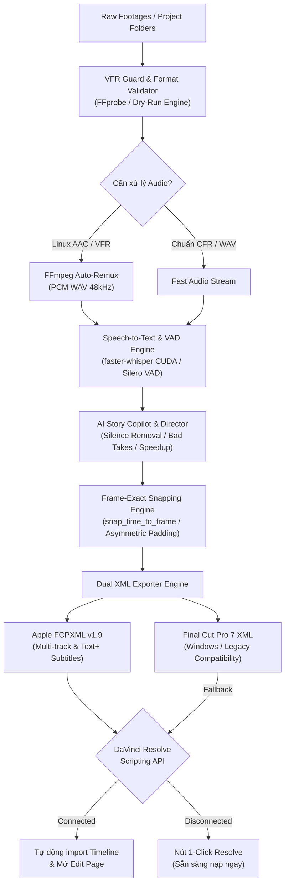

# ResolveFlow-Assistant (ChunDVC) — AI-Powered Rough Cut & Asset Studio for DaVinci Resolve

<div align="center">

[](https://github.com/NguyenVanTruong06/ChunDVC/releases)
[](https://www.python.org/)
[-FCC624.svg?style=for-the-badge&logo=linux&logoColor=black)](https://github.com/NguyenVanTruong06/ChunDVC)
[-41CD52.svg?style=for-the-badge&logo=qt&logoColor=white)](https://wiki.qt.io/Qt_for_Python)
[-76B900.svg?style=for-the-badge&logo=nvidia&logoColor=white)](https://github.com/SYSTRAN/faster-whisper)
[-brightgreen.svg?style=for-the-badge&logo=pytest&logoColor=white)](tests/)
[](LICENSE)

**Bộ công cụ trợ lý AI dựng thô (Rough-Cut) và quản lý đạo cụ thông minh (Asset Studio) 100% On-Premise cho DaVinci Resolve Studio & Free.**

[Tính Năng Nổi Bật](#-điểm-khác-biệt-cốt-lõi-key-highlights) •
[Kiến Trúc Hệ Thống](#-sơ-đồ-kiến-trúc-hệ-thống-system-architecture) •
[Cài Đặt & Khởi Chạy](#-hướng-dẫn-cài-đặt--khởi-chạy) •
[Đóng Gói Phân Phối](#-đóng-gói-độc-lập-standalone-build) •
[Kiểm Thử](#-chạy-kiểm-thử-pytest)

</div>

---

## 🌟 Tổng Quan (Overview)

**ResolveFlow-Assistant (ChunDVC)** giải quyết bài toán tốn thời gian nhất của Editor và Creator: **Lọc khoảng lặng, cắt bỏ câu nói lỗi/vấp, biên soạn phụ đề động Text+, canh nhịp nhạc (Beat Drops), và kéo thả hiệu ứng âm thanh/LUTs**. 

Thay vì phải render video trung gian tốn dung lượng và làm giảm chất lượng hình ảnh, ResolveFlow-Assistant tính toán toàn bộ logic dựng bằng thuật toán xử lý phân số thời gian thực và đẩy thẳng **Timeline dựng sẵn sang DaVinci Resolve qua Native Scripting API hoặc FCPXML 1.9 / FCP7 XML**.

---

## ⚡ Điểm Khác Biệt Cốt Lõi (Key Highlights)

### 1. 🚀 Quy trình "True 1-Click" Mở Thẳng DaVinci Resolve
- **Tự động kết nối IPC:** Kết nối trực tiếp vào phiên làm việc của DaVinci Resolve (cả bản Free lẫn Studio).
- **Tự khởi tạo Project dự phòng:** Nếu người dùng đang ở cửa sổ Project Manager hoặc chưa mở project, hệ thống tự động tạo project `ResolveFlow_AutoProject` để nạp timeline.
- **Tự động Fallback:** Nếu DaVinci Resolve từ chối chuẩn FCPXML 1.9, hệ thống lập tức fallback nạp file FCP7 XML (`.xml`) thay thế trong chớp mắt.
- **Tự chuyển Edit Page:** Sau khi import timeline thành công, DaVinci Resolve tự động mở tab **Edit Page**, sẵn sàng cho editor tinh chỉnh.
- **Nút 1-Click tức thì:** Nếu DaVinci Resolve chưa bật khi AI phân tích xong, giao diện hiển thị nút nổi bật `🚀 Đẩy ngay vào DaVinci Resolve (1-Click)` để người dùng bật Resolve lên và đẩy vào ngay mà không cần chạy lại pipeline từ đầu.

### 2. ⏱️ Frame-Exact Timebase & Audio Padding Chống Chớp Đen
- **Triệt tiêu lỗi 1-Frame Black Gap:** Thuật toán `snap_time_to_frame` tính toán thời gian cắt theo số nguyên khung hình (`int_frames * frame_duration`) cho mọi tốc độ chuẩn (23.976, 24, 25, 29.97, 30, 59.94, 60 fps), loại bỏ triệt để hiện tượng lệch tích lũy âm thanh/hình ảnh trên timeline dài 30-60 phút.
- **Bảo toàn âm đuôi tiếng Việt (Asymmetric Padding):**
  - **Pre-roll buffer (50ms):** Giữ lại nhịp lấy hơi tự nhiên trước khi mở lời.
  - **Post-roll buffer (80ms):** Giữ trọn các phụ âm cuối và âm gió đặc trưng của tiếng Việt (`-t`, `-c`, `-p`, `-ch`, `-nh`).
  - **Auto-merge (<0.15s):** Tự động gộp hai phân đoạn thoại quá gần nhau để loại bỏ các vết cắt giật cục (jump-cuts).

### 3. 🛡️ VFR Guard & Linux AAC Auto-Remux
- **VFR Detection:** Kiểm tra footage quay từ smartphone (iPhone/Android) hoặc OBS bằng cách so sánh `r_frame_rate` và `avg_frame_rate` qua FFprobe. Nếu độ lệch vượt quá `0.5 fps` (dấu hiệu Variable Frame Rate), cảnh báo lập tức hiển thị trên AI Console để cảnh báo trôi tiếng.
- **Linux Audio Transcode:** DaVinci Resolve trên Linux không hỗ trợ giải mã trực tiếp codec âm thanh AAC trong container MP4; ResolveFlow-Assistant tích hợp pipeline tự động remux âm thanh sang PCM WAV 48kHz 24-bit, triệt tiêu lỗi mất tiếng hoặc timeline câm trên Linux.

### 4. 🎨 Modern Pro-Creator UI (Auto Mode & Studio Mode)
- **Dark Theme Zinc-900:** Phong cách giao diện hiện đại, tinh giản theo chuẩn Pro-App.
- **Interactive Mini Timeline (`QPainter`):** Hiển thị trực quan toàn bộ phân đoạn thoại, khoảng lặng bị cắt, tua nhanh (speed-ramp), và playhead tương tác hỗ trợ scrubbing mượt mà.
- **Floating Bubble Widget:** Quả cầu nổi thông minh thu nhỏ xuống góc màn hình, hiển thị tiến độ % và trạng thái kết nối DaVinci Resolve thời gian thực.
- **Asset Studio Drag-and-Drop:** Thư viện SFX, BGM, Meme, LUTs (`.cube`) và Text+ Presets (`.setting`) hỗ trợ kéo thả trực tiếp vào DaVinci Resolve với hiệu ứng xem trước bán trong suốt (**Ghost Pixmap Preview**).

---

## 🏗️ Sơ Đồ Kiến Trúc Hệ Thống (System Architecture)



---

## 💻 Hướng Dẫn Cài Đặt & Khởi Chạy

### 1. Yêu cầu hệ thống (System Requirements)
- **Hệ điều hành:**
  - Windows 11 / Windows 10 (64-bit)
  - Linux: Ubuntu 22.04+, Debian 12+, Arch Linux, Fedora 39+
- **Phần mềm dựng:** DaVinci Resolve Studio hoặc DaVinci Resolve Free (v18.6, v19, v20+).
- **Phần cứng:**
  - GPU: NVIDIA GTX 1060 trở lên (khuyên dùng để tăng tốc Whisper AI qua CUDA).
  - RAM: Tối thiểu 8 GB (khuyên dùng 16 GB+).
- **Công cụ bắt buộc:** `ffmpeg` và `ffprobe` trong PATH hệ thống.

---

### 2. Cài đặt trên Linux (Ubuntu / Debian / Arch / Fedora)

#### Bước 1: Cài đặt thư viện hệ thống
```bash
# Ubuntu / Debian
sudo apt update
sudo apt install -y python3 python3-venv python3-pip ffmpeg libxcb-cursor0 libxcb-xinerama0

# Arch Linux / Manjaro
sudo pacman -S python python-pip ffmpeg libxcb xcb-util-cursor

# Fedora
sudo dnf install -y python3 python3-pip ffmpeg xcb-util-cursor
```

#### Bước 2: Cấp quyền thư mục LUTs DaVinci Resolve (để áp dụng màu tự động)
```bash
sudo mkdir -p "/var/BlackmagicDesign/DaVinci Resolve/Support/LUT"
sudo chmod -R 777 "/var/BlackmagicDesign/DaVinci Resolve/Support/LUT"
```

#### Bước 3: Tạo môi trường ảo và cài đặt dependencies
```bash
git clone https://github.com/NguyenVanTruong06/ChunDVC.git ResolveFlow-Assistant
cd ResolveFlow-Assistant

python3 -m venv .venv
source .venv/bin/activate
pip install --upgrade pip
pip install -r requirements.txt
```

#### Bước 4: Khởi chạy ứng dụng
```bash
chmod +x run_resolveflow.sh
./run_resolveflow.sh
```

---

### 3. Cài đặt trên Windows 11

#### Bước 1: Chuẩn bị môi trường
- Cài đặt **Python 3.11** hoặc **3.12** từ [python.org](https://www.python.org/) (nhớ tick chọn *"Add Python to PATH"*).
- Tải [FFmpeg](https://www.gyan.dev/ffmpeg/builds/) và thêm thư mục `bin` vào biến môi trường hệ thống `PATH`.

#### Bước 2: Clone repository và cài đặt
Mở PowerShell hoặc Windows Terminal trong thư mục bạn muốn cài:
```powershell
git clone https://github.com/NguyenVanTruong06/ChunDVC.git ResolveFlow-Assistant
cd ResolveFlow-Assistant

python -m venv .venv
.\.venv\Scripts\Activate.ps1
pip install --upgrade pip
pip install -r requirements.txt
```

#### Bước 3: Khởi chạy ứng dụng
Nhấp đúp chuột vào file **`Run_ResolveFlow.bat`** hoặc chạy từ terminal:
```cmd
Run_ResolveFlow.bat
```

---

## 📦 Tải Bản Cài Đặt Sẵn (.exe & .deb) Hoặc Tự Đóng Gói

### 1. Tải trực tiếp từ GitHub Releases (Dành cho Editor / Không cần cài Python)
Truy cập trang **[GitHub Releases](https://github.com/NguyenVanTruong06/ResolveFlow-Assistant/releases)** để tải bản phát hành đóng gói sẵn:

- **Windows 11 / 10:** Tải tệp **`ResolveFlow-Assistant-v1.0.0-windows-x64.zip`**
  - Giải nén tệp `.zip` vào ổ đĩa bất kỳ (ví dụ `D:\ResolveFlow-Assistant\`).
  - Nhấp đúp chuột vào file **`ResolveFlow-Assistant.exe`** hoặc **`Launch_ResolveFlow.bat`** để mở ứng dụng ngay!
- **Linux (Ubuntu / Debian / Linux Mint):** Tải tệp **`resolveflow-assistant_1.0.0_amd64.deb`**
  - Cài đặt nhanh bằng lệnh terminal:
    ```bash
    sudo dpkg -i resolveflow-assistant_1.0.0_amd64.deb
    sudo apt-get install -f   # Tự động bù dependencies nếu thiếu
    ```
  - Sau khi cài xong, bạn có thể mở ứng dụng trực tiếp từ Application Menu của hệ điều hành hoặc gõ lệnh `resolveflow-assistant`.
- **Linux (Arch / Fedora / Generic):** Tải tệp **`ResolveFlow-Assistant-v1.0.0-linux-x64.tar.gz`**
  - Giải nén: `tar -xzf ResolveFlow-Assistant-v1.0.0-linux-x64.tar.gz`
  - Chạy: `./ResolveFlow-Assistant/launch_resolveflow.sh`

---

### 2. Tự đóng gói Standalone trên máy cục bộ

```bash
# 1. Kiểm tra cấu hình và xác nhận các đường dẫn tài nguyên (Dry-run mode):
python3 build_standalone.py --dry-run

# 2. Thực hiện đóng gói onedir qua PyInstaller:
python3 build_standalone.py

# 3. (Tùy chọn trên Ubuntu/Debian) Tạo gói cài đặt .deb:
./package_deb.sh 1.0.0
```

Sau khi đóng gói hoàn tất:
- **Trên Linux:** Bản phân phối nằm tại `dist/ResolveFlow-Assistant/` và gói `.deb` nằm tại thư mục gốc dự án.
- **Trên Windows:** Bản phân phối nằm tại `dist\ResolveFlow-Assistant\` (chứa sẵn `ResolveFlow-Assistant.exe`).

---

## 📂 Cấu Trúc Thư Mục Dự Án (Project Structure)

```text
ResolveFlow-Assistant/
├── build_standalone.py            # Script đóng gói standalone đa nền tảng
├── resolveflow.spec               # Cấu hình PyInstaller spec chuẩn hóa
├── run_resolveflow.sh             # Script khởi chạy Linux Pro Edition
├── Run_ResolveFlow.bat            # Script khởi chạy Windows 11 Edition
├── requirements.txt               # Danh sách thư viện Python phụ thuộc
├── presets/                       # Mẫu hiệu ứng Text+ / Fusion Text (.setting)
├── recipes/                       # Cấu hình workflow mẫu theo từng phong cách dựng
├── assets/                        # Thư mục tài nguyên (SFX, BGM, LUTs, Memes)
├── src/
│   ├── main.py                    # Điểm khởi chạy ứng dụng (Auto & Studio Mode)
│   ├── core/                      # Trọng tâm xử lý logic & Video Pipeline
│   │   ├── autocut.py             # Cắt lọc khoảng lặng, audio padding, frame snap
│   │   ├── fcpxml_generator.py    # Bộ xuất Apple FCPXML 1.9 & FCP7 XML
│   │   ├── resolve_api.py         # True 1-Click DaVinci Resolve import & API
│   │   ├── resolve_bridge.py      # Bộ nạp fusionscript đa nền tảng
│   │   ├── ffmpeg_utils.py        # VFR detection, fractional rate, subprocess
│   │   ├── validator.py           # Dry-run validation, 10-bit codec, path integrity
│   │   ├── story_copilot.py       # AI phân tích kịch bản theo ý đồ marketing
│   │   ├── audio_processor.py     # Chuẩn hóa âm thanh 2-Pass Loudnorm EBU R128
│   │   ├── audio_beat.py          # Bắt nhịp nhạc nền BGM (Beat Drops)
│   │   └── connection/            # Bộ chuyển đổi kết nối (Direct / Bridge / Manual)
│   ├── ui/                        # Giao diện PySide6 (Qt6) Pro-Creator
│   │   ├── auto/auto_window.py    # Cửa sổ dựng phim tự động AI Auto-Cut
│   │   ├── studio/studio_window.py# Cửa sổ Asset Studio & quản lý đạo cụ
│   │   ├── bubble/floating_bubble.py # Quả cầu nổi điều khiển thông minh
│   │   ├── components/            # MiniTimelineWidget, Track visualizer
│   │   └── theme.py               # Dark Theme Zinc-900 Palette
│   └── utils/
│       └── path_utils.py          # Xử lý đường dẫn chéo nền tảng (POSIX / Win32)
└── tests/                         # Bộ 389 bài kiểm thử đơn vị tự động (pytest)
```

---

## 🧪 Chạy Kiểm Thử (Pytest)

Dự án áp dụng phương pháp **Test-Driven Development (TDD)** với độ bao phủ kiểm thử toàn diện trên tất cả các module xử lý lõi:

```bash
# Kích hoạt môi trường ảo
source .venv/bin/activate   # Linux
# .\.venv\Scripts\Activate.ps1  # Windows

# Chạy toàn bộ 389 bài unit tests (chế độ không hiển thị GUI trên Linux)
QT_QPA_PLATFORM=offscreen python3 -m pytest tests/ -v

# Chạy kiểm tra riêng các module cốt lõi:
python3 -m pytest tests/test_autocut.py -v
python3 -m pytest tests/test_fcpxml_generator.py -v
python3 -m pytest tests/test_validator.py -v
python3 -m pytest tests/test_resolve_api.py -v
```

Kết quả kiểm thử bảo chứng đạt **100% PASS (389 passed, 0 failures)** trên mọi nền tảng.

---

## 🤝 Đóng Góp & Phát Triển (Contributing)

Mọi đóng góp, báo cáo lỗi (Bug Report) và yêu cầu tính năng mới (Feature Request) đều được hoan nghênh:
1. Fork repository trên GitHub.
2. Tạo nhánh tính năng (`git checkout -b feat/tinh-nang-moi`).
3. Cam kết các thay đổi kèm test case tương ứng (`git commit -m "feat: mo ta tinh nang"`).
4. Đẩy lên nhánh của bạn (`git push origin feat/tinh-nang-moi`).
5. Tạo Pull Request để được review và merge.

---

## 📄 Giấy Phép (License)

Dự án được phân phối dưới giấy phép **MIT License**. Chi tiết xem tại [LICENSE](LICENSE).

---

<div align="center">
Tạo ra với ❤️ dành cho cộng đồng Video Editor & Content Creator Việt Nam và Quốc Tế.
</div>