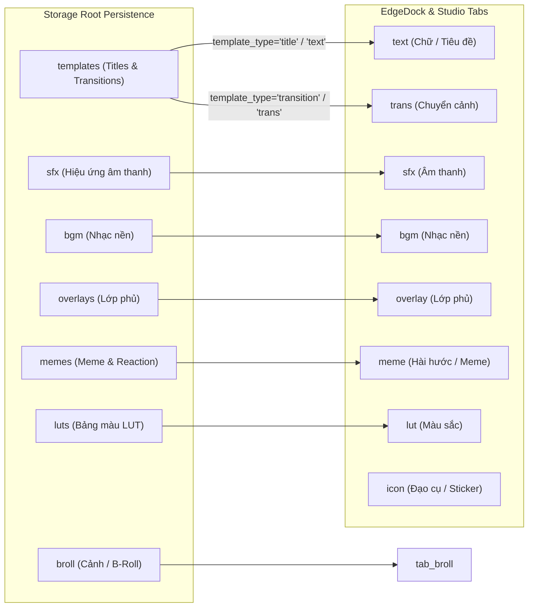

# HỢP ĐỒNG DỮ LIỆU CHUNDVC (01-DATA-CONTRACTS)

- **Mã thiết kế:** `G01-D-R1`
- **Phiên bản:** `1.1.0-draft`
- **Tác giả:** Antigravity (Worker) · **Review:** Codex (Tech Lead)
- **Trạng thái:** `DESIGN_READY`
- **Phân loại bằng chứng:** `CODE_VERIFIED` trên mã nguồn hiện tại của ResolveFlow-Assistant; phân định rõ `[CURRENT]`, `[PROPOSED]`, và `[APPROVED_BY_CODEX]`.

---

## 1. ASSET IDENTITY VÀ BIỂU DIỄN RUNTIME / PERSISTENCE

### 1.1. Bảng đối chiếu các biểu diễn Asset hiện có trong hệ thống [CURRENT]

| Tầng / Thành phần | Kiểu đối tượng | Nguồn tạo / Vị trí code | ID format | Trường danh mục | Lưu trữ (Persistence) |
| :--- | :--- | :--- | :--- | :--- | :--- |
| **Storage Registry** | `dict` (JSON) | `PackIngestService.commit` (`src/core/pack_ingest.py:270`) | `uuid5(NAMESPACE_URL, pack_id + ":" + rel)` | `category`, `subcategory`, `template_type` | `meta/registry.json` (`packs`, `assets`) |
| **Storage Assets** | `dict` | `StorageManager.assets` (`src/core/storage_manager.py:55`) | Kế thừa từ Registry | Kế thừa từ Registry, bổ sung `file_path`, `availability` | Runtime wrapper nạp từ snapshot/registry |
| **Storage UI Adapter** | `dict` | `StorageManager.ui_assets` (`src/core/storage_manager.py:75`) | Kế thừa từ Registry | Chuẩn hóa `tab`, `category`, `sub`, cờ `storage_managed=True` | Runtime mapping cho UI consumers |
| **Studio Kho Đạo Cụ** | `StudioAsset` (class thường) | `TabAssets._rescan_assets` (`src/ui/tabs/tab_assets.py:113`) | Chuỗi ID hoặc hash file | `tab`, `category`, `sub` | In-memory list `all_assets` trong TabAssets |
| **EdgeDock Model** | `dict` (Unified dict) | `extract_asset_info` (`src/ui/lux/library/asset_model.py:45`) | `item["id"]` hoặc `item.id` | `category`, `sub`, `kind`, `pack_name` | Virtualized trong `AssetListModel._assets` |
| **Palette / Search** | `dict` | `SearchIndex.set_assets` (`src/services/search_index.py:172`) | `item["id"]` | Token hóa `clean_name`, `clean_tags`, `motion` | In-memory Inverted Index |
| **Insert Bridge** | `dict` | `to_asset_dict` (`src/services/insert_service.py:15`) | `item["id"]` | Chuẩn hóa `tab`, `category`, `sub`, giữ `_raw_obj` | Chuyển đổi trung gian sang DaVinci Resolve |

---

### 1.2. Phân định Danh tính Asset theo Nguồn (Source Kinds) [PROPOSED]

Hệ thống phân biệt rõ 4 nguồn gốc tài nguyên (`source_kind`). Không ép buộc mọi ID phải là chuỗi hex 32 ký tự / UUID:

1. **Asset ID là một chuỗi không rỗng (`str`)**:
   - Đối với **Built-in Assets** (ví dụ: mẫu chữ động, chuyển cảnh mặc định): Giữ nguyên các định danh tĩnh quen thuộc như `"kinetic_hormozi"`, `"default_zoom"`, `"skin_retouch"`. Tuyệt đối không ép sang hex32/UUID để tránh làm gãy các template / preset đang dùng.
   - Đối với **Managed Assets** (tài nguyên nhập qua Pack): ID sinh tự động qua `uuid.uuid5(uuid.NAMESPACE_URL, f"{pack_id}:{relative_path}")`. Yêu cầu bắt buộc phải có `pack_id`, `relative_path`, và `library_path`.
   - Đối với **Linked Assets** (thư mục ngoài liên kết không sao chép): ID sinh từ `uuid.uuid5(uuid.NAMESPACE_URL, f"linked:{source_id}:{external_path}")`. Bắt buộc có `source_id` và `external_path`, **không bắt buộc có `pack_id`**.
   - Đối với **Generated Assets** (tài nguyên sinh tự động trong phiên dựng): ID sinh động, **không bắt buộc có file vật lý hay pack**.

2. **Quy tắc cốt lõi: TUYỆT ĐỐI KHÔNG DÙNG BASENAME LÀM IDENTITY:**
   - Basename (`impact.wav`, `intro.mp4`) rất dễ trùng lặp giữa các thư mục khác nhau. Basename chỉ dùng làm nhãn hiển thị mặc định (`name`), không làm khóa định danh dữ liệu.

3. **Phân biệt Source Footage (AI Director) với Library Asset (Kho Đạo Cụ):**
   - **Hiện tại [CURRENT]:** `ClipManifest` (`src/core/clip_manifest.py:61`) đang sử dụng `clip_id: str` dạng `"C01"`, `"C02"`... và `content_hash: str` (`sha256` của `size + 1MB đầu + 1MB cuối`).
   - **Đề xuất tương lai [PROPOSED]:** Bổ sung `source_uuid = uuid.uuid5(uuid.NAMESPACE_URL, f"footage:{content_hash}")`. Việc đổi sang UUID chỉ là đề xuất tương lai, cần phiên bản schema migration rõ ràng, không được coi là hiện trạng.
   - **Phân biệt Identity vs Revision/Cache Invalidation:**
     - `clip_id` và `content_hash` đại diện cho căn cước nội dung.
     - `file_path`, `file_size`, `mtime` là thông tin revision dùng để vô hiệu hóa cache (cache invalidation). Khi người dùng di chuyển tệp nhưng nội dung không đổi (`content_hash` khớp), định danh source trong kịch bản và prompt của Story Copilot phải được bảo toàn, không bị đổi ngẫu nhiên.

---

### 1.3. Bảng đặc tả trường của Hợp đồng Asset (Field Specification Table)

| Tên trường | Kiểu dữ liệu | Bắt buộc | Nguồn gốc / Writer | Reader chính | Giá trị mặc định / Unknown | Serialize ra đĩa? |
| :--- | :--- | :--- | :--- | :--- | :--- | :--- |
| `id` | `str` (chuỗi không rỗng) | Bắt buộc | `PackIngestService` / Builtins | Toàn hệ thống | Không được để trống | Có (`registry.json`) |
| `name` | `str` | Bắt buộc | File stem / manifest | UI headers, Search | Tên file không đuôi | Có (`registry.json`) |
| `source_kind` | `Literal["managed", "linked", "builtin", "generated"]` | Bắt buộc | Ingest / Loader | Storage, Resolver | `"managed"` | Có (`registry.json`) |
| `category` | `str` (canonical) | Bắt buộc | Storage taxonomy | Filter, Router | `"broll"` | Có (`registry.json`) |
| `subcategory` | `str` | Tùy chọn | Manifest / Thư mục cha | Category Nav | `""` | Có (`registry.json`) |
| `tags` | `List[str]` | Tùy chọn | Manifest / User edit | Search Index | `[]` | Có (`registry.json`) |
| `template_type` | `Optional[Literal["title", "transition"]]` | Tùy chọn | Ingest classifier | Timeline Mapper | `None` | Có (`registry.json`) |
| `size_bytes` | `int` | Bắt buộc cho file | `os.stat().st_size` | Quota Manager | `0` | Có (`registry.json`) |
| `pack_id` | `Optional[str]` | Bắt buộc nếu `managed` | `PackIngestService` | Registry pack list | `None` | Có (`registry.json`) |
| `pack_name` | `str` | Tùy chọn | User / Folder name | UI Subtitle | `""` | Có (`registry.json`) |
| `relative_path` | `str` (POSIX) | Bắt buộc nếu `managed` | `inspect_tree` | Pack loader | `""` | Có (`registry.json`) |
| `library_path` | `str` (POSIX) | Bắt buộc nếu `managed` | Storage root rel | File resolver | `""` | Có (`registry.json`) |
| `external_path` | `str` (absolute) | Bắt buộc nếu `linked` | User link | File resolver | `""` | Có (`registry.json`) |
| `file_path` | `Optional[str]` | Runtime only | `StorageManager.assets` | Player, Thumbnailer | `None` | **KHÔNG** (Path động) |
| `availability` | `Literal["online", "offline", "missing", "staging"]` | Runtime only | `StorageManager.assets` | UI Badges, Actions | `"offline"` | **KHÔNG** (Tính toán runtime) |
| `thumbnail_path` | `Optional[str]` | Runtime only | `AssetCache` | Grid, Card, Rail | `None` | **KHÔNG** (Cache riêng) |
| `preview_path` | `Optional[str]` | Runtime only | Hover Preview | Audio / Video HUD | `None` | **KHÔNG** |
| `duration_sec` | `Optional[float]` | Tùy chọn | FFprobe / Header | Timeline Mapper | `None` (Unknown: `None`) | Có nếu là audio/video |
| `storage_managed` | `bool` | Runtime only | `StorageManager.ui_assets` | TabAssets, Dock | `False` | **KHÔNG** |
| `_raw_obj` | `Any` | Runtime only | Adapters | InsertService | `None` | **TUYỆT ĐỐI KHÔNG** |

> [!IMPORTANT]
> **Quy ước thống nhất về thời lượng không xác định (`duration_sec`):**
> - Giá trị không xác định **bắt buộc là `None`**.
> - Không dùng `0.0`, `0`, hay `-1` trong schema mới để biểu thị thời lượng chưa biết.
> - Các adapter đọc (read adapters) khi gặp `0` hoặc `-1` từ dữ liệu cũ sẽ chuẩn hóa thành `None`.
> - Tuyệt đối không tự động gán `duration_sec = 3.0` hay `60.0` vào bản nháp timeline rough-cut như thể đã biết trước thời lượng thực tế của clip.

---

### 1.4. Đánh giá kiến trúc DTO: TypedDict + Functional Adapters [PROPOSED]

- **Vị trí định nghĩa đề xuất:** Tạo module thuần Python, **không phụ thuộc Qt** tại `src/core/contracts/asset_dto.py`.
- **Cơ chế kiểu tĩnh:** Sử dụng `typing.TypedDict` kết hợp `Required` và `NotRequired` (tương thích Python 3.11+ / `typing_extensions`) để định nghĩa rõ trường bắt buộc:

```python
# THIẾT KẾ ĐỀ XUẤT: src/core/contracts/asset_dto.py
from typing import TypedDict, List, Optional, Literal
from typing_extensions import Required, NotRequired

class PersistedAssetRecord(TypedDict):
    schema_version: Required[int]
    id: Required[str]
    name: Required[str]
    source_kind: Required[Literal["managed", "linked", "builtin", "generated"]]
    category: Required[str]
    subcategory: NotRequired[str]
    tags: NotRequired[List[str]]
    template_type: NotRequired[Optional[Literal["title", "transition"]]]
    size_bytes: Required[int]
    pack_id: NotRequired[Optional[str]]
    pack_name: NotRequired[str]
    relative_path: NotRequired[str]
    library_path: NotRequired[str]
    external_path: NotRequired[str]
    duration_sec: NotRequired[Optional[float]]

class UnifiedAssetDTO(PersistedAssetRecord, total=False):
    file_path: Optional[str]
    availability: Literal["online", "offline", "missing", "staging"]
    thumbnail_path: Optional[str]
    preview_path: Optional[str]
    storage_managed: bool
    _raw_obj: Optional[object]
```

- **Quy tắc Tuần tự hóa JSON (Serialization Policy):**
  - **CẢNH BÁO QUAN TRỌNG:** `json.dumps(dict)` **KHÔNG TỰ ĐỘNG BỎ** `_raw_obj` hay các tham chiếu Qt (`QPixmap`, `QWidget`) hoặc native Resolve handles. Nếu truyền trực tiếp dict chứa `_raw_obj` vào `json.dumps()`, Python sẽ lập tức báo lỗi `TypeError: Object of type ... is not JSON serializable`.
  - Do đó, việc lưu trữ vào file JSON **BẮT BUỘC** phải đi qua adapter thuần chức năng `to_persisted_record(asset: dict) -> dict` sử dụng danh sách trắng (allowlist) các khóa được phép lưu:

```python
PERSISTED_ALLOWLIST = {
    "schema_version", "id", "name", "source_kind", "category",
    "subcategory", "tags", "template_type", "size_bytes", "pack_id",
    "pack_name", "relative_path", "library_path", "external_path", "duration_sec"
}

def to_persisted_record(asset: dict) -> dict:
    """Tách lọc và trả về bản ghi JSON an toàn, loại bỏ triệt để mọi runtime ref."""
    record = {k: v for k, v in asset.items() if k in PERSISTED_ALLOWLIST}
    record.setdefault("schema_version", 1)
    if "duration_sec" in record and record["duration_sec"] is not None:
        try:
            val = float(record["duration_sec"])
            record["duration_sec"] = val if val > 0 else None
        except (ValueError, TypeError):
            record["duration_sec"] = None
    return record
```

---

## 2. TAXONOMY VÀ ADAPTERS

### 2.1. Phân định Danh mục Kho Chuẩn và Danh mục Hiển thị

Hệ thống duy trì ánh xạ hai chiều giữa tầng Lưu trữ bền vững (`StorageRoot`) và tầng Trình bày UI (`TabAssets`, `EdgeDock`):



> [!NOTE]
> - `templates` trong kho được phân tách thành 2 tab UI riêng biệt dựa trên `template_type`: `"title"` tương ứng với tab `text`, `"transition"` tương ứng với tab `trans`.
> - Video xem trước của template (`preview.mp4`) là tài nguyên minh họa hiển thị, **tuyệt đối không được coi là footage video**.
> - `icon` / `sticker` được xếp vào nhóm biểu tượng riêng (`tab_icon`), không được gộp lẫn vào `meme` vì logic vẽ delegate và chèn timeline khác nhau.

---

### 2.2. Phân biệt Chuẩn hóa Taxonomy với Tìm kiếm (Taxonomy Normalization vs Search Folding)

1. **Chuẩn hóa Danh mục / Nhãn (`normalize_taxonomy`) [CURRENT]:**
   - Vị trí mã nguồn: `src/ui/lux/library/asset_filter.py:23`.
   - Thuật toán: `unicodedata.normalize("NFC", str(text)).strip().lower()`.
   - **Đặc điểm:** Giữ nguyên các ký tự có dấu tiếng Việt (ví dụ: `"chuyển cảnh"`, `"âm thanh"`). Bảo toàn độ chính xác ngữ nghĩa và danh tính (identity) của category.
2. **Loại bỏ dấu phục vụ tìm kiếm mờ (`strip_accents`) [CURRENT]:**
   - Vị trí mã nguồn: `src/services/search_index.py:99`.
   - Thuật toán: Chuẩn hóa `NFKD`, bóc tách các ký tự combining và chuyển `"đ"` $\to$ `"d"`.
   - **Đặc điểm:** Dùng riêng cho việc đối sánh từ khóa tìm kiếm (người dùng gõ tiếng Việt không dấu vẫn tìm được tài nguyên có dấu).
3. **Nguyên tắc kỹ thuật bất biến:**
   - **KHÔNG ĐƯỢC VIẾT NGƯỢC search key (không dấu) THÀNH ID DANH MỤC.**
   - Nhãn danh mục tiếng Việt có dấu (`"hiệu ứng"`) và không dấu (`"hieu ung"`) phải được ánh xạ qua bảng alias tập trung (`CANONICAL_CATEGORIES`) để trỏ về cùng một danh mục gốc, tránh tạo ra 2 custom category trùng lặp.

---

## 3. STATUS, ERROR, TIME VÀ SCHEMA VERSION

### 3.1. Phân định rõ 4 Trục Trạng thái Độc lập (The 4 Status Axes) [PROPOSED]

Hệ thống tách biệt hoàn toàn 4 trục trạng thái, không gộp lẫn:

1. **Trục Tiến trình Tác vụ (Job Lifecycle):**
   - Giá trị: `queued` $\to$ `running` $\to$ (`completed` \| `cancelled` \| `failed`).
   - Phạm vi: Đo lường tiến độ của worker nền (`LibraryJob`, downloader).
2. **Trục Chất lượng & Độ bao phủ Phân tích (Analysis & Quality Status):**
   - Giá trị: `unknown`, `complete`, `partial`, `needs_review`, `cancelled`, `error`.
   - **Bảo toàn thông tin:** Tuyệt đối không rút gọn về `completed`/`failed`. Trạng thái `partial` (ví dụ: bóc băng Whisper xong 5/10 clips) hoặc `needs_review` (phát hiện khuôn mặt nhưng độ tin cậy thấp) bắt buộc phải được giữ nguyên để biên tập viên kiểm tra lại.
3. **Trục Kết quả Tác động Timeline (Mutation Result):**
   - Giá trị: `applied`, `skipped`, `failed`.
   - **Nguyên tắc:** Một tác vụ chèn tài nguyên không được tính là thành công nếu `skipped > 0` mà không có lý do hợp lệ.
4. **Trục Khả dụng Tài nguyên (Media Availability):**
   - Giá trị: `online`, `offline`, `missing`, `staging`.
   - **Phân biệt:** Một tệp media vừa tải về nhưng chưa publish vào registry chỉ ở trạng thái `staging`, không được hiển thị như một asset `online` cho đến khi commit hoàn tất.

---

### 3.2. Không gian Thời gian và Quy đổi Đơn vị (Time Coordinates Specification)

1. **Không gian Timeline (Timeline Space):**
   - Đơn vị: Số nguyên khung hình (`record_frame: int`), xuất phát từ `start_frame` của project timeline (ví dụ: `86400` cho timeline bắt đầu tại `01:00:00:00`, hoặc `0`).
   - FPS dự án biểu diễn dưới dạng phân số chuẩn (rational): ví dụ $24000/1001$ ($\approx 23.976$), $30000/1001$ ($\approx 29.97$), $25/1$, $30/1$.
2. **Không gian Nguồn (Source PTS Space):**
   - Đơn vị: Giây thực (`float`) hoặc phân số PTS timebase (`pts_num / pts_den`).
   - Dải thời gian là khoảng nửa mở (half-open range): `[start_time, end_time)`.
3. **Nguyên tắc làm tròn (Rounding Boundaries):**
   - Tuyệt đối không ép toàn bộ PTS nguồn thành số nguyên khung hình khi lưu trữ metadata.
   - Việc quy đổi từ giây nguồn sang khung hình timeline chỉ được thực hiện tại ranh giới chèn (`InsertService` / `TimelineMapper`) bằng công thức làm tròn rõ ràng:
     $$\text{frame} = \text{round}(\text{pts\_sec} \times \text{fps\_num} / \text{fps\_den})$$

---

### 3.3. Chính sách Tương thích Phiên bản Schema (Schema Versioning & Compatibility Policy)

- **Phiên bản hiện tại:** `schema_version = 1`.
- **Chính sách khi gặp phiên bản không xác định hoặc mới hơn (`schema_version > CURRENT`):**
  - **Quarantine / Read-Only Mode:** Đọc bản ghi ở chế độ chỉ đọc để tránh làm gián đoạn hiển thị, nhưng **chặn tuyệt đối việc ghi đè (Overwrite)**.
  - Tuyệt đối không tự động gán giá trị mặc định cho các trường chưa biết rồi ghi ngược lại đĩa, vì điều này sẽ xóa mất dữ liệu của các phiên bản mới hơn.

---

## 4. BỘ FIXTURES JSON CHUẨN ĐỂ KIỂM THỬ (TEST FIXTURES)

### Fixture 1: Managed Video Asset hợp lệ (Valid Managed Video)
```json
{
  "schema_version": 1,
  "id": "a1b2c3d4-e5f6-5a7b-8c9d-0e1f2a3b4c5d",
  "name": "Cinematic Drone Sunset",
  "source_kind": "managed",
  "category": "broll",
  "subcategory": "nature",
  "tags": ["drone", "sunset", "4k"],
  "template_type": null,
  "size_bytes": 104857600,
  "pack_id": "p9876543-210f-4edc-ba98-76543210fedc",
  "pack_name": "Travel Pack Vol 1",
  "relative_path": "broll/nature/drone_sunset.mp4",
  "library_path": "02_cloud_downloads/packs/travel_pack_vol_1/broll/nature/drone_sunset.mp4",
  "duration_sec": 12.5
}
```

### Fixture 2: Linked External Asset hợp lệ - Không có Pack (Valid Linked Asset)
```json
{
  "schema_version": 1,
  "id": "f5e4d3c2-b1a0-4f9e-8d7c-6b5a4f3e2d1c",
  "name": "Studio Interview Cam A",
  "source_kind": "linked",
  "source_id": "link_ext_drive_01",
  "category": "broll",
  "subcategory": "interviews",
  "tags": ["podcast", "interview"],
  "template_type": null,
  "size_bytes": 524288000,
  "external_path": "/media/external_drive/raw_interviews/cam_a.mov",
  "duration_sec": 180.25
}
```

### Fixture 3: Built-in Legacy Asset với ID truyền thống (Valid Builtin Asset)
```json
{
  "schema_version": 1,
  "id": "kinetic_hormozi",
  "name": "Chữ động phong cách Hormozi",
  "source_kind": "builtin",
  "category": "templates",
  "subcategory": "kinetic",
  "tags": ["text", "kinetic", "highlight"],
  "template_type": "text",
  "size_bytes": 0,
  "duration_sec": null
}
```

### Fixture 4: Custom Category chuẩn với nhãn và tag tiếng Việt (Valid Custom Category)
```json
{
  "schema_version": 1,
  "id": "e3d2c1b0-9a8b-7c6d-5e4f-3a2b1c0d9e8f",
  "name": "Đánh Giá Bàn Phím Cơ",
  "source_kind": "managed",
  "category": "product_review",
  "subcategory": "bàn phím",
  "tags": ["review", "bàn phím", "công nghệ"],
  "template_type": null,
  "size_bytes": 20480000,
  "pack_id": "p1122334-4556-6778-899a-aabbccddeeff",
  "pack_name": "Review Công Nghệ",
  "relative_path": "product_review/ban_phim.mp4",
  "library_path": "02_cloud_downloads/packs/review_cong_nghe/product_review/ban_phim.mp4",
  "duration_sec": 45.2
}
```

### Fixture 5: Template chuyển cảnh kèm cờ phân biệt (Valid Transition Template)
```json
{
  "schema_version": 1,
  "id": "c1a2b3d4-4e5f-6a7b-8c9d-112233445566",
  "name": "Seamless Zoom In",
  "source_kind": "managed",
  "category": "templates",
  "subcategory": "zoom",
  "tags": ["seamless", "zoom"],
  "template_type": "trans",
  "size_bytes": 45000,
  "pack_id": "p5566778-8990-1122-3344-556677889900",
  "pack_name": "Pro Transitions",
  "relative_path": "templates/transitions/zoom_in.drfx",
  "library_path": "02_cloud_downloads/packs/pro_transitions/templates/transitions/zoom_in.drfx",
  "duration_sec": 1.0
}
```

### Fixture 6: Bản ghi KHÔNG HỢP LỆ chứa `_raw_obj` (Invalid Runtime Ref)
```json
{
  "schema_version": 1,
  "id": "invalid-asset-01",
  "name": "Invalid Asset with Runtime Object",
  "source_kind": "managed",
  "category": "broll",
  "size_bytes": 1024,
  "_raw_obj": "<PySide6.QtGui.QPixmap object at 0x7f9a12>"
}
```
*Kết quả xử lý dự kiến:* Adapter `validate_asset_dict` trả về `(False, ["Chứa runtime reference không hợp lệ: _raw_obj"])`. Khi chạy `to_persisted_record()`, trường `_raw_obj` bị lược bỏ hoàn toàn trước khi ghi file.

### Fixture 7: Bản ghi KHÔNG HỢP LỆ có `schema_version` mới hơn (Invalid Unknown Version)
```json
{
  "schema_version": 99,
  "id": "future-asset-99",
  "name": "Asset from ResolveFlow 2030",
  "source_kind": "managed",
  "category": "hologram",
  "size_bytes": 2048
}
```
*Kết quả xử lý dự kiến:* Hệ thống từ chối nạp để chỉnh sửa (`quarantine/read-only`), cảnh báo log: `Không hỗ trợ schema version 99 (hiện tại hỗ trợ: 1). Chuyển sang chế độ chỉ đọc.`

### Fixture 8: Bản ghi có thời lượng âm hoặc sai kiểu (Invalid Duration)
```json
{
  "schema_version": 1,
  "id": "bad-duration-asset",
  "name": "Bad Duration Clip",
  "source_kind": "managed",
  "category": "sfx",
  "size_bytes": 4096,
  "duration_sec": -5.0
}
```
*Kết quả xử lý dự kiến:* Adapter đọc tự động chuẩn hóa `duration_sec` thành `None`. Tuyệt đối không lưu giá trị âm vào cache hay truyền vào timeline.

---

## 5. MA TRẬN QUYẾT ĐỊNH KỸ THUẬT

| Mục thiết kế | Trạng thái | Đánh giá & Rủi ro |
| :--- | :--- | :--- |
| DTO dạng TypedDict + Functional Adapters | `[PROPOSED]` | Giữ nguyên dictionary runtime, tránh lỗi hồi quy `AttributeError`. Cần kiểm chứng benchmark khi triển khai. |
| Giữ nguyên ID dạng chuỗi cho builtins (`kinetic_hormozi`) | `[APPROVED_BY_CODEX]` | Đã duyệt. Ngăn ngừa việc làm gãy các preset đang hoạt động. |
| Thống nhất `duration_sec` chưa biết là `None` | `[PROPOSED]` | Ngăn chặn việc tạo nháp timeline với thời lượng giả (3s/60s). |
| Phân biệt `normalize_taxonomy` (NFC) và `strip_accents` (NFKD search) | `[CURRENT]` | Đã đối chiếu mã nguồn thực tế tại `asset_filter.py` và `search_index.py`. |
| 4 trục trạng thái độc lập (`Job`, `Analysis`, `Mutation`, `Availability`) | `[PROPOSED]` | Bảo toàn các trạng thái quan trọng `partial` và `needs_review`. |
| Bộ fixtures kiểm thử JSON hoàn chỉnh | `[PROPOSED]` | Dùng làm dữ liệu đầu vào cho các test case của Slice 01A/01B. |
