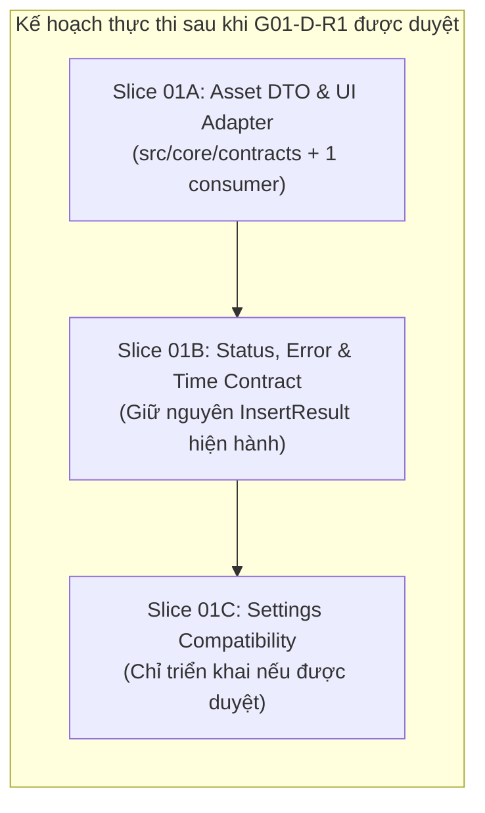

# CÁC LÁT CẮT TRIỂN KHAI NHỎ (01-IMPLEMENTATION-SLICES)

- **Mã thiết kế:** `G01-D-R1`
- **Phiên bản:** `1.1.0-draft`
- **Tác giả:** Antigravity (Worker) · **Review:** Codex (Tech Lead)
- **Trạng thái:** `DESIGN_READY`
- **Nguyên tắc cốt lõi:** Chia nhỏ thành từng lát cắt 1–3 modules độc lập, kiểm chứng qua test trước khi chuyển tiếp. Tuyệt đối không gộp thành "chuẩn hóa toàn bộ codebase". Chỉ dùng các API đã được kiểm chứng bằng mã nguồn thực tế.

---

## 1. TỔNG QUAN CÁC LÁT CẮT (SLICES BREAKDOWN)

---

## 2. CHI TIẾT TỪNG LÁT CẮT TRIỂN KHAI

### Lát cắt 01A — Asset DTO Module & First Consumer [PROPOSED]
* **Mục tiêu:** Tạo module DTO thuần túy không phụ thuộc Qt, tích hợp thử nghiệm vào **duy nhất một consumer đầu tiên** (`StorageManager.ui_assets`), không thay đổi diện rộng toàn bộ ingest/storage/views.
* **Phạm vi trực tiếp (1–2 modules):**
  1. `src/core/contracts/asset_dto.py` *(Mới - Pure Python, NO Qt)*: Chứa định nghĩa `PersistedAssetRecord`, `UnifiedAssetDTO`, `validate_asset_dict()`, và `to_persisted_record()` với allowlist serializable rõ ràng.
  2. `src/core/storage_manager.py` *(Consumer đầu tiên)*: Điều chỉnh phương thức `ui_assets()` để sử dụng adapter chuẩn hóa thay vì ad-hoc mapping.
* **Callers liên quan:**
  - `src/ui/tabs/tab_assets.py` (gọi `StorageManager.ui_assets()`): Tiếp tục nhận dict với các khóa chuẩn `tab`, `category`, `sub`, `storage_managed`.
  - `src/ui/lux/shell/edge_dock.py` (gọi `StorageManager.ui_assets()`): Tiếp tục nhận dict hợp lệ.
* **API giữ nguyên (Preserved APIs):**
  - Giữ nguyên toàn bộ public signature của `StorageManager.assets()`, `StorageManager.ui_assets()`, `PackIngestService.commit()`.
  - Giữ nguyên `dict` interface cho các widget đang sử dụng `item.get(...)` (tránh lỗi `AttributeError`).
* **Fixtures & Kiểm thử hồi quy (Regression Tests):**
  - Tạo `tests/core/contracts/test_asset_dto.py` với 8 fixtures JSON mẫu:
    - Kiểm tra `to_persisted_record()` lược bỏ triệt để `_raw_obj` và các đối tượng không thể serialize.
    - Kiểm tra xử lý `duration_sec`: chuẩn hóa giá trị âm/sai kiểu về `None`.
    - Kiểm tra giữ nguyên ID chuỗi cho builtins (`"kinetic_hormozi"`).
  - Chạy kiểm thử mục tiêu:
    `PYTHONDONTWRITEBYTECODE=1 QT_QPA_PLATFORM=offscreen .venv/bin/pytest tests/test_storage_ingest.py tests/ui/test_pack_ingest_wizard.py`
* **Tiêu chí nghiệm thu (Acceptance Gate):**
  - Tất cả bài test Storage & Ingest hiện tại giữ nguyên trạng thái PASS.
  - Không có sự thay đổi đột ngột nào đối với các consumer khác (`TabAssets`, `EdgeDock`).
* **Rủi ro kỹ thuật & Giảm thiểu:**
  - *Rủi ro:* Ảnh hưởng hiệu năng nạp danh sách lớn.
  - *Giảm thiểu:* Dùng functional adapter và dictionary thuần túy, không tạo thêm class wrapper trung gian. Không đưa ra lời hứa đo lường hiệu năng chưa kiểm chứng.

---

### Lát cắt 01B — Status, Error & Time Contract [PROPOSED]
* **Mục tiêu:** Chuẩn hóa biểu diễn 4 trục trạng thái và thời gian half-open `[start, end)`. Giữ nguyên vẹn hợp đồng `InsertResult` hiện hành để bảo đảm an toàn cho các tác vụ dựng timeline.
* **Phạm vi trực tiếp (1–2 modules):**
  1. `src/core/timeline_mapper.py`: Chuẩn hóa tính toán thời gian timeline (dùng `timeline/speed_mode` và project FPS).
  2. `src/services/insert_service.py`: Chuẩn hóa ghi nhận kết quả chèn.
* **Callers liên quan:**
  - `src/ui/lux/feedback/toast.py` (hiển thị thông báo kết quả)
  - `src/services/autocut_service.py` (chèn clip hàng loạt)
* **API giữ nguyên (Preserved APIs) [BẮT BUỘC]:**
  - **Giữ nguyên 100% thuộc tính của `InsertResult` hiện hành** (`src/services/insert_service.py:87`):
    - `ok: bool`
    - `track: str`
    - `start_tc: str`
    - `start_frame: int`
    - `duration_sec: float`
    - `item_name: str`
    - `item_ref: Any`
    - `error: str`
    - `inserted_at: float`
    - `message: str`
  - Giữ nguyên các phương thức: `InsertService.insert(...)`, `InsertService.insert_async(...)`, `InsertService.undo(result=None)`.
  - Tuyệt đối không đổi tên thành `insert_asset()`, không đổi `ok` thành `success`, không đổi `item_ref` thành `inserted_items`.
* **Trạng thái & Thời gian (Contract Rules):**
  - Trạng thái phân tích giữ đầy đủ: `complete`, `partial`, `needs_review`, `cancelled`, `error`.
  - Không gian thời gian: Timeline dùng integer frame (`record_frame`), nguồn dùng PTS seconds (`float`) với dải nửa mở `[start, end)`.
* **Fixtures & Kiểm thử hồi quy (Regression Tests):**
  - Chạy `tests/services/test_insert_service.py` và `tests/test_instant_autocut_service.py`.
  - Xác nhận thao tác bị skipped không được báo `ok=True`.
* **Tiêu chí nghiệm thu (Acceptance Gate):**
  - Toàn bộ test trong `tests/services/test_insert_service.py` đạt PASS.
  - Không có trường hợp thời lượng chưa biết bị tự động ép thành `3.0s` hay `0.0s`.
* **Rủi ro kỹ thuật & Giảm thiểu:**
  - *Rủi ro:* Lệch frame khi chèn vào DaVinci Resolve.
  - *Giảm thiểu:* Luôn làm tròn số thực tại ranh giới chèn theo project FPS, không đổi đơn vị bên trong metadata nguồn.

---

### Lát cắt 01C — Settings Compatibility Layer (SourcePage Whisper) [IMPLEMENTED]
* **Mục tiêu:** Hợp nhất cấu hình Whisper từ domain cũ `("ResolveFlow", "ResolveFlowAssistant")` sang domain chuẩn `("ChunDVC", "ResolveFlow")` thông qua cơ chế Read-Fallback + Import-Once, độc lập từng key, không đổi cache identity.
* **Điều kiện tiên quyết:** Đã được Tech Lead Codex phê duyệt và giao việc trong `TASK_ID: G01-01C-I`.
* **Phạm vi trực tiếp (1 module):**
  1. `src/ui/director/pages/source_page.py` (`_read_whisper_setting`, `_write_whisper_setting`, `_import_legacy_whisper_setting`, `_is_valid_whisper_setting_value`, `__init__`, `_set_model`, `_set_lang`).
* **Callers liên quan:**
  - `load_from_config` / `save_to_config`: Giữ nguyên ngữ nghĩa, không tự ý persist project override vào QSettings.
* **API giữ nguyên (Preserved APIs):**
  - Giữ nguyên signal: `whisper_changed = Signal(str, str)`.
  - Giữ nguyên phương thức public và UI label / chip: `btn_whisper_chip`.
  - Giữ nguyên tệp cấu hình cũ trên đĩa làm bản sao lưu an toàn (Rollback).
* **Fixtures & Kiểm thử hồi quy (Regression Tests):**
  - Tạo `tests/ui/test_source_settings_compat.py` (16 tests) bao phủ: primary precedence, independent keys, import-once, fallback, invalid types, write safety, config override isolation.
  - Chạy bộ kiểm thử tập trung:
    `QT_QPA_PLATFORM=offscreen .venv/bin/pytest tests/ui/test_source_settings_compat.py tests/ui/test_source_cache_defaults.py tests/ui/test_source_page.py -q` (27 passed in 2.69s, exit 0).
* **Tiêu chí nghiệm thu (Acceptance Gate):**
  - 100% tests tập trung đạt PASS, exit code 0.
  - Cấu hình cũ được bảo lưu trên đĩa, không làm gián đoạn trải nghiệm người dùng cũ.
  - Thiết lập mới được ghi vào Primary domain có kiểm tra `sync()` và `status()`.

---

## 3. MA TRẬN PHÂN LOẠI QUYẾT ĐỊNH

| Quyết định | Trạng thái | Ghi chú |
| :--- | :--- | :--- |
| Không triển khai G01-I cho đến khi G01-D-R1 được duyệt | `[APPROVED_BY_CODEX]` | Tuân thủ tuyệt đối quy trình phân công của Tech Lead. |
| Giữ nguyên 100% cấu trúc `InsertResult` hiện hành trong Slice 01B | `[APPROVED_BY_CODEX]` | Loại bỏ các API giả định (`insert_asset`, `success`). |
| Slice 01A chỉ tích hợp 1 consumer đầu tiên (`ui_assets`) | `[PROPOSED]` | Cô lập phạm vi, không sửa diện rộng. |
| Slice 01C Whisper Settings Compatibility | `[IMPLEMENTED]` | Triển khai an toàn tại `source_page.py`, 27 focused tests pass. |
| Scope ngoài SourcePage Whisper (G02, vision, review_page) | `[DEFERRED]` | Chờ Tech Lead Codex giao việc các phase tiếp theo. |
