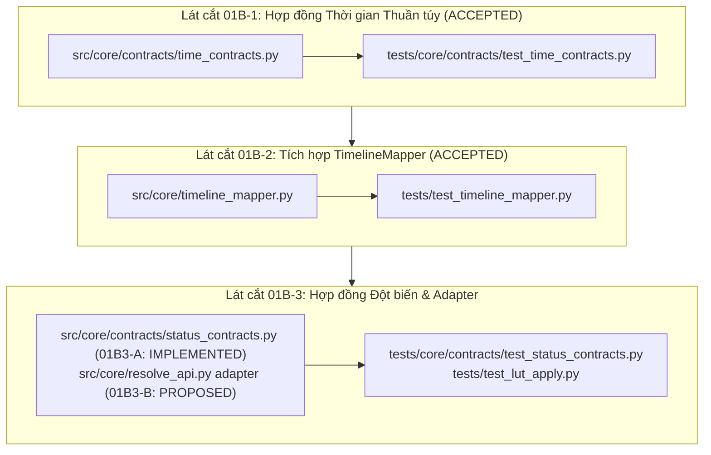

# KẾ HOẠCH PHÂN CHIA LÁT CẮT TRIỂN KHAI: STATUS, ERROR & TIME (G01-01B)

> **Tài liệu tham chiếu:** `docs/architecture/01B-implementation-slices.md`  
> **Trạng thái:** DRAFT FOR CODEX REVIEW (DESIGN_READY)  
> **Nguyên tắc bất di bất dịch:**  
> - Không sửa đổi mã nguồn production trong lượt review thiết kế này.  
> - Giữ nguyên 100% chữ ký API và callers hiện hữu (`InsertResult`, `TimelineMapper`, `apply_lut_to_current_clip`).  
> - Mỗi lát cắt chỉ tác động từ 1 đến tối đa 3 file module, có bài kiểm tra đỏ (failing test) trước khi cài đặt.  
> - Tuyệt đối cấm kết nối DaVinci Resolve hay project thật nếu chưa có mock timeline cô lập.

---

## 1. TỔNG QUAN PHÂN CHIA 3 LÁT CẮT (SLICES ROADMAP)

---

## 2. CHI TIẾT TỪNG LÁT CẮT TRIỂN KHAI

### LÁT CẮT 01B-1: TIME CONTRACTS (G01-01B1-T-I — ĐÃ NGHIỆM THU / ACCEPTED)
- **Mục tiêu:** Xây dựng module hợp đồng thời gian và các hàm số học khung hình thuần túy, zero-dependency.
- **Tập tin tác động:**
  1. `src/core/contracts/time_contracts.py` (Mới):
     - `RationalFPS`: Dataclass bất biến chứa `numerator: int, denominator: int` tối giản, hỗ trợ NTSC aliases (23.976, 29.97, 59.94) và giữ nguyên phân số rõ ràng (explicit Fractions).
     - `pts_to_frame(pts_sec: Union[int, float, Fraction], fps: RationalFPS) -> int`: Round-half-to-even chính xác bằng số học phân số, hỗ trợ signed positions.
     - `frame_to_pts(frame: int, fps: RationalFPS) -> Fraction`: Trả về `Fraction` chính xác để đảm bảo round-trip hoàn hảo.
     - `TimeRangeFrames`: Frozen dataclass biểu diễn khoảng nửa mở `[start_frame, end_frame)` với `start < end`, phương thức `contains(frame)` và `overlaps(other)`.
- **Hạng mục DEFERRED (Hoãn lại theo quyết định Tech Lead Codex):**
  - `status_contracts.py` và `CoverageEvidence` (chờ chốt semantics chi tiết).
  - Timecode / Drop-Frame parser / formatter (sẽ tách task riêng).
- **Bộ kiểm thử tập trung (Focused Tests):**
  - Tạo `tests/core/contracts/test_time_contracts.py`:
    - Test NTSC precision, decimal/float aliases vs explicit Fraction.
    - Test tie-breaking policy half-even tại các mốc nửa frame cả dương lẫn âm.
    - Test bảo vệ số âm, số tràn float (`OverflowError`), timecode không hợp lệ.
    - Test characterization đối chiếu với `TimelineMapper._parse_fps_fraction` hiện có.
    - Test bảo vệ số âm, số tràn float (`OverflowError`), timecode không hợp lệ.
- **Phạm vi CHƯA áp dụng:** Chưa can thiệp vào `TimelineMapper`, `InsertService` hay `ResolveAutomation`.
- **Ràng buộc:** 100% Python thuần túy. Cấm nhập `PySide6`, `cv2`, `torch`, hoặc module IO.

---

### LÁT CẮT 01B-2: TIMELINE MAPPER INTEGRATION (G01-01B2-Q-I & G01-01B2-M-I — ĐÃ HOÀN THÀNH)
- **Mục tiêu:**
  - `G01-01B2-Q-I`: Tích hợp `RationalFPS` và `pts_to_frame` vào lượng tử hóa điểm cắt trong `TimelineMapper.add_segment()`, đảm bảo tính toán bằng `Fraction` trước khi làm tròn half-even, loại bỏ sai số phép trừ float.
  - `G01-01B2-M-I`: Đồng nhất lượng tử hóa trong truy vấn ánh xạ ngược `TimelineMapper.src_to_timeline()`, thay thế boundary float multiplication `round(t_src_sec * self.fps)` bằng `pts_to_frame(t_src_frac, fps_rat)` từ `Fraction` hữu hạn, sửa lỗi làm tròn nửa frame (half-even tie).
- **Tập tin tác động (1 file production):**
  1. `src/core/timeline_mapper.py`:
     - Chỉnh sửa nội bộ `add_segment`: Chuyển đổi tham số sang `Fraction` hữu hạn trước khi cộng trừ padding; lượng tử hóa qua `pts_to_frame(..., fps_rat)`.
     - Chỉnh sửa nội bộ `src_to_timeline`: Thay `round(t_src_sec * self.fps)` bằng `pts_to_frame(_to_finite_fraction(t_src_sec, "t_src_sec"), fps_rat)`.
     - Giữ nguyên toàn bộ cấu trúc và thuộc tính của `PlacedSegment`, con trỏ timeline `cursor_frames`, quy tắc tối thiểu 1 frame, công thức legacy `round(offset_src_f / seg.applied_speed)`, và toàn bộ public methods khác.
- **Bộ kiểm thử tập trung (Focused Tests):**
  - Chạy `tests/test_timeline_mapper.py`:
    - `test_src_to_timeline_fraction_half_even_probe`: Khắc phục probe đỏ (t=Fraction(3003, 16000), fps=Fraction(24000, 1001) -> 4.5 frames trả về 4 thay vì 5).
    - `test_src_to_timeline_parametrized_half_frames`: Kiểm thử toàn diện half-even tie trên 24000/1001, 30000/1001, 24/1.
    - `test_src_to_timeline_explicit_fraction_2997_100`: Kiểm tra rate Fraction explicit 2997/100.
    - `test_src_to_timeline_multi_segment_offsets_and_clamp`: Kiểm tra rec_in != 0, src_in != 0, pad, clamp_to_segment, out-of-bounds, invalid index, tol 1ms.
    - `test_src_to_timeline_speed_modes_and_formula`: Kiểm tra speed off / timeremap (1.5, 2.0) kết hợp quantization mới và legacy offset formula.
    - `test_src_to_timeline_sec_delegation`: Kiểm tra `src_to_timeline_sec` ủy quyền và làm tròn 4 chữ số thập phân.
    - `test_src_to_timeline_nonfinite_inputs`: Kiểm tra ném ValueError với NaN khi tính toán arithmetic, trả về None với Inf ngoài khoảng, không mutate state.
    - `test_add_segment_subtraction_half_even_tie_regression`: Khắc phục lỗi làm tròn 7.5 frames từ 7 (float imprecision) lên 8 (half-even exact).
    - `test_continuity_50_segments_multiple_fps`: Liên tục tuyệt đối trên 50 segments qua 30, 29.97, 24 fps.
    - `test_add_segment_explicit_fraction_fps_and_50_segments_continuity`: Liên tục trên Fraction 2997/100.
    - `test_add_segment_rejects_nan_and_inf_inputs`: Ném `ValueError` khi gặp NaN/Inf, không tịnh tiến cursor.
- **Phạm vi CHƯA áp dụng:** Chưa áp dụng vào Resolve runtime thật; chưa chỉnh sửa callers hay mapper các method khác ngoài `add_segment` và `src_to_timeline`.

---

### LÁT CẮT 01B-3A: PURE MUTATION CONTRACT (G01-01B3-A-I — ĐÃ TRIỂN KHAI)
- **Mục tiêu:** Định nghĩa hợp đồng đột biến chuẩn hóa (`MutationStatus`, `MutationEvidence`) và hàm adapter `lut_result_to_mutation_outcome` bằng Python stdlib thuần túy.
- **Tập tin đã triển khai (2 files pure Python):**
  1. `src/core/contracts/status_contracts.py` (Mới):
     - `MutationStatus`: Enum (`applied`, `skipped`, `failed`, `partial_applied`, `no_op_guidance`, `unknown`).
     - `MutationEvidence`: `@dataclass(frozen=True)` với các trường counter tùy chọn `int | None`, bảo toàn số nguyên lớn mà không bị float overflow.
     - `lut_result_to_mutation_outcome(res_dict: Mapping[str, object])`: Adapter chuyển đổi từ dictionary kết quả LUT sang canonical status theo đúng bảng ưu tiên (precedence) và validation policy nghiêm ngặt.
  2. `tests/core/contracts/test_status_contracts.py` (Mới):
     - 67 unit tests pure Python kiểm chứng toàn bộ 13 trường hợp trong Bảng quyết định và fixtures.
- **Bộ kiểm thử tập trung (Focused Tests):**
  - Chạy `QT_QPA_PLATFORM=offscreen .venv/bin/pytest tests/core/contracts/test_status_contracts.py -q`: 67 passed in 0.22s.

---

### LÁT CẮT 01B-3B: CONSUMER INTEGRATION (G01-01B3-B-I — ĐÃ TRIỂN KHAI / IMPLEMENTED)
- **Mục tiêu:** Tích hợp adapter `lut_result_to_mutation_outcome` vào consumer duy nhất `InsertService._insert_lut`.
- **Tập tin tác động (1 file production + 1 test file):**
  1. `src/services/insert_service.py` (Chỉnh sửa `_insert_lut`):
     - Gọi `lut_result_to_mutation_outcome(res_dict)` để phân loại kết quả.
     - `APPLIED`: Trả về tuple thành công `(tc, msg, f"V{track_idx}", clip_name)` cho `_on_success` tạo `InsertResult(ok=True)`.
     - `SKIPPED`: Ném `RuntimeError` để `_on_error` tạo `InsertResult(ok=False)` kèm thông báo chưa thay đổi (giữ tương thích).
     - `FAILED`: Ném `RuntimeError` tạo `InsertResult(ok=False)`.
     - `PARTIAL_APPLIED`: Ném `RuntimeError(f"Đã áp {evidence.applied_count} clip, lỗi {evidence.failed_count} clip.")` để `InsertResult(ok=False)` cảnh báo rõ ràng có đột biến một phần.
     - `UNKNOWN`: Ném `RuntimeError` cảnh báo thiếu bằng chứng hoặc all counters bằng 0.
  2. `tests/services/test_insert_service.py`:
     - Bổ sung 8 tests bao quát mixed partial, applied+skipped, all-zero, missing counters, invalid types, contradictory status, và immutability của producer dict.
- **Ràng buộc tương thích tuyệt đối:**
  - **`InsertResult` giữ nguyên 100% fields:** `ok`, `track`, `start_tc`, `start_frame`, `duration_sec`, `item_name`, `item_ref`, `error`, `inserted_at`, `message`. **Tuyệt đối KHÔNG thêm `.status`**.
  - **`apply_lut_to_current_clip` giữ nguyên 100%:** Trả về dictionary cũ với `status="error"` cho callers cũ.
- **Bộ kiểm thử tập trung (Focused Tests):**
  - Chạy `QT_QPA_PLATFORM=offscreen .venv/bin/pytest tests/core/contracts/test_status_contracts.py tests/services/test_insert_service.py tests/test_lut_apply.py -q`: 116 passed in 2.70s.
- **Phạm vi CHƯA áp dụng:** Chưa áp dụng đồng loạt sang các producers khác; chưa can thiệp vào Resolve live runtime hay UI.

---

## 3. BẢNG MA TRẬN TƯƠNG THÍCH (CURRENT → PROPOSED → COMPAT)

| Module / Lát cắt | Hiện tại (Current) | Đề xuất Canonical (Proposed) | Cơ chế Tương thích (Compat) |
|---|---|---|---|
| **01B-1: Time (ACCEPTED)** | `float(fps)` (23.976, 29.97) | `RationalFPS(24000, 1001)` | `pts_to_frame` tính trên phân số chính xác; `from_value` chấp nhận cả float, int, Fraction |
| **01B-2: Mapper (ACCEPTED)** | `round(t * fps)` và float subtraction | Lượng tử hóa phân số + `pts_to_frame` | Giữ nguyên public signature, `tol=0.001`, clamp, cursor continuity qua 50 segments |
| **01B-3: InsertResult (GIỮ NGUYÊN)** | `InsertResult(ok, track, ..., error, message)` | Giữ nguyên 100% fields, KHÔNG thêm `.status` | Không phá vỡ bất kỳ positional hay keyword caller nào; không suy đoán trạng thái từ message |
| **01B-3: LUT Dictionary (GIỮ NGUYÊN)** | `status: "applied" \| "skipped" \| "error"` | Canonical `MutationStatus` qua Adapter riêng biệt | Hàm gốc `apply_lut_to_current_clip` giữ nguyên `status="error"` cho legacy callers |
| **01B-3: Transition Guidance (GIỮ NGUYÊN)** | `InsertResult(ok=True)` nhưng không tạo clip | Canonical `MutationStatus.NO_OP_GUIDANCE` | Caller cũ đọc `res.ok=True` bình thường; không ghi nhận mutation thật |
