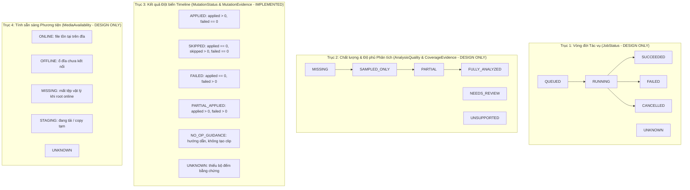

# KIẾN TRÚC VÀ THIẾT KẾ KỸ THUẬT: STATUS, ERROR & TIME (G01-01B-D & G01-01B3)

> **Tài liệu tham chiếu:** `docs/architecture/01B-status-time-design.md`  
> **Trạng thái:**  
> - **Thời gian (Time Contracts & Quantization):** `ACCEPTED` (Đã hoàn thành và nghiệm thu qua `G01-01B1-T-I`, `G01-01B2-Q-I`, `G01-01B2-M-I`).  
> - **Hợp đồng Đột biến (Pure Mutation Contract):** `ACCEPTED` qua `G01-01B3-A-I` (`src/core/contracts/status_contracts.py`).  
> - **Tích hợp Consumer LUT (`_insert_lut`):** `IMPLEMENTED` qua `G01-01B3-B-I` (Consumer đầu tiên duy nhất được tích hợp adapter; producer `apply_lut_to_current_clip` giữ nguyên 100% schema và `status="error"`).  
> - **Các trục khác (Job, Coverage, Availability) & InsertResult Adapter:** `DESIGN_ONLY / DEFERRED` (Chưa triển khai production).  
> **Phạm vi:** Phân tách rành mạch 4 trục trạng thái độc lập: Vòng đời tác vụ (`JobStatus`), Chất lượng/Độ phủ phân tích (`AnalysisQuality`/`CoverageEvidence`), Kết quả đột biến (`MutationStatus`/`MutationEvidence`), và Tính sẵn sàng tài nguyên (`MediaAvailability`).  
> **Cam kết:** Giữ vững 100% tương thích ngược với `InsertResult`, `TimelineMapper`, và DaVinci Resolve API hiện hữu. Tuyệt đối không thêm trường `.status` vào `InsertResult`, không thay đổi giá trị legacy `status="error"` trong dictionary LUT trả về của `apply_lut_to_current_clip`.

---

## B1. KHẢO SÁT MÃ NGUỒN HIỆN CÓ (REAL CODE INVENTORY)

Dựa trên việc đọc trực tiếp mã nguồn thực tế tại kho mã ChunDVC:

### 1.1. Module `src/services/insert_service.py`
- **`InsertResult` (Dòng 86–98):**
  - Cấu trúc `@dataclass` hiện hành:
    ```python
    @dataclass
    class InsertResult:
        ok: bool
        track: str = ""             # e.g. "V2", "A3"
        start_tc: str = ""          # e.g. "01:00:04:12"
        start_frame: int = -1
        duration_sec: float = 0.0
        item_name: str = ""
        item_ref: Any = None
        error: str = ""
        inserted_at: float = field(default_factory=time.time)
        message: str = ""
    ```
  - **Quy tắc bất biến:** Giữ nguyên 100% các trường trên và thứ tự positional arguments. Tuyệt đối KHÔNG thêm `.status` hay phương thức suy đoán trạng thái vào `InsertResult`.
- **`_insert_transition` (Dòng 245–281):**
  - **Hành vi thực tế:** Copy tên chuyển cảnh vào clipboard hệ thống (`app.clipboard().setText(name)`), gọi `prepare_native_transition` để tìm vết cắt trên Timeline và đặt Playhead tới đúng frame chuyển cảnh, phát tín hiệu `InsertResult(ok=True, track="Transitions", message="...")`.
  - **Bản chất nghiệp vụ:** Thao tác này HOÀN TOÀN KHÔNG tạo clip hay thay đổi cấu trúc Timeline (chỉ là hướng dẫn người dùng kéo hiệu ứng từ Effects panel). Không sinh lịch sử Undo. Vì vậy, cờ `ok=True` ở đây biểu thị "hướng dẫn thành công", KHÔNG PHẢI là một đột biến Timeline (`MutationStatus == NO_OP_GUIDANCE`).
- **`_insert_lut` (Dòng 425–530):**
  - Consumer dự kiến sau review của adapter LUT. Hiện tại gọi `auto.apply_lut_to_current_clip(...)`.
  - Khi `applied > 0`: trả về thông tin thành công. Khi `status == "skipped"`: ném `RuntimeError` để đưa về `InsertResult(ok=False, error=msg)` cho UI toast.

---

### 1.2. Module `src/core/resolve_api.py` & `src/core/resolve_bridge.py`
- **`apply_lut_to_current_clip` (`resolve_api.py:908–1022`):**
  - Producer thực tế cho LUT clip Playhead.
  - Trả về dictionary:
    - Thành công: `{"ok": True, "status": "applied", "applied": 1, "skipped": 0, "failed": 0, "clip_name": clip_name, "track": track_idx, "message": msg}`
    - Bỏ qua hợp lệ (clip đã có LUT, `skip_existing=True`): `{"ok": False, "status": "skipped", "applied": 0, "skipped": 1, "failed": 0, "clip_name": clip_name, "track": track_idx, "message": msg}`
    - Lỗi kỹ thuật (không có timeline, không có node graph, Resolve lỗi): `{"ok": False, "status": "error", "applied": 0, "skipped": 0, "failed": 1, "clip_name": clip_name, "track": track_idx, "message": msg}`
  - **Bảo lưu tương thích:** Giữ nguyên giá trị `status="error"` trong dictionary trả về cho legacy callers. Không đổi thành `"failed"` tại hàm gốc này.
- **`apply_look_lut` (`resolve_api.py:833–906`):**
  - Áp dụng LUT theo phạm vi `scope="timeline"` hoặc `scope="clips"`.
  - Trả về dictionary thuần bộ đếm: `{"applied": int, "skipped": int, "failed": int}`.
- **Audio `insert_sfx_to_track` (`resolve_api.py:1077–1165`):**
  - Chèn SFX/BGM vào target track tại vị trí Playhead (`mediaType=2, recordFrame=rec_frame`).
- **Quy ước `_track_is_free` (`resolve_api.py:2249–2264`):**
  - Kiểm tra va chạm bằng công thức `if s < end_frame and e > start_frame: return False`.
  - **Lưu ý:** Đây là convention nội bộ mà mã nguồn hiện tại đang áp dụng (coi `GetEnd()` là half-open), chưa phải chứng cứ runtime bất biến trên mọi bản Resolve API; thiết kế này giữ nguyên boundary và không suy rộng ngoài phạm vi.

---

### 1.3. Module AI & Pipeline (`visual_index.py`, `visual_describer.py`, `clip_manifest.py`, `storage_manager.py`)
- **`VisualIndex.prepare_windows` (`visual_index.py:246–312`):**
  - Phân đoạn video thành các cửa sổ lấy mẫu có ngân sách (`window_sec=8.0`, `frames_per_window=4`, `max_windows=24`).
  - Ghi nhận `coverage`:
    ```json
    {
      "complete": false,
      "total_windows": 12,
      "sampled_windows": 4,
      "sampled_ranges": [[0.0, 8.0], [8.0, 16.0], [16.0, 24.0], [24.0, 32.0]]
    }
    ```
  - Trạng thái chỉ số: `status = "sampled"`.
- **`describe_with_ollama` (`visual_describer.py:83–233`):**
  - Trạng thái từng cửa sổ: `"described"`, `"insufficient_evidence"`, `"needs_review"`, `"error"`.
  - Trạng thái phân tích tổng thể: `"complete"`, `"partial"`, `"needs_review"`.
- **`StorageManager.assets` (`storage_manager.py:155–168`):**
  - Đọc trạng thái tệp: `item['availability'] = 'online' if online and path.is_file() else 'offline'`.

---

## B2. BỐN TRỤC TRẠNG THÁI ĐỘC LẬP (THE 4 ORTHOGONAL AXES)

Nhằm chấm dứt việc nhập nhằng giữa "tiến trình chạy xong" và "chất lượng dữ liệu đạt yêu cầu" hay "đột biến timeline", hệ thống phân tách thành 4 trục trạng thái hoàn toàn trực giao:



### 2.1. Trục 1: Vòng đời Tác vụ (`JobStatus` — DESIGN ONLY)
- **Bản chất:** Trạng thái thực thi kỹ thuật của tiến trình nền / worker / gateway thread.
- **Bảng giá trị:**
  | Giá trị | Ý nghĩa | Dữ liệu đầu vào thực tế |
  | :--- | :--- | :--- |
  | `QUEUED` | Nằm trong hàng đợi chờ thread rảnh | Task vừa submit vào `ResolveGateway` |
  | `RUNNING` | Đang thực thi mã nguồn / I/O | Worker đang chạy hàm `_task` |
  | `SUCCEEDED` | Tiến trình kết thúc sạch (exit 0, không exception) | Callback `_finish` / `_on_success` được kích hoạt |
  | `FAILED` | Ngoại lệ kỹ thuật, crash, timeout | Errback `_on_error` nhận Exception |
  | `CANCELLED` | Người dùng hoặc hệ thống chủ động ngắt | `cancelled() == True`, ném `InterruptedError` |
  | `UNKNOWN` | Hàm đồng bộ cũ hoặc không có tracker | Gọi trực tiếp hàm không qua gateway |

> [!NOTE]
> `JobStatus` thuần túy là hợp đồng trạng thái thực thi, KHÔNG sở hữu side-effect dọn dẹp `shutil.rmtree`. Chính sách dọn dẹp staging thuộc trách nhiệm của service quản lý ingest/job với cơ chế an toàn partial commit / offline.

---

### 2.2. Trục 2: Chất lượng & Độ phủ Phân tích (`AnalysisQuality` & `CoverageEvidence` — DESIGN ONLY)
- **Bản chất:** Đánh giá mức độ hoàn thiện và độ tin cậy của dữ liệu phân tích video/audio.
- **Quy tắc Phân định Rõ ràng Mẫu số và Tỷ lệ:**
  - `sampled_ratio` và `analyzed_ratio` là hai khái niệm tách biệt:
    - `sampled_ratio`: Tỷ lệ cửa sổ/khung hình đã trích xuất mẫu ảnh trên tổng số cửa sổ mục tiêu (`sampled_windows / total_windows`). Mới chỉ là bằng chứng thị giác tĩnh.
    - `analyzed_ratio`: Tỷ lệ cửa sổ đã được mô hình AI sinh mô tả ngữ nghĩa đạt yêu cầu (`analyzed_windows / total_windows`).
    - *Ví dụ:* Với `total_windows = 12`, `sampled_windows = 4`, `analyzed_windows = 0`: `sampled_ratio = 4/12 = 1/3`, nhưng `analyzed_ratio = 0/12 = 0`. Tuyệt đối không gọi `4/12` là tỷ lệ phân tích ngữ nghĩa!
  - **Mẫu số (Denominator):** Phải là số nguyên cửa sổ `total_windows > 0`. Nếu `total_windows == 0`: Độ phủ là `MISSING` hoặc `UNSUPPORTED`, `analyzed_ratio = Fraction(0, 1)`, cấm chia cho 0, **tuyệt đối cấm cờ `complete=True`**.
  - `FULLY_ANALYZED` nếu dùng chỉ có nghĩa là 100% các cửa sổ mục tiêu đã đạt tiêu chuẩn phân tích cụ thể, **không tuyên bố rằng mọi frame hay mọi hành vi trong video đều đã được hiểu**.

---

### 2.3. Trục 3: Kết quả Đột biến Timeline (`MutationStatus` & `MutationEvidence` — IMPLEMENTED)
- **Bản chất:** Phản ánh sự thay đổi trạng thái thực tế trên Timeline / Track / Clip NodeGraph trong DaVinci Resolve.
- **Thứ tự ưu tiên quyết định (Precedence Policy):**
  1. `applied > 0` VÀ `failed > 0` $\implies$ `MutationStatus.PARTIAL_APPLIED`
  2. `applied > 0` VÀ `failed == 0` $\implies$ `MutationStatus.APPLIED` (kể cả khi `skipped > 0`)
  3. `applied == 0` VÀ `failed > 0` $\implies$ `MutationStatus.FAILED` (kể cả khi `skipped > 0`; skipped không che failed)
  4. `applied == 0` VÀ `failed == 0` VÀ `skipped > 0` $\implies$ `MutationStatus.SKIPPED`
  5. `applied == 0` VÀ `failed == 0` VÀ `skipped == 0` $\implies$ `MutationStatus.UNKNOWN`
- **Quy tắc bảo vệ:**
  - Không suy đoán trạng thái đột biến từ text tiếng Việt (`message` hay `error`) hay cờ `ok: bool`.
  - Thiếu bất kỳ bộ đếm nào trong 3 bộ đếm (`applied`, `skipped`, `failed`) $\implies$ `MutationStatus.UNKNOWN`.
  - `NO_OP_GUIDANCE`: Cần bằng chứng riêng do producer hướng dẫn cung cấp; adapter LUT không tự suy guidance từ counters toàn zero hay text message.

---

### 2.4. Trục 4: Tính sẵn sàng Phương tiện (`MediaAvailability` — DESIGN ONLY)
- **Bản chất:** Khả năng truy cập vật lý tới file media trên ổ đĩa.
- **Quy tắc:**
  - `ONLINE`: File tồn tại trên đĩa cục bộ (`os.path.is_file(path) == True`).
  - `OFFLINE`: Ổ đĩa di động/đám mây chứa kho chưa được mount/kết nối.
  - `MISSING`: **Chỉ xác lập khi thư mục gốc kho (root) đang ONLINE nhưng file cụ thể bị mất trên đĩa**. Khi root đang OFFLINE, cấm suy diễn file là MISSING.
  - `STAGING`: File đang trong tiến trình download hoặc copy tạm.

---

## B3. HỢP ĐỒNG KHÔNG GIAN THỜI GIAN & LƯỢNG TỬ HÓA (TIME CONTRACTS — ACCEPTED)

> [!NOTE]
> Toàn bộ phần Thời gian đã được **ACCEPTED** bởi Tech Lead Codex qua các task `G01-01B1-T-I`, `G01-01B2-Q-I`, và `G01-01B2-M-I`.

- **Phân tách 3 không gian:** Source PTS (Fraction/giây) $\to$ Timeline Frames (int qua `RationalFPS` + `pts_to_frame`) $\to$ Display Timecode (SMPTE string).
- **Quy ước biên:** Nửa mở `[src_in, src_out)` và `[rec_in_frames, rec_out_frames)`. Tính liên tục tuyệt đối: `rec_in[k+1] == rec_out[k]`.
- **Làm tròn half-even:** Toán học thuần túy trên phân số $A/B$ qua `divmod(A, B)` tại boundary duy nhất.
- **Đính chính số học NTSC:** 600s ở 23.976 và 24000/1001 chênh ~0.0144 frame (cả 2 đều round về 14386). Dùng phân số để triệt tiêu drift lũy kế qua nhiều vết cắt và phép cộng trừ padding.
- **Phạm vi test speed:** Test mới `test_src_to_timeline_speed_modes_and_formula` kiểm chứng cụ thể `speed=2.0x`. Tốc độ `1.5x` được kiểm chứng độc lập bởi 3 test hiện hữu (`test_speed_mode_off_ignores_speed`, `test_speed_mode_timeremap_respects_speed`, `test_continuity_50_segments_multiple_fps`).

---

## B4. ĐẶC TẢ HỢP ĐỒNG ĐỘT BIẾN THỰC TẾ (`status_contracts.py` — IMPLEMENTED)

Mã nguồn đã triển khai tại [`src/core/contracts/status_contracts.py`](file:///media/vanntruongg/Documents/Development/Python/dự%20án%20cá%20nhân/ResolveFlow-Assistant/src/core/contracts/status_contracts.py) (100% Python stdlib thuần túy, zero Qt, zero Resolve, zero I/O):

```python
class MutationStatus(str, Enum):
    APPLIED = "applied"
    SKIPPED = "skipped"
    FAILED = "failed"
    PARTIAL_APPLIED = "partial_applied"
    NO_OP_GUIDANCE = "no_op_guidance"
    UNKNOWN = "unknown"

@dataclass(frozen=True)
class MutationEvidence:
    applied_count: Optional[int] = None
    skipped_count: Optional[int] = None
    failed_count: Optional[int] = None
    raw_status: Optional[str] = None
```

- **Validation Policy:**
  - Bộ đếm: Phải là `None` hoặc `int >= 0` hữu hạn. Cấm `bool`, `float`, `str`, âm, `NaN`, `Inf`, `list`, `dict`. Ném `ValueError`.
  - `raw_status`: Phải là `None` hoặc `str`. Kiểu khác ném `ValueError`.
  - Không dựa vào `repr()` của object lạ để tránh lỗi đối tượng hỏng.
  - Frozen dataclass: Bất biến, bảo toàn số nguyên lớn mà không bị float overflow.
- **Adapter `lut_result_to_mutation_outcome(res_dict: Mapping[str, object]) -> Tuple[MutationStatus, MutationEvidence]`:**
  - Nhận `Mapping` (MappingProxyType, dict...). Non-mapping ném `ValueError`.
  - Validate toàn bộ các trường counter hiện diện trước khi phân loại (invalid counter không bị missing counter khác che đi).
  - Thiếu bất kỳ counter nào $\implies$ `(MutationStatus.UNKNOWN, ev)`.
  - Đủ 3 counters $\implies$ phân loại theo đúng thứ tự ưu tiên (precedence).
  - Không mutate input, không deepcopy.

---

## B5. BẢNG QUYẾT ĐỊNH & FIXTURES MINH HỌA

### 5.1. Bảng Quyết định Toàn diện (Decision Table)

| ID | Kịch bản nghiệp vụ | Input Counters (`app`, `skip`, `fail`) | Raw Legacy `status` | Cờ `ok` | Canonical `MutationStatus` | Bảo toàn / Xử lý |
| :---: | :--- | :--- | :--- | :---: | :--- | :--- |
| **D01** | Áp LUT thành công | `applied=1, skipped=0, failed=0` | `"applied"` | `True` | `APPLIED` | Đã sửa timeline |
| **D02** | Clip đã có LUT, bỏ qua | `applied=0, skipped=1, failed=0` | `"skipped"` | `False` | `SKIPPED` | Hợp lệ, không phải lỗi |
| **D03** | Lỗi NodeGraph Resolve | `applied=0, skipped=0, failed=1` | `"error"` | `False` | `FAILED` | Legacy giữ `raw_status="error"` |
| **D04** | Áp nhiều clip: vừa được vừa lỗi | `applied=3, skipped=0, failed=2` | `"error"` | `False` | `PARTIAL_APPLIED` | Cấm che giấu lỗi bằng `ok=True` |
| **D05** | Áp nhiều clip: vừa được vừa skip | `applied=3, skipped=2, failed=0` | `"applied"` | `True` | `APPLIED` | Có sửa đổi thực tế |
| **D06** | Tất cả bộ đếm bằng 0 | `applied=0, skipped=0, failed=0` | `""` | `True` | `UNKNOWN` | Không có bằng chứng đột biến |
| **D07** | Thiếu bộ đếm (None/Missing) | Không có các khóa đếm | Bất kỳ | `True`/`False` | `UNKNOWN` | Cấm đoán mò từ text message |
| **D08** | Bộ đếm âm hoặc sai kiểu | `applied=-1` hoặc `"1"` hoặc `True` | Bất kỳ | Bất kỳ | *Ném `ValueError`* | Policy bắt buộc int hữu hạn $\ge 0$ |
| **D09** | Legacy status là `"error"` | `applied=0, skipped=0, failed=1` | `"error"` | `False` | `FAILED` | Canonical là `FAILED`, raw là `"error"` |
| **D10** | Native Transition Guidance | `applied=0, skipped=0, failed=0` | `""` | `True` | `UNKNOWN` (LUT adapter) | LUT adapter không tự suy guidance |
| **D11** | Cancel sau khi đã sửa 1 clip | `applied=1, skipped=0, failed=0` (job cancelled) | `"cancelled"` | `False` | Mutation: `APPLIED`<br/>Job: `CANCELLED` | Chỉ là `PARTIAL_APPLIED` khi failed > 0 |
| **D12** | Coverage mẫu số bằng 0 | `total_windows=0, sampled=0` | `"missing"` | N/A | `MISSING` (Quality), `ratio=0/1` | Cấm chia cho 0, cấm `complete=True` |
| **D13** | Coverage mới lấy mẫu một phần | `total=12, sampled=4, analyzed=0` | `"sampled"` | N/A | `SAMPLED_ONLY`, `sampled_ratio=4/12`<br/>`analyzed_ratio=0/12` | Tách riêng sampled và analyzed |

---

## B6. TIẾN ĐỘ VÀ CÁC HẠNG MỤC TIẾP THEO

1. **Đã nghiệm thu (`G01-01B3-A-I`):**
   - Đã triển khai `src/core/contracts/status_contracts.py` và `tests/core/contracts/test_status_contracts.py`.
   - Toàn bộ 67 focused unit tests PASS 100%.
2. **Đã triển khai (`G01-01B3-B-I`):**
   - Tích hợp adapter `lut_result_to_mutation_outcome` vào consumer duy nhất `_insert_lut()` trong `src/services/insert_service.py`.
   - Cơ chế tương thích:
     - `PARTIAL_APPLIED`: Chuyển thành `ok=False` trong `InsertResult` legacy, với thông báo tiếng Việt nêu rõ số applied và failed (ví dụ: `"Đã áp 2 clip, lỗi 1 clip"`). Tuyệt đối không che giấu lỗi, không khẳng định không có thay đổi, không nói rollback hay undo tự động.
     - `SKIPPED`: Giữ tương thích `ok=False` trong `InsertResult` legacy với thông báo clip đã có LUT, chưa thay đổi.
     - `UNKNOWN`: Chuyển thành `ok=False` với cảnh báo thiếu bộ đếm bằng chứng hoặc tất cả bằng 0.
     - Producer `apply_lut_to_current_clip` giữ nguyên 100% schema và `status="error"` cho legacy callers.
   - 116 focused tests PASS 100%.
3. **Các hạng mục TẠM HOÃN (DEFERRED):**
   - Chưa triển khai các trục `JobStatus`, `AnalysisQuality`, `CoverageEvidence`, `MediaAvailability`.
   - Chưa tạo adapter cho `InsertResult` legacy; chưa can thiệp vào các producers khác ngoài LUT.
   - Chưa mở rộng sang `01C` Settings hay `G02`.
