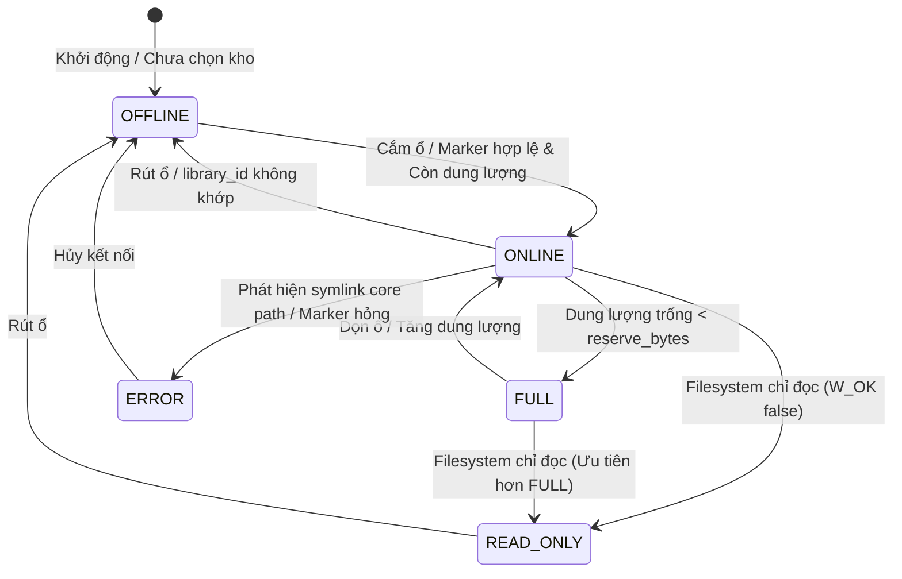

# KIẾN TRÚC GIAO DỊCH KHO, NGOẠI TUYẾN VÀ PHỤC HỒI DỮ LIỆU (02-STORAGE-TRANSACTIONS)

- **Mã thiết kế:** `G02-D`
- **Phiên bản:** `1.0.0-design`
- **Tác giả:** Antigravity (Worker) · **Review:** Codex (Tech Lead)
- **Trạng thái:** `DESIGN_READY`
- **Phân loại bằng chứng:**
  - `VERIFIED`: Đã kiểm chứng trực tiếp trên mã nguồn `src/core/storage_manager.py`, `src/core/pack_ingest.py`, `src/core/cache_manager.py`, `src/core/asset_cache.py`, `src/main.py`.
  - `CODE_ONLY`: Mã nguồn đã tồn tại nhưng chưa có kiểm thử vật lý ngoài đời thực (Drive thật, rút ổ cứng đột ngột).
  - `UNVERIFIED`: Các kịch bản giả định chưa triển khai (Crash cứng giữa rename và atomic write, phục hồi registry từ pack manifest).
- **Phạm vi kiểm toán (Scope):** Kho tài nguyên media ChunDVC (`StorageManager`, `PackIngestService`), bảo toàn tính toàn vẹn dữ liệu khi ngoại tuyến, đầy ổ (ENOSPC), hủy tác vụ hoặc lỗi hệ thống.

---

## 1. PHÂN ĐỊNH RANH GIỚI CÁC THƯ MỤC LƯU TRỮ (STORAGE ROOT VS APP CACHES)

Để tránh nhầm lẫn giữa kho tài nguyên media và các bộ đệm tạm thời của ứng dụng, hệ thống phân định rõ ràng 6 phân vùng lưu trữ độc lập (`VERIFIED`):

| Phân vùng | Đường dẫn cấu hình / Mặc định | Module quản lý (`file:hàm:dòng`) | Nội dung lưu trữ | Ranh giới & Hành vi khi Offline |
| :--- | :--- | :--- | :--- | :--- |
| **Kho Media Chính (`StorageRoot`)** | Người dùng chọn qua hộp thoại; lưu tại `$XDG_DATA_HOME/ChunDVC/storage/storage.json` | `src/core/storage_manager.py:71` (`root`), `src/core/storage_manager.py:97` (`configure`) | Tệp media nặng: SFX, BGM, B-roll, Meme, Overlay, LUT, Fusion templates (`01_core`, `02_cloud_downloads/packs`, `03_local_linked`). | Khi offline: **CẤM** fallback tải media về ổ hệ thống. Dùng snapshot duyệt metadata; chặn insert/preview. |
| **Metadata & Registry Kho** | `.chundvc_meta/` nằm ngay trong `StorageRoot` | `src/core/storage_manager.py:77` (`meta`), `src/core/storage_manager.py:129` (`registry`) | `library.json` (UUID marker), `registry.json` (tổng kê pack & asset), `taxonomy.json`, `staging/`, `registry.lock`. | Đi liền với ổ kho. Mất kết nối ổ = mất truy cập registry gốc (chuyển sang đọc snapshot cục bộ). |
| **Local Snapshot** | `$XDG_DATA_HOME/ChunDVC/storage/snapshot-<uuid>.json` | `src/core/storage_manager.py:135` (`_snapshot_path`), `src/core/storage_manager.py:137` (`snapshot`) | Bản sao lưu metadata nhỏ ($\le 16$ MiB) lưu trên máy người dùng. | Tồn tại trên máy ngay cả khi ổ ngoài bị rút, giúp hiển thị thư viện ở trạng thái `offline`. |
| **Scan Cache (Whisper & Voice)** | `~/.resolveflow_cache/` | `src/core/cache_manager.py:85` (`ScanCacheManager.__init__`) | Kết quả bóc băng phụ đề JSON, khoảng lặng âm thanh, face tracking theo checksum video nguồn. | **Hoàn toàn độc lập với StorageRoot.** Nằm trên ổ hệ thống của user để tái dùng siêu tốc. |
| **UI Thumbnail Cache** | `~/.cache/chundvc/thumbnails/` (Linux) hoặc `%LOCALAPPDATA%/chundvc/thumbnails/` (Windows) | `src/core/asset_cache.py:43,49` (`get_thumb_cache_dir`) | Ảnh xem trước (16:9 thumbnails) trích xuất từ video/image media. | Độc lập với kho. Có thể dọn dẹp hoặc tạo lại tự động, không ảnh hưởng media gốc. |
| **Mô hình AI / Trọng số LLM** | `~/.cache/whisper/`, `~/.ollama/models/` | Module AI / Ollama runtime | File nhị phân trọng số mô hình Whisper cục bộ và Ollama vision models. | **TUYỆT ĐỐI KHÔNG** nằm trong StorageRoot; không bị di chuyển khi migrate kho. |

---

## 2. MA TRẬN 5 TRẠNG THÁI KHO (02A: PRECEDENCE & STORAGE STATES) [IMPLEMENTED/PENDING_CODEX_REVIEW]

Năm trạng thái kho là các trạng thái tổng hợp được đánh giá tuần tự theo thứ tự ưu tiên (Precedence Order), không phải là các trục trực giao độc lập:
1. **Identity & Cấu trúc:** Unconfigured / Missing root / Missing marker / UUID mismatch $\implies$ `OFFLINE`.
2. **An toàn & Lỗi cấu trúc:** Marker malformed / Symlink core path / Core path là file / PermissionError khi đọc marker $\implies$ `ERROR`. (02A-R2: Kiểm tra thư mục core trước marker để chặn .chundvc_meta symlink; mọi OSError khi lstat thư mục core đều bị chặn và ném `StorageOfflineError`, không fail-open).
3. **Quyền ghi (Permission Hint):** `os.access(..., W_OK) == False` tại root hoặc thư mục managed $\implies$ `READ_ONLY`. (Lưu ý: `os.access` chỉ là gợi ý quyền; không bảo đảm mọi thao tác ghi thực tế sẽ thành công nếu gặp lỗi mount ACL/I-node).
4. **Dung lượng (Capacity):** `disk_usage.free < reserve_bytes` $\implies$ `FULL`; `disk_usage.free >= reserve_bytes` $\implies$ `ONLINE`. (Lỗi truy vấn disk_usage $\implies$ `ERROR`, không được báo `ONLINE`).

*Nguyên tắc kế thừa tương thích:*
- Cả `READ_ONLY` và `FULL` vẫn cho phép đọc, duyệt metadata và sử dụng tài nguyên có sẵn.
- Thuộc tính `online` và phương thức `require_online()` tiếp tục giữ nguyên ngữ nghĩa legacy (chỉ kiểm tra khớp identity `library_id` để duyệt tài nguyên siêu tốc, không gọi capacity hay `disk_usage` trên hot path).
- Ranh giới bảo vệ ghi trong 02A được tích hợp duy nhất tại `StorageManager.ensure_space(size)`: ném `PermissionError` (errno `EACCES`) khi `READ_ONLY`, ném `OSError` (errno `ENOSPC`) khi thiếu dung lượng. Các thao tác ghi trực tiếp khác (như sửa taxonomy/tagging) chưa được bao phủ bởi health guard này trong 02A.

### Bảng đặc tả 5 trạng thái kho

| Trạng thái | Điều kiện nhận diện mã nguồn | Khả năng đọc (Browse / Preview / Insert) | Khả năng ghi (Ingest / Download / Tagging) | Phản hồi UX & Thông báo |
| :--- | :--- | :--- | :--- | :--- |
| **`ONLINE`** | `root.is_dir()`, `marker.library_id == config.library_id`, `free_space >= reserve_bytes`, có quyền ghi. | Cho phép đầy đủ 100%. `availability = "online"`. | Cho phép đầy đủ: tải pack, giải nén, ghi metadata. | Badge xanh lá "Kho trực tuyến". |
| **`READ_ONLY`** | Marker khớp nhưng hệ thống tệp chỉ đọc (`os.access(W_OK) == False` tại root hoặc core dir). | Cho phép duyệt, xem trước âm thanh/video, kéo thả chèn vào Resolve. | Bị chặn tại `ensure_space()` với `PermissionError` (errno `EACCES`). | Badge vàng "Kho chỉ đọc (Không thể thêm mới)". |
| **`FULL`** | Marker khớp, có quyền ghi nhưng `free_space < reserve_bytes` (mặc định 256 MiB, `storage_manager.py:94`). | Cho phép duyệt và sử dụng các asset đã có sẵn trong kho. | Bị chặn tại `ensure_space()` với `OSError` (errno `ENOSPC`). | Badge cam "Kho đầy (Dưới mức dự phòng 256MB)". |
| **`OFFLINE`** | Không tìm thấy `root`, ổ bị rút, hoặc `marker.library_id != config.library_id` (`storage_manager.py:83`). | Duyệt danh mục qua Local Snapshot. **CẤM** xem trước âm thanh/video và kéo vào Resolve. | Bị chặn hoàn toàn (`StorageOfflineError`). Tuyệt đối không fallback tải về ổ C/hệ thống. | Badge xám/đỏ "Kho ngoại tuyến — Hãy cắm lại ổ". Asset hiển thị icon mất kết nối. |
| **`ERROR`** | Phát hiện symlink bất thường trong core directories (`storage_manager.py:93`), hoặc `library.json` hỏng cú pháp / sai kiểu. | Bị đình chỉ để bảo vệ dữ liệu. | Bị khóa hoàn toàn cho đến khi người dùng chọn lại kho hoặc sửa metadata. | Cảnh báo đỏ "Lỗi cấu trúc kho / Cần khôi phục". |

---

## 3. GIAO DỊCH, KHÓA VÀ AN TOÀN DỮ LIỆU (02B: REGISTRY, SNAPSHOT & LOCKING)

### 3.1. Hợp đồng khóa tiến trình (Concurrency Lock)
- **Cơ chế hiện tại (`src/core/storage_manager.py:121-128`):** Sử dụng `PySide6.QtCore.QLockFile(str(meta / 'registry.lock'))` với thời gian chờ thử khóa là 1000ms (`lock.tryLock(1000)`).
- **Rủi ro (`CODE_ONLY`):** Nếu một tiến trình nền bị treo (deadlock hoặc crash đột ngột), `registry.lock` có thể trở thành stale lock. `QLockFile` của Qt có cơ chế tự giải phóng stale lock nếu tiến trình nắm giữ đã chết, nhưng cần đảm bảo không nuốt lỗi timeout.
- **Hợp đồng chuẩn hóa:** Mọi thao tác thay đổi `registry.json`, `taxonomy.json`, hoặc `links.json` bắt buộc phải nằm trong khối `with sm.lock():`.

### 3.2. Giới hạn dung lượng và Kiến trúc Catalog-by-Pack
- **Thực trạng (`src/core/storage_manager.py:18,35`):** `MAX_JSON = 16 * 1024 * 1024` (16 MiB). Mỗi bản ghi asset chiếm khoảng 180–250 bytes JSON.
  - Khi số lượng file đạt 70.000 – 100.000 file, dung lượng `registry.json` sẽ chạm ngưỡng 15–20 MiB, dẫn đến ném lỗi `ValueError('Metadata vượt giới hạn 16 MiB; cần chia nhỏ pack.')`.
- **Giải pháp thiết kế: Phân mảnh theo gói (Catalog-by-Pack Partitioning):**
  - Giữ `registry.json` chỉ lưu tóm tắt danh sách Pack (`pack_id`, `name`, `version`, `folder`, `asset_count`, `checksum`). Dung lượng luôn $< 500$ KB ngay cả với 1.000 packs.
  - Chi tiết từng asset được lưu trực tiếp trong `pack_manifest.json` tại thư mục của từng pack (`02_cloud_downloads/packs/<slug>_<id>/pack_manifest.json`).
  - `StorageManager` nạp danh mục vào bộ nhớ theo cơ chế Index cache, không dồn toàn bộ 100k asset vào một tệp JSON duy nhất khi lưu xuống đĩa.

---

## 4. MA TRẬN SỰ CỐ VÀ PHỤC HỒI GIAO DỊCH (02C: TRANSACTIONS & RECOVERY)

### Bảng phân tích sự cố và cơ chế xử lý (Fault Matrix)

| Kịch bản sự cố | Thời điểm xảy ra | Hiện trạng mã nguồn (`file:line`) | Hậu quả nếu không xử lý | Cơ chế phục hồi thiết kế (Recovery Policy) |
| :--- | :--- | :--- | :--- | :--- |
| **Hủy tác vụ người dùng (User Cancel)** | Đang tải / giải nén ZIP / copy file | `pack_ingest.py:102,166`, `storage_manager.py:184` | File tải dở nằm trong staging. | Đã có: Bắt `InterruptedError`, gọi `discard()` xóa sạch thư mục staging (`pack_ingest.py:197`). Dữ liệu chính giữ nguyên vẹn. |
| **Đầy ổ đĩa (ENOSPC)** | Trong lúc streaming tải hoặc extract file | `storage_manager.py:94,185`, `pack_ingest.py:103` | File bị cụt, ổ đĩa chạm mức 0 byte làm đơ OS. | Đã có `ensure_space()` trước mỗi khối 1MB. Nếu gặp lỗi đĩa, bắt ngoại lệ, xóa file dở và giải phóng staging. Không ghi nhận vào registry. |
| **Rút ổ cứng đột ngột (Disk Unplug)** | Đang copy vào staging trên ổ ngoài | `storage_manager.py:182` (`open dst`) | Ghi thất bại, ném `OSError`. Thư mục staging dở còn nằm trên ổ ngoài. | Không cố gắng fallback sang ổ khác. Khi cắm lại ổ, quy trình Startup Cleanup sẽ quét và dọn các thư mục `staging/<job_id>` mồ côi không có tiến trình hoạt động. |
| **Crash cứng giữa chừng (Hard Crash / SIGKILL)** | Sau khi `os.rename(payload, folder)` nhưng TRƯỚC KHI `atomic_json(registry)` hoàn tất | `pack_ingest.py:187-190` | Thư mục pack đã nằm trong `02_cloud_downloads/packs/` nhưng `registry.json` chưa có tên pack này. | **Reconciliation on Startup:** Khi khởi động, quét các thư mục pack trên đĩa; nếu thư mục có `pack_manifest.json` hợp lệ nhưng thiếu trong `registry.json`, tự động tái nhập (auto-register) hoặc thông báo user xác nhận. |
| **Hủy trong khi di chuyển kho (Migration Cancel)** | Đang copy file từ kho cũ sang kho mới | `storage_manager.py:248,264` | Một số file đã copy sang kho mới, cấu hình chưa chuyển. | Đã có: Cấu hình `storage.json` được bảo toàn (chỉ chuyển ở bước cuối cùng, `storage_manager.py:267`). Dữ liệu kho cũ 100% nguyên vẹn. Thư mục đích dở được giữ nguyên để user kiểm tra hoặc xóa thủ công. |
| **Dọn dẹp nguồn di chuyển (Migration Cleanup)** | Sau khi copy và xác minh checksum | `storage_manager.py:270-279` | Xóa nhầm file nguồn nếu marker bị thay đổi. | Đã có bảo vệ kép: Kiểm tra `library_id` của nguồn; **chỉ xóa** media thuộc `01_core`, `02_cloud_downloads`, `03_local_linked`. Tuyệt đối **không xóa** thư mục ngoài, project DaVinci Resolve hay model AI. |

---

## 5. KẾ HOẠCH KIỂM THỬ GIẢ LẬP SỰ CỐ (FAULT-INJECTION TEST PLAN)

Để chuẩn bị cho các đợt kiểm thử sau này, kế hoạch kiểm thử tập trung vào các tình huống biên ngoại lệ (Mock / Temp fixtures cô lập):

1. **Test Giả lập Ổ Ngoại tuyến (Offline Probe):**
   - Đổi tên tệp `library.json` hoặc sửa sai `library_id` $\implies$ `sm.online` chuyển thành `False`.
   - Gọi `sm.assets()` $\implies$ Trả về danh sách từ Snapshot, tất cả asset mang `availability = "offline"`.
   - Gọi `sm.require_online()` $\implies$ Ném đúng `StorageOfflineError`.
2. **Test Giả lập Hết dung lượng đĩa (ENOSPC Injection):**
   - Giả lập `shutil.disk_usage` trả về `free < reserve_bytes` $\implies$ Gọi `ensure_space()` ném `OSError`.
   - Kiểm tra `pack_ingest` dừng ngay lập tức và không tạo file rác.
3. **Test Khôi phục Crash Giao dịch (Crash Ingestion Recovery):**
   - Tạo thư mục pack hợp lệ trong `02_cloud_downloads/packs/TestPack_1.0_uuid/` chứa `pack_manifest.json`.
   - Cố tình để `registry.json` rỗng (`packs: []`).
   - Gọi hàm rà soát (Reconciliation) $\implies$ Registry tự động nhận diện và cập nhật pack vào danh mục.
4. **Test Bảo toàn Thư mục Liên kết (Linked Folder Isolation):**
   - Liên kết một thư mục ngoài $\implies$ File không bị copy/move.
   - Hủy liên kết (`unlink_folder`) $\implies$ Registry xóa bản ghi, thư mục và tệp gốc ngoài máy tính 100% nguyên vẹn.

---

## 6. LÁT CẮT THỰC THI (IMPLEMENTATION STATUS)

### Lát cắt 02A — `StorageState & Volume Health Guard` [ACCEPTED BY CODEX]
- **Mục tiêu:** Nâng cấp cơ chế nhận diện trạng thái của `StorageManager` với 5 trạng thái có thứ tự ưu tiên chặt chẽ (`ONLINE`, `READ_ONLY`, `FULL`, `OFFLINE`, `ERROR`), bổ sung kiểm tra quyền ghi (`os.access W_OK`) và dung lượng dự phòng chính xác tại cổng `ensure_space()`.
- **Phạm vi mã nguồn thực tế (1 module):**
  - `src/core/storage_manager.py`:
    - Bổ sung `StorageState(str, Enum)`: `online`, `read_only`, `full`, `offline`, `error`.
    - Bổ sung phương thức truy vấn thuần túy `StorageManager.get_state() -> StorageState` (không tạo service phụ, không ghi đĩa, không lock).
    - Cập nhật `StorageManager.ensure_space(size=0)`: ném `PermissionError` (errno `EACCES`) khi kho `READ_ONLY`, ném `OSError` (errno `ENOSPC`) khi không đủ dung lượng `size + reserve_bytes`, kiểm tra symlink và tệp thường trong core directories.
    - Sửa nhánh fail-closed (02A-R2): Reorder kiểm tra thư mục core lên trước marker để chặn symlink `.chundvc_meta`, chặn mọi `OSError` (EIO, PermissionError) không cho pass.
- **Tiêu chí nghiệm thu đã đạt (Codex ACCEPTED):** 69 test pass in 22.03s, exit 0.

### Lát cắt 02B1 — `Pack Ingest Publish vs Snapshot Replica Boundary` [IMPLEMENTED/PENDING_CODEX_REVIEW]
- **Mục tiêu:** Tách bạch ranh giới xuất bản Authoritative Registry ngoài ổ đĩa (`StorageRoot/.chundvc_meta/registry.json`) và cập nhật Snapshot cục bộ (`snapshot-<uuid>.json`). Đảm bảo một pack đã publish thành công trên kho media không bị báo thất bại hoặc kẹt retry/duplicate chỉ vì lỗi I/O đĩa hệ thống khi ghi snapshot.
- **Phạm vi mã nguồn thực tế (1 module):**
  - `src/core/pack_ingest.py`:
    - Bọc `sm.snapshot()` trong `try...except (OSError, ValueError, StorageOfflineError) as exc:`.
    - Trả về additive `snapshot_synced: bool` và `warnings: list[str]`.
    - Không rollback folder media hay registry khi snapshot fail.
- **Tiêu chí kiểm thử xác minh:**
  - `tests/core/test_pack_ingest_transactions.py` (7 tests mới).
  - `tests/ui/test_pack_ingest_wizard.py` (1 UI integration test mới).
  - Tổng cộng bộ kiểm thử tập trung: 77 passed in 20.56s (exit code 0).

### Các lát cắt hoãn lại (DEFERRED):
- `02B` Sharding: Giữ nguyên schema JSON; các ước tính bytes/asset là `UNMEASURED`.
- `02C` Recovery & Orphan Cleanup: Chưa triển khai. Cần bằng chứng giao dịch và cơ chế xác thực quyền sở hữu rõ ràng trước khi code.
