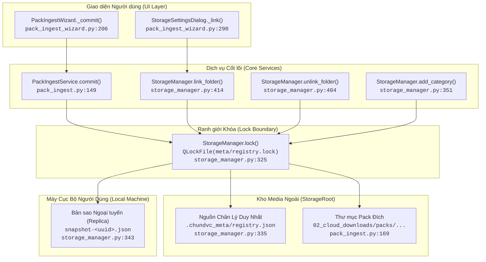

# THIẾT KẾ GIAO DỊCH REGISTRY VÀ SNAPSHOT KHO (02B-REGISTRY-SNAPSHOT-DESIGN)

- **Mã thiết kế:** `G02-02B-D`
- **Phiên bản:** `1.0.0-design`
- **Tác giả:** Antigravity (Worker) · **Review:** Codex (Tech Lead)
- **Trạng thái:** `DESIGN_READY / PENDING_CODEX_REVIEW`
- **Phạm vi kiểm toán (Scope):** Cơ chế giao dịch đồng bộ hóa giữa Metadata Registry ngoài ổ đĩa (`StorageRoot/.chundvc_meta/registry.json`) và Snapshot cục bộ (`$XDG_DATA_HOME/ChunDVC/storage/snapshot-<uuid>.json`). Đảm bảo tính toàn vẹn khi nhập pack (`PackIngestService.commit`), liên kết thư mục (`link_folder`), hủy tác vụ và xử lý sự cố.
- **Phân loại bằng chứng:**
  - `VERIFIED`: Đã kiểm chứng trực tiếp trên mã nguồn `src/core/storage_manager.py`, `src/core/pack_ingest.py`, `src/ui/widgets/pack_ingest_wizard.py` và 69 unit tests hiện hữu.
  - `CODE_ONLY`: Các luồng khóa `QLockFile(1000ms)`, rename rollback và `atomic_json` đã hiện diện trong code nhưng chưa kiểm chứng tải nặng đồng thời ngoài đời thực.
  - `UNMEASURED`: Các chỉ số kích thước JSON trên mỗi asset (180–250 bytes/asset) và ngưỡng số lượng pack; chưa có benchmark chính thức trên tập dữ liệu thực tế lớn (>50.000 asset).

---

## 1. PRODUCER / CONSUMER / CALLGRAPH VÀ KHÓA KHO (FILE:HÀM:DÒNG)

Hệ thống quản lý tài nguyên media ChunDVC sử dụng cơ chế tệp khóa tập trung `QLockFile` (`.chundvc_meta/registry.lock`) để bảo vệ các thao tác biến đổi metadata.



### 1.1. Chi tiết Callgraph của Ingest Pack Commit (`pack_ingest.py:149-196`)
1. **Kiểm tra tiền điều kiện ngoài Lock:**
   - `src/core/pack_ingest.py:150`: `sm.require_online()` kiểm tra ổ cắm và khớp `library_id`.
   - `src/core/pack_ingest.py:151-154`: Xác thực `job_dir` nằm đúng trong `sm.meta / 'staging'`, không phải symlink, thư mục con `payload` tồn tại.
   - `src/core/pack_ingest.py:155-165`: Lọc các asset được chọn (`not excluded`), đối chiếu danh mục với `sm.taxonomy()`, khử trùng lặp đường dẫn và tags.
   - `src/core/pack_ingest.py:166`: Kiểm tra hủy `cancel()`.
   - `src/core/pack_ingest.py:167-170`: Tạo đường dẫn thư mục đích `folder = sm.root / '02_cloud_downloads/packs' / f'{slug}_{version}_{job["pack_id"]}'`.
2. **Chiếm khóa và thực thi giao dịch trong Lock (`pack_ingest.py:171`):**
   - `with sm.lock():` (`src/core/storage_manager.py:325`): Tạo `QLockFile(sm.meta / 'registry.lock')`, gọi `tryLock(1000)`. Nếu thất bại sau 1000ms, ném `OSError('Kho đang cập nhật ở tác vụ khác. Hãy thử lại.')`.
   - `src/core/pack_ingest.py:172`: Kiểm tra `folder.exists()`, nếu đã tồn tại ném `ValueError('Pack đã được nhập.')`.
   - `src/core/pack_ingest.py:173`: Đọc registry hiện tại `registry = sm.registry()` (`storage_manager.py:333`).
   - `src/core/pack_ingest.py:174-178`: Gán `pack_id`, `pack_name`, tính `library_path`, cập nhật danh sách `registry['packs']` và `registry['assets']`.
   - `src/core/pack_ingest.py:180`: Kiểm tra kích thước serialized registry: `len(json.dumps(...)) > 15 * 1024**2` $\implies$ ném `ValueError`.
   - `src/core/pack_ingest.py:181`: `sm.ensure_space(2 * 1024**2)` đảm bảo còn dung lượng trống cho metadata.
   - `src/core/pack_ingest.py:182`: `atomic_json(payload / 'pack_manifest.json', manifest)` lưu bản sao manifest cục bộ trong pack.
   - `src/core/pack_ingest.py:185-186`: Xóa các file không được chọn khỏi payload.
   - `src/core/pack_ingest.py:187`: `sm.require_online()`; `os.rename(payload, folder)` chuyển thư mục dữ liệu vào kho chính.
   - `src/core/pack_ingest.py:188-191`:
     ```python
     try:
         atomic_json(sm.meta / 'registry.json', registry)
     except Exception:
         os.rename(folder, payload)
         raise
     ```
     *Lưu ý:* Nếu `atomic_json` ghi `registry.json` thất bại, rollback chuyển `folder` trả lại thành `payload` trong staging.
   - `src/core/pack_ingest.py:192`: `sm.snapshot()` cập nhật snapshot cục bộ trên máy (`storage_manager.py:341`).
3. **Giải phóng và hoàn tất ngoài Lock:**
   - Thoát khối `with sm.lock()` $\implies$ `lock.unlock()` được gọi tự động trong `finally:`.
   - `src/core/pack_ingest.py:193`: `shutil.rmtree(directory, ignore_errors=True)` dọn dẹp thư mục job staging.
   - `src/core/pack_ingest.py:195`: Trả về `{'pack_id': job['pack_id'], 'count': len(chosen)}`.
   - `src/ui/widgets/pack_ingest_wizard.py:214-220, 240-242`: Nhận kết quả qua signal `LibraryJob.result`, đặt `self._pack_committed = True`, phát tín hiệu `pack_committed`, phát `library_changed`, đóng dialog qua `super().accept()`.

### 1.2. Các Producers khác tác động lên Registry và Snapshot
- **`StorageManager.add_category(category_id, label)` (`storage_manager.py:351-358`):**
  - Chiếm `sm.lock()`, ghi `atomic_json` vào `taxonomy.json`, gọi `sm.snapshot()`.
- **`StorageManager.link_folder(source, category, cancel)` (`storage_manager.py:414-430`):**
  - Chiếm `sm.lock()`, quét cây thư mục ngoài, cập nhật `03_local_linked/links.json`, cập nhật `registry.json`, gọi `sm.snapshot()`.
- **`StorageManager.unlink_folder(source_id)` (`storage_manager.py:404-413`):**
  - Chiếm `sm.lock()`, lọc bỏ asset có `source_id`, cập nhật `links.json`, cập nhật `registry.json`, gọi `sm.snapshot()`.

### 1.3. Consumers duyệt dữ liệu
- **`StorageManager.assets()` (`storage_manager.py:359-372`):**
  - Đọc `self.registry()` nếu `sm.online == True`.
  - Nếu `sm.online == False`, đọc từ snapshot cục bộ `read_json(self._snapshot_path(), {}).get('registry', {})`.
  - Đánh dấu `availability = 'online' if online and path.is_file() else 'offline'`.
- **`StorageManager.ui_assets()` (`storage_manager.py:373-375`):** Chuyển đổi sang `AssetDTO` cho mô hình giao diện PySide6.
- **`StorageManager.taxonomy()` (`storage_manager.py:345-349`):** Đọc `taxonomy.json` trên ổ nếu online; đọc snapshot nếu offline.
- **`StorageManager.links()` (`storage_manager.py:398-402`):** Đọc `links.json` trên ổ nếu online; đọc snapshot nếu offline.

---

## 2. NGUỒN CHÂN LÝ DUY NHẤT & TÁCH BẠCH RANH GIỚI THẤT BẠI SNAPSHOT

### 2.1. Xác lập Nguồn Chân Lý (Source of Truth)
- **`StorageRoot/.chundvc_meta/registry.json` là Nguồn Chân Lý Duy Nhất (Single Source of Truth - SoT).**
- File snapshot `$XDG_DATA_HOME/ChunDVC/storage/snapshot-<library_id>.json` chỉ là **Bản sao ngoại tuyến (Offline Read Replica / Cache)** trên ổ đĩa máy người dùng nhằm phục vụ việc hiển thị UI khi rút ổ cứng.
- Snapshot **KHÔNG PHẢI** là kho lưu trữ có thẩm quyền và không được phép ghi đè ngược lại `registry.json` trên ổ media.

### 2.2. Điểm yếu chết người của luồng `commit()` hiện hữu (`pack_ingest.py:192`)
Hiện tại trong `pack_ingest.py:188-192`:
```python
try:
    atomic_json(sm.meta / 'registry.json', registry)
except Exception:
    os.rename(folder, payload)
    raise
sm.snapshot() # <--- NẰM NGOÀI TRY/EXCEPT ROLLBACK NHƯNG NẰM TRONG COMMIT()
```
**Hậu quả khi Snapshot gặp sự cố:**
1. Giả sử đĩa hệ thống (`$HOME` hoặc `$XDG_DATA_HOME`) bị đầy (`ENOSPC`) hoặc file snapshot bị khóa/lỗi quyền (`PermissionError`):
   - `atomic_json(sm.meta / 'registry.json', registry)` trên ổ cứng media ngoài đã **HOÀN TẤT THÀNH CÔNG 100%**.
   - Dữ liệu media đã nằm ở thư mục chính thức `folder`.
   - Nhưng lệnh `sm.snapshot()` ném ra ngoại lệ `OSError` / `PermissionError`.
2. Do ngoại lệ này không được bắt, nó làm gián đoạn toàn bộ phương thức `commit()`.
3. Giao diện người dùng `PackIngestWizard` nhận diện tác vụ kết thúc với lỗi (`ok = False`, `pack_ingest_wizard.py:243`), hiển thị thông báo lỗi cho người dùng.
4. Thư mục staging `directory` không được dọn dẹp (vì dòng 193 bị bỏ qua).
5. **Kẹt trạng thái (Stuck / Phantom failure):** Khi người dùng thử bấm "Nhập vào kho" một lần nữa, `pack_ingest.py:172` kiểm tra `if folder.exists(): raise ValueError('Pack đã được nhập.')`, biến lỗi lưu đệm tạm thời thành lỗi tắc nghẽn vĩnh viễn!

### 2.3. Giải pháp thiết kế: Tách bạch Ranh giới Commit vs Replica Update
- Thao tác xuất bản gói (Publish Pack) đạt trạng thái **BỀN VỮNG (COMMITTED)** ngay khi `atomic_json(registry.json)` hoàn tất.
- Cập nhật Snapshot cục bộ là **thao tác phụ trợ (Best-effort Post-commit Replica Update)**:
  - Nếu `sm.snapshot()` thất bại: Ghi log cảnh báo `logger.warning`, trả về kết quả thành công cho gói đã nhập kèm cờ cảnh báo `snapshot_synced=False`.
  - Tuyệt đối không ném lỗi ra ngoài làm sập giao dịch đã hoàn tất trên ổ media.
  - Tuyệt đối không cố gắng rollback ngược lại `folder` về `payload` khi registry trên ổ ngoài đã được cập nhật thành công.
- **Tính tương thích:**
  - Định dạng kết quả trả về của `commit()` hiện tại là `{'pack_id': job['pack_id'], 'count': len(chosen)}`.
  - Thiết kế bổ sung trường tuỳ chọn: `{'pack_id': ..., 'count': ..., 'snapshot_synced': True/False}`.
  - Giữ nguyên 100% chữ ký hàm và kiểu trả về `dict`, không cưỡng ép sửa đổi `InsertResult` hay `status_contracts`.

---

## 3. MA TRẬN ĐIỂM LỖI GIAO DỊCH (FAULT POINTS MATRIX)

Bảng phân tích chi tiết hành vi, trạng thái lưu trữ và cơ chế khắc phục tại từng điểm rủi ro trong chu trình Ingest:

| Thời điểm lỗi | Trạng thái Persisted trên Đĩa | Báo cáo giao diện (UI Report) | Tính Idempotency / Retry | Trạng thái Khóa & Quyền sở hữu |
| :--- | :--- | :--- | :--- | :--- |
| **F1: Lỗi trước rename** (VD: ENOSPC khi ghi `pack_manifest.json`, serialize registry > 15 MiB, user cancel) | `payload` còn trong `staging/<uuid>/` (các file bị loại đã prune nếu tới bước đó); `packs/` chưa có thư mục mới; `registry.json` chưa đổi. | Báo lỗi hoặc "Đã hủy"; UI giữ wizard ở chế độ review để sửa hoặc bấm "Hủy / Dọn staging". | Idempotent hoàn toàn. Có thể thử lại an toàn hoặc gọi `discard()`. | Lock được giải phóng an toàn qua `finally: lock.unlock()`. Staging thuộc về job hiện tại. |
| **F2: Crash cứng giữa `os.rename` và `atomic_json(registry)`** (Rút ổ đột ngột, sập nguồn máy) | Thư mục `packs/<slug>_<id>` đã tồn tại trên đĩa; `registry.json` chưa chứa pack mới. Staging rỗng hoặc mất. | App bị crash hoặc báo ngắt kết nối ổ. Khi mở lại, pack chưa xuất hiện trong thư viện. | Pack trở thành "Orphan folder" trên ổ cứng. Chưa được auto-register. Thuộc phạm vi xử lý của **G02-02C**. | Lock file bị bỏ lại trên ổ; `QLockFile` tự động nhận diện stale process sau khi khởi động lại. |
| **F3: Ngoại lệ trong khi `atomic_json(registry)`** (VD: Đầy đĩa ổ ngoài, mất quyền ghi, I/O error) | File tạm `.write-*.tmp` bị xóa; `registry.json` cũ vẫn nguyên vẹn. Khối `except` chạy rollback `os.rename(folder, payload)` (rollback có thể thất bại nếu ổ bị rút phần cứng). | Báo lỗi "Không thể cập nhật chỉ mục kho". Wizard giữ nguyên payload trong staging. | Cho phép người dùng dọn bớt ổ rồi bấm thử lại (Retry) mà không bị lỗi duplicate folder. | Lock được giải phóng trong `finally:`. Staging payload vẫn nguyên vẹn (nếu rollback rename thành công). |
| **F4: Lỗi trong khi `sm.snapshot()`** (VD: Ổ hệ thống `$HOME` đầy, lỗi quyền `$XDG_DATA_HOME`) | `folder` đã vào kho, `registry.json` đã cập nhật pack mới. Snapshot cục bộ chưa có pack mới. | **Báo thành công** ("Đã nhập pack"), kèm cảnh báo ngầm "Snapshot cục bộ chưa được đồng bộ". | Hoàn tất. Nếu mở app khi online, dữ liệu hiển thị từ `registry.json` chuẩn xác 100%. | Snapshot chạy trong lock; lock được giải phóng an toàn qua `finally:` sau khi thoát khối lock. Staging job đã được dọn dẹp. |
| **F5: Nhiều gói liên tiếp (Batch Job) - Gói sau bị hủy** | Gói 1 đã commit và snapshot; gói 2 bị hủy hoặc gặp lỗi ở F1. | Gói 1 báo thành công; Gói 2 báo hủy. | Gói 1 được **bảo toàn vĩnh viễn**, không bị rollback chùm. Staging gói 2 bị dọn dẹp. | Khóa được giải phóng độc lập giữa từng lần commit. |

---

## 4. ĐỒNG THỜI, TIMEOUT, THAY ĐỔI MARKER VÀ GIỚI HẠN KÍCH THƯỚC JSON

### 4.1. Cạnh tranh giữa 2 Jobs & Cơ chế Khóa (Lock Contention)
- Cơ chế khóa hiện hữu: `QLockFile(sm.meta / 'registry.lock')` với thời gian chờ 1000ms (`tryLock(1000)`).
- **Rủi ro:** Khi có 2 tiến trình hoặc luồng cùng nhập pack hoặc link folder, thao tác flush dữ liệu đĩa lớn có thể kéo dài quá 1 giây, dẫn đến việc job thứ hai bị ném ngoại lệ `OSError('Kho đang cập nhật ở tác vụ khác. Hãy thử lại.')`.
- **Đề xuất cải tiến:** Đối với các tác vụ commit quan trọng, nâng thời gian chờ khóa lên có kiểm soát (ví dụ: `tryLock(3000)` đến `5000ms`) trước khi từ chối, giúp tránh nghẽn giả khi đĩa ngoài đang bận I/O.

### 4.2. Rút ổ / Thay đổi Marker trong lúc commit (TOCTOU Defense)
- **Vấn đề TOCTOU (Time-of-Check to Time-of-Use):** Người dùng có thể rút ổ cứng hoặc cắm một ổ cứng khác có cùng tên volume đúng vào thời điểm giữa lúc kiểm duyệt xong và lúc bấm Commit.
- **Quy tắc phòng vệ bên trong Lock:**
  - `sm.require_online()` được gọi ngay trước `os.rename(payload, folder)` bên trong khối `with sm.lock():` (`pack_ingest.py:187`).
  - Lệnh này đọc tệp marker `library.json` và kiểm tra khớp `marker.get('library_id') == self._config.get('library_id')`. Nếu danh tính marker không khớp (do tráo ổ hoặc marker bị sửa đổi), nó ném `StorageOfflineError`, chặn đứng thao tác `os.rename` và `atomic_json` ngay lập tức.
  - *Thừa nhận giới hạn kỹ thuật:* Với ổ cứng di động, việc fsync file + rename không phải là cam kết tuyệt đối về độ bền khi mất điện (power-loss durability) nếu chưa có fsync directory và kiểm tra tính tương thích của filesystem. Hệ thống chỉ bảo đảm ranh giới giao dịch hoàn tất (completion boundary) trong phạm vi tiến trình đang chạy.

### 4.3. Giới hạn Kích thước JSON & Phân tích Sharding (UNMEASURED)
- **Các giới hạn hiện hữu được kiểm soát bằng mã nguồn:**
  - Giới hạn kích thước file marker: `MAX_JSON = 16 * 1024**2` (16 MiB) (`storage_manager.py:25`).
  - Giới hạn kích thước `registry.json` tuần tự hóa: `15 * 1024**2` (15 MiB) (`pack_ingest.py:180`).
  - Giới hạn kích thước `manifest.json`: $2 \times 1024^2$ (2 MiB) (`pack_ingest.py:98, 121`).
  - Giới hạn số file tối đa trong 1 pack: `MAX_FILES = 100_000` (`pack_ingest.py:16`).
- **Phân tích kích thước thực tế & Trạng thái Sharding:**
  - Kích thước trung bình trên mỗi bản ghi asset trong JSON hiện là chỉ số chưa đo kiểm chính thức (`UNMEASURED`).
  - **KẾT LUẬN KIẾN TRÚC:** **TUYỆT ĐỐI CHƯA TRIỂN KHAI REGISTRY SHARDING** ở giai đoạn này. Giữ nguyên schema JSON và cơ chế hiện có cho tới khi có bài đo lường hiệu năng thực tế.

---

## 5. BẢO VỆ SNAPSHOT NGOẠI TUYẾN & CÁCH LY LIBRARY ID

- Snapshot cục bộ được đặt tên định danh theo UUID kho:
  `$XDG_DATA_HOME/ChunDVC/storage/snapshot-<library_id>.json`.
- **Nguyên tắc cách ly tuyệt đối:**
  1. Khi kho hiện tại đang offline, các hàm truy vấn `sm.assets()`, `sm.taxonomy()`, `sm.links()` chỉ được nạp snapshot có UUID khớp với `self._config['library_id']`.
  2. Nếu người dùng chuyển sang kho khác hoặc chưa từng tạo snapshot cho kho hiện tại, các hàm truy vấn trả về danh sách rỗng (`[]` hoặc `{}` mặc định).
  3. **CẤM** tuyệt đối việc fallback sang snapshot của bất kỳ `library_id` nào khác, ngăn chặn việc hiển thị sai lệch tài nguyên giữa các dự án hoặc các ổ đĩa khác nhau.

---

## 6. LÁT CẮT TRIỂN KHAI 02B1 [IMPLEMENTED/PENDING_CODEX_REVIEW]

Lát cắt 02B1 đã được triển khai theo đúng ranh giới thu hẹp được Codex phê chuẩn:

### 6.1. Chi tiết Triển khai (`src/core/pack_ingest.py:commit`)
- **Tách ranh giới Publish vs Snapshot:**
  - Thao tác xuất bản external registry hoàn tất tại `atomic_json(sm.meta / 'registry.json', registry)`.
  - Khối `sm.snapshot()` được bọc an toàn trong `try...except (OSError, ValueError, StorageOfflineError) as exc:`.
  - Khi snapshot gặp lỗi, ghi `logger.warning`, gán `snapshot_synced = False`, bổ sung thông báo cảnh báo vào danh sách `warnings`.
  - Không rollback `folder` hoặc `registry.json` khi snapshot fail.
  - Return dict giữ nguyên `pack_id`, `count`, và bổ sung trường tương thích:
    ```python
    return {
        'pack_id': job['pack_id'],
        'count': len(chosen),
        'snapshot_synced': snapshot_synced,
        'warnings': warnings,
    }
    ```
- **Bảo toàn StorageManager:** Không thay đổi chữ ký hay hợp đồng trả về của `sm.snapshot()` để không làm ảnh hưởng các caller khác (`configure`, `migrate`, `link_folder`).

### 6.2. Kết quả Kiểm thử Xác minh
- Bộ 7 tests mới tại `tests/core/test_pack_ingest_transactions.py` (mô phỏng ENOSPC, PermissionError, ValueError, StorageOfflineError, rollback registry, recheck marker trong lock) PASS 100%.
- Bộ 1 test UI integration mới tại `tests/ui/test_pack_ingest_wizard.py` (xác nhận signal `pack_committed` phát ra khi snapshot fail, không kẹt duplicate) PASS 100%.
- Tổng 77 tests tập trung PASS 100% trong 20.56s (exit code 0).

