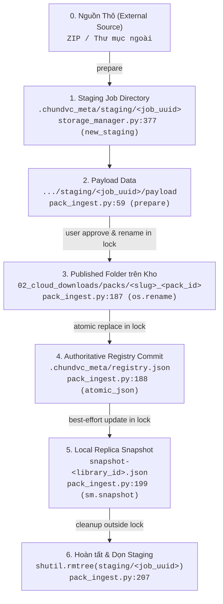

# THIẾT KẾ PHỤC HỒI DỮ LIỆU VÀ KIỂM KÊ KHO AN TOÀN (02C-RECOVERY-DESIGN)

- **Mã thiết kế:** `G02-02C-D`
- **Phiên bản:** `1.0.0-design`
- **Tác giả:** Antigravity (Worker) · **Review:** Codex (Tech Lead)
- **Trạng thái:** `DESIGN_READY / PENDING_CODEX_REVIEW`
- **Phạm vi kiểm toán (Scope):** Cơ chế phát hiện và kiểm kê các trạng thái giao dịch dở dang (Orphan staging, Unregistered published packs, Missing media, Stale snapshot). Đảm bảo nguyên tắc kiểm kê chỉ đọc (Read-only Inventory), phân định rõ giữa "Phát hiện" và "Quyền sửa đổi", tuyệt đối không tự ý xóa hay khôi phục ngầm dữ liệu người dùng.
- **Phân loại bằng chứng:**
  - `VERIFIED`: Đã kiểm chứng trực tiếp trên mã nguồn `src/core/storage_manager.py`, `src/core/pack_ingest.py`, `src/ui/widgets/pack_ingest_wizard.py` và 77 tests hiện hành.
  - `CODE_ONLY`: Các luồng dọn dẹp staging job khi discard, rename rollback khi lỗi atomic registry.
  - `UNVERIFIED`: Các kịch bản sập nguồn phần cứng đột ngột (Power loss), rút cáp đĩa giữa `os.rename` và `atomic_json` (chưa có bài test vật lý ngoài đời thực).

---

## 1. VÒNG ĐỜI TRẠNG THÁI VÀ QUYỀN SỞ HỮU GIAO DỊCH (FILE:HÀM:DÒNG)

Chu trình nhập một gói media từ nguồn thô đến khi xuất bản chính thức trải qua 6 trạng thái sở hữu liên tiếp:



### 1.1. Chi tiết Callgraph và Quyền Sở Hữu (Ownership)
1. **Khởi tạo Staging Job:**
   - `src/core/storage_manager.py:377`: `new_staging()` gọi `self.ensure_space()`, tạo thư mục con duy nhất `path = self.meta / 'staging' / uuid.uuid4().hex`.
   - *Quyền sở hữu:* Thuộc về tiến trình/job ID hiện tại. Lúc này chưa chiếm khóa `registry.lock`.
2. **Chuẩn bị Dữ liệu (`prepare`):**
   - `src/core/pack_ingest.py:59`: Tạo `payload = job_dir / 'payload'`.
   - `src/core/pack_ingest.py:64, 69, 78`: Giải nén ZIP hoặc copy files vào `payload`.
   - Nếu xảy ra lỗi giữa chừng: `pack_ingest.py:82` bắt ngoại lệ và gọi `shutil.rmtree(job_dir, ignore_errors=True)`.
3. **Người dùng Kiểm duyệt trên UI (User Approval Phase):**
   - File nằm chờ tại `staging/<job_uuid>/payload`.
   - Nếu người dùng bấm "Hủy / Dọn staging": `pack_ingest.py:197` (`discard`) gọi `shutil.rmtree(path, ignore_errors=True)`.
   - *Bảo đảm:* Trong giai đoạn này, dữ liệu chưa chạm tới kho chính và chưa hề được coi là đã duyệt.
4. **Giao dịch Xuất bản trong Lock (`commit`):**
   - `src/core/pack_ingest.py:171`: Chiếm `with sm.lock():` (`QLockFile(registry.lock)` timeout 1000ms).
   - `src/core/pack_ingest.py:182`: Ghi `atomic_json(payload / 'pack_manifest.json', manifest)`.
   - `src/core/pack_ingest.py:186`: Xóa các file bị exclude khỏi payload.
   - `src/core/pack_ingest.py:187`: `sm.require_online(); os.rename(payload, folder)`. Dữ liệu được chuyển từ staging sang `02_cloud_downloads/packs/<folder>`.
   - `src/core/pack_ingest.py:188`: Ghi `atomic_json(sm.meta / 'registry.json', registry)`.
   - **Xử lý Double Fault khi Registry ghi lỗi:**
     ```python
     try:
         atomic_json(sm.meta / 'registry.json', registry)
     except Exception as reg_exc:
         try:
             os.rename(folder, payload)
         except Exception as rb_exc:
             logger.error("Rollback rename thất bại sau khi registry ghi lỗi: %s (Lỗi gốc: %s)", rb_exc, reg_exc)
             raise rb_exc from reg_exc
         raise
     ```
     *Lưu ý kiến trúc:* Nếu cả lệnh ghi registry và lệnh rollback rename đều thất bại (ví dụ: ổ đĩa bị ngắt đột ngột), hệ thống tuyệt đối không được nuốt mất lỗi gốc `reg_exc`. Việc chain exception `from reg_exc` bảo đảm nhật ký lỗi giữ nguyên nguyên nhân ban đầu.
5. **Cập nhật Snapshot và Giải phóng:**
   - `src/core/pack_ingest.py:199`: `sm.snapshot()` được bọc an toàn trong `try...except (OSError, ValueError, StorageOfflineError)`.
   - Thoát khỏi khối `with sm.lock()`.
   - `src/core/pack_ingest.py:207`: `shutil.rmtree(directory, ignore_errors=True)` dọn dẹp thư mục staging ngoài lock.

---

## 2. PHÂN LOẠI CÁC TRẠNG THÁI DỞ DANG (ORPHAN STATES TAXONOMY)

Hệ thống phân định rõ 5 trạng thái bất thường có thể xảy ra trên đĩa:

| Mã trạng thái | Tên trạng thái | Đặc điểm nhận dạng trên đĩa | Nguyên nhân phát sinh | Rủi ro & Hạn chế quyền can thiệp |
| :--- | :--- | :--- | :--- | :--- |
| **O1** | **Dangling Staging Directory** | Tồn tại thư mục `.chundvc_meta/staging/<uuid>` không có tiến trình nào đang giữ lock hoặc tương tác. | Ứng dụng bị crash cứng (SIGKILL), tắt máy đột ngột khi đang ở màn hình review, hoặc job chuẩn bị bị treo. | Tốn dung lượng đĩa. **Không được tự xóa ngầm** khi khởi động vì có thể một tiến trình import nền hoặc cửa sổ khác đang chạy. |
| **O2** | **Unregistered Published Folder** | Thư mục `02_cloud_downloads/packs/<slug>_<id>` tồn tại trên đĩa, có chứa media và `pack_manifest.json`, nhưng `pack_id` **hoàn toàn vắng mặt trong `registry.json`**. | Crash sập nguồn ngay sau `os.rename` và trước `atomic_json(registry)`, hoặc lỗi double fault khi rollback rename thất bại. | **RỦI RO CAO:** Tồn tại `pack_manifest.json` KHÔNG đồng nghĩa người dùng đã bấm chấp thuận xuất bản gói. **CẤM TỰ ĐỘNG ĐĂNG KÝ (Auto-register)** vào registry mà không có sự xác nhận của người dùng. |
| **O3** | **Missing Media Entry** | `registry.json` có bản ghi pack hoặc asset, nhưng đường dẫn file trên đĩa không tồn tại. | Người dùng tự xóa file ngoài OS, ổ đĩa bị bad sector, hoặc migrate kho bị gián đoạn. | Giao diện hiển thị thumbnail nhưng không phát được preview hoặc không insert được vào Resolve Timeline. |
| **O4** | **Corrupted / Hostile Manifest** | `pack_manifest.json` trong thư mục pack bị hỏng cú pháp, là symlink, hoặc chứa relative path traversal (`../../`). | Lỗi ghi đĩa dở dang hoặc cố tình can thiệp tệp từ bên ngoài. | Gây sập tiến trình đọc metadata hoặc ghi đè file ngoài vùng quản lý của kho. |
| **O5** | **Stale Local Snapshot** | File `snapshot-<library_id>.json` trên ổ máy có nội dung cũ hơn `registry.json` trên ổ ngoài. | Lỗi snapshot (F4 warning trong 02B1) hoặc ổ cứng được cắm và cập nhật từ một máy tính khác. | Khi offline người dùng không thấy pack mới. Khi cắm online, hệ thống tự động đọc từ `registry.json` nên không ảnh hưởng tính toàn vẹn dữ liệu. |

---

## 3. KHÁI NIỆM NHẬT KÝ BẰNG CHỨNG GIAO DỊCH (MINIMAL EVIDENCE JOURNAL - THIẾT KẾ ĐỀ XUẤT)

*(Lưu ý: Phần này chỉ là đề xuất thiết kế kiến trúc, CHƯA ĐƯỢC PHÊ DUYỆT ĐỂ TRIỂN KHAI CODE trong giai đoạn này).*

Để phân biệt chính xác giữa một gói "đang dở dang do crash" và một gói "đã được người dùng xác nhận duyệt xuất bản", hệ thống cần một tệp nhật ký tối thiểu:
`.chundvc_meta/journal.json`

### Schema đề xuất:
```json
{
  "version": 1,
  "transaction_id": "tx_uuid_12345",
  "library_id": "lib_uuid_67890",
  "pack_id": "pack_uuid_abcdef",
  "phase": "PREPARED", 
  "target_folder": "02_cloud_downloads/packs/VlogPack_1.0_abcdef",
  "timestamp": "2026-10-26T17:20:00Z",
  "user_approved": true
}
```
- Các giai đoạn (`phase`):
  - `STAGING`: Đang giải nén hoặc copy vào staging.
  - `USER_APPROVED`: Người dùng đã bấm nút "Nhập vào kho" trên UI.
  - `RENAMED`: Đã hoàn tất `os.rename` thư mục vào kho chính.
  - `COMMITTED`: Đã hoàn tất `atomic_json(registry.json)`.
- **Quy tắc bảo vệ kho cũ (Legacy Protection):** Tuyệt đối không tự ý gắn nhãn các thư mục đã có sẵn từ trước là "USER_APPROVED" nếu thiếu bằng chứng nhật ký rõ ràng.

---

## 4. QUY TẮC KIỂM KÊ CHỈ ĐỌC (BOUNDED READ-ONLY INVENTORY CONSTRAINTS)

Để bảo đảm tính ổn định và hiệu năng của hệ thống, dịch vụ kiểm kê (Inventory Service) phải tuân thủ nghiêm ngặt các rào cản bảo vệ:

1. **Kiểm tra Danh tính Kho Đầu Tiên (Root Identity Checked):**
   - Trước khi quét bất kỳ thư mục con nào, phải xác thực `library.json` khớp `library_id` đã cấu hình. Nếu kho offline hoặc sai danh tính, dừng ngay lập tức. Tuyệt đối không tạo staging hay đọc rà soát khi kho offline.
2. **Chặn Thư mục Liên kết (No External Footprint Scan):**
   - Quá trình kiểm kê chỉ quét thư mục do ChunDVC trực tiếp quản lý (`.chundvc_meta/staging` và `02_cloud_downloads/packs`).
   - **CẤM** quét sâu vào các thư mục liên kết người dùng (`03_local_linked`), ngăn ngừa nguy cơ quét nhầm hàng trăm terabyte dữ liệu dựng phim ngoài ổ hệ thống.
3. **Giới hạn Thời gian và Tài nguyên (Bounded Limits & Budget):**
   - Giới hạn số lượng mục duyệt tối đa: `MAX_INVENTORY_ITEMS = 1_000`.
   - Giới hạn đọc file: Chỉ đọc metadata header và `pack_manifest.json` ($\le 2$ MiB).
   - **CẤM** băm hash SHA256 định kỳ trên toàn bộ kho media dung lượng lớn (100GB - 500GB) trong luồng UI.
4. **Không Đi Theo Symlink (No Symlink Traversal):**
   - Mọi thao tác quét thư mục sử dụng `os.walk(followlinks=False)` hoặc `p.is_symlink()`. Bỏ qua hoặc báo cáo cảnh báo nếu phát hiện symlink bên trong thư mục quản lý.
5. **Thuần túy Chỉ Đọc (Pure Read-Only):**
   - Dịch vụ kiểm kê tuyệt đối **KHÔNG** gọi `unlink()`, `rmtree()`, `os.rename()`, hay `atomic_json()`. Bất kỳ thao tác dọn dẹp hoặc khôi phục nào đều phải tách riêng và được người dùng chủ động kích hoạt.

---

## 5. BẢNG QUYẾT ĐỊNH PHỤC HỒI (RECOVERY DECISION TABLE)

Bảng nguyên tắc phân định giữa việc **Tự động nhận diện** và **Hành động can thiệp**:

| Trường hợp phát hiện | Tình trạng Khóa / Tiến trình | Kết luận trạng thái | Hành động được phép của Hệ thống |
| :--- | :--- | :--- | :--- |
| Thư mục `.chundvc_meta/staging/<uuid>` tồn tại | File `registry.lock` đang bị chiếm giữ bởi tiến trình khác | `BUSY / IN_PROGRESS` | **KHÔNG CAN THIỆP.** Không báo cáo là orphan, không xóa. |
| Thư mục `.chundvc_meta/staging/<uuid>` tồn tại | Không có `registry.lock`, thời gian sửa đổi thư mục `> 24h` | `STALE_STAGING` | Báo cáo trong danh sách kiểm kê. Chỉ xóa khi người dùng bấm nút "Dọn rác kho" trong Cài đặt Kho. |
| Thư mục `packs/<slug>_<id>` có manifest hợp lệ nhưng không có trong `registry.json` | Không có lock | `UNREGISTERED_PACK` | Báo cáo trong danh sách kiểm kê. Hiển thị hộp thoại hỏi người dùng: *"Phát hiện gói chưa đăng ký [Tên gói]. Bạn có muốn nạp gói này vào thư viện không?"*. **Chỉ đăng ký khi người dùng bấm Đồng ý.** |
| Thư mục `packs/<slug>_<id>` không có manifest hoặc manifest hỏng cú pháp | Không có lock | `CORRUPT_ORPHAN` | Báo cáo cảnh báo lỗi cấu trúc. Giữ nguyên tệp để người dùng tự kiểm tra; không tự ý xóa. |
| `registry.json` chứa asset nhưng file media đích bị thiếu | Mọi trạng thái | `MISSING_MEDIA` | Đánh dấu trạng thái asset trên UI là `missing` (màu xám / icon cảnh báo). Cho phép người dùng chọn lại đường dẫn hoặc xóa bản ghi đăng ký. |
| Snapshot cục bộ cũ hơn registry trên ổ ngoài | Kho đang Online | `SNAPSHOT_OUT_OF_SYNC` | Tự động đồng bộ hóa snapshot cục bộ (`sm.snapshot()`) ngầm khi ứng dụng rảnh. |

---

## 6. LÁT CẮT THỰC THI 02C1 (CẬP NHẬT 02C1-R2) [IMPLEMENTED/PENDING_CODEX_REVIEW]

Lát cắt 02C1 đã được hoàn thiện qua đợt sửa lỗi 02C1-R2 theo đúng ranh giới kiểm kê chỉ đọc (Bounded Read-only Storage Inventory) được Codex phê chuẩn:

### 6.1. Chi tiết Triển khai (`src/core/storage_inventory.py` — Đóng Residual Checklist R1 & R2)
- **Module duy nhất:** `StorageInventoryService(storage: StorageManager)`.
- **Phương thức:** `scan_inventory(cancel=lambda: False, *, max_items=1000, budget_sec=2.0) -> dict`.
- **Đặc tính kỹ thuật hoàn thiện trong 02C1-R2:**
  1. **Báo cáo Trung thực Lỗi I/O tại Entry (Report Truth at Entry):**
     - Bắt `PermissionError` và `OSError` (EACCES/EIO) tại cả cấp độ `entry.stat()` và khi `open(manifest_path)`.
     - Phân định rõ ràng:
       * Tệp thiếu (`FileNotFoundError`) hoặc JSON hỏng cú pháp (`JSONDecodeError`): dữ liệu đọc được nhưng không hợp lệ $\implies$ báo `invalid_entry`, giữ `status="complete"`.
       * Không được phép đọc hoặc lỗi phần cứng I/O (`PermissionError`/`EIO`): quá trình kiểm tra chưa trọn vẹn (incomplete) $\implies$ trả về `status="partial"` (`truncated=True`) kèm warning, hoặc `status="error"` nếu toàn bộ các mục đều lỗi.
  2. **Kiểm tra Kiểu Version Nghiêm ngặt (Version Type Validation):**
     - Registry: nếu key `schema_version` hiện diện, bắt buộc phải là kiểu `int` (loại trừ `bool`, `float` như `1.0`, `None`, chuỗi `"1"`) và giá trị phải bằng `1`. Key bị thiếu được chấp nhận để đảm bảo tính tương thích ngược (legacy compatibility).
     - Manifest: trường `schema_version` bắt buộc là `int` (loại trừ `bool`, `float`, `None`, chuỗi) và giá trị bằng `1`.
  3. **Hạch toán Ngân sách Đọc Ngay Lập tức & Định nghĩa Dung sai (Budget Allowance):**
     - Sử dụng hàm đọc private `_bounded_read_file(path, per_file_limit, remaining_budget)`.
     - Mọi byte được đọc từ đĩa (kể cả file phình to, vượt trần hay rejected reads) đều được cộng ngay vào `total_metadata_read` TRƯỚC mọi lệnh `continue` hay `return`.
     - Tái kiểm tra marker (`library.json`): nếu cạn ngân sách byte còn lại hoặc đọc vượt trần $\implies$ trả về `status="partial"`, `truncated=True` thay vì báo `offline` giả.
     - **Định mức trần & Dung sai (Allowance):**
       * Trần direct metadata là 32 MiB tính gộp cho `registry.json`, các tệp `pack_manifest.json` và `library.json` recheck.
       * Delegated health check (`storage.get_state()`): có định mức riêng độc lập theo API `StorageManager` hiện hành (`MAX_JSON + 1` byte, ~16 MiB).
       * Sentinel buffer: dung sai tối đa +1 byte cho mỗi lần đọc để phát hiện tràn bộ đệm.
       * Không tuyên bố giới hạn 32 MiB tuyệt đối cho toàn bộ process mà phân định rõ direct vs delegated allowance.
  4. **Kiểm tra Hủy & Hạn mức trong Vòng lặp Duyệt Asset:**
     - Gọi `check_limits()` trước khi đọc manifest và giữa từng vòng lặp asset trong `manifest.get("assets", [])`.
     - Khi `cancel()` hoặc hết hạn ngạch thời gian/byte: dừng ngay và propagate `cancelled` hoặc `partial` (`truncated=True`).
     - Tuyệt đối không phân loại pack là hợp lệ (`unregistered_pack`) nếu quá trình xác thực asset bị gián đoạn.
  5. **Chính sách Chỉ Đọc (Read-Only Policy):**
     - Tuân thủ nghiêm ngặt nguyên tắc chỉ đọc: không ghi đĩa, không sửa file, không chiếm/xóa lock, không tạo staging.
     - Duy trì trường `consistency: "unverified"` trung thực theo giới hạn của bài test.

### 6.2. Các Hạng mục Hoãn lại (DEFERRED):
- `missing_media`: Quét kiểm tra toàn bộ file media của các asset đã đăng ký được hoãn lại.
- `snapshot_comparison`: So sánh độ lệch giữa registry và snapshot hoãn lại; không tự động sync snapshot trong inventory.
- `journal`: Hệ thống nhật ký bằng chứng giao dịch mới chỉ ở mức thiết kế sơ bộ.
- `mutating_repair`: Tuyệt đối chưa có cơ chế tự động xóa dữ liệu dở dang hoặc auto-register pack mà chưa có sự phê duyệt của người dùng.

### 6.3. Bằng chứng Kiểm thử (Unit Tests)
- `tests/core/test_storage_inventory.py` (42 unit tests): Bao phủ đầy đủ 4 nhóm yêu cầu của R2:
  * Nhóm 1: `test_manifest_open_io_error_returns_partial_or_error`, `test_entry_stat_io_error_returns_partial_or_error`, `test_corrupt_or_missing_manifest_keeps_complete_status`.
  * Nhóm 2: `test_registry_schema_version_invalid_rejected` (1.0, True, None, "1", 2), `test_registry_missing_schema_version_accepted_for_legacy`, `test_manifest_schema_version_invalid_rejected` (1.0, True, None, "1", 2).
  * Nhóm 3: `test_rejected_and_growing_reads_consume_budget`, `test_marker_recheck_budget_exhaustion_returns_partial_not_offline`.
  * Nhóm 4: `test_manifest_validation_loop_cancel`, `test_manifest_validation_loop_time_budget`.
- Chạy nhóm kiểm thử tập trung theo đúng yêu cầu:
  ```bash
  QT_QPA_PLATFORM=offscreen .venv/bin/pytest tests/core/test_storage_inventory.py tests/core/test_storage_states.py -q
  ```
  $\implies$ **80 passed in 0.77s (exit code 0)** (42 tests inventory + 38 tests storage states).

