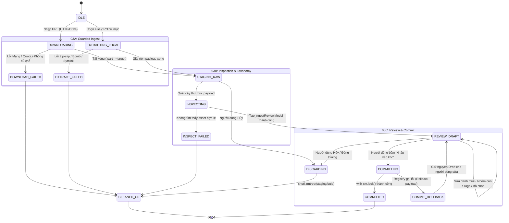

# THIẾT KẾ CHUẨN HÓA NẠP GÓI ĐẠO CỤ VÀ DỮ LIỆU ĐA TẦNG (03-INGESTION)

- **Mã thiết kế:** `G03-D`
- **Phiên bản:** `1.0.0-design`
- **Tác giả:** Antigravity (Worker) · **Review:** Codex (Tech Lead)
- **Trạng thái:** `DESIGN_READY / PENDING_CODEX_REVIEW`
- **Phạm vi kiểm toán (Scope):** Chuẩn hóa toàn bộ các luồng nạp dữ liệu (Asset Pack từ Local/ZIP/Drive, Video Footage thô của AI Director, và Mô hình AI). Thiết lập ranh giới bảo mật cho 3 giai đoạn: `03A` (Guarded Streaming & Secure ZIP Ingest), `03B` (Inspection & Taxonomy Model), và `03C` (Review & Commit Dialog Lifecycle).
- **Phân loại bằng chứng:**
  - `VERIFIED`: Đã kiểm chứng trực tiếp trên mã nguồn `src/core/storage_manager.py`, `src/core/pack_ingest.py`, `src/core/cloud_downloader.py`, `src/core/starter_pack_downloader.py`, `src/ui/tabs/cloud_pack_worker.py`, `src/ui/widgets/pack_ingest_wizard.py`, `src/ui/widgets/drive_dialog.py`, `src/ui/tabs/tab_assets.py`.
  - `CODE_ONLY`: Các luồng fallback `gdown`, streaming bypass trang virus Google Drive, xử lý double-fault rollback `os.rename`.
  - `UNVERIFIED`: Hành vi streaming khi đường truyền bị ngắt đột ngột giữa chừng hoặc Google Drive trả về trang CAPTCHA dạng JavaScript động ngoài đời thực.

---

## 1. PHÂN LOẠI INTENT VÀ BẢNG BÀN GIAO ĐÍCH (DESTINATION OWNERSHIP)

Hệ thống ResolveFlow xử lý 3 loại dữ liệu tải về với mục đích, điểm đến và vòng đời hoàn toàn tách biệt:

| Intent (Ý định) | Đối tượng Dữ liệu | Cơ chế Kích hoạt / UI Surface | Destination Owner (Đích đến) | Đăng ký Registry | Yêu cầu Review Dialog |
| :--- | :--- | :--- | :--- | :---: | :---: |
| **Asset Pack** | Gói đạo cụ (.rfpack, .zip, folder, Drive URL) chứa SFX, BGM, LUTs, Titles, Memes, Overlays | - `tab_asset_hub.py` (Duyệt kho)<br/>- `tab_assets.py` (Menu Nhập)<br/>- `edge_dock.py` (Kéo thả/Menu) | `StorageManager.root`<br/>`02_cloud_downloads/packs/<slug>_<version>_<id>` | **BẮT BUỘC** (`.chundvc_meta/registry.json`) | **BẮT BUỘC** (`PackIngestWizard`) |
| **Source Footage** | Video / Thư mục video gốc dài để cắt dựng thô | - `source_page.py` (AI Director)<br/>- `auto_window.py` (AutoCut) | Thư mục Project do người dùng chọn (Local Drive / Work Dir) | **KHÔNG** (Không ghi vào Asset Registry) | Không (Dùng `GoogleDriveImportDialog`) |
| **AI Model Weights** | Trọng số mô hình (Whisper, YOLO, SAM, Silero VAD) | - Cài đặt Model trong Director<br/>- Tự động tải lần đầu | `~/.cache` hoặc thư mục cấu hình AI model riêng | **KHÔNG** (Quản lý độc lập theo model runtime) | Không (Tiến trình tải nền hệ thống) |

> [!IMPORTANT]
> **Quy tắc Bất di bất dịch:** Tuyệt đối không ép mọi liên kết Google Drive thành Asset Pack! Video nguồn dài 3 tiếng trong AI Director là **Source Footage**, tải về thư mục làm việc của dự án, không bao giờ được đưa vào cấu trúc `02_cloud_downloads/packs` hay làm phình to `registry.json` của kho đạo cụ.

---

## 2. CALLGRAPH THỰC TẾ VÀ RÀ SOÁT CÁC ĐIỂM BYPASS (FILE:HÀM:DÒNG)

### 2.1. Callgraph Luồng Nhập Chuẩn (Standard Ingestion Pipeline)

```mermaid
flowchart TD
    U1["Người dùng: Kéo thả file / Dán link Drive"] --> W0["PackIngestWizard<br/><code>src/ui/widgets/pack_ingest_wizard.py:89</code>"]
    W0 -->|Bấm 'Quét & kiểm tra'| W1["LibraryJob (QThread)<br/><code>src/ui/widgets/pack_ingest_wizard.py:20</code>"]
    
    W1 -->|File cục bộ / Thư mục| P1["PackIngestService.prepare()<br/><code>src/core/pack_ingest.py:59</code>"]
    W1 -->|URL HTTP / Drive| P2["PackIngestService.download()<br/><code>src/core/pack_ingest.py:223</code>"]
    
    P1 -->|ZIP an toàn| S1["_extract() vào Staging<br/><code>.chundvc_meta/staging/&lt;uuid&gt;/payload</code>"]
    P2 -->|Streaming bảo vệ| S1
    
    S1 --> I1["PackIngestService.inspect_job()<br/><code>src/core/pack_ingest.py:118</code>"]
    I1 --> M1["IngestReviewModel (Table View)<br/><code>src/ui/widgets/pack_ingest_wizard.py:40</code>"]
    
    M1 -->|Người dùng chỉnh sửa Draft / Bỏ chọn rác| U2["Bấm 'Nhập vào kho'"]
    U2 --> C1["PackIngestService.commit()<br/><code>src/core/pack_ingest.py:152</code>"]
    C1 -->|with sm.lock(): atomic rename & registry| R1["02_cloud_downloads/packs/...<br/>+ .chundvc_meta/registry.json"]
    C1 -->|Best-effort| S2["sm.snapshot() (Local Replica)"]
```

### 2.2. Bảng Rà Soát Điểm Bypass Thực Tế Trong Codebase

Qua rà soát chi tiết mã nguồn, phát hiện 3 điểm rò rỉ (bypass) trong hệ thống còn bỏ qua bước kiểm duyệt hoặc ghi trực tiếp vào cây thư mục mã nguồn:

| Điểm Bypass / Entrypoint | File : Hàm : Dòng | Hành vi Thực tế | Rủi ro Vi phạm Kiến trúc | Đánh giá | Đề xuất Xử lý |
| :--- | :--- | :--- | :--- | :---: | :--- |
| **Bypass 1: Starter Pack Button** | `src/ui/tabs/tab_assets.py:5404` (`_on_starter_pack_clicked`) | Khởi chạy `StarterPackWorker` $\to$ gọi `StarterPackDownloader.seed_all()` (`src/core/starter_pack_downloader.py:112`). | Ghi trực tiếp các file SFX, LUTs, BGM vào `assets/sfx`, `assets/luts` trong thư mục repo! Không qua `StorageManager`, không kiểm tra dung lượng ổ đĩa, không ghi `registry.json`. | **Bypass Đang Hoạt Động (Cần slice riêng)** | Tách thành một lát cắt riêng biệt để tạo staging producer chuẩn qua `PackIngestWizard`, không sửa vội trong slice HTTP. |
| **Bypass 2: Legacy Cloud Pack Worker** | `src/ui/tabs/cloud_pack_worker.py:20` (`CloudPackInstallWorker.run:47`) | Tải gói về `tempfile.gettempdir() / "resolveflow_pack_cache"` (dòng 70) $\to$ gọi `PackManager.install_pack(target_base_dir="assets")` (dòng 103). | Mã nguồn di sản không có caller kích hoạt tại runtime (các nút Hub UI hiện đều đã chuyển qua `_review_pack` $\to$ `PackIngestWizard`). | **Dormant Legacy (Chưa có caller runtime)** | Giữ nguyên trạng thái dormant, không ưu tiên sửa khi chưa có caller mới. |
| **Bypass 3: Legacy PackManager Engine** | `src/core/pack_manager.py:206` (`PackManager.install_pack`) | Đọc file zip và giải nén trực tiếp vào `assets/`, ghi nhận vào `data/installed_packs.json`. | Phá vỡ cấu trúc kho đa tầng JSON, không có snapshot replica, không kiểm soát `registry.lock`. | **Di Sản (Dormant)** | Giữ các tiện ích tạo/inspect gói, cấm gọi `install_pack`. |

---

## 3. MÁY TRẠNG THÁI TOÀN TRÌNH VÀ VÒNG ĐỜI GIAO DỊCH (03A $\to$ 03B $\to$ 03C)

Vòng đời của một gói tài nguyên từ khi bắt đầu tiếp nhận đến khi hoàn tất xuất bản tuân thủ máy trạng thái nghiêm ngặt:



### 3.1. Quyền Sở Hữu (Ownership Model)
1. **Luồng tính toán (QThread Ownership):**
   - Lớp `LibraryJob(QThread)` (`src/ui/widgets/pack_ingest_wizard.py:20`) thuộc sở hữu của `PackIngestWizard`.
   - Cơ chế bảo vệ: `LibraryJob.active_jobs.add(self)` đảm bảo bộ gom rác Python không thu hồi QThread khi đang chạy ngầm.
   - Khi người dùng đóng cửa sổ hoặc nhấn Hủy: hàm `closeEvent` / `reject()` gọi `self.worker.requestInterruption()`, truyền cờ `cancel()` vào tác vụ I/O; chỉ dọn staging sau khi QThread đã dừng (`finished` signal).
2. **Thư mục Staging (Staging Root Ownership):**
   - Vị trí: `self.storage.meta / 'staging' / <job_uuid>`.
   - Thuộc quyền sở hữu độc quyền của tiến trình và Job ID hiện tại.
   - Không bị coi là Pack chính thức, không hiển thị trên thư viện cho đến khi commit thành công.
3. **Biên Giới Xuất Bản (Publish Boundary):**
   - Ranh giới giữa "Dữ liệu thử nghiệm trong Staging" và "Dữ liệu chính thức trên Kho" **chỉ được xác lập khi ghi đè thành công `atomic_json(registry.json)` sau thao tác `os.rename(payload, folder)`**, tuyệt đối không phải ngay khi chiếm `sm.lock()`.
   - Thứ tự chuẩn: Ghi `pack_manifest.json` $\to$ Xóa file bị exclude khỏi payload $\to$ `os.rename(payload, folder)` $\to$ `atomic_json(registry.json)`.
   - Nếu `registry.json` ghi lỗi: thực hiện rollback `os.rename(folder, payload)` ngay lập tức.
   - Nếu `sm.snapshot()` lỗi: ghi nhận `snapshot_synced=False` và trả về `warnings`, **không rollback pack** vì dữ liệu đã nằm an toàn trên kho chính.

---

## 4. BẤT BIẾN KỸ THUẬT VÀ QUY TẮC AN TOÀN (INVARIANTS MATRIX)

| Bất biến Kỹ thuật | Trạng thái Hiện tại | Mã nguồn Thực thi | Yêu cầu Chuẩn hóa trong G03 |
| :--- | :---: | :--- | :--- |
| **1. Kho Offline / Read-Only / Full** | `VERIFIED` | `storage_manager.py:25` (`StorageState`), `pack_ingest.py:60,153` (`require_online`) | Chặn mọi hành vi chuẩn bị staging hoặc tải về khi kho offline/read-only/full. Tuyệt đối không fallback âm thầm về ổ hệ thống. |
| **2. Unknown Content-Length / Quota Cap** | `VERIFIED` | `cloud_downloader.py` (`TransferBudget`), `pack_ingest.py:246` | Khi header thiếu Content-Length hoặc dạng `chunked`: áp trần tối đa `MAX_PACK_STREAM_BYTES = 10 GiB` cho pack-only (cả HTTP lẫn Drive đơn/folder). Stream vượt trần $\to$ dừng trước khối ghi. Source footage giữ tương thích không giới hạn. |
| **3. Lỗi HTML / Quota / Auth từ Cloud** | `VERIFIED` | `cloud_downloader.py:253,348` (`check_html_prefix`), `pack_ingest.py:293` | Kiểm tra MIME Type `text/html`, HTTP Status 200, và header 512 bytes đầu tiên trước khi ghi đĩa. Tuyệt đối không lưu trang HTML báo lỗi của Google Drive/Cloudflare thành file nhị phân thành công. |
| **4. ZIP-Slip & Path Traversal** | `VERIFIED` | `storage_manager.py:58` (`safe_relative`), `pack_ingest.py:94` | Loại bỏ toàn bộ `..`, dấu gạch chéo đầu `/`, ký tự ổ đĩa `C:`. Đảm bảo file giải nén luôn nằm trong `payload`. |
| **5. Cấm Symlink & Mật khẩu trong ZIP** | `VERIFIED` | `pack_ingest.py:98` (`stat.S_ISLNK`), dòng 99 (`flag_bits & 1`) | Từ chối ngay lập tức các tệp ZIP chứa symlink hoặc có mật khẩu. |
| **6. Chống Trùng tên File Case-Insensitive** | `VERIFIED` | `pack_ingest.py:96` (`seen.add(key.casefold())`) | Tránh xung đột ghi đè tệp trên các hệ điều hành không phân biệt hoa thường (Windows / macOS). |
| **7. Giới hạn Tệp và Dung lượng (Chính sách Tài nguyên ZIP)** | `VERIFIED` | `pack_ingest.py:19-22` (`MAX_FILES = 100_000`, `MAX_UNCOMPRESSED_PACK_BYTES = 20 GiB`, `MAX_MANIFEST_BYTES = 2 MiB`) | Kiểm tra 2 lớp (preflight declared + streaming actual trước từng write). Không áp tỷ lệ nén 100:1 blanket để tránh false positive trên LUTs/.setting. Dọn dẹp best-effort khi storage online. |
| **8. Manifest Đính Kèm là Không Tin Cậy (Untrusted Manifest)** | `VERIFIED` | `pack_ingest.py:32,180` (`_discover_manifest_candidate`, `inspect_job`) | Đã kiểm chứng qua 20 tests (`test_pack_inspection_taxonomy.py`). Bounded read $\le 2$ MiB + 1; `schema_version` bắt buộc `int == 1` (legacy missing được hỗ trợ); ưu tiên deterministic (Root pack_manifest > Root manifest > Nested); category lạ fallback về `guess()` và ghi nhận warning/suggestion ở cấp job; không ghi đè trường bất biến (`id`, `size_bytes`, `library_path`, v.v.). |

---

## 5. TAXONOMY, PREVIEW VS INSERTABLE VÀ CHÍNH SÁCH PHIÊN BẢN (03B)

### 5.1. Phân định Preview vs Insertable (Chống Lỗi Timeline DaVinci Resolve)
Trong các gói tài nguyên dựng phim, các file video có thể đóng 2 vai trò hoàn toàn khác nhau:
1. **Insertable Asset (Đạo cụ chèn được):** SFX (.wav), BGM (.mp3), Video B-Roll / Meme (.mp4), Màu LUT (.cube), Motion Graphics Template (.setting, .drfx).
2. **Preview / Carrier / Auxiliary (Tệp xem trước / Tệp phụ trợ):**
   - Video demo của hiệu ứng chuyển cảnh (ví dụ: `GR_Seamless_Transition_Preview.mp4`).
   - Tệp ảnh bìa (thumbnail `cover.jpg`), tệp hướng dẫn (`installation.pdf`, `readme.txt`).

> [!CAUTION]
> **Rủi ro DaVinci Resolve:** Nếu chèn nhầm file video preview của một Transition Macro vào Timeline, video demo sẽ đè nát các đoạn clip của người dùng thay vì áp dụng hiệu ứng chuyển cảnh. 
> - **Giải pháp:** Thuật toán phân tích (`guess()`) tự động phát hiện các từ khóa `preview`, `demo`, `thumbnail`, `guide`, `chuyển cảnh` và tự động đánh dấu `excluded = True`, phân loại `kind: "preview"` hoặc `"auxiliary"`. Người dùng có thể chủ động kiểm tra và bỏ chọn trước khi commit.

### 5.2. Danh Mục Tùy Biến (Custom Taxonomy) & Nguyên Tắc Draft Edits
- Hệ thống hỗ trợ 7 danh mục cốt lõi (`sfx`, `bgm`, `memes`, `overlays`, `luts`, `templates`, `broll`).
- Người dùng có thể tạo thêm danh mục tùy biến thông qua `StorageManager.add_category(cid, label)` (lưu tại `.chundvc_meta/taxonomy.json`).
- **Nguyên tắc Draft Edits:** Trong suốt quá trình mở `PackIngestWizard`, mọi thao tác đổi tên, phân loại lại danh mục, gán tags hay loại bỏ file chỉ được lưu trong bộ nhớ tạm `IngestReviewModel`. Tuyệt đối **không ghi tạm vào `registry.json`** hay sửa đổi thư mục `02_cloud_downloads` trước khi người dùng bấm "Nhập vào kho".

### 5.3. Chính Sách Trùng Lặp & Phiên Bản Đã Chốt (Duplicate & Version Policy)

Theo quyết định của Tech Lead Codex (`docs/architecture/03-codex-decisions.md`):
- **Chính sách:** Thống nhất duy trì **các phiên bản độc lập song song (Side-by-side versions)**, không ghi đè hoặc tự ý xóa pack cũ trên đĩa.
- Mỗi lần nhập gói mới tạo thư mục độc lập `02_cloud_downloads/packs/<slug>_<version>_<pack_id>` với UUID riêng biệt.
- Tính năng cảnh báo trùng lặp `name + version` trên giao diện người dùng được ghi nhận là mục tiêu thiết kế của tầng UI (sẽ triển khai trong các slice sau).

---

## 6. LÁT CẮT THỰC THI 03A1: DIRECT HTTP PACK DOWNLOAD GUARD [IMPLEMENTED / PENDING_CODEX_REVIEW]

Lát cắt `03A1` đã được triển khai hoàn chỉnh tại nhánh tải HTTP trực tiếp trong `src/core/pack_ingest.py`:

### 6.1. Chi tiết Triển khai (`src/core/pack_ingest.py:download`)
1. **Hạn mức Tải Gói (MAX_PACK_STREAM_BYTES = 10 GiB):**
   - Áp dụng riêng cho tầng tải gói (`pack-only cap`), không áp dụng cho shared `cloud_downloader.py` (vốn dùng tải source footage dài).
   - Kiểm tra trần cho cả `Content-Length` đã khai báo lẫn luồng không rõ độ dài (unknown/chunked stream).
   - Chặn ngay trước khi ghi block vi phạm xuống đĩa; trường hợp dung lượng tải bằng đúng trần (`equality`) được phép vượt qua.
2. **Xác thực HTTP Status nghiêm ngặt:**
   - Chỉ chấp nhận status `200` cho phản hồi đầy đủ; từ chối `204`, `206`, và các mã lỗi `3xx`, `4xx`, `5xx`.
3. **Chặn HTML / Quota Exceeded / Login Page:**
   - Chặn ngay nếu header MIME là `text/html` hoặc `application/xhtml+xml`.
   - Kiểm tra 512 bytes đầu tiên của khối dữ liệu (bỏ qua BOM và khoảng trắng): nếu chứa các dấu hiệu HTML (`<!doctype html`, `<html`, `<head`, `<body`, `quota exceeded`, `too many users`) $\implies$ từ chối ngay, không lưu rác HTML thành file nhị phân.
   - Cho phép các tệp văn bản đơn lẻ hợp lệ (`text/plain` như LUT `.cube` hoặc macro `.setting`).
4. **Chống Tải Rỗng & Tải Thiếu (Truncated):**
   - Từ chối phản hồi rỗng 0 bytes.
   - Từ chối phản hồi tải thiếu dữ liệu so với `Content-Length` đã khai báo.
5. **Cô lập Dọn dẹp Staging:**
   - Khi có lỗi, cancel hoặc ENOSPC: chỉ dọn dẹp thư mục staging do job hiện tại sở hữu (`self.storage.meta / 'staging' / <job_uuid>`), tuyệt đối không đụng tới `/tmp` hệ thống hay mã nguồn `assets/`.

### 6.2. Bằng chứng Kiểm thử (Unit Tests)
- File kiểm thử mới: `tests/core/test_pack_http_download.py` (27 unit tests):
  * Kiểm chứng tải ZIP hợp lệ và tệp đơn lẻ `.cube`/`.setting`.
  * Kiểm chứng trần known/unknown `Content-Length`, chặn trước khi ghi, exact cap pass.
  * Kiểm chứng từ chối zero bytes, truncated response, bad HTTP status (204, 206, 301, 302, 400, 403, 404, 500).
  * Kiểm chứng từ chối HTML MIME và HTML body ẩn trong octet-stream.
  * Kiểm chứng hủy giữa stream, ENOSPC, và kho offline trước tải.
- Lệnh kiểm thử tập trung theo đúng yêu cầu:
  ```bash
  QT_QPA_PLATFORM=offscreen .venv/bin/pytest tests/core/test_pack_http_download.py tests/test_storage_ingest.py tests/core/test_pack_ingest_transactions.py -q
  ```
  $\implies$ **52 passed in 0.91s (exit code 0)**.

---

## 7. TIẾN ĐỘ THỰC THI 03B: INSPECTION & WARNINGS (03B1-I & 03B2-I)

1. **03B1-I (Safe Manifest Inspection) [ACCEPTED]:**
   - Đã cài đặt trong `src/core/pack_ingest.py`: khám phá manifest xác định (root > nested), giới hạn đọc $\le 2$ MiB, kiểm tra `schema_version == 1`, mapping đường dẫn an toàn, chống va chạm casefold và xung đột file trên Linux, fallback về `guess()` an toàn khi gặp danh mục chưa đăng ký kèm `warnings` và `manifest_suggestions` ở top-level job.
   - 56 focused unit tests PASS (exit code 0).
2. **03B2-I (Inspection Warnings UI Presentation) [IMPLEMENTED]:**
   - Đã cài đặt trong `src/ui/widgets/pack_ingest_wizard.py`: warning banner nhỏ gọn $\le 2$ dòng cạnh status bar, nút `⚠️ Xem cảnh báo`, hộp thoại chi tiết giới hạn $\le 100$ mục và $\le 16$ KiB text, toàn bộ render dạng `PlainText` (chống HTML/script injection), reset sạch sẽ giữa các job/cancel/error/commit.
   - Không tự động chặn commit, không ghi đĩa taxonomy khi xem gợi ý, không sửa schema asset records.
   - 27 focused UI tests PASS (exit code 0).

---

## 8. CÁC HẠNG MỤC TIẾP TỤC HOÃN LẠI (DEFERRED SCOPE)
- **Draft Taxonomy RAM Transaction:** Cách ly giao dịch danh mục tùy biến (`_draft_taxonomy`) trong wizard thay vì gọi trực tiếp `StorageManager.add_category()` ghi đĩa; hoãn sang slice riêng sau quyết định duyệt của Tech Lead.
- **Preview Native Roles (.drfx):** Phân loại chuyên sâu các vai trò preview của tệp template DaVinci Resolve phức tạp được hoãn lại.
- **Strict DTO Serializer tại Commit:** Chuẩn hóa toàn bộ asset record qua serializer DTO nghiêm ngặt tại thời điểm commit được hoãn lại.
- **Tuyên bố kiểm thử:** UI PASS trong môi trường offscreen pytest không thay thế cho physical desktop acceptance trên máy người dùng thực tế.
- **Shared Downloader Limits:** Không giới hạn 10 GiB trong `cloud_downloader.py` để tránh làm hỏng luồng tải video footage dài của AI Director.
- **ZIP Bomb & Uncompressed Limits:** Đề xuất trần 20 GiB / 100:1 được ghi nhận là backlog chính sách cho các slice sau.
- **G02 Deferred Items:** Tiếp tục duy trì ranh giới hoãn lại cho Transaction Journal, Mutating Auto-Repair, Missing Media deep scan, và Sharding.


## Trạng thái sau 03B3, 03C1 & 03C2
- **03B3 (RAM Draft Taxonomy & Guarded Commit):** Codex trực tiếp triển khai; wizard giữ category mới trong RAM, core revalidate/merge dưới lock lúc commit. Hủy review không ghi taxonomy; commit lỗi giữ draft cho retry. Rollback lỗi kép báo incomplete, snapshot lỗi sau publish chỉ warning. 63 focused tests PASS 18.99s exit 0.
- **03C1 (Duplicate Hint & Studio Result Feedback):** Antigravity triển khai; cảnh báo trùng lặp (name, version) độc lập khi inspect, phản hồi kết quả và cảnh báo snapshot offline trên Studio TabAssets (Starter Pack và Batch local import). 44 focused tests PASS 24.43s exit 0.
- **03C2 (Dock/Hub Surface Feedback & Partial Queue):** Antigravity triển khai; phản hồi cảnh báo snapshot offline trên EdgeDock (`_handle_dropped_packs`) và Cloud Hub (`AssetHubWidget._review_pack`), tổng hợp cảnh báo chính xác (chỉ tính `snapshot_synced is False`), bảo toàn partial commit và refresh thư viện khi hàng đợi lỗi/hủy giữa chừng mà không bỏ qua refresh. 31 focused tests PASS 25.38s exit 0.
- **Ranh giới hoàn tất và hoãn lại:** Cả 3 giao diện người dùng (Studio, Dock, Hub) đã hoàn thành phản hồi kết quả và cảnh báo offline cache. Các kiểm thử tự động offscreen không thay thế kiểm tra trực quan trên desktop DaVinci Resolve. ROADMAP G04 là Library UI/search/selection; journal/physical crash recovery và Studio hardware-worker lifecycle tiếp tục hoãn lại theo đúng kiến trúc.
