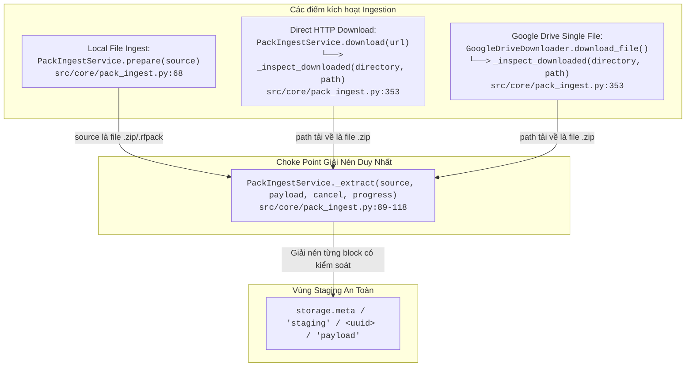

# THIẾT KẾ KIẾN TRÚC: GIỚI HẠN TÀI NGUYÊN VÀ BẢO VỆ GIẢI NÉN ZIP (G03-03A2-D)

- **Mã nhiệm vụ (TASK_ID):** `G03-03A2-I` (triển khai từ thiết kế `G03-03A2-D`)
- **Tác giả:** Antigravity (Worker)
- **Tech Lead Review:** Codex
- **Trạng thái:** `IMPLEMENTED` (70 focused tests PASS), `PENDING_REVIEW`
- **Mục tiêu:** Thiết lập trần kích thước giải nén tối đa cho gói đạo cụ (`MAX_UNCOMPRESSED_PACK_BYTES`), bảo vệ tài nguyên chống cạn kiệt đĩa/bộ nhớ, header giả mạo (lying headers), kiểm soát chặt chẽ dung lượng tệp manifest cả trước và trong quá trình giải nén, mà không gây chặn nhầm các tệp nén tỷ lệ cao hợp pháp (LUTs / text).

---

## 1. CALLGRAPH VÀ CÁC ĐIỂM DẪN VÀO `_extract`

Phương thức `PackIngestService._extract` trong `src/core/pack_ingest.py` là nút cổ chai duy nhất (choke point) thực hiện giải nén các tệp ZIP vào staging payload:



### Ranh giới luồng dữ liệu (Data & Path Boundaries):
1. **Source File:** Tệp nén đầu vào nằm ở ổ đĩa cục bộ của người dùng (với `prepare`) hoặc tệp tạm đã tải về trong `staging/<uuid>/download` (với `download`).
2. **Staging Payload:** Đích đến độc quyền của việc giải nén là `staging/<uuid>/payload`.
3. **Ownership & Cleanup:** Thư mục staging được sở hữu bởi `job_dir = storage.meta / 'staging' / <uuid>`. Nếu giải nén thất bại hoặc bị hủy, toàn bộ `job_dir` được dọn dẹp sạch sẽ bởi khối `except` của caller (`prepare` hoặc `download`), không để lại rác trên hệ thống.

---

## 2. RÀ SOÁT CÁC BẢO VỆ HIỆN CÓ TRONG `_extract` (AUDIT EXISTING GUARDS)

Khác với định kiến "chưa có bảo vệ gì", mã nguồn hiện tại của `_extract` tại `src/core/pack_ingest.py:89-118` đã có một hệ thống phòng thủ tương đối vững chắc:

| STT | Cơ chế bảo vệ hiện có | Vị trí (File:Dòng) | Mục đích phòng thủ | Đánh giá hiện trạng |
|---|---|---|---|---|
| 1 | `len(entries) > MAX_FILES` | `pack_ingest.py:92` | Chặn gói có quá 100,000 files (`MAX_FILES = 100_000`, tránh inode exhaustion / treo vòng lặp). | **ĐÃ CÓ** (Hoạt động tốt). |
| 2 | `safe_relative(entry.filename)` | `pack_ingest.py:95` | Chặn Zip Slip / Path Traversal (`../`, `/etc/passwd`, `C:\Windows`). | **ĐÃ CÓ** (Hoạt động tốt). |
| 3 | `key in seen` (casefold) | `pack_ingest.py:96-98` | Chặn ghi đè, tệp trùng tên, hoặc xung đột hoa/thường trên Linux vs Windows/macOS. | **ĐÃ CÓ** (Hoạt động tốt). |
| 4 | `stat.S_ISLNK(entry.external_attr >> 16)` | `pack_ingest.py:99` | Chặn ZIP chứa symlink trỏ ra ngoài hệ thống. | **ĐÃ CÓ** (Hoạt động tốt). |
| 5 | `entry.flag_bits & 1` | `pack_ingest.py:100` | Từ chối tệp có mật khẩu / mã hóa chưa hỗ trợ. | **ĐÃ CÓ** (Hoạt động tốt). |
| 6 | Preflight Manifest Size (declared) | `pack_ingest.py:102-103` | Chặn manifest khai báo `file_size > 2 * 1024**2` (2 MiB). | **ĐÃ CÓ** (Chỉ kiểm tra declared size). |
| 7 | Preflight Disk Space Check | `pack_ingest.py:104` | `self.storage.ensure_space(total)` dựa trên tổng declared size. | **ĐÃ CÓ** (Chỉ kiểm tra declared size). |
| 8 | Chunk Ensure Space & Cancel Check | `pack_ingest.py:106, 114-115` | Kiểm tra `cancel()` và `storage.ensure_space(len(block))` trên từng block 1 MiB. | **ĐÃ CÓ** (Bảo vệ tràn đĩa ổ cứng thực tế). |
| 9 | Exclusive Creation (`open(..., 'xb')`) | `pack_ingest.py:112` | Chống ghi đè tệp đã tồn tại. | **ĐÃ CÓ** (Hoạt động tốt). |
| 10 | Post-extract Size Equality | `pack_ingest.py:116` | Bắt buộc `written == entry.file_size`. | **ĐÃ CÓ** (Chặn tệp bị cắt cụt). |

### Các điểm yếu bảo mật cần khắc phục (Gaps to Address):
1. **Thiếu trần dung lượng gói giải nén (Pack Uncompressed Cap):** Hiện tại chỉ dựa vào `ensure_space(total)`. Nếu ổ đĩa còn 500 GiB trống, một file ZIP bomb 100 GiB vẫn được phép giải nén, làm cạn kiệt tài nguyên hệ thống.
2. **Lying Header Bypass (Header gian lận):** Nếu tệp ZIP cố tình ghi `entry.file_size = 1000` (1 KB) nhưng thực chất dòng nén giải nén ra 50 GiB, kiểm tra `total` ban đầu sẽ bị lọt qua. Cần kiểm tra tích lũy `total_written` TRƯỚC MỖI BLOCK GHI ĐĨA.
3. **Manifest Actual Size Bypass:** Tương tự, nếu manifest khai báo 100 bytes nhưng giải nén ra 10 MiB, kiểm tra dòng 102 bị lọt qua. Cần kiểm tra `written > 2 MiB` ngay trong lúc giải nén manifest.

---

## 3. PHẠM VI TRIỂN KHAI ĐỀ XUẤT (PROPOSED 03A2 SCOPE)

Triển khai hữu hạn trong **DUY NHẤT 1 module sản phẩm:** `src/core/pack_ingest.py` (hàm `_extract`).

### 3.1. Hằng số trần giải nén (Pack-only Limit)

```python
# Giới hạn kích thước giải nén tối đa cho một gói đạo cụ (Pack-only policy)
# 20 GiB là chính sách đề xuất (proposed policy) thận trọng, chưa qua đo đạc thực tế,
# không khẳng định phù hợp cho mọi gói trong tương lai.
MAX_UNCOMPRESSED_PACK_BYTES = 20 * 1024 * 1024 * 1024  # 20 GiB
MAX_MANIFEST_BYTES = 2 * 1024 * 1024                  # 2 MiB
```

*Lưu ý:* Tuyệt đối không áp dụng trần này cho `source_page.py` hay video footage dài của AI Director (Source Footage không đi qua `_extract`).

### 3.2. Quy tắc kiểm tra 2 lớp (Preflight & Streaming Accumulation)

1. **Lớp 1 — Preflight Check (Header Validation):**
   ```python
   total_declared = sum(entry.file_size for entry in entries)
   if total_declared > MAX_UNCOMPRESSED_PACK_BYTES:
       raise ValueError(f"Tổng dung lượng giải nén của gói ({total_declared / 1024**3:.2f} GiB) vượt quá giới hạn cho phép (20 GiB).")
   ```
2. **Lớp 2 — Streaming Write Accumulation (Lying Header Defense):**
   ```python
   total_written = 0
   for entry in entries:
       # ...
       with archive.open(entry) as src, open(dest, 'xb') as dst:
           while block := src.read(1024**2):
               if cancel(): raise InterruptedError('Đã hủy giải nén.')
               # Chặn đứng NGAY TRƯỚC KHI ghi block làm vượt trần 20 GiB
               if total_written + len(block) > MAX_UNCOMPRESSED_PACK_BYTES:
                   raise ValueError("Dung lượng giải nén thực tế vượt quá trần cho phép (20 GiB).")
               # Chặn đứng manifest nếu kích thước thực vượt 2 MiB
               if is_manifest and (written + len(block) > MAX_MANIFEST_BYTES):
                   raise ValueError("Tệp manifest thực tế vượt quá giới hạn 2 MiB.")
               self.storage.ensure_space(len(block))
               dst.write(block)
               written += len(block)
               total_written += len(block)
   ```

### 3.3. Lý do KHÔNG áp dụng tỷ lệ nén 100:1 blanket (Compression Ratio Heuristic)

- Các tệp bảng màu `3D LUTs (.cube 33x33x33)` chứa hàng chục nghìn dòng số lặp lại (`0.0 0.0 0.0`), hoặc các file macro Fusion `.setting` (văn bản thuần), hoặc các tệp âm thanh có khoảng lặng (zeros):
  - Khi nén Deflate tiêu chuẩn, kích thước có thể giảm từ 2 MiB xuống còn vài KiB (tỷ lệ nén hợp pháp lên tới **200:1 đến 500:1**).
  - Nếu áp dụng quy tắc cứng `uncompressed / compressed > 100:1`, các gói LUTs và Preset hoàn toàn lành mạnh sẽ bị chặn nhầm (False Positive).
- **Quyết định kiến trúc:** Quản lý tài nguyên được bảo đảm bằng **Hard Limits độc lập với tỷ lệ nén** (các trần dung lượng là biện pháp giới hạn tài nguyên - resource policy limits, không phải cam kết an ninh tuyệt đối cho mọi tình huống bất khả kháng):
  - Không quá 100,000 files (`MAX_FILES = 100_000`).
  - Không quá 20 GiB tổng giải nén (`MAX_UNCOMPRESSED_PACK_BYTES`).
  - Không quá 2 MiB cho manifest (`MAX_MANIFEST_BYTES`).
  - Kiểm tra dung lượng đĩa khả dụng trước mỗi block 1 MiB (`ensure_space`).
  - Hủy ngay lập tức và dọn dẹp best-effort vùng staging qua caller owner (`prepare` / `download`) khi kho online. Lưu ý: Không đảm bảo dọn dẹp hoàn toàn trong trường hợp mất điện đột ngột hoặc lỗi quyền cấp hệ điều hành.
  - Các bài kiểm thử fake lying stream kiểm chứng cơ chế bảo vệ ở tầng ứng dụng một cách độc lập với kiểm tra CRC nội tại của `zipfile` Python.

---

## 4. KẾ HOẠCH KIỂM THỬ ĐỀ XUẤT (FOCUSED TESTS FOR 03A2)

Tạo file test tập trung mới: `tests/core/test_pack_zip_bounds.py` sử dụng các fixture nhỏ gọn in-memory (`io.BytesIO` / fake `ZipInfo`), **tuyệt đối không tạo file 20 GiB thật trên đĩa**:

1. `test_declared_uncompressed_size_exceeds_20gib_rejected_before_extract`: ZIP có header khai báo `total > 20 GiB` $\implies$ bị từ chối ngay ở preflight check, không tạo bất kỳ file nào trong payload.
2. `test_exact_20gib_cap_boundary_passes`: Gói có kích thước bằng đúng trần `20 GiB` (equality) $\implies$ vượt qua preflight.
3. `test_lying_header_underdeclared_size_exceeds_cap_blocked_during_stream`: Header khai báo 1 KiB nhưng stream nhả ra khối dữ liệu vượt trần $\implies$ bị chặn ngay trước khi ghi block vi phạm xuống đĩa.
4. `test_manifest_declared_over_2mib_rejected_before_extract`: File `manifest.json` khai báo > 2 MiB $\implies$ bị từ chối ở preflight.
5. `test_manifest_lying_header_exceeding_2mib_blocked_during_stream`: File `manifest.json` khai báo < 2 MiB nhưng stream nhả > 2 MiB $\implies$ bị chặn ngay trong khi giải nén manifest.
6. `test_highly_compressed_valid_cube_lut_passes`: Tệp LUT nén tỷ lệ cao (> 100:1) nhưng tổng dung lượng nhỏ (< 2 MiB) $\implies$ giải nén thành công, không bị chặn oan.
7. `test_corrupted_zip_crc_error_aborts_and_cleans_staging`: File ZIP hỏng CRC giữa chừng $\implies$ ném lỗi rõ ràng và dọn dẹp sạch sẽ staging payload.
8. `test_cancel_during_zip_extraction_aborts_and_cleans_staging`: Gọi `cancel()` giữa chừng $\implies$ dừng ngay và dọn dẹp staging.
9. `test_enospc_during_zip_extraction_aborts_and_cleans_staging`: Giả lập hết đĩa trong khi giải nén $\implies$ dừng ngay và dọn dẹp staging.
10. `test_zip_regression_traversal_and_casefold`: Giữ nguyên các bài test hồi quy về path traversal (`../`) và casefold collision.

---

## 5. KẾT QUẢ THỰC THI LÁT CẮT: `G03-03A2-I`

Lát cắt `G03-03A2-I` đã được thực thi hoàn tất theo đúng chỉ đạo và quyết định ràng buộc từ Tech Lead Codex (`03A2-codex-decisions.md`):
- **Module sản phẩm duy nhất được chỉnh sửa:** `src/core/pack_ingest.py` (bổ sung hằng số `MAX_UNCOMPRESSED_PACK_BYTES = 20 * 1024**3`, `MAX_MANIFEST_BYTES = 2 * 1024**2`, giữ `MAX_FILES = 100_000`, cập nhật hàm `_extract` với kiểm tra preflight + streaming accumulation 2 lớp và hủy sớm).
- **Bộ kiểm thử tập trung mới:** `tests/core/test_pack_zip_bounds.py` bao gồm 13 bài test chi tiết (boundary equality, lying header streaming block, nested manifest, high compression LUT roundtrip, cancellation, CRC/BadZipFile, ENOSPC, và regression guards).
- **Kết quả kiểm thử thực tế:**
  - `tests/core/test_pack_zip_bounds.py`: 13 passed
  - `tests/test_storage_ingest.py`: 17 passed
  - `tests/core/test_pack_http_download.py`: 40 passed
  - **Tổng cộng:** **70 passed in 1.06s (exit code 0)**.
- **Trạng thái:** `IMPLEMENTED`, chờ Tech Lead Codex nghiệm thu.
