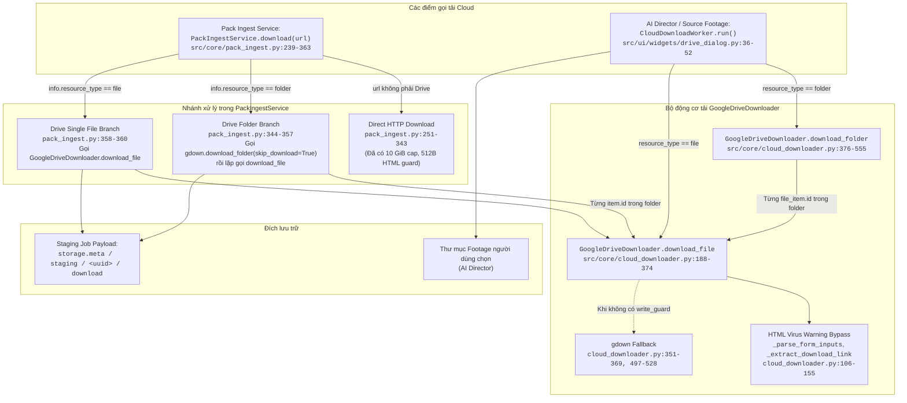
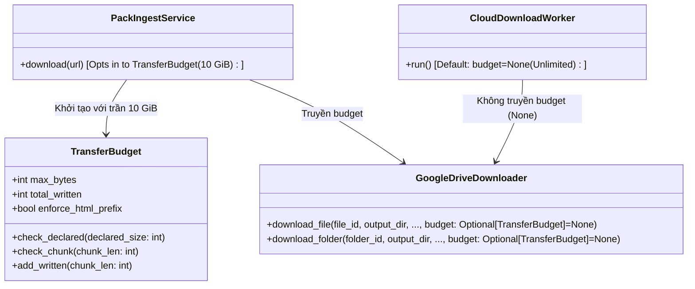

# THIẾT KẾ KIẾN TRÚC: CHÍNH SÁCH GIỚI HẠN TẢI GOOGLE DRIVE DÀNH CHO ASSET PACK (G03-03A3-D)

- **Mã nhiệm vụ (TASK_ID):** `G03-03A3-R1` (sửa lỗi theo phản hồi review từ `G03-03A3-I`)
- **Tác giả:** Antigravity (Worker)
- **Tech Lead Review:** Codex
- **Trạng thái:** `IMPLEMENTED` (89 focused tests PASS), `PENDING_REVIEW`
- **Mục tiêu:** Thiết lập chính sách bảo vệ tài nguyên và hạn ngạch dung lượng khi tải gói đạo cụ từ Google Drive (tệp đơn và thư mục phân tầng), bảo toàn tính toàn vẹn dữ liệu, chống rò rỉ trang lỗi HTML, đồng thời bảo đảm tương thích hoàn toàn cho luồng tải footage dài của AI Director.

---

## 1. RÀ SOÁT MÃ NGUỒN HIỆN TẠI VÀ CALLGRAPH TẢI GOOGLE DRIVE

### 1.1. Bản đồ Callgraph chi tiết (File : Hàm : Dòng)



### 1.2. Khảo sát chi tiết vị trí gọi kiểm soát (Guard / Cancel / Progress / Fallback)

1. **`write_guard` trong `cloud_downloader.py:download_file`:**
   - Dòng 202–203: `if write_guard: write_guard(0)`
   - Dòng 273–274: `if write_guard: write_guard(total_bytes)` $\implies$ *Cảnh báo:* `total_bytes` ở đây là kích thước khai báo từ header `Content-Length`.
   - Dòng 284–285: `if write_guard: write_guard(len(chunk))` $\implies$ Được gọi trước mỗi khối ghi 1 MiB.
   - Dòng 334–335: `if write_guard: raise` $\implies$ Chặn fallback sang `gdown` nếu có `write_guard`.
2. **`guard` trong `pack_ingest.py:download`:**
   - Dòng 247–249:
     ```python
     def guard(size=0):
         if cancel(): raise InterruptedError('Đã hủy tải.')
         self.storage.ensure_space(size)
     ```
   - *Phát hiện lỗ hổng quan trọng:* Hàm `guard` truyền vào `write_guard` hiện tại **CHỈ KIỂM TRA DUNG LƯỢNG ĐĨA TRỐNG (`ensure_space`)**, hoàn toàn **CHƯA CÓ TRẦN DUNG LƯỢNG GÓI (`MAX_PACK_STREAM_BYTES = 10 GiB`)** như luồng HTTP trực tiếp!
   - Nếu người dùng tải một file Drive đơn lẻ 30 GiB hoặc một folder Drive 100 GiB, quá trình tải vẫn sẽ tiếp tục nếu ổ cứng còn đủ chỗ!
3. **Hiện tượng lặp / thiếu bộ đếm tích lũy (Cumulative Counter Deficiency):**
   - Trong `pack_ingest.py:348–353` (nhánh folder):
     Vòng lặp `for item in files:` gọi `GoogleDriveDownloader.download_file` với `write_guard=guard`. Mỗi file được tải độc lập; không hề có một bộ đếm tích lũy `total_downloaded_bytes` xuyên suốt toàn bộ folder. Quota dung lượng bị reset về 0 ở mỗi file!
   - Nguy cơ double count: Không được cộng `total_bytes` (Content-Length) vào bộ đếm thực tế `downloaded_bytes`, vì `Content-Length` chỉ dùng để preflight. Thẩm quyền tối cao luôn là số byte thực tế trước khi gọi `write`.
4. **Hạn chế của `_is_valid_binary_file` (HTML Error Leakage):**
   - Tại `cloud_downloader.py:175–185`: Hàm chỉ kiểm tra tag HTML nếu file `< 30 KiB` (`size < 30 * 1024`).
   - Nếu Google Drive trả về trang lỗi có chèn nhiều CSS/JS (hoặc trang thông báo bản quyền/quota dài > 30 KiB), file này bị coi là binary hợp lệ và ghi vào đĩa! Luồng Direct HTTP ở `pack_ingest.py:293–302` đã có bộ đệm tiền tố 512 bytes (`check_html_prefix`), nhưng `GoogleDriveDownloader` chưa có cơ chế kiểm tra tiền tố 512 bytes này khi stream.
5. **Fallback `gdown` không có ràng buộc:**
   - Tại `cloud_downloader.py:351–369` và `497–528`: `gdown` tải toàn bộ file hoặc folder qua subprocess/internal API mà không thể can thiệp kiểm tra dung lượng theo từng block 1 MiB (`write_guard`).
   - Nếu để `gdown` chạy tự do trong luồng asset pack, nguy cơ tràn đĩa là không thể ngăn chặn.

---

## 2. PHÂN BIỆT RÕ RÀNG: PACK-ONLY POLICY (OPT-IN) VS SOURCE FOOTAGE (DEFAULT COMPAT)

Đây là yêu cầu kiến trúc cốt lõi: **Tuyệt đối không áp đặt giới hạn 10 GiB lên toàn bộ hệ thống làm hỏng tính năng AI Director / AutoWindow.**



### 2.1. Quy tắc cho Gói Đạo Cụ (Asset Pack - Opt-in Policy)
1. **Trần dung lượng nén tối đa:** Áp dụng trần đồng nhất `MAX_PACK_STREAM_BYTES = 10 * 1024 * 1024 * 1024` (10 GiB), tương đương chính sách HTTP đã nghiệm thu ở `G03-03A1`.
2. **Drive Tệp Đơn (Single File):**
   - Nếu có `Content-Length`: Preflight kiểm tra `declared_size > 10 GiB` $\implies$ Bác bỏ ngay lập tức trước khi mở luồng tải.
   - Khi stream: Kiểm tra `written + len(chunk) > 10 GiB` trước từng lần ghi block 1 MiB.
3. **Drive Thư Mục (Folder Aggregate Cumulative):**
   - **Tích lũy toàn folder:** Một bộ đếm `total_written` DUY NHẤT được chia sẻ xuyên suốt mọi tệp trong thư mục.
   - **Không reset quota:** Khi tải file thứ $N$, giới hạn còn lại là `10 GiB - total_written`.
   - **Chặn trước khi ghi:** Trước khi ghi chunk của bất kỳ file nào trong folder, nếu `total_written + len(chunk) > 10 GiB` $\implies$ Dừng ngay lập tức với `ValueError`.
   - **Preflight tổng (nếu có metadata):** Nếu danh sách file từ Google Drive có metadata dung lượng, kiểm tra tổng `sum(sizes) > 10 GiB` trước khi tải.
4. **Không suy đoán theo URL:** Không cố gắng phân tích cấu trúc URL Drive để đoán xem đây là "pack" hay "footage". Quyền quyết định thuộc về caller thông qua việc chủ động truyền `TransferBudget` / `max_stream_bytes`.

### 2.2. Quy tắc cho Video Nguồn (Source Footage - Default Compatibility)
1. **Không giới hạn 10 GiB:** Các dự án phim tài liệu hoặc vlog dài có thể yêu cầu tải 20 GiB, 50 GiB hoặc 200 GiB video gốc chất lượng 4K/6K ProRes.
2. **API tương thích ngược:** Tham số `budget` hoặc `max_stream_bytes` là tham số tùy chọn (keyword-only hoặc đặt ở cuối chữ ký hàm với giá trị mặc định `None`).
3. Các caller hiện tại (`drive_dialog.py`, `auto_window.py`) không cần sửa đổi hoặc can thiệp mà vẫn giữ nguyên hành vi tải footage không giới hạn (ngoại trừ dung lượng thực tế của ổ đĩa).

---

## 3. CƠ CHẾ XỬ LÝ HTML, BẢO MẬT VÀ QUY TẮC FALLBACK

### 3.1. Phân định rạch ròi 2 loại phản hồi HTML từ Google Drive

| Loại phản hồi HTML | Tình huống xuất hiện | Cách thức nhận diện | Hành vi xử lý chuẩn |
|---|---|---|---|
| **1. Transient / Confirmation HTML (Hợp lệ cần vượt qua)** | File lớn (> 100 MB), Google Drive không thể quét virus và yêu cầu người dùng xác nhận tải. | HTML chứa form với action `drive.usercontent.google.com/download` hoặc link `confirm=t`. | **Bắt buộc tự động bóc tách link / token và gửi request xác nhận** (giữ logic hiện có trong `_parse_form_inputs` và `_extract_download_link_from_html`). Sau đó tiếp tục stream dữ liệu nhị phân. |
| **2. Terminal Error HTML (Lỗi dứt khoát - CẤM GHI ĐĨA)** | Quota exceeded (vượt hạn ngạch tải ẩn danh), Access denied (file riêng tư), 403 Forbidden, 404 Not Found, hoặc HTML sau bước confirm. | HTML chứa các cụm từ: `quota exceeded`, `too many users`, `access denied`, `you need access`, `<!doctype html`, `<html`. | **Bắt buộc FAIL-FAST ngay lập tức.** Ném lỗi rõ ràng (`ValueError`). Tuyệt đối không ghi vào file đích, không đổi tên file `.part`, và không nạp vào pipeline. |

### 3.2. Cơ chế tiền tố 512 bytes (Streaming Prefix HTML Inspection)
- Ngay cả khi `Content-Type` bị đánh tráo hoặc là `application/octet-stream`, `GoogleDriveDownloader.download_file` trong chế độ kiểm soát bắt buộc kiểm tra 512 bytes đầu tiên:
  ```python
  def check_html_prefix(block: bytes):
      header = block[:512].lstrip(b'\xef\xbb\xbf \t\r\n').decode('utf-8', errors='ignore').lower()
      if any(marker in header for marker in ('<!doctype html', '<html', '<head', '<body', '<title', 'quota exceeded', 'too many users')):
          raise ValueError("Nội dung tải về từ Google Drive là trang web HTML hoặc thông báo lỗi, không phải tệp tài nguyên.")
  ```
- Việc kiểm tra diễn ra **trước khi ghi block đầu tiên** xuống đĩa.

### 3.3. Chính sách Fail-Closed đối với Fallback (No Uncontrolled Bypass)
- **Đối với Pack-Only Path (khi có `TransferBudget` hoặc `write_guard`):**
  - Tuyệt đối cấm fallback sang `gdown.download()` hoặc `gdown.download_folder()` không kiểm soát!
  - `gdown` chạy đen (opaque) và không hỗ trợ ngắt theo chunk 1 MiB hay theo dõi budget chính xác.
  - **Quy tắc Fail-Closed:** Nếu luồng tải trực tiếp của `GoogleDriveDownloader` thất bại, hệ thống lập tức báo lỗi và dọn dẹp sạch sẽ staging. Không được phép đánh cược tài nguyên người dùng bằng fallback thiếu bảo vệ.
- **Đối với Source Footage Path:**
  - Giữ nguyên fallback sang `gdown` như hiện tại để tối đa hóa khả năng cứu nguy cho người dùng khi tải footage làm việc.

---

## 4. QUY TẮC AN TOÀN KHI QUÉT VÀ TẢI THƯ MỤC GOOGLE DRIVE (FOLDER LISTING SAFETY)

Khi nhận một link Google Drive dạng thư mục (`/folders/<ID>`), cấu trúc bên trong là dữ liệu **hoàn toàn không tin cậy (untrusted data)**:

### 4.1. Các biện pháp phòng vệ danh mục (Folder Safeguards)
1. **Giới hạn số lượng tệp danh mục (`MAX_FILES = 100_000`):**
   - Nếu `len(files) > MAX_FILES`: Lập tức từ chối `raise ValueError('Folder Google Drive có quá nhiều tệp (> 100.000).')`.
   - Ngăn chặn tấn công làm cạn kiệt Inode hoặc tràn bộ nhớ RAM do cây thư mục khổng lồ.
2. **Chống Path Traversal và Escape Staging:**
   - Tên tệp và thư mục con lấy từ Google Drive có thể chứa `../` hoặc các ký tự độc hại.
   - Bắt buộc chuẩn hóa qua `safe_relative(item.local_path)` và xác minh:
     `target_path.is_relative_to(download_dir.resolve())`. Nếu trỏ ra ngoài $\to$ Bác bỏ ngay lập tức.
3. **Không tải vào `/tmp` hoặc ổ hệ thống:**
   - Mọi tệp tải về bắt buộc phải nằm trong thư mục staging của kho lưu trữ được quản lý: `storage.meta / 'staging' / <uuid> / 'download'`.
   - Nếu kho offline hoặc full, `storage.require_online()` và `ensure_space()` sẽ chặn đứng trước khi tải.
4. **Kiểm tra hủy tác vụ (Cancellation Check) liên tục:**
   - Kiểm tra `cancel()` trước mỗi lần quét danh sách tệp và giữa mỗi tệp trong vòng lặp tải folder.
   - Nếu người dùng bấm "Hủy", tiến trình dừng ngay lập tức, không để luồng tải chạy ngầm mồ côi (orphan thread).
5. **Dọn dẹp Best-Effort khi gặp sự cố:**
   - Toàn bộ thư mục `staging/<uuid>` được bảo bọc bởi khối `try...except` trong `PackIngestService.download`.
   - Nếu xảy ra lỗi hoặc bị hủy, toàn bộ staging job được xóa sạch (`shutil.rmtree`), bảo toàn trạng thái sạch sẽ cho ổ đĩa người dùng.

---

## 5. KẾT QUẢ THỰC THI LÁT CẮT: `G03-03A3-I`

Lát cắt thực thi đã hoàn tất trong đúng 2 module sản phẩm theo chỉ đạo từ Codex (`03A3-codex-decisions.md`):

### 5.1. Module 1: `src/core/cloud_downloader.py`
1. **Lớp điều phối ngân sách (`TransferBudget`):**
   - Nhận `max_bytes: int > 0` (bắt buộc số nguyên dương, cấm bool/float/string).
   - `check_declared(size: int >= 0)`: đối chiếu kích thước khai báo từ Content-Length với `remaining = max_bytes - total_consumed` (không cộng header vào quota).
   - `consume(chunk_len: int >= 0)`: kiểm tra trước khi tăng (`total_consumed + chunk_len > max_bytes`), cộng dồn số byte thực nhận trước khi ghi ra đĩa. Không hoàn trả quota khi write fail (kế toán bảo thủ).
2. **Cập nhật `GoogleDriveDownloader.download_file`:**
   - Thêm tham số keyword-only ở cuối: `budget: Optional[TransferBudget] = None`.
   - Chế độ pack (`budget is not None`):
     - Chỉ thử đúng 1 round (`effective_max_retries = 1`), không dùng gdown fallback khi lỗi (Fail-Closed).
     - Đọc HTML confirmation có giới hạn $\le 1$ MiB + 1, chặn đứng trang HTML lớn hoặc chứa lỗi quota/auth terminal.
     - Kiểm tra trạng thái HTTP 200 int nghiêm ngặt; chặn `text/html` và `application/xhtml+xml` trên response cuối.
     - Cơ chế đệm tiền tố 512 bytes độc lập theo từng file (`prefix_buf`), chặn đứng trang lỗi HTML đội lốt `application/octet-stream` trước khi ghi đĩa.
   - Chế độ mặc định (`budget is None` - Source Footage):
     - Giữ nguyên 100% logic cũ (retry, gdown fallback khi không có `write_guard`), không áp trần 10 GiB.

### 5.2. Module 2: `src/core/pack_ingest.py`
1. Trong `PackIngestService.download(url, cancel, progress)`:
   - Khởi tạo 1 đối tượng `budget = TransferBudget(MAX_PACK_STREAM_BYTES)` duy nhất cho mỗi job Drive.
   - **Tệp đơn:** truyền `budget=budget` vào `download_file`.
   - **Thư mục:**
     - Duy trì quét cấu trúc bằng `gdown.download_folder(..., skip_download=True)` (lưu ý: kiểm tra hủy trước/sau lệnh quét; độ dài danh mục được kiểm tra sau khi lệnh trả về, giới hạn `MAX_FILES = 100_000`).
     - Pre-validate toàn bộ danh mục trước khi tải bất kỳ file nào: kiểm tra containment trong staging (`target.is_relative_to(download)`), loại trừ path traversal (`..`), cấm xung đột case-insensitive, cấm symlink ancestor.
     - Vòng lặp tải từng file chia sẻ chung một instance `budget`, tích lũy dung lượng liên tục và chặn đứng ngay trước khối ghi vi phạm.

### 5.3. Kết quả kiểm thử tập trung (`tests/core/test_pack_drive_bounds.py`)
19 bài unit test bao phủ toàn bộ các kịch bản và 4 điểm sửa đổi theo review của Codex:
- `test_transfer_budget_validation`: Xác thực chặt chẽ kiểu dữ liệu, quota lũy kế, không nhầm lẫn bool.
- `test_drive_single_file_declared_over_cap_rejected`: Chặn preflight Content-Length > 10 GiB.
- `test_drive_single_file_streaming_over_cap_blocked_before_write`: Chặn stream vượt trần trước khi ghi đĩa.
- `test_drive_single_file_exact_cap_passes`: Điểm biên đúng 10 GiB (equality) thành công.
- `test_drive_terminal_error_html_rejected_before_write`: Chặn trang lỗi HTML > 30 KiB.
- `test_drive_virus_warning_confirmation_succeeds`: Bóc tách form cảnh báo virus và tải tiếp binary.
- `test_drive_oversized_confirmation_html_fails`: Chặn trang confirm > 1 MiB.
- `test_drive_non_200_status_fails`: Từ chối HTTP status khác 200.
- `test_drive_empty_file_fails`: Từ chối tệp rỗng 0 bytes.
- `test_drive_pack_fails_closed_no_gdown_fallback_even_with_write_guard_none`: Fail-closed tuyệt đối trong pack mode.
- `test_drive_folder_aggregate_cumulative_budget_enforced`: Tích lũy liên file (file 1 + file 2 = 800B, file 3 chạm 1000B bị chặn).
- `test_drive_folder_prevalidation_path_traversal_rejected`: Chặn tệp thoát khỏi staging (`../`).
- `test_drive_folder_prevalidation_casefold_collision_rejected`: Chặn xung đột hoa thường trong folder.
- `test_source_footage_compat_unlimited_no_budget`: Chế độ Source Footage không bị ảnh hưởng bởi trần 10 GiB.
- **Probe R1.1:** `test_pack_drive_strict_http_status_variants`: Bác bỏ trạng thái thiếu (None), sai kiểu (True, 200.0, "200"), chấp nhận int 200 qua status, code, getcode().
- **Probe R1.2:** `test_drive_folder_sanitization_collision_rejected_before_transfer`: Bác bỏ xung đột tên file sau khi chuẩn hóa qua `sanitize_filename` (ví dụ `a?.wav` và `a*.wav` $\to$ `a_.wav`) trước khi tải.
- **Probe R1.3:** `test_drive_folder_ancestor_symlink_inside_staging_rejected_before_transfer`: Kiểm tra symlink trên các thành phần đường dẫn thô (lexical ancestors) trước khi `resolve()`, ngăn chặn symlink trỏ nội bộ staging.
- **Probe R1.4:** `test_drive_pack_mode_preexisting_target_or_part_not_overwritten`: Không ghi đè tệp đích hoặc tệp tạm có trước; mở tệp bằng chế độ độc quyền `"xb"`.
- **Probe R1.5:** `test_drive_response_closed_on_all_error_branches`: Đóng response sạch sẽ qua `try...finally: resp.close()` trên mọi nhánh lỗi (preflight declared cap, HTTP status, HTML prefix, cancel).

---

## 6. TIÊU CHÍ NGHIỆM THU (ACCEPTANCE GATES)

- [x] **Ranh giới rõ ràng:** Chỉ áp dụng trần 10 GiB cho Asset Pack, hoàn toàn bảo toàn khả năng tải video dài của AI Director.
- [x] **Bảo vệ kép:** Kiểm tra cả dung lượng khai báo lẫn tích lũy thực tế trước từng khối ghi.
- [x] **Quản lý folder chặt chẽ:** Dung lượng folder là tổng tích lũy cộng dồn, không reset hạn ngạch theo từng file.
- [x] **Chặn đứng trang lỗi HTML trước khi ghi đĩa.**
- [x] **Fail-closed:** Không có đường vòng lách luật (uncontrolled fallback bypass).
- [x] **Đảm bảo tính toàn vẹn đích đến và đóng tài nguyên:** Giải quyết triệt để 4 probe review của Codex.
- [x] **100% test sử dụng fake stream / mock, toàn bộ 89 focused tests PASS trong 1.38s (exit code 0).**
- [x] **Trạng thái:** `IMPLEMENTED`, bàn giao Tech Lead Codex phê duyệt.
