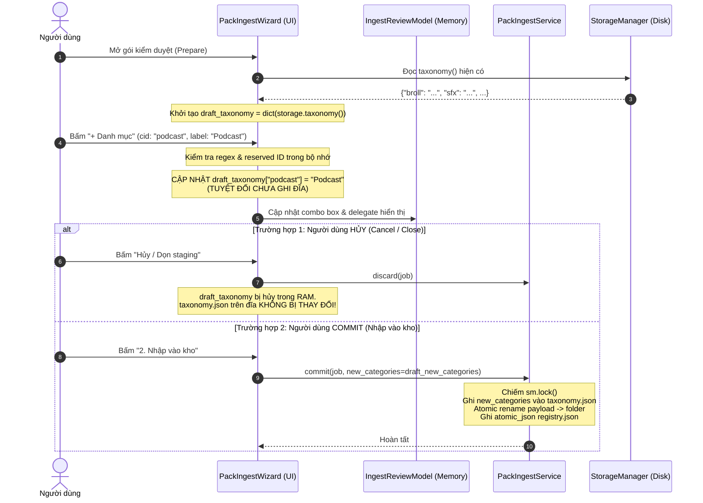

# THIẾT KẾ & ĐẶC TẢ KIỂM DUYỆT GÓI, MANIFEST KHÔNG TIN CẬY (03B-INSPECTION-TAXONOMY)

- **Mã nhiệm vụ:** `G03-03B1-I`, `G03-03B2-I` & `G03-03B2-R1` (triển khai từ `G03-03B-D` đã được phê duyệt)
- **Phiên bản:** `1.3.0-implemented`
- **Tác giả:** Antigravity (Worker) · **Tech Lead Review:** Codex
- **Trạng thái:** `IMPLEMENTED (03B1-I, 03B2-I, 03B2-R1) / ACCEPTED_DECISIONS`
- **Tài liệu nền tảng:** `docs/architecture/03-ingestion.md`, `docs/architecture/03B-codex-decisions.md`, `docs/architecture/01-data-contracts.md`
- **Phân loại bằng chứng (Evidence Class):**
  - `CODE_VERIFIED`:
    1. Đã cài đặt Safe Manifest Inspection trong `src/core/pack_ingest.py` và kiểm chứng với 56 unit tests tập trung (exit code 0).
    2. Đã cài đặt Hiển thị cảnh báo inspection trước commit và Global Details UTF-8 Budget $\le 16384$ bytes trong `src/ui/widgets/pack_ingest_wizard.py` và kiểm chứng với 28 UI tests tập trung (6 tests trong `test_pack_ingest_warnings.py` + 14 tests trong `test_pack_ingest_wizard.py` + 8 tests trong `test_starter_pack_routing.py`, exit code 0).
  - `DEFERRED`: Cách ly draft taxonomy transaction trong wizard, phân loại chi tiết preview native `.drfx`, và strict DTO serializer trong commit tiếp tục được hoãn sang các lát cắt riêng biệt.
  - `DISCLAIMER`: Kết quả kiểm thử UI PASS trong môi trường offscreen pytest phản ánh tính đúng đắn của logic tín hiệu, sự kiện và hợp đồng dữ liệu, không thay thế cho physical desktop acceptance trên màn hình thực tế.

---

## 1. CALLGRAPH THỰC TẾ VÀ ĐỐI SOÁT MÃ NGUỒN (FILE:HÀM:DÒNG)

### 1.1. Chuỗi Gọi Hàm Thực Tế Trong Ingestion (Inspection $\to$ Draft $\to$ Commit)

```mermaid
flowchart TD
    subgraph UI_Surface ["Giao diện Người dùng"]
        W0["PackIngestWizard<br/><code>src/ui/widgets/pack_ingest_wizard.py:89</code>"]
        W1["PackIngestWizard._prepare()<br/><code>src/ui/widgets/pack_ingest_wizard.py:200</code>"]
        M1["IngestReviewModel<br/><code>src/ui/widgets/pack_ingest_wizard.py:40</code>"]
        D1["CategoryDelegate<br/><code>src/ui/widgets/pack_ingest_wizard.py:79</code>"]
        AC["_add_category()<br/><code>src/ui/widgets/pack_ingest_wizard.py:163</code>"]
        AR["_apply_rows()<br/><code>src/ui/widgets/pack_ingest_wizard.py:172</code>"]
        CM["_commit()<br/><code>src/ui/widgets/pack_ingest_wizard.py:210</code>"]
    end

    subgraph Service_Core ["Dịch vụ Lõi (PackIngestService)"]
        S1["PackIngestService.prepare()<br/><code>src/core/pack_ingest.py:62</code>"]
        S2["_extract() (ZIP Safe)<br/><code>src/core/pack_ingest.py:91</code>"]
        IT["inspect_tree()<br/><code>src/core/pack_ingest.py:39</code>"]
        GS["guess()<br/><code>src/core/pack_ingest.py:25</code>"]
        IJ["inspect_job()<br/><code>src/core/pack_ingest.py:134</code>"]
        SC["PackIngestService.commit()<br/><code>src/core/pack_ingest.py:168</code>"]
    end

    subgraph Storage_Contracts ["Lưu trữ & Hợp đồng Dữ liệu"]
        ST["StorageManager.taxonomy()<br/><code>src/core/storage_manager.py:345</code>"]
        SA["StorageManager.add_category()<br/><code>src/core/storage_manager.py:351</code>"]
        UA["StorageManager.ui_assets()<br/><code>src/core/storage_manager.py:373</code>"]
        DTO["AssetDTO / to_ui_asset()<br/><code>src/core/contracts/asset_dto.py:420</code>"]
    end

    W0 --> W1 --> S1
    S1 --> S2 --> IJ
    IJ --> IT --> GS
    IJ -->|Đọc manifest.json| IJ
    IJ -->|Trả về job dict| W1
    W1 -->|Đưa assets vào bảng| M1
    M1 --> D1
    D1 -.->|Đọc danh mục| ST
    AC -.->|GHI ĐĨA TRỰC TIẾP (HIỆN TẠI)| SA
    AR --> M1
    CM --> SC
    SC -->|with sm.lock(): atomic rename & registry| ST
    UA --> DTO
```

### 1.2. Bảng Tra Cứu File : Hàm : Dòng Thực Tế

| Thành phần | File : Dòng | Chữ ký / Định nghĩa | Hành vi Hiện tại (`CODE_READ`) | Đánh giá & Rủi ro Kiến trúc |
| :--- | :--- | :--- | :--- | :--- |
| **`guess`** | `src/core/pack_ingest.py:25-36` | `guess(path: Path) -> Tuple[str, bool]` | Phân loại dựa vào đuôi file và chuỗi tên file (`VIDEO`, `AUDIO`, `IMAGES`, `ext in {'.setting', '.drfx', '.comp'}`). File có chữ `transition` tự động gán `category='templates', excluded=True`. | Keyword `transition` trong file MP4 biến video thường thành template bị loại. Chưa phân biệt rõ vai trò preview với asset chính. |
| **`inspect_tree`** | `src/core/pack_ingest.py:39-56` | `inspect_tree(root: Path, source_id: str, cancel=...) -> List[Dict]` | Duyệt cây đĩa qua `os.walk(followlinks=False)`, lọc symlink thư mục, chặn symlink file, sinh ID ổn định bằng `uuid5(source_id + ':' + rel)`. | An toàn symlink cơ bản tốt, nhưng bỏ qua file `manifest.json`/`pack_manifest.json` cứng, không thu thập metadata phụ trợ. |
| **`inspect_job`** | `src/core/pack_ingest.py:134-167` | `inspect_job(directory: Path, name='Pack', cancel=...) -> Dict` | Tìm manifest bằng `sorted(payload.rglob('*manifest.json'))`, giới hạn 2 MiB, ghép `prefix / str(a.get('relative_path'))`, ghi đè `name`, `category`, `subcategory`, `tags`, `template_type`, `excluded`. Lấy manifest đầu tiên rồi `break`. | **Rủi ro bảo mật & toàn vẹn:**<br/>1. Không dùng `safe_relative` cho `relative_path` trong manifest.<br/>2. Không kiểm tra `schema_version`.<br/>3. `category` lạ trong manifest đè bẹp `guess` mà không kiểm tra taxonomy.<br/>4. `break` sau manifest đầu tiên lấy file ngẫu nhiên theo thứ tự alphabet thư mục. |
| **`commit`** | `src/core/pack_ingest.py:168-232` | `commit(job: Dict, cancel=..., progress=...) -> Dict` | Kiểm tra staging hợp lệ, lọc `chosen` không bị excluded, kiểm tra `category in tax`, xóa file exclude khỏi payload, `os.rename(payload, folder)`, ghi `registry.json`. | **Lưu ý kiến trúc:** Hiện tại `chosen` được ghi trực tiếp vào `registry['assets']` mà **CHƯA ĐI QUA** `to_persisted_record` của `asset_dto.py`. Các trường lạ (như `excluded: False`) đang lọt vào `registry.json`. |
| **`IngestReviewModel`** | `src/ui/widgets/pack_ingest_wizard.py:40-77` | `class IngestReviewModel(QAbstractTableModel)` | Bảng hiển thị 6 cột: Nhập (checkbox), File, Danh mục (combo), Nhóm con, Tags, MiB. | Chỉ cho sửa `category`, `subcategory`, `tags`, `excluded`. Chưa hiển thị cảnh báo vi phạm taxonomy hoặc trạng thái preview. |
| **`CategoryDelegate`** | `src/ui/widgets/pack_ingest_wizard.py:79-87` | `class CategoryDelegate(QStyledItemDelegate)` | Tạo `QComboBox` với dữ liệu từ `self.storage.taxonomy()`. | Lấy taxonomy từ ổ cứng. Nếu manifest gán category chưa đăng ký, combo box sẽ không chọn được giá trị hợp lệ. |
| **`_add_category`** | `src/ui/widgets/pack_ingest_wizard.py:163-171` | `PackIngestWizard._add_category(self)` | Nhận input `cid` và `label` từ người dùng, gọi trực tiếp `self.storage.add_category(cid, label)`. | **Vi phạm nguyên tắc Draft:** Ghi ngay lập tức vào `taxonomy.json` trên đĩa và cập nhật snapshot. Nếu người dùng bấm Hủy (Cancel/Discard), danh mục mới vẫn bị lưu vĩnh viễn trên đĩa! |
| **`taxonomy`** | `src/core/storage_manager.py:345-350` | `StorageManager.taxonomy(self) -> Dict[str, str]` | Đọc `taxonomy.json` nếu online, đọc snapshot nếu offline, fallback `dict(CATEGORIES)`. | Đúng chuẩn 7 danh mục canonical + custom category. |
| **`add_category`** | `src/core/storage_manager.py:351-358` | `StorageManager.add_category(self, category_id, label)` | Chặn reserved IDs, regex `[a-z][a-z0-9_]{0,47}`, chiếm `sm.lock()`, ghi `atomic_json(taxonomy.json)` và `snapshot()`. | Hàm công khai lõi, hoạt động chuẩn xác nhưng không nên gọi trong giai đoạn draft. |
| **`ui_assets`** | `src/core/storage_manager.py:373-375` | `StorageManager.ui_assets(self) -> List[Dict]` | Chuyển đổi toàn bộ `self.assets()` qua `to_ui_asset(asset)` trong `asset_dto.py`. | Tầng biên kết nối dữ liệu kho với tất cả UI consumers. |

### 1.3. Bằng Chứng Người Dùng Dữ Liệu (Consumer Proof): Danh Mục Chuẩn vs Bí Danh Tab UI

Để chứng minh sự tách biệt rõ ràng giữa **Danh mục lưu trữ chuẩn (Canonical Storage Categories)** và **Bí danh Tab hiển thị UI (Legacy Tab Aliases)** mà không cần audit toàn bộ repo:

1. **Hợp đồng DTO (`src/core/contracts/asset_dto.py:24-43, 440-461`):**
   - Lưu trữ chuẩn (7 danh mục): `CANONICAL_STORAGE_CATEGORIES = {"broll", "sfx", "bgm", "overlays", "memes", "luts", "templates"}`.
   - Hiển thị UI: `UI_CATEGORIES = {"broll", "sfx", "bgm", "overlay", "meme", "lut", "text", "trans"}`.
   - Hàm `to_ui_asset` ánh xạ:
     - `overlays` $\to$ `tab = "overlay"`
     - `memes` $\to$ `tab = "meme"`
     - `luts` $\to$ `tab = "lut"`
     - `templates` + `template_type == "trans"` $\to$ `tab = "trans"`
     - `templates` + `template_type == "text"` $\to$ `tab = "text"`
     - `broll`, `sfx`, `bgm` $\to$ giữ nguyên tên tab.
2. **Consumer 1 — TabAssets (`src/ui/tabs/tab_assets.py:6034-6042`):**
   - Đọc qua `StorageManager().ui_assets()`:
     ```python
     for record in StorageManager().ui_assets():
         asset = StudioAsset(id=record["id"], name=record["name"], tab=record["tab"],
                             category=record["category"], sub=record.get("sub", ""), ...)
     ```
   - Bộ lọc tab của `TabAssets` sử dụng thuộc tính `asset.tab` (tức `text`, `trans`, `lut`, `meme`, `overlay`), trong khi `registry.json` lưu `luts`, `memes`, `overlays`, `templates`.
3. **Consumer 2 — Category Navigation (`src/ui/lux/library/category_nav.py:13-22`):**
   - `DEFAULT_CATEGORIES` định nghĩa trực tiếp các ID điều hướng UI:
     `[{"id": "text"}, {"id": "trans"}, {"id": "meme"}, {"id": "overlay"}, {"id": "sfx"}, {"id": "bgm"}, {"id": "lut"}, {"id": "mine"}]`.
4. **Consumer 3 — Model View & Trích xuất Metadata (`src/ui/lux/library/asset_model.py:41-43`):**
   ```python
   cat = str(item.get("tab") or item.get("category") or "text").lower()
   sub = str(item.get("sub") or item.get("sub_category") or (item.get("category") if item.get("tab") else "Tất cả"))
   ```
   Ưu tiên lấy `item["tab"]` trước, chứng minh UI phụ thuộc vào adapter `to_ui_asset`.

---

## 2. CHÍNH SÁCH MANIFEST KHÔNG TIN CẬY (UNTRUSTED MANIFEST SPECIFICATION)

### 2.1. Ranh Giới Bất Khả Xâm Phạm (Security Boundary)

> [!IMPORTANT]
> **Nguyên tắc Cốt lõi:** `manifest.json` đi kèm trong gói tải về là **DỮ LIỆU HOÀN TOÀN KHÔNG TIN CẬY (UNTRUSTED METADATA HINT)** từ bên thứ ba.
> Manifest **CHỈ LÀ GỢI Ý (HINT)** cho giao diện kiểm duyệt, **TUYỆT ĐỐI KHÔNG ĐƯỢC PHÉP**:
> 1. Ghi đè hoặc chỉ định các trường hệ thống bất biến: `id`, `library_path`, `external_path`, `source_kind`, `size_bytes`, `_raw_obj` (runtime handle).
> 2. Tự động đăng ký danh mục mới vào `taxonomy.json` hoặc tạo custom category ngầm định.
> 3. Thoát khỏi cây thư mục gói thông qua đường dẫn tương đối độc hại (`..`, `/`, `C:\`).
> 4. Xóa bỏ hoặc bỏ qua các file media hợp lệ đang thực sự tồn tại trên đĩa.

### 2.2. Kiểm Tra Ràng Buộc Đọc và Cấu Trúc (Bounded Read & Schema Validation)

1. **Giới hạn dung lượng đọc (Bounded Read):**
   - Mỗi file manifest (`*manifest.json`) được giới hạn tối đa `MAX_MANIFEST_BYTES = 2 * 1024 * 1024` (2 MiB).
   - Kiểm tra `st_size > 2 MiB` trước khi đọc.
   - Nếu vi phạm: Không làm sập toàn bộ tiến trình quét; ghi nhận cảnh báo `Manifest quá lớn (> 2 MiB), bỏ qua gợi ý metadata và sử dụng phân loại tự động`.
2. **Xác thực Schema & Phiên bản (Version Handling):**
   - Bắt buộc là JSON Object (`isinstance(metadata, dict)`).
   - `schema_version`:
     - Nếu thiếu `schema_version`: Coi là manifest legacy v1 (hỗ trợ tương thích ngược), xử lý các trường hint cơ bản.
     - Nếu `schema_version == 1`: Hợp lệ, xử lý theo đặc tả v1.
     - Nếu `schema_version > 1` hoặc kiểu dữ liệu không phải `int`: Từ chối áp dụng gợi ý metadata từ manifest (fallback hoàn toàn về `guess()`), đính kèm cảnh báo: `Phiên bản manifest không được hỗ trợ: {version}`.
   - `name`: Chuỗi ký tự, cắt tối đa 60 ký tự, làm sạch ký tự điều khiển.
   - `version`: Chuỗi ký tự, cắt tối đa 24 ký tự, mặc định `'1.0'`.
   - `assets`: Bắt buộc là danh sách (`list`). Nếu không phải `list`, bỏ qua manifest và cảnh báo.

### 2.3. Xử Lý Đường Dẫn Tương Đối & Phòng Chống Prefix Escape

**Lỗ hổng mã nguồn hiện tại (`pack_ingest.py:145-146`):**
```python
prefix = manifest_path.parent.relative_to(payload)
by_path = {(prefix / str(a.get('relative_path', ''))).as_posix(): a for a in entries if isinstance(a, dict)}
```
Đoạn mã trên ghép chuỗi trực tiếp mà không kiểm tra tính an toàn của `relative_path`. Nếu `a.get('relative_path')` là `../../outside.mp4`, nó sẽ thoát khỏi `prefix`!

**Đặc tả chuẩn hóa trong 03B:**
1. Mọi `relative_path` trong manifest bắt buộc phải được thẩm định qua hàm lexical an toàn:
   ```python
   raw_rel = str(a.get('relative_path', '')).strip()
   if not is_safe_relative_path(raw_rel):
       continue  # Bỏ qua entry có đường dẫn nguy hiểm hoặc traversal
   safe_rel = safe_relative(raw_rel)
   target_rel = (prefix / safe_rel) if prefix != Path('.') else safe_rel
   # Đảm bảo target_rel nằm trong cây con của prefix
   if prefix != Path('.') and not target_rel.is_relative_to(prefix):
       continue  # Prefix escape bị chặn đứng
   ```
2. **Khóa tìm kiếm không phân biệt hoa thường (Case-insensitive matching):**
   - Đĩa thực tế có thể là `Audio.WAV` trong khi manifest ghi `audio.wav`.
   - Lập chỉ mục manifest bằng `canonical_key = target_rel.as_posix().casefold()`.
   - Nếu trong cùng một manifest xuất hiện 2 entry có cùng `canonical_key`: Lấy entry đầu tiên, bỏ qua entry thứ hai và gắn cờ cảnh báo `Manifest chứa đường dẫn trùng lặp: {raw_rel}`.

### 2.4. Thứ Tự Ưu Tiên Manifest Gốc vs Manifest Cây Con (Precedence Policy)

Khi giải nén gói tài nguyên, có thể xuất hiện nhiều file manifest ở các cấp thư mục khác nhau.
**Quy tắc ưu tiên nghiêm ngặt:**
1. **Manifest Gốc (Root Manifest):**
   - Ưu tiên 1: `payload / "pack_manifest.json"`
   - Ưu tiên 2: `payload / "manifest.json"`
   - Nếu có manifest gốc, manifest gốc có quyền tối thượng áp dụng cho toàn bộ các file trong gói.
2. **Manifest Thư Mục Con (Subtree Manifest):**
   - Chỉ được duyệt nếu **KHÔNG CÓ** manifest gốc, hoặc file manifest thư mục con chỉ được phép cung cấp metadata cho các file nằm bên trong chính thư mục con đó (`prefix`).
   - Tuyệt đối không cho phép manifest con ghi đè file của thư mục cha hoặc thư mục anh em.
3. Không thực hiện `rglob('*manifest.json')` rồi gọi `break` bừa bãi như hiện tại. Việc quét phải có định hướng rõ ràng: kiểm tra root trước, sau đó mới quét thư mục con theo cây phân cấp.

### 2.5. Bảng Ma Trận Lỗi Manifest & Chính Sách Ứng Xử (Fault Matrix)

| Tình huống Lỗi | Minh họa Dữ liệu | Hành vi Cũ (`pack_ingest.py`) | Chính sách Mới Chuẩn hóa (`03B`) | Trạng thái Draft UI |
| :--- | :--- | :--- | :--- | :--- |
| **Missing Version** | `{"assets": [...]}` | Chấp nhận, coi version='1.0' | Chấp nhận metadata hint, gán version default `'1.0'`, cảnh báo thiếu schema version. | Warning vàng |
| **Unsupported Version** | `{"schema_version": 99}` | Bỏ qua kiểm tra, nhận toàn bộ | Từ chối manifest, fallback 100% về `guess()`, cảnh báo `schema_version 99 không hỗ trợ`. | Warning vàng |
| **Path Traversal Escape** | `"relative_path": "../hack.wav"` | Ghép nối chuỗi, nguy cơ escape | Bác bỏ entry này; không khớp với bất kỳ file nào trên đĩa. | Độc lập, an toàn |
| **Casefold Collision** | `"A.wav"` và `"a.wav"` trong manifest | Entry sau đè entry trước | Giữ entry đầu tiên; log cảnh báo trùng lặp trong manifest. | Ghi nhận |
| **Unmapped Entry** | Manifest khai file `missing.mp4` không có trên đĩa | Bỏ qua ngầm định | Bỏ qua, **tuyệt đối không tạo bản ghi ma (phantom record)** trong draft. | Bỏ qua |
| **Unmanifested Disk File** | Đĩa có `extra.mp4` nhưng manifest không nhắc tới | Bị giữ lại với `guess()` | **Bắt buộc giữ lại**: Duyệt qua `guess()`, gán category tự động, đưa vào draft để user kiểm duyệt. | File hợp lệ |
| **Nested Conflicts** | Root và Subfolder đều có manifest | Alphabet sorting rglob quyết định ngẫu nhiên | Root manifest áp đảo; subfolder manifest bị bỏ qua hoặc chỉ bổ sung nếu root không định nghĩa. | Nhất quán |
| **Tệp rác / Không hợp lệ** | `.DS_Store`, `Thumbs.db`, `.pdf`, `.txt`, `.docx` | `guess()` cho `excluded=True` | Giữ nguyên chính sách loại trừ: mặc định `excluded=True`, không import rác vào kho. | Unchecked đỏ/xám |

### 2.6. Chính Sách Xử Lý Danh Mục Lạ, Thẻ Sai Kiểu & Template Type

Khi manifest chỉ định một `category` không nằm trong 7 danh mục chuẩn (`broll`, `sfx`, `bgm`, `overlays`, `memes`, `luts`, `templates`) và cũng chưa từng tồn tại trong `storage.taxonomy()`:

- **Các phương án xem xét:**
  - *Phương án A (Reject Pack):* Ném lỗi, hủy toàn bộ gói nạp. $\to$ *Quá nghiêm khắc, làm phiền người dùng khi gói tải về từ nguồn cộng đồng có category tự chế.*
  - *Phương án B (Auto-create Category):* Tự động đăng ký category lạ vào `taxonomy.json`. $\to$ *Vi phạm nghiêm trọng an toàn kho: làm rác taxonomy, tạo danh mục không mong muốn trước khi user xác nhận.*
  - *Phương án C (Khuyến nghị — Safe Guess Fallback + Suggestion Warning):*
    1. Giữ nguyên giá trị do `guess(rel)` tự động phán đoán làm `item['category']` hợp lệ ban đầu.
    2. Lưu giá trị lạ từ manifest vào trường metadata tạm của draft: `item['_manifest_suggested_category'] = raw_val`.
    3. Gắn cờ cảnh báo: `item['_warning'] = f"Manifest đề xuất danh mục chưa đăng ký: '{raw_val}'. Đã tự động phân loại vào '{item['category']}'."`
    4. Trên giao diện `PackIngestWizard`, người dùng nhìn thấy cảnh báo. Người dùng có quyền:
       - Chấp nhận danh mục đã đoán.
       - Hoặc bấm `+ Danh mục` để tạo custom category chính thức nếu thực sự muốn.
- **Xử lý `template_type`:**
  - Nếu `category == 'templates'`: Chuẩn hóa `title` $\to$ `text`, `transition` $\to$ `trans`. Bất kỳ giá trị nào khác đưa về mặc định `text`.
  - Nếu `category != 'templates'`: Xóa bỏ hoặc đặt `template_type = None` (theo đúng hợp đồng `asset_dto.py:278-280`).
- **Xử lý `tags`:**
  - Bắt buộc là danh sách chuỗi. Loại bỏ phần tử không phải `str`, cắt mỗi tag tối đa 100 ký tự, giới hạn tối đa 50 tags. Không ném Exception làm sập luồng nạp.

> [!WARNING]
> **Hiện trạng bộ tuần tự hóa DTO:**
> Hiện tại, hàm `PackIngestService.commit()` (`src/core/pack_ingest.py:197`) thêm trực tiếp danh sách `chosen` vào `registry['assets']` mà chưa đi qua `to_persisted_record()` của `asset_dto.py`. Vì vậy, không được phép đưa các trường runtime nội bộ (`_manifest_suggested_category`, `_warning`, `_role`, `excluded`) vào `chosen` khi gọi commit, để tránh làm ô nhiễm file `registry.json`.

---

## 3. BẢY DANH MỤC CHUẨN VÀ MÔ HÌNH DRAFT TAXONOMY

### 3.1. Phân Tách Danh Mục Chuẩn và Danh Mục Tùy Biến

Hệ thống ResolveFlow duy trì cấu trúc taxonomy rõ ràng:
1. **Bảy danh mục Canonical cố định:**
   - `broll`: Cảnh quay minh họa (Video B-roll, cảnh phong cảnh, footage chèn).
   - `sfx`: Hiệu ứng âm thanh ngắn (Whoosh, Impact, UI click, Pop).
   - `bgm`: Nhạc nền dài (Vlog background music, Lofi, Cinematic track).
   - `overlays`: Lớp phủ video có hòa trộn/alpha (Grain, Light Leak, VHS, Dust, Vignette).
   - `memes`: Video/Ảnh meme, hài hước, phản ứng (Reaction clips, Green screen memes).
   - `luts`: Bảng tra cứu màu sắc (Cube 3D LUTs).
   - `templates`: Mẫu Fusion đồ họa chuyển động (`.setting`, `.drfx`, `.comp`), phân tách thành 2 loại `template_type`:
     - `text`: Tiêu đề chữ động (Titles, Lower Thirds, Kinetic Typography).
     - `trans`: Hiệu ứng chuyển cảnh Fusion (Fusion Transitions).
2. **Danh Mục Tùy Biến (Custom Categories):**
   - Được định nghĩa bởi người dùng trong `taxonomy.json`.
   - Định danh (ID): Bắt buộc tuân thủ regex `[a-z][a-z0-9_]{0,47}`.
   - Nhãn hiển thị (Label): Chuỗi tiếng Việt có dấu, độ dài tối đa 100 ký tự.
   - Bị cấm sử dụng các ID dành riêng (`RESERVED_CATEGORY_IDS`):
     `{'all', 'fav', 'recent', 'mine', 'hub', 'text', 'trans', 'lut', 'meme', 'overlay', 'icon'}`.

### 3.2. Bảo Tồn Chuỗi Tiếng Việt Người Dùng Đặt — Chống Đoán Kiểu Dáng Giả Tạo

- Thuộc tính `subcategory` (Nhóm con) và `tags` do người dùng hoặc tác giả gói đặt bằng tiếng Việt có dấu (ví dụ: `Nhóm con: "Khai mạc"`, `Tags: ["hào hùng", "kịch tính", "vlog đời sống"]`) **BẮT BUỘC ĐƯỢC BẢO TỒN NGUYÊN VẸN 100%**.
- **Chống phán đoán giả tạo (No Fake Style Guessing):**
  - Không được dùng các heuristic suy đoán vô căn cứ để tự ý gán nhãn phong cách tiếng Anh (như tự gán `Kinetic`, `Neon`, `Retro`, `Minimalist`, `Cinematic`) nếu tên thư mục hoặc manifest không chứa các từ đó.
  - Nếu file nằm ở thư mục gốc của gói, `subcategory` mặc định để trống `""` (khi hiển thị trên UI sẽ hiển thị ở tab "Tất cả").
  - Chỉ trích xuất `subcategory` từ tên thư mục cha trực tiếp (`rel.parent.name`) khi có phân cấp thư mục thực tế.

### 3.3. Mô Hình Draft-Only Cho Tạo Danh Mục Mới (Isolation & Compatibility)

#### Khiếm khuyết thiết kế hiện tại:
Trong `PackIngestWizard._add_category` (`src/ui/widgets/pack_ingest_wizard.py:169`):
Khi người dùng bấm nút `+ Danh mục` trên thanh công cụ review:
$\implies$ Gọi ngay lập tức `self.storage.add_category(cid, label)`.
$\implies$ `StorageManager.add_category` chiếm khóa `sm.lock()`, ghi đĩa `taxonomy.json` và gọi `sm.snapshot()`.
$\implies$ Nếu người dùng sau đó nhấn nút "Hủy / Dọn staging" (`reject()`), toàn bộ thư mục staging bị xóa nhưng **danh mục mới vẫn tồn tại vĩnh viễn trên đĩa**!

#### Mô hình Draft-Only chuẩn hóa:
Để đảm bảo tính nhất quán giao dịch (Transaction Consistency):



#### Giữ tính tương thích (Compatibility Guarantees):
1. **Không thay đổi chữ ký cốt lõi của `StorageManager.add_category(category_id, label)`:**
   Hàm này tiếp tục hoạt động như một API tiện ích độc lập (được gọi từ Settings hoặc CLI).
2. **Cơ chế ghi tuần tự trong `commit()`:**
   Vì hệ điều hành POSIX không hỗ trợ giao dịch nguyên tử đa tệp (multi-file atomic transaction) giữa `taxonomy.json` và `registry.json` mà không có journal, thứ tự ghi an toàn trong `commit()` được thiết kế:
   - Bước 1: Chiếm `with sm.lock():`
   - Bước 2: Kiểm tra các category mới xuất hiện trong `chosen`: nếu có category chưa có trong `sm.taxonomy()`, cập nhật `taxonomy.json` trước.
   - Bước 3: `os.rename(payload, folder)`.
   - Bước 4: `atomic_json(registry.json)`. Nếu bước này gặp sự cố, rollback rename thư mục (như hiện tại).
   - Không cam kết quá đà về "multi-file ACID" khi chưa có hệ thống G02 Journaling.

---

## 4. CHÍNH SÁCH PREVIEW VÀ KHẢ NĂNG CHÈN TIMELINE (INSERTABILITY)

### 4.1. Phân Biệt Tên File Gợi Ý vs Vai Trò Thực Tế

Trong các gói tài nguyên tải về từ internet, các file mang tên chứa `preview`, `demo`, `thumbnail`, `sample` thường gây nhầm lẫn lớn giữa **Media xem trước** và **Tài sản dựng phim chính thức**.

**Quy tắc phân định độ tin cậy (Confidence & Evidence Tiers):**

| Cấp độ Tin cậy | Bằng chứng Nhận diện (Evidence Source) | Kết luận Vai trò (`role`) | Mặc định Nhập (`excluded`) |
| :--- | :--- | :---: | :---: |
| **Bậc 1: Cực cao (High)** | Manifest khai báo rõ `role: "preview"` hoặc `is_preview: true`. | `preview` | `True` (Loại bỏ) |
| **Bậc 2: Rất cao (High)** | Tệp `.mp4`/`.mov` có cùng tên gốc với một tệp `.drfx`/`.setting`/`.cube` trong cùng thư mục (ví dụ: `Glitch.setting` và `Glitch_preview.mp4`). | `preview` (của template bên cạnh) | `True` (Loại bỏ) |
| **Bậc 3: Trung bình (Medium)** | Tên file chứa `_preview`, `-preview`, `_demo`, `thumbnail` VÀ trong gói đã có các file media chính khác. | `suspected_preview` | `True` (Gợi ý loại, kèm tooltip giải thích) |
| **Bậc 4: Thấp (Low)** | Tệp video đơn lẻ có chữ `preview` nhưng là file duy nhất (ví dụ: `cinematic_preview_reel.mp4`). | `asset` | `False` (Giữ lại, không coi keyword là chắc chắn) |

> [!NOTE]
> Tuyệt đối không coi một từ khóa trong tên file là bằng chứng chắc chắn 100%. Giao diện review luôn là nơi người dùng có quyền phủ quyết (User Override).

### 4.2. Chuyển Cảnh Native (`.drfx` / `.setting`) vs Video Xem Trước (`.mp4`)

Đây là điểm xung đột kỹ thuật then chốt trong DaVinci Resolve:
1. **Tài sản chuyển cảnh Native:**
   - Định dạng: `.drfx` (Gói cài đặt mẫu Fusion) hoặc `.setting` (Macro nốt Fusion đặt trong `Edit/Transitions`).
   - Hành vi Resolve: Kéo thả trực tiếp vào vết cắt giữa hai clip trên Timeline để tạo hiệu ứng chuyển tiếp giữa Video Track A và Track B.
   - Hướng dẫn / Cài đặt: Khác hoàn toàn việc import clip vào Media Pool.
2. **Video xem trước chuyển cảnh (`.mp4`, `.mov`):**
   - Bản chất: Là một đoạn video đặc (solid carrier, không có kênh alpha) quay lại cảnh hai bức ảnh mẫu được chuyển cảnh bằng hiệu ứng nói trên để người mua xem thử trên trang web.
   - Hậu quả nếu người dùng chèn vào Timeline:
     - Đây là một clip video thông thường, che lấp toàn bộ video chính bên dưới (do không có alpha).
     - Không thể biến thành một hiệu ứng chuyển tiếp (Transition Cut) trên DaVinci Resolve!
3. **Chính sách phân loại & Override rõ ràng:**
   - Mặc định: Mọi file `.mp4`/`.mov` đi kèm template chuyển cảnh được nhận diện là `preview` $\implies$ Tự động đánh dấu `excluded = True`.
   - Tooltip giải thích trên UI: `"File video xem trước (không phải template chuyển cảnh). Bỏ dấu tích để không nạp rác vào kho."`
   - Nếu người dùng vẫn muốn sử dụng clip này (ví dụ làm footage B-roll minh họa):
     Người dùng bỏ tích ô loại trừ (`excluded = False`), và chuyển danh mục từ `templates` sang `broll`. Hệ thống chấp nhận lựa chọn của người dùng, không chặn thô bạo.

### 4.3. Lưu Trữ Thuộc Tính Dự Kiến & Hợp Đồng DTO (Compatibility Allowlist)

**Thực trạng hợp đồng dữ liệu V1 (`src/core/contracts/asset_dto.py:67-84`):**
Danh sách trắng các trường được phép lưu trữ (`PERSISTED_ALLOWLIST`):
```python
PERSISTED_ALLOWLIST: Set[str] = {
    "schema_version", "id", "name", "source_kind", "category",
    "subcategory", "tags", "template_type", "size_bytes", "pack_id",
    "pack_name", "relative_path", "library_path", "source_id",
    "external_path", "duration_sec",
}
```
`PERSISTED_ALLOWLIST` **HOÀN TOÀN KHÔNG CÓ** các trường `role`, `is_preview`, `insertability`, `warning`.

**Nguyên tắc tương thích:**
1. **KHÔNG tự tiện bổ sung các trường không có trong allowlist** vào bản ghi lưu trữ bền vững trên `registry.json` khi chưa có schema version mới (v2).
2. Các thông tin `_role`, `_insertability_hint`, `_warning` **CHỈ TỒN TẠI TRONG RAM** trong suốt vòng đời của `job['assets']` và `IngestReviewModel`.
3. Chúng điều khiển:
   - Giá trị mặc định của trường `excluded: bool` trong giai đoạn draft.
   - Biểu tượng, tooltip và màu sắc cảnh báo trên bảng giao diện `PackIngestWizard`.
4. Khi gọi `commit()`:
   Chỉ những file có `excluded == False` mới được đưa vào danh sách `chosen`. Trước khi ghi vào `registry.json`, các cờ tạm bắt đầu bằng dấu gạch dưới (`_*`) và cờ `excluded` được làm sạch hoàn toàn để khớp 100% với `PERSISTED_ALLOWLIST`.

---

## 5. RÀNG BUỘC TƯƠNG THÍCH AI RECIPE VÀ TIÊU THỤ ASSET ID

### 5.1. Định Danh Ổn Định (Deterministic Stable UUID)

- Mọi asset trong gói được sinh ID bằng định danh tất định chuẩn RFC 4122 v5:
  `asset_id = uuid.uuid5(uuid.NAMESPACE_URL, f"{pack_id}:{relative_path}").hex`
- Đảm bảo: Cùng một file trong cùng một gói luôn có ID bất biến giữa các lần quét lại hoặc giữa các máy khác nhau.
- Người dùng các tính năng AI (như AutoCut, AI Director) lưu tham chiếu đến asset thông qua chuỗi `asset_id` này.

### 5.2. Tương Thích Với Recipe AI (`src/core/recipe_manager.py`)

- Schema `Recipe` (`src/core/recipe_manager.py:46, 385`) sử dụng các trường tham chiếu tĩnh:
  - `text_preset_id: str` (ví dụ: `"karaoke_pop"`, trỏ tới preset chữ).
  - Tùy chọn bật tắt: `enable_broll`, `enable_sfx`, `enable_subtitles`.
- Giai đoạn Ingest & Inspection của kho đạo cụ **CHỈ CẦN BẢO ĐẢM**:
  1. `asset_id` là chuỗi ký tự duy nhất, không trùng lặp trong kho.
  2. Trường `category` và `template_type` phân loại chính xác để khi xuất bản sang UI, adapter `to_ui_asset()` đưa asset về đúng tab (`text`, `sfx`, `broll`).
- **GIỚI HẠN PHẠM VI NGHIÊM NGẶT:**
  - Inspection trong 03B **TUYỆT ĐỐI KHÔNG CHẠY**:
    - Mô hình Whisper nhận dạng tiếng nói.
    - Mô hình thị giác máy tính (YOLO, CLIP, ResNet, Face Detection).
    - Bộ phân tích font chữ hệ thống.
    - Bất kỳ yêu cầu kết nối mạng hay AI Semantic Search nào.
  - Inspection hoàn toàn thuần túy là tác vụ cục bộ, hướng I/O đĩa và giải mã JSON/metadata nhẹ.

---

## 6. LÁT CẮT TRIỂN KHAI ƯU TIÊN 03B1 (FOCUSED SLICE SPECIFICATION)

Để đảm bảo an toàn cao nhất, không phá vỡ hệ thống và có thể nghiệm thu chắc chắn, toàn bộ giai đoạn `03B` được chia tách rõ ràng. Slice đầu tiên `03B1` chỉ tập trung xử lý các rủi ro đã có bằng chứng mã nguồn rõ ràng:

### 6.1. Phạm Vi Module Sản Xuất Của 03B1 ($\le 2$ Modules)

1. **Module 1: `src/core/pack_ingest.py` (Lõi thẩm định & nạp metadata):**
   - Làm sạch hàm `guess()`: Sửa logic tự động gán `templates` cho file video có từ "transition"; bổ sung nhận diện preview video đi kèm template.
   - Thắt chặt hàm `inspect_job()`:
     - Thêm kiểm tra `is_safe_relative_path` cho mọi entry trong manifest, chặn đứng prefix escape.
     - Kiểm tra `schema_version` của manifest; từ chối manifest có phiên bản không hỗ trợ.
     - Xử lý casefold collision trong manifest.
     - Áp dụng chính sách Safe Guess Fallback khi gặp `category` lạ trong manifest (không để lọt category lạ làm sập commit).
     - Ưu tiên Root Manifest trước, loại bỏ rủi ro do `sorted(rglob).break` gây ra.
2. **Module 2: `src/ui/widgets/pack_ingest_wizard.py` (Cách ly Draft Taxonomy):**
   - Chuyển `_add_category` sang chế độ Draft-only: Lưu danh mục mới vào bộ nhớ RAM (`_draft_taxonomy`) của wizard.
   - Chỉ đồng bộ danh mục mới vào đĩa qua `StorageManager.add_category` khi người dùng nhấn nút Commit (`_commit`).
   - Nếu người dùng bấm Hủy / Đóng cửa sổ: Không có bất kỳ thay đổi nào bị ghi vào `taxonomy.json`.

### 6.2. Danh Sách API Giữ Nguyên vs Thay Đổi

| API / Hàm | Trạng thái | Chi tiết Thay đổi |
| :--- | :---: | :--- |
| `guess(path: Path)` | Giữ chữ ký, sửa logic bên trong | Trả về `(category, excluded)`. Không ép file MP4/MOV thành template; phát hiện preview heuristics. |
| `inspect_tree(root, source_id, cancel)` | Giữ nguyên chữ ký | Giữ nguyên logic duyệt đĩa an toàn hiện có. |
| `inspect_job(directory, name, cancel)` | Giữ nguyên chữ ký | Nâng cấp toàn bộ logic phân tích manifest an toàn, bọc try-catch metadata không làm crash job. |
| `PackIngestService.commit(job, ...)` | Giữ nguyên chữ ký | Nhận `job`, lọc sạch các trường tạm `_*` trước khi cập nhật registry. |
| `StorageManager.taxonomy()` | Giữ nguyên 100% | Không thay đổi. |
| `StorageManager.add_category()` | Giữ nguyên 100% | Không thay đổi chữ ký hay logic khóa. |
| `PackIngestWizard._add_category()` | Sửa nội bộ | Không gọi `self.storage.add_category` ngay lập tức; ghi nhận vào `_draft_taxonomy`. |

### 6.3. Bộ Fixtures Lỗi & Kịch Bản Kiểm Thử Tập Trung (Focused Test Suite)

Trong slice 03B1, sẽ tạo tệp kiểm thử chuyên biệt `tests/core/test_pack_inspection_taxonomy.py` bao gồm 8 bài test trọng tâm:

1. `test_manifest_path_traversal_escape_rejected`: Manifest chứa `../escape.mp4` hoặc `/root.mp4` bị bỏ qua, không ghi đè file ngoài thư mục con.
2. `test_manifest_unsupported_version_fallback_to_guess`: Manifest có `schema_version: 99` bị từ chối metadata hint, hệ thống tự động fallback về `guess()` và gắn cảnh báo.
3. `test_manifest_unknown_category_fallback_to_guess_with_warning`: Manifest chứa category lạ `"hacked_category"` không làm sập tiến trình nạp; asset giữ category do `guess()` phán đoán kèm gợi ý trong draft.
4. `test_manifest_casefold_collision_first_entry_wins`: Manifest có 2 dòng `video.mp4` và `VIDEO.MP4` chỉ nhận dòng đầu tiên, không ghi đè lẫn nhau.
5. `test_root_manifest_takes_precedence_over_nested`: Cả root và thư mục con đều có manifest, metadata ở root manifest được ưu tiên áp dụng.
6. `test_transition_preview_mp4_default_excluded_with_explanation`: Tệp `wipe_preview.mp4` nằm cạnh `wipe.setting` được phân loại đúng và mặc định `excluded=True`.
7. `test_draft_taxonomy_discard_leaves_disk_clean`: Thêm custom category trong wizard rồi hủy bỏ $\implies$ `taxonomy.json` trên đĩa không bị thay đổi.
8. `test_commit_cleans_temporary_draft_fields`: Sau khi commit thành công, các trường tạm `_warning`, `_role`, `excluded` không xuất hiện trong `registry['assets']`.

### 6.4. Các Hạng Mục Nằm Ngoài Phạm Vi (Backlog / Deferred)

- Không sửa đổi cấu trúc UI Dock (`EdgeDock`, `CategoryNavWidget`).
- Không triển khai sửa đổi schema registry sang v2.
- Không triển khai AI Director semantic matching hay Whisper model tagging.
- Không sửa luồng nạp Footage thô (Source Footage) của AI Director.

---

## 7. KẾT LUẬN KIỂM CHỨNG & CÂU HỎI TRÌNH TECH LEAD REVIEW

### 7.1. Phân Định Mức Độ Kiểm Chứng

- `CODE_READ` (Đã xác minh qua mã nguồn):
  - Callgraph 3 tầng: `guess` $\to$ `inspect_tree` $\to$ `inspect_job` $\to$ `commit`.
  - Sự tồn tại của lỗ hổng ghi đĩa trực tiếp trong `PackIngestWizard._add_category`.
  - Sự thiếu hụt bước gọi `to_persisted_record` trong `PackIngestService.commit`.
  - Sự tách biệt giữa danh mục lưu trữ (`CANONICAL_STORAGE_CATEGORIES`) và tab UI (`UI_CATEGORIES`) thông qua `to_ui_asset`.
- `PROPOSED` (Đề xuất kiến trúc cho 03B1):
  - Cơ chế Safe Guess Fallback khi gặp danh mục lạ trong manifest.
  - Cơ chế cách ly Draft Taxonomy trong bộ nhớ `PackIngestWizard`.
  - Bảng nhận diện độ tin cậy của file preview.
- **Lưu ý Design-Only:** Tài liệu này là bước thiết kế kiến trúc thuần túy, chưa có mã nguồn hay bài test mới nào được tạo hoặc chạy trong slice này.

### 7.2. Các Quyết Định Kiến Trúc Cần Codex Tech Lead Chốt

| Vấn đề Cần Chốt | Phương án Khuyến nghị (Recommendation) | Phương án Thay thế | Lý do Khuyến nghị |
| :--- | :--- | :--- | :--- |
| **Q1. Ứng xử với category lạ trong manifest** | **Phương án C:** Fallback về `guess()`, giữ gợi ý của manifest trong draft UI để người dùng quyết định, không tự động đăng ký vào `taxonomy.json`. | Phương án A: Từ chối gói ngay lập tức (Hard Fail). | Giữ trải nghiệm mượt mà cho người dùng khi gặp các gói chia sẻ cộng đồng, đồng thời ngăn chặn tuyệt đối việc làm ô nhiễm taxonomy của kho. |
| **Q2. Vòng đời của Custom Category tạo trong Wizard** | **Draft-only trong Wizard:** Chỉ lưu trong `_draft_taxonomy` của RAM, chỉ ghi đĩa khi `commit()` thành công. Hủy wizard thì hủy luôn draft. | Ghi đĩa ngay kèm cờ `draft=True` trong `taxonomy.json`. | Tránh phải sửa schema của `taxonomy.json`, không làm thay đổi các consumer khác đang đọc file này. |
| **Q3. Làm sạch trường tạm trước khi ghi Registry** | **Lọc triệt để các key bắt đầu bằng `_*` và `excluded`** trước khi thêm vào `registry['assets']` trong `commit()`. | Gọi trực tiếp `to_persisted_record` cho từng asset trong `chosen`. | Mặc dù `to_persisted_record` là mục tiêu dài hạn, việc chỉ lọc trường tạm trong 03B1 ít gây rủi ro hồi quy (regression) nhất cho các gói hiện có. |

---

## 8. LÁT CẮT THỰC THI 03B2-I: HIỂN THỊ CẢNH BÁO KIỂM TRA GÓI TRÊN GIAO DIỆN (UI PRESENTATION RUNTIME)

Lát cắt `03B2-I` triển khai hiển thị cảnh báo từ kết quả `inspect_job` lên giao diện `PackIngestWizard` trước khi người dùng thực hiện commit:

### 8.1. Thiết Kế & Thực Thi Trên Giao Diện (`src/ui/widgets/pack_ingest_wizard.py`)
1. **Khu vực hiển thị cảnh báo (Warning Banner):**
   - Vị trí: Đặt ngay cạnh `lbl_status` trong thanh điều khiển xem xét (review bar).
   - Trạng thái mặc định: Ẩn hoàn toàn (`warning_widget.setVisible(False)`) khi không có cảnh báo hoặc khi job là legacy/không có key `warnings`.
   - Khi có cảnh báo: Hiển thị tóm tắt gọn gàng $\le 2$ dòng: `"Có N cảnh báo kiểm tra gói — hãy xem trước khi nhập."` kèm ghi chú nếu có danh mục chưa đăng ký được giữ phân loại tự động.
   - Nút bấm `⚠️ Xem cảnh báo`: Cho phép người dùng mở hộp thoại chi tiết.
2. **Hạn mức hiển thị an toàn & Chống chèn mã (Bounded & Plain Text):**
   - Định dạng toàn bộ bằng `Qt.TextFormat.PlainText`, không render HTML từ manifest không tin cậy, ngăn chặn chèn script/link giả mạo.
   - Hộp thoại chi tiết (`_show_warnings_dialog`) sử dụng `QMessageBox` với `detailedText`, giới hạn tối đa 100 dòng cảnh báo và không quá 16 KiB text.
   - Khi vượt quá giới hạn, hiển thị thông báo rút gọn rõ ràng: `"... (Đã rút gọn thêm N cảnh báo)"`.
   - Hiển thị gợi ý danh mục từ manifest (`manifest_suggestions`) dưới dạng hint tham khảo (read-only), nhấn mạnh rõ không tự ý tạo taxonomy.
3. **Vòng đời & Trạng thái (Lifecycle & State Invariants):**
   - Cảnh báo được hiển thị trước khi nút "Nhập vào kho" (`btn_commit`) khả dụng, áp dụng đồng nhất cho cả luồng prepare thông thường và `prepare_factory`.
   - Hàm `_reset_warnings()` được gọi tại `_prepare()`, `_finished()` (error/discard/commit), đảm bảo không rò rỉ cảnh báo cũ sang job mới.
   - Cảnh báo chỉ mang tính thông tin (`warning-only`), không tự động chặn commit và không thêm vòng phê duyệt bắt buộc; người dùng vẫn có toàn quyền chỉnh sửa phân loại theo quy trình wizard hiện có.
   - Không đưa bất kỳ trường `_*` hay `warning` nào vào asset records hay registry trên đĩa.
4. **Phạm vi Tiếp tục Hoãn lại (Deferred Scope):**
   - `_draft_taxonomy` (cách ly giao dịch danh mục tùy biến trong RAM thay vì gọi trực tiếp `StorageManager.add_category`) tiếp tục được hoãn sang slice riêng sau khi có quyết định duyệt của Tech Lead.
   - Phân loại chi tiết preview native `.drfx` và strict DTO serializer trong commit tiếp tục hoãn.
   - **Tuyên bố miễn trừ kiểm thử:** Kết quả kiểm thử UI PASS trong môi trường offscreen pytest phản ánh tính đúng đắn của logic tín hiệu và hợp đồng dữ liệu, không thay thế cho physical desktop acceptance trên màn hình thực tế.

### 8.2. Lát Cắt Sửa Đổi 03B2-R1: Global Details UTF-8 Budget & UI Wait Evidence
1. **Một Ngân Sách Chung Toàn Cục (Single Global UTF-8 Budget = 16384 Bytes):**
   - Trước khi sửa: Ngân sách 16 KiB chỉ đếm các dòng cảnh báo (`self._current_warnings`); phần header, separator, newline và gợi ý danh mục (`self._current_suggestions`) nằm ngoài bộ đếm, dẫn tới khi có 150 suggestions lớn thì kích thước thực tế vượt lên tới 51,622 bytes.
   - Sau khi sửa: Áp dụng một ngân sách duy nhất `max_bytes = 16384` (16 KiB UTF-8) cho **TOÀN BỘ** `detailedText` (bao gồm headers, cảnh báo, gợi ý, dấu xuống dòng, dấu phân cách và footer rút gọn).
   - Dự trữ chỗ cho footer rút gọn (`footer_reserve = 256` bytes) ngay khi phát hiện có khả năng vượt trần hoặc vượt số lượng entry (`max_warnings = 100`, `max_suggestions = 50`).
   - Cắt chuỗi an toàn theo codepoint UTF-8 (`errors='ignore'`), không cắt đứt nửa chừng byte của ký tự tiếng Việt hay emoji. Nếu có cảnh báo đơn lẻ quá dài (> 20 KiB), cắt gọn phần đuôi và gắn thẻ `... [cắt gọn]`.
   - Sử dụng bounded iterator `itertools.islice(self._current_suggestions.items(), 50)` thay vì `list(items())[:50]`.
   - Footer thông báo rút gọn minh bạch cả hai phía: `... (Đã rút gọn thêm X cảnh báo và Y gợi ý do vượt giới hạn 16 KiB)`.
2. **Bằng Chứng Đợi UI (UI Wait Evidence):**
   - Node kiểm thử `test_wizard_factory_auto_prepare_and_draft_review` được chuyển sang cơ chế deadline monotonic 5s, xử lý sự kiện qua `qapp.processEvents()` và nhường CPU bằng `time.sleep(0.005)`.
   - Kiểm tra chặt chẽ cả hai điều kiện: không còn timer `_prepare_timer` active VÀ `wizard.worker is None` (tránh return quá sớm khi timer chưa kịp nạp worker).
   - Bổ sung khối `finally:` dọn dẹp và ngắt luồng an toàn, bảo vệ chống hủy `QThread` khi đang chạy.


## Cập nhật Codex — 03B3 đã triển khai
Đối với draft taxonomy/commit, quyết định và hành vi hiện hành tại
03B3-draft-taxonomy-design.md thay thế các proposal cũ trong tài liệu này.
RAM-only khi review/cancel; guarded multi-file commit, best-effort rollback, không formal two-phase commit.
63 focused tests PASS18.99s exit0. Không áp dụng strict DTO serializer toàn app, preview roles vẫn deferred.
