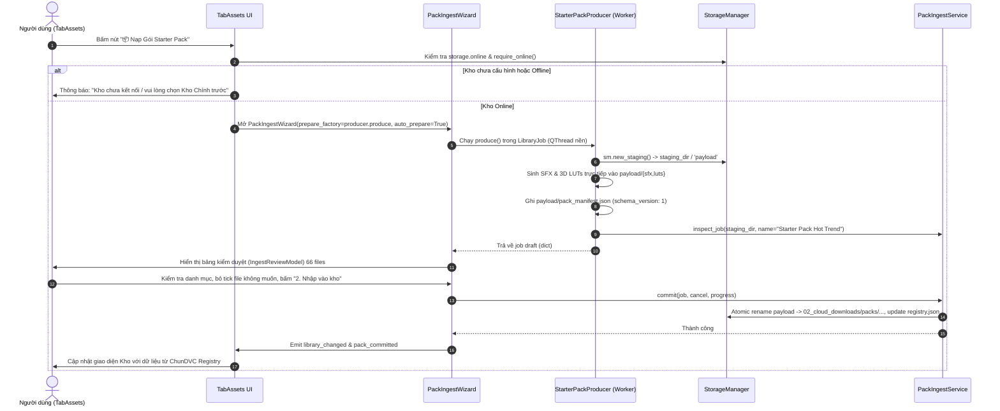

# THIẾT KẾ KIẾN TRÚC: STARTER PACK QUA STORAGE ROOT STAGING & REVIEW (G03-03S-D)

- **Mã nhiệm vụ (TASK_ID):** `G03-03S-D`
- **Tác giả:** Antigravity (Worker)
- **Tech Lead Review:** Codex
- **Trạng thái:** `DESIGN_READY` (Design-only, không can thiệp code sản phẩm / test runner)
- **Mục tiêu:** Chấm dứt triệt để bypass ghi trực tiếp vào thư mục mã nguồn git repo (`assets/`), chuyển hướng sinh gói Starter Pack vào `StorageRoot` staging, qua kiểm duyệt `PackIngestWizard` và commit/discard theo đúng giao thức ChunDVC.

---

## 1. CALLGRAPH HIỆN TẠI VÀ DANH MỤC TÁC DỤNG PHỤ (SIDE-EFFECTS AUDIT)

### 1.1. Luồng thực thi hiện tại (Callgraph file:hàm:dòng)

```text
src/ui/tabs/tab_assets.py:3455 (btn_starter_pack.clicked.connect)
  └──> src/ui/tabs/tab_assets.py:5403 (_on_starter_pack_clicked)
         └──> src/core/starter_pack_downloader.py:180 (StarterPackWorker.run)
                └──> src/core/starter_pack_downloader.py:111 (StarterPackDownloader.seed_all)
                       ├── [Dòng 114] StarterPackManifest.save_manifest()
                       ├── [Dòng 127] src/core/sfx_generator.py:629 (generate_all_sfx)
                       ├── [Dòng 136] src/core/lut_generator.py:379 (LUT3DGenerator.ensure_all_luts_exist)
                       ├── [Dòng 145] tools/populate_all_assets.py:71 (generate_bgm_tracks)
                       ├── [Dòng 154] tools/populate_all_assets.py:256 (generate_overlays_and_stickers)
                       ├── [Dòng 161] Path("assets/broll_memes/memes").glob("*.mp4") (chỉ đếm tệp)
                       ├── [Dòng 168] src/core/text_preset.py:598 (PresetManager.ensure_default_presets)
                       ├── [Dòng 169] src/core/recipe_manager.py:87 (RecipeManager.ensure_default_recipes)
                       └── [Dòng 175] src/core/asset_indexer.py (AssetIndexer.clear_cache)
```

### 1.2. Bảng tác dụng phụ chi tiết (Side-effects & Output Paths)

| STT | File / Hàm gọi | Dòng | Đường dẫn ghi / Tác dụng phụ | Đánh giá kiến trúc |
|---|---|---|---|---|
| 1 | `StarterPackManifest.save_manifest` | `starter_pack_downloader.py:102-105` | `assets/starter_pack_manifest.json` (repo) | **VI PHẠM:** Ghi thẳng file JSON vào cây mã nguồn repo git. |
| 2 | `generate_all_sfx` | `sfx_generator.py:629-641` | `assets/sfx/*.wav` (50 tệp PCM WAV, ~10 MiB) | **VI PHẠM:** Ghi đè thư mục cục bộ của repo, không qua StorageRoot. |
| 3 | `LUT3DGenerator.ensure_all_luts_exist` | `lut_generator.py:379-391` | `assets/luts/*.cube` (16 tệp 3D LUT, ~2 MiB) | **VI PHẠM:** Ghi đè thư mục `assets/luts/` trong repo. |
| 4 | `generate_bgm_tracks` | `tools/populate_all_assets.py:71-249` | `assets/music/{mood}/*.wav` (8 tệp WAV, ~12 MiB) | **VI PHẠM:** Import từ `tools/` vào core; ghi tệp nặng vào repo. |
| 5 | `generate_overlays_and_stickers` | `tools/populate_all_assets.py:256-498` | `assets/broll_memes/overlays/*.png` (17 tệp PNG) | **VI PHẠM:** Import từ `tools/`; phụ thuộc font OS; ghi vào repo. |
| 6 | Đếm video memes | `starter_pack_downloader.py:161-164` | `assets/broll_memes/memes/*.mp4` (chỉ đếm, không sinh) | **PHANTOM REPORT:** Không sinh được video; manifest khai báo 11 nhưng đĩa chỉ có 8 tệp thực. |
| 7 | `PresetManager.ensure_default_presets` | `text_preset.py:604-609` | `presets/text_styles/{id}.json` (10 tệp JSON) | **LỆCH PHẠM VI:** Cấu hình text style người dùng bị coi như asset media. |
| 8 | `RecipeManager.ensure_default_recipes` | `recipe_manager.py:89-130` | `recipes/{id}.json` (7 tệp JSON) | **LỆCH PHẠM VI:** Template workflow bị gộp lẫn vào tải asset pack. |
| 9 | `AssetIndexer.clear_cache` | `starter_pack_downloader.py:175` | Xóa biến static memory `AssetIndexer._cached_assets` | **LEGACY ENGINE:** Cập nhật cache của cơ chế cũ thay vì ChunDVC registry. |

### 1.3. Phân loại tài nguyên thực tế vs Tuyên bố tiếp thị ("75+ đạo cụ")

Báo cáo trung thực về tài nguyên:
- **Tài nguyên sinh thuật toán (Local Procedural Synthesis):**
  - **SFX:** 50 tệp WAV 48kHz mono do `sfx_generator.py` tổng hợp trực tiếp bằng `numpy` + `wave`. (Manifest cũ chỉ liệt kê 17 tệp).
  - **3D LUTs:** 16 tệp `.cube` 33x33x33 do `lut_generator.py` tạo bằng giải thuật toán màu. (Manifest cũ chỉ liệt kê 8 tệp).
  - **BGM Loops:** 8 tệp WAV do `tools/populate_all_assets.py` tổng hợp âm nhạc.
  - **Overlays/Stickers:** 17 tệp PNG do `tools/populate_all_assets.py` vẽ bằng PIL.
- **Tài nguyên mẫu có sẵn (Pre-existing Media Samples):**
  - `assets/broll_memes/memes/`: Thư mục hiện có 8 video MP4 hợp lệ (`boman_dap_ban_cay_cu.mp4`, `con_dung_cai_nit.mp4`, `do_mixi_ao_that_day.mp4`, `do_mixi_cuoi_sac_sua.mp4`, `meme_meo_khoc_banana.mp4`, `pewpew_nhin_lau_lam_roi.mp4`, `pewpew_so_qua_co.mp4`, `thay_ba_gat_cay_cu.mp4`).
- **Tài nguyên phantom (Chỉ có tên trong manifest, KHÔNG CÓ TỆP TRÊN ĐĨA):**
  - `khaby_lame_nhun_vai.mp4`: Không tồn tại trên đĩa.
  - `cat_vibing_head.mp4`: Không tồn tại trên đĩa.
  - `anh_da_den_cham_hoi.mp4`: Không tồn tại trên đĩa.
- **Kết luận:** Tuyệt đối không hứa hẹn "75+ đạo cụ" một cách vô căn cứ. Hệ thống phải báo cáo chính xác số lượng tệp thực sự được tạo và ghi vào staging.

---

## 2. PHƯƠNG ÁN DUY NHẤT: STAGING PRODUCER & WIZARD REVIEW

Chấm dứt hoàn toàn việc ghi vào `assets/` của repo. Luồng chuẩn hóa mới như sau:



### 2.1. Đánh giá tính khả thi đưa target_dir vào các generator hiện có

- `generate_all_sfx(target_dir: str)`: **Hoàn toàn khả thi**. Hàm đã có sẵn tham số `target_dir` (mặc định là `"assets/sfx"`). Chỉ cần truyền `str(payload / "sfx")`.
- `LUT3DGenerator.ensure_all_luts_exist(target_dir: str)`: **Hoàn toàn khả thi**. Hàm đã có sẵn tham số `target_dir`. Chỉ cần truyền `str(payload / "luts")`.
- `generate_bgm_tracks(base_dir: str)`: Đã có tham số `base_dir`, nhưng đang nằm trong `tools/populate_all_assets.py`. Việc import từ `tools/` vào production service vi phạm ranh giới kiến trúc. Sẽ hoãn lại ở lát cắt sau để chuyển code sang `src/core/bgm_generator.py`.
- `generate_overlays_and_stickers(target_dir: str)`: Tương tự BGM, nằm trong `tools/` và phụ thuộc PIL / phông chữ hệ thống. Hoãn lại ở lát cắt sau.
- **Ranh giới an toàn cho Lát cắt 1 (Phase 1):** Chỉ đưa **SFX (50 tệp)** và **3D LUTs (16 tệp)** vào Staging Producer. Đây là 2 generator thuần túy toán học / âm thanh tổng hợp nằm ngay trong `src/core/`, hoàn toàn độc lập, không phụ thuộc mạng, không phụ thuộc font hệ thống, tốc độ sinh cực nhanh (< 0.5s cho toàn bộ 66 tệp).

### 2.2. Tách biệt hoàn toàn Presets & Recipes khỏi Asset Ingestion

- `PresetManager` (lưu tại `presets/text_styles/`) và `RecipeManager` (lưu tại `recipes/`) là các file cấu hình mẫu (configuration templates), không phải media assets nhị phân nặng.
- Chúng **không được đưa vào Staging Payload** của asset pack và **không được commit vào `registry.json` của StorageRoot**.
- Việc khởi tạo preset/recipe mặc định thuộc về bootstrap cấu hình ứng dụng (`Settings / First-run`), không bị trộn lẫn vào chu kỳ nạp media pack.

---

## 3. THIẾT KẾ KÝ HÀM VÀ API CHUẨN XÁC (EXACT API CONTRACTS)

### 3.1. API của StarterPackProducer (`src/core/starter_pack_downloader.py`)

```python
class StarterPackProducer:
    """Sinh gói Starter Pack vào thư mục staging của StorageManager thay vì ghi đè repo."""

    PACK_NAME = "Creator Starter Pack Hot Trend"
    PACK_VERSION = "1.0"

    @classmethod
    def produce_to_staging(
        cls,
        storage: StorageManager,
        cancel: Callable[[], bool] = lambda: False,
        progress: Callable[[str], None] = lambda text: None,
    ) -> Dict[str, Any]:
        """
        Thực hiện sinh tài nguyên vào staging payload:
        1. storage.require_online()
        2. job_dir = storage.new_staging() -> payload = job_dir / 'payload'
        3. Kiểm tra cancel() và dung lượng storage.ensure_space(...)
        4. Sinh SFX vào payload / 'sfx'
        5. Sinh LUTs vào payload / 'luts'
        6. Tạo pack_manifest.json chuẩn schema_version: 1 trong payload
        7. Gọi PackIngestService(storage).inspect_job(job_dir, name=cls.PACK_NAME, cancel=cancel)
        8. Trả về job draft dict cho PackIngestWizard.
        """
```

### 3.2. Mở rộng `PackIngestWizard` (`src/ui/widgets/pack_ingest_wizard.py`)

Giữ nguyên toàn bộ tham số hiện có, chỉ thêm một tham số tùy chọn `prepare_factory`:

```python
class PackIngestWizard(QDialog):
    def __init__(
        self,
        storage=None,
        parent=None,
        source=None,
        url=None,
        auto_prepare=False,
        prepare_factory: Optional[Callable[[Callable[[], bool], Callable[[str], None]], Dict[str, Any]]] = None,
    ):
        super().__init__(parent)
        self.storage = storage or StorageManager()
        self.service = PackIngestService(self.storage)
        self.job = None
        self.worker = None
        self._prepare_factory = prepare_factory
        # ... giữ nguyên toàn bộ layout và kết nối signal ...
```

Phương thức `_prepare()` trong Wizard:
```python
    def _prepare(self):
        if self._terminal or self._closing or self.worker is not None or self.job is not None:
            return
        if self._prepare_factory is not None:
            self._run(lambda cancel, progress: self._prepare_factory(cancel, progress), 'prepare')
            return
        value = self.input_source.text().strip()
        operation = self.service.download if value.startswith(('https://', 'http://')) else self.service.prepare
        self._run(lambda cancel, progress: operation(value, cancel, progress), 'prepare')
```

**Ưu điểm tuyệt đối:**
- Không thay đổi bất kỳ hành vi nào của các caller hiện có (`TabAssetHub`, `EdgeDock`).
- Tái sử dụng 100% vòng đời của `LibraryJob`, signal `progress`, bảng ảo hóa `IngestReviewModel`, cơ chế `_commit()` và `discard()`.
- Tuyệt đối không truyền chuỗi JSON giả định vào `source`.

---

## 4. VÒNG ĐỜI VÀ BẢO ĐẢM AN TOÀN (LIFECYCLE & SAFETY GUARANTEES)

1. **Khởi đầu tại UI (`TabAssets._on_starter_pack_clicked`):**
   - Kiểm tra `self.storage.online`:
     - Nếu kho chưa online / chưa cấu hình: hiển thị thông báo yêu cầu kết nối / chọn Kho Chính (StorageRoot), không tự tiện tạo thư mục rác hay ghi vào repo/tmp.
   - Debounce nút bấm: Vô hiệu hóa nút trong khi Wizard đang mở.
2. **Khởi chạy nền (Background Execution):**
   - Khởi tạo Wizard với `prepare_factory=lambda c, p: StarterPackProducer.produce_to_staging(self.storage, c, p), auto_prepare=True`.
   - Wizard tự động kích hoạt timer chạy `_prepare()`, đưa tác vụ vào `LibraryJob` (QThread).
   - Tuyệt đối không sinh file trên UI thread $\implies$ giao diện không bị giật lag (0 dropped frames).
3. **An toàn khi Hủy hoặc Đóng cửa sổ (Cancel / Close / Reject):**
   - Nếu người dùng bấm "Hủy / Dọn staging" hoặc đóng cửa sổ (`closeEvent`):
     - Wizard gọi `worker.requestInterruption()`.
     - `StarterPackProducer` kiểm tra `cancel()` giữa các bước (sau mỗi phase sinh SFX, LUTs) và ném `InterruptedError`.
     - Staging cleanup: Khi tác vụ dừng hoặc bị hủy, `self.service.discard(job)` hoặc khối `except` trong producer sẽ dọn dẹp thư mục staging độc quyền của job (`self.storage.meta / 'staging' / <job_uuid>`).
     - `closeEvent` hoãn đóng cho tới khi `LibraryJob` kết thúc an toàn, loại trừ lỗi "QThread: Destroyed while thread is still running".
4. **Kiểm duyệt và Xác nhận (Review & User Commit):**
   - Khi hoàn tất sinh vào staging, bảng `QTableView` hiển thị danh sách 66 file.
   - Người dùng có toàn quyền:
     - Bỏ dấu tick để loại bỏ các âm thanh hoặc LUTs không thích.
     - Thay đổi danh mục, nhóm con, hoặc tags.
   - Bấm "2. Nhập vào kho":
     - `PackIngestService.commit()` xác thực danh mục hợp lệ, di chuyển payload sang `StorageRoot/02_cloud_downloads/packs/...`, cập nhật `registry.json` bằng `atomic_json`, đồng bộ snapshot offline, và phát tín hiệu `library_changed`.
     - Bảng tài nguyên của `TabAssets` tự động tải lại danh mục từ `StorageManager.ui_assets()`.

---

## 5. DUNG LƯỢNG IO, NGÂN SÁCH ĐĨA VÀ DỌN DẸP AN TOÀN

1. **Dung lượng ước tính cho Lát cắt 1 (Phase 1):**
   - 50 tệp SFX: ~10 MiB.
   - 16 tệp 3D LUTs: ~2.1 MiB.
   - `pack_manifest.json`: ~0.05 MiB.
   - **Tổng dung lượng cần ghi:** ~12.2 MiB.
2. **Kiểm tra không gian đĩa trước khi ghi (`ensure_space`):**
   - Trước khi sinh bất kỳ byte nào xuống đĩa, gọi:
     `storage.ensure_space(size=25 * 1024 * 1024)` (dự phòng 25 MiB an toàn).
   - Nếu dung lượng khả dụng trên phân vùng của `StorageRoot` nhỏ hơn `reserve_bytes` (500 MiB) + 25 MiB, lập tức ném `DiskSpaceError("Không đủ dung lượng đĩa trống để tạo gói Starter Pack.")`.
3. **Ranh giới dọn dẹp staging (Isolation):**
   - Chỉ được dọn dẹp thư mục do job hiện tại sở hữu:
     `job_dir = storage.meta / 'staging' / <uuid>`
   - Tuyệt đối không xóa lan sang thư mục staging của các job khác hay thư mục dữ liệu `02_cloud_downloads`.

---

## 6. MÃ HÓA METADATA VÀ TAXONOMY CHUNDVC

Để `commit()` thành công và không bị từ chối bởi quy tắc `tax = sm.taxonomy()`, metadata phải tuân thủ nghiêm ngặt bảng danh mục chuẩn:

### 6.1. Bảng ánh xạ danh mục chuẩn (Taxonomy Mapping)

| Loại tài nguyên | ChunDVC `category` (Bắt buộc) | `subcategory` | `tags` |
|---|---|---|---|
| SFX Chuyển cảnh (Whoosh, Swoosh) | `sfx` | `chuyen_canh` | `['chuyen_canh', 'whoosh', 'starter_pack']` |
| SFX Giật mình (Braam, Sub Bass) | `sfx` | `giat_minh` | `['giat_minh', 'impact', 'starter_pack']` |
| SFX Hài hước (Cười, Bonk, Airhorn) | `sfx` | `hai_huoc` | `['hai_huoc', 'comedy', 'starter_pack']` |
| SFX Điểm nhấn (Pop, Ding, Shutter) | `sfx` | `diem_nhan` | `['diem_nhan', 'ui', 'starter_pack']` |
| SFX Công nghệ (Glitch, Click, Mech) | `sfx` | `cong_nghe` | `['cong_nghe', 'tech', 'starter_pack']` |
| 3D LUT Tự nhiên (Rec709, Warm Vlog) | `luts` | `natural` | `['natural', 'clean', 'starter_pack']` |
| 3D LUT Điện ảnh (Teal Orange, Kodak) | `luts` | `cinema` | `['cinema', 'film', 'starter_pack']` |
| 3D LUT Phong cách (Pastel, Cyberpunk) | `luts` | `style` | `['style', 'creative', 'starter_pack']` |

> [!IMPORTANT]
> Trong manifest cũ, `category` bị gán nhầm thành `"chuyen_canh"` hoặc `"cinema"`. Trong kiến trúc mới, `category` **bắt buộc** phải là `'sfx'` hoặc `'luts'` (khớp với khóa của `StorageManager.taxonomy()`). Phân loại chi tiết được chuyển thành `subcategory`.

### 6.2. Cấu trúc `pack_manifest.json` trong staging payload

```json
{
  "schema_version": 1,
  "name": "Creator Starter Pack Hot Trend",
  "version": "1.0",
  "assets": [
    {
      "relative_path": "sfx/whoosh.wav",
      "name": "Whoosh lướt nhanh",
      "category": "sfx",
      "subcategory": "chuyen_canh",
      "tags": ["chuyen_canh", "whoosh", "starter_pack"],
      "excluded": false
    },
    {
      "relative_path": "luts/ResolveFlow_Cinematic_Teal_Orange.cube",
      "name": "Teal & Orange Hollywood",
      "category": "luts",
      "subcategory": "cinema",
      "tags": ["cinema", "teal_orange", "starter_pack"],
      "excluded": false
    }
  ]
}
```

---

## 7. ĐỀ XUẤT LÁT CẮT IMPLEMENTATION ĐẦU TIÊN (SLICE 1 — <= 3 MODULES)

### 7.1. Ba modules sản phẩm duy nhất cần thay đổi

1. `src/core/starter_pack_downloader.py`:
   - Hiện thực `StarterPackProducer.produce_to_staging(storage, cancel, progress) -> dict`.
   - Sinh 50 SFX và 16 LUTs trực tiếp vào staging payload.
   - Tạo `pack_manifest.json` chuẩn schema 1.
   - Gọi `PackIngestService.inspect_job()` và trả về job draft.
   - Ngừng toàn bộ hành vi ghi vào `assets/` và ngừng `save_manifest()`.
2. `src/ui/widgets/pack_ingest_wizard.py`:
   - Thêm tham số tùy chọn `prepare_factory` vào `__init__`.
   - Trong `_prepare()`, thực thi `prepare_factory` nếu có.
3. `src/ui/tabs/tab_assets.py`:
   - Trong `_on_starter_pack_clicked()`:
     - Kiểm tra `self.storage.online`, nếu offline cảnh báo người dùng.
     - Khởi tạo và hiển thị `PackIngestWizard(storage=self.storage, parent=self, prepare_factory=StarterPackProducer.produce_to_staging, auto_prepare=True)`.
     - Lắng nghe `pack_committed` để làm mới danh mục hiển thị từ ChunDVC.

### 7.2. Danh mục kiểm thử tập trung đề xuất (`tests/core/test_starter_pack_staging.py`)

1. `test_starter_pack_producer_rejects_offline_storage`: Đảm bảo khi kho offline, producer từ chối thực thi và không tạo file rác nào.
2. `test_starter_pack_producer_writes_only_to_staging_payload`: Xác nhận 100% tệp sinh ra nằm trong `staging/<uuid>/payload`, thư mục `assets/` trong repo hoàn toàn sạch sẽ (0 byte thay đổi).
3. `test_starter_pack_producer_canonical_taxonomy`: Kiểm tra mọi asset trong `pack_manifest.json` đều có `category` nằm trong `StorageManager.taxonomy()` (`sfx` hoặc `luts`), không bị lỗi danh mục lạ khi commit.
4. `test_starter_pack_producer_cancellation_cleans_staging`: Hủy tiến trình giữa chừng $\implies$ dọn dẹp sạch sẽ staging directory.
5. `test_starter_pack_producer_disk_space_guard`: Đảm bảo kiểm tra dung lượng trước khi ghi, từ chối an toàn khi đĩa đầy.
6. `test_pack_ingest_wizard_prepare_factory_loads_draft`: Wizard nạp thành công job draft vào bảng ảo hóa review mà không tự động commit.
7. `test_pack_ingest_wizard_discard_cleans_only_owned_staging`: Người dùng hủy bỏ kiểm duyệt $\implies$ chỉ xóa thư mục staging của job, không chạm tới dữ liệu đã lưu.
8. `test_pack_ingest_wizard_commit_registers_in_storage_root`: Người dùng chấp thuận $\implies$ gói được chuyển vào `02_cloud_downloads/packs/`, cập nhật `registry.json` và snapshot.

### 7.3. Tiêu chí nghiệm thu (Acceptance Gate)

- Nhấn nút "📦 Nạp Gói Starter Pack" trên giao diện không làm thay đổi bất kỳ file nào trong git tree (`git status --short` không xuất hiện file untracked hay dirty mới trong `assets/`).
- Hộp thoại `PackIngestWizard` xuất hiện với bảng review 66 items (50 SFX + 16 LUTs).
- Khi người dùng bấm "Nhập vào kho", toàn bộ tài nguyên được lưu vào `StorageRoot/02_cloud_downloads/packs/` và hiển thị trên tab Kho Đạo Cụ.
- Khi người dùng bấm "Hủy", thư mục staging bị dọn dẹp hoàn toàn.

---

## 8. KẾT QUẢ TRIỂN KHAI THỰC TẾ (IMPLEMENTATION STATUS — G03-03S1-I & G03-03S1-R1)

- **Trạng thái:** `IMPLEMENTED` (33 focused tests PASS, exit code 0).
- **Files thay đổi (đúng 3 modules):**
  1. `src/core/starter_pack_downloader.py`:
     - Thêm `StarterPackProducer.produce_to_staging(storage, cancel, progress, sfx_generator_fn, lut_generator_fn)` sinh vào `sm.new_staging()/payload`.
     - Bổ sung capture `initial_root`, `initial_library_id`, `initial_marker_id`.
     - Bổ sung `_verify_identity()` trước và sau từng batch (SFX, LUTs, manifest, inspect).
     - Bổ sung `ensure_space(64MiB)` trước mỗi batch.
     - Bổ sung bảo vệ cleanup: chỉ xóa staging khi root, library_id, marker khớp 100% với lúc khởi tạo; nếu library UUID đổi (kể cả cùng root), giữ nguyên job cũ và ném lỗi gốc.
     - Đưa `payload.mkdir()` vào trong `try...except` error cleanup scope.
  2. `src/ui/widgets/pack_ingest_wizard.py`:
     - Mở rộng constructor hỗ trợ `prepare_factory` ở cuối, kích hoạt qua `_prepare()` trong `LibraryJob` nền, bảo vệ nút bấm và không yêu cầu input source.
  3. `src/ui/tabs/tab_assets.py`:
     - Nối `_on_starter_pack_clicked` sang `PackIngestWizard` với closure gắn `storage` của tab.
     - Thêm `_ingest_in_progress` reentrancy guard.
     - Thêm khối `try...finally` đảm bảo phục hồi nút bấm, nhãn và reset guard trong mọi tình huống (kể cả constructor/exec ném ngoại lệ).
     - Cập nhật button text và tooltip phản ánh đúng phạm vi SFX & LUTs.
- **Bộ kiểm thử:**
  - `tests/core/test_starter_pack_staging.py` (11 unit tests, bao gồm 3 probe tests đổi UUID, marker và symlink)
  - `tests/ui/test_pack_ingest_wizard.py` (14 unit tests)
  - `tests/ui/test_starter_pack_routing.py` (8 unit tests, bao gồm 4 UI reentrancy và finally recovery tests)
  - Tổng cộng: **33 passed in 24.07s (exit code 0)**.
