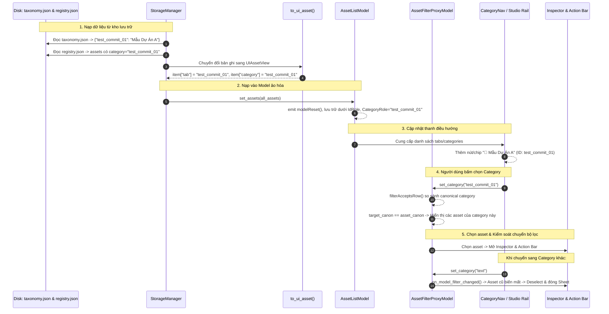
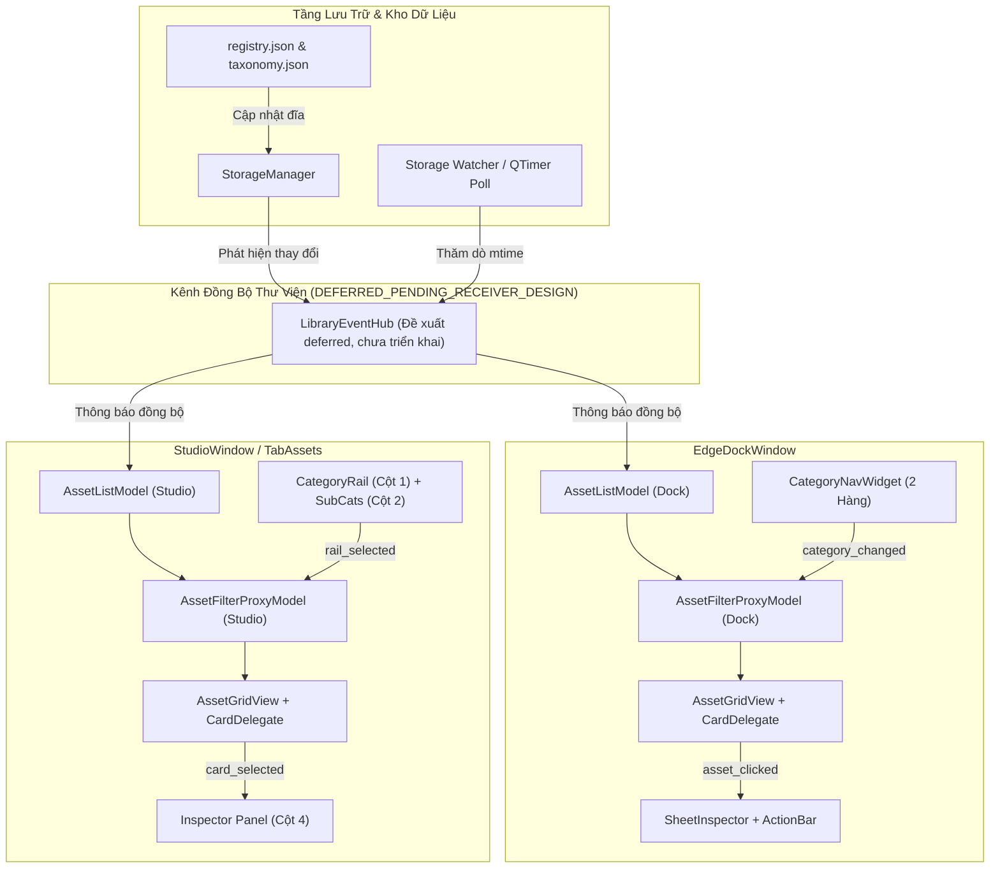

# THIẾT KẾ KIẾN TRÚC G04: MỘT THƯ VIỆN CHO STUDIO VÀ DOCK
## (UNIFIED LIBRARY ARCHITECTURE, SEARCH & TAXONOMY FILTERING)

- **Mã thiết kế:** `G04-D`
- **Tác giả:** Antigravity (Worker) · **Tech Lead Review:** Codex
- **Trạng thái:** `ACCEPTED_WITH_BINDING_CORRECTIONS` (Theo `docs/architecture/04-codex-decisions.md`)
- **Phiên bản:** `1.1.0-revised`
- **Tài liệu tham chiếu:** `docs/architecture/03-gate-acceptance.md`, `docs/architecture/04-codex-decisions.md`, `src/core/storage_manager.py`, `src/core/contracts/asset_dto.py`, `src/ui/lux/library/asset_model.py`, `src/ui/lux/library/asset_filter.py`, `src/ui/lux/library/category_nav.py`, `src/ui/tabs/tab_assets.py`, `src/ui/lux/shell/edge_dock.py`, `src/main.py`.

---

## 1. BỐI CẢNH, MỤC TIÊU & RÀNG BUỘC KỸ THUẬT

### 1.1. Tiền đề Gate G03 đã đóng (Handoff Context)
- Gate G03 đã chính thức được nghiệm thu (`ACCEPTED` tại `docs/architecture/03-gate-acceptance.md`).
- Toàn bộ các cơ chế: tải stream giới hạn, staging bảo mật, phân tích manifest an toàn, danh mục nháp cách ly trong RAM (`_draft_taxonomy`), commit có khóa kiểm soát và rollback nguyên tử, cảnh báo trùng lặp độc lập và phản hồi kết quả hàng đợi (Studio, Dock, Hub) đã hoàn tất.
- Kiểm thử thực tế trên desktop thật với 2 gói media (`pack_test_1.zip`, `pack_test_2.zip`) đã đạt 4/4 mục `PASS 100%`.
- **Ranh giới bất di bất dịch:** Không mở lại hoặc sửa đổi mã nguồn G03. Đối tượng trọng tâm của G04 là **Thư viện hiển thị, tìm kiếm xếp hạng, lọc phân cấp đa chiều và vòng đời chọn lựa/xem trước (Selection & Preview)**.

### 1.2. Mục tiêu cốt lõi của G04
1. **Một Nguồn Chân Lý Dữ Liệu Duy Nhất (Single Source of Truth):**
   Cả hai giao diện người dùng chính (`EdgeDockWindow` và `StudioWindow`/`TabAssets`) phải cùng chia sẻ và phản ứng đồng bộ với một cấu trúc dữ liệu thư viện hợp nhất, không quét lại đĩa trùng lặp, không tạo các bộ nhớ đệm hay gateway riêng rẽ.
2. **Ảo hóa Tuyệt đối (Full Virtualization):**
   Duy trì kiến trúc Model/View chuẩn Qt (`QAbstractListModel` $\to$ `QSortFilterProxyModel` $\to$ `QListView`/`AssetGridView`). Tuyệt đối **không tạo hàng loạt QWidget card** (`self.card_widgets` chỉ là shim tương thích ngược). Toàn bộ hiển thị thẻ do `AssetCardDelegate` (QPainter) đảm nhiệm.
3. **Bộ lọc Đa Tầng Không Xung Đột (Hierarchical Multi-Faceted Filtering):**
   Hợp nhất điều kiện lọc: `Category` AND (`Subcategory` OR `Tags`) AND `Pack` AND `Search Query` AND `Mode (All/Fav/Recent)`. Custom category mới (như `test_commit_01`) phải xuất hiện đầy đủ trên thanh điều hướng và lọc chính xác.
4. **Tìm Kiếm Đảo Chỉ Mục Tốc Độ Cao (< 1ms):**
   Tích hợp bộ chỉ mục tìm kiếm đảo `SearchIndex` với thuật toán xếp hạng điểm số (relevance scoring), tự động cập nhật khi kho thay đổi mà không làm đứng (freeze) luồng giao diện chính.
5. **Vòng Đời Chọn Lựa & Xem Trước An Toàn (Selection, Preview & Offline Guard):**
   Dùng chung một bộ điều khiển xem trước duy nhất (`SharedHoverPreview`), tự động giải phóng tài nguyên khi cuộn/rời chuột. Chặn triệt để thao tác preview/drag/insert khi asset có trạng thái `availability == "offline"`.

---

## 2. BẢNG ĐỐI CHIẾU HIỆN TRẠNG API THỰC TẾ (FILE:HÀM:DÒNG)

Bảng dưới đây khảo sát đối chiếu chính xác các hàm và cơ chế hiện có trong mã nguồn (phân loại bằng chứng: `VERIFIED`, `CODE_ONLY`, `UNVERIFIED`):

| Thành Phần / Module | File : Hàm : Dòng | Hiện Trạng Thực Tế Trong Code | Đánh Giá & Điểm Bất Cập Kiến Trúc | Phân Loại |
| :--- | :--- | :--- | :--- | :---: |
| **Storage Assets Source** | `src/core/storage_manager.py:ui_assets:373` | Trả về danh sách asset từ `self.assets()`, nạp qua adapter `to_ui_asset(asset)`. Xử lý đường dẫn và gắn nhãn `availability` ('online' / 'offline'). | Hoạt động tốt, an toàn đa tầng; là nguồn chuẩn cho managed packs và linked folders. | `VERIFIED` |
| **Asset DTO Adapter** | `src/core/contracts/asset_dto.py:to_ui_asset:420` | Map `category` kho sang `tab` UI (`overlays` $\to$ `overlay`, `templates` $\to$ `text`/`trans`). Custom categories được giữ nguyên `tab = category`. | Hoạt động ổn định, bảo toàn `_raw_obj` bằng tham chiếu, duration legacy tolerance. | `VERIFIED` |
| **Legacy Asset Indexer** | `src/core/asset_indexer.py:AssetIndexer:9` | Quét đĩa cứng cục bộ thư mục `assets/` (`sfx`, `luts`, `memes`, `templates`, `music`) và `QSettings("ChunDVC", "library/linked_folders")`. | Sử dụng bộ nhớ đệm toàn cục `_GLOBAL_ASSET_CACHE`. Vẫn nạp song song với `StorageManager`; việc có scan lặp hay không phụ thuộc cache hit (chưa có benchmark đo đạc I/O). | `CODE_VERIFIED` |
| **Inverted Search Index** | `src/services/search_index.py:SearchIndex:14` | Xây dựng inverted index trong RAM từ `assets`. Cho phép tìm kiếm token hóa với BM25/scoring. | Mục tiêu lý thuyết nhanh, được cập nhật khi Dock gọi `set_search_index()`. Chưa có benchmark chính thức <1ms. | `CODE_VERIFIED` |
| **Asset List Model** | `src/ui/lux/library/asset_model.py:AssetListModel:111` | `QAbstractListModel` ảo hóa danh sách asset. Trích xuất metadata bằng `extract_asset_info:36` qua các Custom Roles (`IdRole`, `NameRole`, `CategoryRole`, `TagsRole`...). | Hoạt động mượt mà. Hỗ trợ lazy thumbnail loading. | `CODE_VERIFIED` |
| **Asset Filter Proxy** | `src/ui/lux/library/asset_filter.py:AssetFilterProxyModel:52` | `QSortFilterProxyModel` lọc theo category, subcategory, pack, tag, search query, fav/recent. Sắp xếp theo `_search_scores`. | `filterAcceptsRow:174` hoạt động đúng. `set_category:83` đã reset sub, category tag, pack; `set_sub_category:92` về all đã clear tag. | `CODE_VERIFIED` |
| **Category Nav Widget** | `src/ui/lux/library/category_nav.py:CategoryNavWidget:43` | Thanh điều hướng 2 hàng: Hàng 1 (Category chips có nút cuộn `‹` `›`), Hàng 2 (Subcategory chips). Mặc định dùng `DEFAULT_CATEGORIES:13`. | Nhận danh mục qua `set_categories:133`. Nhận danh sách dict hoặc string ID. | `CODE_VERIFIED` |
| **EdgeDock Asset Wiring** | `src/ui/lux/shell/edge_dock.py:set_assets:426` | Gán assets cho `self.asset_model` và `self.palette`. Bổ sung custom categories và B-roll từ taxonomy và assets. | **Lỗi P1 (Hiển thị):** Trước G04-04A1-I, `_on_profile_changed` gọi `set_categories(profile.categories)` làm mất custom chip. Đã khắc phục bằng helper `_build_effective_categories`. | `VERIFIED` |
| **EdgeDock Storage Sync** | `src/ui/lux/shell/edge_dock.py:refresh_storage_assets:1380` | Lọc bỏ managed assets cũ và nạp lại `sm.ui_assets()`, cập nhật `search_index` và `proxy_model`. | Hoạt động tốt trong nội bộ Dock khi nạp pack. Chưa phát tín hiệu cho Studio Window do thiếu receiver phía Studio. | `CODE_VERIFIED` |
| **EdgeDock Filter Changed** | `src/ui/lux/shell/edge_dock.py:_on_model_filter_changed:465` | Kiểm tra nếu `_selected_asset` bị lọc mất thì deselect và đóng sheet (dòng 475-485). | Đã có logic deselect. Có thể tối ưu handler bằng ID map + `mapFromSource` (tách thành task riêng, không tuyên bố toàn bộ Qt filter là O(1)). | `CODE_VERIFIED` |
| **EdgeDock Suggest Click** | `src/ui/lux/shell/edge_dock.py:_on_suggested_asset:1012` | Tìm asset theo ID qua `self.asset_model.index_of_asset_id:1015`, đổi category, xóa search/filter xung đột, chọn và cuộn tới asset trong grid. | **Đúng quy chuẩn:** Ghi chú rõ: `do NOT auto-insert to timeline on suggestion click`. Chỉ chọn và mở sheet, không tự chèn. | `CODE_VERIFIED` |
| **Studio TabAssets Rescan** | `src/ui/tabs/tab_assets.py:_rescan_assets:6048` | Quét lại toàn bộ `AssetIndexer` (tất cả các thư mục), gộp `StorageManager().ui_assets()` qua `_merge_storage_assets:6035`, gọi `_sync_storage_rail:6022` và `_populate_cards:5256`. | Chạy trên GUI thread khi nạp lại. Chưa có receiver nhận cập nhật nhẹ mà không rescan. | `CODE_VERIFIED` |
| **Studio Rail Button Sync** | `src/ui/tabs/tab_assets.py:_sync_storage_rail:6022` | Đọc `StorageManager().taxonomy()`, duyệt `self.all_assets`, nếu có `tab` mới thì tạo thêm `QPushButton` gắn vào cột Rail bên trái (dòng 6028-6033). | Có hỗ trợ sinh nút rail cho custom category khi có asset mang tab đó trong RAM; nhãn nút lấy từ `taxonomy.json`. | `CODE_VERIFIED` |
| **Main Startup & Wiring** | `src/main.py:load_all_library_assets:39` & `create_studio_manager:79` | `load_all_library_assets` kết hợp builtin + indexer + storage. Khởi tạo `dock` và `search_index`. `storage_timer:154` thăm dò registry mỗi 2.5s. | **Lỗi P1 (Stale):** `create_studio_manager` chỉ kết nối Studio $\to$ Dock. Đề xuất bus sync: `DEFERRED_PENDING_RECEIVER_DESIGN`. | `CODE_VERIFIED` |
| **Shared Hover Preview** | `src/ui/lux/library/hover_preview.py:SharedHoverPreview:58` | Quản lý preview âm thanh/video lướt chuột qua một instance `QMediaPlayer` và `QVideoWidget` duy nhất. Debounce 150ms. | Đã có kiểm tra `availability == "offline": return` (dòng 170). Tự động dừng khi cuộn chuột hoặc rời chuột. | `VERIFIED` |

---

## 3. TRUY VẾT CUSTOM CATEGORY (TRACER BULLET: THEO DẤU `test_commit_01`)

Để chứng minh tính toàn vẹn của hệ thống khi người dùng tạo một danh mục mới (ví dụ: `test_commit_01` với nhãn *"Mẫu Dự Án A"*), chúng ta truy vết từng bước luồng dữ liệu từ đĩa cứng lên đến màn hình:



### 3.1. Các ca kiểm thử biên (Edge Cases) trong quá trình theo dấu:
1. **Trùng nhãn hiển thị (Label Collision):**
   - Hai category có ID khác nhau (`cat_a`, `cat_b`) nhưng người dùng đặt cùng một nhãn hiển thị *"Hiệu ứng"*.
   - **Xử lý:** Bộ lọc proxy model lọc **HOÀN TOÀN THEO ID** (`CategoryRole == "cat_a"`), tuyệt đối không lọc theo chuỗi nhãn hiển thị. Nhãn chỉ phục vụ giao diện người dùng nhìn thấy.
2. **Category tùy biến chưa có asset nào (`count == 0`):**
   - Khi vừa commit taxonomy nhưng chưa có pack/asset nào thuộc category đó.
   - **Hiện trạng:** `EdgeDockWindow.set_assets` duyệt qua `assets` nên bỏ sót category rỗng.
   - **Quy chuẩn G04:** Phải đọc trực tiếp từ `StorageManager.taxonomy()` kết hợp với danh mục mặc định để luôn giữ đúng các danh mục đã đăng ký hợp lệ.
3. **Chuyển trang ngữ cảnh DaVinci Resolve (Context Profile Switch):**
   - **Hiện trạng lỗi:** Chuyển từ Edit sang Fusion làm mất chip tùy biến.
   - **Quy chuẩn G04:** `CategoryNavWidget` phải duy trì 2 nhóm: `Profile Categories` (các danh mục ưu tiên theo trang Resolve) và `Custom Categories` (các danh mục tùy biến của kho luôn được đính kèm ở phía sau).
4. **Tài nguyên Kho Offline (Storage Offline Replica):**
   - Khi ổ đĩa tháo rời bị rút ra: `StorageManager.online == False`.
   - `assets()` đọc từ file snapshot bản sao cục bộ (`.chundvc_meta/snapshot.json`). Toàn bộ asset nhận cờ `availability = "offline"`.
   - Thẻ hiển thị trên Grid có huy hiệu `Offline`, làm mờ hình ảnh, chặn không cho khởi chạy preview video/âm thanh và vô hiệu hóa nút kéo thả vào timeline Resolve.

---

## 4. BẢNG CHÂN TRỊ BỘ LỌC ĐA TẦNG (FILTER TRUTH TABLE)

Hệ thống lọc thư viện tuân thủ biểu thức logic vị từ (Predicate Logic) kết hợp chặt chẽ theo mã nguồn hiện hành (`AssetFilterProxyModel.filterAcceptsRow`):

$$\text{Accept}(Row) = C(Row) \land S(Row) \land T(Row) \land P(Row) \land Q(Row) \land M(Row)$$

Trong đó:
- $C$: Bộ lọc Danh mục chính (Category Filter)
- $S$: Bộ lọc Danh mục con (Subcategory Filter: khớp `sub` hoặc khớp `tag`)
- $T$: Bộ lọc Thẻ (Tag Filter: khớp `tag` hoặc khớp `sub`) — $S$ và $T$ là hai điều kiện độc lập `AND` khi cùng bật
- $P$: Bộ lọc Gói đạo cụ (Pack Filter)
- $Q$: Bộ lọc Từ khóa tìm kiếm xếp hạng (Search Query Matching)
- $M$: Chế độ lọc đặc biệt (Mode: All / Favorites / Recent)

> [!NOTE]
> Mã nguồn hiện hành (`asset_filter.py:set_category`) đã tự động dọn sạch bộ lọc xung đột: chuyển Category sẽ reset `_sub_category = 'all'`, xóa `_tag = None` và xóa `_pack_filter = None`. Tương tự, `set_sub_category` khi chọn `'all'` hoặc `'Tất cả'` đã tự động xóa tag (`_tag = None`). Đây là hành vi đã có trong mã nguồn (CODE_VERIFIED).

### 4.1. Bảng Chân Trị Chi Tiết Cho Từng Trường

| Tiêu Chí Lọc | Giá Trị Lọc Thiết Lập | Điều Kiện Thỏa Mãn Trên Asset Bản Ghi | Hành Vi Khi Thay Đổi (Reset Rule) |
| :--- | :--- | :--- | :--- |
| **Category ($C$)** | `"all"` | Luôn `True` (chấp nhận mọi danh mục). | Đổi từ `"all"` sang một category cụ thể $\to$ Reset Subcategory về `"all"`, Reset Tag về `None`, Reset Pack về `None`. |
| | `"text"`, `"lut"`, `"sfx"`... | `get_canonical_category(asset.category) == target_category` (chính xác, không so sánh chuỗi con). | Đổi Category $\to$ Reset Subcategory về `"all"`, Reset Tag về `None`, Reset Pack về `None`. |
| | Custom ID (vd: `test_commit_01`) | `asset.category.lower() == target_id.lower()`. | Như trên. |
| **Subcategory ($S$)**| `"all"` hoặc `"Tất cả"` | Luôn `True` đối với nhóm con. | Không ảnh hưởng đến Category. Xóa Tag đang kích hoạt nếu chuyển về `"Tất cả"`. |
| | Tên nhóm con cụ thể (vd: `kinetic`) | `normalize(asset.sub) == normalize(target)` HOẶC `normalize(target) in asset.tags`. | Giữ nguyên Category cha. |
| | Tiền tố pack: `pack:<tên_gói>` | `normalize(asset.pack_name) == normalize(target_pack)`. | Lọc riêng các asset thuộc gói trong danh mục hiện tại. |
| **Tag ($T$)** | `None` | Không lọc tag (bỏ qua điều kiện tag). | Bấm chọn 1 tag $\to$ Áp dụng điều kiện $T$. |
| | Tag chuỗi cụ thể (vd: `neon`) | `normalize(tag) in [normalize(t) for t in asset.tags]` HOẶC `normalize(tag) == normalize(asset.sub)`. | Không làm mất Category cha; kết hợp AND với Category. |
| **Pack Filter ($P$)**| `None` | Không lọc theo gói. | |
| | Tên gói (vd: `Starter Pack`) | `normalize(asset.pack_name) == normalize(target_pack)`. | Kết hợp AND với Category và Subcategory. |
| **Search Query ($Q$)**| `""` (Rỗng) | Luôn `True`. Thứ tự sắp xếp trả về tự nhiên theo model. | Xóa từ khóa $\to$ Khôi phục thứ tự sắp xếp gốc (`sort(-1)`). |
| | Có từ khóa (vd: `laser`) | `asset.id in matched_ids` (từ `SearchIndex.search(query)`). | Tự động kích hoạt sắp xếp theo điểm liên quan (`SortOrder.DescendingOrder`). |
| **Filter Mode ($M$)** | `"all"` | Bỏ qua kiểm tra yêu thích/gần đây. | Mặc định. |
| | `"fav"` | `asset.id in favorites` (hoặc nằm trong bộ sưu tập con `coll:<tên>`). | Bỏ qua nếu asset không có sao yêu thích. |
| | `"recent"` | `asset.id in recent_ids` (danh sách mở gần đây). | Bỏ qua nếu asset chưa từng được sử dụng. |

---

## 5. ĐẶC TẢ VÒNG ĐỜI VÀ EVENT FLOW TOÀN HỆ THỐNG

### 5.1. Sơ đồ dòng sự kiện (Event Flow Diagram)



### 5.2. Nguyên tắc quản lý bộ nhớ và hiệu năng (Zero GUI Lag Policy)
1. **Không quét file trên GUI Thread:**
   Toàn bộ thao tác đọc thư mục hoặc tính toán I/O nặng phải diễn ra trong worker ngầm hoặc chỉ đọc file `registry.json` đã có sẵn.
2. **Tối ưu hóa thao tác Deselect khi lọc ($O(1)$ thay vì $O(N)$):**
   Thay vì duyệt `any(proxy_model.index(r, 0) == sel_id for r in range(count))`, lưu trữ `_selected_asset_id`. Kiểm tra trực tiếp xem vị trí hàng `source_row` của asset đó sau khi map sang proxy có hợp lệ hay không (`proxy_model.mapFromSource(src_idx).isValid()`). Thời gian thực thi là $O(1)$.
3. **Quản lý Vòng Đời Preview Âm Thanh / Video Duy Nhất:**
   Không bao giờ khởi tạo `QMediaPlayer` cho từng thẻ. `SharedHoverPreview` lắng nghe sự kiện di chuột trên viewport của `AssetGridView`, chỉ phát khi dừng chuột quá 150ms và lập tức gọi `player.stop()` ngay khi có thao tác lăn chuột hoặc chuột rời khỏi ô thẻ.

---

## 6. PHÂN RÃ CÁC LÁT CẮT THIẾT KẾ VÀ TIẾN ĐỘ THỰC THI

Để hiện thực hóa Gate G04 một cách an toàn và có kiểm soát, lộ trình được Tech Lead Codex phê duyệt và phân rã chi tiết (theo `docs/architecture/04-codex-decisions.md`):

```
┌────────────────────────────────────────────────────────────────────────┐
│ G04-04A1-I: GIỮ CATEGORY TÙY BIẾN QUA CONTEXT PROFILE (HOÀN TẤT)      │
│ • Sửa duy nhất 1 production module src/ui/lux/shell/edge_dock.py.      │
│ • Helper _build_effective_categories đồng nhất set_assets & profile.   │
│ • Giữ profile IDs mặc định, nối custom taxonomy hợp lệ ở cuối.        │
│ • Bảo toàn nhãn tiếng Việt, subs, tags, snapshot offline, restore.     │
└────────────────────────────────────┬───────────────────────────────────┘
                                     │
┌────────────────────────────────────▼───────────────────────────────────┐
│ G04-04A2-D: THIẾT KẾ RECEIVER & ĐỒNG BỘ DOCK <-> STUDIO (DEFERRED)     │
│ • Thiết kế receiver phía Studio (cập nhật all_assets/model/rail/sheet).│
│ • Xác định rõ generation ID, signal ownership, không rescan thừa.      │
│ • Chỉ triển khai khi thiết kế receiver được phê duyệt.                 │
└────────────────────────────────────┬───────────────────────────────────┘
                                     │
┌────────────────────────────────────▼───────────────────────────────────┐
│ 04B: DYNAMIC TAXONOMY & MULTI-FACETED SEARCH/FILTER (DEFERRED)         │
│ • Hoàn thiện logic lọc kết hợp Category + Sub + Tag + Pack + Query.    │
│ • Tự động cập nhật SearchIndex khi thư viện biến động (Invalidation). │
└────────────────────────────────────┬───────────────────────────────────┘
                                     │
┌────────────────────────────────────▼───────────────────────────────────┐
│ 04C: SELECTION LIFECYCLE, HOVER PREVIEW & OFFLINE GUARDS (DEFERRED)   │
│ • Hoàn thiện SharedHoverPreview cho cả 2 cửa sổ.                       │
│ • Chặn tuyệt đối preview/drag/insert khi asset có cờ offline.          │
│ • Khớp nối chọn đề xuất AI (Suggestion Click) không tự ý insert.       │
└────────────────────────────────────────────────────────────────────────┘
```

---

### 6.1. LÁT CẮT ĐÃ THỰC THI: `TASK_ID: G04-04A1-I` & `G04-04A1-R1`

Tuân thủ nghiêm ngặt chỉ đạo của Tech Lead: **"Đúng một production module edge_dock.py; không tạo library_bus.py, không sửa main.py/TabAssets/StorageManager"**.

#### 1. Module thực thi (Duy nhất 1 production module):
- `src/ui/lux/shell/edge_dock.py`:
  - `_build_effective_categories`: Helper dùng chung hợp nhất category definitions.
  - `set_assets`: Sử dụng helper; đồng bộ category_nav và proxy_model; kiểm tra và reset subcategory đã mất về `Tất cả` / `all`, tránh lưới rỗng giả (G04-04A1-R1).
  - `_on_profile_changed`: Duy trì profile categories, nối custom categories, đồng bộ restore saved state bằng effective IDs.

#### 2. Kết quả kiểm thử tập trung (Focused Test Suite):
- File mới: `tests/ui/test_dock_profile_taxonomy.py` (12 tests PASS).
- Hồi quy 2 file: `tests/ui/test_edge_dock.py` (13 tests PASS) + `tests/ui/test_pack_surface_feedback.py` (10 tests PASS).
- Tổng cộng: **35 passed in 4.41s**, exit code 0.
- Lưu ý: Test offline mock taxonomy là provider mock, chưa kiểm chứng I/O snapshot thực tế.

#### 3. Danh mục đề xuất hoãn lại (Deferred Scope):
- **Proposed Bus Sync:** `DEFERRED_PENDING_RECEIVER_DESIGN`. Cần hoàn thiện thiết kế receiver phía Studio Window trước khi xem xét thêm service kết nối.
- Lát cắt `04B` và `04C` tiếp tục deferred theo lộ trình.

---

## 7. PHÁT HIỆN LỖI P1 & QUYẾT ĐỊNH CỦA TECH LEAD CODEX

### 7.1. Các phát hiện kiến trúc đã đối chiếu:
1. **Lỗi P1 (Hiển thị) — `edge_dock.py`:** Hàm `_on_profile_changed` trước đây gán thẳng `profile.categories` tĩnh làm biến mất các Custom Categories đã commit vào kho. **Đã được giải quyết triệt để tại task G04-04A1-I.**
2. **Lỗi P1 (Stale) — `main.py`:** `create_studio_manager` chỉ nối `Studio.assets_updated` sang Dock. Khi Dock nạp pack mới, Studio đang mở có thể stale. **Đã ghi nhận, hoãn triển khai bus sync chờ thiết kế receiver.**

### 7.2. Chính sách chốt từ Tech Lead (`04-codex-decisions.md`):
1. **Trên profile có thư viện:** Profile categories theo thứ tự gốc, nối custom taxonomy hợp lệ ở cuối; giữ label tiếng Việt và ID. Giữ cả category rỗng được đăng ký. Profile không có thư viện (`media`, `deliver`) tiếp tục ẩn nav/grid như hiện hành.
2. **Nguồn dữ liệu:** Giữ hybrid bundled + storage, không migration/xóa file; giữ metadata/ID hiện hành. Một notification bus tương lai chỉ làm nhiệm vụ invalidation/wiring, không thay nguồn chân lý JSON.
3. **Offline mode:** Duyệt metadata từ snapshot an toàn; chặn thao tác trên media unavailable.
4. **Bộ lọc hiện tại:** Đã có logic dọn sạch bộ lọc xung đột (`set_category` reset sub/tag/pack; `set_sub_category` reset tag). Không mô tả như logic còn thiếu. S và T là hai điều kiện độc lập AND khi cùng bật.
5. **Hiệu năng:** Không tuyên bố benchmark <1ms hay O(1) khi chưa có đo đạc thực nghiệm độc lập.

---

## KẾT LUẬN & ĐIỂM DỪNG GIAO ĐOẠN D
Tài liệu thiết kế kiến trúc đã hoàn tất đầy đủ. antigravity (Worker) dừng lại tại đây, không tự ý viết mã sản xuất hay sửa test trước khi Tech Lead (Codex) xem xét và phê duyệt thiết kế `G04-D`.
