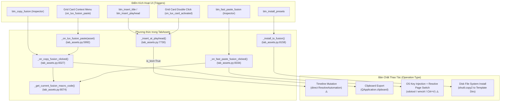

# THIẾT KẾ KIẾN TRÚC: G04-04C10-D — CHỐT TEXT / FUSION ACTIONS ĐÚNG ASSET VÀ QUA GATEWAY

- **TASK_ID:** `G04-04C10-D — Chốt Text/Fusion actions đúng asset và qua gateway`
- **TRẠNG THÁI:** `DESIGN_READY`
- **CẤP ĐỘ WORKER:** `HIGH`
- **Người thiết kế:** Antigravity (Worker)
- **Tech Lead thẩm định:** Codex Tech Lead
- **Thời gian lập:** 2026-10-27T05:27:00+07:00
- **Phạm vi:** Tài liệu thiết kế kiến trúc thuần túy (DESIGN ONLY). Tuyệt đối không chỉnh sửa code sản xuất hay test suite; không chạy pytest/Resolve/clipboard write.

---

## 1. BỐI CẢNH & PHẠM VI THIẾT KẾ (CONTEXT & DESIGN SCOPE)

### 1.1. Bối cảnh kỹ thuật hiện tại
1. **Các cổng đã nghiệm thu (Prior Accepted Gates):**
   - `G04-04C6` (Grid drag & shared preview): Code và desktop smoke accepted.
   - `G04-04C7` (Inspector drag & procedural text custom clone): Code accepted 66 tests.
   - `G04-04C8` (Video Inspector preview session & callback isolation): Code accepted 50 tests; desktop smoke accepted.
   - `G04-04C9` (Audio Inspector engine & Studio arbitration): Code accepted 70 tests (exit 0 trong 3.84s); desktop verification accepted với FFmpeg backend thật trên `DISPLAY=:1` (`BACKEND_PLAYBACK_VERIFIED`, `PHYSICAL_AUDIBILITY_UNVERIFIED`).
2. **Khoảng trống kỹ thuật còn lại (Residual Technical Debt):**
   - Nhánh chèn chữ tại Playhead (`TabAssets._insert_at_playhead`) vẫn dùng trực tiếp đối tượng `ResolveAutomation` trên luồng UI chính, bỏ qua hoàn toàn `ActionGuard` và dịch vụ điều phối chuẩn `InsertService` / `ResolveGateway`.
   - Các hành động xuất và dán Fusion (`_get_current_fusion_macro_code`, `_on_copy_fusion_clicked`, `_on_fast_paste_fusion_clicked`, `_on_lux_fusion_paste`) sinh mã tùy tiện: tạo nút `TextPlus` rác cho cả video, LUT, SFX, hoặc tài nguyên missing/staging; ghi đè clipboard người dùng ngay cả khi thao tác bị từ chối.
   - Tính năng `fast_paste_to_fusion` sử dụng lệnh mô phỏng phím hệ điều hành (`xdotool`, `wmctrl`, `EnumWindows`) tiềm ẩn nguy cơ chèn nhầm vào cửa sổ khác ngoài DaVinci Resolve.
3. **Mục tiêu của G04-04C10-D:**
   - Khảo sát chi tiết call graph thực tế (`file:hàm:dòng`) của toàn bộ các thao tác Text và Fusion.
   - Thiết lập chính sách kiểm duyệt tài nguyên nghiêm ngặt qua `ActionGuard`, phân định ranh giới giữa: Xuất Clipboard thuần túy, Mô phỏng phím OS, Đột biến Timeline/Fusion qua Gateway, và Cài đặt file lên đĩa.
   - Định nghĩa hợp đồng tùy biến (Customization contract) bảo toàn tính bất biến (Immutability) của preset gốc.
   - Đề xuất **DUY NHẤT 1 lát cắt triển khai nhỏ** (1–3 modules) có thể nghiệm thu cô lập, auditable và không phá vỡ tính năng hiện hành.

---

## 2. BẢN ĐỒ CALLGRAPH THỰC TẾ (ACTUAL CALLGRAPH & RESIDUAL AUDIT)

Dưới đây là khảo sát đối chiếu chính xác mã nguồn hiện hành trong `src/ui/tabs/tab_assets.py` và các module liên quan:



### Chi tiết từng Route:

#### Route 1: Chèn chữ tại Playhead (`_insert_at_playhead`)
- **Tệp:Hàm:Dòng:** `src/ui/tabs/tab_assets.py:7730` (`TabAssets._insert_at_playhead`).
- **Điểm kích hoạt:**
  - Nút bấm `self.btn_insert_title` / `self.btn_insert_playhead` -> `_on_insert_single_title_clicked` (`line 8321`).
  - Nhấp đúp chuột vào card trong grid: `_on_lux_card_activated` (`line 5987`).
  - Sự kiện thêm card cũ: `_on_card_add_requested` (`line 5998`).
- **Phân nhánh kiểm tra:**
  - Dòng 7745: `is_text = tab == "text" or isinstance(self.selected_asset, TextStylePreset) or (not is_trans and not is_video and not is_sfx and not is_bgm and not is_lut)`.
  - Nhánh 1 (Video, Trans, SFX, BGM, LUT - lines 7748–7888): Đã chuyển sang `InsertService.insert(...)` trong `04C4-I`.
  - Nhánh 2 (Text - lines 7891–7961): **Vẫn chạy mã trực tiếp cũ!**
    - Line 7892: Khởi tạo `resolve_auto = ResolveAutomation()` trực tiếp trên luồng giao diện chính (GUI Thread).
    - Lines 7897–7928: Đọc tham số giao diện thô từ các widget (`txt_single_title`, `slide_title_dur`, `combo_font`, `slide_font_size`, `slide_stroke_width`, `weight_buttons`, `anim_chips`, `curve_chips`, `swatch_colors`).
    - Line 7933: Gọi hàm `resolve_auto.insert_title_at_playhead(...)` trực tiếp qua API Scripting fusionscript.
    - Line 7951: **Double Dispatch:** Phát tín hiệu `self.insert_title_requested.emit(text, preset_id, dur)` ngay cả khi lệnh gọi trực tiếp đã chạy hoặc đã thất bại.
    - Lines 7953–7955: Báo Toast tiếng Việt.
    - Line 7960: **Tác dụng phụ sai lệch:** Gọi `RecentManager.add(asset_d.get("id", ""))` vô điều kiện ngay cả khi thao tác chèn thất bại (`success == False`).
- **Phân loại thao tác:** **Resolve Timeline / Fusion Clip Mutation**.
- **Lỗ hổng hiện tại:** Bỏ qua hoàn toàn `ActionGuard` (không kiểm tra staging/missing/origin), thực thi blocking trên main thread gây freeze UI/rò rỉ COM proxy, double dispatch tín hiệu Qt, ghi nhận Recent sai khi lỗi.

#### Route 2: Sao chép mã node Fusion (`_on_copy_fusion_clicked`)
- **Tệp:Hàm:Dòng:** `src/ui/tabs/tab_assets.py:8327` (`TabAssets._on_copy_fusion_clicked`).
- **Điểm kích hoạt:**
  - Nút bấm `self.btn_copy_fusion.clicked` trong Inspector.
  - Gọi từ menu ngữ cảnh grid card: `_on_lux_fusion_paste` (`line 5992`).
- **Luồng xử lý:**
  - Line 8328: Gọi `macro_code = self._get_current_fusion_macro_code()`.
  - Trong `_get_current_fusion_macro_code()` (`lines 8074–8156`):
    - Nếu `isinstance(target, TextStylePreset)` hoặc `tab == "text"`: Tạo `customized_preset = TextStylePreset(...)` với các thuộc tính ghi đè từ UI và gọi `FusionSettingGenerator.generate_setting_content(customized_preset, sample_text=sample_txt)` (`line 8129`).
    - Nếu `isinstance(target, TransitionStylePreset)` hoặc `tab == "trans"`: Gọi `TransitionMacroGenerator.generate_setting_content(target)` (`line 8131`).
    - **FALLBACK NGUY HIỂM (lines 8144–8156):** Với MỌI tài nguyên khác (video MP4, âm thanh WAV, LUT CUBE, hoặc tài nguyên bị missing), hàm tự động sinh ra một đoạn mã Lua chứa công cụ `TextPlus` giả lập:
      ```lua
      {
          Tools = ordered() {
              RF_{asset_id} = TextPlus {
                  Inputs = {
                      StyledText = Input { Value = "{name}", },
                      Font = Input { Value = "Arial", },
                      Size = Input { Value = 0.08, },
                  },
                  ViewInfo = OperatorInfo { Pos = { 220, 36.3 } },
              }
          }
      }
      ```
  - Line 8329: Ghi đè trực tiếp clipboard hệ thống: `QApplication.clipboard().setText(macro_code)`.
  - Line 8331: Phát tín hiệu `self.copy_fusion_node_requested.emit(preset_id)`.
  - Line 8332: Hiển thị Toast `"Đã copy Fusion node! Dán vào trang Fusion bằng Ctrl+V"`.
- **Phân loại thao tác:** **Clipboard Export Only** (Không làm thay đổi Timeline hay node graph của Resolve).
- **Lỗ hổng hiện tại:** Không qua `ActionGuard`; sinh mã `TextPlus` rác cho tài nguyên phi Fusion hoặc file bị xóa; ghi đè clipboard người dùng ngay cả khi tài nguyên không hợp lệ; phát tín hiệu với ID mặc định `"karaoke_pop"` nếu ID trống.

#### Route 3: Dán nhanh vào Fusion (`_on_fast_paste_fusion_clicked`)
- **Tệp:Hàm:Dòng:** `src/ui/tabs/tab_assets.py:8334` (`TabAssets._on_fast_paste_fusion_clicked`).
- **Điểm kích hoạt:** Nút `self.btn_fast_paste_fusion.clicked` trong Inspector.
- **Luồng xử lý:**
  - Line 8335: Lấy mã qua `self._get_current_fusion_macro_code()`.
  - Line 8337: Gọi `fast_paste_to_fusion(macro_code)` trong `src/core/fast_paste.py:126`.
  - Trong `fast_paste_to_fusion`:
    - Ghi mã vào clipboard: `clipboard.setText(macro_code)` (`fast_paste.py:149`).
    - Nạp API Resolve trực tiếp: `load_resolve_api()` (`fast_paste.py:158`).
    - Chuyển trang Resolve sang Fusion: `resolve_app.OpenPage("fusion")` (`fast_paste.py:166`).
    - Ép tiêu điểm cửa sổ hệ điều hành: `focus_davinci_resolve()` (`fast_paste.py:22–101`) qua `wmctrl` / `xdotool` (Linux) hoặc `EnumWindows` / `SetForegroundWindow` (Windows).
    - Bơm phím nóng hệ thống: `simulate_paste_hotkey()` (`fast_paste.py:104–142`) qua `xdotool key ctrl+v` hoặc `pyautogui.hotkey('ctrl', 'v')`.
- **Phân loại thao tác:** **Clipboard Export + OS Window Focus Steal + OS Keystroke Injection + Resolve Page Switch**.
- **Lỗ hổng hiện tại:** Rất rủi ro; không có bảo đảm cửa sổ DaVinci Resolve thực sự nhận được focus trước khi phím `Ctrl+V` được nhấn (có thể paste chuỗi Lua vào bất kỳ trình soạn thảo/cửa sổ nào khác); không kiểm tra `ActionGuard`.

#### Route 4: Dán Fusion từ Menu Ngữ Cảnh Grid (`_on_lux_fusion_paste`)
- **Tệp:Hàm:Dòng:** `src/ui/tabs/tab_assets.py:5992` (`TabAssets._on_lux_fusion_paste`).
- **Điểm kích hoạt:** Menu chuột phải trên asset card trong `AssetGrid`: `fusion_paste_requested.connect(self._on_lux_fusion_paste)` (`src/ui/lux/library/asset_grid.py:545`).
- **Luồng xử lý:**
  - Lines 5993–5994: Chọn asset qua `_on_card_selected(pid)`.
  - Lines 5995–5996: Nhấp nút copy: `self.btn_copy_fusion.click()` (ủy quyền sang Route 2).
- **Phân loại thao tác:** **Ủy quyền cho Clipboard Export**.
- **Lỗ hổng hiện tại:** Tên hàm mang nghĩa "Dán" (`fusion_paste`), nhưng thực chất chỉ thực hiện "Sao chép" (`copy_fusion`). Cần đồng bộ thuật ngữ và hành vi.

#### Route 5: Cài đặt vào thư mục DaVinci (`_install_to_fusion`)
- **Tệp:Hàm:Dòng:** `src/ui/tabs/tab_assets.py:8158` (`TabAssets._install_to_fusion`).
- **Điểm kích hoạt:** Nút `self.btn_install_presets.clicked` -> `_on_install_presets_clicked` (`line 8325`).
- **Luồng xử lý:**
  - Nếu là LUT: sao chép file `.cube` vào thư mục LUT của DaVinci (`lines 8164–8184`).
  - Nếu là file `.setting`: sao chép file vào thư mục Templates `Titles` hoặc `Transitions` của Resolve (`lines 8186–8200`).
  - Nếu là procedural: sinh hàng loạt file `.setting` và ghi vào đĩa (`lines 8201–8207`).
  - Line 8208: Phát tín hiệu `self.install_presets_requested.emit()`.
  - Line 8209: Báo Toast tiếng Việt.
- **Phân loại thao tác:** **Disk File System Installation** (Thao tác file cục bộ, không can thiệp timeline).
- **Trạng thái:** Tách bạch với runtime insertion; không nằm trong luồng chèn timeline hằng ngày.

---

## 3. CHÍNH SÁCH QUẢN LÝ TÀI NGUYÊN THEO TỪNG LOẠI HÌNH (ASSET POLICY & BOUNDARIES)

Bảng phân định chính sách và thẩm quyền (Authority) cho từng loại tài nguyên đối với các thao tác Text/Fusion:

| Nhóm Tài Nguyên | Nhận Diện Kỹ Thuật | CopyFusion (Xuất Clipboard) | Insert Text tại Playhead | FastPaste Fusion | Ghi Nhận Recent |
| :--- | :--- | :--- | :--- | :--- | :--- |
| **1. Procedural `TextStylePreset`** | `isinstance(target, TextStylePreset)` hoặc `target._raw_obj` là `TextStylePreset` | **CHO PHÉP:** Thu thập overrides từ UI, sinh chuỗi Lua qua `FusionSettingGenerator`. | **CHO PHÉP QUA GATEWAY:** Chuyển qua `InsertService` / Title Worker; cấm direct ResolveAutomation. | **CẢNH BÁO RỦI RO:** Chỉ cho phép khi Resolve đang mở; ưu tiên hướng dẫn Copy. | **CHỈ KHI THÀNH CÔNG:** Không ghi khi lỗi hoặc khi chỉ copy clipboard. |
| **2. Managed File-backed `.setting`** | `source_kind == "managed"` và đuôi `.setting` | **CHO PHÉP CÓ ĐIỀU KIỆN:** Thẩm định qua `ActionGuard`; đọc file giới hạn (bounded UTF-8); **CẤM** biến đổi thành TextPlus mặc định. | **CHO PHÉP QUA GATEWAY:** Chèn template qua `InsertService`. | **CẢNH BÁO RỦI RO:** Giống procedural text. | Chỉ ghi khi Insert thành công. |
| **3. Managed `.setting` bị lỗi (Missing/Offline/Staging/Root Swap)** | `status in ("missing", "offline", "staging")` hoặc sai `origin_library_id` | **TỪ CHỐI (FAIL-CLOSED):** Báo lỗi tiếng Việt; **GIỮ NGUYÊN** clipboard cũ của user; cấm sinh mã rác. | **TỪ CHỐI (FAIL-CLOSED):** ActionGuard chặn ngay lập tức; không gọi Resolve. | **TỪ CHỐI (FAIL-CLOSED):** Chặn ngay; 0 phím tắt OS, 0 đổi trang. | **KHÔNG GHI NHẬN.** |
| **4. Builtin / Local File-backed `.setting`** | File `.setting` cục bộ hợp lệ trên đĩa | **CHO PHÉP:** Đọc file bounded; xuất nguyên văn nội dung file. | **CHO PHÉP QUA GATEWAY:** Chèn qua `InsertService`. | Tương tự nhóm 2. | Chỉ ghi khi Insert thành công. |
| **5. Native Video Transition** | `cat == "trans"` hoặc `TransitionStylePreset` | **TỪ CHỐI:** Chuyển cảnh native không phải là node text Fusion; báo lý do rõ ràng. | **HƯỚNG DẪN THỦ CÔNG:** Trả về `OK_NATIVE_TRANSITION_GUIDANCE`; 0 clip timeline. | **TỪ CHỐI:** Không hỗ trợ dán node. | Không ghi vào Recent như clip đã chèn. |
| **6. Non-Fusion Media (SFX / BGM / LUT / Video)** | Đuôi `.mp4`, `.wav`, `.cube`, v.v. | **TỪ CHỐI TUYỆT ĐỐI:** Cấm fallback sang TextPlus; giữ nguyên clipboard; thông báo tài nguyên không hỗ trợ Fusion. | Không đi qua nhánh Text (đã có nhánh media chuyên biệt của `InsertService`). | **TỪ CHỐI TUYỆT ĐỐI.** | Theo quy định của InsertService media. |

### Các quy tắc bất biến (Invariants):
1. **Chống ô nhiễm Clipboard (Zero Clipboard Pollution):** Khi thao tác CopyFusion hoặc FastPaste bị từ chối (denied), clipboard hiện tại của hệ điều hành phải được bảo toàn 100%, không bị ghi đè chuỗi rỗng hay chuỗi lỗi.
2. **Triệt tiêu Fallback TextPlus giả (No Dummy TextPlus Fallback):** Xóa bỏ hoàn toàn khối mã `RF_{asset_id} = TextPlus` giả lập trong `_get_current_fusion_macro_code()`. Nếu tài nguyên không phải kiểu chữ hoặc file `.setting` hợp lệ, hàm phải trả về lỗi hoặc chuỗi rỗng.
3. **Bảo toàn nguồn gốc (Provenance Preservation):** Không cho phép dùng custom preset clone để lách kiểm tra nguồn gốc (`origin_library_id` / `origin_root`). Mọi tài nguyên file-backed phải được thẩm định tính toàn vẹn trước khi đọc.

---

## 4. HỢP ĐỒNG TÙY BIẾN VÀ BẢO TOÀN NGUYÊN BẢN (CUSTOMIZATION CONTRACT)

### 4.1. Cơ chế tùy biến cho Procedural `TextStylePreset`
Khi người dùng tùy chỉnh trên giao diện Inspector (`TabAssets`):
- Các thuộc tính ghi đè được thu thập:
  - `sample_text`: Lấy từ `self.txt_single_title.text().strip()`. Nếu rỗng, dùng `target.name` hoặc fallback an toàn `"ResolveFlow Title"`.
  - `font`: Lấy từ `self.combo_font.currentText()`, chuẩn hóa qua `resolve_system_font()`.
  - `size`: Lấy từ `self.slide_font_size.value()` (int).
  - `weight`: Lấy từ nút radio được chọn trong `self.weight_buttons` (`"normal"`, `"bold"`, `"extra_bold"`).
  - `outline_width`: Lấy từ `self.slide_stroke_width.value() / 100.0` (float).
  - `animation`: Lấy từ `self.anim_chips` (`"pop"`, `"bounce"`, `"typewriter"`, `"slide"`, `"box_highlight"`, v.v.).
  - `timing_curve`: Lấy từ `self.curve_chips` (`"spring"`, `"ease-in-out"`, `"linear"`).
  - `standard_color`, `highlight_color`, `outline_color`, `box_color`, `glow_color`: Lấy từ `self.swatch_colors`.

### 4.2. Tính bất biến của đối tượng gốc (Source Immutability)
- Tuyệt đối **KHÔNG** chỉnh sửa trực tiếp các thuộc tính trên đối tượng `base_preset` đang lưu trong danh mục ứng dụng.
- Sử dụng phương thức tạo bản sao kiểu định danh:
  ```python
  if hasattr(base_preset, "model_copy"):
      custom_preset = base_preset.model_copy(update=update_data)
  elif hasattr(base_preset, "copy"):
      custom_preset = base_preset.copy(update=update_data)
  else:
      custom_preset = TextStylePreset(id=asset_id, name=asset_name, **update_data)
  ```
- **Bảo toàn trường không ghi đè:** Các trường như `category`, `badge_icon`, `tags`, `description`, `position_y_16_9` không bị giao diện Inspector thay đổi phải được giữ nguyên vẹn từ `base_preset`.

### 4.3. Đối với tài nguyên File-backed `.setting`
- Các tài nguyên file-backed `.setting` (kể cả template tiêu đề có sẵn hoặc do người dùng nhập vào) là cây node Fusion hoàn chỉnh đã được tác giả thiết kế.
- **Quy tắc:** Tuyệt đối không áp dụng bộ tạo chữ mẫu ngẫu nhiên vào file `.setting`. Đọc nguyên văn nội dung file bằng luồng đọc an toàn (bounded UTF-8 read, giới hạn tối đa 5MB) và xuất trực tiếp vào clipboard.

### 4.4. Đề xuất mở rộng `ActionGuard` với Intent `"fusion_export"`
Để chuẩn hóa hoàn toàn việc kiểm duyệt trước khi sao chép mã Fusion, đề xuất bổ sung intent `"fusion_export"` vào `ActionGuard`:
```python
ActionIntent = Literal["insert", "inspect", "drag", "preview", "fusion_export"]
```
- **Hành vi khi `intent == "fusion_export"`:**
  1. Nếu tài nguyên là `TextStylePreset` procedural: Cho phép -> `result_code = "OK_PROCEDURAL_FUSION_EXPORT"`.
  2. Nếu tài nguyên là file `.setting` (managed/builtin): Kiểm tra sự tồn tại trên đĩa, xác minh định danh kho (nếu managed) -> Cho phép kèm `resolved_path`.
  3. Nếu tài nguyên là chuyển cảnh native: Từ chối -> `result_code = "ERR_NATIVE_TRANSITION_FUSION_UNSUPPORTED"`, lý do tiếng Việt rõ ràng.
  4. Nếu tài nguyên là media thông thường (SFX, BGM, LUT, Video): Từ chối -> `result_code = "ERR_NON_FUSION_MEDIA_UNSUPPORTED"`, lý do tiếng Việt.
  5. Nếu tài nguyên đang staging, offline, missing, hoặc tráo đổi ID kho: Từ chối theo quy tắc chuẩn (`ERR_STAGING_UNPUBLISHED`, `ERR_STORAGE_MISSING`, v.v.).

---

## 5. KIẾN TRÚC THI HÀNH & CỔNG GIAO TIẾP (EXECUTION ARCHITECTURE & GATEWAY)

### 5.1. Phân định ranh giới giữa Export và Mutation
1. **Thao tác Xuất (Export Operations - CopyFusion):**
   - Bản chất: Hoạt động thuần túy phía Client (UI/OS Clipboard). Không tạo clip, không sửa timeline, không tương tác với tiến trình DaVinci Resolve.
   - Cơ chế bảo vệ: Không cần gửi job qua `ResolveGateway`, nhưng **bắt buộc** phải qua `ActionGuard(intent="fusion_export")`.
   - Single Dispatch: Chỉ phát tín hiệu `copy_fusion_node_requested` khi và chỉ khi sao chép thành công.
2. **Thao tác Chèn Timeline (Mutation Operations - Insert Text tại Playhead):**
   - Bản chất: Tương tác trực tiếp với timeline Resolve, tạo đối tượng clip `TextPlus` và cấu hình tham số Fusion.
   - Cơ chế chuẩn: Phải loại bỏ việc gọi `ResolveAutomation` trực tiếp trên luồng giao diện chính. Chuyển đổi toàn bộ việc tạo Title sang `InsertService.insert(...)`, điều phối qua `ResolveGateway` hoặc worker độc quyền `title_insert_worker.py` (đã được xây dựng trong `src/core/title_insert_worker.py`).
   - Phản hồi: Nhận đối tượng `InsertResult` chuẩn (10 trường), hiển thị Toast trung thực và chỉ ghi `RecentManager` khi `res.ok == True`.
3. **Thao tác Dán Nhanh (OS Keystroke Injection - FastPasteFusion):**
   - Đánh giá: Việc dùng `xdotool` / `pyautogui` gõ `Ctrl+V` vào cửa sổ desktop tiềm ẩn rủi ro rất cao và khó kiểm soát trên các môi trường window manager khác nhau (X11 vs Wayland, focus delay).
   - Kiến trúc an toàn: Cần thẩm định nghiêm ngặt qua `ActionGuard`, kiểm tra Resolve có đang chạy không; nếu không an toàn, fallback về chế độ Copy và hướng dẫn người dùng nhấn `Ctrl+V` thủ công.

---

## 6. ĐỀ XUẤT DUY NHẤT MỘT LÁT CẮT TRIỂN KHAI (ONE RECOMMENDED IMPLEMENTATION SLICE)

Theo đúng nguyên tắc kiến trúc "chọn route auditable dễ đóng trước, giới hạn 1–3 modules nhỏ", chúng tôi đề xuất:

### LÁT CẮT ĐỀ XUẤT: CHUẨN HÓA COPYFUSION EXPORT VÀ BỔ SUNG INTENT TRONG ACTIONGUARD
- **Mã lát cắt dự kiến:** `G04-04C10-I` (CopyFusion Export Hardening & ActionGuard Intent).
- **Phạm vi tác động:** Đúng **2 module sản xuất**:
  1. `src/core/action_guard.py`: Bổ sung `intent="fusion_export"`.
  2. `src/ui/tabs/tab_assets.py`: Tái cấu trúc `_get_current_fusion_macro_code()` và `_on_copy_fusion_clicked()` theo `ActionGuard`.
- **Nội dung thực hiện chi tiết:**
  1. Trong `src/core/action_guard.py`:
     - Thêm `intent="fusion_export"`.
     - Cho phép procedural `TextStylePreset` (`OK_PROCEDURAL_FUSION_EXPORT`).
     - Cho phép file `.setting` hợp lệ (`OK_FILEBACKED_FUSION_EXPORT` kèm `resolved_path`).
     - Từ chối fail-closed cho native transitions (`ERR_NATIVE_TRANSITION_FUSION_UNSUPPORTED`), non-fusion media (`ERR_NON_FUSION_MEDIA_UNSUPPORTED`), missing/offline/staging.
  2. Trong `src/ui/tabs/tab_assets.py`:
     - Cập nhật `_on_copy_fusion_clicked()`:
       - Kiểm tra `check_action_availability(target, intent="fusion_export")`.
       - Nếu bị từ chối: Hiển thị Toast lỗi tiếng Việt (`guard_res.reason`), **KHÔNG** ghi đè clipboard, **KHÔNG** phát tín hiệu Qt.
       - Nếu được phép:
         - Với procedural text: Clone `TextStylePreset` với UI overrides an toàn (tương tự như `_create_drag_mime_data`), sinh chuỗi Lua qua `FusionSettingGenerator`.
         - Với file-backed: Đọc bounded UTF-8 từ `guard_res.resolved_path`.
         - Đặt nội dung vào clipboard: `QApplication.clipboard().setText(macro_code)`.
         - Phát duy nhất 1 tín hiệu: `self.copy_fusion_node_requested.emit(preset_id)`.
         - Hiển thị Toast thành công: `"✅ Đã sao chép mã Fusion node! Hãy dán vào trang Fusion (Ctrl+V)."`
     - Loại bỏ hoàn toàn fallback `RF_{asset_id} = TextPlus` rác trong `_get_current_fusion_macro_code()`.

### Bảng quyết định (Decision Table cho Lát cắt G04-04C10-I):

| Đầu vào (Asset / Target) | Hành động (Action) | Thẩm định (Guard Intent) | Kết quả Guard | Hành vi Clipboard | Tín hiệu Qt | Thông báo Toast | Ghi Recent |
| :--- | :--- | :--- | :--- | :--- | :--- | :--- | :--- |
| **Procedural TextStylePreset** | Click `btn_copy_fusion` | `fusion_export` | `allowed=True` (`OK_PROCEDURAL_FUSION_EXPORT`) | Ghi mã Lua tùy biến từ Inspector | Emit `copy_fusion_node_requested` (1 lần) | ✅ "Đã sao chép mã Fusion..." | Không |
| **File `.setting` hợp lệ trong kho** | Click `btn_copy_fusion` | `fusion_export` | `allowed=True` (`OK_FILEBACKED_FUSION_EXPORT`) | Ghi nguyên văn nội dung file `.setting` | Emit `copy_fusion_node_requested` (1 lần) | ✅ "Đã sao chép mã Fusion..." | Không |
| **File `.setting` bị thiếu (Missing)** | Click `btn_copy_fusion` | `fusion_export` | `allowed=False` (`ERR_STORAGE_MISSING`) | **Bảo toàn nguyên vẹn clipboard cũ** | 0 emit | ❌ "Không tìm thấy file nguồn..." | Không |
| **Tài nguyên Staging** | Click `btn_copy_fusion` | `fusion_export` | `allowed=False` (`ERR_STAGING_UNPUBLISHED`) | **Bảo toàn nguyên vẹn clipboard cũ** | 0 emit | ❌ "Tài nguyên đang staging..." | Không |
| **Chuyển cảnh Native** | Click `btn_copy_fusion` | `fusion_export` | `allowed=False` (`ERR_NATIVE_TRANSITION_FUSION_UNSUPPORTED`) | **Bảo toàn nguyên vẹn clipboard cũ** | 0 emit | ℹ️ "Chuyển cảnh native không hỗ trợ xuất mã Fusion..." | Không |
| **Video / SFX / LUT / BGM** | Click `btn_copy_fusion` | `fusion_export` | `allowed=False` (`ERR_NON_FUSION_MEDIA_UNSUPPORTED`) | **Bảo toàn nguyên vẹn clipboard cũ** | 0 emit | ℹ️ "Tài nguyên không hỗ trợ xuất mã Fusion..." | Không |

### Phạm vi trì hoãn (Deferred Scope):
- **Chuyển đổi Insert Text tại Playhead sang `InsertService`:** Hoãn sang lát cắt tiếp theo (sau khi CopyFusion đã chuẩn hóa), để kiểm thử chuyên sâu về quản lý tiến trình và tương tác timeline Resolve mà không làm xáo trộn luồng export.
- **FastPaste OS Keystroke Injection:** Tạm thời gắn guard kiểm duyệt từ `ActionGuard`, không mở rộng thêm tính năng phím nóng OS mới.

---

## 7. KẾ HOẠCH KIỂM THỬ HỮU HẠN (FINITE TEST PLAN)

Thiết kế file kiểm thử TDD mới: `tests/ui/test_tab_assets_fusion_copy.py` (khoảng 8–10 test cases tập trung):

```python
# Danh mục các ca kiểm thử TDD (Red -> Green):
# 1. test_fusion_copy_procedural_text_customization_positive:
#    - Nạp TextStylePreset procedural, chỉnh font "Roboto", size 60, weight "extra_bold", text "Test Custom".
#    - Bấm Copy -> Clipboard nhận đúng chuỗi Lua chứa "Roboto", size quy đổi, "Test Custom". Base preset không đổi.
# 2. test_fusion_copy_managed_setting_file_bounded_read_positive:
#    - Nạp file .setting hợp lệ trong mock storage.
#    - Bấm Copy -> Clipboard nhận đúng nội dung file gốc trên đĩa. Không bị biến thành TextPlus giả.
# 3. test_fusion_copy_missing_file_denied_preserves_clipboard:
#    - Nạp target file .setting nhưng xóa file trên đĩa. Gán clipboard = "PREVIOUS_CLIPBOARD".
#    - Bấm Copy -> Thao tác bị từ chối; clipboard vẫn giữ nguyên "PREVIOUS_CLIPBOARD"; không phát signal.
# 4. test_fusion_copy_staging_denied_preserves_clipboard:
#    - Nạp target availability="staging".
#    - Bấm Copy -> Bị chặn với ERR_STAGING_UNPUBLISHED; clipboard giữ nguyên; 0 signal.
# 5. test_fusion_copy_root_id_swap_denied:
#    - Nạp target managed có origin_library_id sai lệch so với kho active.
#    - Bấm Copy -> Bị chặn fail-closed; clipboard giữ nguyên.
# 6. test_fusion_copy_native_transition_denied:
#    - Nạp TransitionStylePreset.
#    - Bấm Copy -> Bị chặn với ERR_NATIVE_TRANSITION_FUSION_UNSUPPORTED; 0 dummy textplus.
# 7. test_fusion_copy_non_fusion_media_denied:
#    - Nạp asset video MP4, SFX WAV, LUT CUBE.
#    - Bấm Copy -> Bị chặn với ERR_NON_FUSION_MEDIA_UNSUPPORTED; 0 dummy textplus; clipboard giữ nguyên.
# 8. test_fusion_copy_single_dispatch_and_no_recent_mutation:
#    - Xác minh tín hiệu copy_fusion_node_requested chỉ phát đúng 1 lần khi thành công.
#    - Xác minh RecentManager không bị ghi nhận thêm ID khi copy clipboard.
```

- **Môi trường chạy:** `QT_QPA_PLATFORM=offscreen .venv/bin/pytest tests/ui/test_tab_assets_fusion_copy.py -q`.
- **Ranh giới:** Không yêu cầu DaVinci Resolve thật đang chạy; kiểm thử hoàn toàn độc lập qua mock clipboard và DI storage provider của `ActionGuard`.

---

## 8. CÂU HỎI CHÍNH SÁCH & ĐỀ XUẤT (POLICY QUESTIONS & RECOMMENDATIONS)

### Câu hỏi 1: Về việc mở rộng `ActionIntent` trong `ActionGuard`
- **Câu hỏi:** Có nên bổ sung tường minh intent thứ 5 là `"fusion_export"` vào `ActionGuard`, hay tái sử dụng intent `"insert"` / `"drag"` kèm cờ phụ?
- **Khuyến nghị:** **Bổ sung tường minh `"fusion_export"`**. Việc này giúp định nghĩa chính sách phân quyền rõ ràng: Chuyển cảnh native bị từ chối xuất mã Fusion nhưng được phép `insert` (hướng dẫn); media video được phép `insert` nhưng bị cấm `fusion_export`. Tách intent giúp code minh bạch, không phát sinh điều kiện phụ lồng nhau.

### Câu hỏi 2: Về tính bất biến của file-backed `.setting`
- **Câu hỏi:** Khi người dùng chọn một file `.setting` (title/macro có sẵn) và gõ chữ vào ô tiêu đề mẫu của Inspector, hệ thống có nên cố gắng phân tích và thay thế chuỗi chữ bên trong file `.setting` bằng regex/string formatting không?
- **Khuyến nghị:** **TUYỆT ĐỐI KHÔNG**. Cấu trúc file `.setting` của Fusion có thể rất phức tạp, chứa nhiều node lồng nhau (Merge, Transform, Keyframes, Custom Shading). Việc dùng regex thay thế chuỗi chữ dễ phá vỡ cú pháp Lua hoặc thay thế nhầm vào các thuộc tính khác. File `.setting` phải được tôn trọng như một asset nhị phân/văn bản nguyên bản. Chỉ `TextStylePreset` sinh mã động mới hỗ trợ tùy biến tham số.

### Câu hỏi 3: Về menu ngữ cảnh `_on_lux_fusion_paste` trên Grid
- **Câu hỏi:** Thao tác chuột phải trên card hiện mang tên `_on_lux_fusion_paste` (và nhãn menu "Dán vào Fusion"), nhưng thực chất chỉ thực hiện copy vào clipboard. Có nên đổi tên thành "Sao chép mã Fusion (Ctrl+C)" không?
- **Khuyến nghị:** Trong tài liệu thiết kế và code nội bộ, ánh xạ thẳng về `_on_copy_fusion_clicked`. Trên giao diện, hiển thị nhãn chuẩn: `"Sao chép mã Fusion"` (hoặc `"Copy Fusion Node"`), kèm Toast hướng dẫn `"Đã copy Fusion node! Dán vào trang Fusion bằng Ctrl+V"`, tránh gây hiểu lầm cho người dùng rằng ứng dụng sẽ tự động dán vào timeline mà không cần thao tác tiếp theo.

---

## 9. ĐÍNH CHÍNH & LÀM RÕ BẰNG CHỨNG AUDIO (AUDIO EVIDENCE CLARIFICATIONS)

Nhằm duy trì tính minh bạch kỹ thuật tuyệt đối sau khi nghiệm thu cổng `G04-04C9-AUTO-UI`:
1. **Phạm vi kiểm thử Desktop:**
   - Kịch bản `task/desktop_verify_04c9.py` đã xác minh thành công toàn bộ vòng đời phát âm thanh, dừng chéo hai chiều (arbitration pair wiring) giữa `AudioInspectorWidget` và `SharedHoverPreview` trong cùng cửa sổ desktop hiển thị trên `DISPLAY=:1`.
   - Backend phát âm thanh thực sự là Qt Multimedia với FFmpeg 9.0.1 LGPL 2.1 (`BACKEND_PLAYBACK_VERIFIED`): Trạng thái `PlayingState`, `position` tịnh tiến liên tục (278ms), `duration` đo chính xác (10000ms), và vạch playhead trên `WaveformCanvas` chạy mượt mà theo thời gian thực.
2. **Ranh giới vật lý (`PHYSICAL_AUDIBILITY_UNVERIFIED`):**
   - Hệ thống không có microphone hay cảm biến âm học vật lý để đo áp suất sóng âm phát ra trong không khí từ loa/tai nghe phần cứng. Bằng chứng được xác nhận ở tầng phần mềm backend (`BACKEND_PLAYBACK_VERIFIED`) và hoàn toàn trung thực với giới hạn vật lý.

---

## 11. KẾT QUẢ THI HÀNH LÁT CẮT G04-04C10-I & BẢN VÁ G04-04C10-R1 (IMPLEMENTATION AUDIT)

Lát cắt triển khai `G04-04C10-I` và bản vá nghiệm thu `G04-04C10-R1` đã hoàn thành 100% mã nguồn và kiểm thử tự động, tuân thủ tuyệt đối các quyết định ràng buộc từ Codex Tech Lead (`docs/architecture/04C10-codex-decisions.md` và `docs/architecture/04C10-codex-review.md`):

1. **2 Production Modules sửa đổi duy nhất:**
   - `src/core/action_guard.py` (bổ sung `intent="fusion_export"`, kiểm định nguồn, loại trừ media/transition, xác thực `.setting` và procedural `TextStylePreset`; loại bỏ hoàn toàn suy luận `library_path` trái phép, khôi phục contract strict managed).
   - `src/ui/tabs/tab_assets.py` (tách builder tùy biến `_build_custom_text_preset`, bounded file read 5MiB có kiểm tra `stat.S_ISREG(st.st_mode)` trên file descriptor mở, chặn rò rỉ clipboard fail-closed, short-circuit FastPaste, xử lý stale ID, và `record_recent=False` triệt để trong menu ngữ cảnh copy).
2. **Mã kết quả ActionGuard chuẩn hóa & Hợp đồng Managed nghiêm ngặt:**
   - `OK_PROCEDURAL_FUSION_EXPORT`: Chấp thuận preset chữ procedural, `resolved_path=""`.
   - `OK_FILEBACKED_FUSION_EXPORT`: Chấp thuận file-backed `.setting` hợp lệ, trả về đường dẫn `resolved_path` đã chuẩn hóa realpath.
   - `ERR_MISSING_LIBRARY_PATH`: Trả về fail-closed cho mọi intent (`insert`, `drag`, `preview`, `fusion_export`) khi asset managed thiếu cả `library_path` lẫn `relative_path`.
   - `ERR_NATIVE_TRANSITION_FUSION_UNSUPPORTED`: Chặn chuyển cảnh native trước khi duyệt file.
   - `ERR_NON_FUSION_MEDIA_UNSUPPORTED`: Chặn video, sfx, bgm, luts.
   - `ERR_STAGING_MEDIA_UNSUPPORTED` / `ERR_FILE_NOT_FOUND` / `ERR_ORIGIN_UNVERIFIED`: Xử lý fail-closed an toàn.
3. **Giới hạn kích thước & Bounded Read với `fstat`:**
   - Hằng số `MAX_FUSION_SETTING_BYTES = 5 * 1024 * 1024` (5 MiB).
   - Mở file nhị phân, kiểm tra `os.fstat(f.fileno())` xác nhận regular file trên chính opened descriptor, đọc `MAX + 1` bytes để phát hiện tràn; kiểm tra file rỗng, giải mã strict UTF-8; bảo toàn nguyên vẹn format và ký tự xuống dòng gốc.
4. **Bảo toàn Clipboard & Không ghi Recent:**
   - Khi bị từ chối hoặc gặp lỗi đọc/sinh mã: 0 lần gọi `QApplication.clipboard().setText()`, bảo toàn toàn bộ MIME data hiện tại (ảnh, HTML, custom data) của người dùng.
   - Menu ngữ cảnh `_on_lux_fusion_paste`: Thực hiện `self._on_card_selected(pid, record_recent=False)` và gán target chính xác, bảo đảm 0 lần gọi `RecentManager.add` đối với cả trường hợp copy thành công lẫn bị từ chối.
5. **Bộ kiểm thử hữu hạn nghiệm thu:**
   - `QT_QPA_PLATFORM=offscreen PYTHONDONTWRITEBYTECODE=1 .venv/bin/pytest tests/core/test_action_guard_fusion_export.py tests/ui/test_tab_assets_fusion_copy.py tests/core/test_action_guard.py tests/core/test_action_guard_drag_preview.py tests/core/test_action_guard_preview.py tests/ui/test_tab_assets_inspector_drag.py -q`
   - **Kết quả:** 150/150 passed trong 11.55 giây (Exit code 0).

