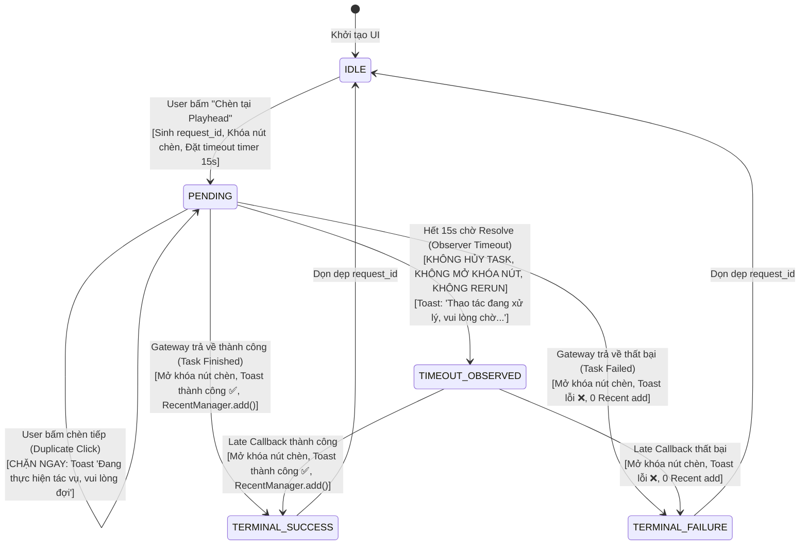

# THIẾT KẾ KIẾN TRÚC: G04-04C11-D-R1 — CHỐT ĐƯỜNG RENDER THAM SỐ VÀ PENDING MUTATION

- **TASK_ID:** `G04-04C11-I — Chèn Text cơ bản bất đồng bộ qua Gateway`
- **TRẠNG THÁI:** `IMPLEMENTED_PENDING_REVIEW`
- **CẤP ĐỘ WORKER:** `HIGH`
- **Người thực hiện:** Antigravity (Worker)
- **Tech Lead thẩm định:** Codex Tech Lead
- **Thời gian hoàn thành:** 2026-10-27T06:30:00+07:00
- **Tài liệu thẩm định của Codex:** [`docs/architecture/04C11-codex-decisions.md`](file:///media/vanntruongg/Documents/Development/Python/dự án cá nhân/ResolveFlow-Assistant/docs/architecture/04C11-codex-decisions.md)
- **Phạm vi:** Hoàn thành triển khai thực tế trên chính xác 3 modules sản xuất và 3 bộ test tương ứng. 99/99 acceptance tests passed in 17.10s.

---

## 1. TỔNG QUAN HIỆU CHỈNH THEO CODEX REVIEW (EXECUTIVE REVISION SUMMARY)

Bản thiết kế `G04-04C11-D-R1` giải quyết dứt điểm 3 điểm phản biện cốt lõi từ Tech Lead tại `docs/architecture/04C11-codex-review.md`:

1. **Minh bạch hóa End-to-End Field Mapping (Khắc phục mâu thuẫn bảo toàn tham số):**
   - Không đánh đồng hai hệ generator khác nhau: `FusionSettingGenerator` (`src/core/text_preset.py:879` — sinh static TextPlus `.setting` cho drag/export) vs `src/core/fusion/` (`TITLES` & `TitleParams` — sinh animated `.comp` cho timeline insertion).
   - Lập ma trận đối chiếu từng trường từ Inspector UI qua `TitleParams` tới node inputs thực tế trong DaVinci Resolve.
   - Công bố minh bạch: Trường nào được render thực tế (`SUPPORTED_RENDERED`), trường nào được xấp xỉ (`SUPPORTED_APPROXIMATED`), và trường nào bị lược bỏ bởi template (`UNSUPPORTED_DROPPED`). Tuyệt đối không tuyên bố bảo toàn tham số sai sự thật.
2. **Khôi phục Quyền Hạn Nguồn Gốc (Authority & Original Asset Provenance):**
   - Loại bỏ hoàn toàn giải pháp thay thế asset gốc bằng preset clone (`custom_preset`).
   - Tài nguyên được người dùng chọn (`self.selected_asset`) giữ nguyên 100% metadata nguồn (`id`, `source_kind`, `origin_library_id`, `origin_root`, `library_path`) để `ActionGuard` thẩm định fail-closed.
   - Các giá trị tùy biến trên Inspector được đóng gói riêng biệt thành `extra_params` chứa kiểu dữ liệu nguyên thủy an toàn (`serializable`), triệt tiêu hoàn toàn `_raw_obj` hay Qt widget / Resolve proxy sang Gateway.
3. **Thiết lập Hợp đồng Trạng thái Bất đồng bộ (Async Pending Lifecycle & Duplicate Protection):**
   - Loại bỏ `QEventLoop` lồng trên UI thread; chuyển sang mô hình hoàn toàn bất đồng bộ `svc.insert_async(..., callback=...)`.
   - Khóa pending (`self._in_flight_requests[request_id]`) tồn tại xuyên suốt cho đến khi Gateway worker thread trả về trạng thái cuối cùng (Terminal State: Success hoặc Failure).
   - Timeout 15 giây là bộ quan sát (Observer Timeout): Cảnh báo người dùng Resolve đang xử lý chậm, nhưng **tuyệt đối không mở khóa nút bấm, không reset cờ pending, không tự động chạy lại (NEVER autorerun duplicate)**.
   - Callback đến muộn (Late Callback) giải quyết đúng `request_id`, không làm đổi selection hiện tại của người dùng, không ghi nhận Recent hai lần.
4. **Lát cắt triển khai khả thi (3 Modules):**
   - Mở rộng phạm vi lên đúng **3 modules sản xuất** (`src/core/resolve_bridge.py`, `src/services/insert_service.py`, `src/ui/tabs/tab_assets.py`) để đồng bộ hợp đồng render và transport thực tế.

---

## 2. MA TRẬN ÁNH XẠ THAM SỐ ĐẦU CUỐI (END-TO-END PARAMETER & RENDER MAPPING)

### 2.1. Phân biệt hai hệ thống sinh mã (Two Generator Systems)

Trong codebase tồn tại hai hệ thống sinh mã Fusion hoàn toàn khác biệt:
1. **Hệ 1: `FusionSettingGenerator` (`src/core/text_preset.py:879–950`):**
   - Sinh file `.setting` (cú pháp bảng Lua `Tools = ordered() { ... }`).
   - Tạo ra 1 node `TextPlus` tĩnh với các Shading Elements (Outline Element 2, Glow Element 3, Bounding Box Element 4).
   - **Mục đích:** Kéo thả từ UI vào Timeline (`drag`), hoặc sao chép mã node vào Clipboard (`fusion_export`).
   - **Hạn chế:** Không có đường cong chuyển động (Splines), không có keyframes hoạt họa, và không tạo ra tệp `.comp` hoàn chỉnh có `MediaOut1` để gọi `ImportFusionComp`.
2. **Hệ 2: `src/core/fusion/` (`TITLES` & `TitleParams` tại `src/core/fusion/common.py` & `titles.py`):**
   - Sinh tệp `.comp` hoàn chỉnh (`Composition { Tools = { ... } }`) có node `MediaOut1` thông qua hàm `export_title_comp(...)`.
   - Tạo ra Macro hoạt họa phức hợp gồm nhiều node liên kết: `TextPlus`, `Transform` (Pop/Bounce), `Spline` (Bezier keyframes), `FastNoise` (Paper tear), `Displace` (Glitch), `BrightnessContrast` (Fade), `MotionBlur`.
   - **Mục đích:** Chèn trực tiếp lên Timeline tại Playhead thông qua `AppendToTimeline(carrier)` + `ImportFusionComp(comp)`.
   - **Hạn chế:** Dataclass `TitleParams` chỉ định nghĩa một tập hợp trường giới hạn, các trường ngoài dataclass bị `TitleParams.from_dict` (`common.py:46`) lọc bỏ.

### 2.2. Bảng đối chiếu chi tiết từng trường dữ liệu (Field-by-Field Render Contract)

Bảng dưới đây xác lập hợp đồng render trung thực giữa các điều khiển Inspector UI và kết quả hiển thị thực tế trên Timeline DaVinci Resolve:

| Trường Dữ Liệu Inspector | Kiểu Dữ Liệu UI | Tham Số Chuyển Giao `extra_params` | Ánh Xạ Vào `TitleParams` | Input Thực Tế Trên Node Fusion (resolve_bridge) | Trạng Thái Khả Thi (Render Capability) | Ghi Chú Kỹ Thuật & Giới Hạn Thực Tế |
| :--- | :--- | :--- | :--- | :--- | :--- | :--- |
| **Nội dung chữ** | `QLineEdit.text()` | `text: str` | `TitleParams.text` | `Text1.StyledText = Input { Value = "..." }` | `SUPPORTED_RENDERED` | Hiển thị 100% trung thực chuỗi nhập của người dùng. Fallback về tên preset nếu để trống. |
| **Phông chữ** | `QComboBox.currentText()` | `font: str` | `TitleParams.font` | `Text1.Font = Input { Value = "..." }` | `SUPPORTED_RENDERED` | Được thẩm định và chuẩn hóa qua `resolve_system_font(font)`. |
| **Kích thước chữ** | `QSlider.value()` (pt: 12..120) | `size: int` | `TitleParams.size` | `Text1.Size = Input { Value = fusion_size }` | `SUPPORTED_RENDERED` | Chuyển đổi tỷ lệ: `fusion_size = round(max(0.04, min(0.25, size / 600.0)), 4)`. |
| **Độ đậm chữ** | `weight_buttons` (normal, bold, extra_bold) | `weight: str` | `TitleParams.style` | `Text1.Style = Input { Value = "Bold" / "Regular" / "Black" }` | `SUPPORTED_RENDERED` | `"extra_bold"` -> `"Black"`, `"bold"` -> `"Bold"`, `"normal"` -> `"Regular"`. |
| **Màu chữ chính** | `swatch_colors["text"]` (Hex `#FFFFFF`) | `color: str` | `TitleParams.color` | `Text1.Red1/Green1/Blue1 = Input { Value = r/g/b }` | `SUPPORTED_RENDERED` | Giải mã RGB từ Hex (0.0 đến 1.0) qua `parse_color(p.color)`. |
| **Màu nhấn / Highlight** | `swatch_colors["highlight"]` (Hex) | `highlight_color: str` | `TitleParams.accent` | `Marker.Red1 / Glow.Red1 / PaperShape.Red1` | `SUPPORTED_APPROXIMATED` | Được chuyển thành `accent`. Style `highlighter`, `neon_pulse`, `paper_cutout`, `lower_third`, `quote_box` dùng màu này. Bị bỏ qua ở `spring_pop`. |
| **Thời lượng chữ** | `slide_title_dur.value()` (giây) | `duration: float` | `TitleParams.duration_frames` | `TimelineItem.duration_frames` & `Fade.FadeOut` | `SUPPORTED_RENDERED` | Tính theo FPS timeline: `dur_frames = max(24, int(duration * fps))`. |
| **Target Track** | `combo_target_track` (V1..V8) | `preferred_track: int` | *(truyền riêng)* | `ctx.media_pool.AppendToTimeline(..., trackIndex=track)` | `SUPPORTED_RENDERED` | Mặc định Track V2. Tự động tìm track trống tiếp theo nếu xung đột (`next_free`). |
| **Kiểu hoạt ảnh** | `anim_chips` (pop, typewriter, glow, ...) | `animation: str` | *(chọn style)* | Chọn Macro tương ứng trong 8 styles của `TITLES` | `SUPPORTED_APPROXIMATED` | Ánh xạ: `pop/bounce` -> `spring_pop`, `typewriter` -> `typewriter`, `glow` -> `neon_pulse`, `box` -> `highlighter`, `glitch` -> `rgb_glitch`, `paper` -> `paper_cutout`, `slide/static` -> `lower_third`. |
| **Độ dày viền (Stroke Width)** | `slide_stroke_width` (0.0 .. 0.5) | `outline_width: float` | **Không có trong TitleParams** | `Thickness2` hardcode `0.06` trong `_outline()` | `UNSUPPORTED_DROPPED` | Template `titles.py` hardcode độ dày viền trong `_outline()`. Thiết kế công bố rõ là chưa hỗ trợ tùy biến độ dày viền trên timeline comp. |
| **Màu viền (Stroke Color)** | `swatch_colors["stroke"]` (Hex) | `outline_color: str` | **Không có trong TitleParams** | `Red2/Green2/Blue2` hardcode `(0, 0, 0)` trong `_outline()` | `UNSUPPORTED_DROPPED` | Template `titles.py` hardcode màu viền đen `(0, 0, 0)`. Công bố rõ là viền luôn màu đen. |
| **Màu hộp / Hào quang** | `swatch_colors["box_glow"]` (Hex) | `box_glow_hex: str` | Fallback vào `TitleParams.accent` | Tùy biến theo style | `SUPPORTED_APPROXIMATED` | Nếu `highlight_color` không có, dùng làm fallback cho `accent`. Không thể chỉnh độc lập cả hai màu cùng lúc. |
| **Đường cong chuyển động** | `curve_chips` (spring, ease, linear) | `timing_curve: str` | **Không có trong TitleParams** | Spline Bezier keys hardcode trong từng Style | `UNSUPPORTED_DROPPED` | Mỗi macro style đã được nung sẵn (baked) đường cong Bezier tối ưu nghệ thuật (ví dụ Hormozi spring pop `(0, 0.0) -> (6, 1.25) -> (10, 0.95) -> (14, 1.0)`). Lựa chọn chip curve trên Inspector không tác động tới timeline comp. |
| **Vị trí lề dưới (Layout)** | `position_y_16_9` (0.15 .. 0.35) | `position_y: float` | `TitleParams.position` | Hardcode vị trí trong Macro (`Text1.Center`) | `SUPPORTED_APPROXIMATED` | Các style hạ chữ (`lower_third`) cố định ở lề dưới, các style tiêu đề (`spring_pop`, `glitch`) cố định ở tâm khung hình `(0.5, 0.5)`. |

> [!IMPORTANT]
> **Cam kết tính trung thực kỹ thuật (Technical Integrity):**
> ChunDVC công bố minh bạch 4 tham số được render trung thực 100% (`text`, `font`, `size`, `weight`, `color`, `duration`, `track`), 3 tham số được xấp xỉ hóa nghệ thuật (`highlight_color`, `box_glow`, `animation`), và 3 tham số bị template bỏ qua (`outline_width`, `outline_color`, `timing_curve`). Không tự ý hứa hẹn tính toàn vẹn của các tham số bị drop.

---

## 3. HỢP ĐỒNG NGUỒN GỐC & BẢO VỆ QUYỀN HẠN (AUTHORITY & PROVENANCE CONTRACT)

### 3.1. Bảo toàn Thực thể Nguồn gốc (Authoritative Entity Preservation)
Trong bản thiết kế trước (`04C11-D`), việc sinh `custom_preset` rồi truyền `to_asset_dict(custom_preset)` đã tạo ra một ID giả mạo (`f"custom_{base_id}_{time}"`) và làm thất thoát các trường nguồn (`source_kind`, `origin_library_id`, `origin_root`, `library_path`). Điều này vi phạm nghiêm trọng cơ chế kiểm soát quyền hạn của `ActionGuard`.

**Quy tắc bất biến mới (Invariant):**
1. **Authoritative Asset:** Đối tượng được kiểm tra quyền hạn và truyền cho tầng dịch vụ là **chính xác tài nguyên được chọn** (`self.selected_asset`).
2. **Metadata Integrity:** `payload = to_asset_dict(self.selected_asset)` bảo toàn nguyên trạng:
   - `id`: ID gốc của asset (ví dụ `"kinetic_hormozi"` hoặc `"managed_macro_title"`).
   - `source_kind`: `"builtin"`, `"managed"`, `"linked"`, hoặc `"generated"`.
   - `origin_library_id` và `origin_root`: Giữ nguyên gốc để kiểm tra storage root.
   - `library_path` và `relative_path`: Giữ nguyên để kiểm tra path traversal.
3. **Triệt tiêu Proxy và GUI Handles:**
   - Trước khi gửi qua Gateway: `payload.pop("_raw_obj", None)` và `payload.pop("native_preset", None)`.
   - Tuyệt đối không gửi bất kỳ con trỏ `QWidget`, `QSlider`, `QLineEdit` hay COM proxy nào sang Gateway Worker.
4. **Tách biệt Custom Parameters:**
   - Dữ liệu tùy biến từ Inspector được đóng gói riêng biệt thành một từ điển Python thuần túy `extra_params: Dict[str, Any]` (chỉ chứa `str`, `int`, `float`, `None`).
   - `ActionGuard` thẩm định trên `payload` gốc. Nếu `payload` là `managed` nhưng thiếu file trên đĩa hoặc vi phạm đường dẫn, `ActionGuard` lập tức từ chối fail-closed với `ERR_MANAGED_FILE_MISSING` hoặc `ERR_MISSING_LIBRARY_PATH`.

### 3.2. Chính sách đối với Macro File-backed (`.setting`)
- Nếu tài nguyên có `file_path` đuôi `.setting` hoặc `template_type == "macro"`:
  - `ActionGuard` kiểm tra tính toàn vẹn của file trên đĩa.
  - Tuy nhiên, API Scripting của DaVinci Resolve **không hỗ trợ import file `.setting` tùy ý lên Edit Timeline** mà không qua cài đặt thư mục hoặc dán clipboard trang Fusion.
  - **Quy tắc xử lý:** UI lập tức hiển thị Toast hướng dẫn trung thực:
    `"ℹ️ Hiệu ứng macro Fusion (.setting) chưa hỗ trợ chèn tự động lên Edit Timeline; vui lòng bấm 'Xuất mã Fusion' để sao chép node hoặc dùng phím tắt vào Fusion Page."`
  - Trả về `InsertResult(ok=False, item_name=name, error="Tài nguyên .setting yêu cầu sao chép Fusion node")`.
  - **Tuyệt đối 0 task gửi tới Gateway, 0 carrier clip được tạo, 0 fallback sang TextPlus, và 0 ghi nhận vào Recent.**

---

## 4. HỢP ĐỒNG TRẠNG THÁI PENDING BẤT ĐỒNG BỘ (ASYNC PENDING & LIFECYCLE CONTRACT)

### 4.1. Loại bỏ QEventLoop lồng & Chuyển sang Asynchronous Dispatch
- Phương thức `_insert_at_playhead` trong `TabAssets` **không gọi** hàm đồng bộ `svc.insert(...)` (vốn dùng `QEventLoop` lồng có nguy cơ nuốt sự kiện hoặc gây re-entrancy).
- `TabAssets` gọi trực tiếp phương thức bất đồng bộ:
  `svc.insert_async(payload, mode=mode, duration=duration, preferred_track=preferred_track, extra_params=extra_params, callback=self._on_insert_finished)`.

### 4.2. Vòng đời Trạng thái Pending & Cơ chế Khóa Thao tác (Operation Pending Lock)



### 4.3. Các quy tắc vận hành bất biến của Pending State:
1. **Quản lý bằng `request_id` duy nhất:** Mỗi thao tác chèn sinh một `request_id = f"req_{asset_id}_{uuid4().hex[:8]}"`. Trạng thái được lưu trong `self._in_flight_requests[request_id] = {"asset_id": asset_id, "start_time": time.time(), "status": "PENDING"}`.
2. **Khóa nút bấm (Button Lock):** Khi có ít nhất một request đang `PENDING`, nút `btn_insert_title_playhead` bị disable và đổi nhãn thành `"Đang chèn..."`. Mọi sự kiện kích hoạt tiếp theo bị chặn hoàn toàn (short-circuit).
3. **Bản chất của Timeout 15 giây:**
   - DaVinci Resolve Scripting API không cung cấp hàm hủy tác vụ đang chạy (`cancellation API`). Vì vậy, khi hết 15 giây, task trên Gateway **vẫn đang tiếp tục chạy trong Resolve**.
   - Timeout chỉ đóng vai trò cảnh báo người dùng: `"⚠️ Thao tác chèn đang mất nhiều thời gian hơn dự kiến (15s). DaVinci Resolve có thể đang xử lý; vui lòng chờ phản hồi, không bấm chèn lại để tránh trùng lặp."`.
   - **Tuyệt đối không mở khóa nút bấm và không tự động thử lại (NEVER autorerun duplicate).** Khóa pending chỉ được giải phóng khi Gateway phát tín hiệu kết thúc (`task_finished` hoặc `task_failed`).
4. **Bảo toàn Selection khi nhận Late Callback:**
   - Khi callback kích hoạt, hệ thống đối chiếu `request_id` và lấy đúng `asset_id` đã lưu trong `_in_flight_requests`.
   - Nếu người dùng đã nhấp chuột chọn thẻ asset khác trong lúc đang chờ: Callback tuyệt đối **không thay đổi `self.selected_asset` hiện tại** của người dùng.
   - Thao tác ghi nhận `RecentManager.add(tracked_asset_id)` ghi đúng ID của asset đã được chèn thành công, không ghi ID của asset đang chọn ngẫu nhiên trên màn hình.
5. **An toàn khi đóng/ẩn cửa sổ (Window Lifecycle):**
   - Đóng hoặc ẩn cửa sổ không làm hủy Gateway worker thread.
   - Callback kiểm tra tính hợp lệ của đối tượng nhận (`shiboken6.isValid(self)` hoặc `not self.isDeleted()`) trước khi cập nhật widget giao diện, ngăn ngừa `RuntimeError: Internal C++ object already deleted`.

---

## 5. ĐỐI CHIẾU NGỮ CẢNH BRIDGE VÀ GATEWAY THREAD (BRIDGE CONTEXT & DELETION CONTRACT)

### 5.1. Ngữ cảnh Resolve: Gateway Thread vs `resolve_bridge.context()`
- `ResolveGateway` khởi tạo và duy trì luồng `QThread` riêng biệt (`_GatewayWorker`).
- Trong phương thức `_task(resolve)` của `ResolveGateway`:
  - `resolve` được truyền vào từ Gateway worker.
  - Tuy nhiên, `resolve_bridge` sử dụng hàm `context()` nội tại (`src/core/resolve_bridge.py:215`) để kết nối fusionscript.
- **Hợp đồng phối hợp (Coordination Contract):**
  - Trước khi gọi `bridge_insert_title`, task kiểm tra quyền sở hữu Timeline:
    ```python
    pm = resolve.GetProjectManager() if resolve and hasattr(resolve, "GetProjectManager") else None
    proj = pm.GetCurrentProject() if pm else None
    tl = proj.GetCurrentTimeline() if proj else None
    if not tl:
        raise RuntimeError("Chưa mở Timeline nào trong DaVinci Resolve.")
    ```
  - `bridge_insert_title` thực thi trực tiếp trên cùng tiến trình Resolve, tạo carrier clip trong bin `_rf_carrier` và import Fusion composition.
  - Giá trị trả về từ bridge là đối tượng COM proxy `TimelineItem`. Task lập tức trích xuất các thuộc tính nguyên thủy:
    - `track`: `f"V{track_index}"`
    - `start_frame`: `item.GetStart()`
    - `duration`: `dur_frames / fps`
    - `start_tc`: `tl.GetCurrentTimecode()`
    - `name`: `item.GetName()`
  - **Nguyên tắc an toàn COM proxy:** Không giữ tham chiếu lâu dài tới proxy `TimelineItem` trên UI thread. `InsertResult.item_ref` có thể lưu proxy cho thao tác trong cùng session, nhưng logic Undo không được phụ thuộc vào tính sống sót của proxy này.

### 5.2. Vòng đời Carrier Clip & Xử lý Thất bại Cục bộ (Partial Failure)
- **Carrier clip cho Title:** Đây là cơ chế bắt buộc của Resolve API để gắn Fusion comp (`ImportFusionComp`) lên video track. Carrier là tệp chuỗi hình ảnh PNG tạo trong thư mục cache ChunDVC và import vào Media Pool bin `_rf_carrier`.
- **Dọn dẹp khi Import comp thất bại:**
  - Nếu `item.ImportFusionComp(comp_path)` trả về `None`:
    `resolve_bridge.py:490` thực thi lệnh dọn dẹp ngay lập tức: `tl.DeleteClips([item], False)`.
  - Nếu lệnh xóa carrier thành công: Ném ngoại lệ `ResolveFlowError("ImportFusionComp failed")` -> Trả về `InsertResult(ok=False, error=...)`. Timeline hoàn toàn sạch sẽ.
  - Nếu lệnh xóa carrier cũng thất bại: Báo lỗi cục bộ trung thực:
    `InsertResult(ok=False, error="Không thể import Fusion Comp; clip carrier chưa được xóa sạch trên track V2.")`. Không bao giờ che giấu sự cố.
- **Tình trạng Frame Bounds (`endFrame = dur - 1`):**
  - Tại `resolve_bridge.py:472`, tham số chèn là `"endFrame": dur - 1`.
  - Vì chưa có bài kiểm thử live desktop chuyên biệt cho frame bounds của Title tại cổng này, hệ thống xếp loại đây là **`UNVERIFIED`** và giữ nguyên hiện trạng code, không tự ý sửa đổi công thức tính frame.

### 5.3. Hợp đồng Hoàn tác An toàn (Safe Undo Contract)
- `InsertService.undo(result)` (`src/services/insert_service.py:761–825`) không dựa vào con trỏ proxy cũ.
- Khi người dùng kích hoạt Undo trong vòng 30 giây:
  - Task `_undo_task` được submit vào Gateway thread.
  - Task truy vấn lại danh sách clip trên track tương ứng qua `tl.GetItemListInTrack("video", track_index)`.
  - Khớp clip dựa trên tên (`it.GetName() == target.item_name`) và vị trí frame (`abs(it.GetStart() - target.start_frame) <= 5`).
  - Gọi `tl.DeleteClips([item_to_delete], False)` để xóa clip an toàn mà không làm dạt (ripple) timeline.
  - Đây là cơ chế đã được kiểm chứng bằng test suite (`test_insert_service_undo_within_30s_success`).

---

## 6. ĐỀ XUẤT LÁT CẮT TRIỂN KHAI DUY NHẤT (PROPOSED IMPLEMENTATION SLICE)

Để giải quyết triệt để cả 3 tầng: UI Authority, Gateway Transport, và Bridge Render Mapping, chúng tôi đề xuất **DUY NHẤT 1 lát cắt triển khai gồm chính xác 3 modules sản xuất**:

```
Module 1: src/ui/tabs/tab_assets.py        (Authority, Async Pending Lock, Guidance .setting, Cease Signal, Conditional Recent)
Module 2: src/services/insert_service.py   (Async Text Gateway Dispatch, InsertResult 10 fields, Safe Undo)
Module 3: src/core/resolve_bridge.py       (Bridge Parameter Forwarding, Transparent Field Mapping, Safe Carrier Cleanup)
```

### 6.1. Chi tiết phân công trách nhiệm từng module

#### Module 1: `src/ui/tabs/tab_assets.py`
1. Giữ nguyên `self.selected_asset` làm payload thẩm định cho `ActionGuard`.
2. Kiểm tra nếu là file-backed `.setting` macro -> hiển thị Toast hướng dẫn trung thực, dừng xử lý (0 task, 0 carrier, 0 Recent add).
3. Đóng gói `extra_params` chỉ chứa các giá trị nguyên thủy từ Inspector (text, font, size, weight, colors, animation, duration, preferred_track).
4. Thiết lập cờ pending `self._in_flight_requests` và disable nút bấm chèn.
5. Gọi bất đồng bộ `svc.insert_async(..., callback=self._on_insert_finished)`.
6. Cài đặt observer timeout 15s cảnh báo người dùng, không mở khóa nút bấm và không autorerun duplicate.
7. Xóa bỏ dòng `self.insert_title_requested.emit(...)` trong hàm chèn (triệt tiêu double dispatch tới `AutoWindow`). Giữ nguyên khai báo signal trên class.
8. Trong callback: Giải phóng pending lock, hiển thị Toast, chỉ gọi `RecentManager.add(tracked_asset_id)` khi `res.ok is True`.

#### Module 2: `src/services/insert_service.py`
1. Trong `insert_async`: Nhận dạng procedural text (`isinstance(raw, TextStylePreset)` hoặc `cat == "text"` không có file `.setting`), chuyển sang `_insert_procedural_text(...)`.
2. Phương thức `_insert_procedural_text`:
   - Gửi task qua `self._gateway.submit(_task, callback=_on_success, errback=_on_error)`.
   - Task chạy trên Gateway Worker Thread, kiểm tra timeline mở và gọi `resolve_bridge.insert_title_at_playhead(...)`.
   - Thu thập metadata clip tạo thành công.
3. Chuẩn hóa `InsertResult` với đầy đủ 10 trường schema.
4. Ghi nhận `_last_results` khi `res.ok is True` để phục vụ `InsertService.undo()`.

#### Module 3: `src/core/resolve_bridge.py`
1. Trong `insert_title_at_playhead`:
   - Tiếp nhận `params` mở rộng từ `extra_params`.
   - Ánh xạ an toàn các trường hợp lệ vào `TitleParams` (text, font, style, size, color, accent, duration_frames).
   - Kiểm tra và đảm bảo phông chữ hợp lệ qua `resolve_system_font(font)`.
   - Bắt lỗi khi `ImportFusionComp` thất bại và thực hiện rollback dọn dẹp carrier clip bằng `DeleteClips`.
   - Báo lỗi rõ ràng nếu việc dọn dẹp carrier không thành công.

---

### 6.2. Các lát cắt kỹ thuật bảo lưu (Deferred Subsequent Slices)
Các hạng mục sau được ghi nhận rõ ràng là **DEFERRED** (mô tả đúng 1 dòng mỗi mục, không gộp vào cổng này):
- **Slice 2 (Deferred):** Nâng cấp `title_insert_worker.py` hỗ trợ đối số `--params-json` cho mô hình cách ly tiến trình hoàn toàn (Out-of-Process Isolation).
- **Slice 3 (Deferred):** Tự động hóa dán Fusion qua phím hệ điều hành (`fast_paste_to_fusion` via OS keys & window focus verification).
- **Slice 4 (Deferred):** Cài đặt tự động mẫu `.setting` vào thư mục hệ thống `Templates/Edit/Titles` của DaVinci Resolve trên đĩa.
- **Slice 5 (Deferred):** Mở rộng generator `TITLES` hỗ trợ tùy biến dynamic stroke width, stroke color và custom splines cho timeline comps.

---

## 7. KẾ HOẠCH KIỂM THỬ HỮU HẠN (FINITE ACCEPTANCE TEST PLAN)

Toàn bộ kiểm thử chạy offscreen không cần mở ứng dụng thật (`QT_QPA_PLATFORM=offscreen`).

### 7.1. Bộ kiểm thử UI: `tests/ui/test_tab_assets_text_insert.py`
1. `test_tab_assets_insert_preserves_original_asset_authority`:
   - Xác minh `payload` truyền tới `ActionGuard` giữ nguyên `id`, `source_kind`, `origin_library_id`, `origin_root`, `library_path` của asset gốc.
2. `test_tab_assets_insert_async_dispatch_no_nested_loop`:
   - Xác minh `_insert_at_playhead` gọi `svc.insert_async` với callback; không chạy `QEventLoop.exec()` trên UI thread.
3. `test_tab_assets_in_flight_pending_lock_blocks_duplicate`:
   - Kích hoạt chèn; xác minh nút bấm bị disable, request được lưu trong `_in_flight_requests`; bấm lần 2 bị từ chối với Toast cảnh báo; `insert_async` chỉ được gọi đúng 1 lần.
4. `test_tab_assets_timeout_observer_does_not_unlock_nor_rerun`:
   - Giả lập timeout 15s; xác minh Toast cảnh báo hiển thị; nút bấm vẫn bị khóa; không có lệnh autorerun gửi tới service.
5. `test_tab_assets_late_callback_resolves_cleanly_on_selection_change`:
   - Bấm chèn asset A; người dùng chuyển sang chọn asset B; late callback của A trả về `ok=True`; xác minh `self.selected_asset` vẫn là B; `RecentManager.add` ghi đúng ID của A.
6. `test_tab_assets_zero_double_dispatch_signal`:
   - Đặt spy quan sát `insert_title_requested`; xác minh signal không bị emit trong toàn bộ chu trình chèn.
7. `test_tab_assets_filebacked_setting_truthful_guidance`:
   - Chọn asset `.setting`; bấm chèn; xác minh Toast hướng dẫn trung thực hiển thị; 0 task gửi Gateway; 0 Recent add.
8. `test_tab_assets_failed_result_zero_recent`:
   - Service trả về `ok=False`; xác minh Toast lỗi hiển thị; 0 Recent add.

### 7.2. Bộ kiểm thử Service & Bridge: `tests/services/test_insert_service_text.py`
1. `test_insert_service_procedural_text_gateway_execution`:
   - Mock Gateway và Timeline; gọi `insert_async`; xác minh task được submit lên Gateway Thread; gọi đúng `resolve_bridge.insert_title_at_playhead`.
2. `test_insert_service_text_result_schema_10_fields`:
   - Xác minh `InsertResult` trả về có đủ 10 trường; `ok=True`, `track="V2"`, `start_frame >= 0`, `duration_sec > 0`.
3. `test_insert_service_text_undo_via_gateway`:
   - Chèn text thành công; gọi `service.undo()`; xác minh `_undo_task` chạy trên Gateway, tìm đúng clip theo tên và frame, gọi `tl.DeleteClips`.
4. `test_resolve_bridge_carrier_cleanup_on_import_failure`:
   - Giả lập `ImportFusionComp` trả về `None`; xác minh bridge gọi `tl.DeleteClips` dọn dẹp carrier và ném ngoại lệ rõ ràng.

---

## 8. MA TRẬN BẰNG CHỨNG KỸ THUẬT (EVIDENTIARY CLASSIFICATION)

| Hạng Mục Kỹ Thuật | Phân Loại | Bằng Chứng Mã Nguồn Thực Tế |
| :--- | :--- | :--- |
| `FusionSettingGenerator` sinh static `.setting` (không keyframes, không `.comp`) | `CODE_VERIFIED` | `src/core/text_preset.py:879–950` |
| `TITLES` sinh standalone animated `.comp` qua `export_title_comp` | `CODE_VERIFIED` | `src/core/fusion/__init__.py:55` & `titles.py:364` |
| `TitleParams.from_dict` lọc bỏ các trường không có trong dataclass | `CODE_VERIFIED` | `src/core/fusion/common.py:46` |
| `resolve_bridge.context()` tự kết nối global scriptapp, không dùng param task | `CODE_VERIFIED` | `src/core/resolve_bridge.py:215` |
| `InsertService.undo` tìm lại clip trên track theo tên/frame và xóa an toàn | `CODE_VERIFIED` | `src/services/insert_service.py:774–825` |
| `resolve_bridge` tự xóa carrier khi `ImportFusionComp` thất bại | `CODE_VERIFIED` | `src/core/resolve_bridge.py:490` |
| Mô hình Async Pending Lock và Timeout Observer không rerun | `PROPOSED` | Được mô tả chi tiết tại Mục 4 tài liệu này |
| Ma trận minh bạch tham số render trung thực vs approximated vs dropped | `PROPOSED` | Được mô tả chi tiết tại Mục 2.2 tài liệu này |
| Lát cắt triển khai 3 modules (`tab_assets.py`, `insert_service.py`, `resolve_bridge.py`) | `PROPOSED` | Được mô tả chi tiết tại Mục 6 tài liệu này |
| Frame bounds `endFrame = dur - 1` của Title trên Resolve Linux thật | `UNVERIFIED` | Phụ thuộc vào desktop verification có timeline thật |

---

## 10. BỔ SUNG G04-04C11-R1: STRONG TIMELINE/CLIP IDENTITY & COMP ACTIVATION VERIFICATION

Nhằm giải quyết triệt để các phát hiện biên từ Codex Review (`docs/architecture/04C11-codex-review.md` & `docs/architecture/04C11-implementation-review.md`), kiến trúc đã được nâng cấp với 4 trụ cột an toàn danh tính:

### 10.1. Strong Project & Timeline Identity
1. **Trích xuất định danh an toàn qua `_get_safe_uid(obj)`:**
   - Đọc `GetUniqueId()` từ Project và Timeline đối tượng DaVinci Resolve.
   - Khi task gửi từ Gateway, `expected_project_id` và `expected_timeline_id` được chụp trực tiếp từ ngữ cảnh bound và chuyển vào `insert_title_at_playhead`.
   - Nếu `GetUniqueId()` của project hoặc timeline thay đổi trước khi gọi `AppendToTimeline` (kể cả cùng tên, ví dụ: 2 timeline đều tên `"Timeline 1"` nhưng khác UID) -> `ResolveFlowError` được ném ngay lập tức, 0 clip được chèn (`0 Append`).
   - Nếu đối tượng không hỗ trợ UID nhưng bị tráo đổi tham chiếu -> fail-closed an toàn, không đoán mò tên.

### 10.2. Strict Title Undo Contract (Loại bỏ hoàn toàn fallback tên/vị trí)
1. **Kiểm tra ngữ cảnh Project/Timeline:**
   - So sánh cả tên và `GetUniqueId()` giữa lúc chèn (`item_ref`) và lúc hoàn tác (`undo`).
   - Nếu project hoặc timeline hiện tại khác với lúc chèn -> từ chối hoàn tác (0 Delete).
2. **Khớp danh tính tuyệt đối theo `unique_id`:**
   - Nếu `unique_id` bị thiếu/rỗng -> từ chối hoàn tác với lý do rõ ràng tiếng Việt (0 Delete).
   - Nếu `unique_id` có mặt -> **CHỈ** tìm kiếm clip có `GetUniqueId() == unique_id` trên đúng track đã ghi nhận.
   - Nếu không tìm thấy clip khớp UID -> từ chối hoàn tác (0 Delete). **TUYỆT ĐỐI KHÔNG** fallback sang so sánh tên, start frame hay duration (ngăn ngừa triệt để nguy cơ xóa nhầm clip thay thế của người dùng).

### 10.3. Comp Activation & MediaOut Verification Boundary
1. **Kiểm thử chuỗi hoạt hóa Comp:**
   - `item.ImportFusionComp(comp_path)`: Kiểm tra comp khác `None`.
   - `item.GetFusionCompNameList()`: Danh sách tên comp không được rỗng.
   - `item.LoadFusionCompByName(names[-1])`: Không được trả về `False`.
   - `item.GetFusionCompByIndex(1)`: Phải trả về active comp hợp lệ.
   - `_ensure_media_out_connected(active_comp)`: Phải xác minh kết nối MediaOut thành công; không nuốt lỗi (no swallowing).
   - Chỉ xóa comp mặc định ban đầu (`names[:-1]`) SAU KHI các bước trên đã kích hoạt và xác minh thành công.
2. **Rollback Carrier tự động:**
   - Nếu bất kỳ bước nào trong chuỗi trên thất bại -> gọi `tl.DeleteClips([item], False)` để dọn dẹp clip carrier rỗng.
   - Nếu dọn dẹp thất bại -> báo lỗi kèm thông báo trung thực về clip tồn dư trên track.

### 10.4. Actual Track Readback theo UID
1. **Khớp danh tính thay vì con trỏ đối tượng:**
   - Khi đọc lại track từ `tl.GetItemListInTrack("video", tr)`, duyệt qua các clip và so sánh `_get_safe_uid(it) == unique_id`.
   - Tránh lỗi lệch track khi DaVinci Resolve trả về wrapper proxy object mới khác con trỏ ban đầu.
   - Nếu không tìm thấy bằng chứng track hoặc dữ liệu bị mơ hồ -> không được tự tiện gán mặc định V2 (`track = ""`, `track_index = None`).

---

## 11. KẾT LUẬN & ĐIỂM DỪNG (CONCLUSION & CHECKPOINT)

Lát cắt triển khai và sửa đổi **`G04-04C11-R1`** đã:
- Hoàn thành đầy đủ 4 trụ cột an toàn danh tính trên đúng 3 modules sản xuất (`src/core/resolve_bridge.py`, `src/services/insert_service.py`, `src/ui/tabs/tab_assets.py`) và 3 bộ test tương ứng.
- Đạt 112/112 tests PASS trên toàn bộ bộ kiểm thử finite (exit code 0).
- Giữ nguyên toàn bộ file dirty/untracked, không shutdown máy, duy trì cấp độ `HIGH`.

Kính trình Codex Tech Lead thẩm định nghiệm thu code `G04-04C11-R1`!
