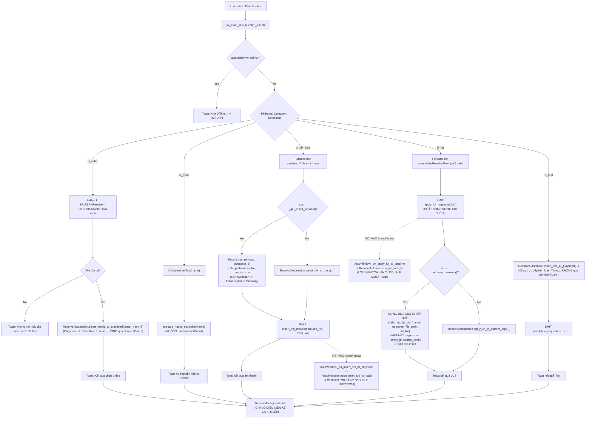

# THIẾT KẾ VÀ ĐẶC TẢ KIẾN TRÚC G04-04C4: STUDIO INSERT GUARD VÀ BẢO TOÀN PAYLOAD NGUỒN

- **Mã định danh:** `G04-04C4-R1` (Refinement: Audio default auto & video duration unknown)
- **Trạng thái:** `IMPLEMENTED_CODE_VERIFIED` (Đã hoàn tất mã nguồn TabAssets và bộ kiểm thử quy định đạt 84/84 tests PASS, exit code 0; Chưa desktop verified; Chờ Codex review)
- **Cấp độ Worker:** `HIGH` (Duy trì nghiêm ngặt theo quy định phiên làm việc)
- **Tác giả:** Antigravity (Worker)
- **Tech Lead thẩm định:** Codex Tech Lead
- **Ngày lập:** 2026-10-27
- **Mục tiêu:** Khảo sát toàn diện mã nguồn hiện tại của `TabAssets._insert_at_playhead`, bóc tách callgraph từng danh mục, lập ma trận bảo toàn trường dữ liệu, triệt tiêu lỗi double-dispatch từ Qt signals, và triển khai lát cắt chuẩn hóa (2 modules) đưa toàn bộ thao tác chèn Video, SFX/BGM, LUT và Native Transition từ Studio qua `ActionGuard` và `InsertService`.

---

## 1. KHẢO SÁT VÀ CALLGRAPH MÃ NGUỒN HIỆN TẠI (CURRENT CALLGRAPHS - [CODE_VERIFIED])

Khảo sát trực tiếp từ mã nguồn thực tế tại thời điểm hiện tại:
- `TabAssets._insert_at_playhead` [`src/ui/tabs/tab_assets.py:7085–7317`][CODE_VERIFIED]
- `StudioWindow` [`src/ui/studio/studio_window.py:180–200`][CODE_VERIFIED]
- `AutoWindow` [`src/ui/auto/auto_window.py:3500–3600`][CODE_VERIFIED]
- `InsertService` [`src/services/insert_service.py:167–267`][CODE_VERIFIED]
- `ActionGuard` [`src/core/action_guard.py:44–80`][CODE_VERIFIED]

```
[CODE_VERIFIED]  Mã nguồn hiện hành đang chạy trong dự án
[PROPOSED]       Đặc tả thay đổi/bổ sung trong lát cắt thiết kế này
[DEFERRED]       Các consumer/route được bảo lưu cho các lát cắt tiếp theo
```

### 1.1. Các Điểm Gọi Vào `TabAssets._insert_at_playhead` [CODE_VERIFIED]
Hàm `_insert_at_playhead` là đầu mối tập trung xử lý chèn tại Playhead trong `TabAssets`:
1. `self.btn_insert_title_playhead.clicked.connect(self._insert_at_playhead)` [`tab_assets.py:4602`]
2. `_on_lux_card_activated`: Double click hoặc Enter trên lưới ảo hóa [`tab_assets.py:5386`]
3. `_on_card_add_requested`: Bấm nút thêm trên Card cũ [`tab_assets.py:5397`]
4. `_on_insert_single_title_clicked`: Bấm nút chèn Title [`tab_assets.py:7747`]

### 1.2. Phân Tích Chi Tiết Từng Nhánh Trong `_insert_at_playhead` Hiện Tại [CODE_VERIFIED]



### 1.3. Bóc Tách Các Lỗ Hổng Kiến Trúc Cốt Lõi [CODE_VERIFIED EVIDENCE]

1. **Bỏ qua `InsertService` và `ActionGuard` trên Video & Chuyển cảnh [CODE_VERIFIED GAP]:**
   - Nhánh `is_video` (`lines 7110–7149`) gọi thẳng `ResolveAutomation.insert_media_at_playhead(target_track=3)`.
   - Bỏ qua toàn bộ `ActionGuard`: Không kiểm tra staging, không kiểm tra origin root/id, không kiểm tra path traversal `..`.
   - Chạy đồng bộ (blocking) trên Qt GUI main thread thay vì chạy ngầm qua `ResolveGateway`.
   - Cố định cứng `target_track=3`, bỏ qua tùy chọn track của người dùng.
2. **Nguy cơ Thế Chỗ Tệp Bất Hợp Pháp khi Mất File (Unverified Fallback Hazard) [CODE_VERIFIED DEFECT]:**
   - Khi `real_file_path` của Video không tồn tại hoặc bị xóa, code tự động quét thư mục mã nguồn repo qua `BRollSFXResolver` (`line 7117`) và `PosixPathAdapter.get_asset_path("broll_memes", ...)` (`lines 7123–7131`).
   - Nếu một asset trong kho quản lý bị xóa mất file nhưng tình cờ trùng tên với file mẫu trong repo, code sẽ tự ý chèn file repo mẫu! Điều này vi phạm hợp đồng: *không được chèn file khác file đã verified*.
3. **Lỗi Double Dispatch / Phát Tín Hiệu Kép Gây Đột Biến 2 Lần [CODE_VERIFIED DEFECT]:**
   - Nhánh SFX (`line 7207`): Sau khi `svc.insert()` đã gọi DaVinci Resolve chèn file âm thanh, code tiếp tục gọi `self.insert_sfx_requested.emit(audio_file, ...)`.
   - Trong `src/ui/auto/auto_window.py:3507`:
     `self.tab_titles.insert_sfx_requested.connect(self._on_insert_sfx_at_playhead)`
     Hàm `_on_insert_sfx_at_playhead` (`lines 3573–3581`) lại gọi `resolve_auto.insert_sfx_to_track(...)` một lần nữa!
     $\to$ **Hậu quả:** File âm thanh bị chèn 2 lần liên tiếp trên timeline!
4. **Phát Tín Hiệu Sớm (Premature Signal) và Dựng Payload Tổn Thất trên LUT [CODE_VERIFIED DEFECT]:**
   - Nhánh LUT (`line 7223`): Phát `self.apply_lut_requested.emit(pid)` **TRƯỚC KHI** gọi dịch vụ chèn hoặc có kết quả!
   - Trong `src/ui/auto/auto_window.py:3506`: `self.tab_titles.apply_lut_requested.connect(self._on_apply_lut_to_timeline)` lập tức gọi `resolve_auto.apply_look_lut(...)` ngay cả khi người dùng chưa xác nhận hoặc khi thao tác sau đó bị từ chối!
   - Dựng payload mới bị mất sạch dữ liệu (`lines 7226–7231`):
     ```python
     res = svc.insert({
         "tab": "lut",
         "id": pid,
         "name": lut_name,
         "file_path": lut_file,
     })
     ```
     Bị loại bỏ hoàn toàn các trường: `source_kind`, `origin_root`, `origin_library_id`, `availability`, `storage_managed`. Khiến `ActionGuard` nhận diện sai thành legacy media và bỏ qua kiểm tra thẩm quyền kho!
5. **Ghi Lịch Sử Gần Đây (RecentManager) Thiếu Điều Kiện [CODE_VERIFIED DEFECT]:**
   - Cuối hàm (`line 7316`): `RecentManager.add(asset_d.get("id", ""))` được gọi vô điều kiện, kể cả khi `ActionGuard` từ chối, Resolve báo lỗi, hoặc timeline không mở.

---

## 2. MA TRẬN BẢO TOÀN TRƯỜNG DỮ LIỆU (FIELD-PRESERVATION MATRIX)

Bảng đối chiếu sự toàn vẹn của các trường metadata xuyên suốt chu trình chèn:

| Trường Dữ Liệu | Nguồn Gốc (`selected_asset`) | Hiện Tại Trong `TabAssets` | Đề Xuất Chuẩn Hóa (`PROPOSED`) | Rủi Ro Nếu Bị Mất Trường |
|---|---|---|---|---|
| `id` | Chuỗi định danh duy nhất | Giữ nguyên | Giữ nguyên | Không định danh được asset |
| `name` | Tên hiển thị người dùng | Giữ nguyên | Giữ nguyên | Hiển thị toast sai tên |
| `category` / `tab` | Phân loại chuẩn | Có thể bị ép kiểu thô | Giữ nguyên từ `to_asset_dict` | Điều hướng sai router chèn |
| `file_path` | Đường dẫn file media | Bị thay thế bằng file fallback repo | Giữ nguyên đường dẫn ứng viên ban đầu | Chèn nhầm file rác không xác minh |
| `preview_path` | Đường dẫn file xem trước | Bị bỏ qua | Giữ nguyên (không dùng làm insert path) | Không ảnh hưởng chèn |
| `availability` | `online`, `offline`, `missing`, `staging` | **Bị xóa mất ở nhánh LUT** | **Bảo toàn 100%** | Bỏ lọt asset staging/missing qua guard |
| `source_kind` | `managed`, `linked`, `builtin`, `generated` | **Bị xóa mất ở nhánh LUT** | **Bảo toàn 100%** | Mất thẩm quyền kho, biến thành legacy |
| `storage_managed` | `True` nếu thuộc kho chính | **Bị xóa mất ở nhánh LUT** | **Bảo toàn 100%** | Bỏ qua kiểm tra đồng bộ marker ổ đĩa |
| `origin_root` | Root ổ đĩa lúc nạp metadata | **Bị xóa mất ở nhánh LUT** | **Bảo toàn 100%** | Không phát hiện được stale root (ổ A sang B) |
| `origin_library_id` | ID thư viện lúc nạp | **Bị xóa mất ở nhánh LUT** | **Bảo toàn 100%** | Không phát hiện được kho bị hoán đổi |
| `duration` | Thời lượng media (giây) | Có đọc, gán lại | Chuyển qua `extra_params` hoặc payload | Chèn sai độ dài clip |
| `preferred_track` | Track người dùng chỉ định | Đọc từ UI combobox | Truyền rõ ràng qua `InsertService.insert` | Chèn đè lên track không mong muốn |

---

## 3. BẢNG CHÍNH SÁCH XỬ LÝ (POLICY TABLE) & EXPECTED OUTCOMES

| Trường Hợp Kiểm Thử / Nghiệp Vụ | Dữ Liệu Đầu Vào (`asset_dict`) | Phản Ứng Của `ActionGuard` | Hành Vi Của `InsertService` | Hành Vi Giao Diện & Toast (`TabAssets`) |
|---|---|---|---|---|
| **1. Managed Asset Online Hợp Lệ** | `storage_managed=True`, file tồn tại, root & id khớp | `allowed=True`, `status="online"`, `OK_MANAGED_MEDIA_VERIFIED` | Dispatch qua `ResolveGateway` tới track tương ứng | Toast `✅ Đã chèn...`, thêm vào `RecentManager` |
| **2. Managed Asset Bị Offline (Rút ổ)** | `storage_managed=True`, root không tồn tại hoặc library_id không khớp | `allowed=False`, `status="offline"`, `ERR_STORAGE_ROOT_OFFLINE` / `ERR_LIBRARY_ID_MISMATCH` | Chặn ngay, không gọi Gateway, phát `insertion_finished(ok=False)` | Toast `❌ Kho Offline — hãy kết nối lại ổ đĩa...`, **KHÔNG** ghi Recent |
| **3. Managed Asset Bị Mất File (Missing)** | `storage_managed=True`, root online nhưng file bị xóa trên đĩa | `allowed=False`, `status="missing"`, `ERR_FILE_NOT_FOUND` | Chặn ngay, **CẤM** fallback quét repo file | Toast `❌ File nguồn không tồn tại trên đĩa`, **KHÔNG** ghi Recent |
| **4. Asset Đang Staging (Chưa tải xong)** | `availability="staging"` | `allowed=False`, `status="staging"`, `ERR_STAGING_UNPUBLISHED` | Chặn ngay trước mọi lệnh I/O | Toast `❌ Tài nguyên đang đồng bộ/staging...`, **KHÔNG** ghi Recent |
| **5. Stale Origin (Ổ đĩa cũ A sang B)** | `origin_root="/mnt/drive_A"`, nhưng app config trỏ `/mnt/drive_B` | `allowed=False`, `status="offline"`, `ERR_STORAGE_ROOT_MISMATCH` | Chặn ngay, không gọi Gateway | Toast `❌ Thư mục gốc tài nguyên không khớp...` |
| **6. Runtime Procedural Text Preset** | `TextStylePreset` object, không có file đĩa | `allowed=True`, `status="online"`, `OK_PROCEDURAL_PRESET` | Chạy generator sinh Fusion macro/code | Toast `✅ Đã chèn Title...`, thêm Recent |
| **7. Managed Text Template Thiếu File** | `storage_managed=True`, text tab, thiếu file `.setting` / `.drfx` | `allowed=False`, `status="missing"`, `ERR_FILE_NOT_FOUND` | Chặn ngay, **CẤM** fallback sang generator | Toast `❌ File nguồn không tồn tại...` |
| **8. Chuyển Cảnh Native (`trans`)** | `tab="trans"`, thiếu file video | `allowed=True`, `status="online"`, `OK_NATIVE_TRANSITION_GUIDANCE` | Copy tên vào clipboard, tìm cut point | Toast hướng dẫn kéo từ Effects (15s), thêm Recent |
| **9. Generated File-backed Media** | `source_kind="generated"`, file tmp hợp lệ | `allowed=True`, `status="online"`, `OK_GENERATED_MEDIA_VERIFIED` | Dispatch bình thường qua Gateway | Toast `✅ Đã chèn...`, thêm Recent |
| **10. DaVinci Resolve Chưa Mở Timeline** | Asset hợp lệ, nhưng Resolve chưa mở project/timeline | `ActionGuard` cho phép, nhưng `Gateway._task` trả về lỗi | `InsertResult(ok=False, error="Không có Timeline đang mở...")` | Toast `❌ Chưa thể chèn... Hãy kiểm tra Timeline`, **KHÔNG** ghi Recent |
| **11. Phòng Ngừa Double Dispatch** | Bất kỳ thao tác chèn SFX / LUT nào qua Service | Đã guard và dispatch trong service | Service hoàn thành 1 lần duy nhất | **KHÔNG** phát signal yêu cầu mutation phụ ra `auto_window` |

---

## 4. LÁT CẮT TRIỂN KHAI THỰC TẾ (IMPLEMENTED SLICE - [CODE_VERIFIED])

Để đảm bảo an toàn tuyệt đối, tuân thủ nguyên tắc thay đổi tối thiểu, lát cắt thực tế được triển khai trong **chính xác 2 production modules**:

### 4.1. Module 1: [`src/ui/tabs/tab_assets.py`](file:///media/vanntruongg/Documents/Development/Python/dự án cá nhân/ResolveFlow-Assistant/src/ui/tabs/tab_assets.py) (`lines 6696–6711, 7093–7225`) [CODE_VERIFIED]
Tái cấu trúc hàm `_insert_at_playhead` và cơ chế khởi tạo Inspector:
1. **Audio Combo Default Auto (G04-04C4-R1):**
   - Trong `_update_inspector_details` (`lines 6696–6711`): Mục đầu tiên của combobox audio (SFX/BGM) được gán là `Tự động (Tìm track trống...)` kèm userData `{"mode": "auto", "track": None}`. Các mục sau cho phép chọn explicit track (A2, A1, A4, New track).
   - Trong `_insert_at_playhead` (`lines 7175–7220`): Đọc userData trước. Nếu là text thuần (legacy), tự động map nhãn mặc định cũ (`Audio Track 2 (A2 - SFX)`, `Audio Track 4/5 (A4/A5 - BGM)`) về `mode="auto", preferred_track=None`. Các lựa chọn explicit (A1, A2, New track) được bảo toàn nguyên vẹn.
2. **Video Duration Sentinel (G04-04C4-R1):**
   - Thêm `TabAssets._extract_video_duration(payload)` (`lines 7093–7123`): Ưu tiên `duration_sec` nếu có trong payload; fallback `duration` khi không có key `duration_sec`. Giá trị unknown (None, 0, số âm, NaN, Inf, bool, string không hợp lệ) được trả về `0.0` (sentinel).
   - Truyền `duration=0.0` xuống `InsertService.insert` để service chuyển thành `duration_sec=None`, giữ nguyên thời lượng tự nhiên của clip trong Resolve thay vì bị giới hạn cứng 3 giây.
3. **Bảo Toàn Payload Đầy Đủ:**
   - Dùng `asset_d = to_asset_dict(self.selected_asset)` và `payload = dict(asset_d)` làm cơ sở duy nhất (`lines 7127, 7147`).
   - Giữ nguyên vẹn tất cả metadata: `source_kind`, `origin_root`, `origin_library_id`, `availability`, `storage_managed`, `file_path`, `preview_path`.
4. **Triệt Tiêu Hoàn Toàn Unverified Fallback:**
   - Xóa bỏ việc tự động gọi `BRollSFXResolver().resolve_meme(...)` hay `PosixPathAdapter.get_asset_path("broll_memes", ...)`.
   - Nếu asset bị mất file, chuyển nguyên trạng cho `InsertService.insert()` để `ActionGuard` fail-closed với `ERR_FILE_NOT_FOUND`.
5. **Đồng Bộ Hóa Luồng Chèn Video & Trans Qua `InsertService`:**
   - Nhánh `is_video`: Chuyển sang gọi `svc.insert(payload, mode=mode, duration=duration, preferred_track=preferred_track)`. Tận dụng worker ngầm của `ResolveGateway`, giải phóng GUI thread.
   - Nhánh `is_trans`: Chuyển sang gọi `svc.insert(payload, mode=mode)` (hàm `_insert_transition` của `InsertService` copy clipboard và `prepare_native_transition`).
6. **Loại Bỏ Hoàn Toàn Tín Hiệu Gây Double Mutation:**
   - Loại bỏ lệnh phát sớm `self.apply_lut_requested.emit(pid)`.
   - Loại bỏ lệnh phát `self.insert_sfx_requested.emit(...)` trên luồng service.
   - Không còn kích hoạt các mutation listener trong `AutoWindow` (`_on_insert_sfx_at_playhead`, `_on_apply_lut_to_timeline`).
7. **Chuẩn Hóa Xử Lý Kết Quả & RecentManager:**
   - Nhận `InsertResult` trả về từ `svc.insert(...)`:
     - Nếu `res.ok == True`: Hiển thị toast thành công `✅ {res.message or ...}`, gọi `RecentManager.add(asset_id)`.
     - Nếu `res.ok == False`: Hiển thị toast lỗi `❌ {res.error}` (hoặc `ℹ️` nếu skipped LUT), **tuyệt đối không gọi `RecentManager.add`**.

### 4.2. Module 2: [`src/services/insert_service.py`](file:///media/vanntruongg/Documents/Development/Python/dự án cá nhân/ResolveFlow-Assistant/src/services/insert_service.py) [CODE_VERIFIED]
1. **Loại bỏ Unverified Fallback Bên Trong `_insert_video` (`lines 608–625`):**
   - Xóa bỏ hoàn toàn fallback `BRollSFXResolver().resolve_meme` và quét thư mục repo sau guard.
   - `_insert_video` chỉ thực thi trên đúng `file_path` đã được `ActionGuard` phê chuẩn (`guard_res.resolved_path`), kiểm tra file tồn tại trước khi dispatch.
2. **Luồng Transition Trước Implicit Fusion Paste (`lines 245–248`):**
   - Đặt kiểm tra transition native trước kiểm tra Fusion page paste, đảm bảo `mode == "auto"` vào transition routing guidance thay vì paste nhầm node Fusion.
3. **Threading Volume Offset Âm Thanh (`lines 364–425`):**
   - `_insert_audio` nhận `extra_params: Optional[Dict[str, Any]] = None`.
   - Trích xuất `volume_offset` (vd: `-18.0` dB cho BGM, `-12.0` dB cho SFX). Chỉ truyền `volume_offset_db` vào `auto.insert_sfx_to_track` khi được chỉ định rõ ràng, giữ nguyên signature mặc định cho các caller không truyền param.

---

## 5. CÁC THÀNH PHẦN TIẾP TỤC TRÌ HOÃN (DEFERRED ROUTES)

1. **Direct Fusion Paste / Fast Paste Guard:**
   - Các nút `_on_copy_fusion_clicked` và `_on_fast_paste_fusion_clicked` tiếp tục sử dụng logic clipboard hiện hành, chưa tích hợp `ActionGuard`.
2. **Kéo Thả Ngoài (Drag & Drop Guard):**
   - Sự kiện drag khởi tạo từ `_create_drag_mime_data` giữ nguyên kiểm tra cache `availability == "offline"`, chưa có dynamic verification.
3. **Text Preset Parameter Direct Route:**
   - Nhánh chèn Text/Title với các tùy biến phức tạp (font selector, size slider, stroke, color swatches, animation chips) tạm thời giữ nguyên branch legacy (`lines 7196–7315`), chưa chuyển đổi trong lát cắt này.
4. **Tối Ưu Hóa Vòng Lặp Selection $O(N)$:**
   - Duyệt tìm asset bằng vòng lặp trong `edge_dock.py` và `tab_assets.py` tiếp tục hoãn lại, không kết hợp vào lát cắt an toàn chèn.

---

## 6. KẾT QUẢ KIỂM THỬ TDD & BẰNG CHỨNG THỰC TẾ (TEST RESULTS - [CODE_VERIFIED])

### 6.1. File Kiểm Thử Mới & Regression Suite
- File kiểm thử: `tests/ui/test_tab_assets_insert_guard.py` (14 tests)
  - `test_tab_assets_video_routing_preserves_origin_and_no_direct_automation`
  - `test_tab_assets_missing_file_no_unverified_repo_fallback`
  - `test_tab_assets_lut_preserves_origin_and_no_double_dispatch`
  - `test_tab_assets_sfx_no_double_dispatch`
  - `test_tab_assets_native_transition_routing`
  - `test_tab_assets_service_unavailable_graceful`
  - `test_tab_assets_recent_manager_only_on_success`
  - `test_tab_assets_actual_service_integration_managed_root_mismatch`
  - `test_tab_assets_actual_service_integration_valid_video`
  - `test_tab_assets_audio_inspector_combo_defaults_to_auto` (G04-04C4-R1)
  - `test_tab_assets_audio_combo_explicit_choices_and_legacy_fallback` (G04-04C4-R1)
  - `test_tab_assets_video_duration_extraction_cases` (G04-04C4-R1)
  - `test_tab_assets_video_unknown_duration_integration_sends_none_to_automation` (G04-04C4-R1)
  - `test_tab_assets_audio_integration_a2_busy_picks_a3` (G04-04C4-R1)
- Regression tests trong `tests/services/test_insert_service.py` (3 tests):
  - `test_insert_service_video_no_repo_fallback_on_missing_file`
  - `test_insert_service_audio_volume_offset_threading`
  - `test_insert_service_native_transition_auto_mode_on_fusion_page`

### 6.2. Kết Quả Chạy Kiểm Thử Quy Định
- **Lệnh thực thi:**
  ```bash
  QT_QPA_PLATFORM=offscreen PYTHONDONTWRITEBYTECODE=1 .venv/bin/pytest tests/ui/test_tab_assets_insert_guard.py tests/services/test_insert_service.py tests/ui/test_studio_storage_snapshot.py tests/ui/test_pack_result_feedback.py -q
  ```
- **Kết quả:**
  ```
  84 passed in 28.24s, exit code 0
  ```
- **Phân loại kiểm thử:**
  - Red Phase R1: 3 failed (Audio inspector combo default fixed A2, explicit choices parsing, free-track integration)
  - Green Phase R1: 84 passed, 0 failed, 0 skipped, exit code 0.
- **Tiêu chuẩn an toàn:**
  - Đúng chính xác 1 production module sửa đổi trong R1: `src/ui/tabs/tab_assets.py`.
  - Không sửa đổi ngoài scope.
  - Mock scoped chặt chẽ, không gọi Resolve thật, không mở GUI Qt thật.
  - Chưa kiểm thử thực tế trên giao diện desktop (Desktop Verification: Pending).

---

## 7. CÁC QUYẾT ĐỊNH CHÍNH SÁCH ĐÃ ĐƯỢC TECH LEAD CODEX THÔNG QUA

Các quyết định ràng buộc từ Codex Tech Lead (`docs/architecture/04C4-codex-decisions.md`):
1. **Loại Bỏ Hoàn Toàn Fallback Repo:** Đã đồng ý và triển khai. Asset mất file fail-closed với `ERR_FILE_NOT_FOUND`.
2. **Triệt Tiêu Double Dispatch Signal:** Đã đồng ý và triển khai. Không emit `insert_sfx_requested` / `apply_lut_requested` khi qua `InsertService`.
3. **Phạm Vi Text Presets:** Đã đồng ý giữ lại direct legacy branch cho Text/Title, hoàn tất dứt điểm Video/SFX/BGM/LUT/Trans.

---

## 8. SỬA LỖI FRAME BOUNDS CHÈN VIDEO (TASK G04-04C5-I - [CODE_VERIFIED])

### 8.1. Nguyên Nhân Kỹ Thuật (Root Cause Analysis)
- Trong DaVinci Resolve API `media_pool.AppendToTimeline([append_spec])`, thời lượng clip (duration) được tính theo công thức:
  $$\text{Duration} = \text{endFrame} - \text{startFrame}$$
- Khi `startFrame = 0`, cấu hình cũ tại `src/core/resolve_api.py:1291` sử dụng `"endFrame": dur_frames - 1`.
- Kết quả: Khi clip nguồn có 168 frames (`dur_frames = 168`), `endFrame` được gửi là 167, dẫn đến thời lượng đặt trên timeline chỉ đạt $167 - 0 = 167$ frames (thiếu đúng 1 frame so với nguyên bản 7.0s @ 24fps).

### 8.2. Giải Pháp Triển Khai (Minimal Production Fix)
- Chỉ sửa đổi duy nhất tại `src/core/resolve_api.py:1291` trong phương thức `ResolveAutomation.insert_media_at_playhead`:
  ```python
  append_spec = {
      "mediaPoolItem": target_item,
      "startFrame": 0,
      "endFrame": dur_frames,  # Sửa từ dur_frames - 1 thành dur_frames
      "recordFrame": rec_frame,
      "trackIndex": target_track,
      "mediaType": 1,
  }
  ```
- **Bảo toàn bất biến:**
  - Logic clamp: `min(total_frames, max(1, int(round(duration_sec * fps))))`.
  - Tối thiểu 1 frame cho positive duration cực ngắn.
  - Trường hợp không giới hạn (`duration_sec=None` hoặc `0`): `dur_frames = total_frames`.
  - Ảnh tĩnh (`is_still`): Giữ nguyên `append_spec` không chứa `startFrame` và `endFrame`.
  - `recordFrame`, `trackIndex`, `mediaType` không bị thay đổi.
  - Không sửa đổi bất kỳ hàm audio, transition, hay rational time rounding nào khác.

### 8.3. Bằng Chứng TDD & Desktop Live Resolve Verification
- **TDD Unit Tests:** `tests/core/test_resolve_media_frame_bounds.py` (5 tests PASS, 100% GREEN sau RED phase).
- **Bộ Kiểm Thử Tập Trung:** 71 passed (`tests/core/test_resolve_media_frame_bounds.py`, `tests/test_resolve_api.py`, `tests/services/test_insert_service.py`), exit code 0.
- **Desktop Verification trên DaVinci Resolve thực tế (`DISPLAY=:1`, PID 275135):**
  - Kịch bản: `task/desktop_verify_frame_bounds.py` (Exit code 0).
  - Safety Hard-Abort: Xác minh dự án `ChunDVC_G04_Acceptance_1793037559`, tạo timeline owned `Timeline_FrameBounds_1793040010`.
  - **Case 1 (Video full 7s qua Studio UI):** GetDuration = 168 (EXACT), GetEnd - GetStart = 168.
  - **Case 2 (Video 3.0s qua Studio UI):** GetDuration = 72 (EXACT), GetEnd - GetStart = 72. Clip V2 bảo toàn 168 frames.
  - **Case 3 (Video 1/24s qua API Integration):** GetDuration = 1 (EXACT), GetEnd - GetStart = 1.
  - Bằng chứng lưu tại `.bridge/ux-evidence/G04-04C5-I/`.

