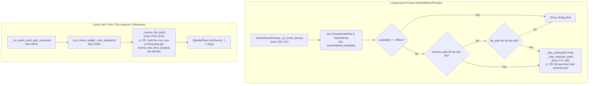

# THIẾT KẾ VÀ ĐẶC TẢ KIẾN TRÚC G04-04C6: GUARD CHO DRAG VÀ PREVIEW NGOÀI INSERTSERVICE

- **Mã định danh:** `G04-04C6a-I` (Triển khai Guard cho Kéo thả Lưới; Preview Deferred)
- **Trạng thái:** `IMPLEMENTED_PENDING_REVIEW` (Đã hoàn thành toàn bộ mã nguồn trên 2 modules cho phép và bộ kiểm thử TDD; 148 tests PASS, exit 0; Dừng chờ Codex Tech Lead nghiệm thu)
- **Cấp độ Worker:** `HIGH` (Duy trì nhất quán xuyên suốt phiên)
- **Tác giả:** Antigravity (Worker)
- **Tech Lead thẩm định:** Codex Tech Lead
- **Ngày lập:** 2026-10-27
- **Mục tiêu:** Thiết kế mở rộng `ActionGuard` (`check_action_availability`) để bao quát các intent thao tác ngoài `InsertService` gồm: **Kéo thả chuột (Drag & Drop)** vào DaVinci Resolve và **Xem trước media (Hover Preview / Explicit Preview)**. Triệt tiêu hoàn toàn các lỗ hổng bypass bảo mật: sinh file rác giả lập (/tmp dummy .wav/.cube/.mp4), kéo thả file preview MP4 của chuyển cảnh native, bypass ranh giới kho StorageManager khi drag, và phát preview trên tài nguyên chưa được kiểm chứng hoặc đã bị xóa.

```
[CODE_VERIFIED]  Mã nguồn hiện hành đang chạy trong dự án (kèm đường dẫn file:dòng chính xác)
[PROPOSED]       Đặc tả thay đổi/mở rộng trong lát cắt thiết kế G04-04C6
[DEFERRED]       Các consumer/route phụ trợ được bảo lưu cho các giai đoạn tiếp theo
```

---

## 1. KHẢO SÁT VÀ CALLGRAPH MÃ NGUỒN HIỆN TẠI (CURRENT CALLGRAPHS - [CODE_VERIFIED])

Khảo sát trực tiếp từ mã nguồn thực tế tại thời điểm hiện tại:
1. `src/core/action_guard.py:check_action_availability` [`lines 199–642`][CODE_VERIFIED]
2. `src/ui/lux/library/asset_grid.py:create_asset_mime_data` [`lines 36–109`][CODE_VERIFIED]
3. `src/ui/lux/library/asset_grid.py:AssetGridView.mouseMoveEvent` [`lines 291–337`][CODE_VERIFIED]
4. `src/ui/tabs/tab_assets.py:_create_drag_mime_data` [`lines 7355–7525`][CODE_VERIFIED]
5. `src/ui/tabs/tab_assets.py:CardWidget._start_drag` [`lines 2904–3005`][CODE_VERIFIED]
6. `src/ui/tabs/tab_assets.py:DraggableAssetLabel.mouseMoveEvent` [`lines 302–339`][CODE_VERIFIED]
7. `src/ui/tabs/tab_assets.py:DraggableActionButton.mouseMoveEvent` [`lines 354–379`][CODE_VERIFIED]
8. `src/ui/lux/library/hover_preview.py:SharedHoverPreview._on_hover_timeout` [`lines 233–271`][CODE_VERIFIED]
9. `src/ui/lux/library/hover_preview.py:SharedHoverPreview.preview_asset` [`lines 304–325`][CODE_VERIFIED]
10. `src/ui/tabs/tab_assets.py:IconMemeInspectorWidget._start_playback` [`lines 1599–1609`][CODE_VERIFIED]
11. `src/ui/tabs/tab_assets.py:IconMemeInspectorWidget._resolve_file_path` [`lines 1478–1515`][CODE_VERIFIED]

---

### 1.1. Luồng Kéo Thả (Drag & Drop Callgraph) Hiện Tại [CODE_VERIFIED]

```mermaid
flowchart TD
    subgraph GridDrag["Luồng Kéo Thả từ Lưới Ảo Hóa (AssetGridView)"]
        AG_MouseMove["AssetGridView.mouseMoveEvent<br/>(lines 291–337)"] --> AG_Mime["create_asset_mime_data(asset)<br/>(lines 36–109)"]
        AG_Mime --> CheckOffline{"target.availability == 'offline'?"}
        CheckOffline -- Yes --> ReturnEmpty["Trả về QMimeData rỗng"]
        CheckOffline -- No --> CheckManaged{"storage_managed == True?"}
        CheckManaged -- Yes --> CheckPhys["not file_path or not os.path.isfile(file_path)?"]
        CheckPhys -- Yes --> ReturnEmpty
        CheckManaged -- No --> BranchType{"Phân loại Category / Tab"}

        BranchType -- "File vật lý có sẵn" --> MimePhys["mime_data.setUrls([file_path])"]
        BranchType -- "Text / Title" --> GenText["FusionSettingGenerator.export_setting_file<br/>(lines 63–85)"]
        BranchType -- "Trans / Transition" --> GenTrans["TransitionMacroGenerator.export_setting_file<br/>(lines 88–105) ⚠️ LỖI: Tạo macro giả cho cả native!"]
        BranchType -- "Khác" --> FallbackId["mime_data.setText(asset_id)<br/>(lines 107–109)"]

        MimePhys --> DragExec["drag = QDrag(self)<br/>drag.setMimeData(mime_data)<br/>drag.exec(...)<br/>⚠️ LỖI: Chạy exec() kể cả khi payload rỗng!"]
        GenText --> DragExec
        GenTrans --> DragExec
        FallbackId --> DragExec
        ReturnEmpty --> DragExec
    end

    subgraph LegacyDrag["Luồng Kéo Thả Cũ (TabAssets Inspector & CardWidget)"]
        InspectDrag["DraggableAssetLabel / DraggableActionButton<br/>(lines 302–380)"] --> Tab_CreateMime["TabAssets._create_drag_mime_data<br/>(lines 7355–7525)"]
        Card_Drag["CardWidget.mouseMoveEvent<br/>(lines 2897–2902)"] --> Card_StartDrag["CardWidget._start_drag<br/>(lines 2904–3005)"]

        Tab_CreateMime --> DummyWav["Không có file SFX: Tạo dummy WAV câm 44.1kHz trong /tmp!"]
        Tab_CreateMime --> DummyCube["Không có file LUT: Tạo dummy CUBE 2x2x2 trong /tmp!"]
        Tab_CreateMime --> DummyMp4["Không có file Video: Tạo dummy MP4 24-byte trong /tmp!"]
        Tab_CreateMime --> RecentLog["RecentManager.add(id)<br/>(Ghi vô điều kiện trước khi drag)"]
    end
```



---

### 1.2. Luồng Xem Trước (Hover / Explicit Preview Callgraph) Hiện Tại [CODE_VERIFIED]



---

### 1.3. Bóc Tách Các Lỗ Hổng Kiến Trúc Cốt Lõi [CODE_VERIFIED EVIDENCE]

1. **Bypass Toàn Bộ Thẩm Quyền Kho (`ActionGuard`) Khi Kéo Thả [CODE_VERIFIED DEFECT]:**
   - Trong `create_asset_mime_data` (`asset_grid.py:42–48`): Chỉ kiểm tra `availability == "offline"`. Hoàn toàn không kiểm tra `origin_library_id`, `origin_root`, symlink escape, path traversal `..`, hay tính toàn vẹn của StorageManager.
   - Nếu người dùng chuyển thư mục kho chính từ Thư mục A sang Thư mục B trong Cài đặt (Root Switch), các card cũ trên lưới vẫn kéo thả được file từ Thư mục A vào timeline Resolve nếu file còn nằm trên đĩa!
2. **Kéo Thả Chuyển Cảnh Native Sinh Macro Giả Sai Lệch [CODE_VERIFIED DEFECT]:**
   - Tại `asset_grid.py:87–105` và `tab_assets.py:7424–7440`: Bất kỳ asset nào thuộc tab `trans` đều được đưa vào `TransitionMacroGenerator.export_setting_file()`.
   - Với các chuyển cảnh native đã cài đặt sẵn trong Resolve (như `Smooth Push`, `Dip to Color`), macro sinh ra chỉ chứa bộ trộn Dissolve mặc định, phá vỡ chuyển cảnh thực tế và tạo clip rác trên timeline thay vì áp chuyển cảnh giữa 2 clip.
3. **Thế Chỗ File Giả Lập (/tmp Dummy Carriers) [CODE_VERIFIED DEFECT]:**
   - Tại `tab_assets.py:7454–7505`: Khi file SFX, LUT, hoặc Video không tồn tại, code tự động sinh file rác:
     - SFX: Sinh file WAV câm 44.1kHz tại `/tmp/ResolveFlow_{clean_id}.wav`.
     - LUT: Sinh file CUBE 2x2x2 danh nghĩa tại `/tmp/ResolveFlow_{asset_id}.cube`.
     - Video: Sinh file MP4 rỗng 24 byte (`ftypmp42...`) tại `/tmp/ResolveFlow_{asset_id}.mp4`.
   - Điều này vi phạm nghiêm ngặt hợp đồng: *Tài nguyên missing bắt buộc phải fail-closed, tuyệt đối không được sinh media giả mạo.*
4. **Thực Thi `QDrag.exec()` Bất Chấp Payload Bị Từ Chối [CODE_VERIFIED DEFECT]:**
   - Tại `asset_grid.py:314–336`: `drag.exec()` được gọi vô điều kiện. Khi `create_asset_mime_data` trả về `QMimeData` rỗng (không có URLs), chuột vẫn hiển thị ghost dragging và hệ thống vẫn bắt đầu vòng đời drag OS, gây hiểu lầm cho người dùng và DaVinci Resolve.
5. **Bypass Kiểm Tra Thẩm Quyền Xem Trước (Preview Authority Bypass) [CODE_VERIFIED DEFECT]:**
   - Tại `hover_preview.py:245–258`: Chỉ kiểm tra `availability == "offline"`. Không kiểm tra `staging` (tài nguyên đang tải dở vẫn bị phát) hoặc `missing`.
   - Khi `preview_path` khuyết thiếu, code tự động fallback sang `file_path` mà không kiểm tra xem master file có thuộc về kho hợp lệ hay không.
   - Tại `tab_assets.py:1478–1515`: `_resolve_file_path` quét ngược vào mã nguồn repo và sử dụng hardcoded alias (`meme_cat_cry` $\to$ `meme_meo_khoc_banana.mp4`), đánh tráo nội dung người dùng.

---

## 2. MA TRẬN QUYẾT ĐỊNH (DECISION MATRIX)

Ma trận quyết định toàn diện cho `ActionGuard` mở rộng với 3 nhóm Intent:
- **`insert`**: Chèn vào timeline qua `InsertService` (đã chuẩn hóa tại G04-04C4).
- **`drag`**: Kéo thả file ra ngoài ứng dụng hoặc vào timeline DaVinci Resolve (`create_asset_mime_data`).
- **`preview`**: Phát xem trước media (`SharedHoverPreview`, `preview_asset`, Inspector preview).

| Source Kind | Cache / Storage State | Intent `insert` | Intent `drag` | Intent `preview` | Mã Kết Quả (Result Code) | Hành Vi Chi Tiết & Ràng Buộc |
|---|---|---|---|---|---|---|
| **Any** | `availability == 'staging'` | **DENY** | **DENY** | **DENY** | `ERR_STAGING_UNPUBLISHED` | Tài nguyên đang tải/chưa publish: Cấm mọi thao tác timeline, drag và preview. |
| **Any** | `availability == 'offline'` | **DENY** | **DENY** | **DENY** | `ERR_CACHED_OFFLINE` | Kho offline: Từ chối ngay lập tức ở cấp độ cache. |
| **Any** | `availability == 'missing'` | **DENY** | **DENY** | **DENY** | `ERR_CACHED_MISSING` | Đã xác định missing: Từ chối ngay lập tức, cấm quét đĩa dự phòng. |
| **managed** | Root switch $A \to B$ (Foreign Root) | **DENY** | **DENY** | **DENY** | `ERR_FOREIGN_ROOT` | `norm_active_root != norm_origin_root`: Từ chối hoàn toàn, yêu cầu nạp lại kho. |
| **managed** | Same path, ID swap (Mismatch) | **DENY** | **DENY** | **DENY** | `ERR_STORAGE_IDENTITY_MISMATCH` | `active_lib_id != origin_lib_id`: Kho đã bị thay thế, không tin cậy path. |
| **managed** | Path traversal (`..`) | **DENY** | **DENY** | **DENY** | `ERR_INVALID_PATH_TRAVERSAL` | Đường dẫn chứa phân đoạn bất hợp pháp: Chặn đứng mọi intent. |
| **managed** | Symlink trỏ ra ngoài kho | **DENY** | **DENY** | **DENY** | `ERR_SYMLINK_ESCAPE` | Symlink escape ra ngoài `active_root`: Từ chối truy cập. |
| **managed** | File bị xóa sau khi nạp (Post-select deleted) | **DENY** | **DENY** | **DENY** | `ERR_FILE_NOT_FOUND` | Action-time `stat` thất bại: Báo missing thật, cấm sinh file dummy `/tmp`. |
| **managed** | File hợp lệ trong kho | **ALLOW** | **ALLOW** | **ALLOW** | `OK_MANAGED_MEDIA_VERIFIED` | Đạt mọi điều kiện bảo vệ: Cung cấp `resolved_path` cho insert/drag/preview. |
| **linked** | External path bị xóa / không tồn tại | **DENY** | **DENY** | **DENY** | `ERR_FILE_NOT_FOUND` | File ngoài bị mất: Báo missing, cấm chèn hoặc drag. |
| **linked** | External path hợp lệ trên đĩa | **ALLOW** | **ALLOW** | **ALLOW** | `OK_LINKED_MEDIA_VERIFIED` | File ngoài tồn tại: Cho phép thao tác. |
| **builtin** | File mẫu trong gói cài đặt tồn tại | **ALLOW** | **ALLOW** | **ALLOW** | `OK_BUILTIN_MEDIA_VERIFIED` | Tài nguyên builtin chuẩn: Cho phép thao tác. |
| **generated** | File kết quả sinh động tồn tại | **ALLOW** | **ALLOW** | **ALLOW** | `OK_GENERATED_MEDIA_VERIFIED` | File render/export hợp lệ: Cho phép thao tác. |
| **native transition** | Preset chuyển cảnh native DaVinci | **ALLOW (Guidance)** | **DENY** | **ALLOW (nếu có preview MP4)** | Drag: `ERR_NATIVE_TRANSITION_DRAG_UNSUPPORTED`<br/>Insert: `OK_NATIVE_TRANSITION_GUIDANCE`<br/>Preview: `OK_PREVIEW_VERIFIED` | Drag bị cấm hoàn toàn vì timeline Resolve không hỗ trợ thả file ngoài cho transition cắt nối. Insert chuyển thành hướng dẫn clipboard. Preview phát clip mô phỏng. |
| **procedural text** | Generator sinh mã động (`TextStylePreset`) | **ALLOW (Fusion Paste)** | **ALLOW (Export Setting)** | **DENY / SIMULATE** | Drag: `OK_PROCEDURAL_DRAG_SETTING`<br/>Insert: `OK_PROCEDURAL_PRESET` | Drag sinh file `.setting` hợp lệ tại thời điểm kéo. |
| **managed text** | Mất file `.setting` gốc | **DENY** | **DENY** | **DENY** | `ERR_FILE_NOT_FOUND` | **RÀNG BUỘC SẮT:** CẤM fallback sang procedural generator khi managed text mất file gốc! |
| **legacy/unknown** | Không có origin, có dấu hiệu managed | **DENY** | **DENY** | **DENY** | `ERR_ORIGIN_UNVERIFIED` | **Chính sách Fail-closed:** Không degrade tài nguyên managed thiếu origin về diện legacy tự do. |

---

## 3. CHÍNH SÁCH CHUYỂN CẢNH NATIVE & BỘ SINH MÃ PROCEDURAL (POLICIES)

### 3.1. Chuyển Cảnh Native (Native Transitions)
- **Bản chất kỹ thuật DaVinci Resolve:**
  Chuyển cảnh trên Timeline của DaVinci Resolve là một toán tử chuyển tiếp giữa 2 clip kề nhau trên cùng một video track (Cut-transition). DaVinci Resolve **KHÔNG** chấp nhận thao tác kéo thả file từ bên ngoài (kể cả file `.setting` Macro) thả lên đường phân cách clip để tự biến thành chuyển cảnh native. Việc thả file `.setting` vào timeline sẽ bị Resolve biến thành một Fusion Generator độc lập đè lên track mới.
- **Quy tắc Drag đối với Native Transition [PROPOSED POLICY]:**
  1. Khi `asset` là chuyển cảnh native (thuộc `trans`/`transition` hoặc `is_native_guidance == True`):
     - `check_action_availability(asset, intent="drag")` trả về:
       - `allowed = False`
       - `result_code = "ERR_NATIVE_TRANSITION_DRAG_UNSUPPORTED"`
       - `reason = "Chuyển cảnh Native không thể kéo thả file vào timeline; hãy sử dụng nút Chèn hoặc kéo trực tiếp từ Effects Library của DaVinci Resolve."`
       - `is_native_guidance = True`
  2. `create_asset_mime_data`: Trả về `QMimeData` rỗng (hoặc chỉ chứa Plain Text tên chuyển cảnh phục vụ tra cứu, tuyệt đối **KHÔNG CÓ URLs file**).
  3. UI Feedback: Khi người dùng cố gắng kéo thẻ chuyển cảnh native, giao diện hiển thị Toast hoặc Status Hint hướng dẫn, và **KHÔNG GỌI `QDrag.exec()`**.

### 3.2. Bộ Sinh Mã Procedural Generator (Procedural Text Presets)
- **Trường hợp hợp lệ:**
  Chỉ khi tài nguyên là một generator runtime thực thụ (thuộc `TextStylePreset` thuần túy hoặc `source_kind == "builtin"` / `"generated"`):
  - Cho phép xuất file `.setting` tạm thời vào `tempfile.gettempdir()`.
  - File `.setting` sinh ra phải tuân thủ cú pháp Lua Fusion Macro chuẩn của ChunDVC, chứa đúng `sample_text` người dùng đã nhập.
  - Vòng đời file tạm: Được đặt tên có tiền tố `ChunDVC_Drag_<uuid>` để dễ dàng dọn dẹp, quyền sở hữu thuộc về phiên làm việc hiện tại.
- **Trường hợp cấm mạo danh (Anti-Fallback Rule):**
  - Nếu tài nguyên có `source_kind == "managed"` nhưng file `.setting` gốc trong kho bị thiếu: **BẮT BUỘC BÁO LỖI `ERR_FILE_NOT_FOUND`**.
  - Tuyệt đối không được gọi `FusionSettingGenerator.generate_setting_content` để tạo một preset mặc định thay thế!

---

## 4. TÁCH BIỆT THẨM QUYỀN: PREVIEW PATH VS MASTER SOURCE PATH

### 4.1. Nguyên Tắc Đặc Quyền Tối Thiểu (Principle of Least Privilege)
$$\text{Quyền Xem Trước (Preview Authority)} \neq \text{Quyền Chèn/Kéo (Insert/Drag Authority)}$$

1. **`file_path` (Master Source Path):**
   - Là file gốc có độ phân giải đầy đủ, chất lượng cao (Master ProRes/H.264/WAV/CUBE).
   - Bắt buộc phải thỏa mãn toàn bộ ranh giới an toàn kho (`StorageManager`, `origin_root`, `origin_library_id`, `symlink escape`).
2. **`preview_path` (Proxy / Cache Path):**
   - Là file proxy nén nhẹ (720p/1080p bitrate thấp, file MP4/WebM/WAV) được sinh ra để hiển thị nhanh trên UI và phát hover preview 60fps mà không gây quá tải ổ đĩa.
   - Thường nằm trong thư mục cache cục bộ: `~/.resolveflow_cache/previews/` hoặc thư mục cache của gói cài đặt.
3. **Quy Tắc Ranh Giới [PROPOSED]:**
   - **Khi kiểm tra `intent == "preview"`:**
     - Ưu tiên thẩm định `preview_path`. Nếu `preview_path` tồn tại và là file thông thường hợp lệ trên đĩa $\to$ Cho phép xem trước (`OK_PREVIEW_VERIFIED`).
     - Nếu không có `preview_path`, cho phép thẩm định sang `file_path`. Lúc này `file_path` phải thỏa mãn điều kiện an toàn thông thường.
     - Việc `preview_path` hợp lệ **TUYỆT ĐỐI KHÔNG ĐỒNG NGHĨA** với việc tài nguyên được phép `insert` hay `drag`!
   - **Khi kiểm tra `intent in ("insert", "drag")`:**
     - Guard **BẮT BUỘC CHỈ KIỂM TRA `file_path`**.
     - **CẤM TUYỆT ĐỐI** việc lấy `preview_path` thay thế cho `file_path` để chèn hoặc kéo vào DaVinci Resolve!

### 4.2. Giữ Nguyên 4 Trạng Thái Khả Dụng (Availability Enums)
Không tự chế thêm trạng thái mới (như "preview_only" hay "degraded"). Hệ thống giữ nghiêm ngặt 4 trạng thái:
- `"online"`: Đầy đủ file master và sẵn sàng cho mọi thao tác.
- `"offline"`: Ổ đĩa kho lưu trữ chưa được kết nối hoặc khác thư mục gốc.
- `"missing"`: File master không tồn tại trên đĩa.
- `"staging"`: File đang được tải về từ Cloud/Drive, chưa commit.

---

## 5. ĐỀ XUẤT MỞ RỘNG API VÀ LÁT CẮT TRIỂN KHAI DUY NHẤT (RECOMMENDED SLICE)

### 5.1. Mở Rộng API `ActionGuard` (`src/core/action_guard.py`) [PROPOSED API]

Mở rộng `check_action_availability` nhận thêm 2 intent mới:
```python
ActionIntent = Literal["insert", "inspect", "drag", "preview"]

def check_action_availability(
    asset: Any,
    intent: ActionIntent = "insert",
    storage_provider: Optional[Callable[[], Any]] = None,
    stat_fn: Optional[Callable[[str], Any]] = None,
    realpath_fn: Optional[Callable[[str], str]] = None,
) -> ActionGuardResult:
```

- **Logic xử lý `intent == "drag"`:**
  1. Nếu là chuyển cảnh native (`is_transition_effect`): Trả về `allowed=False`, `result_code="ERR_NATIVE_TRANSITION_DRAG_UNSUPPORTED"`, `is_native_guidance=True`.
  2. Nếu là procedural text (`is_procedural_generator`): Trả về `allowed=True`, `result_code="OK_PROCEDURAL_DRAG_SETTING"`.
  3. Ngược lại: Thẩm định `file_path` qua toàn bộ Identity Gate và Storage Boundaries y hệt như `intent == "insert"`. Không có ngoại lệ.

- **Logic xử lý `intent == "preview"`:**
  1. Kiểm tra cache: Nếu `staging` $\to$ Deny `ERR_STAGING_UNPUBLISHED`.
  2. Xác định đường dẫn kiểm tra: Ưu tiên `preview_path`. Nếu không có thì dùng `file_path`.
  3. Thẩm định file kiểm tra qua `_safe_resolve_path` và `_safe_stat_file`.
  4. Nếu hợp lệ: Trả về `allowed=True`, `status="online"`, `result_code="OK_PREVIEW_VERIFIED"`, `resolved_path=resolved_preview_file`.

---

### 5.2. Lát Cắt Triển Khai Đầu Tiên Duy Nhất (Single Recommended Slice: 3 Modules)

Chúng tôi đề xuất triển khai gói gọn trong **3 production modules** thuộc luồng lưới ảo hóa Akitt Pro (không can thiệp vào legacy inspector/widgets):

#### Module 1: `src/core/action_guard.py`
- Mở rộng `check_action_availability` hỗ trợ `intent="drag"` và `intent="preview"`.
- Bổ sung mã lỗi:
  - `ERR_NATIVE_TRANSITION_DRAG_UNSUPPORTED`: Chặn drag chuyển cảnh native.
  - `OK_PROCEDURAL_DRAG_SETTING`: Cho phép sinh setting động khi kéo text generator.
  - `OK_PREVIEW_VERIFIED`: Cho phép phát preview media đã qua xác thực.

#### Module 2: `src/ui/lux/library/asset_grid.py`
- Cập nhật `create_asset_mime_data`:
  - Thay thế toàn bộ các phép kiểm tra thủ công rải rác (`availability == "offline"`, `storage_managed`) bằng lời gọi duy nhất:
    ```python
    guard = check_action_availability(asset, intent="drag")
    if not guard.allowed:
        return QMimeData()  # Trả về rỗng an toàn
    ```
  - Loại bỏ hoàn toàn fallback id text (`mime_data.setText(asset_id)`).
  - Loại bỏ việc sinh macro giả cho chuyển cảnh không phải procedural.
- Cập nhật `AssetGridView.mouseMoveEvent`:
  - Trước khi khởi tạo `QDrag`:
    ```python
    mime_data = create_asset_mime_data(asset, sample_text=sample_txt)
    if not mime_data or not mime_data.hasUrls():
        # KHÔNG GỌI drag.exec()!
        return
    ```
  - Triệt tiêu hoàn toàn hiện tượng ghost drag khi bị từ chối.

#### Module 3: `src/ui/lux/library/hover_preview.py`
- Cập nhật `_on_hover_timeout`:
  - Đọc `raw = idx.data(AssetObjRole)` (đối tượng DTO đầy đủ).
  - Gọi guard thẩm định trước khi khởi động player:
    ```python
    guard = check_action_availability(raw, intent="preview")
    if not guard.allowed:
        return
    ```
  - Sử dụng `guard.resolved_path` an toàn thay vì tự tiện fallback file bừa bãi.
- Cập nhật `preview_asset`:
  - Thẩm định tương tự qua `check_action_availability(asset, intent="preview")`.

---

## 6. KẾ HOẠCH KIỂM THỬ TẬP TRUNG (FOCUSED TEST PLAN)

Khi bước vào giai đoạn cài đặt (04C6-I), bộ kiểm thử tập trung sẽ được viết mới trong `tests/core/test_action_guard_drag_preview.py` và `tests/ui/test_asset_grid_drag_guard.py`:

1. **Unit Test Cho `ActionGuard` (`intent="drag"` & `intent="preview"`):**
   - `test_guard_drag_managed_media_success`: File trong kho hợp lệ $\to$ allowed=True, resolved_path đúng.
   - `test_guard_drag_managed_foreign_root_denied`: Khác thư mục gốc $\to$ allowed=False, `ERR_FOREIGN_ROOT`.
   - `test_guard_drag_staging_denied`: Trạng thái staging $\to$ allowed=False, `ERR_STAGING_UNPUBLISHED`.
   - `test_guard_drag_native_transition_denied`: Chuyển cảnh native $\to$ allowed=False, `ERR_NATIVE_TRANSITION_DRAG_UNSUPPORTED`, `is_native_guidance=True`.
   - `test_guard_drag_procedural_text_allowed`: TextStylePreset $\to$ allowed=True, `OK_PROCEDURAL_DRAG_SETTING`.
   - `test_guard_drag_managed_text_missing_file_no_procedural_fallback`: Managed text mất file $\to$ allowed=False, `ERR_FILE_NOT_FOUND`.
   - `test_guard_preview_valid_preview_path`: Có preview_path hợp lệ $\to$ allowed=True, `OK_PREVIEW_VERIFIED`.
   - `test_guard_preview_missing_master_and_proxy_denied`: Cả 2 đều mất $\to$ allowed=False, `ERR_FILE_NOT_FOUND`.
   - `test_guard_preview_does_not_grant_insert`: Kiểm tra 1 asset chỉ có preview_path: preview=True nhưng insert=False.

2. **Component Test Cho `AssetGridView` & `create_asset_mime_data`:**
   - `test_create_asset_mime_data_denied_returns_empty_mime`: Khi guard từ chối $\to$ `QMimeData` rỗng, `hasUrls() == False`.
   - `test_asset_grid_mouse_move_never_execs_drag_on_empty_mime`: Mock `QDrag.exec` $\to$ đảm bảo `drag.exec()` không bao giờ được gọi khi tài nguyên bị từ chối hoặc offline.
   - `test_hover_preview_never_plays_on_denied_guard`: Mock `QMediaPlayer.play` $\to$ đảm bảo player không bao giờ phát và overlay không bao giờ hiện khi guard từ chối.

---

## 8. TRIỂN KHAI VÀ KHẮC PHỤC LÁT CẮT G04-04C6a-I & G04-04C6a-R1: GUARD KÉO THẢ LƯỚI

Theo chỉ đạo từ Tech Lead Codex (`docs/architecture/04C6-codex-review.md` & `docs/architecture/04C6a-codex-review.md`):
- **Phân tách lát cắt:** Tách riêng phần Guard kéo thả lưới (`G04-04C6a-I/R1`) triển khai trước trong 2 module (`src/core/action_guard.py` và `src/ui/lux/library/asset_grid.py`).
- **Khoảng trống thiết kế Preview (Preview Design Gap):** Quyền xem trước proxy cache và offline preview tồn tại khoảng trống thẩm quyền (chỉ `isfile(proxy)` không chứng minh quyền sở hữu hay tính toàn vẹn cache; sự tồn tại của cache không tương đương quyền insert). Do đó, intent `preview` tiếp tục được bảo lưu (DEFERRED) và trả về `ERR_UNKNOWN_INTENT`.
- **Đóng 4 lỗi thẩm quyền & lifecycle trong G04-04C6a-R1:**
  1. *Linked provenance regression:* Khôi phục đầy đủ quyền cho `source_kind == "linked"` có `origin_library_id`/`origin_root` do `StorageManager.assets()` sinh ra; chỉ coi là xung đột (`ERR_CONFLICTING_SOURCE_METADATA`) khi có `storage_managed=True` hoặc `library_path`. Trả lại nguyên trạng cho intent `insert/inspect`.
  2. *Transition identification:* Phân tích `category` và `tab` độc lập (tránh `category='templates'` che mất `tab='trans'`). Mọi dạng chuyển cảnh đều bị chặn khi kéo thả (`ERR_NATIVE_TRANSITION_DRAG_UNSUPPORTED`), ngăn chặn hoàn toàn việc kéo file preview MP4 của chuyển cảnh native vào timeline.
  3. *Procedural capability:* Loại bỏ hoàn toàn `raw_type == 'TextStylePreset'`. Chỉ công nhận `isinstance(raw_obj, TextStylePreset)` thực sự, chặn đứng class-name spoofing.
  4. *Temp ownership & path safety:* Không ghép `asset_id` vào đường dẫn file. Sử dụng `tempfile.NamedTemporaryFile` cấp phát file độc quyền với tiền tố `ChunDVC_Drag_` và hậu tố `.setting`. Ngăn chặn hoàn toàn path traversal, ký tự Unicode lạ hay thoát thư mục tạm. Dọn dẹp đúng file mình sở hữu khi export lỗi, giữ lại file khi thành công.
  5. *Test segfault & lifecycle:* Cô lập `request_thumbnail_async` trong fixture test để tránh kích hoạt worker thread `asset_cache` khi render card test; bỏ mock `indexAt` trong các test kiểm thử model/view/layout/visualRect thật.
- **Kết quả kiểm thử tập trung (Focused Validation Result):**
  - `tests/core/test_action_guard.py`: 63 passed.
  - `tests/core/test_action_guard_drag_preview.py`: 18 passed.
  - `tests/ui/test_asset_grid_drag_guard.py`: 12 passed.
  - `tests/ui/test_hover_preview_lifecycle.py`: 10 passed.
  - `tests/services/test_insert_service.py`: 48 passed.
  - Tổng cộng: **151 passed in 3.00s, EXIT_STATUS: 0**.
  - Log lưu tại: `.bridge/ux-evidence/G04-04C6a-R1/focused-tests.log`.
  - Trạng thái: **REVISED_IMPLEMENTED_PENDING_REVIEW**.

---

## 9. TRIỂN KHAI VÀ KHẮC PHỤC LÁT CẮT G04-04C6a-R2: CHỐT INFERENCE DRAG, BẢO TOÀN INSERT

Theo chỉ đạo từ Tech Lead Codex (`docs/architecture/04C6a-codex-review.md` phần Review R1 và `.bridge/task.md` cho `G04-04C6a-R2`):
- **Bảo toàn nguyên trạng cho `intent == "insert"` và `"inspect"`:**
  Khởi tạo `effective_source_kind = source_kind`. Chỉ thực hiện suy luận bổ sung khi `intent == "drag"`. Khi `source_kind is None`, các thao tác `insert` và `inspect` giữ nguyên hành vi chuẩn trước 04C6a: không bị ép vào managed gate, tài nguyên legacy có `library_path` hoặc `file_path` thật tiếp tục được phép chèn bình thường (`OK_LEGACY_MEDIA`), chấm dứt triệt để việc silently tăng phạm vi hardening insert gây `ERR_ORIGIN_UNVERIFIED`.
- **Chặn đứng khe hở Origin-Only Bypass khi `intent == "drag"`:**
  Khi `source_kind is None`, hệ thống ưu tiên thẩm định:
  1. Bằng chứng managed rõ (`storage_managed=True` hoặc `library_path`) $\to$ `effective_source_kind = "managed"` (bắt buộc qua Managed Gate đầy đủ).
  2. Bằng chứng linked ngoài (`external_path` hợp lệ, không xung đột với managed) $\to$ `effective_source_kind = "linked"` (bảo toàn quyền cho linked).
  3. Nếu không có bằng chứng linked nhưng lại mang `origin_library_id` HOẶC `origin_root` $\to$ Chặn ngay lập tức với `ERR_ORIGIN_UNVERIFIED` ("Tài nguyên trong kho chưa được xác thực nguồn gốc — hãy làm mới danh mục kho.") trước khi rơi vào procedural text setting fallback hay legacy media fallback. Điều này ngăn chặn hoàn toàn việc asset mang origin cũ lọt qua thành `OK_LEGACY_MEDIA` hoặc export file setting qua `OK_PROCEDURAL_DRAG_SETTING`.
- **Xung đột Metadata cho Explicit Builtin / Generated:**
  Nếu `source_kind in ("builtin", "generated")` mà mang bất kỳ trường nào của kho lưu trữ (`storage_managed`, `library_path`, `origin_library_id`, `origin_root`) hoặc `external_path` $\to$ Chặn ngay với `ERR_CONFLICTING_SOURCE_METADATA`, ngăn chặn việc giả mạo loại nguồn để né quy tắc kiểm duyệt.
- **Bảo đảm Input Immutability:**
  `check_action_availability` chỉ đọc dữ liệu qua `asset.get()`, hoàn toàn không sửa đổi hoặc làm biến dạng từ điển asset đầu vào.
- **Kết quả kiểm thử tập trung (Focused Validation Result G04-04C6a-R2):**
  - `tests/core/test_action_guard.py`: 63 passed.
  - `tests/core/test_action_guard_drag_preview.py`: 26 passed (+8 regression tests mới).
  - `tests/ui/test_asset_grid_drag_guard.py`: 12 passed.
  - `tests/ui/test_hover_preview_lifecycle.py`: 10 passed.
  - `tests/services/test_insert_service.py`: 48 passed.
  - Tổng cộng: **159 passed in 3.14s, EXIT_STATUS: 0**.
  - Log lưu tại: `.bridge/ux-evidence/G04-04C6a-R2/focused-tests.log`.
  - Trạng thái: **REVISED_IMPLEMENTED_PENDING_REVIEW**.


