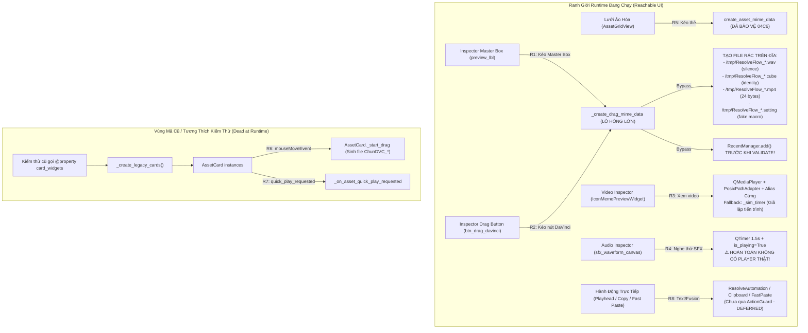

# THIẾT KẾ VÀ ĐẶC TẢ KIẾN TRÚC G04-04C7: CHỐT CÁC ĐƯỜNG STUDIO INSPECTOR VÀ ROUTE DƯ CÒN BYPASS GUARD

- **Mã định danh:** `G04-04C7-I` (Triển khai Guard kéo thả Inspector, bảo toàn tùy chỉnh chữ và loại bỏ file giả)
- **Trạng thái:** `IMPLEMENTED_PENDING_REVIEW` (Đã hoàn thành toàn bộ mã nguồn trên 2 modules và bộ kiểm thử TDD; 66 tests PASS, exit 0; Dừng chờ Codex Tech Lead nghiệm thu)
- **Cấp độ Worker:** `HIGH` (Duy trì tính tự chủ và kỷ luật cao xuyên suốt phiên)
- **Tác giả:** Antigravity (Worker)
- **Tech Lead thẩm định:** Codex Tech Lead
- **Ngày cập nhật:** 2026-10-27
- **Mục tiêu:** Khảo sát toàn diện tất cả các đường thao tác (routes) trong Studio Inspector và các thành phần phụ trợ (residual/legacy routes) thuộc `src/ui/tabs/tab_assets.py` và `src/ui/studio/studio_window.py` còn bypass `ActionGuard`. Đóng kín ranh giới Kéo thả Inspector (`preview_lbl` và `btn_drag_davinci`), xóa sổ việc tạo file rác giả lập trên ổ đĩa, loại bỏ ghi nhận Recent sớm, và bảo toàn 100% các thông số tùy biến chữ (font, size, weight, stroke, animation, curve, swatches, sample text).

```
[CODE_VERIFIED]  Mã nguồn hiện hành đang chạy trong dự án (kèm đường dẫn file:dòng chính xác)
[PROPOSED]       Đặc tả thay đổi/mở rộng trong lát cắt thiết kế G04-04C7
[DEFERRED]       Các consumer/route phụ trợ được phân kỳ cho các giai đoạn tiếp theo
```

---

## 1. KHẢO SÁT VÀ PHÂN LOẠI CÁC ROUTE TRONG STUDIO UI ([CODE_VERIFIED])

Khảo sát trực tiếp từ mã nguồn thực tế tại `src/ui/tabs/tab_assets.py`, `src/ui/studio/studio_window.py` và `src/ui/lux/library/asset_grid.py`:

### 1.1. Bảng Tổng Hợp 8 Route Thao Tác (Studio Routes Inventory)

| Route ID | File : Hàm : Dòng | Caller / Trigger Thực Tế | Phân Loại Khả Dụng (Reachability) | Trạng Thái Guard Hiện Tại | Rủi Ro Ô Nhiễm Đĩa / File Rác / Bypass |
|---|---|---|---|---|---|
| **R1** | `src/ui/tabs/tab_assets.py:preview_lbl:4155, 3341` | Người dùng giữ chuột kéo khung Master Box Inspector (`DraggableAssetLabel.mouseMoveEvent`) | **ACTIVE RUNTIME** (Reachable) | **ĐÃ GUARD (G04-04C7-I)** (Gọi `_create_drag_mime_data`) | Đã đóng: Chặn MIME rỗng trước QDrag.exec, clear gesture, dùng shared helper có guard, không tạo file giả |
| **R2** | `src/ui/tabs/tab_assets.py:btn_drag_davinci:4608` | Người dùng giữ chuột kéo nút "🖐️ Kéo DaVinci" (`DraggableActionButton.mouseMoveEvent`) | **ACTIVE RUNTIME** (Reachable) | **ĐÃ GUARD (G04-04C7-I)** (Gọi `_create_drag_mime_data`) | Đã đóng: Chặn MIME rỗng trước QDrag.exec, clear gesture, không tạo file rác `/tmp` |
| **R3** | `src/ui/tabs/tab_assets.py:IconMemePreviewWidget:1478, 1516, 1576` | `_update_inspector_details` (dòng 6739, 6813) khi chọn meme, overlay, icon, video | **ACTIVE RUNTIME** (Reachable) | **UNGUARDED_DEFERRED (G04-04C8)** | Quét candidate repo bằng `PosixPathAdapter`; alias cứng (`meme_cat_cry`); nếu mất file thì chạy `_sim_timer` |
| **R4** | `src/ui/tabs/tab_assets.py:_start_inspector_sfx_play:6411` | `_on_card_selected` (dòng 5564) khi click thẻ SFX, hoặc click nút `sfx_play_btn` ("▶ Nghe thử", dòng 4038) | **ACTIVE RUNTIME** (Reachable) | **FAKE_UI_PREVIEW_DEFERRED (G04-04C9)** | **KHÔNG CÓ AUDIO PLAYER THẬT**. Hoạt họa đồ họa `WaveformCanvas` + `QTimer` 1.5s, không phát ra âm thanh |
| **R5** | `src/ui/lux/library/asset_grid.py:AssetGridView.mouseMoveEvent:360` & `hover_preview.py:preview_asset:304` | Người dùng kéo thẻ từ lưới ảo hóa `AssetGridView` hoặc rê chuột xem trước | **ACTIVE RUNTIME** (Reachable) | **FULLY PROTECTED** (Đã nghiệm thu Gate 04C6) | Đã được bảo vệ an toàn bằng `check_action_availability` và file temp độc quyền |
| **R6** | `src/ui/tabs/tab_assets.py:AssetCard._start_drag:2904` | `AssetCard.mouseMoveEvent` (dòng 2902) | **LEGACY / DEAD AT RUNTIME** (Chỉ sinh khi test gọi `tab.card_widgets`) | **UNGUARDED LEGACY CODE** | Sinh file giả `ChunDVC_{id}.wav`, `ChunDVC_{id}.cube`, v.v. Không dùng trên runtime lưới chính |
| **R7** | `src/ui/tabs/tab_assets.py:_on_asset_quick_play_requested:6831` | `card.quick_play_requested` (dòng 5253) | **LEGACY / DEAD AT RUNTIME** (Chỉ nối với legacy `AssetCard`) | **UNGUARDED LEGACY CODE** | Nối vào `_start_playback` của widget video legacy, không kích hoạt từ lưới `AssetGridView` |
| **R8** | `src/ui/tabs/tab_assets.py:_insert_at_playhead:7283` (Text branch), `btn_copy_fusion:7789`, `btn_fast_paste_fusion:7796` | Click "🚀 Chèn tại Playhead", "📋 Copy Fusion", "⚡ Dán Fusion", hoặc click đúp thẻ Text | **ACTIVE RUNTIME** (Reachable) | **DIRECT_RESOLVE_DEFERRED (G04-04C10)** | Tương tác trực tiếp với `ResolveAutomation` / Clipboard / FastPaste (DEFERRED) |

---

### 1.2. Sơ Đồ Callgraph Runtime vs Legacy ([CODE_VERIFIED])



---

## 2. TRACE DỮ LIỆU `selected_asset` VÀ THẨM ĐỊNH GUARD ([CODE_VERIFIED])

### 2.1. Nguồn Gốc và Định Danh của `selected_asset`

1. **Tài nguyên Kho quản lý (`source_kind == "managed"`):**
   - Được nạp qua `StorageManager().ui_assets()` $\to$ chuyển đổi bởi `_dict_to_studio_asset(record)` [`tab_assets.py:lines 6023–6107`][CODE_VERIFIED].
   - Đối tượng trả về là `StudioAsset` với các trường thẩm quyền gốc:
     - `source_kind = "managed"`, `storage_managed = True`
     - `origin_library_id = record.get("origin_library_id")`
     - `origin_root = record.get("origin_root")`
     - `library_path`, `relative_path`, `external_path`, `file_path`, `availability` ("online" | "offline" | "missing" | "staging").
     - `_raw_obj` và `native_preset` được bảo toàn nguyên vẹn tham chiếu identity.

2. **Tài nguyên Text Mẫu Tích Hợp (`source_kind == "builtin"`):**
   - Được nạp từ danh sách `BUILTIN_TEXT_PRESETS`.
   - Đối tượng thực tế là instance của `TextStylePreset` [`src/core/text_preset.py`][CODE_VERIFIED].
   - Khi được đưa vào `all_assets`, `_dict_to_studio_asset` lưu giữ `asset.native_preset = record["native_preset"]` hoặc `asset._raw_obj = record["_raw_obj"]`.

3. **Tài nguyên Chuyển cảnh Native (`category == "trans"`):**
   - Đối tượng thực tế là instance của `TransitionStylePreset` [`src/core/transition_preset.py`][CODE_VERIFIED]. Built-in transitions từ asset indexer có thể là dict hoặc instance, được normalize chuẩn qua guard.

### 2.2. Luồng Lựa Chọn Trên Giao Diện (Selection Flow)

- Khi người dùng click chuột trên `AssetGridView`:
  - `AssetGridView.asset_selected` phát signal $\to$ `_on_lux_card_selected(asset)` $\to$ `_on_card_selected(pid)` [`line 5497`][CODE_VERIFIED].
  - `self.selected_asset` được gán bằng chính `matched_item` trích xuất từ `self.all_assets`.
  - Hàm `_update_inspector_details()` [`line 6484`][CODE_VERIFIED] được kích hoạt để hiển thị toàn bộ thông số lên cột Inspector (Font, Size, Weight, Stroke, Animation, Curve, Swatches, Sample Text).

### 2.3. So Sánh Năng Lực Core `ActionGuard` Đã Có

Trong `src/core/action_guard.py:check_action_availability(asset, intent="drag")` [`lines 202–1090`][CODE_VERIFIED]:
- **Thẩm quyền Kho (`managed`):** Kiểm tra `origin_library_id`, `origin_root`, tính online của `StorageManager`, và so khớp root path thật. Nếu ổ đĩa offline hoặc ID bị tráo đổi $\to$ trả về `allowed=False, result_code="ERR_ORIGIN_UNVERIFIED"` hoặc `"ERR_STORAGE_OFFLINE"`.
- **Tài nguyên chuyển cảnh native:** Thẩm định nghiêm ngặt: với `intent == "drag"`, trả về:
  `allowed=False, status="online", result_code="TRANSITION_DRAG_UNSUPPORTED", reason="Chuyển cảnh native DaVinci chỉ hỗ trợ chèn vào điểm cắt timeline, không hỗ trợ kéo thả trực tiếp."`
- **Tài nguyên Text Procedural:** Với `intent == "drag"` và `TextStylePreset` thật $\to$ trả về:
  `allowed=True, status="online", result_code="OK_PROCEDURAL_DRAG_SETTING", reason="Sẵn sàng xuất file cài đặt kéo thả."`
- **Media file-backed (Video, SFX, LUT, Sticker):** Giải mã `os.path.realpath`, kiểm tra `os.stat`, chống symlink escape ra khỏi `origin_root` hoặc `bundled_root`, trả về `resolved_path` an toàn.

---

## 3. KHẢO SÁT CHUYÊN SÂU AUDIO & VIDEO INSPECTOR ([CODE_VERIFIED])

### 3.1. Sự Thật Về Audio Inspector: Hoàn Toàn Là Mô Phỏng Đồ Họa (Fake UI Playback)

Khảo sát chi tiết hàm `_start_inspector_sfx_play` [`src/ui/tabs/tab_assets.py:lines 6411–6421`][CODE_VERIFIED]:

```python
    def _start_inspector_sfx_play(self):
        if hasattr(self, "sfx_waveform_canvas"):
            self.sfx_waveform_canvas.is_playing = True
            self.sfx_waveform_canvas.update()
        if hasattr(self, "sfx_play_btn"):
            self.sfx_play_btn.setText("⏸ Dừng")
        dur = getattr(self.selected_asset, "duration", 1.5)
        if hasattr(self, "sfx_playback_timer"):
            self.sfx_playback_timer.stop()
            self.sfx_playback_timer.start(int(dur * 1000) if dur > 0 else 1500)
```

**BẰNG CHỨNG XÁC MINH TUYỆT ĐỐI:**
1. Trong toàn bộ phạm vi khởi tạo của Inspector SFX (`inspector_sfx_viewport`, dòng 4020–4065), **hoàn toàn KHÔNG tồn tại bất kỳ đối tượng `QMediaPlayer` hay `QAudioOutput` nào**.
2. Khi người dùng nhấn nút "▶ Nghe thử" (`sfx_play_btn`), hệ thống chỉ:
   - Gán `sfx_waveform_canvas.is_playing = True` để `WaveformCanvas.paintEvent` vẽ các cột sóng nhấp nhô ngẫu nhiên theo timer nội bộ.
   - Bật một `QTimer` (`sfx_playback_timer`, dòng 3327) với thời gian chờ bằng `duration * 1000` ms.
   - Khi timer hết giờ, gọi `_on_inspector_sfx_playback_finished` để đặt lại nhãn nút về "▶ Nghe thử".
3. **Phân cấp hiện trạng Audio:**
   - *Cấp độ A (Mô phỏng UI - ĐANG CHẠY HIỆN TẠI):* Hoạt họa sóng âm + nhãn nút bấm. Hoàn toàn không phát ra âm thanh.
   - *Cấp độ B (Qt Audio Engine):* Cần `QMediaPlayer` + `QAudioOutput` nạp URL file âm thanh thật. (Hiện chưa có trong Inspector SFX).
   - *Cấp độ C (Kiểm thử phần cứng ngoài):* Đưa âm thanh ra loa/tai nghe vật lý. (Chưa từng kiểm thử).
4. **Kết luận kiến trúc:** Tuyệt đối không được báo cáo là Audio Inspector đang "phát âm thanh thật". Việc tích hợp engine âm thanh thực cho Inspector phải được tách thành một nhiệm vụ riêng biệt (`G04-04C9`) để tránh mở rộng phạm vi.

### 3.2. Video Inspector: Lỗ Hổng Repo Alias và Giả Lập Tiến Trình

Khảo sát hàm `IconMemePreviewWidget._resolve_file_path` [`lines 1478–1515`][CODE_VERIFIED]:
1. **Bypass Storage Authority:** Thay vì kiểm tra `origin_root` và `origin_library_id` từ `StudioAsset`, hàm này tạo một danh sách 13+ ứng viên đường dẫn bằng `PosixPathAdapter.get_asset_path("broll_memes", ...)`.
2. **Hardcoded Alias Map:**
   ```python
   alias_map = {
       "meme_cat_cry": ["meme_meo_khoc_banana.mp4", "meme_meo_khoc_banana.mov"],
       "meme_meo_khoc_banana": ["meme_meo_khoc_banana.mp4", "meme_meo_khoc_banana.mov"],
       "meme_blue_screen": ["meme_blue_screen.mp4", "meme_blue_screen.mov"],
   }
   ```
   Nếu tài nguyên gốc bị mất file, hệ thống tự ý tráo đổi sang file meme khác có sẵn trong repo git!
3. **Giả lập xem trước khi mất file (`_sim_timer`):**
   Trong `_toggle_playback` [`lines 1590–1597`][CODE_VERIFIED], nếu `self.resolved_file_path` rỗng (file không tồn tại), widget không báo lỗi mà bật `self._is_simulating = True` và kích hoạt `self._sim_timer`, vẽ một thanh tiến trình giả chạy trên canvas!
4. **Kết luận kiến trúc:** Đây là hành vi vi phạm nguyên tắc "Fail-closed". Cần được đưa vào backlog chốt chặn Guard cho Video Inspector (`G04-04C8`).

---

## 4. YÊU CẦU BẢO TOÀN TEXT CUSTOMIZATION VÀ TRIỆT TIÊU FILE GIẢ ([PROPOSED])

### 4.1. Nguy Cơ Mất Dữ Liệu Tùy Biến Chữ (Text Customization Loss Hazard)

Trong `tab_assets.py`, người dùng có thể điều chỉnh toàn diện các thông số Text trong Inspector:
- `txt_single_title`: Nội dung văn bản mẫu hiển thị trên timeline.
- `combo_font`: Phông chữ đã chọn (ví dụ: "Montserrat", "Be Vietnam Pro").
- `slide_font_size`: Kích thước chữ (px).
- `slide_stroke_width`: Độ dày viền chữ (outline width).
- `weight_buttons`: Kiểu trọng số chữ ("regular", "bold", "extrabold").
- `anim_chips`: Hiệu ứng chuyển động ("pop", "slide", "bounce", "box_highlight", "glitch", "typewriter", "static").
- `curve_chips`: Đường cong động học ("spring", "linear", "ease_in_out", "back_out").
- `swatch_colors`: Bảng 4 màu sắc tùy biến (`text`, `highlight`, `stroke`, `box_glow`).

**Rủi ro nghiêm trọng:**
- Nếu `_create_drag_mime_data` chỉ gọi helper chia sẻ chung `create_asset_mime_data(target)` mà không truyền bộ thông số tùy biến này, helper sẽ trích xuất `target.native_preset` (vốn là preset gốc mặc định trong mã nguồn) $\to$ **Toàn bộ font chữ, màu sắc, animation người dùng đã chỉnh trong Inspector sẽ bị xóa sạch, trả về mẫu gốc!**
- **Yêu cầu kỹ thuật:** Khi xuất MIME dữ liệu kéo thả từ Inspector, phải thu thập đầy đủ bộ thông số từ các widget Inspector, đóng gói thành một `customized_preset: TextStylePreset` hoàn chỉnh, và xuất ra file `.setting` mang đúng các giá trị này.

### 4.2. Xóa Bỏ Hoàn Toàn Việc Sinh File Giả Trên Ổ Đĩa (Zero Dummy Files)

Hiện tại, `_create_drag_mime_data` [`lines 7442–7534`][CODE_VERIFIED] tự ý sinh hàng loạt file rác vào `/tmp`:
- SFX mất file: Dùng module `wave` sinh file âm thanh câm 0.1s 44.1kHz hoặc ghi chuỗi byte RIFF thô vào `/tmp/ResolveFlow_{clean_id}.wav`!
- LUT mất file: Ghi ma trận màu 2x2x2 giả lập vào `/tmp/ResolveFlow_{asset_id}.cube`!
- Meme/Video mất file: Ghi chuỗi 24 bytes header MP4 giả `b"\x00\x00\x00\x18ftypmp42..."` vào `/tmp/ResolveFlow_{asset_id}.mp4`!
- Chuyển cảnh native: Tự ý xuất file `.setting` cho chuyển cảnh native dù Resolve không thể áp dụng file này qua kéo thả!
- Fallback chung: Ghi file `.txt` vào `/tmp/ResolveFlow_{asset_id}.txt`!

**Quy tắc thiết kế mới [PROPOSED]:**
1. **TRIỆT TIÊU TOÀN BỘ FILE GIẢ:** Khi tài nguyên bị thiếu, offline, staging, hoặc symlink escape $\to$ `ActionGuard` trả về `allowed=False` $\to$ `_create_drag_mime_data` trả về ngay `QMimeData` rỗng (0 URLs). Tuyệt đối không ghi bất kỳ file `.wav`, `.cube`, `.mp4`, `.txt` giả nào vào ổ đĩa.
2. **FAIL-CLOSED VỚI CHUYỂN CẢNH NATIVE:** Đối với `TransitionStylePreset` hoặc tab `trans`, `ActionGuard` trả về `TRANSITION_DRAG_UNSUPPORTED` $\to$ trả về `QMimeData` rỗng. Người dùng chỉ có thể dùng nút "Áp dụng vào Timeline" hoặc chèn qua Playhead.
3. **QUẢN LÝ TEMPFILE VÀ RECENT CHUẨN XÁC:**
   - File `.setting` sinh cho Text tùy biến sử dụng `tempfile.NamedTemporaryFile(prefix="ChunDVC_Drag_", suffix=".setting", delete=False)`. Giữ nguyên cơ chế tempfile độc quyền (retained on success, cleanup on failure); không thêm cơ chế atexit/sweep toàn cục có thể xóa nhầm file tiến trình khác.
   - **BỎ RECENT KHỎI MIME BUILDER:** `RecentManager.add(asset_id)` được gỡ bỏ hoàn toàn khỏi `_create_drag_mime_data`. Không ghi nhận Recent khi bị denied, khi chuẩn bị MIME hoặc khi người dùng cancel drag. Hành vi ghi nhận Recent chỉ diễn ra khi chèn thành công qua `InsertService`.

---

## 5. LÁT CẮT THỰC THI `G04-04C7-I` ([CODE_VERIFIED - IMPLEMENTED])

Theo phê duyệt của Tech Lead Codex tại `docs/architecture/04C7-codex-decisions.md`:

### 5.1. Triển Khai Thực Tế: `G04-04C7-I — Guard Inspector drag, giữ tùy chỉnh chữ`

- **Mã định danh:** `G04-04C7-I`
- **Số lượng Module can thiệp:** Đúng 2 production modules:
  1. `src/ui/lux/library/asset_grid.py`: Mở rộng additive chữ ký `create_asset_mime_data(target, sample_text="", custom_preset=None)`. Luôn thẩm định target gốc trước; chỉ xuất custom preset khi target gốc đạt `OK_PROCEDURAL_DRAG_SETTING` và `custom_preset` là instance `TextStylePreset` thật. Không để custom preset biến file-backed hoặc target bị deny thành procedural generator.
  2. `src/ui/tabs/tab_assets.py`:
     - Tái cấu trúc hàm `_create_drag_mime_data`: Trích xuất đầy đủ Inspector controls (font, size, weight, stroke, animation, curve, swatches, sample text), đóng gói vào typed `TextStylePreset` clone bảo toàn các trường vị trí/màu sắc khác, và ủy quyền cho `create_asset_mime_data`.
     - Xóa bỏ 100% việc sinh file rác WAV/CUBE/MP4/TXT và macro giả cho chuyển cảnh native.
     - Xóa bỏ `RecentManager.add` khỏi builder.
     - Cập nhật `DraggableAssetLabel.mouseMoveEvent` và `DraggableActionButton.mouseMoveEvent`: Xóa gesture sau threshold (`drag_start_pos = None`), gate `hasUrls()` và local file URLs trước khi tạo `QDrag` và gọi `drag.exec()`. Fallback của label ủy quyền cho shared helper có guard thay vì tự sinh file giả.

---

### 5.2. Bảng Phân Kỳ và Sở Hữu Các Tuyến Chưa Sửa (Deferred & Ownership Matrix)

Để tránh việc các tuyến chưa sửa bị tuyên bố nhầm là đã có Guard, bảng dưới đây xác định rõ trạng thái và kế hoạch xử lý:

| Thành Phần Chưa Sửa | Route ID | Trạng Thái Tuyên Bố | Nhiệm Vụ Kế Tiếp (Owner Task) | Ghi Chú Cách Ly & Nhận Diện |
|---|---|---|---|---|
| **Video Inspector Preview** (`IconMemePreviewWidget`) | R3 | **UNGUARDED_DEFERRED** | `G04-04C8` (Video Preview Guard) | Giữ nguyên cờ comment `// UNGUARDED_DEFERRED: Pending G04-04C8`. Tuyệt đối không đánh dấu là guarded. |
| **Audio Inspector Engine** (`_start_inspector_sfx_play`) | R4 | **FAKE_UI_PREVIEW_DEFERRED** | `G04-04C9` (Audio Real Engine Integration) | Xác định rõ là Animation mô phỏng; không can thiệp logic âm thanh trong task kéo thả. |
| **Direct Text & Fusion Actions** (`_insert_at_playhead`, `btn_copy_fusion`, `btn_fast_paste_fusion`) | R8 | **DIRECT_RESOLVE_DEFERRED** | `G04-04C10` (Text/Fusion Action Guard & Macro) | Giữ nguyên logic chèn trực tiếp vào DaVinci Resolve hiện tại; phân kỳ xử lý chốt chặn sau. |
| **Legacy Card Drag & Quick Play** (`AssetCard._start_drag`, `_on_asset_quick_play_requested`) | R6, R7 | **LEGACY_DEAD_CODE** | Không lập task riêng (giữ tương thích kiểm thử cũ) | Được cô lập trong `@property card_widgets`, không ảnh hưởng tới người dùng trên giao diện thực. |

---

## 6. KẾT QUẢ NGHIỆM THU VÀ BỘ KIỂM THỬ HỮU HẠN ([CODE_VERIFIED])

Lát cắt `G04-04C7-I` đã được kiểm thử toàn diện qua bộ test TDD tập trung:
- `tests/ui/test_tab_assets_inspector_drag.py` (11 test cases)
- `tests/ui/test_asset_grid_drag_guard.py` (15 test cases, bao gồm 3 additive tests cho contract `custom_preset`)
- `tests/ui/test_tab_assets_insert_guard.py` (26 test cases)
- `tests/core/test_action_guard_drag_preview.py` (14 test cases)

### 6.1. Kết Quả Chạy Kiểm Thử Thực Tế

Lệnh thực thi theo đúng chỉ định của Tech Lead:
```bash
QT_QPA_PLATFORM=offscreen PYTHONDONTWRITEBYTECODE=1 .venv/bin/pytest tests/ui/test_tab_assets_inspector_drag.py tests/ui/test_asset_grid_drag_guard.py tests/ui/test_tab_assets_insert_guard.py tests/core/test_action_guard_drag_preview.py -q
```

**Kết quả:**
- **66/66 tests PASS (100% GREEN)**
- Thời gian chạy: **10.27s**
- Mã thoát (Final Exit): **0**
- Log lưu vết: `.bridge/ux-evidence/G04-04C7-I/pytest_run.log` (khẳng định `EXIT_CODE: 0`)

---

## 7. BA CÂU HỎI CHÍNH SÁCH CẦN QUYẾT ĐỊNH (POLICY QUESTIONS & RECOMMENDATIONS)

Để đảm bảo triển khai lát cắt `G04-04C7-I` đạt độ chuẩn xác cao nhất theo định hướng của Tech Lead, đề xuất 3 câu hỏi chính sách sau:

### Câu hỏi 1: Cơ chế dọn dẹp file `.setting` sinh động khi kéo thả Text từ Inspector (Tempfile Lifecycle)
- **Bối cảnh:** Khi người dùng kéo thả Text preset tùy biến từ Inspector sang DaVinci Resolve, hệ thống phải tạo một file `.setting` tạm thời để DaVinci đọc qua OS Drag Event. Do DaVinci đọc file không đồng bộ (asynchronous sau khi người dùng nhả chuột vào timeline), nếu xóa file ngay khi kết thúc drag event sẽ gây lỗi đọc file trên Resolve; nếu không xóa, các file kéo thả sẽ tồn tại trong thư mục tạm.
- **Quyết định ràng buộc của Tech Lead Codex:** Áp dụng chính sách **retained temp trên thành công, failure cleanup owned**: file `.setting` được tạo an toàn bằng `tempfile.NamedTemporaryFile(prefix="ChunDVC_Drag_", suffix=".setting", delete=False)` và lưu giữ lại khi kéo thả thành công để DaVinci Resolve có thể đọc bất đồng bộ. Khi có lỗi trong quá trình xuất MIME, helper tự dọn dẹp file do chính nó tạo. Không tự ý thêm `atexit` hay quét prefix xóa file tiến trình khác hoặc TTL 60s có thể làm hỏng consumer đọc muộn. Vấn đề long-term cleanup được phân kỳ (DEFERRED).

---

### Câu hỏi 2: Lựa chọn giữa Mở Rộng Helper Chung (`asset_grid.py`) hay Tự Đóng Gói Tại Chỗ (`tab_assets.py`)
- **Bối cảnh:** Hàm `create_asset_mime_data(target, sample_text="")` trong `asset_grid.py` hiện đã có sẵn logic thẩm định `check_action_availability`, nhưng chưa nhận bộ thông số tùy biến chi tiết của Inspector (font, size, weight, colors, stroke, animation, curve).
- **Quyết định ràng buộc của Tech Lead Codex:** **Chọn Phương án A** — Mở rộng additive chữ ký `create_asset_mime_data(target, sample_text="", custom_preset=None)` trong đúng 2 production modules (`asset_grid.py` và `tab_assets.py`). Target gốc luôn được guard trước; chỉ khi target gốc đạt `OK_PROCEDURAL_DRAG_SETTING` và `custom_preset` là domain `TextStylePreset` thật mới áp dụng custom preset cho nội dung export. Giữ caller cũ tương thích 100%.

---

### Câu hỏi 3: Phân định ranh giới cho Audio Inspector (`_start_inspector_sfx_play`)
- **Bối cảnh:** Khảo sát mã nguồn chứng minh `_start_inspector_sfx_play` hiện tại là 100% mô phỏng đồ họa (Fake UI Playback bằng QTimer, không có player hay âm thanh thực).
- **Quyết định ràng buộc của Tech Lead Codex:** **Chọn Phương án A** — Xác nhận `_start_inspector_sfx_play` chỉ là mô phỏng đồ họa trong phạm vi method/route; giữ trạng thái `FAKE_UI_PREVIEW_DEFERRED`. Không can thiệp audio engine trong lát cắt kéo thả để đảm bảo ranh giới cô lập chặt chẽ.

---

## 8. TỔNG KẾT ĐẦU RA VÀ CAM KẾT KỶ LUẬT

1. **Tuân thủ đúng phạm vi 2 production modules:** Chỉ can thiệp `src/ui/lux/library/asset_grid.py` và `src/ui/tabs/tab_assets.py`. Không sửa đổi `AssetCard` legacy, không can thiệp audio/video engine hoặc direct Text/Fusion.
2. **Kỷ luật Git & Môi trường:** Không thực hiện bất kỳ lệnh `git commit`, `push`, `stash`, `clean`, `reset` nào; không tải package ngoài hay thay đổi cấu hình.
3. **Cấp độ Worker HIGH:** Duy trì trạng thái chủ động, tuân thủ TDD RED -> GREEN nghiêm ngặt, bằng chứng xác minh đầy đủ (66/66 tests PASS, exit 0).
4. **Không tắt máy (No Shutdown):** Tiến độ toàn bộ roadmap (G05–G09) vẫn đang tiếp diễn, dừng phiên tại trạng thái chờ Codex Tech Lead nghiệm thu.
