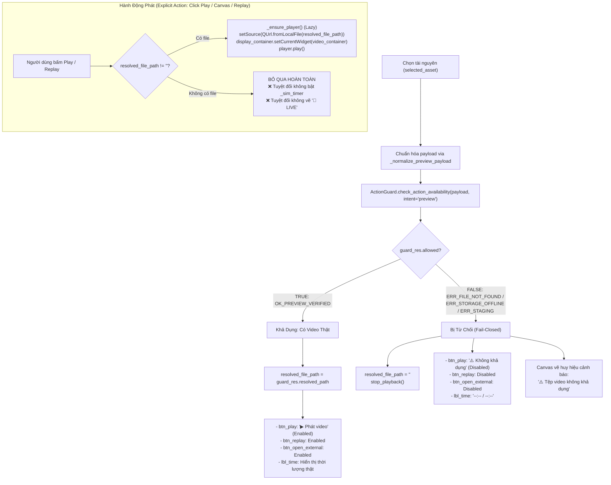

# THIẾT KẾ VÀ ĐẶC TẢ KIẾN TRÚC G04-04C8: VIDEO INSPECTOR PREVIEW ĐÚNG NGUỒN VÀ TRIỆT TIÊU SIMULATION GIẢ

- **Mã định danh:** `G04-04C8-R1` (Hiện thực Video Inspector callback binding theo session token, bảo toàn reason tiếng Việt và triệt tiêu stale callback)
- **Trạng thái:** `IMPLEMENTED_PENDING_REVIEW` (Hoàn thành TDD GREEN R1; 50/50 tests passed, exit code 0; Chờ Tech Lead Codex nghiệm thu)
- **Cấp độ Worker:** `HIGH` (Duy trì tính tự chủ và kỷ luật cao xuyên suốt phiên)
- **Tác giả:** Antigravity (Worker)
- **Tech Lead thẩm định:** Codex Tech Lead
- **Ngày lập:** 2026-10-27
- **Mục tiêu:** Khảo sát chi tiết toàn bộ luồng hoạt động của Video Inspector (`IconMemePreviewWidget` và các callsite trong `src/ui/tabs/tab_assets.py`), thiết kế cơ chế chốt chặn `ActionGuard` đúng nguồn dữ liệu cho việc xem trước video (Memes, Overlays, Transitions, Videos), xóa bỏ hoàn toàn việc tìm kiếm alias ngầm trong repo git (`PosixPathAdapter`) và chế độ mô phỏng giả lập tiến trình phát (`_sim_timer` / `_is_simulating` / "🔴 LIVE"), đồng thời đảm bảo an toàn vòng đời phát video khi chuyển đổi selection hoặc ẩn tab.

```
[CODE_VERIFIED]  Mã nguồn hiện hành đang chạy trong dự án (kèm đường dẫn file:dòng chính xác)
[PROPOSED]       Đặc tả thay đổi/mở rộng trong lát cắt thiết kế G04-04C8
[DEFERRED]       Các consumer/route phụ trợ được phân kỳ cho các giai đoạn tiếp theo
```

---

## 1. KHẢO SÁT VÀ TRACE CHI TIẾT HIỆN TRẠNG VIDEO INSPECTOR ([CODE_VERIFIED])

### 1.1. Luồng Lựa Chọn và Định Tuyến Dữ Liệu (Actual Selection Flow)

Khảo sát trực tiếp từ mã nguồn thực tế tại `src/ui/tabs/tab_assets.py`:

```mermaid
flowchart TD
    UserSelect["Người dùng click thẻ trên AssetGridView / Suggestion Bar"] --> OnLuxCard["_on_lux_card_selected(asset) :5497"]
    OnLuxCard --> OnCardSelected["_on_card_selected(preset_id) :5508"]
    
    subgraph SelectionSync["Xử Lý Selection & Đồng Bộ"]
        OnCardSelected --> StopSFX["_stop_inspector_sfx_play() :5510"]
        OnCardSelected --> CheckTab["Kiểm tra target_tab :5526"]
        CheckTab -->|Khác tab hiện tại| FilterRail["_filter_by_rail(target_tab) :4836<br/>⚠️ Gọi icon_meme_widget.stop_playback() :4838"]
        CheckTab -->|Cùng tab| AssignSelected["self.selected_asset = matched_item :5562"]
        FilterRail --> AssignSelected
        AssignSelected --> UpdateInsp["_update_inspector_details() :5605"]
    end

    subgraph InspectorRouting["Định Tuyến Trong _update_inspector_details :6495"]
        UpdateInsp --> CheckCat{"Phân loại category"}
        CheckCat -->|is_text :6502| HideIconText["inspector_icon_viewport.hide() :6537<br/>❌ KHÔNG gọi stop_playback!"]
        CheckCat -->|is_lut :6650| HideIconLUT["inspector_icon_viewport.hide() :6658<br/>❌ KHÔNG gọi stop_playback!"]
        CheckCat -->|is_sfx :6670| HideIconSFX["inspector_icon_viewport.hide() :6690<br/>❌ KHÔNG gọi stop_playback!"]
        CheckCat -->|is_trans :6735| TransBranch["Kiểm tra thumb_path / video_file :6745"]
        CheckCat -->|else (meme/overlay/icon) :6790| VideoBranch["Lấy scalar metadata :6818-6823"]
        
        TransBranch -->|Có video/thumb| SetItemTrans["icon_meme_widget.set_item(..., 'trans') :6750"]
        TransBranch -->|Không video/thumb| HideIconTrans["inspector_icon_viewport.hide() :6758<br/>❌ KHÔNG gọi stop_playback!"]
        VideoBranch --> SetItemMeme["icon_meme_widget.set_item(name, tab_type, ...) :6824"]
    end
```

### 1.2. Bên Trong `IconMemePreviewWidget` (`lines 1307–1832`)

1. **Khởi tạo và Cấu trúc UI (`lines 1309–1458`):**
   - Được khởi tạo duy nhất một lần tại `tab_assets.py:4089`: `self.icon_meme_widget = IconMemePreviewWidget(self.inspector_icon_viewport)`.
   - Giao diện gồm:
     - `display_container` (`QStackedWidget`, cao 132px):
       - Page 0: `canvas_widget` (`_paint_canvas`) dùng để vẽ Sticker, Poster thumbnail, và giao diện mô phỏng simulation.
       - Page 1: `video_container` chứa `QVideoWidget` dùng cho phát video thực tế.
     - `control_bar` (`QWidget`): Chứa nút `btn_play` ("▶ Phát video" / "▶ Xem thử"), nút `btn_replay` ("↺"), nhãn thời gian `lbl_time` ("00:00 / 00:04"), nút `btn_browse` ("📂"), và nút `btn_open_external` ("↗ Mở ngoài").

2. **Hàm `set_item(...)` (`lines 1527–1575`):**
   ```python
   def set_item(self, name: str, item_type: str, badge: str, color_hex: str, sub: str, thumbnail_path: str = "", file_path: str = "", asset_id: str = ""):
       self.stop_playback()
       self.item_name = name
       self.item_type = item_type
       ...
       self.resolved_file_path = self._resolve_file_path(file_path, name, item_type, asset_id=asset_id)
   ```
   - **Xác nhận Autoplay:** Khi gán item, hàm gọi `self.stop_playback()` và chuyển `display_container` về `self.canvas_widget`. **HOÀN TOÀN KHÔNG CÓ AUTOPLAY KHI CHỌN THẺ**. Video chỉ phát khi người dùng có hành động tường minh (Explicit Action).
   - **Phân biệt Static Artwork vs Video:**
     - Nếu `item_type == "icon"` (Sticker / Icon vector): Ẩn hoàn toàn `control_bar`, đặt chiều cao cố định 136px, chỉ hiển thị `canvas_widget` vẽ biểu tượng và nhãn "STICKER". Không có video decoding, không có timer simulation.
     - Nếu `item_type` là `meme`, `overlay`, hoặc `trans`: Hiển thị `control_bar`, đặt chiều cao 175px, hiển thị `canvas_widget` vẽ ảnh thumbnail và nút "▶ Xem video".

3. **Cơ chế Kích hoạt Phát Video (Explicit Actions):**
   - Click nút `btn_play`: Gọi `_toggle_playback()` [`line 1587`].
   - Click chuột lên khung Canvas: Gọi `_on_canvas_clicked(event)` [`line 1676`] $\to$ nếu không phải icon thì gọi `_toggle_playback()`.
   - Click nút `btn_replay`: Gọi `_replay()` [`line 1626`].
   - Legacy: `_on_asset_quick_play_requested(asset_id)` [`line 6842`] gọi `icon_meme_widget._start_playback()`.

---

## 2. PHÂN TÍCH CÁC LỖ HỔNG VÀ SỰ ĐỨT GÃY THẨM QUYỀN NGUỒN ([CODE_VERIFIED])

### 2.1. Đứt Gãy Thẩm Quyền Metadata (Provenance Loss)

Tại `_update_inspector_details` [`lines 6818–6824`]:
```python
tab_type = self.selected_asset.get("tab", "icon") if isinstance(self.selected_asset, dict) else getattr(self.selected_asset, "tab", "icon")
badge = self.selected_asset.get("badge_icon", "✨") if isinstance(self.selected_asset, dict) else getattr(self.selected_asset, "badge_icon", "✨")
color_hex = self.selected_asset.get("color_hex", "#facc15") if isinstance(self.selected_asset, dict) else getattr(self.selected_asset, "color_hex", "#facc15")
thumb_path = self.selected_asset.get("thumbnail_path", "") if isinstance(self.selected_asset, dict) else getattr(self.selected_asset, "thumbnail_path", "")
fpath = self.selected_asset.get("file_path", "") if isinstance(self.selected_asset, dict) else getattr(self.selected_asset, "file_path", "")
asset_id = self.selected_asset.get("id", "") if isinstance(self.selected_asset, dict) else getattr(self.selected_asset, "id", "")
self.icon_meme_widget.set_item(name, tab_type, badge, color_hex, sub, thumb_path, fpath, asset_id=asset_id)
```

**Hậu quả:**
- Toàn bộ các trường thẩm quyền quản lý nguồn của `StudioAsset` gồm: `origin_library_id`, `origin_root`, `storage_managed`, `library_path`, `relative_path`, `external_path`, `preview_path`, `availability` ("online" | "offline" | "staging" | "missing"), và `_raw_obj` **BỊ LOẠI BỎ HOÀN TOÀN**.
- `IconMemePreviewWidget` chỉ nhận chuỗi đường dẫn thô `file_path`, tên và `asset_id`, hoàn toàn mù mờ về xuất xứ lưu trữ, không thể biết kho lưu trữ có đang offline hay tài nguyên có đang bị staging/unverified hay không.

### 2.2. Lỗ Hổng Quét Ứng Viên Repo và Bản Đồ Bí Danh Cứng (Repo Alias Scan & Hardcoded Alias Map)

Tại `_resolve_file_path` [`lines 1489–1525`]:
```python
clean_name = name.split("(")[0].strip()
candidates.extend([
    str(PosixPathAdapter.get_asset_path("broll_memes", "memes", f"{name}.mp4")),
    str(PosixPathAdapter.get_asset_path("broll_memes", "memes", f"{clean_name}.mp4")),
    str(PosixPathAdapter.get_asset_path("broll_memes", "memes", f"{name}.mov")),
    ...
    str(PosixPathAdapter.get_asset_path("broll_memes", f"{clean_name}.mp4")),
])
alias_map = {
    "meme_cat_cry": ["meme_meo_khoc_banana.mp4", "meme_meo_khoc_banana.mov"],
    "meme_meo_khoc_banana": ["meme_meo_khoc_banana.mp4", "meme_meo_khoc_banana.mov"],
    "meme_blue_screen": ["meme_blue_screen.mp4", "meme_blue_screen.mov"],
}
```

**Hậu quả:**
1. **Tráo đổi file ngầm (Asset Hijacking):** Khi người dùng chọn tài nguyên `meme_cat_cry`, nếu file gốc bị thiếu, widget tự ý tráo sang file `meme_meo_khoc_banana.mp4` nằm trong thư mục cài đặt git của ứng dụng!
2. **Bypass Storage Isolation:** Bỏ qua cấu hình `StorageManager`, tự ý truy cập hệ thống file repo qua `PosixPathAdapter`.

### 2.3. Lỗ Hổng Mô Phỏng Giả Lập Tiến Trình Khi Mất File (Fake Simulation Loop)

Tại `_toggle_playback` [`lines 1600–1609`], `_start_playback` [`lines 1620–1625`], và `_on_player_error` [`lines 1480–1488`]:
```python
else:
    self._is_simulating = True
    self._sim_progress = 0.0
    self._sim_timer.start()
    self.btn_play.setText("⏸ Dừng xem thử")
    self.canvas_widget.update()
```

Khi file video không tồn tại (`resolved_file_path` rỗng) hoặc bộ giải mã video cục bộ gặp lỗi:
1. Widget **KHÔNG HỀ BÁO LỖI**, mà bật cờ `self._is_simulating = True` và kích hoạt `_sim_timer` (tần số 33ms ~ 30 FPS).
2. Hàm `_on_sim_tick` [`lines 1657–1664`] cộng dồn `_sim_progress += 0.02` và cập nhật nhãn thời gian giả lập `00:00 / 00:04`.
3. Hàm `_paint_canvas` [`lines 1743–1778`] vẽ vòng tròn sóng nhấp nhô, phóng to thu nhỏ ảnh và hiển thị huy hiệu màu đỏ **"🔴 LIVE"**!
4. **Hậu quả:** Người dùng bị đánh lừa rằng video đang được phát thử nghiệm, trong khi thực tế tệp tin hoàn toàn không tồn tại trên ổ đĩa. Đây là hành vi vi phạm nghiêm trọng nguyên tắc Fail-Closed.

### 2.4. Đứt Gãy Vòng Đời Trình Phát Khi Chuyển Danh Mục Hoặc Ẩn Widget (Lifecycle Leak)

1. **Thiếu sự kiện đóng/ẩn widget:** `IconMemePreviewWidget` hoàn toàn không cài đặt `hideEvent` hay `closeEvent`.
2. **Ẩn viewport không dừng phát:** Tại `tab_assets.py:6537, 6658, 6690, 6758`, khi người dùng đang phát video meme rồi click sang xem thẻ Chữ (Text), LUT, Âm thanh (SFX), hoặc Chuyển cảnh không có preview, hệ thống chỉ gọi `self.inspector_icon_viewport.hide()`. **Trình phát `QMediaPlayer` vẫn tiếp tục phát âm thanh và video ngầm trong bộ nhớ!**
3. **Hiện tượng tín hiệu trễ (Late Signal Hazard):** Khi đang phát video A, người dùng nhanh tay chọn video B. Nếu không dừng sạch và reset nguồn, tín hiệu `positionChanged` hoặc `mediaStatusChanged(EndOfMedia)` từ video A có thể gửi tới sau và cập nhật thanh tiến trình hoặc kích hoạt phát lại trên giao diện của video B.

---

## 3. THIẾT KẾ KIẾN TRÚC MỚI: CHỐT CHẶN GUARD VÀ TRIỆT TIÊU GIẢ LẬP ([PROPOSED])

### 3.1. Nguyên Tắc Thiết Kế Cốt Lõi (Core Principles)

1. **Action-Time Guard Thẩm Quyền Tuyệt Đối & Recheck Tại Mọi Hành Động:**
   - Không chỉ kiểm tra tại thời điểm chọn thẻ (`selection`), mà **MỌI HÀNH ĐỘNG PHÁT THỰC TẾ** (`_toggle_playback`, `_start_playback`, `_replay`, `resume`, `_open_external`) đều phải **thẩm định lại (recheck)** payload hiện tại qua `check_action_availability(payload, intent="preview")`.
   - Nếu tệp bị xóa, ổ đĩa bị ngắt kết nối, hoặc root ID bị tráo đổi giữa lúc chọn thẻ và lúc bấm Play $\to$ Lập tức từ chối, xóa sạch đường dẫn đã phân giải, dừng phát và chuyển sang Fail-Closed.
2. **Nguồn Sự Thật Duy Nhất (Single Source of Truth) & Kiểm Tra Định Dạng Playable:**
   - Nguồn phát video cho `QMediaPlayer` **CHỈ ĐƯỢC PHÉP LẤY TỪ `guard_res.resolved_path`**.
   - Tuyệt đối không quét thư mục ứng viên repo bằng `PosixPathAdapter`, không dùng bản đồ bí danh `alias_map`.
   - Kiểm tra định dạng video hợp lệ trước khi nạp vào player: Chỉ chấp nhận các đuôi mở rộng thuộc `VIDEO_EXTS = {".mp4", ".mov", ".mkv", ".webm", ".m4v"}`. Tuyệt đối không nạp tệp `.setting`, `.cube`, `.png` hay canvas vào `QMediaPlayer`.
3. **Triệt Tiêu 100% Chế Độ Mô Phỏng Giả Lập:**
   - Xóa bỏ hoàn toàn `_sim_timer`, `_is_simulating`, `_sim_progress`, `_on_sim_tick`, và huy hiệu "🔴 LIVE".
   - Khi mất file, ổ đĩa offline, tài nguyên staging, hoặc lỗi giải mã codec: Phải ở trạng thái Fail-Closed, vô hiệu hóa các nút điều khiển, hiển thị thông báo lỗi trung thực bằng tiếng Việt (theo `guard_res.reason`).
4. **Bảo Toàn Khả Năng Xem Trước Chuyển Cảnh Native:**
   - Khi tài nguyên là chuyển cảnh native (`TransitionStylePreset` hoặc tab `trans`), `ActionGuard` thẩm định sự tồn tại của file demo preview MP4 đi kèm.
   - Chấp nhận mọi mã thành công hợp lệ từ Guard bao gồm `OK_PREVIEW_VERIFIED` và `OK_BUILTIN_PREVIEW_VERIFIED`. Nếu có file demo hợp lệ, phát file MP4 demo đó; nếu không có demo, hiển thị canvas chuyển cảnh tĩnh, không giả lập tiến trình.
5. **Bảo Toàn Trải Nghiệm Sticker / Icon Tĩnh:**
   - Sticker tĩnh (`item_type == "icon"`) hiển thị canvas ảnh trong suốt / icon vector, ẩn thanh điều khiển `control_bar`, không có video playback và không có thời lượng giả lập.
6. **Vô Hiệu Hóa Tạm Thời Nút "📂 Liên Kết Tệp" (`btn_browse`):**
   - Nút `btn_browse` tạm thời bị ẩn/vô hiệu hóa kèm tooltip hướng dẫn liên kết qua thư viện; phương thức `_browse_file` khi bị gọi trực tiếp sẽ là một no-op an toàn, không mở hộp thoại và không tự ý gán file ngoài luồng thẩm định. Quy trình relink được phân kỳ (DEFERRED).
7. **Bảo Vệ Hành Động Mở Ngoài (`_open_external`):**
   - Chỉ mở tệp khi đã qua thẩm định Action-Time Guard và là tệp video được hỗ trợ; không mở bất kỳ đường dẫn tùy tiện nào được gán đè.

---

### 3.2. Sơ Đồ Luồng Hoạt Động Guard Mới Cho Video Inspector ([PROPOSED])



---

### 3.3. Tái Sử Dụng Hợp Đồng Chuẩn Hóa Dữ Liệu (Payload Normalization Contract)

Để đảm bảo Một Nguồn Sự Thật Duy Nhất (Single Source of Truth) và tránh phân kỳ logic kiểm tra giữa Grid Hover và Inspector:
- `IconMemePreviewWidget` sẽ sử dụng hàm `_normalize_preview_payload` từ `src.ui.lux.library.hover_preview`:
  ```python
  from src.ui.lux.library.hover_preview import _normalize_preview_payload
  ```
- **Xác minh không có Circular Import:** Module `src/ui/lux/library/hover_preview.py` hoàn toàn độc lập, chỉ phụ thuộc vào `asset_model.py` và `PySide6`, hoàn toàn không import `tab_assets.py`. Việc `tab_assets.py` import `_normalize_preview_payload` là an toàn 100%.

---

## 4. QUẢN LÝ VÒNG ĐỜI TRÌNH PHÁT VÀ AN TOÀN ĐỒNG THỜI (LIFECYCLE & CONCURRENCY) ([PROPOSED])

### 4.1. Vòng Đời Khi Thay Đổi Thẻ Được Chọn (Selection Switch Lifecycle)

Khi người dùng đang phát video tài nguyên A mà chuyển sang chọn tài nguyên B:
1. `set_asset(target_asset)` được gọi ngay lập tức:
   - Gọi `self.stop_playback()`: Dừng ngay `QMediaPlayer`, đặt `display_container` về `canvas_widget`.
   - Tăng biến thế hệ `self._playback_generation += 1`.
   - Đặt lại thời gian: `self._position_ms = 0`, `self._duration_ms = 0`, cập nhật `lbl_time.setText("00:00 / 00:00")`.
2. Kiểm tra Guard cho tài nguyên B:
   - Nếu B hợp lệ: Nạp `resolved_file_path = guard_res.resolved_path`, chuẩn bị sẵn sàng cho hành động bấm phát của người dùng.
   - Nếu B bị từ chối: Đặt `resolved_file_path = ""`, khóa các nút bấm điều khiển.

### 4.2. Xử Lý Tín Hiệu Trễ Từ Qt Multimedia (Guarding Late Signals Qua Epoch Binding)

`QMediaPlayer` hoạt động dựa trên các tín hiệu bất đồng bộ (`positionChanged`, `durationChanged`, `playbackStateChanged`, `mediaStatusChanged`). Để tránh việc các tín hiệu từ tài nguyên cũ làm xáo trộn giao diện của tài nguyên mới:
1. Thêm biến đếm thế hệ `self._playback_epoch: int = 0` và cờ trạng thái `self._is_active_playback: bool = False`.
2. Khi bắt đầu một phiên phát mới, tăng `self._playback_epoch += 1` và ghi nhận `current_epoch = self._playback_epoch`.
3. Trong hàm `stop_playback()`:
   ```python
   self._playback_epoch += 1  # Invalidate ngay lập tức mọi async callback đang chờ
   self._is_active_playback = False
   if self._player is not None:
       try:
           self._player.stop()
           self._player.setSource(QUrl())  # Xóa sạch source kể cả khi player đã ở StoppedState
       except Exception:
           pass
   ```
4. Trong các slot nhận tín hiệu (`_on_position_changed`, `_on_duration_changed`, `_on_playback_state_changed`):
   - Kiểm tra `if not self._is_active_playback:` $\to$ bỏ qua.
   - Đối chiếu epoch hoặc source URL hiện hành: nếu tín hiệu phát ra từ nguồn cũ trước khi chuyển thẻ, lập tức loại bỏ.
   - *Ghi chú kỹ thuật:* Do các tín hiệu Qt C++ nguyên bản không mang token xuất xứ của caller, giải pháp epoch + source binding và clear source là ranh giới phòng vệ thực tế tốt nhất (best-effort boundary) trong mô hình hướng sự kiện của Qt.

### 4.3. Quản Lý Vòng Đời Khi Ẩn Hoặc Đóng Widget (Hide / Close Safety)

1. Cài đặt `hideEvent` và `closeEvent` trực tiếp trên `IconMemePreviewWidget`:
   ```python
   def hideEvent(self, event):
       self.stop_playback()
       super().hideEvent(event)

   def closeEvent(self, event):
       self.stop_playback()
       super().closeEvent(event)
   ```
2. Tại `TabAssets._update_inspector_details`:
   - Trước khi ẩn `inspector_icon_viewport` để hiển thị Inspector của Text (dòng 6537), LUT (dòng 6658), SFX (dòng 6690), hoặc Chuyển cảnh native dạng loop (dòng 6758), **phải gọi tường minh `self.icon_meme_widget.stop_playback()`**.

### 4.4. Sở Hữu Trình Phát Đơn Nhất và Định Tuyến Âm Thanh (Audio Routing)

- `IconMemePreviewWidget` duy trì việc khởi tạo trễ (Lazy Initialization) cho đúng một instance `QMediaPlayer` và một instance `QAudioOutput`.
- `_audio_output` tiếp tục được đăng ký với `get_audio_router().register(self._audio_output)` để tôn trọng thiết lập âm thanh toàn cục của ứng dụng.
- Tuyệt đối không khởi tạo thêm `QMediaPlayer` mới sau mỗi lần click.

---

## 5. ĐỀ XUẤT LÁT CẮT THỰC THI DUY NHẤT: `G04-04C8-I` ([PROPOSED])

- **Tên lát cắt:** `G04-04C8-I — Chốt Guard Video Inspector, triệt tiêu alias fallback và simulation giả`
- **Số lượng Module can thiệp:** Đúng **1 production module**: `src/ui/tabs/tab_assets.py`.
- **Nội dung thực thi chi tiết:**

### 5.1. Mở Rộng API Trong `IconMemePreviewWidget`

1. **Thêm phương thức mới tiếp nhận đối tượng asset đầy đủ:**
   ```python
   def set_asset(self, asset: Any, sub: str = ""):
       """
       Nạp tài nguyên vào Inspector với đầy đủ thẩm định ActionGuard.
       Bảo toàn 100% xuất xứ lưu trữ, availability và native preset refs.
       """
   ```
2. **Duy trì phương thức cũ `set_item` phục vụ tương thích ngược (Backward Compatibility):**
   ```python
   def set_item(self, name: str, item_type: str, badge: str, color_hex: str, sub: str, thumbnail_path: str = "", file_path: str = "", asset_id: str = ""):
       """
       Wrapper tương thích ngược cho các unit test và callsite cũ.
       Đóng gói các tham số thành Mapping chuẩn và chuyển giao cho set_asset.
       """
   ```

### 5.2. Các Mã Nguồn Bị Gỡ Bỏ Hoàn Toàn (Complete Removal)

1. **Xóa hàm `_resolve_file_path`:**
   - Xóa bỏ toàn bộ danh sách quét 13+ ứng viên bằng `PosixPathAdapter.get_asset_path("broll_memes", ...)`.
   - Xóa bỏ từ điển bí danh cứng `alias_map` (`meme_cat_cry`, `meme_blue_screen`, v.v.).
   - Xóa bỏ việc quét thumbnail PNG bằng alias `cat`.
2. **Xóa bỏ toàn bộ thành phần mô phỏng Simulation:**
   - Xóa `_sim_timer`, `_sim_progress`, `_is_simulating`.
   - Xóa slot `_on_sim_tick`.
   - Xóa nhánh vẽ hoạt họa `if self._is_simulating:` trong `_paint_canvas` (vòng tròn sóng, scale rung, huy hiệu "🔴 LIVE").
   - Xóa fallback sang simulation trong `_on_player_error`. Khi gặp lỗi phát video, hiển thị thông báo lỗi trung thực trên UI.

### 5.3. Cập Nhật Callsite Trong `TabAssets`

- Cập nhật `_update_inspector_details`:
  - Dòng 6750: Chuyển sang gọi `self.icon_meme_widget.set_asset(self.selected_asset, sub=sub)`.
  - Dòng 6824: Chuyển sang gọi `self.icon_meme_widget.set_asset(self.selected_asset, sub=sub)`.
  - Dòng 6537, 6658, 6690, 6758: Bổ sung `self.icon_meme_widget.stop_playback()` trước khi ẩn viewport.

---

## 6. KẾ HOẠCH BỘ KIỂM THỬ HỮU HẠN (FINITE ACCEPTANCE PLAN) ([PROPOSED])

- **File kiểm thử mới:** `tests/ui/test_tab_assets_video_inspector_guard.py` (khoảng 10–12 test cases).
- **Môi trường:** Chạy Qt widget thật với `QT_QPA_PLATFORM=offscreen`, ActionGuard thật và `StorageManager` DI tạm qua `tmp_path`.

### 6.1. Danh Sách Các Ca Kiểm Thử

1. `test_video_inspector_positive_managed_media`: Video meme hợp lệ trong kho -> Guard cấp quyền -> `resolved_file_path` chuẩn xác -> `btn_play` hiển thị "▶ Phát video", các nút enabled -> kích hoạt phát hiển thị video widget.
2. `test_video_inspector_missing_media_fail_closed`: Video meme bị xóa file -> Guard từ chối `ERR_FILE_NOT_FOUND` -> `resolved_file_path` rỗng -> `btn_play` disabled, hiển thị "⚠️ Không khả dụng", `lbl_time` hiển thị "--:-- / --:--".
3. `test_video_inspector_offline_storage_fail_closed`: Kho lưu trữ bị offline -> Guard từ chối `ERR_STORAGE_OFFLINE` -> vô hiệu hóa phát.
4. `test_video_inspector_staging_asset_fail_closed`: Tài nguyên chưa xuất bản (staging) -> Guard từ chối `ERR_STAGING_UNPUBLISHED` -> vô hiệu hóa phát.
5. `test_video_inspector_root_id_swap_fail_closed`: Tráo đổi library ID hoặc root path -> Guard từ chối `ERR_STORAGE_IDENTITY_MISMATCH` / `ERR_ORIGIN_UNVERIFIED` -> fail-closed.
6. `test_video_inspector_no_repo_alias_fallback`: Với `asset_id == "meme_cat_cry"` khi file chính bị thiếu -> khẳng định KHÔNG tự ý tìm thấy hoặc phát `meme_meo_khoc_banana.mp4` từ repo git.
7. `test_video_inspector_zero_simulation`: Khẳng định `_sim_timer` không chạy, `_is_simulating` không tồn tại hoặc luôn False khi file thiếu; canvas không vẽ nhãn "🔴 LIVE".
8. `test_video_inspector_native_transition_demo`: Transition có file demo MP4 hợp lệ trong bundled previews -> Guard cấp quyền -> Inspector phát video demo MP4; Transition không có demo -> hiển thị canvas tĩnh, không giả lập phát.
9. `test_video_inspector_static_sticker_no_playback`: Sticker tĩnh -> canvas vẽ sticker, control bar ẩn, 0 playback.
10. `test_video_inspector_lifecycle_selection_switch`: Đang phát video A -> chọn video B -> video A lập tức dừng (`stop_playback()`), tín hiệu trễ từ video A không cập nhật sang B.
11. `test_video_inspector_lifecycle_hide_and_close`: Đang phát video -> ẩn viewport hoặc chuyển tab -> video tự động dừng.
12. `test_video_inspector_backward_compat_set_item`: Gọi `set_item` theo chữ ký cũ vẫn hoạt động qua guard và tương thích với các test hiện hữu.

### 6.2. Lệnh Kiểm Thử Hữu Hạn Duy Nhất

```bash
QT_QPA_PLATFORM=offscreen PYTHONDONTWRITEBYTECODE=1 .venv/bin/pytest tests/ui/test_tab_assets_video_inspector_guard.py tests/ui/test_tab_assets_inspector_drag.py tests/ui/test_asset_grid_drag_guard.py tests/ui/test_hover_preview_authority.py -q
```

---

## 7. BA CÂU HỎI CHÍNH SÁCH VÀ QUYẾT ĐỊNH RÀNG BUỘC CỦA CODEX

### Câu hỏi 1: Phương thức tiếp nhận dữ liệu của `IconMemePreviewWidget`
- **Bối cảnh:** Hiện tại `set_item` nhận 8 tham số rời rạc, làm mất toàn bộ metadata quản lý của `selected_asset`.
- **Quyết định ràng buộc của Tech Lead Codex:** **Chọn Phương án A** — Triển khai `set_asset(self, asset: Any, sub: str = "")` tiếp nhận trực tiếp domain object / `StudioAsset` / `Mapping`, giữ nguyên `set_item` cũ làm wrapper bao bọc cho các caller scalar cũ. Các callsite Studio thực tế trong `_update_inspector_details` bắt buộc chuyển sang truyền `self.selected_asset` đầy đủ, không biến managed asset thành legacy scalar.

---

### Câu hỏi 2: Nơi đặt hàm chuẩn hóa `_normalize_preview_payload`
- **Bối cảnh:** Cần chuẩn hóa dữ liệu đầu vào cho `check_action_availability(intent="preview")`.
- **Quyết định ràng buộc của Tech Lead Codex:** **Chọn Phương án A** — Tái sử dụng `_normalize_preview_payload` từ `src.ui.lux.library.hover_preview`. Không di chuyển hay tách module trong slice này, giữ phạm vi triển khai nghiêm ngặt trong đúng 1 production module `tab_assets.py`.

---

### Câu hỏi 3: Xử lý nút "📂 Liên kết tệp" (`btn_browse`) trong Video Inspector
- **Bối cảnh:** Nút `btn_browse` (`_browse_file`, dòng 1576) hiện cho phép người dùng mở hộp thoại `QFileDialog` để chọn bất kỳ file MP4/MOV nào trên máy tính và gán thẳng vào `resolved_file_path` mà không qua `StorageManager` hay `ActionGuard`.
- **Quyết định ràng buộc của Tech Lead Codex:** **Tạm thời vô hiệu hóa / ẩn nút `btn_browse`** kèm tooltip tiếng Việt hướng dẫn liên kết media qua quy trình quản lý thư viện. Phương thức `_browse_file` khi bị gọi trực tiếp sẽ là một no-op an toàn, không mở dialog, không gán source tùy tiện và không biến managed asset thành linked asset để lách guard. Toàn bộ hợp đồng relink được phân kỳ (DEFERRED).
  - *Phương án A (Khuyến nghị):* Giữ nút `btn_browse` nhưng bổ sung kiểm tra: file được chọn phải là file thông thường hợp lệ và được thẩm định an toàn trước khi gán cho player.
  - *Phương án B:* Ẩn hoặc vô hiệu hóa nút `btn_browse` trong Inspector, yêu cầu người dùng nạp media thông qua quy trình nhập kho chuẩn (`pack_ingest`).
- **Khuyến nghị của Worker:** **Chọn Phương án A** để bảo toàn tính năng người dùng hiện có, nhưng chốt chặn an toàn cho đường dẫn được chọn.

---

## 8. ĐÍNH CHÍNH THỐNG KÊ TEST GATE 04C7 (ERRATA) VÀ KỶ LUẬT HỆ THỐNG

### 8.1. Đính Chính Thống Kê Số Lượng Test Gate 04C7 Theo Codex Review

Theo nhận xét thẩm định của Tech Lead Codex tại `docs/architecture/04C7-codex-review.md`:
- Số lượng test chi tiết theo từng file thực tế trong cây mã nguồn:
  - `tests/core/test_action_guard_drag_preview.py`: **26 tests** (không phải 14 tests như nhầm lẫn ghi chép ở report trước).
  - `tests/ui/test_tab_assets_insert_guard.py`: **14 tests** (không phải 26 tests).
  - `tests/ui/test_asset_grid_drag_guard.py`: **15 tests**.
  - `tests/ui/test_tab_assets_inspector_drag.py`: **11 tests**.
- **Tổng số lượng kiểm thử toàn bộ Gate 04C7:** **66 tests PASS hoàn toàn chính xác**, exit code `0`.

### 8.2. Ranh Giới Phân Kỳ Được Bảo Lưu (Deferred Boundaries)

1. **Audio Inspector Engine (`_start_inspector_sfx_play`):** Xác nhận là mô phỏng UI bằng `QTimer` và `WaveformCanvas`; giữ trạng thái `FAKE_UI_PREVIEW_DEFERRED` (phân kỳ `G04-04C9`).
2. **Direct Text & Fusion Insertion (`_insert_at_playhead`, `btn_copy_fusion`, `btn_fast_paste_fusion`):** Giữ logic hiện hữu, phân kỳ `G04-04C10`.
3. **Legacy `AssetCard`:** Giữ nguyên vùng mã cũ trong `@property card_widgets` để đảm bảo tương thích các unit test cũ, không can thiệp.

### 8.3. Cam Kết Kỷ Luật

- **Tuân thủ đúng phạm vi:** Đúng 1 production module `src/ui/tabs/tab_assets.py`.
- **Git & Workspace:** Giữ nguyên toàn bộ uncommitted/untracked files. Không chạy git commit, push, stash, clean, reset.
- **Worker HIGH:** Duy trì cấp độ tự chủ và kỷ luật cao nhất.
- **Không tắt máy (No Shutdown):** Tiến độ toàn bộ roadmap (G05–G09) vẫn đang tiếp diễn.

---

## 9. KẾT QUẢ HIỆN THỰC VÀ KIỂM THỬ TDD (GATE G04-04C8-I & R1)

### 9.1. Tóm Tắt Triển Khai
- **Mô-đun sản xuất duy nhất:** `src/ui/tabs/tab_assets.py`
  - Thêm phương thức `IconMemePreviewWidget.set_asset(self, asset: Any, sub: str = "")` tiếp nhận trực tiếp domain object / `StudioAsset` / `Mapping`, chuẩn hóa qua `_normalize_preview_payload` từ `src.ui.lux.library.hover_preview`.
  - Tái cấu trúc `set_item` thành wrapper tương thích ngược cho các callsite cũ (không truyền invalid source_kind).
  - Xóa bỏ triệt để `_resolve_file_path`, `PosixPathAdapter` và bảng ánh xạ alias ngầm (`meme_cat_cry` -> `meme_meo_khoc_banana.mp4`).
  - Xóa bỏ hoàn toàn mã mô phỏng giả lập: `_sim_timer`, `_sim_progress`, `_is_simulating`, `_on_sim_tick`, và huy hiệu "🔴 LIVE". Lỗi codec được hiển thị thông điệp tiếng Việt trung thực.
  - Triển khai Action-Time Guard Recheck: kiểm tra lại quyền hạn và tính khả dụng của file ngay tại thời điểm bấm Play/Replay/External (`_toggle_playback`, `_replay`, `_open_external`), bảo đảm fail-closed tuyệt đối.
  - **Khắc phục triệt để Callback Stale & Vòng Đời R1:**
    - Cài đặt cơ chế binding theo phiên (`_start_session`) đóng gói epoch/source token độc quyền trong từng closure wrapper (`on_pos`, `on_dur`, `on_state`, `on_err`).
    - Khi dừng/chuyển thẻ/ẩn/đóng: Tăng `_playback_epoch` và gỡ bỏ `_is_active_playback = False` TRƯỚC khi dừng player hoặc clear source (`setSource(QUrl())`).
    - Ngắt kết nối các connections widget sở hữu (`_disconnect_session`) an toàn qua `QObject.disconnect(conn)` hoặc player disconnect, ngăn duplicate connections khi lặp lại play/pause/resume/replay.
    - Mọi callback trễ từ session cũ hoặc khi widget đang inactive đều bị drop hoàn toàn, không thể sửa `_position_ms`, `_duration_ms`, nhãn nút hoặc dừng session mới của Asset B.
    - Bảo toàn lý do từ chối tiếng Việt (`guard_res.reason`) qua tooltip (`btn_play.setToolTip`) phân biệt rõ ràng kho Offline, Staging, hoặc Missing, không để `stop_playback` hay late state callback ghi đè.
    - Hiển thị thông báo giải mã trung thực từ `error_string` khi gặp lỗi codec thực tế.
  - Vô hiệu hóa nút `btn_browse` kèm tooltip hướng dẫn liên kết media qua quy trình nhập kho chuẩn; `_browse_file` là no-op an toàn.
  - Cập nhật các callsite trong `_update_inspector_details` để truyền full `self.selected_asset` bảo toàn toàn bộ origin provenance và dừng player khi chuyển sang các nhánh Text, LUT, SFX/BGM, Transition không có preview.

### 9.2. Kết Quả Kiểm Thử (Finite Test Suite G04-04C8-R1)
- **Lệnh thực thi:**
  `QT_QPA_PLATFORM=offscreen PYTHONDONTWRITEBYTECODE=1 .venv/bin/pytest tests/ui/test_tab_assets_video_inspector_guard.py tests/ui/test_tab_assets_inspector_drag.py tests/ui/test_asset_grid_drag_guard.py tests/ui/test_hover_preview_authority.py tests/test_tab_assets.py::test_meme_live_preview_and_video_playback -v`
- **Kết quả:** **50 passed**, 0 failed, 21 warnings trong 6.68s.
- **Exit Code:** `0`
- **Log bằng chứng:** `.bridge/ux-evidence/G04-04C8-R1/pytest_run.log`

