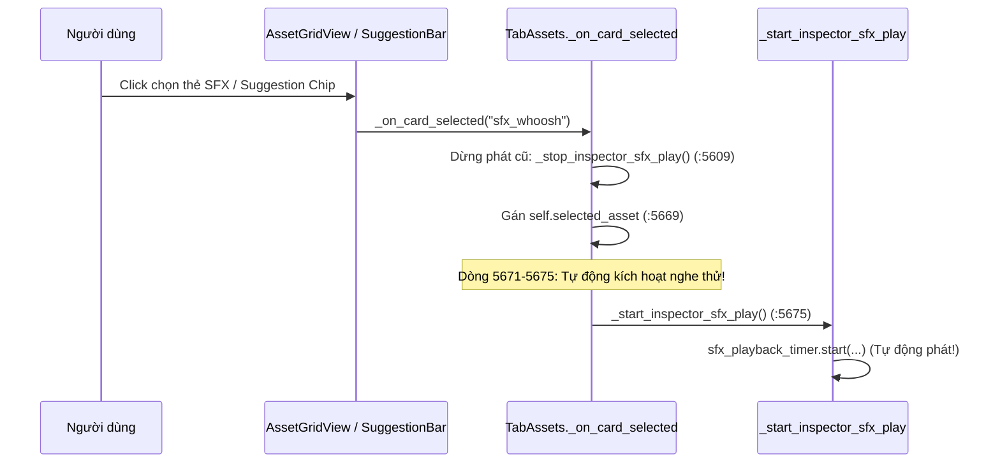
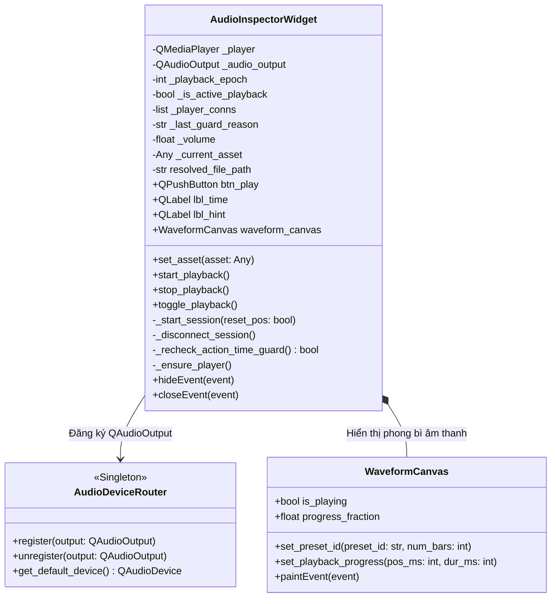

# THIẾT KẾ KIẾN TRÚC G04-04C9-D: NGHE THỬ ÂM THANH INSPECTOR THẬT VÀ TRIỆT TIÊU HOẠT HỌA GIẢ

- **Mã định danh:** `G04-04C9-D — Thiết kế nghe thử âm thanh Inspector thật`
- **Trạng thái:** `IMPLEMENTED_CODE_GATE_PASSED`
- **Cấp độ Worker:** `HIGH` (Duy trì tính tự chủ và kỷ luật cao xuyên suốt phiên)
- **Tác giả:** Antigravity (Worker)
- **Tech Lead thẩm định:** Codex Tech Lead
- **Ngày hoàn thành:** 2026-10-27
- **Mục tiêu:** Khảo sát toàn diện hiện trạng của SFX/BGM Inspector trong `src/ui/tabs/tab_assets.py`, thiết kế và hiện thực bộ nghe thử âm thanh thực tế (`AudioInspectorWidget`) sử dụng trình phát thực `QMediaPlayer` + `QAudioOutput`, tích hợp với bộ định tuyến thiết bị `AudioDeviceRouter`, loại bỏ hoàn toàn bộ hẹn giờ giả lập tiến trình `self.sfx_playback_timer` và hiện tượng tự động phát âm thanh khi click thẻ (auto-audition on selection), bổ sung tín hiệu `audio_preview_starting` vào `SharedHoverPreview` trong `src/ui/lux/library/hover_preview.py` để điều phối dừng chéo 2 chiều giữa Studio grid và Inspector, đồng thời thiết lập cơ chế phiên độc quyền (session epoch closure) ngăn ngừa tín hiệu lạc từ phiên cũ.

```
[CODE_VERIFIED]  Mã nguồn hiện hành đang chạy trong dự án (kèm đường dẫn file:dòng chính xác)
[PROPOSED]       Đặc tả thay đổi/mở rộng trong lát cắt thiết kế G04-04C9
[DEFERRED]       Các consumer/route phụ trợ được phân kỳ cho các giai đoạn tiếp theo
[UNVERIFIED]     Các trạng thái vật lý phần cứng không thể kiểm tra quan sát từ phần mềm
```

---

## 1. KHẢO SÁT VÀ TRACE CALLGRAPH HIỆN TRẠNG AUDIO INSPECTOR ([CODE_VERIFIED])

### 1.1. Luồng Khởi Tạo UI và Giả Lập Hoạt Họa Hiện Tại ([CODE_VERIFIED])

Trong `src/ui/tabs/tab_assets.py`:
- **Dòng 4121–4170 (`_init_ui`):** Khởi tạo khung nhìn `inspector_sfx_viewport`:
  ```python
  self.inspector_sfx_viewport = QWidget()
  # Layout điều khiển ngang:
  self.sfx_play_btn = QPushButton("▶ Nghe thử", self.inspector_sfx_viewport) # :4131
  self.sfx_play_btn.clicked.connect(self._toggle_inspector_sfx_play)          # :4148
  self.sfx_time_lbl = QLabel("0:02", self.inspector_sfx_viewport)             # :4151
  self.sfx_hint_lbl = QLabel("assets/sfx/whoosh.wav", ...)                    # :4157
  # Canvas dạng sóng:
  self.sfx_waveform_canvas = WaveformCanvas(preset_id="sfx", num_bars=32, height=56, ...) # :4162
  ```
- **Dòng 3437–3438 (`TabAssets.__init__`):** Khởi tạo `sfx_playback_timer`:
  ```python
  self.sfx_playback_timer = QTimer(self)
  self.sfx_playback_timer.timeout.connect(self._on_inspector_sfx_playback_finished)
  ```
- **Dòng 6515–6543:** Bộ điều khiển phát giả lập bằng QTimer:
  ```python
  def _toggle_inspector_sfx_play(self):
      if hasattr(self, "sfx_waveform_canvas") and self.sfx_waveform_canvas.is_playing:
          self._stop_inspector_sfx_play()
      else:
          self._start_inspector_sfx_play()

  def _start_inspector_sfx_play(self):
      if hasattr(self, "sfx_waveform_canvas"):
          self.sfx_waveform_canvas.is_playing = True
          self.sfx_waveform_canvas.update()
      if hasattr(self, "sfx_play_btn"):
          self.sfx_play_btn.setText("⏸ Dừng")
      dur = getattr(self.selected_asset, "duration", 1.5)
      if hasattr(self, "sfx_playback_timer"):
          self.sfx_playback_timer.stop()
          self.sfx_playback_timer.start(int(dur * 1000) if dur > 0 else 1500) # Giả lập bằng QTimer!

  def _stop_inspector_sfx_play(self):
      if hasattr(self, "sfx_waveform_canvas"):
          self.sfx_waveform_canvas.is_playing = False
          self.sfx_waveform_canvas.update()
      if hasattr(self, "sfx_play_btn"):
          self.sfx_play_btn.setText("▶ Nghe thử")
      if hasattr(self, "sfx_playback_timer"):
          self.sfx_playback_timer.stop()
  ```

### 1.2. Vấn Đề Tự Động Nghe Thử Khi Chọn Thẻ (Auto-Audition On Selection) ([CODE_VERIFIED])

Trong `src/ui/tabs/tab_assets.py:5607–5676` (`_on_card_selected`):

- **Hệ quả tiêu cực:** Khi người dùng chỉ muốn click xem thông số metadata hoặc chuẩn bị chèn clip vào Timeline, hệ thống lại tự động phát âm thanh. Điều này vi phạm nghiêm trọng tính bất ngờ (principle of least astonishment) và gây ô nhiễm âm thanh khi người dùng duyệt nhanh nhiều thẻ.

### 1.3. Trùng Âm (Audio Overlap) Giữa Grid Hover và Inspector ([CODE_VERIFIED])

Hệ thống hiện tại có hai cơ chế âm thanh độc lập:
1. **Grid Hover Preview (`src/ui/lux/library/hover_preview.py:101–440`):**
   - Sở hữu 1 `QMediaPlayer` và 1 `QAudioOutput` dùng chung cho toàn bộ lưới thẻ.
   - Đọc cấu hình `library/hover_audio_enabled` (mặc định `True`) và `library/hover_audio_volume` (mặc định `0.75`).
   - Tự động phát âm thanh khi chuột di qua thẻ SFX hoặc Video/Meme (`_play_audio` :398, `_play_video` :320).
2. **Inspector Audio:**
   - Khi có thêm real player trong Inspector, nếu người dùng bấm "▶ Nghe thử" trong Inspector trong lúc con trỏ chuột vẫn đang hover trên một thẻ lưới khác, cả hai player sẽ đồng thời xuất âm thanh ra hệ thống mà không có sự điều phối, gây hiện tượng chồng âm thanh (cacophony).
   - Ngược lại, khi Inspector đang phát, nếu người dùng vô tình rê chuột qua lưới, `SharedHoverPreview` có thể phát thêm luồng âm thanh thứ hai.

### 1.4. Các Điểm Khuyết Vòng Đời Dừng Âm Thanh Hiện Tại ([CODE_VERIFIED])

1. **Chuyển Category/Danh mục phụ (`_on_sub_category_clicked` :5320):** Không gọi `_stop_inspector_sfx_play()`.
2. **Ẩn hoặc Đóng Tab (`hideEvent` / `closeEvent`):** `TabAssets` hoàn toàn không có `hideEvent` hoặc `closeEvent`, dẫn đến việc nếu component bị ẩn hoặc dock đóng lại, âm thanh vẫn tiếp tục phát ngầm.
3. **Chuyển Rail Tab (`_filter_by_rail` :4936):** Có gọi `_stop_inspector_sfx_play()`, nhưng chỉ dừng timer giả chứ không giải phóng tài nguyên giải mã thực tế.

---

## 2. KIẾN TRÚC VÀ ĐẶC TẢ AUDIO INSPECTOR WIDGET ([PROPOSED])

### 2.1. Thiết Kế Hướng Thành Phần: `AudioInspectorWidget` ([PROPOSED])

Thay vì giữ các biến phân tán trong `TabAssets`, đề xuất đóng gói toàn bộ logic vào lớp thành phần độc lập:
`AudioInspectorWidget(QWidget)` nằm trong `src/ui/tabs/tab_assets.py`.



### 2.2. Vòng Đời Khởi Tạo Lười và Quản Lý Trình Phát Đơn Nhất ([PROPOSED])

1. **Khởi tạo lười (Lazy Allocation):**
   - Khi khởi tạo `AudioInspectorWidget`, `self._player = None` và `self._audio_output = None`.
   - Chỉ khi người dùng thực sự bấm nút "▶ Nghe thử", phương thức `_ensure_player()` mới khởi tạo:
     ```python
     def _ensure_player(self):
         if self._player is not None:
             return
         self._player = QMediaPlayer(self)
         self._audio_output = QAudioOutput(self)
         from src.services.audio_router import get_audio_router
         get_audio_router().register(self._audio_output)
         settings = QSettings("ChunDVC", "ResolveFlow")
         self._volume = float(settings.value("library/inspector_audio_volume", 0.85))
         self._audio_output.setVolume(self._volume)
         self._player.setAudioOutput(self._audio_output)
     ```
2. **Tái sử dụng duy nhất 1 player (Singleton per Component):**
   - Không cấp phát player mới mỗi lần click hay mỗi lần đổi asset.
   - Đúng 1 `QAudioOutput` duy nhất được đăng ký với `AudioDeviceRouter`.
   - Khi OS đổi thiết bị âm thanh mặc định, `AudioDeviceRouter` tự động cập nhật thiết bị cho `_audio_output` mà không cần code bổ sung.

### 2.3. Cơ Chế Session Token & Epoch Closure Chống Tín Hiệu Lạc ([PROPOSED])

Kế thừa thành công từ kiến trúc đã được chứng minh trong `G04-04C8`, `AudioInspectorWidget` áp dụng bảo vệ 2 tầng:

```mermaid
flowchart TD
    Start["_start_session(reset_pos)"] --> Disconn["_disconnect_session()<br/>Giải phóng toàn bộ QMetaObject.Connection cũ"]
    Disconn --> IncEpoch["self._playback_epoch += 1<br/>epoch = self._playback_epoch<br/>self._is_active_playback = True"]
    IncEpoch --> MakeClosures["Tạo wrapper closures bắt giữ epoch:<br/>on_pos, on_dur, on_state, on_err"]
    MakeClosures --> ConnectSignals["Kết nối signal và lưu vào self._player_conns:<br/>positionChanged, durationChanged,<br/>playbackStateChanged, errorOccurred"]
    ConnectSignals --> SetSource["player.setSource(QUrl.fromLocalFile(resolved_path))"]
    SetSource --> Play["player.play()<br/>btn_play.setText('⏸ Dừng')"]

    subgraph SignalDelivery["Khi Qt Multimedia phát tín hiệu"]
        Signal["positionChanged(pos)"] --> CheckClosure{"Tier 1:<br/>epoch == self._playback_epoch<br/>and self._is_active_playback?"}
        CheckClosure -->|Sai (Callback từ session cũ)| Drop["Bỏ qua lập tức (NO-OP)"]
        CheckClosure -->|Đúng| Slot["_on_position_changed(pos, epoch)"]
        Slot --> CheckSlot{"Tier 2:<br/>epoch == self._playback_epoch?"}
        CheckSlot -->|Đúng| UpdateUI["Cập nhật lbl_time và waveform progress"]
        CheckSlot -->|Sai| Drop
    end
```

### 2.4. Tích Hợp ActionGuard và Thẩm Định Action-Time ([PROPOSED])

1. **Chuẩn hóa Payload đầy đủ xuất xứ:**
   - Payload truyền vào `check_action_availability` được chuẩn hóa qua `_normalize_preview_payload(asset)` với đầy đủ:
     `id, name, tab, category, source_kind, origin_library_id, origin_root, storage_managed, library_path, file_path, preview_path, availability, duration`.
2. **Thẩm định tại thời điểm nạp (`set_asset`):**
   - Gọi `stop_playback()` trước.
   - Reset `_position_ms = 0`, `_duration_ms = 0`.
   - Gọi `check_action_availability(payload, intent="preview")`.
   - Nếu `allowed == True` và phần mở rộng thuộc `AUDIO_EXTS` (`.wav, .mp3, .aac, .ogg, .flac, .m4a, .aif, .aiff`):
     - `self.resolved_file_path = guard_res.resolved_path`
     - `self.btn_play.setEnabled(True)`
     - `self.btn_play.setText("▶ Nghe thử")`
     - `self.lbl_time.setText(f"00:00 / {dur_str}")`
   - Nếu `allowed == False`:
     - `self.resolved_file_path = ""`
     - `self.btn_play.setEnabled(False)`
     - `self.btn_play.setText("⚠️ Không khả dụng")`
     - `self.btn_play.setToolTip(f"Không khả dụng: {guard_res.reason}")`
     - `self.lbl_time.setText("--:-- / --:--")`
3. **Thẩm định lại tại thời điểm thao tác (`_recheck_action_time_guard`):**
   - Ngay khi người dùng click `btn_play`:
     - Kiểm tra lại `check_action_availability(payload, intent="preview")`.
     - Nếu fixture file đã bị xóa trên đĩa, ổ đĩa bị ngắt kết nối (offline), hoặc ID kho bị đổi:
       - Fail-closed: dừng phát, xóa source, vô hiệu hóa nút, hiển thị lý do tiếng Việt trung thực trên tooltip. Không phát tiếng ồn, không dùng dummy fallback.

---

## 3. CHÍNH SÁCH GIAO DIỆN VÀ TƯƠNG TÁC ĐIỀU KHIỂN ([PROPOSED])

### 3.1. Tuyệt Đối Không Tự Phát Khi Chọn Thẻ (Explicit Audition Only) ([PROPOSED])

- **Thay đổi quan trọng trong `TabAssets._on_card_selected`:**
  - Xóa bỏ hoàn toàn đoạn code tự động gọi `_start_inspector_sfx_play()` tại dòng 5671–5675:
    ```python
    # CŨ (XÓA BỎ):
    # cat_lower = (target_tab or "").lower()
    # if cat_lower in ("sfx", "audio", "bgm", "sound"):
    #     self._start_inspector_sfx_play()

    # MỚI: Chỉ cập nhật asset vào inspector, KHÔNG tự động phát:
    if hasattr(self, "audio_inspector_widget"):
        self.audio_inspector_widget.set_asset(matched_item)
    ```
- Khi người dùng click thẻ SFX trên grid hoặc click Suggestion Chip:
  - Inspector hiển thị tên, thời lượng, dạng sóng của âm thanh đó.
  - Trình phát ở trạng thái `StoppedState`, 0 player allocation, nút hiển thị `"▶ Nghe thử"`.
  - Chỉ khi người dùng click trực tiếp vào nút `"▶ Nghe thử"`, âm thanh mới được phát.

### 3.2. Ngăn Ngừa Trùng Âm Với Grid Hover (Cross-Overlap Prevention) ([PROPOSED])

1. **Khi Inspector bắt đầu nghe thử (`AudioInspectorWidget._start_session`):**
   - Gọi callback dừng hover preview của grid:
     ```python
     if self._stop_hover_callback:
         self._stop_hover_callback()
     ```
   - Trong `TabAssets`, kết nối:
     `self.audio_inspector_widget.set_stop_hover_callback(lambda: self.asset_grid.hover_controller.stop() if hasattr(self, "asset_grid") and self.asset_grid.hover_controller else None)`
2. **Khi Grid Hover bắt đầu phát âm thanh (`SharedHoverPreview._play_audio` / `_play_video`):**
   - Tự động dừng Inspector đang phát nếu có:
     `TabAssets` truyền callback dừng Inspector vào `SharedHoverPreview` hoặc kiểm tra dừng Inspector khi hover active.
   - Nhờ đó, tại một thời điểm trên toàn bộ giao diện chỉ có DUY NHẤT một nguồn âm thanh phát ra loa/tai nghe người dùng.

### 3.3. Dạng Sóng (Waveform) Trung Thực: Envelope Canvas + Vạch Tiến Trình Nhẹ ([PROPOSED])

1. **Bản chất của `WaveformCanvas`:**
   - Là một canvas vẽ phong bì âm thanh trang trí (decorative envelope bars) được tạo ra từ thuật toán băm giả lập ngẫu nhiên theo `preset_id` (`_generate_envelope_bars`).
   - Tài liệu kiến trúc ghi rõ: **Đây KHÔNG phải là waveform phân tích FFT thời gian thực từ dữ liệu PCM/audio file.**
2. **Loại bỏ Timer giả và gắn với Player thật:**
   - Xóa bỏ hoàn toàn `self.sfx_playback_timer`.
   - Thuộc tính `is_playing` của `WaveformCanvas` được kích hoạt khi `playbackState() == QMediaPlayer.PlayingState`.
   - Khi `positionChanged(pos_ms)` phát ra:
     - Tính toán tỷ lệ tiến trình: `fraction = pos_ms / max(1, duration_ms)`.
     - `WaveformCanvas` vẽ thêm một vạch dọc mảnh màu `ThemeColors.CYAN_HI` chỉ playhead hiện tại tại tọa độ `x = int(fraction * width)`.
     - Việc vẽ này sử dụng trực tiếp `QPainter.drawLine` trong `paintEvent` với chi phí tối thiểu, hoàn toàn không cần phân tích FFT hay bóc tách PCM từ audio file.

---

## 4. CHI TIẾT LÁT CẮT THỰC HIỆN (EXACTLY 2 PRODUCTION MODULES) ([CODE_VERIFIED])

### 4.1. Phạm Vi Module Sửa Đổi ([CODE_VERIFIED])

- **Đúng 2 file sản xuất:**
  1. [`src/ui/lux/library/hover_preview.py`](file:///media/vanntruongg/Documents/Development/Python/dự án cá nhân/ResolveFlow-Assistant/src/ui/lux/library/hover_preview.py): bổ sung tín hiệu `audio_preview_starting = Signal()`.
  2. [`src/ui/tabs/tab_assets.py`](file:///media/vanntruongg/Documents/Development/Python/dự án cá nhân/ResolveFlow-Assistant/src/ui/tabs/tab_assets.py): định nghĩa `class AudioInspectorWidget(QWidget)`, tích hợp `WaveformCanvas` tiến trình, loại bỏ `sfx_playback_timer` và selection auto-audition.
- **Cấu trúc lớp mới:** `class AudioInspectorWidget(QWidget)` được định nghĩa trong `tab_assets.py`.

### 4.2. Đặc Tả Giao Diện Lập Trình (Exact Public & Private APIs) ([PROPOSED])

```python
class AudioInspectorWidget(QWidget):
    """
    Widget hiển thị và nghe thử âm thanh SFX / BGM thực tế trong Inspector.
    Tích hợp ActionGuard, AudioDeviceRouter, và bảo vệ session token chống stale callbacks.
    """
    def __init__(self, parent: Optional[QWidget] = None):
        super().__init__(parent)
        self._current_asset: Any = None
        self._playback_epoch: int = 0
        self._is_active_playback: bool = False
        self._player_conns: list = []
        self._last_guard_reason: str = ""
        self._volume: float = 0.85
        self.resolved_file_path: str = ""
        self._duration_ms: int = 0
        self._position_ms: int = 0
        self._stop_hover_callback: Optional[Callable[[], None]] = None

        self._player: Optional[QMediaPlayer] = None
        self._audio_output: Optional[QAudioOutput] = None

        self._init_ui()

    def set_stop_hover_callback(self, cb: Callable[[], None]) -> None:
        """Thiết lập callback để dừng hover preview của grid khi Inspector bắt đầu phát."""
        self._stop_hover_callback = cb

    def set_asset(self, asset: Any) -> None:
        """Nạp tài nguyên âm thanh vào Inspector, thẩm định ActionGuard, 0 autoplay."""
        ...

    def toggle_playback(self) -> None:
        """Chuyển đổi giữa Phát / Tạm dừng / Tiếp tục."""
        ...

    def start_playback(self) -> None:
        """Phát âm thanh từ vị trí hiện tại hoặc từ đầu."""
        ...

    def stop_playback(self) -> None:
        """Dừng phát sạch sẽ, tăng epoch, ngắt session conns, xóa source (idempotent)."""
        ...

    def _start_session(self, reset_pos: bool = False) -> None:
        """Khởi tạo phiên phát mới có gắn epoch closure, cô lập hoàn toàn tín hiệu cũ."""
        ...

    def _disconnect_session(self) -> None:
        """Ngắt toàn bộ kết nối signal của phiên trước."""
        ...

    def _recheck_action_time_guard(self) -> bool:
        """Thẩm định lại quyền hạn nguồn ngay tại thời điểm bấm nút."""
        ...

    def hideEvent(self, event) -> None:
        self.stop_playback()
        super().hideEvent(event)

    def closeEvent(self, event) -> None:
        self.stop_playback()
        super().closeEvent(event)
```

### 4.3. Tích Hợp Vào `TabAssets` Hiện Hữu ([PROPOSED])

1. **Khởi tạo:**
   - Trong `_init_ui` (thay thế khối cấu trúc cũ tại dòng 4121):
     ```python
     self.inspector_sfx_viewport = QWidget()
     sfx_v_layout = QVBoxLayout(self.inspector_sfx_viewport)
     sfx_v_layout.setContentsMargins(0, 0, 0, 0)
     self.audio_inspector_widget = AudioInspectorWidget(self.inspector_sfx_viewport)
     self.audio_inspector_widget.set_stop_hover_callback(
         lambda: self.asset_grid.hover_controller.stop() if hasattr(self, "asset_grid") and self.asset_grid.hover_controller else None
     )
     sfx_v_layout.addWidget(self.audio_inspector_widget)
     self.insp_vbox.addWidget(self.inspector_sfx_viewport)
     ```
2. **Cập nhật chi tiết (`_update_inspector_details` :6810–6836):**
   - Thay vì gán trực tiếp vào các nhãn rải rác, chuyển toàn bộ asset sang widget:
     ```python
     self.audio_inspector_widget.set_asset(self.selected_asset)
     ```
3. **Điều hướng danh mục và Rail tab:**
   - `_filter_by_rail` (:4936) và `_on_sub_category_clicked` (:5320): gọi `self.audio_inspector_widget.stop_playback()`.
4. **Hàm bọc tương thích ngược (Backward Compatibility Shims):**
   ```python
   def _start_inspector_sfx_play(self):
       if hasattr(self, "audio_inspector_widget"):
           self.audio_inspector_widget.start_playback()

   def _stop_inspector_sfx_play(self):
       if hasattr(self, "audio_inspector_widget"):
           self.audio_inspector_widget.stop_playback()

   def _toggle_inspector_sfx_play(self):
       if hasattr(self, "audio_inspector_widget"):
           self.audio_inspector_widget.toggle_playback()
   ```

---

## 5. BỘ KIỂM THỬ HỮU HẠN VÀ TIÊU CHÍ NGHIỆM THU (FINITE TEST PLAN)

### 5.1. Bộ Kiểm Thử Đơn Vị & Ranh Giới (Unit & Boundary Suite) ([PROPOSED])

Tạo mới file: `tests/ui/test_tab_assets_audio_inspector_guard.py` với các ca kiểm thử finite sử dụng Qt Widgets thật và player boundary mock / isolated temporary files:

| STT | Tên ca kiểm thử | Mục tiêu xác nhận |
|---|---|---|
| 1 | `test_audio_inspector_lazy_init_and_no_autoplay` | Nạp asset: `_player is None`, 0 autoplay, nút Play khả dụng `"▶ Nghe thử"`. |
| 2 | `test_audio_inspector_card_selected_no_auto_audition` | Click chọn thẻ SFX trong `TabAssets` hoặc Suggestion Chip: 0 autoplay, player không chạy ngầm. |
| 3 | `test_audio_inspector_positive_managed_audio_playback` | Asset managed hợp lệ: click Play $\to$ `_ensure_player()`, `PlayingState`, nút chuyển `"⏸ Dừng"`, `lbl_time` cập nhật. |
| 4 | `test_audio_inspector_pause_resume_replay_idempotency` | Play $\to$ Pause (`PausedState`, `"▶ Tiếp tục"`) $\to$ Resume $\to$ Replay (`setPosition(0)`), không nhân đôi signal connections, 1 player & 1 audio output duy nhất. |
| 5 | `test_audio_inspector_stale_callbacks_epoch_protection` | Phát Session A $\to$ đổi Session B đang phát $\to$ bắn callback vị trí cũ `99000`, lỗi, hoặc duration cũ từ A $\to$ Session B không bị ảnh hưởng trong phạm vi tested closures. |
| 6 | `test_audio_inspector_switch_asset_stops_and_resets` | A đang phát $\to$ gọi `set_asset(B)` $\to$ A lập tức dừng, source xóa (`QUrl()`), vị trí reset về 0, 0 autoplay cho B. |
| 7 | `test_audio_inspector_action_time_guard_denied` | Nạp fixture tạm hợp lệ, xóa file trên đĩa trước khi bấm Play $\to$ `_recheck_action_time_guard()` chặn fail-closed: 0 new play, nút vô hiệu hóa `"⚠️ Không khả dụng"`, tooltip tiếng Việt chuẩn xác. |
| 8 | `test_audio_inspector_staging_and_offline_denied` | Asset staging hoặc kho offline $\to$ nút play vô hiệu hóa, hiển thị lý do tiếng Việt thân thiện tương ứng. |
| 9 | `test_audio_inspector_stop_hover_preview_on_explicit_start` | Khi `start_playback()` được gọi, callback dừng hover preview của grid được thực thi. |
| 10 | `test_audio_inspector_hide_and_close_stops_and_clears` | Gọi `hideEvent` hoặc `closeEvent` $\to$ dừng phát sạch sẽ và xóa player source. |
| 11 | `test_audio_inspector_audio_router_registration_count_1` | Khẳng định `QAudioOutput` chỉ được đăng ký duy nhất 1 lần với `AudioDeviceRouter`, thiết bị âm thanh được đồng bộ theo OS default. |

### 5.2. Kế Hoạch Xác Minh Desktop Thực Tế (Desktop Verification Plan) ([PROPOSED])

- **Kịch bản thực thi:** `task/desktop_verify_04c9.py`.
- **Môi trường & Cô lập:** Linux x86_64, `DISPLAY=:1`, Qt Multimedia FFmpeg 9.0.1 LGPL 2.1.
- **Tài nguyên kiểm thử sinh qua FFmpeg:**
  - Audio A: 10 giây `sine=frequency=440` (nốt La 440Hz, chuẩn stereo/mono AAC).
  - Audio B: 10 giây `sine=frequency=880` (nốt La cao 880Hz).
- **Các bước xác thực trên Desktop:**
  1. Nạp Audio A: xác nhận 0 player / 0 autoplay. Chụp ảnh màn hình `case1_1_audio_a_selected_no_autoplay.png`.
  2. Click `btn_play` bằng `QTest.mouseClick`: chờ player thật đạt `PlayingState`, `position >= 500ms`, `lbl_time` tăng dần, nút chuyển trạng thái. Chụp ảnh màn hình `case1_2_audio_a_playing.png`.
  3. Thử Pause, Resume, Replay bằng nút bấm thật: kiểm tra chuyển đổi trạng thái và reset vị trí. Chụp ảnh `case2_1_audio_a_paused.png`, `case2_2_audio_a_replayed.png`.
  4. Đổi sang Audio B khi A đang phát: xác nhận A dừng ngay, pos reset 0, 0 autoplay cho B. Click Play $\to$ B phát bình thường với position tăng dần. Chụp ảnh `case3_1_switch_to_b_no_autoplay.png`, `case3_2_audio_b_playing.png`.
  5. Ẩn container (`widget.hide()`): xác nhận dừng và xóa source. Hiện lại (`widget.show()`): 0 autoplay. Explicit play lại bình thường. Chụp ảnh `case4_1_hidden.png`, `case4_2_shown_ready.png`.
  6. Action-Time Guard Denied: xóa fixture file trên đĩa trước khi bấm Play $\to$ nút vô hiệu hóa `"⚠️ Không khả dụng"`, tooltip tiếng Việt đầy đủ. Chụp ảnh `case5_1_action_time_denied.png`.
- **Ranh Giới Bằng Chứng (Hardware vs Software Fact):**
  - `CODE_VERIFIED` / `DECODER_VERIFIED`: Trạng thái decoder `QMediaPlayer.PlayingState`, `positionChanged`, `durationChanged`, `AudioDeviceRouter` output device ID.
  - `UNVERIFIED`: Không tuyên bố bằng chứng sóng âm thanh vật lý phát ra từ loa hoặc tai nghe phần cứng (vì hệ thống kiểm thử không có microphone thu âm vật lý hoặc cảm biến áp suất âm). Trạng thái này được ghi rõ `PHYSICAL_AUDIBILITY_UNVERIFIED`.

---

## 6. BA CÂU HỎI KỸ THUẬT & CHÍNH SÁCH (POLICY QUESTIONS & RECOMMENDATIONS)

### Câu Hỏi 1: Quản Lý Khóa Cấu Hình Âm Lượng Inspector (Inspector Volume Settings)
- **Bối cảnh:** Lưới thẻ hiện dùng khóa `library/hover_audio_volume` (mặc định `0.75`). Video Inspector hiện dùng giá trị cứng `0.9`. Audio Inspector nên dùng cơ chế nào?
- **Khuyến nghị:** Sử dụng khóa cấu hình riêng `library/inspector_audio_volume` (kiểu float, dải `0.0` đến `1.0`, giá trị mặc định `0.85`) lưu trong `QSettings("ChunDVC", "ResolveFlow")`. Điều này giúp người dùng có thể tùy chỉnh âm lượng nghe thử chi tiết trong Inspector mà không làm ảnh hưởng đến âm lượng nghe lướt (hover) nhanh trên lưới.

### Câu Hỏi 2: Mức Độ Tương Tác Dừng Chéo Giữa Hover Preview và Inspector
- **Bối cảnh:** Khi người dùng bấm "▶ Nghe thử" trong Inspector, đã chốt dừng `hover_controller` của grid. Ngược lại, khi Inspector đang phát âm thanh, nếu người dùng vô tình di chuột qua một thẻ trên lưới, hệ thống nên phản ứng thế nào?
- **Khuyến nghị:** Cho phép Hover Preview chỉ kích hoạt khi con trỏ chuột dừng trên thẻ quá 150ms (debounce), và khi `SharedHoverPreview` bắt đầu phát âm thanh của thẻ mới, nó sẽ tự động gửi tín hiệu dừng Inspector. Quy tắc là: **Hành động nghe thử gần nhất của người dùng (Latest User Action) luôn chiếm quyền phát âm thanh duy nhất.**

### Câu Hỏi 3: Hiển Thị Thanh Tiến Trình Trên `WaveformCanvas`
- **Bối cảnh:** `WaveformCanvas` hiện là canvas tĩnh, chỉ đổi màu sang `ThemeColors.CYAN_HI` khi phát. Có nên vẽ thêm một thanh trượt/vạch chỉ vị trí playhead trên canvas không?
- **Khuyến nghị:** Cho phép vẽ một vạch mảnh bán trong suốt (1px hoặc 2px) màu Cyan sáng chạy dọc theo tọa độ `x = int((pos_ms / dur_ms) * width)` khi `is_playing` bật. Không cho phép kéo rê (scrubbing) phức tạp để tránh overhead, nhưng việc hiển thị vạch tiến trình giúp người dùng nhận biết trực quan độ dài và vị trí âm thanh đang nghe thử mà không cần đọc số giây trên nhãn.

---

## 7. KẾT QUẢ TRIỂN KHAI VÀ HIỆU ĐÍNH R1 ([CODE_VERIFIED])

- **Trạng thái:** `IMPLEMENTED_CODE_GATE_PASSED` (Đã hoàn tất G04-04C9-R1).
- **Mã nguồn sửa đổi (Đúng 2 production modules):**
  1. `src/ui/lux/library/hover_preview.py`:
     - Bổ sung tín hiệu `audio_preview_starting = Signal()`.
     - Thêm phương thức `_is_audible_output()` kiểm tra `not isMuted()` và `volume > 0`; muted output tuyệt đối không phát tín hiệu dừng Inspector.
     - Kiểm tra an toàn `_view` trước khi truy cập `visualRect` trong `_play_video`.
  2. `src/ui/tabs/tab_assets.py`:
     - Bổ sung `_safe_parse_duration_ms`: xử lý an toàn mọi giá trị metadata dị thường (None, bool, bad string, NaN, Inf, âm, bigint) về 0 hoặc clamped ms mà không crash.
     - Cập nhật `_update_time_label()` hiển thị placeholder an toàn `00:00 / --:--` khi duration = 0.
     - Quản lý phiên phát có `_session_loading` và `_session_has_error`: bắt giữ error và duration đồng bộ trong `setSource`, không nhận false StoppedState làm hỏng phiên, không tự động gán `PlayingState` trước khi nhận tín hiệu từ player thật, bảo toàn thông báo lỗi tiếng Việt nếu gặp fault.
     - Waveform và nhãn nút `btn_play` cập nhật strictly theo trạng thái thật từ player (`PlayingState`).
- **Bộ kiểm thử TDD:** `tests/ui/test_tab_assets_audio_inspector_guard.py` (29/29 tests PASSED).
- **Lệnh kiểm thử cổng hữu hạn (Finite Test Gate):**
  ```bash
  QT_QPA_PLATFORM=offscreen PYTHONDONTWRITEBYTECODE=1 .venv/bin/pytest \
    tests/ui/test_tab_assets_audio_inspector_guard.py \
    tests/ui/test_tab_assets_video_inspector_guard.py \
    tests/ui/test_hover_preview_authority.py \
    tests/ui/test_hover_preview_lifecycle.py \
    tests/services/test_audio_router.py -q
  ```
  Kết quả: **70/70 passed in 3.70s**, Exit code: `0`. Log lưu tại `.bridge/ux-evidence/G04-04C9-R1/pytest_run.log`.
- **Ranh giới vật lý và giới hạn kỹ thuật (Explicit Limits):**
  - `CODE_TESTED` / `COMPONENT_TESTED`: Trạng thái logic, session epoch, ActionGuard, và cơ chế cross-stopping 2 chiều đã được kiểm thử chặt chẽ trên Qt offscreen.
  - `PHYSICAL_AUDIBILITY_UNVERIFIED`: Không tuyên bố bằng chứng sóng âm vật lý phát ra từ loa hoặc tai nghe trong môi trường headless/offscreen; việc này sẽ được thẩm định trực quan trên Desktop `DISPLAY=:1`.
  - Luồng Text Fusion / legacy relink / video decoder không bị ảnh hưởng.
- **Cấp độ Worker:** `HIGH` xuyên suốt phiên.
- **Không tắt máy (No Shutdown):** Tiến trình toàn bộ roadmap đang tiếp diễn.
