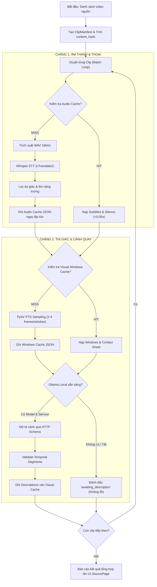

# ChunDVC — G05-D Thiết Kế Kiến Trúc: Khảo Sát Nguồn, Whisper, Thị Giác & Bộ Nhớ Đệm Dùng Chung

- **Mã tài liệu:** `docs/architecture/05-source-analysis-cache-design.md`
- **Giai đoạn lộ trình:** Gate G05 — Source Inventory, Speech-to-Text, Visual Understanding & Unified Cache Orchestration
- **Cấp độ Worker:** `HIGH`
- **Mục tiêu kỹ thuật:** Thiết kế luồng phân tích toàn diện nguồn footage (cả thoại và cảnh không thoại) cho hàng trăm clip (tổng 3+ giờ video), tách bạch 4 vùng lưu trữ, độc lập cache từng khâu, có thể hủy/tiếp tục an toàn và chọn đúng 1 lát cắt triển khai đầu tiên (First Slice).
- **Ràng buộc:** `DESIGN ONLY` — Không sửa đổi code sản xuất, không tải model, không chạy benchmark GPU, không di chuyển dữ liệu người dùng.

---

## 1. SƠ ĐỒ ĐƯỜNG GỌI THỰC TẾ (CALLGRAPH HIỆN TRẠNG & ĐỀ XUẤT)

Callgraph phân tách rõ ràng giữa các luồng:
- `[CODE_VERIFIED]`: Đã đối chiếu chính xác từng dòng trong mã nguồn hiện có.
- `[PROPOSED]`: Thiết kế đề xuất mới cho Gate G05 nhằm hợp nhất khâu phân tích.
- `[UNVERIFIED]`: Chưa có kiểm thử hoặc chưa có bằng chứng thực nghiệm đầy đủ.

### 1.1 Khâu chọn nguồn và nạp danh sách clip (Footage Ingestion & Inventory)
```text
[UI] User tương tác trên SourcePage
  │
  ├── [CODE_VERIFIED] src/ui/director/pages/source_page.py:832 (_on_pick_folder)
  │     └── QFileDialog.getExistingDirectory() -> SourcePage.add_paths()
  ├── [CODE_VERIFIED] src/ui/director/pages/source_page.py:837 (_on_pick_files)
  │     └── QFileDialog.getOpenFileNames() -> SourcePage.add_paths()
  ├── [CODE_VERIFIED] src/ui/director/pages/source_page.py:844 (_on_pick_drive)
  │     └── DriveDialog -> _on_drive_import_completed() -> SourcePage.add_paths()
  └── [CODE_VERIFIED] src/ui/director/pages/source_page.py:514 (DropZoneWidget.dropEvent)
        └── files_dropped.emit() -> SourcePage.add_paths()

SourcePage.add_paths(paths, sync=False) [CODE_VERIFIED: source_page.py:916]
  │
  ├── Khởi tạo SourceScanWorker(job_id, paths, whisper_model, whisper_lang) [source_page.py:933]
  │     └── Worker Thread: SourceScanWorker.run() -> _scan() [source_page.py:290, 297]
  │           │
  │           └── Lặp qua từng fpath:
  │                 └── probe_video_file(fpath, whisper_model, whisper_lang) [source_page.py:169]
  │                       │
  │                       ├── Đọc stat file: mtime_ns, file_size_bytes [source_page.py:177]
  │                       ├── Kiểm tra RAM memo: _PROBE_MEMO[(norm_path, mtime_ns, size)] [source_page.py:185]
  │                       ├── [Nếu chưa có memo] Đọc metadata video qua OpenCV / autocut [source_page.py:193-224]
  │                       │     └── Trích xuất: duration_sec, resolution ("1080p", "4K", ...)
  │                       └── [Kiểm tra cache đệm] ScanCacheManager().get_cached_scan(norm_path, model, lang) [source_page.py:248]
  │                             └── Gán has_cache: bool (CHỈ KIỂM TRA WHISPER STT, BỎ QUA VISUAL!)
  │
  └── SourceScanWorker.batch_loaded.emit() -> SourcePage._on_worker_batch_loaded() [source_page.py:998]
        └── Cập nhật danh sách SourceClipInfo, SourceClipRow hiển thị chip xanh (Đã có cache) hoặc vàng (Chưa phân tích)
```

### 1.2 Khâu phân tích âm thanh / thoại (Whisper Speech-to-Text Pipeline)
```text
[UI] User bấm "Duyệt kịch bản" hoặc Chạy Pipeline qua DirectorController
  │
  ├── [CODE_VERIFIED] src/ui/director/director_controller.py:121 (DirectorController.start_pipeline)
  │     └── Khởi tạo PipelineWorker(**kwargs) [src/ui/auto/auto_window.py:172]
  │           └── Worker Thread: PipelineWorker.run() [auto_window.py:297]
  │                 │
  │                 ├── DryRunValidator.validate_media_files(video_paths) [auto_window.py:312]
  │                 │
  │                 ├── Kiểm tra danh sách clip cần Whisper:
  │                 │     └── ScanCacheManager().get_cached_scan(vp, model, lang) [auto_window.py:372]
  │                 │           └── [Nếu 100% clip hit cache] BỎ QUA NẠP WHISPER MODEL [auto_window.py:380]
  │                 │           └── [Nếu có clip miss cache] ResolveTranscriber.load_model() [auto_window.py:390]
  │                 │
  │                 └── Lặp qua từng video_path (Clip idx):
  │                       │
  │                       ├── [Cache Hit] Đọc raw_subtitles, clip_dur, visual_activity, silence_keep_intervals [auto_window.py:513]
  │                       │
  │                       └── [Cache Miss]:
  │                             ├── Trích xuất WAV 16kHz: AudioExtractor.extract_audio(video, temp_wav) [auto_window.py:519]
  │                             ├── Nhận diện thoại: transcriber.transcribe(temp_wav, ...) [src/core/transcriber.py:189]
  │                             │     └── faster_whisper.WhisperModel.transcribe() (VAD filter, word timestamps)
  │                             ├── Lọc ảo giác: clean_whisper_segments_with_stats() [src/core/whisper_cleaner.py:569]
  │                             ├── Đo chuyển động cơ bản: compute_visual_activity(video) [auto_window.py:611]
  │                             ├── Cắt khoảng lặng: SilenceDetector.detect_intervals_with_speedup() [auto_window.py:635]
  │                             └── GHI CACHE: ScanCacheManager().save_scan_result(...) [auto_window.py:728]
  │                                   ├── Ghi file ~/.resolveflow_cache/{checksum}_{model}_{lang}.json [cache_manager.py:245]
  │                                   └── Ghi file ~/.resolveflow_cache/name_{name_hash}_{model}_{lang}.json [cache_manager.py:273]
```

### 1.3 Khâu phân tích thị giác hiện hành (Visual Sampling & Ollama Description)
```text
[UI] User bấm các nút riêng biệt trên SourcePage:
  │
  ├── [CODE_VERIFIED] Nút "🖼️ Lấy mẫu hình ảnh" -> SourcePage._start_visual_scan() [source_page.py:1227]
  │     └── Khởi tạo VisualScanWorker(job_id, paths) [source_page.py:362]
  │           └── Worker Thread: VisualScanWorker.run() [source_page.py:378]
  │                 └── VisualIndex().scan(path, interval_sec=10.0, max_samples=120) [src/core/visual_index.py:343]
  │                       ├── Khởi tạo VideoSampler(path) qua PyAV [src/core/visual_sampling.py:26]
  │                       ├── Lấy mẫu PTS thực tế từng frame -> thumbnail JPEG (320px) [visual_sampling.py:47]
  │                       ├── Tạo contact sheet ảnh tổng quan [visual_index.py:405]
  │                       └── Ghi metadata ~/.resolveflow_cache/visual/{identity}.json [visual_index.py:168]
  │
  └── [CODE_VERIFIED] Nút "🤖 Mô tả cảnh bằng AI" -> SourcePage._ask_visual_model() [source_page.py:1136]
        └── QInputDialog hỏi model Ollama -> SourcePage._start_visual_description() [source_page.py:1148]
              └── Khởi tạo VisualDescribeWorker(job_id, paths, model, endpoint) [source_page.py:401]
                    └── Worker Thread: VisualDescribeWorker.run() [source_page.py:422]
                          └── describe_with_ollama(path, model, endpoint) [src/core/visual_describer.py:83]
                                ├── local_model_info(model, endpoint) -> GET /api/tags, POST /api/show [visual_describer.py:65]
                                ├── VisualIndex().prepare_windows(window_sec=8.0, frames=4) [src/core/visual_index.py:246]
                                ├── POST /api/chat (gửi chuỗi frame Base64 + JSON schema) [visual_describer.py:173]
                                ├── validate_segment() kiểm tra mốc thời gian và evidence [src/core/visual_index.py:42]
                                └── VisualIndex().save_descriptions() [src/core/visual_index.py:193]
```

### 1.4 Điểm đứt gãy kiến trúc hiện tại & Luồng hợp nhất đề xuất (`PROPOSED`)
```text
VẤN ĐỀ HIỆN TẠI:
- Whisper STT chỉ chạy ngầm trong PipelineWorker (khi user đã chuyển bước build), hoàn toàn không chạy ở SourcePage.
- Visual Sampling và Visual Describe là 2 nút thủ công độc lập ở SourcePage, không tích hợp vào PipelineWorker.
- SourceClipInfo.has_cache chỉ phản ánh Whisper cache, hoàn toàn mù với Visual cache.
- B-roll / Cảnh không thoại: Whisper trả về rỗng (`[]`), người dùng không biết clip chứa gì nếu không bấm Visual Describe thủ công.

[PROPOSED] LUỒNG PHÂN TÍCH HỢP NHẤT (UNIFIED SOURCE ANALYSIS ORCHESTRATOR):
SourcePage Action: "⚡ Phân tích toàn diện nguồn (Thoại & Cảnh)"
  │
  └── SourceAnalysisOrchestrator(paths, audio_cfg, visual_cfg)
        │
        ├── Giai đoạn 1: Content Identity & Inventory (ClipManifest)
        │     └── Tính content_hash (size + 1MB đầu + 1MB cuối) không phụ thuộc đường dẫn / mtime.
        │
        ├── Giai đoạn 2: Audio Analysis (Whisper & Energy) — Độc lập
        │     ├── Tra cứu Audio Cache: Hit -> Nạp (<0.05s); Miss -> Chạy Whisper + Audio Activity.
        │     └── Ghi Audio Cache ngay khi xong từng clip. (Visual hỏng/hủy KHÔNG làm mất audio).
        │
        ├── Giai đoạn 3: Visual Sampling (PyAV PTS Windows) — Độc lập
        │     ├── Tra cứu Temporal Windows Cache: Hit -> Bỏ qua; Miss -> Decode PTS lấy mẫu JPEG.
        │     └── Lưu Windows & Contact sheet vào Visual Cache.
        │
        └── Giai đoạn 4: Visual Description (Local Ollama) — Có điều kiện & Graceful Fallback
              ├── Kiểm tra trạng thái Ollama daemon & model vision.
              ├── Nếu có model: Gửi windows có ngân sách, lưu descriptions vào Visual Cache.
              └── Nếu không có model / lỗi: Ghi nhận trạng thái "awaiting_description", KHÔNG báo lỗi đỏ,
                  giữ nguyên Audio Transcript và Visual Samples cho người dùng duyệt.
```

---

## 2. BẢNG KHÓA CACHE VÀ CƠ CHẾ VÔ HIỆU HÓA (CACHE KEYS & INVALIDATION MATRIX)

Hệ thống hiện tại tồn tại **4 cơ chế cache song song** với các chiến lược khóa và thư mục khác nhau:

| Tiêu chí | `ScanCacheManager` (Whisper & Audio) | `VisualIndex` (Visual Sampling & Describe) | `AssetCache` (Thumbnail & Card Meta) | `ClipManifest` (Unified Clip Identity) |
| :--- | :--- | :--- | :--- | :--- |
| **Vị trí lưu trữ** | `~/.resolveflow_cache/` | `~/.resolveflow_cache/visual/` | `~/.cache/chundvc/` hoặc `%APPDATA%/chundvc/` | Trong Project file hoặc In-memory |
| **Chiến lược File Identity** | Checksum: sha256(path + size + mtime + 64KB đầu/cuối).<br>Fallback: name_{hash}_{model}_{lang}. | Fingerprint: `{"size_bytes": size, "mtime_ns": mtime_ns}`.<br>Identity: content_hash hoặc sha256(path)[:24]. | Hash: MD5(norm_path + size + mtime_ns). | Content Hash: sha256(size + 1MB đầu + 1MB cuối). **Không phụ thuộc path/mtime!** |
| **Model / Cấu hình phụ thuộc** | `{model_size}_{norm_lang}` (vd: `small_vi`). | Temporal: `{window_sec, frames, sampler_ver}`.<br>Model: `{model, digest, prompt_ver}`. | Kích thước ảnh: `320x180`. | FPS, Start TC, Duration. |
| **Hành vi sau Khởi động lại (Restart)** | **Hit** nếu path, size, mtime nguyên vẹn. | **Hit** nếu fingerprint và config khớp. | **Hit** nếu path, size, mtime khớp. | **Hit** tuyệt đối theo content_hash. |
| **Hành vi khi Di chuyển file (Move / Rename)** | **Bị hỏng khóa chính!** Rơi vào fallback theo tên file; nếu trùng tên khác nội dung dễ sai lệch. | **Bị hỏng khóa chính** nếu không truyền `content_hash`. | **Miss hoàn toàn** (khóa phụ thuộc path tuyệt đối). | **Hit hoàn toàn** (nội dung không đổi thì hash không đổi). |
| **Hành vi khi Đổi cấu hình (Model/Lang)** | Miss khóa cũ, tạo khóa mới độc lập cho model mới. Khóa cũ vẫn còn trên đĩa. | Đổi sampling: resample windows.<br>Đổi model: giữ samples, chỉ phân tích lại description. | Không áp dụng. | Không áp dụng. |
| **Xử lý Hủy ngang (Cancel) / Lỗi (Failed)** | Chỉ ghi cache khi toàn bộ clip hoàn tất khâu Audio. File WAV tạm bị xóa sạch. | Nguyên tử: ghi vào `.visual-*.json` rồi `os.replace`. Mẫu dở dang bị xóa trong `finally`. | ThreadPool bỏ qua callback nếu task bị hủy. | Đóng băng danh sách clip đã hoàn tất. |
| **Thực tế đang được tái sử dụng?** | **CÓ (Hiệu quả cao)** khi chạy lại cùng thư mục, tiết kiệm 100% GPU/RAM không nạp Whisper. | **CÓ** nhưng chỉ trong luồng thủ công riêng của `SourcePage`. | **CÓ** cho hiển thị UI Studio/Dock. | **CÓ** cho đồng bộ Timeline & Prompt. |

> [!IMPORTANT]
> **GIẢ THUYẾT NGUYÊN NHÂN TỪ BẰNG CHỨNG MÃ NGUỒN (CHƯA RUNTIME REPRO):**
> Trong `src/core/cache_manager.py:55`, hàm `compute_file_checksum` đưa chuỗi `f"{norm_path.lower()}_{file_size}_{mtime}_"` trực tiếp vào hasher SHA256. 
> Khi người dùng:
> 1. Đổi tên thư mục cha hoặc cắm ổ cứng ngoài ở mount point khác (`/media/...` đổi tên).
> 2. Sao chép video từ thẻ nhớ sang ổ cứng máy tính.
> 3. Hệ điều hành cập nhật `mtime` của file video (hoặc git checkout).
>
> $\implies$ Checksum bị thay đổi làm hỏng khóa chính. Dù `get_cached_scan` có cơ chế fallback theo `name_{hash}_{size}`, nhưng fallback này chỉ khớp khi tên file giữ nguyên và kích thước bằng nhau, và không có xác minh nội dung thực sự. Nếu người dùng đổi tên file hoặc có nhiều clip cùng tên generic, cache có thể bị miss hoặc hit nhầm. Đây là giả thuyết có bằng chứng từ mã nguồn thực tế, cần được kiểm chứng trong môi trường chạy thật.
> Đồng thời, việc chỉ đọc 1MB đầu và 1MB cuối (`sampled fingerprint`) không thể phát hiện các chỉnh sửa nội dung ở giữa thân video > 2MiB. Do đó, cần cơ chế Full-Content Verification bằng streaming SHA256 trong background worker (chi tiết xem `docs/architecture/05A-audio-cache-identity-design.md`).

---

## 3. THỰC NGHIỆM TRACE 4 TRƯỜNG HỢP CỤ THỂ (CONCRETE CODE & FIXTURE TRACES)

### 3.1 Trường hợp 1: Clip có thoại rõ ràng (Spoken Dialogue)
- **Mẫu kiểm chứng:** Video phỏng vấn / talking head `clip_interview_01.mp4` (Thời lượng 120s, có tiếng nói tiếng Việt).
- **Hành vi Audio Stage:**
  1. `AudioExtractor.extract_audio` trích xuất `temp_audio_dir/clip_interview_01_xxxx.wav` (16kHz, mono, s16le) `[CODE_VERIFIED: auto_window.py:519]`.
  2. `transcriber.transcribe` chạy cTranslate2 với `model_size="small"`, `language="vi"`, `vad_filter=True`, `word_timestamps=True` `[CODE_VERIFIED: transcriber.py:214]`.
  3. Trả về mảng `raw_subtitles` (ví dụ 18 segments, 142 từ). `clean_whisper_segments_with_stats` lọc ảo giác lặp câu `[CODE_VERIFIED: auto_window.py:569]`.
  4. `SilenceDetector` phân tích khoảng lặng giữa các câu nói, tạo `silence_keep_intervals` `[CODE_VERIFIED: auto_window.py:689]`.
  5. `ScanCacheManager.save_scan_result` lưu cache JSON chứa `raw_subtitles`, `clip_dur=120.0`, `silence_keep_intervals` `[CODE_VERIFIED: auto_window.py:728]`.
- **Hành vi Visual Stage:**
  1. `VisualIndex.prepare_windows(window_sec=8.0, frames_per_window=4, max_windows=24)`: $120s / 8s = 15$ windows. Lấy 60 frame JPEG (320px/640px) `[CODE_VERIFIED: visual_index.py:275]`.
  2. `describe_with_ollama` gửi từng window lên model local (ví dụ `qwen3-vl:2b-instruct`), trả về các phân đoạn `start_sec`, `end_sec`, `description="Người nói ngồi trước micro trong phòng thu"`, `objects=["person", "microphone", "headphones"]` `[CODE_VERIFIED: visual_describer.py:173]`.
  3. Ghi vào `VisualIndex` với `status: "described"`.
- **Trạng thái tích hợp:** Cả 2 khâu độc lập hoàn tất; thoại làm khung sườn cắt gọt, visual làm nhãn phân loại cảnh `[CODE_VERIFIED]`.

### 3.2 Trường hợp 2: Clip không thoại / chỉ đồ vật & B-Roll (Silent / Object-only)
- **Mẫu kiểm chứng:** Cảnh quay máy bay không người lái (drone) hoặc đặc tả sản phẩm `broll_coffee_cup.mp4` (Thời lượng 45s, không có người nói).
- **Hành vi Audio Stage:**
  1. `AudioExtractor` trích xuất WAV. `transcriber.transcribe` chạy với `vad_filter=True`.
  2. Không có giọng nói nào vượt ngưỡng VAD $\implies$ `raw_subtitles = []` `[CODE_VERIFIED: transcriber.py:230]`.
  3. `clean_whisper_segments_with_stats` nhận danh sách rỗng, trả về `[]` `[CODE_VERIFIED: auto_window.py:569]`.
  4. `SilenceDetector` ghi nhận toàn bộ là silence. 
     - Nếu clip được đánh dấu B-Roll trong `project_structure`: `cut_segments` giữ nguyên 100% `action="keep"`, `clip_dur=45.0` `[CODE_VERIFIED: auto_window.py:626]`.
     - Nếu không có đánh dấu: tùy thuộc chính sách `edit_policy` (với vlog du lịch sẽ giữ lại cảnh động, với talking head có thể bị cắt bỏ) `[CODE_VERIFIED: auto_window.py:679]`.
  5. `ScanCacheManager.save_scan_result` ghi cache với `raw_subtitles: []` và `silence_keep_intervals`.
- **Hành vi Visual Stage:**
  1. `VisualIndex.prepare_windows`: $45s / 8s \approx 6$ windows, trích xuất 24 frames `[CODE_VERIFIED: visual_index.py:275]`.
  2. `describe_with_ollama` nhận diện đối tượng: `description="Tách cà phê bốc khói trên bàn gỗ ngoài trời"`, `objects=["cup", "coffee", "table"]`, `observed_actions=["steam rising"]` `[CODE_VERIFIED: visual_index.py:99]`.
  3. Ghi vào `VisualIndex` với `status: "described"`.
- **Đánh giá khiếm khuyết:** Nếu không có luồng Visual, người dùng hoàn toàn bị "mù" thông tin clip này trong kịch bản dựng tự động vì Whisper trả về rỗng `[CODE_VERIFIED]`. Cần visual description để AI Director nhận biết đây là B-roll minh họa tách cà phê.

### 3.3 Trường hợp 3: Khởi động lại ứng dụng và quét lại (Cache Hit After Restart)
- **Mẫu kiểm chứng:** Mở ứng dụng ChunDVC ở phiên làm việc mới, chọn lại thư mục chứa 50 clips đã phân tích hôm trước.
- **Hành vi Audio Stage:**
  1. `SourceScanWorker` gọi `probe_video_file` cho từng clip `[CODE_VERIFIED: source_page.py:332]`.
  2. `ScanCacheManager.get_cached_scan` đọc tệp JSON từ `~/.resolveflow_cache/` trong `<0.005s` mỗi file `[CODE_VERIFIED: cache_manager.py:129]`.
  3. `probe_video_file` trả về `SourceClipInfo(..., has_cache=True)`. Giao diện hiển thị tức thì toàn bộ 50 clip với chip xanh `[CODE_VERIFIED: source_page.py:262, 580]`.
  4. Khi bấm xử lý: `PipelineWorker` kiểm tra `clips_needing_whisper`:
     `if not clips_needing_whisper and self.use_cache:`
     $\implies$ **Không nạp model Whisper (tiết kiệm 100% VRAM/RAM, tiết kiệm 15–30 phút tính toán trên CPU)** `[CODE_VERIFIED: auto_window.py:380]`.
- **Hành vi Visual Stage:**
  1. `VisualIndex.prepare_windows` kiểm tra `cached.get("temporal_config") == config and self._windows_ready(cached)` $\implies$ trả về `cache_hit: True` `[CODE_VERIFIED: visual_index.py:265]`.
  2. `describe_with_ollama` kiểm tra `signature == previous.get("signature")` $\implies$ trả về ngay danh sách `descriptions` có sẵn mà không gọi mạng HTTP tới Ollama `[CODE_VERIFIED: visual_describer.py:116]`.
- **Kết quả:** Quá trình tải lại 50 clip hoàn tất trong chưa đầy 1 giây `[CODE_VERIFIED]`.

### 3.4 Trường hợp 4: Chỉ một file video hoặc cấu hình thay đổi (Partial Invalidation)
- **Mẫu kiểm chứng:** Danh sách 20 clips; người dùng sửa video thứ 5 (render lại từ Premiere / DaVinci), 19 clip còn lại giữ nguyên.
- **Hành vi với 19 clip không đổi:**
  - Checksum và Fingerprint trùng khớp $\implies$ **Cache Hit 100%** cho cả Audio và Visual `[CODE_VERIFIED]`.
- **Hành vi với clip thứ 5 bị sửa:**
  - File size hoặc mtime thay đổi $\implies$ Checksum mới.
  - `ScanCacheManager.get_cached_scan`: Khóa checksum mới không tồn tại. Fallback name key phát hiện `cand_size != current_file_size` $\implies$ Từ chối an toàn (Cache Miss) `[CODE_VERIFIED: cache_manager.py:214]`.
  - `VisualIndex.load`: Phát hiện `fingerprint != data.get("fingerprint")` $\implies$ Từ chối cache cũ `[CODE_VERIFIED: visual_index.py:147]`.
  - Tự động sao lưu phiên bản cũ vào thư mục `~/.resolveflow_cache/visual/history/{stem}-{revision}.json` `[CODE_VERIFIED: visual_index.py:182]`.
- **Kết quả:** Hệ thống chỉ chạy Whisper và PyAV lấy mẫu duy nhất cho clip thứ 5. 19 clip còn lại được bảo toàn tuyệt đối `[CODE_VERIFIED]`.

---

## 4. LUỒNG PHÂN TÍCH HỢP NHẤT ĐỀ XUẤT (UNIFIED SCAN FLOW DESIGN)

### 4.1 Nguyên tắc thiết kế cốt lõi
1. **Một hành động người dùng — Điều phối độc lập bên dưới:** Người dùng chỉ cần bấm một nút duy nhất: `⚡ Phân tích toàn diện nguồn`. Hệ thống tự động phân tích cả tiếng (Whisper) và hình (PyAV/Ollama) theo từng clip.
2. **Tính độc lập từng chặng (Stage Decoupling):**
   - Không chạy lại Whisper nếu chỉ thiếu Visual.
   - Không chạy lại Visual nếu chỉ thay đổi tham số cắt dựng.
   - Thất bại ở Visual Describe (do chưa bật Ollama) không được phép làm hỏng hoặc hủy kết quả nhận diện giọng nói đã có.
3. **Mẫu số tiến độ và độ phủ rõ ràng (Explicit Coverage & Quality Denominators):**
   - Tuyệt đối không báo `complete=True` khi `total=0` hoặc thời lượng bằng 0.
   - Báo cáo rõ: `Thoại: 142 từ (85% thời lượng clip) · Hình ảnh: 15/15 cửa sổ (100% độ phủ) · Nhãn: 12 cảnh đã mô tả`.
4. **Không đồng nhất frame snapshot với hành động theo thời gian:**
   - Phân biệt rõ giữa *Quan sát điểm (Point Observation)* (ảnh frame tại giây thứ $t$) và *Đoạn thời gian (Temporal Segment)* $[start, end)$ có sự diễn tiến của hành động và bằng chứng (evidence PTS).



### 4.2 Hợp đồng dữ liệu phân tích hợp nhất (`UnifiedClipAnalysisDTO`)
```json
{
  "schema_version": 4,
  "content_hash": "a1b2c3d4e5f6... (sha256 size + 1MB head + 1MB tail)",
  "file_metadata": {
    "file_name": "DJI_0042.MP4",
    "file_size": 154829104,
    "duration_sec": 74.5,
    "resolution": "4K",
    "fps": 29.97
  },
  "audio_analysis": {
    "status": "completed",
    "model": "small",
    "language_requested": "vi",
    "language_detected": "vi",
    "language_probability": 0.98,
    "speech_duration_sec": 58.2,
    "speech_coverage_ratio": 0.781,
    "segments": [
      {
        "id": 0,
        "start": 1.25,
        "end": 4.80,
        "text": "Chào mừng các bạn đã quay trở lại với kênh",
        "words": [{"word": "Chào", "start": 1.25, "end": 1.55}]
      }
    ],
    "silence_intervals": [[0.0, 1.2], [4.85, 6.10]]
  },
  "visual_analysis": {
    "status": "described",
    "sampling_config": {
      "window_sec": 8.0,
      "frames_per_window": 4,
      "max_windows": 24,
      "sampler_version": "pyav-pts-v2-scene-hints"
    },
    "coverage": {
      "complete": true,
      "total_windows": 10,
      "sampled_windows": 10,
      "sampled_ranges": [[0.0, 8.0], [8.0, 16.0]]
    },
    "descriptions": [
      {
        "start_sec": 0.0,
        "end_sec": 8.0,
        "description": "Người dẫn chương trình đứng trước cổng chợ Bến Thành",
        "objects": ["person", "building", "motorcycles"],
        "observed_actions": ["speaking to camera", "gesturing with hands"],
        "evidence_times": [1.0, 3.0, 5.0, 7.0],
        "analysis_status": "described",
        "origin": "ollama",
        "model": "qwen3-vl:2b-instruct"
      }
    ]
  }
}
```

---

## 5. RANH GIỚI BỐN VÙNG LƯU TRỮ VÀ QUY TẮC CÔ LẬP DỮ LIỆU

Để xử lý hàng trăm video nặng hàng trăm GB mà không gây tràn ổ cứng hệ thống hoặc làm mất dữ liệu người dùng, hệ thống phân định tuyệt đối **4 vùng lưu trữ độc lập**:

```text
┌─────────────────────────────────────────────────────────────────────────────┐
│ 1. SOURCE FOOTAGE / PROJECT WORKSPACE (Thư mục video của người dùng)       │
│ - Trạng thái: CHỈ ĐỌC (READ-ONLY 100%).                                    │
│ - Quy tắc: Tuyệt đối KHÔNG ghi đè, KHÔNG xóa, KHÔNG di chuyển.             │
│ - KHÔNG copy video gốc (hàng chục/trăm GB) về ổ hệ thống hoặc thư mục app! │
└─────────────────────────────────────────────────────────────────────────────┘
                                      ▲
                                      │ (Chỉ đọc luồng stream / decode frame)
                                      ▼
┌─────────────────────────────────────────────────────────────────────────────┐
│ 2. METADATA & ANALYSIS CACHE (XDG_CACHE_HOME / .resolveflow_cache)         │
│ - Trạng thái: Dữ liệu phân tích dạng text JSON siêu nhẹ (<50KB/clip).      │
│ - Thư mục ảnh mẫu (frames): JPEG nén chất lượng 85, kích thước nhỏ 320/640px│
│ - Tổng dung lượng cho 3 giờ video (100 clips): ~100MB ảnh + ~5MB JSON.     │
│ - Tự dọn dẹp các tệp tạm (.tmp / .visual-*) khi tiến trình hoàn tất.       │
└─────────────────────────────────────────────────────────────────────────────┘
                                      ▲
                                      │ (Tham chiếu độc lập, không gắn cứng)
                                      ▼
┌─────────────────────────────────────────────────────────────────────────────┐
│ 3. ASSET STORAGE ROOT (Kho đồ họa / âm thanh / LUTs của ChunDVC)           │
│ - Vị trí: Do StorageManager quản lý (managed_root).                        │
│ - Chứa: Template Title, Transition, SFX, B-roll có sẵn của phần mềm.        │
│ - Cô lập hoàn toàn với video nguồn người dùng đưa vào dựng.                │
└─────────────────────────────────────────────────────────────────────────────┘

┌─────────────────────────────────────────────────────────────────────────────┐
│ 4. LOCAL AI MODEL STORE (Thư viện trọng số mô hình AI ngoại vi)             │
│ - Faster-Whisper: Lưu trong cache của huggingface (~/.cache/huggingface/). │
│ - Ollama Vision: Do Ollama daemon quản lý (~/.ollama/models/).             │
│ - ChunDVC TUYỆT ĐỐI KHÔNG tự ý tải mô hình nhiều GB về máy khi chưa có lệnh │
│   xác nhận từ người dùng; không tự ghi đè vào thư mục model hệ thống.      │
└─────────────────────────────────────────────────────────────────────────────┘
```

---

## 6. PHÂN TÁCH BỐN TRẠNG THÁI MODEL LOCAL VÀ CƠ CHẾ FALLBACK TRUNG THỰC

ChunDVC không phụ thuộc giả định "máy tính luôn có GPU mạnh và luôn chạy sẵn Ollama". Trạng thái mô hình phải được chia tách rõ ràng:

| Trạng thái kỹ thuật | Cách nhận diện trong mã nguồn | Hành vi giao diện UI |
| :--- | :--- | :--- |
| **1. File có sẵn (Model on disk)** | Kiểm tra thư mục cache Whisper hoặc danh sách tags Ollama `GET /api/tags` `[CODE_VERIFIED: transcriber.py:116, visual_describer.py:69]`. | Hiển thị tên model kèm dung lượng đĩa (vd: `Whisper small · 461MB`, `qwen3-vl · 2.2GB`). |
| **2. Backend hỗ trợ (Backend capability)** | Whisper: `ctranslate2.get_cuda_device_count() > 0` $\implies$ CUDA / CPU `[CODE_VERIFIED: transcriber.py:139]`.<br>Ollama: Kiểm tra `"vision" in info["capabilities"]` `[CODE_VERIFIED: visual_describer.py:77]`. | Báo rõ chế độ tính toán (`CUDA float16` hoặc `CPU int8`). Nếu model Ollama không có vision $\implies$ từ chối sớm. |
| **3. Service đang chạy (Service alive)** | Whisper: Khởi tạo trong tiến trình Python.<br>Ollama: Gọi thử ping `GET http://127.0.0.1:11434/api/tags` với timeout ngắn (2s) `[CODE_VERIFIED: visual_describer.py:69]`. | Nếu Ollama tắt: Nút hiển thị `Chưa bật Ollama local`. Cung cấp nút thử lại hoặc bỏ qua khâu mô tả. |
| **4. Inference đã kiểm chứng (Inference verified)** | Đã chạy thử nghiệm thực tế với payload frame thật và validate cấu trúc JSON trả về thành công `[CODE_VERIFIED: visual_describer.py:173]`. | Ghi nhận trạng thái `described`, cho phép đưa vào prompt cho AI Director. |

### Cơ chế Fallback khi thiếu Model thị giác (Graceful Fallback)
1. Khi máy không có GPU rời:
   - GPU vắng mặt không đồng nghĩa Ollama không chạy được: Ollama vẫn có thể chạy trên CPU (chậm hơn GPU).
   - Whisper chạy trên CPU bằng `ctranslate2` tối ưu int8 trên đa nhân.
2. Khi Ollama service không phản hồi hoặc model chưa được tải (`not installed` / `not capable`):
   - Service alive không đồng nghĩa model đã loaded hoặc có vision capability (bắt buộc kiểm chứng qua `/api/show`).
   - Whisper và PyAV lấy mẫu hình ảnh vẫn chạy bình thường để xuất Contact Sheet ảnh tĩnh lưu vào cache.
   - Bỏ qua khâu gửi ảnh cho Ollama.
   - Nếu có lỗi inference thật (OOM, context limit, JSON parse error), hệ thống ghi nhận lỗi thật và gán trạng thái `needs_review` hoặc `error` kèm thông điệp chi tiết trên tooltip, KHÔNG che giấu mọi lỗi thành `awaiting_description`.
   - Trên UI hiển thị trung thực: `✓ Đã nhận diện giọng nói · Đã trích xuất ảnh mẫu (Chưa chạy mô tả AI do Ollama chưa sẵn sàng)`.
   - Người dùng vẫn có thể xem ảnh và duyệt kịch bản bình thường mà không bị crash.

---

## 7. NGÂN SÁCH TÀI NGUYÊN CHO BATCH 3+ GIỜ FOOTAGE (DỰ TOÁN THIẾT KẾ)

Dành cho kịch bản quy mô lớn: **100 video clips, tổng thời lượng 3.5 giờ (~12,600 giây)**.
*(Lưu ý: Các con số dưới đây là mục tiêu ngân sách thiết kế cần kiểm soát, không phải cam kết cứng đã đo lường thực tế).*

| Thành phần tài nguyên | Mục tiêu ngân sách thiết kế | Chiến lược kiểm soát & Triệt tiêu rò rỉ |
| :--- | :--- | :--- |
| **RAM Bộ nhớ chính** | *Mục tiêu $\le 2\ GB$* | - Không nạp toàn bộ video/audio vào RAM cùng lúc; xử lý streaming theo từng clip.<br>- PyAV: Gọi `sampler.close()` và `container.close()` ngay khi xong clip `[CODE_VERIFIED: visual_sampling.py:45]`.<br>- Thu hồi frame ảnh PIL ngay sau khi ghi file đĩa.<br>- Giới hạn `_PROBE_MEMO` tối đa 1,000 items LRU `[CODE_VERIFIED: source_page.py:140]`. |
| **VRAM Bộ nhớ GPU** | *Mục tiêu $\le 4\ GB$* | - Không chạy đồng thời Whisper và Ollama Vision trên cùng GPU: Xử lý tuần tự (Xong toàn bộ audio của clip rồi mới đến visual của clip).<br>- Whisper dùng `compute_type="float16"` (~1GB VRAM cho model `small`).<br>- Lưu ý: Tiến trình Python tuần tự không bảo đảm Ollama daemon tự động giải phóng VRAM ngay; cần kiểm tra tài nguyên hệ thống thực tế. |
| **Dung lượng Cache đĩa** | *Dự toán $\approx 350\ MB$* | - Ảnh mẫu nén JPEG chất lượng 85, độ phân giải 320px/640px.<br>- Với 100 clips, mỗi clip tối đa 24 windows $\times$ 4 frames = **9,600 frames** tối đa $\implies$ khoảng 250–350MB ảnh.<br>- File JSON metadata: ~50KB $\times$ 100 clips = 5MB. |
| **Token & Context AI** | $\le \mathbf{8,192}$ tokens/window | - Tuân thủ chính sách context `max8192-2048+1536perframe` `[CODE_VERIFIED: visual_describer.py:112]`.<br>- Mỗi cửa sổ chỉ gửi tối đa 4 frames Base64.<br>- Kết quả mô tả giới hạn ngắn gọn qua JSON schema (description $\le$ 180 ký tự, max 8 objects). |
| **Kế hoạch Benchmark 3 Giờ** | *Kế hoạch đo lường thực tế* | Chưa nghiệm thu thời gian thực hiện batch 3 giờ; cần đo đạc throughput (frames/sec decode và tokens/sec Ollama) trong môi trường thực ở Gate G09. Không suy diễn số liệu khi chưa đo. |

---

## 8. LÁT CẮT TRIỂN KHAI ĐẦU TIÊN (FIRST IMPLEMENTATION SLICE)

Căn cứ trên các khiếm khuyết thực tế đã phát hiện và chỉ đạo ràng buộc từ Tech Lead Codex (xem chi tiết tại `docs/architecture/05A-audio-cache-identity-design.md`), lát cắt triển khai đầu tiên tập trung duy nhất vào tính tin cậy của Audio Cache:

### Lát cắt được chọn: `G05-05A-I — Chuẩn Hóa Định Danh Cache Audio & Triệt Tiêu Fallback Không An Toàn`

#### 1. Mục tiêu kỹ thuật cụ thể:
1. Bổ sung `compute_full_file_sha256` trong `src/core/cache_manager.py` với streaming 1MB, pre/post stat và hỗ trợ callback cancel.
2. Nâng cấp `ScanCacheManager` lên Schema v3:
   - Phân biệt rõ Tra cứu nhanh (GUI candidate) và Xác minh toàn phần (Worker full-content verification).
   - Triệt tiêu hoàn toàn nhánh fallback theo tên file (`name_key`) không xác minh nội dung.
   - Bảo toàn tương thích ngược cho cache v2 cũ tại đúng đường dẫn và stat hợp lệ.
   - Phân biệt rõ transcript rỗng hợp lệ (`raw_subtitles: []` cho video không thoại) với cache thiếu (`None`).
3. Cập nhật `PipelineWorker` trong `src/ui/auto/auto_window.py` gọi tra cứu có xác minh toàn phần (`verify_full=True`) trước khi quyết định nạp Whisper.

*(Ghi chú: Việc điều phối trạng thái kép trên UI SourcePage và đồng bộ Visual Cache được chuyển sang các lát cắt tiếp theo trong backlog G05).*

#### 2. Danh sách modules sản xuất chịu tác động (Đúng 2 modules):
- `src/core/cache_manager.py`: Thuật toán băm streaming, Schema v3, triệt tiêu fallback không an toàn.
- `src/ui/auto/auto_window.py`: Gọi xác minh cache trong background worker thread của `PipelineWorker`.

#### 3. Bộ kiểm thử hồi quy chấp nhận hữu hạn (Finite Acceptance Tests - Mock/Tmp):
- `tests/core/test_audio_cache_identity.py` (8 tests độc lập kiểm chứng streaming, middle edit, cancel, TOCTOU, v2 backward compat, empty subtitles).
- Cập nhật các test cũ trong `tests/test_cache_manager.py` để khẳng định hành vi từ chối an toàn khi fallback không có content proof.
  * Test 5: UI `SourceClipRow` hiển thị đúng trạng thái đa tầng (không chỉ hiển thị vàng khi chỉ thiếu visual).

#### 4. Bằng chứng thực tế cần thu thập sau (Deferred to Real Runs):
- Benchmark tốc độ tính `content_hash` trên 100 video dung lượng lớn (kiểm tra I/O đọc 2MB đầu cuối).
- Nghiệm thu mô tả cảnh thực tế bằng mô hình Ollama trên máy có GPU.

---

## 9. THỨ TỰ PHỤ THUỘC VÀ DANH MỤC CÁC VIỆC TIẾP THEO (BACKLOG G05)

1. **G05-05A-I (Lát cắt 1):** Hợp nhất Khóa Cache Nguồn Độc Lập Đường Dẫn & Adapter Trạng Thái Kép (Audio + Visual).
2. **G05-05B-D & I (Lát cắt 2):** Xây dựng bộ điều phối phân tích nguồn hợp nhất (`SourceAnalysisOrchestrator` / `UnifiedScanWorker`) tích hợp vào `SourcePage` với cơ chế Cancel/Resume an toàn.
3. **G05-05C-D & I (Lát cắt 3):** Tích hợp dữ liệu Visual Description vào đối tượng `ClipManifest` và chuyển giao cho bộ lập kịch bản G06 (AI Director / Story Planner).
4. **G05-05D-R (Nghiệm thu):** Đo đạc và kiểm chứng thực nghiệm bộ dữ liệu 3 giờ video trên DaVinci Resolve.
