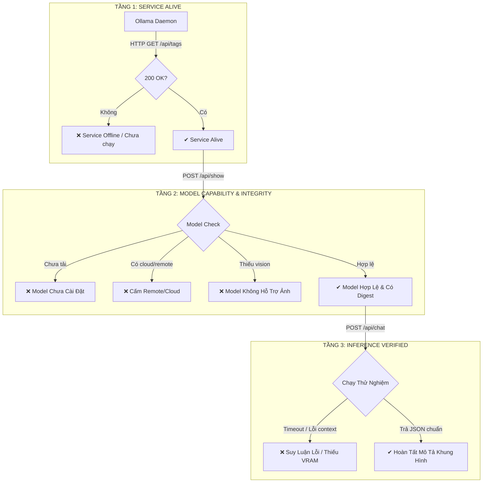
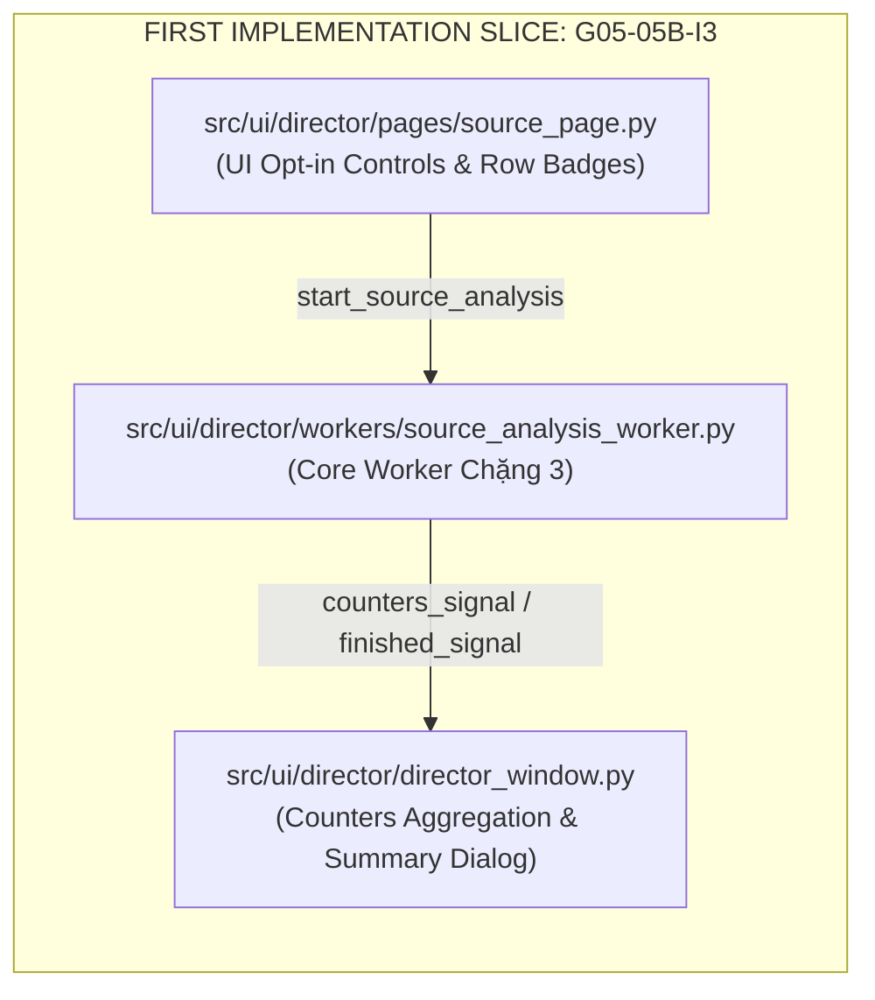

# ChunDVC — G05-05B-I3-D Thiết Kế Kiến Trúc: Tích Hợp Mô Tả Thị Giác Ngoại Tuyến (Local Vision Description Integration)

- **Mã tài liệu:** `docs/architecture/05B-I3-local-vision-integration-design.md`
- **Giai đoạn:** Gate G05 — Source Inventory, Speech-to-Text, Visual Understanding & Unified Cache Orchestration
- **Mã nhiệm vụ:** `G05-05B-I3-D` (Phần B)
- **Cấp độ Worker:** `HIGH` (Đã được Người dùng xác nhận chuyển đổi trên môi trường)
- **Phạm vi:** `DESIGN ONLY` — Không sửa đổi code production hoặc unit tests, không chạy benchmark/pytest/app/Resolve/model/download/GPU inference.
- **Tài liệu tham chiếu:**
  - `docs/architecture/05B-unified-source-analysis-design.md` (Thiết kế tổng thể quét nguồn hợp nhất 05B)
  - `docs/architecture/05B-I2-desktop-review.md` (Đánh giá nghiệm thu Desktop UI của Codex)
  - `docs/architecture/05A-audio-cache-identity-design.md` (Chuẩn hóa cache audio Schema v3)
  - `src/core/visual_describer.py` (Cơ chế mô tả qua Ollama local)
  - `src/core/visual_index.py` (Chỉ mục thị giác, overview scan và temporal windows)
  - `docs/architecture/ROADMAP.md` (Lộ trình chuẩn hóa kiến trúc)

---

## 1. CALLGRAPH HIỆN TRẠNG & CALLGRAPH TÍCH HỢP ĐỀ XUẤT

### 1.1 Khảo sát Callgraph Hiện Trạng (CODE_VERIFIED)

Hiện tại trong mã nguồn, chức năng mô tả hình ảnh tồn tại nhưng hoàn toàn phân mảnh và chạy trên một worker độc lập, không gắn kết với tiến trình phân tích nguồn:

```text
[HIỆN TRẠNG: MÔ TẢ THỊ GIÁC ĐỘC LẬP TRÊN SOURCEPAGE]
SourcePage:
  └── VisualDescribeWorker(QThread) [source_page.py:406]
        └── run() [source_page.py:427]
              └── for path in self.paths:
                    └── describe_with_ollama(path, model, endpoint, index, ...) [visual_describer.py:83]
                          ├── local_model_info(model, endpoint) [visual_describer.py:65]
                          │     ├── GET /api/tags (kiểm tra model tồn tại)
                          │     └── POST /api/show (kiểm tra capability "vision", cấm remote/cloud)
                          ├── index.prepare_windows(path, ...) [visual_index.py:246]
                          │     └── VideoSampler trích xuất frames theo từng cửa sổ temporal (vd: 8s/window, 4 frames)
                          └── for window in windows:
                                └── POST /api/chat [Ollama HTTP] (gửi base64 frames + strict JSON schema)
                                      └── Lưu descriptions vào visual_cache metadata JSON [visual_index.py:488]
```

**Hạn chế cốt tử của hiện trạng:**
1. **Phân mảnh thao tác người dùng:** Người dùng phải bấm "Phân tích nguồn" để có thoại và contact sheet, sau đó nếu muốn mô tả AI thì phải tìm cách kích hoạt riêng `VisualDescribeWorker`, trải qua hai lần duyệt danh sách tệp.
2. **Thiếu liên kết thoại - hình ảnh:** `VisualDescribeWorker` hiện tại lấy mẫu đồng đều cả tệp video (`max_windows=24`), không tận dụng thông tin từ Chặng 1 (Audio STT). Cảnh quay không có lời thoại (B-roll tiềm năng) và cảnh có thoại bị đối xử ngang nhau, gây lãng phí tài nguyên tính toán GPU của máy người dùng.
3. **Chưa có điểm tiêu thụ downstream:** Dữ liệu mô tả (`descriptions`, `visual_segments`) lưu vào đĩa nhưng trang Review (`review_page.py`) và prompt dựng (`story_copilot.py`) chỉ đọc mỗi transcript từ `ScanCacheManager`, bỏ qua toàn bộ dữ liệu thị giác.

---

### 1.2 Callgraph Đề Xuất: Tích Hợp Mô Tả Thị Giác Thành Chặng 3 (PROPOSED)

Đưa Mô tả thị giác vào làm **Chặng 3 tùy chọn (Opt-in Stage, mặc định OFF)** trong cùng một phiên của `SourceAnalysisWorker`:

```text
[UI] SourcePage: Người dùng cấu hình tùy chọn quét nguồn
  ├── [x] Quét thoại & Khoảng lặng (Whisper) [Mặc định: ON]
  ├── [x] Lấy mẫu khung hình thị giác (Visual Overview) [Mặc định: ON]
  └── [ ] Mô tả hình ảnh bằng AI (Ollama Local Vision) [MẶC ĐỊNH: OFF — Opt-in]
        ├── Dropdown chọn Model: [llava:latest / minicpm-v:latest] (Đọc từ cache/local info)
        └── Endpoint: http://127.0.0.1:11434 (Chỉ cho phép HTTP private/local)
  │
  └── Bấm [⚡ Phân tích nguồn (Thoại & Khung hình)]
        │
        └── SourcePage.start_source_analysis(config)
              │ Snapshot bất biến: SourceAnalysisConfig(
              │     enable_audio=True,
              │     enable_visual_sampling=True,
              │     enable_visual_describe=bool,   <-- MỚI
              │     vision_model=str,              <-- MỚI
              │     vision_endpoint=str,           <-- MỚI
              │     local_files_only=True
              │ )
              │
              └── SourceAnalysisWorker(QThread).run()
                    │
                    ├── [CHẶNG 1: AUDIO STT & SILENCE]
                    │     ├── v3 Cache Hit -> Nạp raw_subtitles (0 Whisper)
                    │     └── Cache Miss -> Probe audio -> Transcribe -> Lưu v3 Cache
                    │     └── Xác định các phân đoạn không thoại: non_speech_intervals
                    │
                    ├── [CHẶNG 2: VISUAL OVERVIEW SAMPLING]
                    │     ├── v1 Visual Cache Hit -> Nạp contact_sheet (0 decode mới)
                    │     └── Cache Miss -> VideoSampler -> Lấy mẫu đều thưa -> Tạo contact_sheet.jpg
                    │
                    └── [CHẶNG 3: LOCAL VISION DESCRIPTION] (Chỉ chạy khi enable_visual_describe=True)
                          │
                          ├── Preflight Model Check (local_model_info):
                          │     ├── Kiểm tra kết nối Ollama local
                          │     ├── Kiểm tra model có capability "vision", không cloud
                          │     └── Lấy model digest định danh
                          │
                          ├── Chuẩn bị Cửa Sổ Temporal (prepare_windows):
                          │     ├── Phân bổ cửa sổ temporal đều đặn theo ngân sách có sẵn (uniform bounded windows)
                          │     │   (Lưu ý: Speechless priority được hoãn lại ở lát cắt đầu theo quyết định Codex)
                          │     └── Nhóm shot boundaries (shot_group)
                          │
                          ├── Kiểm tra Chữ Ký Phân Tích (Signature Hash Check):
                          │     └── Khớp signature & hoàn thành toàn bộ cửa sổ đã chọn -> Tái sử dụng descriptions (0 Ollama call)
                          │
                          └── Vòng lặp suy luận từng cửa sổ (Ollama /api/chat):
                                ├── Bounded socket timeout từng request + kiểm tra cooperative cancel
                                ├── Strict JSON format schema (_window_schema)
                                └── Partial persistence: Checkpoint atomic ngay từng cửa sổ đã validate xuống đĩa
```

---

## 2. PHÂN BIỆT RẠCH RÒI: OVERVIEW SCAN vs TEMPORAL WINDOWS

Cần phân định rạch ròi hai cơ chế lấy mẫu hình ảnh trong hệ thống để tránh nhầm lẫn:

| Tiêu chí | Overview Scan (Chặng 2) | Temporal Windows (Chặng 3) |
|---|---|---|
| **Hàm thực thi** | `VisualIndex.scan(video_path)` | `VisualIndex.prepare_windows(...)` |
| **Mục đích** | Bảng ảnh thu nhỏ tổng quan (`contact_sheet.jpg`) phục vụ người dùng xem nhanh và gắn kèm câu hỏi. | Chuỗi khung hình chi tiết có thứ tự thời gian phục vụ AI phân tích hành động. |
| **Phân bổ mẫu** | Rải đều theo thời lượng clip (ví dụ mỗi 2.0s hoặc 10.0s một frame, tối đa 120 frames). | Chia theo các cửa sổ temporal cố định (ví dụ 8.0s/cửa sổ, 4 frames/cửa sổ, tối đa 24 cửa sổ). |
| **Phát hiện chuyển cảnh** | Không nhóm shot. | Có nhóm shot (`shot_group`) dựa trên độ lệch pixel giữa các frame liên tiếp để nhận biết đổi góc máy. |
| **Chi phí tính toán** | Thấp (chỉ giải mã ảnh qua PyAV, không AI inference). | Trung bình - Cao (giải mã ảnh + suy luận VLM qua Ollama). |
| **Tự động hóa cảnh không thoại** | Không phân biệt thoại/không thoại. | **Tự động ưu tiên phân tích các đoạn không thoại (speechless intervals)** được phát hiện từ Chặng 1. |

> [!IMPORTANT]
> **Tự động chuẩn bị cửa sổ cho cảnh không thoại (Speechless Scene Hints):**
> Khi Chặng 1 hoàn tất, hệ thống đã biết chính xác các đoạn thời gian không có lời thoại (`non_speech_intervals` hoặc khoảng cách giữa các câu thoại). Khi Chặng 3 chạy, `prepare_windows` sẽ ưu tiên đặt các cửa sổ temporal vào những khoảng thời gian này trước, đảm bảo footage B-roll hoặc hành động không lời được mô tả đầy đủ mà người dùng không cần phải bấm tìm cảnh thủ công.

---

## 3. NGUYÊN TẮC BẢO MẬT & TÁCH BẠCH 3 TẦNG TRẠNG THÁI OLLAMA

Nhằm đảm bảo an toàn ngoại tuyến 100% và không gây đơ giao diện (GUI freeze), hệ thống tuân thủ nghiêm ngặt mô hình 3 tầng trạng thái:



### Các nguyên tắc bất biến:
1. **Tuyệt đối không tải model tự động (No Model Download):** Nếu model chưa có trên máy, worker phát thông báo rõ ràng `"Chưa cài model Ollama: <tên>"`, không tự ý gọi `/api/pull` qua mạng gây tốn băng thông và treo tiến trình.
2. **Cấm chuyển tiếp lên Cloud (No Cloud Forwarding):** Kiểm tra các cờ `remote_host`, `remote_model` trong phản hồi của Ollama; từ chối xử lý footage nếu model là proxy đẩy dữ liệu ra bên ngoài.
3. **Cấm Network Probe trên GUI Thread:** Khi ứng dụng khởi động hoặc khi chuyển tab, GUI thread tuyệt đối không gửi HTTP request tới Ollama. Việc kiểm tra trạng thái chỉ được thực hiện bất đồng bộ trên worker thread hoặc khi người dùng chủ động bấm kiểm tra kết nối trong hộp thoại cài đặt.
4. **Cô lập Endpoint:** Chỉ chấp nhận URL thuộc mạng private hoặc localhost (ví dụ `http://127.0.0.1:11434`, `http://localhost:11434`, IP dải `192.168.x.x`, `10.x.x.x`). Từ chối mọi URL công cộng.

---

## 4. CƠ CHẾ CACHE PHÂN TẦNG, CHỐNG HỒI QUY & BẢO TOÀN ANNOTATION

### 4.1 Tính Độc Lập Giữa Các Tầng Cache

Mỗi chặng phân tích sở hữu không gian lưu trữ độc lập và không làm ô nhiễm lẫn nhau:

```text
[CACHE MANAGER] audio_cache/ (Schema v3)
  └── v3_<sha256>_<model>_<lang>.json -> Lưu clip_dur, raw_subtitles, silence/cut intervals.

[VISUAL INDEX] visual_cache/
  ├── frames/ -> Chứa các ảnh mẫu JPEG trích xuất từ video.
  └── metadata/
        └── <fingerprint>.json:
              ├── contact_sheet_path: Đường dẫn ảnh tổng quan (Chặng 2)
              ├── windows: Danh sách cửa sổ temporal (Chặng 3)
              ├── descriptions: Danh sách các đoạn mô tả (Chặng 3)
              └── analysis: Thông tin chữ ký, model digest, trạng thái hoàn tất (Chặng 3)
```

**Nguyên tắc chống hồi quy:**
- Nếu Chặng 1 (Audio) và Chặng 2 (Visual Overview) đã hoàn tất thành công, nhưng Chặng 3 (Visual Description) bị lỗi (ví dụ Ollama hết VRAM, thiếu model, hoặc người dùng đổi model vision):
  $\to$ **Tuyệt đối KHÔNG chạy lại Whisper và KHÔNG chạy lại bộ giải mã khung hình Chặng 2!** Dữ liệu Chặng 1 & 2 được giữ nguyên vẹn 100%.

### 4.2 Bảo Toàn Annotation Của Người Dùng (User Notes Preservation)
- Trong tệp metadata của `VisualIndex`, trường `descriptions` có thể chứa các mô tả do chính người dùng tự nhập tay (`"origin": "user"`).
- Khi Chặng 3 chạy, hàm tổng hợp phải lọc và giữ nguyên toàn bộ các mô tả có `"origin": "user"`, chỉ cập nhật hoặc bổ sung các mô tả sinh tự động từ AI (`"origin": "ollama"`).

### 4.3 Chữ Ký Xác Thực (Signature Hash)
Chữ ký của Chặng 3 được tính toán băm SHA-256 từ các tham số quyết định:
```python
signature_data = {
    "fingerprint": source_fingerprint,
    "sampling": visual["temporal_config"],
    "model": info["name"],
    "digest": info["digest"],
    "endpoint": _local_endpoint(endpoint),
    "analysis_version": ANALYSIS_VERSION,
    "prompt_version": PROMPT_VERSION,
    "refinement_policy": {"max_refinements": max_refinements, "max_frames": 8},
    "generation": {"thinking": False, "num_predict": 800, "context_policy": "max8192-2048+1536perframe"},
}
```
Nếu chữ ký trùng khớp và trạng thái là `complete`, worker trả về ngay kết quả từ cache (0 cuộc gọi tới Ollama).

### 4.4 Định Nghĩa Chuẩn Tắc Về Trạng Thái & Quy Chuẩn Caption Khách Quan
- `status == "complete"`: Toàn bộ các cửa sổ đều có ít nhất 2 frame bằng chứng và được model mô tả thành công (`analysis_status == "described"`), 0 lỗi.
- `status == "partial"`: Một số cửa sổ hoàn tất, một số cửa sổ bị gián đoạn do hủy hoặc lỗi mạng.
- `status == "needs_review"`: Khung hình quá tối/mờ hoặc có sự chuyển cảnh mạnh khiến model không thể xác định hành động rõ ràng.
- **Quy tắc cấm complete giả:** Nếu clip không sinh ra được cửa sổ nào (`total_windows == 0`), trạng thái phải là `insufficient_evidence` hoặc `empty`, tuyệt đối **không được gán nhãn `complete`**.
- **Quy tắc Caption Khách Quan (Objective Observation Rule):**
  - Mô tả chỉ ghi nhận những gì nhìn thấy được trên khung hình: đồ vật xuất hiện (`objects`), hành động biến đổi cơ học giữa ít nhất 2 mốc thời gian (`observed_actions`), kèm ID khung hình làm bằng chứng (`evidence_frame_ids`).
  - **Nghiêm cấm suy diễn chủ quan:** Không suy đoán cảm xúc ("vui vẻ", "tức giận"), không suy đoán ý định sâu xa ("đang chuẩn bị đi làm"), không gán danh tính cụ thể ("ông An", "bác sĩ").

---

## 5. VÒNG ĐỜI TÁC VỤ, SỞ HỮU LUỒNG & HỦY BỎ CÓ RANH GIỚI (CANCELLATION)

### 5.1 Ranh Giới Hủy Bỏ Hữu Hạn (Bounded Cooperative Cancellation)
- Giao thức HTTP của thư viện chuẩn Python (`urllib.request`) là synchronous blocking socket. Khi Ollama đang trong quá trình tính toán ma trận trên GPU/CPU cho một cửa sổ, socket có thể không ngắt ngay lập tức ở mức hệ điều hành.
- **Chính sách:**
  - Thiết lập `timeout=30.0s` cho mỗi request cửa sổ.
  - Sau mỗi cửa sổ hoàn tất, worker lập tức kiểm tra `self._is_cancelled`. Nếu cờ hủy được bật, worker dừng lại ngay lập tức và ném `InterruptedError`.
  - Không hứa hẹn hủy tức thì ở mức mili-giây đối với lời gọi HTTP đang dở dang, nhưng cam kết ranh giới dừng tối đa không vượt quá thời gian xử lý của 1 cửa sổ (bounded).

### 5.2 Lưu Trữ Từng Phần Khi Bị Hủy (Partial Persistence)
- Khi người dùng bấm "✕ Hủy phân tích", những cửa sổ đã phân tích xong trước đó **không bị vứt bỏ**.
- Worker thực hiện commit các window đã hoàn tất vào `visual_cache` với nhãn `status: "partial"`, giúp lần quét sau người dùng có thể tiếp tục mà không mất công sức đã xử lý.

### 5.3 Phân Tách Bộ Đếm Tiến Trình (Granular Counters)
Bộ đếm của Chặng 3 được phân tách rõ ràng giữa Chất lượng (Quality) và Độ phủ (Coverage):
```json
{
  "visual_describe": {
    "total_windows": 12,
    "described_windows": 10,
    "needs_review_windows": 1,
    "insufficient_evidence_windows": 1,
    "coverage_ratio": 0.833,
    "status": "partial"
  }
}
```
> [!NOTE]
> Danh sách nhãn rỗng `[]` trên clip không đồng nghĩa clip đó là B-roll. Nó chỉ phản ánh rằng clip không có lời thoại nhận diện được; việc xác định clip có phải B-roll hay không phụ thuộc vào kết quả phân tích hành động ở Chặng 3.

---

## 6. KẾT NỐI HẠ TẦNG XUỐNG DƯỚI (DOWNSTREAM CONSUMPTION)

### 6.1 Hiện Trạng & Điểm Nghẽn Downstream
- Tại `ReviewPage` (`src/ui/director/pages/review_page.py`), phương thức `load_transcripts_from_cache` hiện chỉ đọc dữ liệu thoại từ `ScanCacheManager`.
- Nếu clip hoàn toàn không có lời thoại (`has_audio == False` hoặc `raw_subtitles == []`), nó biến mất hoàn toàn khỏi danh sách duyệt tại Bước 3!

### 6.2 Đề Xuất Kênh Tiêu Thụ Dữ Liệu Thị Giác
1. **Mở rộng `ReviewPage` nạp phân đoạn thị giác:**
   - Bổ sung phương thức `load_visual_segments_from_cache(paths)`.
   - Đọc trường `visual_segments` từ `VisualIndex.load(path)`.
   - Với những khoảng thời gian không có thoại, hiển thị một thẻ cảnh thị giác (Visual Scene Card) trên danh sách duyệt:
     `[00:01:15 - 00:01:23] 🖼️ Cảnh quay: Xe máy di chuyển trên đường đèo · Đồ vật: [xe máy, con đường, ngọn núi]`.
2. **Đưa bối cảnh thị giác vào AI Prompt (`story_copilot.py`):**
   - Bổ sung khối `[NON-SPEECH VISUAL SCENES]` vào prompt gửi cho LLM dựng kịch bản:
     ```text
     DANH SÁCH CÁC CẢNH QUAY KHÔNG THOẠI (B-ROLL / HÀNH ĐỘNG):
     - Clip 'P1020340.MP4' [00:05 - 00:13]: Người chèo thuyền trên sông, có chuyển cảnh sang góc rộng.
     - Clip 'P1020345.MP4' [00:00 - 00:08]: Cận cảnh ly cà phê bốc khói trên bàn gỗ.
     ```
   - Điều này giúp AI Director hiểu được kho tài nguyên hình ảnh có những gì để lên kịch bản chèn B-roll chuẩn xác vào giữa các câu thoại.

### 6.3 Giới Hạn Ghi Nhận (Downstream Limits)
- **Chưa xây dựng Recipe Engine (Gate G06):** Giai đoạn G05 chỉ dừng lại ở việc trích xuất và lưu trữ dữ liệu mô tả nguồn vào cache; việc tự động cắt ghép hoặc sinh timeline dựa trên mô tả thị giác thuộc phạm vi của Gate G06 và G07.
- **Candidate Alias:** Các định danh tệp đổi tên hoặc đường dẫn tương đối vẫn dựa trên canonical file path; cơ chế alias ánh xạ mtime/size vẫn là ứng viên (candidate).

---

## 7. LỰA CHỌN FIRST IMPLEMENTATION SLICE (DUY NHẤT 1 SLICE)

Theo đúng quy chuẩn kiến trúc của Tech Lead Codex, chỉ lựa chọn **duy nhất 1 slice triển khai tối thiểu** gồm đúng **3 modules sản xuất** có liên kết chặt chẽ:



### Chi tiết thay đổi của 3 modules:

1. **`src/ui/director/workers/source_analysis_worker.py`:**
   - Mở rộng snapshot `SourceAnalysisConfig`: bổ sung `enable_visual_describe: bool = False`, `vision_model: str = ""`, `vision_endpoint: str = "http://127.0.0.1:11434"`.
   - Bổ sung `Stage 3: Visual Description` vào `run()` sau khi hoàn thành Chặng 2.
   - Inject DI dependency `describer_fn` (mặc định trỏ tới `describe_with_ollama`) để phục vụ unit test không cần kết nối mạng.
   - Bổ sung bộ đếm `visual_describe` vào nested counters schema.

2. **`src/ui/director/pages/source_page.py`:**
   - Thêm checkbox tùy chọn `chk_enable_vision`: `[ ] Mô tả hình ảnh AI (Ollama Local Vision)` (Mặc định: Bỏ chọn).
   - Thêm combobox `cbo_vision_model` nạp danh sách model local từ `local_model_info` hoặc cấu hình đã lưu.
   - Cập nhật hàm `start_source_analysis()` truyền các giá trị này vào config snapshot.
   - Cập nhật hiển thị huy hiệu dòng clip `lbl_cache`: hiển thị thêm trạng thái mô tả (ví dụ: `🖼️ Đã có mô tả AI (12 cảnh)`).

3. **`src/ui/director/director_window.py`:**
   - Cập nhật hàm `_on_source_analysis_completed`: bóc tách nhánh `counters.get("visual_describe", {})` để hiển thị số lượng cảnh đã mô tả trong hộp thoại tóm tắt duy nhất.
   - Mở rộng `get_completed_analysis_snapshot()` và snapshot matching để đối chiếu cấu hình `vision_model`.

### Kế hoạch kiểm thử quy chuẩn (Unit Tests):
- Tạo tệp kiểm thử mới: `tests/ui/test_source_analysis_visual_describe.py` (Mock-only, finite tests):
  1. `test_visual_describe_opt_in_disabled_by_default`: Kiểm tra mặc định không chạy Chặng 3, 0 Ollama calls.
  2. `test_visual_describe_enabled_runs_after_stage2_and_emits_counters`: Bật opt-in, kiểm tra worker gọi describer_fn theo đúng thứ tự tuần tự sau Stage 2.
  3. `test_visual_describe_error_degrades_gracefully_preserving_audio_and_samples`: Mô phỏng Ollama ném ConnectionError $\to$ Chặng 1 và Chặng 2 vẫn bảo toàn trạng thái hoàn tất, summary báo lỗi Chặng 3 trung thực.
  4. `test_cooperative_cancel_stops_at_window_boundary_and_persists_partial`: Kiểm tra bấm hủy dừng worker và lưu kết quả partial.

---

## 8. BA QUYẾT ĐỊNH CHÍNH SÁCH RÀNG BUỘC TỪ TECH LEAD CODEX (2026-10-27)

Theo văn bản quyết định ràng buộc `docs/architecture/05B-I3-codex-decisions.md`:

### Quyết định 1: Chiến lược lựa chọn cửa sổ temporal
- **Quyết định:** **DEFERRED (Hoãn lại)** tính năng ưu tiên đoạn không thoại (`speechless priority`) trong lát cắt đầu tiên (first slice).
- **Thực thi:** Giữ nguyên hàm `prepare_windows()` phân bổ đều đặn và có ngân sách giới hạn (`uniform bounded temporal windows`). Hệ thống vẫn tự động trích xuất mẫu cho các clip không có âm thanh. Bỏ tuyên bố tiết kiệm 80% thời gian GPU chưa qua đo lường thực tế.

### Quyết định 2: Xử lý Timeout và Hủy socket HTTP của Ollama
- **Quyết định:** Giữ nguyên thư viện chuẩn `urllib.request` và cơ chế timeout socket hiện hành. Không viết lại tầng async phức tạp.
- **Thực thi:** Không đưa ra cam kết cứng (SLA) về việc hủy kết thúc trong vòng tối đa 30s đối với tiến trình GPU của Ollama. Tuân thủ nguyên tắc cooperative cancellation: kiểm tra cờ hủy trước/sau mỗi request và trước/sau mỗi commit, đảm bảo không gửi thêm request nào sau khi đã nhận cờ hủy.

### Quyết định 3: Hiển thị downstream trên ReviewPage
- **Quyết định:** Hướng thiết kế tab/panel "Cảnh quay" là hợp lý nhưng được tách thành **nhiệm vụ downstream riêng**, không gộp vào lát cắt lõi (core slice).
- **Thực thi:** Lát cắt lõi `I3a` tập trung 100% vào việc chuẩn hóa `src/core/visual_index.py` và `src/core/visual_describer.py`. Lát cắt tiếp theo `I3b` sẽ đưa vào worker và UI SourcePage.

---
*Tài liệu thiết kế kiến trúc G05-05B-I3-D đã cập nhật phản ánh đầy đủ các quyết định ràng buộc từ Codex.*
