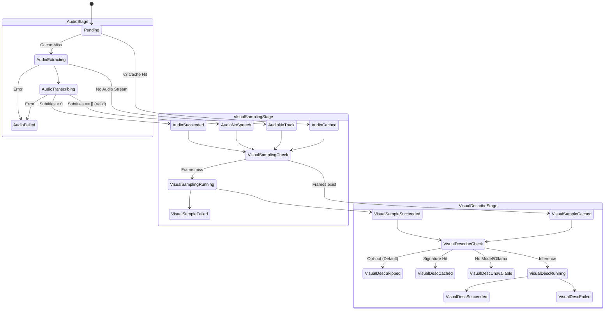

# ChunDVC — G05-05B-D Thiết Kế Kiến Trúc: Quét Nguồn Hợp Nhất Thoại và Hình Ảnh (Unified Source Analysis)

- **Mã tài liệu:** `docs/architecture/05B-unified-source-analysis-design.md`
- **Giai đoạn lộ trình:** Gate G05 — Source Inventory, Speech-to-Text, Visual Understanding & Unified Cache Orchestration
- **Mã nhiệm vụ:** `G05-05B-D`
- **Cấp độ Worker:** `HIGH`
- **Phạm vi:** `DESIGN ONLY` — Không sửa code production/tests, không chạy pytest/app/Resolve/model/download/GPU/media scan.
- **Tài liệu tham chiếu:**
  - `docs/architecture/05A-gate-acceptance.md` (Nghiệm thu cache audio schema v3, full SHA256 verified)
  - `docs/architecture/05A-audio-cache-identity-design.md` (Thiết kế cache audio schema v3)
  - `docs/architecture/05-source-analysis-cache-design.md` (Khảo sát G05 ban đầu)
  - `docs/architecture/ROADMAP.md` (Lộ trình chuẩn hóa kiến trúc ChunDVC)

---

## 1. CALLGRAPH HIỆN TRẠNG & CALLGRAPH ĐỀ XUẤT (CODE_VERIFIED vs PROPOSED)

### 1.1 Hiện trạng đường gọi mã nguồn (CODE_VERIFIED)

Hiện tại, việc phân tích footage bị phân mảnh thành ba nhánh độc lập và có sự xâm lấn nghiêm trọng giữa quét nguồn với tạo timeline:

```text
[HIỆN TRẠNG 1: QUÉT THƯ MỤC & PROBE METADATA]
SourcePage.add_paths(paths) [source_page.py:916]
  └── SourceScanWorker(QThread) [source_page.py:273]
        └── _scan() [source_page.py:297]
              └── probe_video_file(fpath, whisper_model, whisper_lang) [source_page.py:169]
                    ├── Lấy stat: mtime_ns, file_size_bytes
                    ├── Đọc OpenCV metadata (duration, fps, resolution) [source_page.py:193-224]
                    └── ScanCacheManager().get_cached_scan(verify_full=False) [source_page.py:248]
                          └── Gán has_cache: bool (CHỈ KIỂM TRA AUDIO CANDIDATE, BỎ QUA VISUAL HOÀN TOÀN!)

[HIỆN TRẠNG 2: NÚT QUÉT THÔ WHISPER GÂY XÂM LẤN PIPELINE]
SourcePage.btn_scan ("⚡ Quét thô (Whisper)") [source_page.py:728]
  └── phát signal rough_scan_requested [source_page.py:616]
        └── director_window.py:310 (_on_start_rough_scan) [director_window.py:326]
              └── director_controller.start_pipeline(phase=1) [director_controller.py:121]
                    └── PipelineWorker(phase=1) [auto_window.py:172, 297]
                          ├── DryRunValidator.validate_media_files() [auto_window.py:312]
                          ├── Khởi tạo ResolveAutomation() [auto_window.py:457] (XÂM LẤN RESOLVE!)
                          ├── Khởi tạo AudioCutConfig, AIDirector, VisionReframer [auto_window.py:463-485]
                          ├── Tạo thư mục _TIMELINE_IMPORT trong folder người dùng [auto_window.py:514-515] (XÂM LẤN DISK!)
                          ├── Đăng ký GlobalAssetPool cho project folder [auto_window.py:518]
                          ├── Vòng lặp STT từng clip:
                          │     ├── compute_full_file_sha256() + get_cached_scan(verify_full=True) [auto_window.py:568]
                          │     ├── AudioExtractor.extract_audio() -> temp_wav [auto_window.py:613]
                          │     ├── FasterWhisper.transcribe() [auto_window.py:644]
                          │     └── ScanCacheManager.save_scan_result() [auto_window.py:860]
                          └── ĐIỂM NGUY HIỂM: Phân tích AIDirector ở cuối Phase 1 [auto_window.py:893-921]
                                └── Nếu không có đoạn cắt (not has_cut_proposals):
                                      ├── In log: "Toàn bộ phân đoạn đạt chuẩn... Tự động chuyển tiếp Phase 2..."
                                      ├── Gán self.phase = 2 [auto_window.py:916]
                                      ├── Gọi resolve_auto.ensure_resolve_running() [auto_window.py:919] (ÉP CHẠY RESOLVE!)
                                      └── Nhảy thẳng vào Giai đoạn 2: ÁP DỤNG CẮT & TẠO TIMELINE RESOLVE!

[HIỆN TRẠNG 3: QUÉT THỊ GIÁC VÀ MÔ TẢ RỜI RẠC TRÊN SOURCEPAGE]
SourcePage:
  ├── VisualScanWorker(QThread) [source_page.py:362]
  │     └── index = VisualIndex(); index.scan(path) [source_page.py:388] -> Chỉ lấy frame mẫu tổng quan
  └── VisualDescribeWorker(QThread) [source_page.py:401]
        └── describe_with_ollama(path, model, endpoint) [source_page.py:433] -> Gọi Ollama local
```

**Nhược điểm cốt tử của hiện trạng:**
1. Người dùng bấm "Quét thô (Whisper)" ở Trang Nguồn chỉ muốn chuẩn bị dữ liệu bóc thoại, nhưng `PipelineWorker` bị kéo theo, ép kết nối Resolve, tạo thư mục `_TIMELINE_IMPORT` tại ổ đĩa nguồn, và nếu clip không có khoảng lặng/cắt thì tự động nhảy sang Phase 2 sinh timeline!
2. Quét thoại và quét thị giác hoàn toàn tách rời: `SourceScanWorker` chỉ kiểm tra audio candidate; `VisualScanWorker` và `VisualDescribeWorker` không chạy cùng, người dùng phải bấm nhiều nơi hoặc không biết hình ảnh đã có mẫu chưa.
3. Nếu người dùng hủy ở bước quét thô, toàn bộ tiến trình pipeline bị ảnh hưởng, trạng thái không được đồng bộ rõ ràng cho từng clip.

---

### 1.2 Callgraph đề xuất: Quét nguồn hợp nhất (PROPOSED)

```text
[UI] User trên SourcePage: Danh sách clip nguồn đã nạp (inventory)
  │
  ├── Tùy chọn trên giao diện:
  │     ├── [x] Quét thoại & Khoảng lặng (Whisper STT) [Mặc định: BẬT]
  │     ├── [x] Lấy mẫu khung hình thị giác (Visual Keyframe Sampling) [Mặc định: BẬT]
  │     └── [ ] Phân tích thị giác bằng AI (Ollama Local Vision) [Mặc định: TẮT, Opt-in]
  │           └── Combobox chọn model Ollama có capability "vision" (nếu đã cài)
  │
  └── Bấm nút: [⚡ Phân tích nguồn (Thoại & Khung hình)] (SourceAnalysisAction)
        │
        └── SourcePage._on_start_unified_source_analysis()
              └── Khởi tạo Snapshot Config:
                    ├── whisper_model: str, whisper_lang: str
                    ├── run_audio: bool = True
                    ├── run_visual_sampling: bool = True
                    ├── run_visual_describe: bool (theo checkbox)
                    ├── vision_model: Optional[str]
                    └── vision_endpoint: str
              │
              └── UnifiedSourceScanWorker(QThread) (HOÀN TOÀN SOURCE-ONLY!)
                    │ (KHÔNG Resolve, KHÔNG AIDirector timeline, KHÔNG _TIMELINE_IMPORT)
                    │
                    └── Worker Thread: UnifiedSourceScanWorker.run()
                          │
                          ├── [STAGE 0: PREFLIGHT & LOCAL IDENTITY]
                          │     ├── Lặp qua từng clip trong danh sách snapshot
                          │     ├── compute_full_file_sha256() -> (digest_hex, platform_evidence)
                          │     └── Kiểm tra nhanh cache hit:
                          │           ├── Audio v3: ScanCacheManager.get_cached_scan(verify_full=True)
                          │           ├── Visual Sampling: VisualIndex.load() + kiểm tra contact_sheet/samples
                          │           └── Visual Describe: VisualIndex.load() + kiểm tra analysis signature
                          │
                          ├── [STAGE 1: AUDIO ANALYSIS (STT & SILENCE)]
                          │     ├── Nếu có clip cần Whisper mới:
                          │     │     ├── Nạp ResolveTranscriber(model_size) (Lazy Load)
                          │     │     └── Lặp qua clip chưa có audio cache:
                          │     │           ├── Trích xuất temp_wav mono 16kHz vào system temp
                          │     │           ├── transcriber.transcribe() có progress & cancel check
                          │     │           ├── ScanCacheManager.save_scan_result() (Atomic commit)
                          │     │           └── Xóa temp_wav ngay lập tức
                          │     │     └── Giải phóng transcriber.unload_model()
                          │     └── Phát signal: clip_audio_completed(clip_path, status, counters)
                          │
                          ├── [STAGE 2: VISUAL SAMPLING (PTS-ACCURATE FRAMES)]
                          │     ├── Lặp qua từng clip:
                          │     │     ├── Nếu VisualIndex.load() đã có frames hợp lệ -> Đánh dấu CACHED
                          │     │     └── Nếu chưa:
                          │     │           ├── VisualIndex.prepare_windows() hoặc VideoSampler.sample()
                          │     │           ├── Trích xuất frame vào ~/.resolveflow_cache/visual/frames/
                          │     │           ├── Tạo contact_sheet.jpg
                          │     │           └── VisualIndex._write() (Atomic commit)
                          │     └── Phát signal: clip_visual_sampled(clip_path, status, counters)
                          │
                          ├── [STAGE 3: OPTIONAL LOCAL VISION DESCRIPTION (OPT-IN)]
                          │     ├── Nếu user chọn opt-in VÀ endpoint Ollama local khả dụng:
                          │     │     ├── local_model_info(vision_model, endpoint)
                          │     │     └── Lặp qua từng clip:
                          │     │           ├── Nếu đã có signature khớp -> Đánh dấu CACHED
                          │     │           └── Nếu chưa:
                          │     │                 ├── describe_with_ollama(window_sec=8, frames=4)
                          │     │                 └── VisualIndex._write() (Ghi nhận evidence)
                          │     └── Nếu không opt-in: Đánh dấu SKIPPED
                          │
                          └── [HOÀN TẤT & TỔNG HỢP COUNTERS]
                                └── Phát finished(job_id, summary_stats)
                                      └── SourcePage cập nhật UI: Chip trạng thái từng hàng, tổng hợp cache
```

---

## 2. KIẾN TRÚC SOURCE-ONLY WORKER / SERVICE

### 2.1 Nguyên tắc cách ly (Strict Isolation)
1. **Không phụ thuộc DaVinci Resolve:** Module phân tích nguồn tuyệt đối không import `ResolveAutomation`, không gọi API Resolve, không kiểm tra tiến trình Resolve đang chạy hay tắt. Phân tích nguồn là thao tác chuẩn bị dữ liệu ngoại tuyến (offline data preparation).
2. **Không đột biến đĩa của người dùng:** Tuyệt đối không tạo thư mục `_TIMELINE_IMPORT`, không ghi file XML, EDL, hay file tạm vào thư mục footage của người dùng.
3. **Không chạy AI Director kịch bản dựng:** Việc phân tích ý nghĩa kịch bản (AI Director proposals, pacing, hook detection, remove bad takes) thuộc Bước 2 (Style/Review), không được thực thi trong khâu quét nguồn.
4. **Tách đường cắt tối thiểu (Minimal Seam):** Tái dùng các helper chức năng lõi đã kiểm chứng, không sao chép lại hàng nghìn dòng của `PipelineWorker`:
   - `src/core/cache_manager.py`: `ScanCacheManager`, `compute_full_file_sha256`, `validate_file_identity`.
   - `src/core/audio.py`: `AudioExtractor.extract_audio`, `AudioExtractor.get_audio_duration`.
   - `src/core/autocut.py`: `SilenceDetector.detect_silence_from_wav`, `get_media_metadata`.
   - `src/services/autocut_service.py`: `ResolveTranscriber` (model wrapper cho faster-whisper).
   - `src/core/visual_index.py`: `VisualIndex`, `validate_segment`.
   - `src/core/visual_describer.py`: `describe_with_ollama`, `local_model_info`.

### 2.2 Đề xuất thành phần: `UnifiedSourceScanWorker`
Worker kế thừa `QThread` (đặt tại `src/ui/director/workers/unified_source_scan_worker.py` hoặc bên cạnh `SourcePage`), nhận snapshot cấu hình đóng băng khi bắt đầu:

```python
@dataclass(frozen=True)
class SourceAnalysisConfig:
    job_id: str
    video_paths: Tuple[str, ...]
    whisper_model: str
    whisper_language: str
    enable_audio: bool = True
    enable_visual_sampling: bool = True
    enable_visual_description: bool = False
    vision_model: Optional[str] = None
    vision_endpoint: str = "http://127.0.0.1:11434"
    window_sec: float = 8.0
    frames_per_window: int = 4
    max_windows: int = 24
```

Signals phát ra cho UI:
- `job_started(str)`: Bắt đầu job với ID.
- `clip_stage_progress(str, str, str, int, int)`: `(job_id, clip_path, stage_name, current_step, total_steps)`.
- `clip_status_updated(str, str, dict)`: `(job_id, clip_path, stage_results_dict)`.
- `counters_updated(str, dict)`: `(job_id, summary_counters)`.
- `job_finished(str, bool, str, dict)`: `(job_id, success, message, final_counters)`.
- `log_message(str, str)`: `(job_id, text_log)`.

---

## 3. THIẾT KẾ GIAO DIỆN & ĐIỀU PHỐI HÀNH ĐỘNG DUY NHẤT

### 3.1 Gom cụm giao diện trên `SourcePage`
Hiện tại trên `SourcePage`:
- Nút `btn_scan`: "⚡ Quét thô (Whisper)" nằm ở header danh sách clip.
- Các nút visual sampling / describe nằm rải rác hoặc ẩn trong menu.

Thiết kế mới gom thành một khu vực điều khiển phân tích rõ ràng:
1. **Nút bấm chính (Single Action Button):**
   - Nhãn mặc định: `[⚡ Phân tích nguồn (Thoại & Khung hình)]`
   - Khi có cache một phần: `[⚡ Phân tích nguồn (N/M clip chưa đủ dữ liệu)]`
   - Khi toàn bộ clip đã có đủ cache audio & visual sampling: `[✓ Đã có cache toàn bộ (Bấm để quét lại)]`
2. **Khu vực Tùy chọn Thị giác (Visual Option Panel):**
   - Checkbox: `[ ] Phân tích nội dung hình ảnh bằng AI (Ollama Local Vision)` (Mặc định: Unchecked).
   - Tooltip giải thích: *"Sử dụng mô hình AI thị giác chạy cục bộ trên máy để nhận diện hành động và đối tượng trong từng khung hình. Yêu cầu cài đặt Ollama và model hỗ trợ Vision."*
   - Combobox lựa chọn model: Tự động liệt kê các model local có capability `vision` thông qua `local_model_info` (nếu có Ollama). Nếu không có Ollama đang chạy, combobox hiển thị *"Chưa phát hiện Ollama Vision local"* và bị disable, không cho phép chọn.
3. **Chính sách không tự động tải model (Zero Auto-Download Policy):**
   - Tuyệt đối không tự động kích hoạt `ollama pull` hoặc tải qua mạng.
   - Nếu user bật opt-in nhưng model chưa có: Báo cảnh báo rõ trên UI, dừng stage thị giác AI và giữ nguyên kết quả audio + sampling đã làm xong.
4. **Hỗ trợ CPU & GPU:**
   - Nếu hệ thống không có GPU (NVIDIA CUDA), Whisper và Ollama vẫn được phép chạy trên CPU nếu thư viện hỗ trợ.
   - Không được coi việc thiếu GPU là "không khả dụng" (unavailable); chỉ hiển thị nhãn `[CPU mode - Tốc độ có thể chậm hơn]`.

---

## 4. TÍNH ĐỘC LẬP TUYỆT ĐỐI CỦA CACHE TỪNG GIAI ĐOẠN

Ba giai đoạn phân tích có vòng đời, chi phí tính toán và định danh hoàn toàn độc lập:

| Giai đoạn | Cơ chế định danh (Identity) | Vị trí lưu trữ | Định dạng | Tái dùng khi nào |
|---|---|---|---|---|
| **Audio STT** | Full-content SHA256 (64 hex) + platform evidence + model + lang | `~/.resolveflow_cache/v3_{sha256}_{model}_{lang}.json` | Schema v3 JSON | File giữ nguyên byte SHA256 và model/lang không đổi. |
| **Visual Sampling** | File fingerprint `(st_size, st_mtime_ns)` + sampling config | `~/.resolveflow_cache/visual/{identity}.json` + `frames/overview-*/` | Visual Schema v3 JSON + JPEG | Size/mtime không đổi, sampling interval và max_samples không đổi. |
| **Visual Description** | Model digest + sampling config + prompt version + refinement policy | Nằm trong trường `analysis` của Visual JSON | Schema v3 `descriptions` + `analysis` metadata | Khớp hoàn toàn signature mô tả, model digest và prompt. |

### Các quy tắc cách ly cache bắt buộc:
1. **Audio Cache Hit $\implies$ Không chạy lại Whisper:** Dù visual sampling bị thiếu, bị lỗi hoặc người dùng chọn model thị giác mới, tuyệt đối không trích xuất WAV hay gọi lại Whisper nếu audio cache v3 đã tồn tại.
2. **Visual Sampling Hit $\implies$ Không trích xuất lại ảnh:** Nếu thư mục `frames/overview-*/` và `contact_sheet.jpg` còn nguyên vẹn và khớp fingerprint, không giải mã PyAV lại.
3. **Đổi Vision Model chỉ chạy lại Stage 3:** Người dùng đổi từ model `llava:7b` sang `minicpm-v:latest` chỉ xóa/ghi đè trường `analysis` và `descriptions` tương ứng; không đụng chạm đến Audio Cache hay Visual Frames.
4. **Bảo toàn chú giải thủ công của người dùng (User Annotations):**
   - Trong `VisualIndex`: Các phân đoạn có `origin == "user"` được tách riêng, không bao giờ bị ghi đè bởi model mới (`origin == "local_model:..."`).
5. **Đổi tên/Di chuyển file (File Rename/Move):**
   - Audio v3 dựa trên full SHA256 nên tự nhiên miễn nhiễm với việc đổi tên/di chuyển file.
   - Visual Index hiện tại dùng `path.resolve()` kết hợp `fingerprint`. Tính năng hỗ trợ rename/move cho Visual Index được ghi nhận là **DEFERRED** (hoãn lại cho slice sau), không bypass kiểm tra fingerprint hiện tại.

---

## 5. MÁY TRẠNG THÁI (STATE MACHINE) & BỘ ĐẾM BẰNG CHỨNG (COUNTERS)

### 5.1 Trạng thái cấp Job (Job State)
- `PENDING`: Đang chờ tài nguyên hoặc chuẩn bị preflight.
- `RUNNING`: Đang thực thi phân tích.
- `SUCCEEDED`: Toàn bộ các clip và giai đoạn được chọn đã hoàn thành (kể cả khi một số clip silent/không thoại).
- `FAILED`: Gặp lỗi nghiêm trọng không thể tiếp tục (lỗi IO toàn cục, hết ổ đĩa, v.v.).
- `CANCELLED`: Người dùng bấm dừng; các kết quả trung gian đã ghi đĩa được bảo toàn.

### 5.2 Trạng thái từng giai đoạn của từng Clip (Per-Stage Clip Status)



**Bảng mã trạng thái chuẩn hóa:**
- **Audio:** `pending`, `cached`, `extracting`, `transcribing`, `succeeded`, `no_speech` (hợp lệ), `no_audio_track`, `failed`, `cancelled`.
  - *Lưu ý quan trọng:* `[]` (danh sách câu thoại rỗng) là một kết quả thành công hợp lệ (`no_speech`), phân biệt rạch ròi với `no_audio_track` (file video không chứa stream audio) và `failed` (lỗi giải mã/transcriber crash).
- **Visual Sampling:** `pending`, `cached`, `sampling`, `succeeded`, `failed`, `cancelled`.
- **Visual Description:** `skipped` (người dùng không chọn), `pending`, `cached`, `describing`, `succeeded`, `unavailable` (thiếu model/endpoint), `failed`, `cancelled`.

### 5.3 Bộ đếm bằng chứng trung thực (Evidence Counters)
Không bao giờ dùng boolean giả tạo để báo cáo tiến độ. Mọi thông số được đếm bằng số nguyên chính xác:
```python
{
    "total_clips": int,             # Tổng số clip trong danh sách quét
    "audio": {
        "cached": int,              # Số clip hit v3 cache
        "new": int,                 # Số clip transcribe thành công mới
        "no_speech": int,           # Số clip hoàn thành nhưng không có thoại ([])
        "no_audio_track": int,      # Số clip không có luồng âm thanh
        "failed": int               # Số clip lỗi ở khâu audio
    },
    "visual_sampling": {
        "cached": int,              # Số clip đã có frame mẫu hợp lệ
        "new": int,                 # Số clip vừa lấy mẫu frame thành công
        "failed": int               # Số clip lỗi lấy mẫu (PyAV error, corrupted video)
    },
    "visual_description": {
        "skipped": int,             # Số clip bỏ qua (do user opt-out)
        "cached": int,              # Số clip khớp signature mô tả cũ
        "new": int,                 # Số clip được mô tả thành công mới
        "unavailable": int,         # Số clip không thể mô tả do thiếu model/service
        "failed": int               # Số clip lỗi inference/timeout
    }
}
```
*Ràng buộc:* Nếu `total_clips == 0`, worker từ chối chạy ngay tại preflight, không bao giờ phát `SUCCEEDED` giả tạo.

---

## 6. SỞ HỮU TIẾN TRÌNH (JOB OWNERSHIP) & CƠ CHẾ HỦY AN TOÀN

1. **Request / Job ID:**
   - Mỗi lần bấm "Phân tích nguồn", sinh một `job_id = uuid.uuid4().hex[:8]`.
   - Mọi event, log và callback đều mang theo `job_id`.
2. **Snapshot Cấu hình (Immutability):**
   - Toàn bộ tham số (`whisper_model`, `whisper_lang`, `enable_visual_description`, v.v.) được đóng băng vào `SourceAnalysisConfig` tại thời điểm bấm nút. Việc thay đổi combobox trên UI sau đó không ảnh hưởng đến job đang chạy.
3. **Phát hiện Nguồn Đổi giữa chừng (Fail-Closed on Mutated Source):**
   - Tại đầu mỗi stage của từng clip, kiểm tra lại `validate_file_identity(video_path, prov)`.
   - Nếu phát hiện file bị ghi đè/thay đổi kích thước: Dừng xử lý clip đó, đánh dấu `failed` với lý do `source_mutated_during_analysis`, không ghi cache bẩn.
4. **Hủy bỏ hợp tác (Cooperative Cancellation - Tuyệt đối không dùng `QThread.terminate`):**
   - `QThread.terminate()` bị cấm hoàn toàn vì gây rò rỉ file descriptor, giữ lock bộ nhớ đệm, corrupt tệp JSON đang ghi hoặc treo luồng giải mã PyAV/Cuda.
   - Cơ chế hủy kiểm tra cờ `self._is_cancelled` tại:
     * Trước và sau khi tính SHA256 file.
     * Trước khi trích xuất WAV.
     * Trong callback `is_cancelled_callback` của Faster-Whisper.
     * Trước và sau mỗi khung hình được decode trong `VideoSampler.sample()`.
     * Trước mỗi cửa sổ inference trong `describe_with_ollama()`.
5. **Bảo toàn Kết quả khi Hủy (Preserve Completed Work):**
   - Các clip hoặc stage đã hoàn tất và ghi đĩa trước thời điểm hủy được giữ nguyên vẹn 100%. Lần chạy tiếp theo sẽ hit cache ngay tại các điểm này.
6. **Bảo vệ Late Callbacks:**
   - Trên UI `SourcePage`: Nếu nhận được signal từ một `job_id` khác với `self._current_active_job_id` (do job cũ kết thúc trễ sau khi đã bị hủy), UI lập tức bỏ qua (discard), không cập nhật đè lên trạng thái mới.
7. **Hành vi Đóng / Ẩn Cửa sổ Director:**
   - Khi đóng cửa sổ, gọi `worker.cancel()`, hiển thị thông báo chờ luồng kết thúc an toàn (với timeout ngắn) trước khi hủy widget.

---

## 7. PHÂN TÁCH CÁC TẦNG LƯU TRỮ (STORAGE TIER SEPARATION)

| Tầng lưu trữ | Đường dẫn | Quyền hạn (Permissions) | Trách nhiệm dọn dẹp |
|---|---|---|---|
| **Source Footage** | Đường dẫn video gốc của người dùng | **READ-ONLY** tuyệt đối | Không bao giờ tạo file hay thư mục tại đây. |
| **Audio Tạm** | `tempfile.gettempdir() / "ChunDVC_Audio"` | Đọc / Ghi tạm thời | Worker tự xóa file `.wav` ngay sau khi transcribe xong từng clip, hoặc dọn toàn bộ trong khối `finally` của job. |
| **Metadata & Frames Cache** | `~/.resolveflow_cache/` (audio) và `~/.resolveflow_cache/visual/` | Ghi cache nguyên tử (Atomic replace) | Người dùng quản lý hoặc dọn dẹp qua công cụ Cache Manager; worker không tự xóa cache cũ của user. |
| **StorageRoot (Asset Library)** | Thư mục kho tài nguyên đa tầng | Độc lập hoàn toàn | Quá trình quét nguồn không truy cập, không quét lại kho asset. |
| **Model Store** | `~/.cache/huggingface/` hoặc `~/.ollama/models` | Read-only lúc chạy | Chỉ đọc model đã có sẵn trên máy; không tải model mới. |

---

## 8. TÍCH HỢP CHO CÁC KHÂU TIẾP THEO (DOWNSTREAM CONSUMERS)

Dữ liệu thu được từ khâu quét nguồn hợp nhất phục vụ trực tiếp cho các bước tiếp theo trong quy trình rough-cut:

```text
[Dữ liệu quét nguồn hợp nhất]
  ├── Audio v3 Cache: raw_subtitles, silence_intervals, clip_dur, audio_energy_db
  └── Visual v3 Cache: contact_sheet_path, visual_segments (objects, actions, evidence)
        │
        ├── [CONSUMER 1: REVIEW PAGE (BƯỚC 3)]
        │     ├── Nạp danh sách câu thoại từ Audio v3 Cache (0ms re-transcribe)
        │     ├── Hiển thị bảng ảnh contact sheet cho từng clip
        │     └── Cho phép xem các đoạn thoại kèm nhãn hành động hình ảnh
        │
        ├── [CONSUMER 2: AI DIRECTOR & EDIT PLAN (GATE G06)]
        │     ├── Phân biệt rạch ròi: Lời thoại (Speech) vs Quan sát hình ảnh (Visual Observation)
        │     ├── Phân đoạn không có thoại ([]): Sử dụng visual_segments để nhận diện B-roll có cảnh quay cụ thể
        │     └── Tạo edit-plan JSON có căn cứ xác minh (grounded evidence)
        │
        └── [CONSUMER 3: BUILD TIMELINE (GATE G07)]
              ├── Tái dùng 100% dữ liệu đã cache
              └── Chỉ thực hiện các thao tác trên DaVinci Resolve (import media, apply cut, arrange timeline)
```

**Provenance Guard phòng chống Stale State:**
Trước khi Review Page hoặc Build Pipeline nạp dữ liệu từ in-memory state, một hàm guard kiểm tra nhanh `mtime_ns` và `file_size` của footage. Nếu file đã bị sửa đổi sau thời điểm quét nguồn, hệ thống cảnh báo và yêu cầu quét lại thay vì sử dụng dữ liệu cũ.

---

## 9. LÁT CẮT TRIỂN KHAI ĐẦU TIÊN (SINGLE FIRST IMPLEMENTATION SLICE)

Để đảm bảo nguyên tắc bước đi nhỏ, kiểm chứng được và không làm vỡ các luồng đang chạy, lát cắt triển khai đầu tiên được chốt duy nhất như sau:

### 9.1 Phạm vi lát cắt: `G05-05B-I1 — Worker nguồn độc lập, offline model và tương thích cache STT`

Theo quyết định ràng buộc từ Codex Tech Lead (`05B-codex-decisions.md`), lát cắt I1 tập trung hoàn toàn vào tầng backend và khả năng tương thích của cache để đóng kín các rủi ro trước khi nối UI ở I2:

**Số lượng module liên quan (Đúng 3 modules sản xuất):**
1. **`src/ui/director/workers/source_analysis_worker.py` (Mới):**
   - Triển khai `SourceAnalysisConfig` bất biến và `SourceAnalysisWorker` kế thừa `QThread`.
   - Điều phối tuần tự: Preflight check $\to$ Audio STT (tái dùng v3 cache) $\to$ Visual Sampling (tái dùng `VisualIndex.scan`).
   - Tách biệt 100% khỏi Resolve, không import `PipelineWorker`, không tạo `_TIMELINE_IMPORT`.
   - Sở hữu thư mục temp độc quyền `mkdtemp`, tự động dọn dẹp sạch sẽ trong `finally`.
2. **`src/core/transcriber.py`:**
   - Bổ sung tham số `local_files_only: bool = False` cho `load_model`, lan truyền vào cả khởi tạo `WhisperModel` chính và CPU fallback.
   - Worker mới luôn đặt `local_files_only=True` để ngăn chặn hoàn toàn việc tự ý tải model qua mạng.
3. **`src/ui/auto/auto_window.py` (`PipelineWorker` cache consumption):**
   - Khi cache v3 là STT-only (có transcript nhưng thiếu silence/cut data): tái sử dụng transcript (0 Whisper transcribe) nhưng vẫn kích hoạt `SilenceDetector` tính khoảng lặng khi `run_cut=True`.
   - Không mặc định fullclip giả khi thiếu dữ liệu cut; không chạy detector khi `run_cut=False`.

---

## 10. THỨ TỰ BACKLOG TIẾP THEO & ĐIỀU KIỆN NGHIỆM THU GATE G05

1. **`G05-05B-I1 & I1-R1` (Backend Core & Lifecycle Hardening):** Triển khai `SourceAnalysisWorker` với per-clip state model, exactly 1 terminal emission, try/except/finally temp ownership, offline loading (`local_files_only=True`), và `auto_window.py` STT-only cache consumption. (Đã hoàn thành, 113/113 tests PASS).
2. **`G05-05B-I2` (UI Wiring & Dispatching Seam Closure):** Nối nút phân tích trên `SourcePage` và định tuyến lại nút `ReviewPage`, khóa active job, chuyển trạng thái chip trực quan, cắt bỏ hoàn toàn việc gọi `start_pipeline(phase=1)`. (Đã hoàn thành, 85/85 finite tests PASS).
3. **`G05-05B-I3` (Local Vision Description):** Tích hợp tùy chọn opt-in Visual Description với Ollama local, graceful degradation khi thiếu model/endpoint.
4. **`G05-05B-R` (Nghiệm thu toàn bộ Gate G05):** Thẩm định end-to-end chuỗi phân tích nguồn và cache dùng chung.

---

## 11. GHI NHẬN TRIỂN KHAI G05-05B-I2 & I2-R1 (UI WIRING, OWNERSHIP & SEAM CLOSURE)

- **Các module sửa đổi:**
  1. `src/ui/director/pages/source_page.py`:
     - Chuyển `btn_scan` thành nút toggle phân tích / hủy: `"⚡ Phân tích nguồn (Thoại & Khung hình)"` $\leftrightarrow$ `"✕ Hủy phân tích"`.
     - Thêm phương thức public `start_source_analysis()` với snapshot cấu hình bất biến (`SourceAnalysisConfig`), từ chối khi đang có tác vụ inventory/visual/describe/shutdown chạy ngầm.
     - Đăng ký và quản lý worker theo closure identity gắn chặt token và worker instance, gọi `deleteLater()` sau khi thread dừng hẳn.
     - Khóa controls an toàn, bảo đảm Job A kết thúc muộn không bao giờ mutate hay unlock Job B đang active.
     - Invalidate toàn bộ trạng thái runtime verified về candidate khi người dùng thay đổi model, language, thêm/xóa footage, hoặc recheck cache.
     - Tách bạch rõ rệt giữa logical terminal (`finished_signal`) và physical stopped (`QThread.finished`).
     - Cập nhật huy hiệu `lbl_cache` trung thực: `[]` ghi rõ `"⚪ Thoại: Không nhận diện được lời thoại"` (không tự suy đoán B-roll), `no_audio_track` ghi `"🔇 Không có luồng âm thanh"`, `unavailable` ghi `"⚠️ Thiếu mô hình Whisper"`, `failed` ghi `"❌ Lỗi âm thanh"`, cảnh báo `cache_saved=False` khi không lưu được cache.
     - Phát các tín hiệu: `source_analysis_busy_changed(bool)` và `source_analysis_completed(str, bool, str, dict)`.
  2. `src/ui/director/director_window.py`:
     - Cắt bỏ hoàn toàn đường dẫn `controller.start_pipeline(phase=1)` từ `page_source` và `page_review`.
     - Nút scan từ cả hai trang đều gọi `page_source.start_source_analysis()`; từ ReviewPage sẽ tự động chuyển về Bước 1 để người dùng quan sát tiến độ trực quan.
     - Tách biệt cancel routing: hủy source scan gọi `page_source.cancel_source_analysis()`, hủy pipeline gọi `controller.cancel_pipeline()`.
     - Giám sát `busy_changed`: khóa navigation (`stepper`, `btn_primary`, `btn_back`, `btn_review_scan`) khi worker đang chạy, phục hồi khi QThread dừng hẳn.
     - Đọc chính xác schema nested counters `{total_clips, audio: {...}, visual: {...}}` từ worker, hiển thị duy nhất 1 popup summary nguồn, triệt tiêu 100% popup timeline sót.
     - Chỉ refresh ReviewPage khi snapshot cấu hình của phiên hoàn tất trùng khớp 100% cấu hình và danh sách clip hiện tại.
     - Bảo vệ chống late popup khi cửa sổ đã đóng hoặc đang chờ worker thoát.
- **Test suite mới:** `tests/ui/test_source_analysis_routing.py` (9 tests: nested counters summary 2 clips, QTest mouseClick và cancel policy, logical vs physical review button lock, Job A late cleanup vs active Job B, start failure rollback, real close pending deferred close, exclusive active checks, settings mutation invalidation, real QThread execution).
- **Kết quả kiểm thử nhóm:** 85 passed in 5.12s (Exit code 0).

---

## 12. GHI NHẬN KIỂM THỬ DESKTOP UI G05-05B-I2-AUTO-UI (COMPONENT_DESKTOP_VERIFIED)

- **Trạng thái:** `COMPONENT_DESKTOP_VERIFIED` (Exit code 0).
- **Harness:** `task/desktop_verify_05b_source_analysis.py`.
- **Môi trường:** X11 server thật `DISPLAY=:1`, ffmpeg 6.1.1, PySide6 6.8, Python 3.12 trong `.venv`.
- **Session cô lập:** Cấp phát `tempfile.mkdtemp` riêng, process-only env XDG/HOME, dọn dẹp sạch sẽ trong `finally` block (`cleanup_ok == True`).
- **Ranh giới:**
  - 2 Video Fixtures tạo tự động bằng ffmpeg: Clip A (testsrc + 440Hz sine tone), Clip B (SMPTE bars, no audio).
  - Seeded cache v3 cho Clip A (`SEEDED_FIXTURE_CACHE`, `raw_subtitles=[]`).
  - Audio stream metadata probe thật cho Clip B phát hiện `no_audio_track`.
  - Guard assert: `transcriber_calls == 0`, không tải/nạp Whisper, Ollama, GPU inference hoặc DaVinci Resolve.
- **Kết quả 3 ca:**
  1. *Ca 1 (Source Button):* QTest click nạp files, QTest click scan. Controls khóa ngay lập tức, nút đổi `"✕ Hủy phân tích"`. Huy hiệu chân thực hiển thị trên hàng clip (`🟢 Thoại: Không có lời thoại`, `🔇 Không có luồng âm thanh`, `🖼️ Đã có khung hình`). Tạo 2 contact sheets khác biệt trên đĩa (`VisualIndex.scan`). Bắt modal tóm tắt duy nhất qua QTimer (0 timeline popup sót), tự động đóng và chụp ảnh.
  2. *Ca 2 (Replay / Review Scan Reuse):* Window mới trong cùng session cache. Nạp lại 2 fixtures. Bấm Review scan thật $\to$ route về SourcePage (bước 1), 0 pipeline calls. Spy trên `VideoSampler.__init__` ghi nhận 0 decode/sample mới (100% visual cache hit). Transcriber calls == 0. Chuỗi `busy_changed`: `[True, False]`.
  3. *Ca 3 (Cancel & Close Ownership):* Inject `ControlledVisualIndex` với cổng đồng bộ (CONTROLLED BOUNDARY). Worker dừng tại cổng trên real QThread. Bấm `"✕ Hủy phân tích"` qua QTest. Logical terminal giữ controls bị khóa cho tới khi physical thread dừng. Mở cổng trong `finally` block $\to$ worker cooperative cancel $\to$ physical finished $\to$ registry trống 100%, 0 thread leak ngầm, nút phục hồi.
- **Evidence:** 5 ảnh chụp giao diện và log tại `.bridge/ux-evidence/G05-05B-I2-AUTO-UI/`.

---
*Tài liệu thiết kế G05-05B-D và kết quả thẩm định Desktop UI đã cập nhật đầy đủ.*
