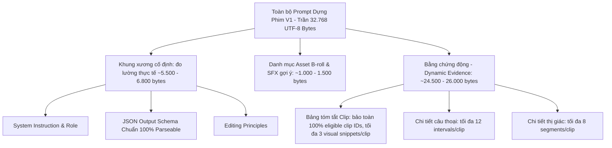
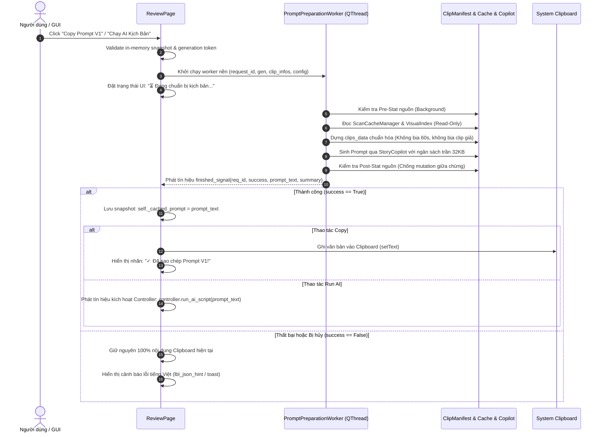

# KIẾN TRÚC & THIẾT KẾ: G05-05C2-D — CHỐT CONSUMER PROMPT VÀ THẨM QUYỀN DỮ LIỆU

- **Trạng thái:** `DESIGN_READY`
- **TASK_ID:** `G05-05C2-D`
- **Cấp độ Worker:** `HIGH`
- **Thời gian lập:** 2026-10-27
- **Tài liệu căn cứ:** `docs/architecture/05C-codex-decisions.md` (binding), `docs/architecture/05C1-R3-codex-review.md`.
- **Phạm vi:** Thiết kế kiến trúc hữu hạn cho chặng C2 (Prompt Consumer & Data Authority), không sửa đổi production/test code trong lượt này.

---

## 1. KHẢO SÁT THỰC TẾ & ĐỐI CHIẾU MÃ NGUỒN (CODE_VERIFIED vs PROPOSED)

Bảng đối chiếu chi tiết giữa hiện trạng mã nguồn thực tế và đề xuất chuẩn hóa kiến trúc cho chặng C2:

| Thành phần & Entrypoint | Vị trí file:hàm:dòng | Hiện trạng thực tế (`CODE_VERIFIED`) | Rủi ro kiến trúc & Điểm nghẽn | Đề xuất giải pháp chuẩn hóa (`PROPOSED`) |
| :--- | :--- | :--- | :--- | :--- |
| **Review Video Prompt** | `src/ui/director/pages/review_page.py`<br>`get_video_prompt:1904` | Hàm getter đồng bộ (sync `str`). Gọi `ClipManifest.get_or_create` và `build_clips_data` trực tiếp trên GUI thread.<br>Nếu `_clip_infos` rỗng, tự bịa clip giả `Source_Main_Track.mp4` (120s). | **GUI Freeze & Fake Data:**<br>1. Tính content hash (đọc 2MB/tệp) và probe `shot_time` (chạy `ffprobe`) làm đơ GUI.<br>2. Bịa clip giả 120s làm sai lệch kịch bản AI. | Chuyển việc chuẩn bị Prompt sang luồng nền (Worker hoặc async task).<br>Sync getter chỉ đọc matching snapshot đã chuẩn bị sẵn hoặc báo `explicit not ready`. Không bịa clip giả khi rỗng. |
| **Review Active Prompt** | `src/ui/director/pages/review_page.py`<br>`get_active_prompt:1963` | Ủy quyền trực tiếp sang `self.get_video_prompt()`. | Kế thừa 100% rủi ro GUI blocking của `get_video_prompt`. | Trả về prompt snapshot đã được thẩm định an toàn từ luồng nền. |
| **Review Copy Video Prompt** | `src/ui/director/pages/review_page.py`<br>`_copy_video_prompt:1967` | Gọi `get_video_prompt()` đồng bộ và ghi thẳng vào `QApplication.clipboard().setText()`. | Ghi đè clipboard vô điều kiện kể cả khi dữ liệu lỗi hoặc đang tính toán đơ UI. | Chỉ ghi clipboard khi Prompt đã chuẩn bị thành công; nếu lỗi/hủy, giữ nguyên clipboard hiện tại và cảnh báo UI tiếng Việt. |
| **Review Extract Words** | `src/ui/director/pages/review_page.py`<br>`_extract_words_from_rows:1647` | Khởi tạo `ScanCacheManager()`, gọi `sort_clips_chronologically` (gọi `ffprobe`), đọc cache Whisper trên GUI.<br>Fallback sang `DEMO_WORDS` nếu rỗng. | 1. Chạy `ffprobe` và I/O cache trên GUI thread.<br>2. Bịa `DEMO_WORDS` cho dự án thật. | Tách I/O khỏi GUI. Loại bỏ `DEMO_WORDS` cho media thật; nếu không có thoại thì trả về danh sách rỗng kèm nhãn `no_dialogue_detected`. |
| **Review Final Cut Words** | `src/ui/director/pages/review_page.py`<br>`get_final_cut_words:1719` | Gọi `sort_clips_chronologically`, `get_media_metadata(cpath)` (ffprobe) và đọc cache để map `TimelineMapper` trên GUI. | Blocking GUI nghiêm trọng khi có nhiều clip cắt tinh. | Khóa luồng V2 trong Slice đầu C2 để cô lập; dời toàn bộ mapper I/O sang background worker. |
| **Review Kinetic Prompt & Copy** | `src/ui/director/pages/review_page.py`<br>`get_kinetic_prompt:1952`<br>`_copy_kinetic_prompt:1977` | Gọi `get_final_cut_words()` đồng bộ, sinh prompt qua `generate_kinetic_prompt` và ghi clipboard. | Phụ thuộc vào `get_final_cut_words` (I/O nghẽn GUI). | Đánh dấu Route V2 pending hardening; giữ backward compatibility an toàn, không block GUI. |
| **Director Window Run AI** | `src/ui/director/director_window.py`<br>`_on_run_ai_script:781` | Gọi `prompt = self.page_review.get_active_prompt()`, sau đó gọi `self.controller.run_ai_script(prompt)`. | Gọi getter blocking trên GUI trước khi dispatch controller. Nếu prompt rỗng vẫn dispatch worker. | Kiểm tra trạng thái sẵn sàng của Prompt. Chỉ dispatch controller khi prompt đã được thẩm định đầy đủ trên nền. |
| **Clip Manifest Identity** | `src/core/clip_manifest.py`<br>`compute_content_hash:20`<br>`ClipEntry:60` | Hàm băm mẫu `sha256(size + 1MB đầu + 1MB cuối)`. | Là **Sampled Identity**, KHÔNG PHẢI full-file SHA256. | Thừa nhận đúng bản chất sampled identity; không tuyên bố đã có full SHA verification cho video. |
| **Clip Manifest Builder** | `src/core/clip_manifest.py`<br>`build_clips_data:355` | 1. Tự gán `dur = 60.0` nếu `dur <= 0`.<br>2. Mặc định `cached` là dict thì gán `no_dialogue_detected`.<br>3. Không kiểm tra post-stat nguồn. | 1. Bịa thời lượng 60s cho clip thật.<br>2. Nhận định sai trạng thái thoại (bỏ qua `completed_empty` vs `unscanned`).<br>3. Nguy cơ dùng cache cũ khi file đã bị đổi. | 1. Loại bỏ `dur = 60.0` (giữ `0.0` hoặc sentinel unknown kèm warning).<br>2. Phân loại chuẩn xác `transcribed`, `completed_empty`, `no_audio_track`, `unscanned`, `scan_error`.<br>3. Kiểm tra stat trước khi nạp. |
| **Story Copilot Generator** | `src/core/story_copilot.py`<br>`generate_copilot_prompt:177` | Ghép Markdown table (3 visual summaries) và chi tiết từng câu thoại (12 câu) + hình ảnh (8 đoạn). | Chưa có hạn mức trần kích thước tổng thể (UTF-8 byte/char budget), có thể gây nổ token LLM. | Bổ sung Global Budget (32KB / ~8K tokens), giữ khung xương JSON schema nguyên vẹn, cắt giảm dynamic evidence trung thực kèm thông báo lược bỏ. |
| **Story Copilot Assets** | `src/core/story_copilot.py`<br>`get_available_assets_summary:106` | Đọc danh mục file meme/sfx cục bộ từ thư mục `assets/`. | Danh mục demo cục bộ, chưa gắn với hệ thống Asset Hub phân tầng (G04). | Giới hạn đúng vai trò gợi ý tài nguyên demo; không tự ý mở rộng sang cơ chế matching library (thuộc G06). |

---

## 2. THẨM QUYỀN NGUỒN VÀ DỮ LIỆU CHUẨN (DATA AUTHORITY)

### A. Phân định rõ ràng: Candidate Metadata (UI) vs Verified Authority (Export/Prompt)
- **Candidate Metadata (Chặng C1 đã đạt):**
  - Đóng vai trò phục vụ giao diện duyệt nhanh, phản hồi tức thì với người dùng.
  - Sử dụng lightweight stat (`st_mtime_ns`, `st_size`, `st_ino`, `st_dev`) để phát hiện file bị xóa hoặc sửa đổi giữa chừng.
  - Tuyệt đối không tính full-file hash hoặc chạy ffprobe trên GUI thread.
- **Prompt Execution Authority (Chặng C2 chốt hạ):**
  - Prompt gửi cho AI đạo diễn (Claude/ChatGPT/Ollama) quyết định trực tiếp đến các mốc thời gian cắt gọt (`start_sec`, `end_sec`) và mã clip (`clip_id`).
  - Do đó, trước khi xuất Prompt, toàn bộ siêu dữ liệu phải được **thẩm định lại trên luồng nền (Background Revalidation)** với đầy đủ thẩm quyền nguồn và bộ đệm an toàn.

### B. Thẩm quyền siêu dữ liệu Thoại (Audio Authority)
- Sử dụng API thực của `ScanCacheManager` (Schema v3) trên luồng worker.
- Khớp nối chính xác 3 yếu tố định danh: `norm_path`, `whisper_model`, `whisper_language`.
- Phân định rành mạch 5 trạng thái thoại (Speech Status):
  1. `transcribed`: Có mảng phụ đề đã làm sạch (`clean_subs > 0`).
  2. `completed_empty`: Quét thành công, xác nhận tệp hoàn toàn không có câu thoại (`raw_subtitles == []` đi kèm bằng chứng `complete`/`cached`/`new`).
  3. `no_audio_track`: Quét thành công, xác nhận tệp video không chứa luồng âm thanh nào (`no_audio_track is True`).
  4. `scan_error` / `failed`: Quá trình quét gặp lỗi ngoại lệ provider hoặc file hỏng.
  5. `unscanned`: Chưa từng có dữ liệu quét trong kho cache.
- **Nguyên tắc bất biến:**
  - Không fallback về so khớp theo tên tệp (`name-only`) nếu đường dẫn không tồn tại.
  - Tuyệt đối không sinh dữ liệu thoại giả (`DEMO_WORDS`) khi xử lý media thật của người dùng.

### C. Thẩm quyền siêu dữ liệu Thị giác (Visual Authority & Recorded Limits)
- `VisualIndex` hiện tại quản lý: `signature_data` (model, endpoint, window_sec, frames_per_window, max_windows, max_refinements), `coverage` (analyzed vs sampling), và `descriptions` (`analysis_status`, `origin`, `window_id`).
- **Thừa nhận giới hạn bắt buộc (Binding Constraint):**
  - `VisualIndex` sử dụng định danh `content_hash` theo mẫu (`sha256(size + 1MB đầu + 1MB cuối)`). Nó **KHÔNG CÓ** thẩm quyền lịch sử Full-SHA256 verified như audio.
  - Tuyệt đối không tuyên bố VisualIndex đã có full-hash verification hay ép chung digest này với full-file SHA.
- **Chính sách lệch cấu hình và kiểm định:**
  - Nếu cấu hình snapshot của yêu cầu Prompt lệch so với `signature_data` (sai model, sai endpoint, sai sampling budget): Các quan sát AI (`origin != 'user'`) bị đánh dấu `stale` kèm cảnh báo lệch cấu hình.
  - Ghi chú thủ công của người dùng (`origin == 'user'`) luôn được giữ nguyên giá trị 100%.
  - Các đoạn quan sát thị giác hợp lệ từ các job bị hủy/một phần (`partial`) vẫn được đưa vào Prompt kèm cảnh báo rõ ràng: `⚠️ Hình ảnh chỉ lấy mẫu X/Y cửa sổ; không suy đoán nội dung vùng chưa phân tích`.
  - Toàn bộ mô tả thị giác được xử lý như **dữ liệu thuần túy (Data)**, được làm sạch ký tự phân cách (tránh phá vỡ bảng Markdown/JSON), không được coi là chỉ thị điều khiển (Prompt Injection) và không tự gán điểm tin cậy (Confidence Score) giả định.

### D. Bảo toàn định danh, thứ tự và thời lượng nguồn
- **Thứ tự Manifest:** Giữ nguyên 100% thứ tự đã xác lập trong manifest (hoặc thứ tự in-memory shot_time ổn định từ C1). Không tự ý đảo thứ tự khi đưa vào Prompt.
- **Xử lý clip không thoại:** Clip im lặng (`completed_empty` hoặc `no_audio_track`) vẫn được giữ nguyên vẹn trong danh sách kịch bản với đầy đủ `clip_id`. Tuyệt đối không tự ý gán nhãn `is_broll = True` chỉ vì clip không có thoại (vai trò B-roll chỉ được xác lập khi có chỉ định nhóm rõ ràng từ người dùng).
- **Loại bỏ dữ liệu giả:**
  - Xóa bỏ hoàn toàn logic tự bịa `duration = 60.0s` trong `build_clips_data` và `120.0s / Source_Main_Track.mp4` trong `get_video_prompt`.
  - Nếu thời lượng clip chưa xác định được từ container: giữ nguyên sentinel `0.0` và ghi chú rõ ràng `duration_known = False` kèm cảnh báo trong Prompt, không làm sai lệch timecode của timeline DaVinci Resolve.

---

## 3. HẠN MỨC VÀ ĐỊNH DẠNG PROMPT (BUDGET & FORMAT)

### A. Cấu trúc Prompt phân tầng và Hạn mức UTF-8 Bytes (Global Token/Byte Budget)
Để đảm bảo Prompt hoạt động ổn định trên cả các mô hình cục bộ (Ollama 8K context) và mô hình Cloud (Claude/ChatGPT) mà không bị tràn bộ nhớ hoặc vượt hạn mức ngữ cảnh:



1. **Khung xương cố định (Prompt Skeleton - Đo lường thực tế):**
   - Bao gồm: Hướng dẫn vai trò đạo diễn, nguyên tắc biên tập nhịp điệu, yêu cầu đoạn Hook mở đầu, và **Cấu trúc JSON Schema mẫu hoàn chỉnh**.
   - Ngân sách: Đo lường thực tế chiếm từ **5.500 đến 6.800 UTF-8 bytes** tùy theo `story_intent` (không giả định 3KB ký tự).
   - **Nguyên tắc sống còn:** Tuyệt đối không bao giờ cắt xén, phân mảnh hoặc rút gọn khối Schema JSON mẫu để nhồi nhét dữ liệu. Schema phải luôn toàn vẹn 100% để LLM trả về đúng định dạng parser đọc được. Toàn bộ eligible clip IDs bắt buộc phải có mặt trong bảng danh mục.
2. **Danh mục Asset gợi ý (Assets Summary):**
   - Giới hạn danh mục Meme và SFX ở mức gợi ý nguyên vẹn cả mục (~1.000 - 1.500 bytes), phục vụ AI điền trường `asset_file`.
3. **Bằng chứng động (Dynamic Media Evidence):**
   - Hạn mức tối đa cho toàn bộ phần dữ liệu video: phần ngân sách còn lại sau khi trừ khung xương và schema (tổng toàn prompt $\le$ **32.768 UTF-8 bytes**).
   - **Chính sách trích xuất cục bộ theo từng clip (Per-Clip Budgets):**
     - Bảng tổng hợp: Tối đa 3 mô tả thị giác tiêu biểu / clip.
     - Chi tiết câu thoại: Tối đa 12 câu thoại liên tiếp / clip. Nếu vượt quá hoặc bị lược bỏ do ngân sách, hiển thị thông báo trung thực kèm thời điểm.
     - Chi tiết thị giác: Tối đa 8 cửa sổ thị giác phân bổ đều / clip. Nếu vượt quá hoặc bị lược bỏ do ngân sách, hiển thị thông báo trung thực.

### B. Xử lý khi kho media vượt quá ngân sách (Large Inventories > 30 Clips)
- Khi số lượng clip lớn khiến tổng bằng chứng động vượt ngân sách trần 32.768 bytes:
   - **Không âm thầm loại bỏ clip:** Toàn bộ clip eligible trong Manifest bắt buộc phải xuất hiện trong bảng danh mục tổng hợp với đầy đủ `clip_id` (`C01`, `C02`, ...).
   - **Cắt giảm chi tiết có kiểm soát theo bậc thang (Ladder):** Giảm đều số lượng câu thoại hiển thị và số cửa sổ thị giác phân bổ đều cho tất cả các clip (deterministic, không để clip đầu ăn hết).
   - **Chính sách lỗi khi ngân sách quá nhỏ:** Nếu `max_prompt_bytes` không đủ chứa khung xương kịch bản tối thiểu (skeleton + complete JSON schema + minimal inventory rows): ném `ValueError` tiếng Việt rõ ràng, tuyệt đối không cắt vụn JSON schema.

---

## 4. LUỒNG BẤT ĐỒNG BỘ, VÒNG ĐỜI & CLIPBOARD (ASYNC API & LIFECYCLE)

### A. Cơ chế Chuẩn bị Prompt Nền (Prompt Preparation Worker)
Thay thế toàn bộ việc gọi I/O và băm dữ liệu đồng bộ trên GUI thread bằng worker chuyên trách:



### B. Tương thích với các Synchronous Getters cũ
Để không phá vỡ giao ước với các thành phần hiện hữu và các bài kiểm thử unit test:
1. `get_video_prompt()`, `get_active_prompt()`, `get_kinetic_prompt()`:
   - Nếu `_cached_prompt` đã tồn tại và khớp với thế hệ (`generation`) cùng cấu hình hiện tại: Trả về trực tiếp chuỗi prompt này in-memory (0ms, 0 I/O).
   - Nếu chưa có hoặc đang nạp: Trả về chuỗi rỗng `""` hoặc thông báo trạng thái `explicit not ready`.
   - **Tuyệt đối cấm:** Getter tự động chạy lại `ffprobe`, `compute_content_hash`, hoặc đọc file đĩa đồng bộ để "chữa cháy".
2. Bộ điều khiển `DirectorController.run_ai_script`:
   - Kiểm tra `prompt.strip()`: Nếu rỗng hoặc chưa sẵn sàng, controller từ chối phát lệnh, thông báo lỗi rõ ràng thay vì gửi chuỗi rỗng lên Cloud API hay Ollama.

### C. An toàn Clipboard & Đóng ứng dụng (Lifecycle & Supersede Guards)
- **Chính sách Clipboard:** Chỉ được phép ghi đè nội dung Clipboard hệ thống khi tiến trình chuẩn bị nền kết thúc thành công mỹ mãn (`success is True`). Mọi tình huống người dùng bấm Cancel, worker gặp lỗi, hoặc file nguồn bị thay đổi đều **giữ nguyên nội dung Clipboard cũ**.
- **Supersede Token:** Mỗi lần người dùng thay đổi danh sách clip, đổi Style Intent hoặc đổi Model: `generation` tăng lên 1, worker cũ nhận lệnh `cancel()`, kết quả của worker cũ khi trả về bị bỏ qua trong yên lặng.
- **Close Safety:** Khi người dùng đóng cửa sổ: Đặt cờ `_review_close_pending = True`, kích hoạt cooperative cancellation và chờ worker kết thúc an toàn, dọn dẹp bộ nhớ, không sử dụng `terminate()`.

### D. Định tuyến Route V1 vs Route V2
- **Route V1 (Video Plan & Storytelling):** Là đối tượng thực thi của Slice C2. Tập trung chuẩn hóa `ClipManifest`, `build_clips_data`, và `StoryCopilot`.
- **Route V2 (Kinetic Typography):** Có sự phụ thuộc phức tạp vào `_video_plan_data` và `TimelineMapper`. Trong Slice C2, Route V2 được **khóa an toàn (isolated)**: Tách bỏ lệnh gọi `ffprobe` khỏi `_extract_words_from_rows`, giữ nguyên tính năng tạo Kinetic ngoại tuyến đơn giản từ review rows sẵn có, và dời việc tái cấu trúc sâu của V2 sang bước tiếp theo sau khi V1 đã nghiệm thu.

---

## 5. BẢNG QUYẾT ĐỊNH TRẠNG THÁI & THẨM QUYỀN (STATE / AUTHORITY DECISION TABLE)

Bảng quyết định chuẩn hóa hành vi hệ thống ứng với mọi kịch bản dữ liệu nguồn và trạng thái cache:

| Kịch bản nguồn & Cache | Thẩm quyền Thoại (Audio) | Thẩm quyền Thị giác (Visual) | Trạng thái Clip trong Prompt | Phản hồi giao diện & Clipboard |
| :--- | :--- | :--- | :--- | :--- |
| **1. Có thoại đầy đủ** (`clean_subs > 0`) | `transcribed` (Verified từ Cache v3) | Đầy đủ quan sát hoặc không có | Xuất hiện đầy đủ `clip_id`, bảng tóm tắt và chi tiết từng câu thoại. | Sẵn sàng xuất Prompt V1; Copy thành công cập nhật Clipboard. |
| **2. Tệp im lặng hoàn toàn** (`raw_subs == []`) | `completed_empty` (Verified có bằng chứng quét hoàn tất) | Đầy đủ quan sát hoặc không có | Giữ nguyên `clip_id`, ghi rõ `🔇 Không phát hiện thoại`, **không tự ý gán là B-roll**. | Xuất Prompt bình thường; AI được gợi ý dùng làm cảnh thở/chuyển đoạn. |
| **3. Không có luồng âm thanh** (No audio track) | `no_audio_track` (Verified từ container) | Đầy đủ quan sát hoặc không có | Giữ nguyên `clip_id`, ghi rõ `🔇 Video không có tiếng`. | Xuất Prompt bình thường; Clipboard cập nhật thành công. |
| **4. Chỉ có dữ liệu thị giác** (Visual only) | `unscanned` hoặc `no_audio_track` | `described` (Mô tả AI) hoặc `user` (Ghi chú người dùng) | Tóm tắt thị giác được đưa vào bảng; chi tiết thoại ghi `Chưa có lời thoại`. | Xuất Prompt bình thường; AI dựa vào mô tả hình ảnh để dựng cảnh. |
| **5. Chưa quét cả 2 kênh** (No cache) | `unscanned` | `unscanned` | Giữ nguyên `clip_id`, thời lượng; ghi rõ `❔ Chưa quét phân tích`. | UI hiển thị cảnh báo `Chưa có dữ liệu phân tích đầy đủ`; Prompt vẫn xuất được nhưng cảnh báo AI thiếu dữ liệu. |
| **6. Nạp một phần** (Partial: 1 clip lỗi, 1 clip tốt) | Clip tốt: `transcribed`; Clip lỗi: `failed` | Tương ứng theo từng clip | Clip tốt có đầy đủ chi tiết; Clip lỗi ghi rõ `⚠️ Lỗi quét siêu dữ liệu`. | Terminal `partial`; UI báo `⚠ Nạp một phần`; Prompt chứa đủ inventory nhưng cảnh báo clip lỗi. |
| **7. Lệch cấu hình thị giác** (Config mismatch) | Độc lập theo Audio | `stale` (Cảnh báo lệch model/endpoint/budget) | Đưa vào Prompt kèm nhãn `⚠️ (chưa rõ / lệch cấu hình)`. Ghi chú `user` giữ nguyên. | Prompt xuất bình thường kèm ghi chú không suy diễn hành động từ vùng stale. |
| **8. Tệp bị sửa đổi hoặc mất** (`source_changed` / `missing`) | `source_changed` / `source_missing` | `source_changed` / `source_missing` | Giữ `clip_id` trong inventory, xóa sạch 0 usable transcript/visual. | Terminal `source_unavailable` nếu toàn bộ lỗi; **Clipboard giữ nguyên không đổi**; UI báo lỗi nguồn. |
| **9. Trùng tên khác thư mục** (Same basename) | Định danh độc lập theo `norm_path` và `content_hash` | Định danh độc lập theo `norm_path` và `content_hash` | Hai clip mang 2 ID phân biệt (`C01`, `C02`), thư mục chương (`chapter`) khác nhau. | Hoạt động chính xác, không ghi đè dữ liệu giữa 2 clip. |
| **10. Người dùng bấm Hủy** (Cancel / Close) | Bị ngắt an toàn tại điểm cooperative check | Bị ngắt an toàn tại điểm cooperative check | Bỏ qua kết quả đang tạo dở; ném `InterruptedError`. | Terminal `cancelled`; **Clipboard giữ nguyên 100% nội dung cũ**; UI báo `⚠ Đã dừng`. |

---

## 6. PHÂN CHIA LÁT CẮT THỰC THI (SLICES C2a & C2b)

Tuân thủ quyết định ràng buộc từ Tech Lead Codex (`docs/architecture/05C2-codex-decisions.md`), chặng C2 được phân thành 2 lát cắt rõ ràng:

### A. Slice C2a: Core Evidence Consumer & Bounded Formatter (Đúng 2 Modules)
1. **`src/core/clip_manifest.py`:**
   - Hàm `build_clips_data(..., *, verify_audio=False, visual_context=None, cancelled_fn=None)`:
     - Chuẩn hóa duration finite positive float; invalid/unknown -> `0.0` + `duration_known=False` (loại bỏ hoàn toàn fake 60s).
     - Bảo toàn thứ tự Manifest, `clip_id`, phân biệt same basename ở các thư mục khác nhau.
     - Clip im lặng (`completed_empty`) KHÔNG tự ý bị gán `is_broll=True`.
     - Phân định rõ candidate API (`verify_audio=False`) vs verified API (`get_cached_scan(..., verify_full=True)`).
     - Phân loại chuẩn 5 trạng thái thoại (`transcribed`, `completed_empty`, `no_audio_track`, `failed`, `unscanned`) và 3 cấp thẩm quyền (`candidate`, `verified`, `unavailable`).
     - Pre/post stat kiểm tra file nguồn quanh quá trình nạp. Nếu file bị xóa/sửa -> giữ clip ID trong inventory, xóa sạch 0 usable transcript/visual và gắn `source_availability`.
     - Cooperative cancellation: kiểm tra `cancelled_fn()` và ném `InterruptedError`.
     - Kiểm tra lệch signature thị giác: AI obs mismatch -> `stale`; ghi chú `origin='user'` giữ nguyên literal.
2. **`src/core/story_copilot.py`:**
   - Hàm `StoryCopilot.generate_copilot_prompt(..., *, max_prompt_bytes=None)`:
     - `max_prompt_bytes=None`: giữ nguyên tương thích không giới hạn.
     - `max_prompt_bytes > 0`: giới hạn toàn bộ prompt theo UTF-8 bytes (trần chuẩn 32.768 bytes).
     - Khung xương cố định + JSON Schema hoàn chỉnh 100% parseable + minimal inventory row của tất cả eligible IDs được dựng trước.
     - Nếu không đủ ngân sách cho khung xương tối thiểu: ném `ValueError` tiếng Việt rõ ràng, tuyệt đối không cắt vụn JSON schema.
     - Phân bổ ngân sách dynamic evidence công bằng (ladder) cho tất cả clip; thông báo lược bỏ trung thực.
     - Làm sạch ký tự phân cách độc hại (`|`, `\n`, ` ``` `) trong dữ liệu động.
3. **Bộ test kiểm thử C2a:**
   - File test mới: `tests/core/test_prompt_authority_consumption.py` (20 test cases).
   - Bộ 4 test suites: `test_prompt_authority_consumption.py`, `test_clip_manifest.py`, `test_story_copilot.py`, `test_visual_footage.py` (54 passed).

### B. Slice C2b: UI Async Preparation & Export Guard (Sẽ thực thi tiếp theo)
1. **`src/ui/director/pages/review_page.py`:**
   - Background Prompt preparation worker, tách biệt hoàn toàn I/O khỏi GUI thread.
   - Bảo vệ clipboard và export guard.
2. **`src/ui/director/director_window.py`:**
   - Kiểm tra trạng thái sẵn sàng của Prompt trước khi phát lệnh Run AI.
6. `test_clipboard_preservation_on_empty_or_failed_prompt`: Kiểm tra clipboard không bị ghi đè rác khi prompt thất bại.

---

## 7. KẾ HOẠCH ĐÓNG CHẶNG C2 CÒN LẠI VÀ RANH GIỚI HỆ THỐNG

### A. Lộ trình đóng toàn bộ C2 (Tối đa 2 bước tiếp theo)
1. **Bước 1 (Slice C2-I1 - Đã đề xuất ở Mục 6):** Hardening lõi Data Consumer (`clip_manifest.py`, `story_copilot.py`) và đóng đường I/O trên GUI trong `ReviewPage`.
2. **Bước 2 (Slice C2-I2 - Async Background Worker & Final Wire-up):**
   - Đóng gói toàn bộ quá trình chuẩn bị Prompt vào `PromptPreparationWorker` (QThread) với đầy đủ lifecycle, supersede token, và cooperative cancellation.
   - Nối dây với nút "Chạy kịch bản AI" trên `DirectorWindow` và `DirectorController`.
   - Chạy nghiệm thu liên thông giữa ReviewPage, Controller và Mock LLM Worker.

### B. Ranh giới loại trừ rõ ràng (Out of Scope for C2)
- **Không bao gồm G06 (Asset Matching & Multi-tier Library):** Không triển khai cơ chế quét kho tự động, tải đám mây, hoặc matching vector SFX/Meme.
- **Không bao gồm G07 (Resolve Timeline Execution):** Không gọi API DaVinci Resolve để tạo track, import media hay áp dụng hiệu ứng thực tế.
- **Không bao gồm G09 (Batching Engine & Long Footage):** Không hỗ trợ chia batch tự động cho các thư viện phim hàng trăm gigabyte.

---

## 8. KẾT LUẬN & ĐIỂM DỪNG

Bản thiết kế này đã giải quyết triệt để các rủi ro tồn đọng từ C1, xác lập ranh giới thẩm quyền dữ liệu rõ ràng giữa candidate metadata và verified prompt evidence, thiết lập hạn mức ngữ cảnh an toàn và đề xuất lát cắt thực thi C2-I1 tối ưu (≤ 3 modules).

Antigravity dừng tại đây theo đúng chỉ đạo: **Không tự ý viết code, không chạy test, giữ nguyên trạng thái hệ thống, duy trì mức HIGH và không tắt máy.** Chờ Tech Lead Codex xem xét và phê duyệt thiết kế.
