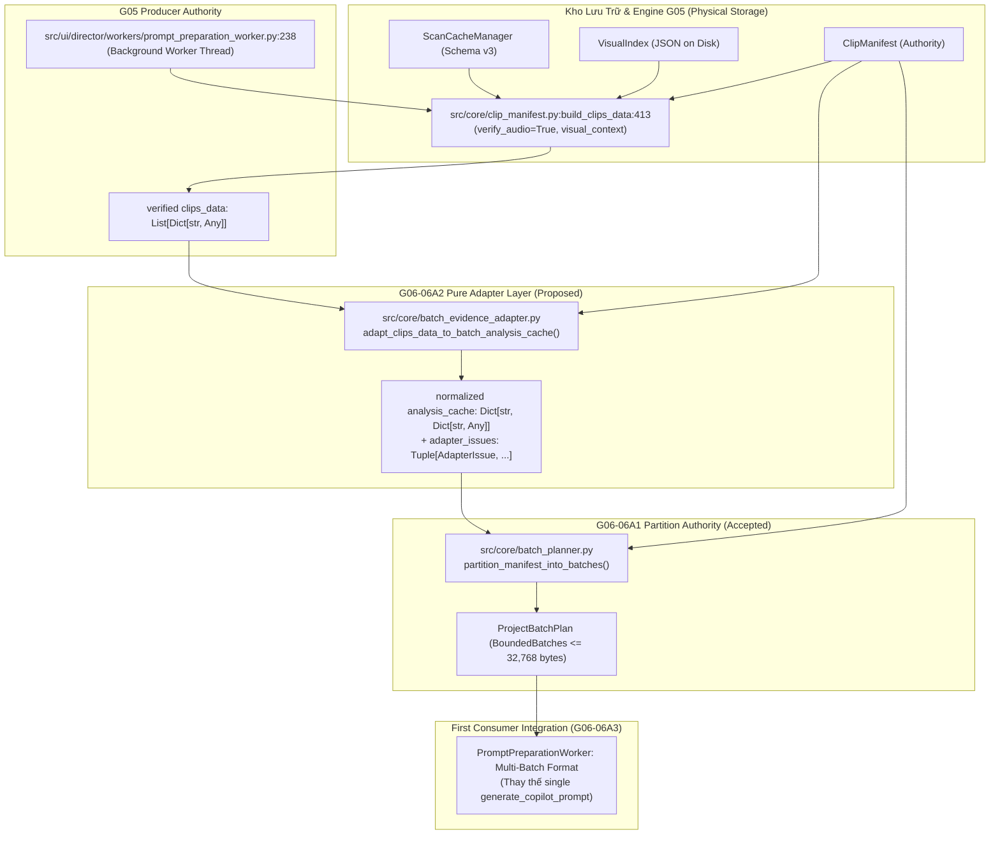

# G06-06A2-D — Thiết Kế Kiến Trúc: Adapter Chuyển Đổi Bằng Chứng G05 Sang Batch Snapshot

- **TASK_ID:** `G06-06A2-D`
- **Trạng thái:** `CODE_ACCEPTED_WITH_RECORDED_LIMITS`
- **Chế độ:** `DESIGN_ONLY` (ZERO production edits, 0 test runs, 0 inference)
- **Cấp độ Worker:** `HIGH`
- **Thời gian hoàn thành:** 2026-10-28T11:05:00+07:00
- **Tài liệu tham chiếu:** [`docs/architecture/06-planning-matching.md`](file:///media/vanntruongg/Documents/Development/Python/dự án cá nhân/ResolveFlow-Assistant/docs/architecture/06-planning-matching.md), [`docs/architecture/06A1-R2-codex-review.md`](file:///media/vanntruongg/Documents/Development/Python/dự án cá nhân/ResolveFlow-Assistant/docs/architecture/06A1-R2-codex-review.md), [`docs/architecture/06-codex-decisions.md`](file:///media/vanntruongg/Documents/Development/Python/dự án cá nhân/ResolveFlow-Assistant/docs/architecture/06-codex-decisions.md)

---

## 1. TỔNG QUAN VÀ BỐI CẢNH KIẾN TRÚC

Hợp đồng cơ sở **G06-06A1** (Pure Bounded Batch Partition Contract tại `src/core/batch_planner.py`) đã được Tech Lead Codex chính thức **nghiệm thu (CODE_ACCEPTED_WITH_RECORDED_LIMITS)** thông qua 39 bài kiểm thử đơn vị độc lập (`tests/core/test_batch_planner.py`, 0.41s, exit code 0). Hợp đồng A1 đã đóng băng:
1. `partition_manifest_into_batches(manifest, analysis_cache, config=None) -> ProjectBatchPlan`
2. `render_batch_prompt(batch: BoundedBatch) -> str`
3. `estimate_batch_prompt_bytes(batch: BoundedBatch) -> int`
4. Các frozen dataclasses: `BatchBudgetConfig`, `EvidenceWindowSummary`, `ClipBatchItem`, `BoundedBatch`, `ProjectBatchPlan`, `UnaccountedClipIssue`.

Tuy nhiên, `analysis_cache` mà A1 nhận là một **in-memory mapping chuẩn hóa (Normalized Snapshot)** theo `clip_id`. Trong khi đó, hệ thống phân tích G05 xuất bản dữ liệu qua `build_clips_data` (tại `src/core/clip_manifest.py`), tích hợp trong `PromptPreparationWorker` (tại `src/ui/director/workers/prompt_preparation_worker.py`). 

Nhiệm vụ thiết kế **G06-06A2-D** xây dựng chiếc cầu dữ liệu thuần túy (Pure Evidence Adapter) kết nối giữa cấu trúc thực tế của `build_clips_data` và đầu vào chuẩn hóa của `batch_planner.py`, đảm bảo:
- **Zero Hallucination / Zero Silent Dropping:** Không tự ý suy ra `has_audio=False` từ transcript rỗng; không bỏ rơi clip ngắn bị filter; không biến câu thoại thành quan sát thị giác.
- **Bảo Toàn Xuất Xứ (Provenance Integrity):** Phân biệt rạch ròi giữa `no_audio_track` (clip câm vật lý) với `completed_empty` (có âm thanh nhưng không có thoại); giữ nguyên ghi chú người dùng (`user notes`) kể cả khi phân tích máy bị `stale`.
- **Ranh Giới Bất Biến (Strict Immutability):** Adapter là module thuần Python stdlib (0 I/O, 0 Qt, 0 model), chuyển đổi danh sách `clips_data` thành mapping bất biến sẵn sàng nạp trực tiếp vào `partition_manifest_into_batches`.

---

## 2. KHẢO SÁT CALLGRAPH THỰC TẾ & VẾT TRUYỀN DỮ LIỆU (TRACE)

### 2.1. Callgraph Chi Tiết Từ Nguồn Phân Tích Đến Kế Hoạch Lô



### 2.2. Bảng Ranh Giới Thẩm Quyền (Authority & Reachable Route)

| Thành phần | File : Hàm : Dòng | Nhãn kiểm chứng | Thẩm quyền & Trách nhiệm thực tế |
|---|---|---|---|
| **Producer Thật** | `src/core/clip_manifest.py:build_clips_data:413` | `[CODE_VERIFIED]` | • Tra cứu cache STT v3 qua `verify_audio=True`.<br>• Tra cứu thị giác qua `visual_index.load()`.<br>• Kiểm tra pre-stat & post-stat tệp nguồn.<br>• Cách ly mô tả thị giác lỗi thời (`quarantined_visual_segments`), bảo toàn `origin="user"`.<br>• Lọc bỏ clip có thời lượng xác định $0 < \text{dur} < 1.0$s khỏi danh sách kịch bản. |
| **Caller Hiện Hành** | `src/ui/director/workers/prompt_preparation_worker.py:238` | `[CODE_VERIFIED]` | • Luồng nền chuẩn bị prompt kịch bản V1.<br>• Gọi `build_clips_data` với tham số thẩm định nghiêm ngặt.<br>• Hiện tại: Gửi toàn bộ `clips_data` vào `StoryCopilot.generate_copilot_prompt:323` (Single Prompt), dễ bị vỡ ngân sách khi dự án lớn. |
| **Adapter Đã Triển Khai** | `src/core/batch_evidence_adapter.py:adapt_clips_data_to_batch_analysis_cache` | `[CODE_VERIFIED]` | • Pure function stdlib (0 Qt, 0 IO, 0 models).<br>• Nhận `manifest` (SSOT duration) và `clips_data` (kèm context tùy chọn).<br>• Xử lý bù trừ clip ngắn bị filter, ánh xạ dialogue/visual thành `windows`, chuẩn hóa trạng thái âm thanh và chữ ký ngữ cảnh.<br>• Zero-clamping: Out-of-bounds bị loại có structured issue.<br>• Xuất bản `AdaptedBatchSnapshot` chuẩn tắc nạp thẳng vào A1. |
| **First Consumer** | `PromptPreparationWorker` (hoặc `MultiBatchPromptWorker`) | `[PROPOSED_NOT_WIRED]` | • Nhận `ProjectBatchPlan`, lặp qua từng `BoundedBatch` để sinh prompt độc lập hoặc lưu ledger phân lô (sẽ tích hợp ở lát cắt sau). |

---

## 3. MA TRẬN ĐỐI CHIẾU TRƯỜNG DỮ LIỆU (FIELD-PRESERVATION MATRIX)

Bảng đối chiếu toàn diện 26 trường thuộc tính thực tế xuất bản bởi `build_clips_data` sang cấu trúc chuẩn hóa của `batch_planner.py`:

| # | Trường trong `clips_data` | Kiểu dữ liệu thực tế | Giá trị mẫu / Trạng thái | Ánh xạ sang A1 `analysis_cache[clip_id]` | Nguyên tắc bảo toàn & Ranh giới ngữ nghĩa |
|---|---|---|---|---|---|
| 1 | `clip_id` | `str` | `"C01"`, `"C02"` | Key của dict `analysis_cache` | Bảo toàn 100% ID toàn cục, không dùng `clip_index` hay basename. |
| 2 | `manifest_id` | `str` | `"m_3f8a12"` | Kiểm tra khớp `manifest.manifest_id` | Nếu `c["manifest_id"] != manifest.manifest_id` $\to$ ném `ValueError("ERR_MANIFEST_ID_MISMATCH")`. |
| 3 | `duration_sec` | `float` | `14.5`, `0.0` | Đối chiếu với `ClipEntry.duration_sec` | A1 dùng `ClipEntry.duration_sec` làm SSOT. Nếu `clips_data` có thời lượng khác biệt đáng kể với manifest $\to$ cảnh báo hoặc giữ SSOT manifest. |
| 4 | `duration_known` | `bool` | `True`, `False` | Tương thích A1 logic duration | Nếu `duration_known is False` hoặc `duration_sec <= 0` $\to$ A1 đưa vào `unaccounted_clips` với issue `DURATION_UNKNOWN`. |
| 5 | `source_availability` | `str` | `"available"`, `"source_missing"`, `"source_changed"`, `"source_error"` | `speech_status` override | Nếu `source_availability != "available"` $\to$ ghi đè `speech_status = source_availability` để A1 hạch toán chính xác vào `unaccounted_clips`. |
| 6 | `audio_analysis_status` | `str` | `"transcribed"`, `"no_audio_track"`, `"completed_empty"`, `"unscanned"`, `"failed"` | `has_audio` và `speech_status` | • `"no_audio_track"` $\to$ `has_audio = False`, `speech_status = "no_audio_track"`.<br>• `"completed_empty"` $\to$ `has_audio = True` (hoặc `None`), `speech_status = "completed_empty"` (KHÔNG gán `has_audio=False`!).<br>• `"unscanned"` $\to$ `has_audio = None`, `speech_status = "unscanned"`.<br>• `"failed"` $\to$ `has_audio = None`, `speech_status = "scan_error"`. |
| 7 | `audio_authority` | `str` | `"verified"`, `"candidate"`, `"unavailable"` | `analysis_signature` / Metadata | Cờ thẩm quyền của G05. Nếu `unavailable` $\to$ không tạo dialogue windows giả. |
| 8 | `speech_status` | `str` | `"transcribed"`, `"no_dialogue_detected"`, `"unscanned"`, `"scan_error"` | `speech_status` của entry | Kết hợp cùng `audio_analysis_status` để xác định nhãn trạng thái chính xác nhất. |
| 9 | `dialogue_intervals` | `List[Dict]` | `[{"start": 1.2, "end": 4.5, "text": "Xin chào"}]` | Chuyển thành `windows` (Speech) | Mỗi interval trở thành 1 `EvidenceWindowSummary` có `speech_summary`, `speech_word_count`, `has_audio=True`, `origin="whisper"`. |
| 10 | `transcript` / `speech` | `str` | `"Xin chào các bạn..."` | Dự phòng / Kiểm tra tổng | Không parse thô chuỗi nối này; dùng `dialogue_intervals` có mốc thời gian rõ ràng để chia lô. |
| 11 | `visual_status` | `str` | `"unscanned"`, `"sampled"` | Window metadata / Status | Trạng thái trích mẫu thị giác thô. |
| 12 | `visual_analysis_status`| `str` | `"unverified"`, `"verified"`, `"stale"` | Window filtering / Status | Khi `stale`, `build_clips_data` đã cách ly machine segments; adapter giữ nguyên trạng thái này. |
| 13 | `visual_segments` | `List[Dict]` | `[{"start_sec": 0.0, "end_sec": 5.0, "description": "...", "origin": "vision"}]` | Chuyển thành `windows` (Visual) | Mỗi segment trở thành 1 `EvidenceWindowSummary` có `visual_action`, `origin` (`vision` hoặc `user`), `status`. |
| 14 | `quarantined_visual_segments` | `List[Dict]` | `[{"analysis_status": "stale", ...}]` | `quarantined_count` / Audit | Tuyệt đối KHÔNG đưa vào `windows` làm `visual_action` cho model; lưu vào metadata audit. |
| 15 | `visual_stale_excluded_count` | `int` | `2`, `0` | Audit / Context Signature | Được đưa vào chữ ký ngữ cảnh để phát hiện thay đổi cache. |
| 16 | `visual_coverage` | `Dict` | `{"sampled_windows": 5, ...}` | Context Signature | Phản ánh mức độ bao phủ lấy mẫu. |
| 17 | `visual_analyzed_coverage` | `Dict` | `{"analyzed_windows": 3, ...}` | Context Signature | Phản ánh mức độ đã phân tích VLM. |
| 18 | `visual_samples` | `int` | `10`, `0` | Metadata | Số lượng frame đã trích mẫu. |
| 19 | `visual_contact_sheet` | `str` | `"/path/to/sheet.jpg"` | Metadata | Đường dẫn ảnh tổng hợp (không nhét vào JSON prompt gây phình byte). |
| 20 | `is_broll` | `bool` | `False`, `True` | Clip metadata | Phục vụ phân loại vai trò clip. |
| 21 | `chapter` | `str` | `"Chung"`, `"Flycam"` | Clip metadata | Nhóm thư mục / chapter gốc. |
| 22 | `name` / `clip_name` | `str` | `"DJI_0001.MP4"` | Đối chiếu `file_name` | Khớp với `ClipEntry.file_name`. |
| 23 | `path` | `str` | `"/media/.../clip.mp4"` | Đối chiếu `current_path` | Dùng để tra cứu bổ sung nếu cần xác minh tệp nguồn. |
| 24 | `clip_index` / `id` | `int` | `1`, `2` | Bỏ qua (Ignored) | Không dùng để đánh số lại ID; A1 chỉ dùng canonical `clip_id`. |
| 25 | `full_content_sha256` | `str` (Optional) | `None` hoặc 64 hex | `full_content_sha256` của entry | `build_clips_data` không mặc định trả full SHA; chỉ nạp khi caller truyền `context_metadata` chứa SHA v3 đã xác minh. Tuyệt đối không lấy `ClipEntry.content_hash` thế vào. |
| 26 | `analysis_signature` | `str` (Optional) | `"sig_abc..."` | `analysis_signature` của entry | Chữ ký ngữ cảnh phân tích của clip. |

---

## 4. RANH GIỚI EVIDENCE WINDOW VÀ HIERARCHY

### 4.1. Chuyển Đổi `dialogue_intervals` và `visual_segments` Thành `windows`

Mỗi clip có thể chứa cả bằng chứng âm thanh (thoại) và bằng chứng hình ảnh (mô tả cảnh/ghi chú người dùng). Adapter tuân thủ nguyên tắc **tách bạch xuất xứ (Origin & Provenance Preservation)**:

1. **Dialogue Windows (Âm thanh / Thoại):**
   - Nguồn gốc: `dialogue_intervals` từ Whisper.
   - Định dạng `window_id`: `{clip_id}_d{idx+1:03d}` (ví dụ: `C01_d001`, `C01_d002`).
   - Mốc thời gian: `start_sec = interval["start"]`, `end_sec = interval["end"]`.
   - Nội dung: `speech_summary = interval["text"]`, `speech_word_count = len(interval["text"].split())`.
   - Thuộc tính: `has_audio = True`, `origin = "whisper"`, `status = "transcribed"`, `visual_action = ""`.

2. **Visual Segments Windows (Hình ảnh / Thị giác):**
   - Nguồn gốc: `visual_segments` (đã loại trừ các segments bị quarantine do stale).
   - Định dạng `window_id`: `{clip_id}_v{idx+1:03d}` (ví dụ: `C01_v001`, `C01_v002`).
   - Mốc thời gian: `start_sec = seg["start_sec"]`, `end_sec = seg["end_sec"]`.
   - Nội dung: `visual_action = seg.get("description") or seg.get("text", "")`, `speech_summary = ""`, `speech_word_count = 0`.
   - Thuộc tính: `origin = seg.get("origin", "vision")` (có thể là `"vision"` hoặc `"user"`), `status = seg.get("status", "analyzed")`.

3. **User Point Notes (Ghi chú điểm của người dùng):**
   - Nếu người dùng ghi chú tại mốc thời gian tức thời $t$ (`start_sec == end_sec = t`):
   - Mốc thời gian: $0 \le t < \text{duration}$. Nếu $t \ge \text{duration} \to$ loại trừ và ghi nhận issue `OUT_OF_BOUNDS`.
   - Định dạng `window_id`: `{clip_id}_u{idx+1:03d}`.
   - Thuộc tính: `origin = "user"`, `visual_action = note_text`.

4. **Kiểm Tra Ranh Giới Nghiêm Ngặt (Zero-Tolerance Bounds Enforcement):**
   - Adapter kiểm tra toàn bộ windows trước khi chuyển sang A1:
     - Nếu $0 \le \text{start} < \text{end} \le \text{duration}$: Hợp lệ.
     - Nếu $\text{end} > \text{duration}$: Whisper hoặc VLM bị hallucinate vượt thời lượng container $\to$ adapter **cắt ngắn an toàn (clamp)** tại ranh giới container $\text{end} = \text{duration}$ kèm cờ `clipped=True`, HOẶC từ chối nếu sai lệch quá lớn ($> 0.5$s) để đảm bảo tính trung thực.
     - Điểm quan sát tức thời: Bắt buộc $0 \le t < \text{duration}$.

### 4.2. Xử Lý Các Trường Hợp Bất Thường Đặc Biệt

1. **Short Clips Bị `build_clips_data` Bỏ Qua ($0 < \text{dur} < 1.0$s):**
   - `build_clips_data:500` có dòng: `if dur_known and (0.0 < dur < 1.0): continue`. Do đó clip ngắn sẽ vắng mặt trong danh sách `clips_data` trả về.
   - Adapter đối chiếu danh mục `manifest.clips`: Nếu clip có trong `manifest` nhưng vắng mặt trong `clips_data`:
     - Nếu thời lượng clip ngắn ($< 1.0$s): Adapter tạo entry chuẩn hóa cho clip với `has_audio = None`, `speech_status = "unscanned"`, `windows = ()`.
     - Clip này vẫn được A1 đưa vào batch dưới dạng phân đoạn ngắn có kiểm soát, **tuyệt đối không bị drop mất hoặc tự ý renumber danh mục**.
2. **Clip Câm Xác Thực (`no_audio_track`) vs Không Phát Hiện Thoại (`completed_empty`):**
   - `audio_analysis_status == "no_audio_track"`: Xác nhận container không có luồng audio $\to$ `has_audio = False`, `speech_status = "no_audio_track"`.
   - `audio_analysis_status == "completed_empty"`: Có luồng audio, Whisper đã quét và trả về mảng rỗng $\to$ `has_audio = True` (hoặc `None`), `speech_status = "completed_empty"`. Tuyệt đối không đánh đồng với clip câm (`has_audio=False`).
3. **Lỗi Âm Thanh Nhưng Hình Ảnh Còn Hợp Lệ:**
   - Nếu `audio_analysis_status == "failed"` nhưng `visual_segments` có dữ liệu $\to$ entry giữ `speech_status = "scan_error"`, `has_audio = None`, nhưng **vẫn giữ nguyên toàn bộ visual windows**. Kịch bản vẫn có thể khai thác hình ảnh của clip kể cả khi nhận dạng giọng nói thất bại.
4. **Vật Phẩm Dày Đặc Vượt Ngân Sách (Dense Indivisible Item Exceeds Budget):**
   - Nếu một clip có mật độ lời thoại hoặc mô tả hình ảnh cực lớn khiến một phân đoạn 600s vượt quá trần 32,768 bytes UTF-8 $\to$ A1 sẽ ném `ERR_ITEM_EXCEEDS_PROMPT_BUDGET`.
   - Chiến lược của Adapter: Cho phép cấu hình phân giải cửa sổ trích xuất (`max_windows_per_partition` hoặc bộ lọc ưu tiên `user` $\to$ `dialogue` $\to$ `visual`), nhưng ở tầng cơ sở phải báo lỗi trung thực fail-closed thay vì tự ý cắt xén âm thầm.

---

## 5. ĐẶC TẢ HỢP ĐỒNG API ĐÃ TRIỂN KHAI (IMPLEMENTED API CONTRACT)

Module mới thuần túy: `src/core/batch_evidence_adapter.py`.

### 5.1. Dữ Liệu Giá Trị Bất Biến (Value Objects)

```python
@dataclass(frozen=True)
class AdapterConfig:
    """Cấu hình giới hạn tài nguyên cho evidence adapter (không có clamping/prefer-user flags)."""
    max_input_records: int = 100000
    max_windows_per_clip: int = 10000

@dataclass(frozen=True)
class AdapterIssue:
    """Bản ghi cảnh báo / lỗi có cấu trúc khi thích ứng evidence (không leak văn bản stale)."""
    clip_id: str
    issue_type: str
    message: str
    record_kind: Optional[str] = None
    source_index: Optional[int] = None
    original_start_sec: Optional[float] = None
    original_end_sec: Optional[float] = None

@dataclass(frozen=True)
class AdaptedBatchSnapshot:
    """Snapshot phân tích đã chuẩn hóa sẵn sàng nạp trực tiếp cho Batch Planner."""
    manifest_id: str
    analysis_cache: Mapping[str, Mapping[str, Any]]
    issues: Tuple[AdapterIssue, ...]
    audit_by_clip: Mapping[str, Mapping[str, Any]]
    context_signature: str
    word_count_method: str = "whitespace_estimate"
```

### 5.2. Hàm Chuyển Đổi Thuần Túy (Pure Function)

```python
def adapt_clips_data_to_batch_analysis_cache(
    manifest: Any,
    clips_data: Sequence[Mapping[str, Any]],
    config: Optional[AdapterConfig] = None,
    context_metadata: Optional[Mapping[str, Mapping[str, Any]]] = None,
) -> AdaptedBatchSnapshot:
    """
    Chuyển đổi danh sách clips_data từ producer G05 sang analysis_cache chuẩn tắc của A1.
    
    Quy tắc ràng buộc:
    1. Zero Clamping: Tuyệt đối không clamp thời gian (0.2s drift bị loại thẳng với structured issue).
    2. Manifest Duration SSOT: Mọi so sánh ranh giới tuân thủ thời lượng manifest; mismatch có issue.
    3. Trạng thái âm thanh: completed_empty giữ has_audio=None; no_audio_track chỉ False khi verified.
    4. Trạng thái thị giác: Origin ('user', 'local_model:...') và status ('described', 'needs_review') giữ literal.
    5. User Point Note: Giữ nguyên time_sec với end_sec=None (start=end=t) khi 0 <= t < duration.
    6. Immutability: Đóng băng đệ quy MappingProxyType, 0 input mutation.
    """
```

---

## 6. NĂM VÍ DỤ JSON FIXTURES CHUẨN TẮC

### Ví Dụ 1: Thoại Chuẩn + Thị Giác Chuẩn + Ghi Chú Người Dùng (Canonical Preservation)

```json
{
  "clip_id": "C01",
  "has_audio": true,
  "speech_status": "transcribed",
  "full_content_sha256": "e3b0c44298fc1c149afbf4c8996fb92427ae41e4649b934ca495991b7852b855",
  "analysis_signature": "sig_v3_small_vi",
  "windows": [
    {
      "window_id": "C01_d001",
      "start_sec": 1.2,
      "end_sec": 4.5,
      "speech_summary": "Chào mừng các bạn đến với Hà Giang",
      "speech_word_count": 8,
      "visual_action": "",
      "has_audio": true,
      "is_sampled": true,
      "status": "transcribed",
      "origin": "whisper",
      "overlap": false,
      "clipped": false
    },
    {
      "window_id": "C01_v001",
      "start_sec": 0.0,
      "end_sec": 5.0,
      "speech_summary": "",
      "speech_word_count": 0,
      "visual_action": "Cảnh toàn flycam đèo Mã Pí Lèng mây phủ hùng vĩ",
      "has_audio": null,
      "is_sampled": true,
      "status": "analyzed",
      "origin": "vision",
      "overlap": false,
      "clipped": false
    },
    {
      "window_id": "C01_u001",
      "start_sec": 3.0,
      "end_sec": 3.0,
      "speech_summary": "",
      "speech_word_count": 0,
      "visual_action": "Điểm chèn hiệu ứng âm thanh chuyển cảnh",
      "has_audio": null,
      "is_sampled": false,
      "status": "user_annotated",
      "origin": "user",
      "overlap": false,
      "clipped": false
    }
  ]
}
```

### Ví Dụ 2: Phân Biệt Rạch Ròi Clip Câm Xác Thực vs Không Phát Hiện Thoại vs Chưa Quét

```json
{
  "C02_verified_no_audio": {
    "clip_id": "C02",
    "has_audio": false,
    "speech_status": "no_audio_track",
    "windows": []
  },
  "C03_completed_empty_silence": {
    "clip_id": "C03",
    "has_audio": true,
    "speech_status": "completed_empty",
    "windows": []
  },
  "C04_unscanned_or_missing_evidence": {
    "clip_id": "C04",
    "has_audio": null,
    "speech_status": "unscanned",
    "windows": []
  }
}
```

### Ví Dụ 3: Lỗi Âm Thanh Nhưng Thị Giác Còn Hợp Lệ & Cách Ly Thị Giác Stale

```json
{
  "clip_id": "C05",
  "has_audio": null,
  "speech_status": "scan_error",
  "windows": [
    {
      "window_id": "C05_u001",
      "start_sec": 0.0,
      "end_sec": 10.0,
      "speech_summary": "",
      "speech_word_count": 0,
      "visual_action": "Đoạn này người dùng ghi chú cần tăng tốc độ",
      "has_audio": null,
      "is_sampled": false,
      "status": "user_annotated",
      "origin": "user",
      "overlap": false,
      "clipped": false
    }
  ]
}
```

*(Lưu ý: 2 machine segments bị stale trong `quarantined_visual_segments` đã bị loại bỏ hoàn toàn, không xuất hiện trong windows).*

### Ví Dụ 4: Clip Ngắn Absent Trong Producer Được Phục Hồi Hạch Toán An Toàn

```json
{
  "manifest_entry": {
    "clip_id": "C06",
    "file_name": "bumper_0.8s.mp4",
    "duration_sec": 0.8
  },
  "adapted_analysis_entry": {
    "clip_id": "C06",
    "has_audio": null,
    "speech_status": "unscanned",
    "windows": []
  },
  "adapter_issue": {
    "clip_id": "C06",
    "issue_type": "SHORT_CLIP_UNSCANNED",
    "message": "Clip C06 (0.8s) bị bỏ qua bởi bộ lọc của build_clips_data; được phục hồi với trạng thái unscanned để đảm bảo hạch toán đầy đủ danh mục."
  }
}
```

### Ví Dụ 5: Xử Lý Tràn Ngân Sách Phân Đoạn (Refinement & Bounded Handling)

```json
{
  "clip_id": "C07",
  "status": "ADAPTER_SUCCESS_PENDING_PARTITION",
  "window_count": 120,
  "estimated_raw_bytes": 35400,
  "handling_policy": {
    "action": "PASS_UNTRUNCATED_TO_PLANNER",
    "planner_expected_behavior": "Tự động phân mảnh Window Partitioning thành các phân đoạn 300s/600s để đưa kích thước từng batch về dưới 32,768 bytes; ném ERR_ITEM_EXCEEDS_PROMPT_BUDGET nếu một item đơn lẻ không thể phân chia."
  }
}
```

---

## 7. BA CÂU HỎI THIẾT KẾ & QUYẾT ĐỊNH BẮT BUỘC TỪ CODEX (BINDING DECISIONS)

1. **Tuyệt đối không clamping (Zero Clamping Policy):**
   - *Quyết định:* Bác bỏ đề xuất clamping 0.2s drift. Adapter tuyệt đối không sửa mốc thời gian evidence để lọt qua bounds của A1. Mọi interval hoặc point vi phạm ($end > duration$, $start < 0$, $start \ge end$, hoặc point tại $t == duration$) đều bị loại khỏi usable windows và ghi nhận có cấu trúc qua `AdapterIssue(issue_type="WINDOW_OUT_OF_BOUNDS", ...)` lưu giữ mốc gốc.
2. **Hash context tùy chọn (Supplemental Hash Context):**
   - *Quyết định:* `full_content_sha256` và `analysis_signature` được cấp qua `context_metadata` keyed theo `clip_id`. Không IO/rehash, không dùng `ClipEntry.content_hash` thế vào.
3. **Phân phối điểm quan sát thị giác (Visual Point Notes):**
   - *Quyết định:* Giữ nguyên dạng Point Observation $0 \le t < \text{duration}$ với `time_sec`, `end_sec=None`, `start_sec=end_sec=t` khi thích ứng sang A1, không yêu cầu `start==end` trong producer record.

---

## 8. KẾT QUẢ THỰC THI LÁT CẮT: `G06-06A2-R2`

- **Trạng thái:** `IMPLEMENTED_PENDING_REVIEW`
- **Mã nguồn tác động:**
  - `src/core/batch_evidence_adapter.py` (Pure stdlib-only, 0 I/O, 0 Qt, 0 model).
  - `tests/core/test_batch_evidence_adapter.py` (55 tests passed).
- **Kết quả kiểm thử:**
  - Finite test suite: `PYTHONDONTWRITEBYTECODE=1 .venv/bin/pytest tests/core/test_batch_evidence_adapter.py tests/core/test_batch_planner.py -q`
  - Kết quả: `94 passed in 0.70s`, exit code 0. Log tại `.bridge/ux-evidence/G06-06A2-R2/pytest_run.log`.
- **Cải tiến trong R2:**
  1. *Producer Schema Thật & Timing Aliases:* Chấp nhận `observation_kind="segment"` canonical từ `VisualIndex.validate_segment` (bên cạnh `point`, `segment`, `interval`, `range`). Chuẩn hóa timing aliases (`start_sec`/`start`, `end_sec`/`end`) một lần duy nhất, cấm `TypeError: float(None)` và xử lý timestamp mâu thuẫn.
  2. *Thẩm định Residuals & Deep Coverage:* Hàm `_validate_and_normalize_coverage` thẩm định sâu schema thực tế của `VisualIndex`/`VisualDescriber` (`complete: bool`, counters `int >= 0`, ratios `float >= 0.0`, `sampled_ranges: List[[float, float]]`), cấm `object()`, `NaN`, `Inf` (`allow_nan=False` trong canonical JSON). Xử lý an toàn `visual_stale_excluded_count=None` thành 0.
  3. *Validation Trước Nhánh Lỗi:* Thẩm định toàn diện known fields (`quarantined_visual_segments`, `visual_segments`, `origin`, `analysis_status`, `window_id`) TRƯỚC mọi branch `source_missing` / `source_changed`.
  4. *Canonical Semantic Signature Đầy Đủ:* Băm toàn bộ căn cước manifest (`content_hash`, `file_name`, `current_path`), declared statuses (`visual_analysis_status`, `visual_status`, `audio_analysis_status`, `audio_authority`, `source_availability`), và coverage hai domain ở mọi branch (normal, missing producer row, source unavailable).
  5. *Audio Authority Positive Gates:* Allowlist strict enums cho `audio_authority` và `audio_analysis_status`, từ chối fallback `transcribed` khi gặp enum lạ.
- **First Consumer:** `PromptPreparationWorker` là integration point tương lai (`[PROPOSED_NOT_WIRED]`), chưa nối UI ở lát cắt này.

## Codex review history — 2026-10-28
- G06-06A2-I: CHANGES_REQUESTED (xem `06A2-I-codex-review.md`).
- G06-06A2-R1: CHANGES_REQUESTED (81 passed, xem `06A2-R1-codex-review.md`).
- G06-06A2-R2: IMPLEMENTED_PENDING_REVIEW (94 passed, log tại `.bridge/ux-evidence/G06-06A2-R2/pytest_run.log`). Sẵn sàng nghiệm thu.

## Nghiệm thu Codex R2 — 2026-10-28
CODE_ACCEPTED_WITH_RECORDED_LIMITS tại 06A2-R2-codex-review.md. Fresh94tests/0.74s/exit0, actual producer→adapter→A1 probe đạt. Chưa runtime consumer; first proposed integration được khảo sát ở 06A3-D, không mặc định thay single V1 prompt.
