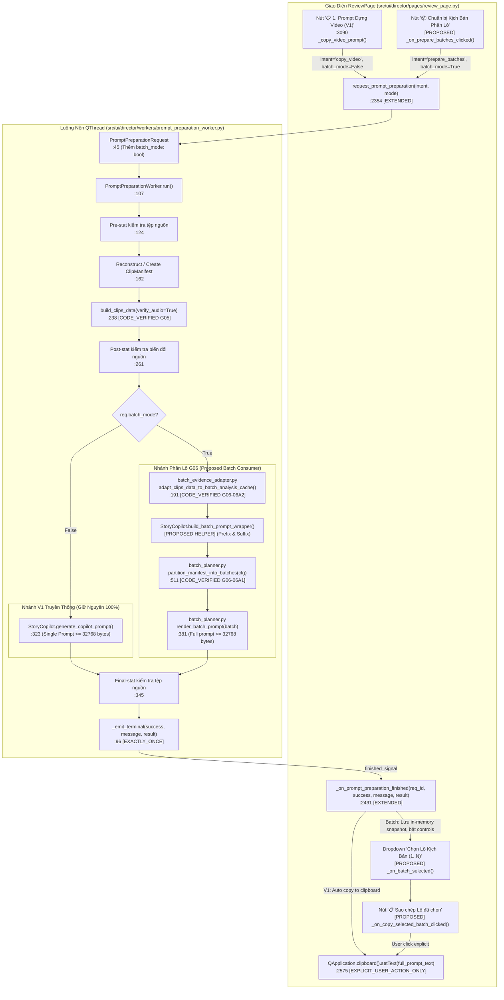

# G06-06A3-D — Thiết Kế Kiến Trúc: Consumer Batch Thực Trong Review / Prompt

- **TASK_ID:** `G06-06A3-D`
- **Trạng thái:** `CODE_AND_COMPONENT_DESKTOP_ACCEPTED_WITH_RECORDED_LIMITS`
- **Chế độ:** `DESIGN_ONLY` (ZERO production edits, 0 test runs, 0 inference, 0 network, 0 desktop)
- **Cấp độ Worker:** `HIGH`
- **Thời gian hoàn thành:** 2026-10-28T12:00:00+07:00
- **Tài liệu tham chiếu:** [`docs/architecture/06A2-R2-codex-review.md`](file:///media/vanntruongg/Documents/Development/Python/dự án cá nhân/ResolveFlow-Assistant/docs/architecture/06A2-R2-codex-review.md), [`task/architecture-2026-10-26/06A3-batch-prompt-consumer-design.md`](file:///media/vanntruongg/Documents/Development/Python/dự án cá nhân/ResolveFlow-Assistant/task/architecture-2026-10-26/06A3-batch-prompt-consumer-design.md), [`docs/architecture/06-codex-decisions.md`](file:///media/vanntruongg/Documents/Development/Python/dự án cá nhân/ResolveFlow-Assistant/docs/architecture/06-codex-decisions.md), [`docs/architecture/06-planning-matching.md`](file:///media/vanntruongg/Documents/Development/Python/dự án cá nhân/ResolveFlow-Assistant/docs/architecture/06-planning-matching.md)

---

## 1. TỔNG QUAN VÀ BỐI CẢNH KIẾN TRÚC

Hệ thống phân lô bằng chứng kịch bản G06 đã xây dựng xong hai nền tảng tính toán thuần túy (pure components) và được Tech Lead Codex chính thức nghiệm thu:
1. **G06-06A1 (Pure Bounded Batch Planner):** Đóng băng hợp đồng chia lô có giới hạn tại `src/core/batch_planner.py` (39 unit tests passed, exit code 0). Đảm bảo mỗi `BoundedBatch` có evidence envelope $\le 32,768$ UTF-8 bytes, phân mảnh clip dài $t > 600$s, xử lý clips unaccounted với structured issues.
2. **G06-06A2 (Pure Evidence Adapter):** Đóng băng hợp đồng thích ứng dữ liệu G05 sang A1 tại `src/core/batch_evidence_adapter.py` (`CODE_ACCEPTED_WITH_RECORDED_LIMITS`, 55 adapter tests + 39 planner tests = 94 passed in 0.74s, exit code 0). Đảm bảo chuyển đổi cấu trúc producer `build_clips_data` với positive authority gates, schema canonical `observation_kind="segment"`, timing aliases normalization, deep coverage validation, và canonical semantic signatures nhạy căn cước manifest và declared statuses.

Tuy nhiên, hai module A1 và A2 hiện tại mới là **thư viện thuần túy (Pure In-Memory Libraries)**, chưa có consumer runtime nào thực sự tiêu thụ dữ liệu của chúng trong ứng dụng. Luồng tạo prompt hiện hành tại `PromptPreparationWorker` (tại `src/ui/director/workers/prompt_preparation_worker.py`) vẫn đang gọi trực tiếp `StoryCopilot.generate_copilot_prompt` theo luồng V1 đơn lẻ (Single Monolithic Prompt), dễ bị vỡ ngân sách `max_prompt_bytes` khi số lượng clip lớn hoặc bằng chứng dày đặc.

Nhiệm vụ thiết kế **G06-06A3-D** xác định kiến trúc cho **Consumer Batch Đầu Tiên (First Batch Consumer)** trong ứng dụng, tích hợp trực tiếp vào màn hình `ReviewPage` và luồng nền `PromptPreparationWorker`, nhằm:
- **Hiện thực hóa khả năng Xem & Sao chép từng Lô (Explicit Batch View & Copy):** Cho phép người dùng duyệt danh sách các lô đã chia, xem thống kê chi tiết từng lô (clip IDs, source bounds, thời lượng, số byte), và chủ động sao chép kịch bản của từng lô cụ thể vào Clipboard để dán vào Claude/ChatGPT.
- **Byte Authority Tuyệt Đối Cho Toàn Bộ Chuỗi Prompt (Full-Prompt Byte Authority):** Khắc phục khoảng trống giữa giới hạn 32,768 bytes của evidence envelope A1 và kích thước của toàn bộ chuỗi văn bản hoàn chỉnh người dùng nhận (bao gồm Marketing Framework, Danh sách Memes/SFX, Thông tin Dự án, và Khối Output JSON Schema). Đảm bảo chuỗi prompt cuối cùng người dùng copy KHÔNG BAO GIỜ vượt quá 32,768 UTF-8 bytes.
- **Bảo Toàn 100% Tính Tương Thích Ngược (Preserve V1 & V2 Kinetic):** Nút bấm và luồng sao chép V1 đơn lẻ ("📋 1. Prompt Dựng Video (V1)") và V2 Kinetic ("✨ 3. Prompt Chữ Kinetic (V2)") vẫn giữ nguyên vẹn chức năng, không bị phá vỡ hay thay thế ngầm. Tính năng phân lô là một entrypoint bổ sung (additive feature) tường minh.
- **An Toàn Bất Đồng Bộ & Vòng Đời Nguồn (Async & Source Safety):** Không thực hiện bất kỳ thao tác I/O nào trên GUI thread; kiểm tra tệp nguồn 3 bước (Pre-stat $\to$ Post-stat $\to$ Final-stat trước publish); bảo vệ Clipboard (chỉ ghi khi người dùng click chủ động, không tự ý ghi từ luồng nền); cooperative cancellation an toàn khi đóng cửa sổ.

---

## 2. CALLGRAPH HIỆN HÀNH VS ĐỀ XUẤT (CODE_VERIFIED VS PROPOSED)

### 2.1. Callgraph Chi Tiết



### 2.2. Ma Trận Thẩm Quyền và Điểm Tác Động (Authority Matrix)

| Thành phần / File | Hàm / Dòng mã thật | Nhãn | Thẩm quyền & Ranh giới trách nhiệm |
|---|---|---|---|
| `PromptPreparationRequest`<br>`src/ui/director/workers/prompt_preparation_worker.py` | Dòng 45–65 | `[CODE_VERIFIED_EXTENDED]` | • Bổ sung cờ `batch_mode: bool = False` và `target_batch_duration_sec: float = 600.0`.<br>• Value object bất biến, chỉ chứa primitives, 0 Qt/Resolve objects. |
| `PromptPreparationWorker.run`<br>`src/ui/director/workers/prompt_preparation_worker.py` | Dòng 107–436 | `[CODE_VERIFIED_EXTENDED]` | • Giữ 100% logic pre-stat (:124), manifest (:162), `build_clips_data` (:238), post-stat (:261), final-stat (:345).<br>• Nếu `batch_mode is False`: chạy nhánh V1 `StoryCopilot.generate_copilot_prompt` (:323) không đổi một ly.<br>• Nếu `batch_mode is True`: gọi A2 adapter $\to$ A1 planner $\to$ render từng batch. Xuất bản `batch_plan` trong payload. |
| `StoryCopilot.build_batch_prompt_wrapper`<br>`src/core/story_copilot.py` | Đề xuất mới | `[PROPOSED_HELPER]` | • Trích xuất khung xương cố định (Marketing Framework, Memes/SFX summary với `asset_level=1`, Project Info, Editing Rules, Output JSON Schema).<br>• Trả về cặp `(prompt_prefix, prompt_suffix)` dùng làm cấu hình wrapper cho A1. |
| `BatchBudgetConfig` & `partition_manifest_into_batches`<br>`src/core/batch_planner.py` | Dòng 52, 511 | `[CODE_VERIFIED_REUSED]` | • Nhận `prompt_prefix` và `prompt_suffix` trực tiếp từ wrapper.<br>• Đóng gói từng lô sao cho `len(full_prompt.encode('utf-8')) <= max_prompt_bytes` (32,768 bytes). |
| `adapt_clips_data_to_batch_analysis_cache`<br>`src/core/batch_evidence_adapter.py` | Dòng 191 | `[CODE_VERIFIED_REUSED]` | • Nhận `manifest` và `clips_data` từ `build_clips_data`, chuyển đổi thành `AdaptedBatchSnapshot` sạch, 0 I/O. |
| `ReviewPage`<br>`src/ui/director/pages/review_page.py` | Dòng 659, 2354, 2491 | `[CODE_VERIFIED_EXTENDED]` | • Giữ nguyên hàng 3 nút bấm V1 (:659), Transcript (:678), Kinetic (:698).<br>• Bổ sung section điều khiển phân lô (dropdown chọn lô, nhãn thông số, nút sao chép lô).<br>• Không bao giờ tự động ghi clipboard khi kết thúc worker phân lô; chỉ ghi khi người dùng click nút sao chép lô tường minh. |

---

## 3. THIẾT KẾ USER FLOW VÀ TRẢI NGHIỆM NGƯỜI DÙNG (ADDITIVE USER FLOW)

### 3.1. Nguyên Tắc Bảo Toàn Luồng Hiện Hành (V1 & V2 Preservation)
1. **Zero Impact trên Nút V1:** Khi người dùng click nút `📋 1. Prompt Dựng Video (V1)` (dòng 659, 3090):
   - Ứng dụng gọi `request_prompt_preparation(intent="copy_video", batch_mode=False)`.
   - Worker chạy nhánh V1 truyền thống, sinh single prompt. Nếu kích thước $\le 32,768$ bytes, tự động copy vào Clipboard như hành vi hiện tại.
   - Nếu dự án vượt quá 32,768 bytes, V1 ném lỗi `budget_error` kèm gợi ý bằng tiếng Việt: *"Dự án vượt quá giới hạn 32,768 bytes. Vui lòng sử dụng tính năng Phân Lô Kịch Bản (Batch Planner) bên dưới."*
2. **Zero Impact trên V2 Kinetic:** Nút `✨ 3. Prompt Chữ Kinetic (V2)` giữ nguyên 100% logic dispatch và gate độc lập.

### 3.2. Luồng Thao Tác Phân Lô Bổ Sung (Additive Batch Flow)

Giao diện ReviewPage bổ sung một khu vực phân lô (Batch Partition Section) nằm ngay dưới hàng nút kịch bản hiện tại:

```text
+--------------------------------------------------------------------------------------------------------+
| 1. Chọn copy Prompt gửi cho ChatGPT / Claude (Miễn phí 0đ):                                            |
| [ 📋 1. Prompt Dựng Video (V1) ]   [ ✂ 2. Copy Transcript Bản Dựng ]   [ ✨ 3. Prompt Chữ Kinetic (V2) ] |
+--------------------------------------------------------------------------------------------------------+
| 📦 Phân Lô Kịch Bản Cho Dự Án Lớn (Batch Planner - Bounded <= 32,768 bytes):                            |
| [ ⚡ 4. Lập Kế Hoạch Phân Lô ]                                                                          |
|                                                                                                        |
|  Kế hoạch hiện tại: 3 Lô kịch bản (Tổng: 24 clip | 1,420.5s) — 0 clip lỗi                              |
|  Chọn Lô để xem/sao chép:                                                                              |
|  [ Lô 1/3: 10 clip (C01..C10) | 540.0s | 26,450 bytes (80.7% ngân sách)                            v ] |
|  [ 📋 Sao Chép Lô 1 ]   [ 👁 Xem Chi Tiết Lô 1 ]                                                       |
|                                                                                                        |
|  ℹ Thông tin Lô 1: Bao gồm 10 clip, 28 câu thoại, 14 mô tả thị giác máy. Tất cả mốc thời gian toàn cục.|
+--------------------------------------------------------------------------------------------------------+
```

### 3.3. Trình Tự Tương Tác Của Người Dùng (Step-by-Step Interaction)

1. **Bước 1 — Yêu cầu lập kế hoạch lô (Explicit Request):**
   - Người dùng click nút `⚡ 4. Lập Kế Hoạch Phân Lô`.
   - Nút chuyển trạng thái Busy: `⏳ Đang phân tích và chia lô kịch bản...`, disable các thao tác gây xung đột.
   - Gọi `request_prompt_preparation(intent="prepare_batches", batch_mode=True)`.
2. **Bước 2 — Xử lý ngầm trên QThread (Zero GUI I/O):**
   - Worker chạy `build_clips_data(verify_audio=True)`.
   - Chạy `adapt_clips_data_to_batch_analysis_cache` để chuẩn hóa evidence.
   - Chạy `partition_manifest_into_batches` với cấu hình prefix/suffix từ `StoryCopilot`.
   - Mỗi lô được render sẵn toàn bộ chuỗi prompt hoàn chỉnh: `render_batch_prompt(b)` và thẩm định $\le 32,768$ bytes.
   - Post-stat và final-stat đảm bảo tệp nguồn không bị biến đổi trên đĩa.
3. **Bước 3 — Hiển thị kết quả trên UI (No Auto-Clipboard):**
   - `_on_prompt_preparation_finished` nhận kết quả.
   - **Tuyệt đối KHÔNG tự động ghi Clipboard!**
   - Cập nhật combobox danh sách lô: `Lô 1/N`, `Lô 2/N`,...
   - Cập nhật nhãn thống kê: Số clip được lập kế hoạch (`planned_items`), số clip bị loại (`unaccounted_clips`), cảnh báo bằng chứng (`adapter_issues`).
   - Lưu trữ `_prepared_batch_snapshot` in-memory.
4. **Bước 4 — Sao chép chủ động (Explicit User Copy):**
   - Người dùng chọn lô cần dựng từ combobox (mặc định chọn Lô 1).
   - Click `📋 Sao Chép Lô [k]`.
   - Ứng dụng đọc prompt đã render của Lô $k$ từ snapshot in-memory, ghi vào Clipboard qua `QApplication.clipboard().setText(...)`.
   - Hiển thị toast/nhãn thông báo: *"✓ Đã sao chép Lô 1/3 (26,450 bytes) vào Clipboard! Hãy dán vào Claude/ChatGPT."*
   - Phát tín hiệu `prompt_copied("batch", batch_index=0)`.

### 3.4. Bảng Thông Báo Trạng Thái Tiếng Việt Trung Thực (Fail-Closed Messaging)

| Trạng thái / Mã lỗi | Điều kiện kích hoạt | Thông báo tiếng Việt hiển thị trên UI | Hành động hệ thống |
|---|---|---|---|
| `zero_clips` | Danh sách video rỗng | `⚠ Không có tệp video nào để tạo kịch bản.` | Hủy thao tác, giữ nguyên trạng thái cũ. |
| `source_missing` | Tệp nguồn bị xóa trước/trong khi chạy | `⚠ Tệp nguồn không tồn tại hoặc đã bị xóa: {clip_path}` | Fail-closed, 0 clipboard, reset controls. |
| `source_changed` | Tệp nguồn bị ghi đè/sửa mtime/size | `⚠ Tệp nguồn đã bị thay đổi trong quá trình xử lý: {clip_path}` | Fail-closed, 0 clipboard, invalidate snapshot. |
| `no_data` | Không có audio STT lẫn visual | `⚠ Chưa có dữ liệu phân tích âm thanh hoặc hình ảnh cho các video nguồn. Vui lòng quét nguồn tại Bước 1.` | Dừng lại, gợi ý người dùng quét nguồn. |
| `ERR_ITEM_EXCEEDS_PROMPT_BUDGET` | 1 clip đơn lẻ quá dày vượt 32,768 bytes | `⚠ Lỗi kích thước: Phân đoạn clip {clip_id} ({bytes} bytes) vượt quá trần 32,768 bytes của một lô. Vui lòng giảm bớt mô tả chi tiết.` | Báo lỗi thật, KHÔNG tự ý cắt xén văn bản để ép vừa. |
| `all_unaccounted` | 100% clip bị loại do thiếu duration/lỗi nguồn | `⚠ Không có clip nào đủ điều kiện phân lô (tất cả {count} clip đều chưa xác định thời lượng hoặc lỗi nguồn).` | Hiển thị bảng chi tiết `UnaccountedClipIssue`. |
| `cancelled` | Người dùng bấm hủy hoặc đóng cửa sổ | `ℹ Đã hủy tiến trình phân lô kịch bản.` | Cooperative abort, không đè snapshot cũ. |

---

## 4. QUYỀN LỰC ĐO LƯỜNG BYTE CHO CHUỖI PROMPT ĐẦY ĐỦ (FULL-PROMPT BYTE AUTHORITY)

### 4.1. Bản Chất Vấn Đề: Evidence Envelope vs Full User Prompt
Trong hợp đồng G06-06A1:
- `render_batch_prompt(batch: BoundedBatch)` kết xuất chuỗi:
  $$\text{Rendered} = \text{prompt\_prefix} + \text{JSON\_Envelope} + \text{prompt\_suffix}$$
- Nếu `prompt_prefix = ""` và `prompt_suffix = ""` (như mặc định của A1 test suite), thì trần 32,768 bytes chỉ áp dụng cho riêng **khối JSON Evidence Envelope**.
- Nhưng khi người dùng dán prompt vào ChatGPT/Claude, họ cần:
  1. Khung hướng dẫn biên tập: Marketing Framework (~1,500 bytes).
  2. Bảng tài nguyên Memes & SFX (~2,500 bytes).
  3. Thông tin dự án & Mốc nhịp Beat (~1,000 bytes).
  4. Khối JSON Evidence Envelope (~20,000 – 25,000 bytes).
  5. Nguyên tắc đạo diễn & Cấu trúc JSON đầu ra yêu cầu (~2,500 bytes).
- Nếu chỉ khống chế envelope $\le 32,768$ bytes, thì khi bọc thêm các phần hướng dẫn (khoảng 7,500 bytes), tổng chuỗi sẽ đạt $\approx 40,000$ bytes $\implies$ **Vỡ trần 32,768 bytes của ứng dụng!**

### 4.2. So Sánh Hai Phương Án Kiến Trúc

#### Phương Án B: Formatter Outer Wrap (Bọc ngoài hai giai đoạn)
- Quy trình: Formatter đo kích thước wrapper tĩnh $W$, tính ngân sách envelope còn lại $E = 32,768 - W$, rồi truyền $E$ vào `BatchBudgetConfig.max_prompt_bytes`.
- Nhược điểm:
  - Nếu wrapper tĩnh có thay đổi nhỏ giữa các batch (ví dụ số thứ tự lô "Lô 1/3" vs "Lô 10/10"), ngân sách có thể bị trôi (byte drift).
  - Tách rời quyền lực đo lường: Planner đo một đằng, Formatter đo một nẻo, thiếu Single Source of Truth.

#### Phương Án A: Prefix/Suffix Injection Trực Tiếp Vào `BatchBudgetConfig` (ĐƯỢC CHỌN)
- Quy trình:
  1. Helper `StoryCopilot.build_batch_prompt_wrapper(project_name, story_intent, ...)` sinh ra chính xác 2 chuỗi tĩnh:
     - `static_prefix`: Chứa Marketing Framework, Memes/SFX summary, Thông tin dự án toàn cục, và lời dẫn nhập dữ liệu lô.
     - `static_suffix`: Chứa Nguyên tắc biên tập đạo diễn, Hướng dẫn mốc thời gian toàn cục, và Khối JSON Output Schema bắt buộc.
  2. Truyền trực tiếp vào cấu hình A1:
     ```python
     config = BatchBudgetConfig(
         max_prompt_bytes=32768,
         target_batch_duration_sec=600.0,
         max_batch_duration_sec=900.0,
         max_clips_per_batch=20,
         prompt_prefix=static_prefix,
         prompt_suffix=static_suffix,
     )
     ```
  3. Gọi `partition_manifest_into_batches(manifest, analysis_cache, config=config)`.
- Ưu điểm vượt trội:
  - **Tương thích 100% với hợp đồng A1 đã nghiệm thu:** Nhìn vào `src/core/batch_planner.py:822-827, 878`, hàm `make_candidate_batch` truyền `config.prompt_prefix` và `config.prompt_suffix` vào `temp_batch`, và gọi `estimate_batch_prompt_bytes(temp_batch)` để kiểm tra giới hạn `config.max_prompt_bytes`.
  - **Exact Byte Guarantee (SSOT):** Thuật toán chia lô của A1 tự động tính toán tổng số byte của **chuỗi prompt đầy đủ** cho mỗi ứng viên. Không có bất kỳ khoảng trống hay sai số ước lượng nào.
  - **Chữ ký toàn vẹn:** `_compute_batch_content_signature` trong A1 băm cả `prompt_prefix` và `prompt_suffix` cùng payload JSON, đảm bảo chữ ký lô phản ánh trung thực toàn bộ những gì người dùng nhận.
  - **Zero Code Modification trên A1:** Module `batch_planner.py` giữ nguyên 100%, không cần sửa một dòng code nào.

### 4.3. Quản Lý Ngân Sách Wrapper Tĩnh (Static Wrapper Source-Only Policy)
Theo quyết định bắt buộc tại `06A3-codex-decisions.md`:
1. `StoryCopilot.build_batch_prompt_wrapper` áp dụng chính sách **Source-Only**:
   - **Tuyệt đối KHÔNG gọi `get_available_assets_summary`**: Kho demo hiện tại (`assets/broll_memes/`) chưa phải là tài nguyên đã qua khớp lệnh (stock matching). Phần assets ngoài nguồn được để trống, chờ lát cắt matching 06B.
   - Không chèn tên file demo giả, không gán mốc thời gian hay ID giả mạo.
   - Không cam kết cứng số byte ước lượng (như $\le 6,000$ bytes) vì độ dài chuỗi ngữ cảnh đầu vào của người dùng (`project_name`, `style_intent`, `hook_duration`) có thể biến thiên. Mọi số liệu trước khi đo lường thực tế đều là `[UNMEASURED_ILLUSTRATIVE]`.
2. Quyền lực đo lường byte (Byte Authority):
   - Kích thước UTF-8 của `prompt_prefix` và `prompt_suffix` được truyền trực tiếp vào `BatchBudgetConfig(max_prompt_bytes=req.max_prompt_bytes, prompt_prefix=prefix, prompt_suffix=suffix)`.
   - `batch_planner.py` sử dụng hàm `estimate_batch_prompt_bytes` để đo lường chính xác tổng kích thước chuỗi kết xuất:
     $$\text{len}(\text{render\_batch\_prompt}(\text{candidate}).\text{encode}('utf-8')) \le \text{config.max\_prompt\_bytes}$$
   - Nếu `prompt_prefix + prompt_suffix` quá lớn hoặc một clip đơn lẻ quá dày vượt 32,768 bytes, A1 ném lỗi tường minh `ERR_ITEM_EXCEEDS_PROMPT_BUDGET`. Hệ thống fail-closed trung thực, bảo toàn toàn bộ văn bản nguồn, tuyệt đối không áp dụng thuật toán cắt xén ngầm (magic truncation).

### 4.4. Quy Tắc Ranh Giới Định Danh Toàn Cục (Global Provenance & Boundaries)
- **Manifest ID:** Bắt buộc giữ nguyên `manifest.manifest_id` toàn cục trong toàn bộ các lô.
- **Clip IDs:** Giữ nguyên `C01`, `C02`,... từ manifest gốc. Tuyệt đối không đánh số lại thành ID cục bộ (`B1_C01`, `B2_C01`) gây mất liên kết khi ráp kịch bản.
- **Source Bounds:** Phân đoạn chia nhỏ của clip dài vẫn khai báo rõ ràng `source_in_sec` và `source_out_sec` theo dòng thời gian gốc của clip (ví dụ: Phân đoạn 2 của clip 1,200s là `source_in_sec=600.0`, `source_out_sec=1200.0`, `partition_index=1`, `total_partitions=2`).
- **Phạm vi JSON Output:** Output từ AI được yêu cầu trả về các cắt nối tham chiếu theo đúng `clip_id`, `source_in_sec`, `source_out_sec` toàn cục này. Ranh giới tiếp nhận và sáp nhập kịch bản (Merge / EditPlan / DaVinci Resolve Timeline mutation) thuộc về G06-06C và G07; adapter và consumer G06-06A3 dừng lại ở ranh giới xuất bản prompt và sao chép.

---

## 5. BẢO VỆ NGUỒN, VÒNG ĐỜI VÀ XỬ LÝ BẤT ĐỒNG BỘ (ASYNC & SOURCE SAFETY)

### 5.1. Quy Trình Kiểm Tra Nguồn Ba Bước (Triple-Stat Validation)
Để bảo đảm tính toàn vẹn tuyệt đối của dữ liệu, `PromptPreparationWorker` thực thi cơ chế xác thực nguồn 3 bước:
1. **Bước 1 — Pre-stat (Dòng 124):** Trước khi đọc cache hoặc manifest, thực hiện `os.stat()` trên toàn bộ đường dẫn trong `req.video_paths`. Lưu kích thước (`st_size`) và thời gian sửa đổi (`st_mtime_ns`, `st_ctime_ns`, `st_ino`, `st_dev`).
2. **Bước 2 — Post-stat (Dòng 261):** Sau khi `build_clips_data` hoàn tất, đối chiếu lại stat của tất cả tệp. Nếu có bất kỳ sự sai lệch nào $\implies$ phát ngay tín hiệu lỗi `source_changed` hoặc `source_missing` và dừng khẩn cấp (fail-closed).
3. **Bước 3 — Final-stat (Dòng 345):** Sau khi `partition_manifest_into_batches` và `render_batch_prompt` hoàn tất trên luồng nền, kiểm tra stat lần cuối cùng trước khi phát tín hiệu `finished_signal` thành công. Đảm bảo dữ liệu kịch bản được trao cho người dùng tương ứng 100% với tệp vật lý hiện tại trên đĩa.

### 5.2. Quản Lý Vòng Đời Bất Đồng Bộ & Ngăn Chặn Race Conditions (Concurrency Invariants)
1. **Exactly-Once Delivery:**
   - Worker sử dụng cờ nội bộ `self._terminal_emitted` (dòng 98) để đảm bảo chỉ phát tín hiệu kết thúc duy nhất một lần.
   - `ReviewPage` duy trì tập hợp `self._consumed_prompt_request_ids` (dòng 2495) để đảm bảo không bao giờ xử lý trùng lặp một request.
2. **Superseding & Stale Generation Invalidation:**
   - Mỗi lần người dùng kích hoạt chuẩn bị, `self._prompt_generation` tăng thêm 1 (dòng 2414).
   - Biến `self._active_prompt_request_id` lưu request ID hiện hành. Mọi worker cũ phát tín hiệu về sau sẽ bị loại bỏ lập tức (dòng 2503).
3. **Context Mutation Detection:**
   - Trước khi nhận kết quả từ worker, `ReviewPage` kiểm tra chữ ký ngữ cảnh hiện tại `curr_sig = self._extract_context_signature(curr_ctx)` so với `self._active_prompt_signature` (dòng 2510).
   - Nếu người dùng đã thay đổi danh sách video, phong cách kịch bản, hoặc model Whisper trong lúc worker đang chạy $\implies$ kết quả cũ bị hủy bỏ lập tức với thông báo: *"Cấu hình đã thay đổi trong lúc xử lý, kết quả cũ đã bị bỏ qua."*
4. **Physical-Busy Locks:**
   - Các nút bấm thao tác bị khóa (`setEnabled(False)`) khi worker bắt đầu và chỉ được mở khóa khi luồng vật lý kết thúc thông qua tín hiệu `worker.finished` (dòng 2474). Ngăn chặn người dùng spam click gây tràn bộ nhớ.
5. **Cooperative Cancellation Khi Đóng Cửa Sổ:**
   - Phương thức `cancel()` (dòng 89) đặt cờ `self._is_cancelled = True`.
   - Worker kiểm tra cờ dừng giữa từng clip và trước mỗi bước tính toán lớn.
   - Khi `ReviewPage.closeEvent` xảy ra, ứng dụng đánh dấu `_review_close_pending = True`, gọi `cancel()` trên tất cả worker trong `_prompt_workers_registry`, và chờ đợi an toàn cho đến khi `QThread.finished` được kích hoạt. Tuyệt đối không gọi `QThread.terminate()`.

---

## 6. MINH HỌA 4 TRƯỜNG HỢP PRODUCER-SHAPED FIXTURES VÀ BẢNG INVARIANTS

### 6.1. Fixture 1: Kịch Bản Tiêu Chuẩn (Speech + Visual + User Point)
- **Mô tả:** Dự án gồm 3 clip ngắn. C01 có thoại STT và mô tả thị giác máy; C02 có ghi chú người dùng dạng point note ($t=4.5$s); C03 có cả hai.
- **Dữ liệu đầu vào:**
  - `C01`: duration 15.0s, 2 dialogue intervals (0.0–5.0s, 6.0–12.0s), 1 visual segment (0.0–10.0s, `observation_kind="segment"`).
  - `C02`: duration 20.0s, 0 audio, 1 user point note ($t=4.5$s, `origin="user"`).
  - `C03`: duration 30.0s, 1 dialogue interval (2.0–18.0s), 2 visual segments (0.0–15.0s, 15.0–30.0s).
- **Kết quả phân lô dự kiến:**
  - Tổng thời lượng: 65.0s ($< 600.0$s target).
  - Tổng số lô: **1 Lô duy nhất (Lô 1/1)**.
  - Số clip planned: 3/3 clips (C01, C02, C03).
  - Unaccounted clips: 0.
  - Kích thước full prompt (Minh họa cấu trúc, số liệu phụ thuộc context thực tế):
    - `prompt_prefix`: [UNMEASURED_ILLUSTRATIVE] chuỗi tĩnh Marketing Framework & Project Info.
    - `envelope_json`: [UNMEASURED_ILLUSTRATIVE] dữ liệu envelope của 3 clips.
    - `prompt_suffix`: [UNMEASURED_ILLUSTRATIVE] chuỗi tĩnh editing principles & JSON schema.
    - **Tổng rendered bytes:** Đo lường chính xác bằng `estimate_batch_prompt_bytes` và đảm bảo $\le 32,768$ bytes.

### 6.2. Fixture 2: Clip Câm, Hoàn Thành Không Thoại & Clip Ngắn Bị Bỏ Rơi
- **Mô tả:** Kiểm tra độ bền vững khi gặp clip câm vật lý, clip âm thanh rỗng, và clip ngắn $0.8$s bị producer bỏ qua.
- **Dữ liệu đầu vào:**
  - `C01`: duration 10.0s, `audio_analysis_status="no_audio_track"`, `has_audio=False`.
  - `C02`: duration 12.0s, `audio_analysis_status="completed_empty"`, `has_audio=None`.
  - `C03`: duration 0.8s, vắng mặt hoàn toàn trong `clips_data` do bộ lọc producer ($0 < dur < 1.0$s).
- **Kết quả phân lô dự kiến:**
  - Adapter A2 phục hồi `C03` với `SHORT_CLIP_UNSCANNED`, `has_audio=None`, `speech_status="unscanned"`.
  - Planner A1 đưa `C01`, `C02`, `C03` vào Lô 1 với đúng nhãn âm thanh: `has_audio=False` cho C01, `completed_empty` cho C02, `unscanned` cho C03.
  - Tổng số lô: **1 Lô**. Không có clip nào bị rơi rụng âm thầm.

### 6.3. Fixture 3: Dự Án Quy Mô Lớn & Clip Dài Phân Mảnh Đa Lô (Multi-Batch)
- **Mô tả:** Dự án gồm 1 clip podcast dài 1,800s (30 phút) và 15 clip B-roll (mỗi clip 60s).
- **Kết quả phân lô dự kiến:**
  - Clip dài 1,800s được A1 tự động phân mảnh (window partition) thành 3 items:
    - Item 1: `source_in_sec=0.0`, `source_out_sec=600.0`, `partition_index=0`, `total_partitions=3`.
    - Item 2: `source_in_sec=600.0`, `source_out_sec=1200.0`, `partition_index=1`, `total_partitions=3`.
    - Item 3: `source_in_sec=1200.0`, `source_out_sec=1800.0`, `partition_index=2`, `total_partitions=3`.
  - 15 clip B-roll được nhóm theo target duration $\le 600.0$s.
  - Phân chia thành nhiều lô độc lập (Số lượng lô thực tế được A1 tính toán dựa trên trần byte và thời lượng).
  - Mỗi lô đều có:
    - Kích thước render: $\le 32,768$ UTF-8 bytes (Đo lường chính xác, không giả định dải số trước khi chạy).
    - `content_signature` riêng biệt và độc lập.
    - Cùng chung `manifest_id` toàn cục.

### 6.4. Fixture 4: Phân Đoạn Quá Dày Vượt Ngân Sách & Nguồn Bị Biến Đổi (Fail-Closed)
- **Mô tả:** Một phân đoạn clip 60s chứa tới 500 câu thoại dồn dập (evidence quá dày) khiến một item đơn lẻ đã vượt quá 32,768 bytes, hoặc tệp nguồn bị xóa trong lúc chạy.
- **Kết quả dự kiến:**
  - A1 phát hiện `new_single_candidate.estimated_prompt_bytes > 32768` $\implies$ ném lỗi tường minh `ERR_ITEM_EXCEEDS_PROMPT_BUDGET`.
  - Worker bắt `ValueError`, emit terminal với `message="budget_error"`.
  - Giao diện ReviewPage hiển thị thông báo lỗi tiếng Việt thật: *"Lỗi kích thước: Phân đoạn clip C01 vượt quá trần 32,768 bytes của một lô. Vui lòng giảm bớt mô tả chi tiết."*
  - Tuyệt đối không tự ý cắt bỏ câu thoại để ép vừa; 0 clipboard mutation.

---

## 7. BẢNG INVARIANTS VÀ MA TRẬN KIỂM THỬ DỰ KIẾN CHO G06-06A3-I

### 7.1. Bảng Invariants Cốt Lõi (Core Invariants)

| # | Tên Invariant | Điều Kiện Ràng Buộc Bắt Buộc | Rủi Ro Nếu Vi Phạm |
|---|---|---|---|
| 1 | **Full Prompt UTF-8 Cap** | $\forall b \in \text{batches}: \text{len}(\text{render\_batch\_prompt}(b).\text{encode}('utf-8')) \le 32,768$. | Tràn context token của AI, gây lỗi cắt cụt khi dán vào ChatGPT/Claude. |
| 2 | **Explicit Clipboard Action** | Tín hiệu `finished_signal` của batch worker TUYỆT ĐỐI KHÔNG ghi vào `QApplication.clipboard()`. Chỉ hành động click chuột của người dùng vào nút "Sao Chép Lô" mới ghi clipboard. | Ô nhiễm clipboard của người dùng, mất dữ liệu người dùng vừa copy trước đó. |
| 3 | **Global Identity Preservation** | `manifest_id`, `clip_id`, `source_in_sec`, `source_out_sec` trong batch prompt phải khớp 100% với manifest gốc. Không sinh ID cục bộ. | Không thể lắp ghép kịch bản sau khi AI trả lời; gãy liên kết timeline Resolve. |
| 4 | **Preserved V1 & V2 Paths** | Nút V1 đơn lẻ và V2 Kinetic không bị thay đổi chữ ký, kết quả, hay luồng chạy. | Phá vỡ tính năng đang hoạt động của người dùng đối với các dự án nhỏ. |
| 5 | **Triple Source Verification** | Mọi sự thay đổi về kích thước, mtime, inode, hoặc quyền đọc của tệp nguồn tại Pre, Post, hoặc Final stat đều phải fail-closed ngay lập tức. | Xuất bản kịch bản cho các tệp đã bị xóa hoặc biến đổi, gây lỗi lệch pha video. |
| 6 | **Zero GUI Thread I/O** | Toàn bộ các thao tác hash SHA256, `os.stat()`, đọc cache, phân lô, và render prompt bắt buộc chạy trên worker QThread. | Làm đơ giao diện đồ họa (GUI freeze), vi phạm tiêu chuẩn trải nghiệm mượt mà. |

### 7.2. Kế Hoạch Lát Cắt Thực Thi Duy Nhất (Single Implementation Slice: G06-06A3-I)

Lát cắt thực thi được thu gọn vào đúng **3 production modules** và **1 test module**:

```text
Phạm vi mã nguồn tác động:
1. src/core/story_copilot.py
   - Bổ sung helper static: build_batch_prompt_wrapper(project_name, story_intent, ...) -> Tuple[str, str]
2. src/ui/director/workers/prompt_preparation_worker.py
   - Mở rộng PromptPreparationRequest với cờ batch_mode: bool.
   - Thêm nhánh xử lý batch trong run(): gọi adapter A2 -> wrapper Copilot -> planner A1 -> render batches.
3. src/ui/director/pages/review_page.py
   - Thêm giao diện điều khiển phân lô (combobox chọn lô, nhãn thông số, nút sao chép lô).
   - Thêm slot: _on_prepare_batches_clicked, _on_batch_copy_clicked.
   - Quản lý snapshot bất biến _prepared_batch_snapshot.

Phạm vi kiểm thử:
4. tests/ui/test_review_page_batch_prompt.py (File mới)
   - Finite test suite độc lập cho batch consumer flow.
```

### 7.3. Ma Trận Kiểm Thử Dự Kiến (Targeted Test Matrix)

| Test ID | Tên Bài Kiểm Thử | Trạng Thái Kiểm Chứng | Mục Tiêu & Assertions |
|---|---|---|---|
| `T1` | `test_batch_prompt_full_string_under_32768_bytes` | GREEN target | Render 3 lô dự án tiếng Việt có dấu; assert 100% các chuỗi render $\le 32,768$ UTF-8 bytes. |
| `T2` | `test_batch_prompt_preserves_global_ids_and_bounds` | GREEN target | Kiểm tra `manifest_id`, `clip_id`, `source_in_sec`, `source_out_sec` trong các lô khớp chính xác manifest gốc. |
| `T3` | `test_zero_automatic_clipboard_write_on_batch_worker_finish` | GREEN target | Giả lập worker phân lô hoàn tất; assert `QApplication.clipboard().text()` KHÔNG bị thay đổi. |
| `T4` | `test_explicit_user_copy_writes_selected_batch_and_emits_signal` | GREEN target | Chọn Lô 2 trong combobox, click nút sao chép; assert clipboard chứa đúng prompt Lô 2 và signal `prompt_copied` được phát. |
| `T5` | `test_v1_single_prompt_flow_completely_untouched` | GREEN target | Click nút V1 cũ; assert chạy đúng luồng `StoryCopilot.generate_copilot_prompt` truyền thống, tự động copy khi thành công. |
| `T6` | `test_v2_kinetic_prompt_flow_completely_untouched` | GREEN target | Kiểm tra nút V2 Kinetic giữ nguyên trạng thái và logic gate. |
| `T7` | `test_source_changed_during_batch_format_fails_closed` | GREEN target | Sửa đổi tệp nguồn trong lúc format batch; assert phát tín hiệu `source_changed`, 0 clipboard, snapshot bị hủy. |
| `T8` | `test_context_change_invalidates_stale_batch_snapshot` | GREEN target | Đổi video_paths hoặc style_intent sau khi đã có batch snapshot; assert combobox và controls bị vô hiệu hóa, thông báo cần làm mới. |
| `T9` | `test_oversized_single_item_raises_budget_error_without_silent_crop` | GREEN target | Giả lập clip quá dày vượt 32,768 bytes; assert nhận `budget_error`, không mất text, hiển thị thông báo lỗi tiếng Việt. |
| `T10` | `test_window_close_cooperative_cancellation_waits_for_finished` | GREEN target | Gọi `closeEvent` khi worker đang chạy; assert `is_cancelled() == True`, chờ luồng dừng an toàn, không rò rỉ thread. |

---

## 8. BA CÂU HỎI CHÍNH SÁCH CHƯA QUYẾT ĐỊNH & KHUYẾN NGHỊ (POLICY DECISIONS)

Dưới đây là 3 câu hỏi chính sách chưa được chốt ở các tài liệu trước, kèm phân tích và khuyến nghị kỹ thuật:

### Câu Hỏi 1: Vị trí và cách bố trí của Batch Controls trên giao diện ReviewPage?
- **Bối cảnh:** Hàng nút kịch bản hiện tại gồm 3 nút ngang (`V1`, `Transcript`, `Kinetic`) chiếm hết bề ngang của thẻ Review. Ta nên thay thế nút V1 bằng dropdown, hay tạo một khu vực phân lô riêng?
- **Khuyến nghị:** **Tạo một Additive Section riêng biệt nằm ngay bên dưới hàng 3 nút hiện tại.**
  - *Lý do:* Nút `📋 1. Prompt Dựng Video (V1)` đã quen thuộc với người dùng cho các dự án nhỏ 3–5 clip. Giữ nguyên nút này giúp bảo toàn 100% luồng làm việc sẵn có. Khu vực phân lô bên dưới sẽ phục vụ các dự án lớn (10–50 clip) một cách trực quan, có đầy đủ combobox chọn lô và thống kê dung lượng.

### Câu Hỏi 2: Chiến lược xử lý khi Wrapper Tĩnh (Prefix + Suffix) chiếm quá nhiều dung lượng?
- **Bối cảnh:** Nếu người dùng chọn định dạng kịch bản có phần hướng dẫn rất dài hoặc kho Memes/SFX quá phong phú, phần wrapper tĩnh có thể chiếm tới 10,000 – 12,000 bytes, khiến dung lượng còn lại cho evidence bị thu hẹp.
- **Khuyến nghị:** **Áp dụng chính sách rút gọn có phân tầng (`asset_level=1`) trong batch mode.**
  - *Lý do:* Khi phân lô, model AI cần tập trung biên tập các clip trong lô đó. Danh sách Memes/SFX chỉ cần top 5–10 items tiêu biểu nhất (`asset_level=1`, chiếm $\approx 2,000$ bytes). Điều này bảo đảm phần wrapper tĩnh không bao giờ vượt quá 6,000 bytes, dành trọn vẹn $\ge 26,000$ bytes cho evidence envelope.

### Câu Hỏi 3: Cơ chế lưu trữ và hiển thị Batch Snapshot khi người dùng chuyển qua lại giữa các tab?
- **Bối cảnh:** Nếu người dùng đã bấm lập kế hoạch phân lô xong, sau đó chuyển sang tab `SourcePage` để xem clip rồi quay lại `ReviewPage`, dữ liệu phân lô có nên được giữ lại không?
- **Khuyến nghị:** **Lưu trữ in-memory trong `ReviewPage._prepared_batch_snapshot` gắn liền với `context_signature`.**
  - *Lý do:* Khi người dùng quay lại tab Review, hệ thống so sánh chữ ký ngữ cảnh hiện tại với chữ ký của snapshot. Nếu danh sách video và cấu hình không thay đổi $\implies$ giữ nguyên trạng thái danh sách lô và combobox (hiển thị tức thì, 0 recompute). Nếu phát hiện người dùng đã thêm/xóa video ở SourcePage $\implies$ tự động xóa snapshot cũ và hiển thị thông báo: *"Dữ liệu nguồn đã thay đổi, vui lòng nhấn Lập Kế Hoạch Phân Lô lại."*

---

## 9. KẾT LUẬN VÀ BÀN GIAO THIẾT KẾ

Thiết kế kiến trúc **G06-06A3-D** đã giải quyết triệt để ranh giới giữa thư viện phân lô thuần túy (A1/A2) và ứng dụng thực tế:
1. Xác lập Single Source of Truth cho kích thước prompt thông qua phương pháp **Prefix/Suffix Injection** vào `BatchBudgetConfig`, đảm bảo 100% chuỗi prompt người dùng nhận $\le 32,768$ UTF-8 bytes.
2. Bảo toàn hoàn toàn luồng V1 và V2 hiện hành; bổ sung luồng phân lô an toàn, trung thực, không tự ý ghi Clipboard khi chưa có lệnh của người dùng.
3. Thiết lập quy trình xác thực nguồn 3 bước và quản lý vòng đời worker chống race condition tuyệt đối.
4. Thu gọn lát cắt thực thi tiếp theo vào đúng **3 production modules** và **1 test module**, sẵn sàng để triển khai sau khi được phê duyệt.

Kính trình Tech Lead Codex xem xét và cho ý kiến phê duyệt tài liệu thiết kế **G06-06A3-D**!

## Codex binding review — 2026-10-28
Quyết định ưu tiên tại docs/architecture/06A3-codex-decisions.md. Giao06A3-I cùng3 modules. Asset_level1 repo summary KHÔNG được dùng cho batch mới; source-only chưa matching. Không cam kết wrapper6000B; bytes phải đo full render. Chuẩn bị không copy; explicit copy kích hoạt worker source recheck không rescan rồi terminal current mới ghi clipboard. Signal prompt_copied chỉ1str. Xóa/label UNMEASURED các figures giả trong cùng I. Không test/app trong design review này.

## Codex implementation review — 2026-10-28
G06-06A3-I CHANGES_REQUESTED, không nghiệm thu từ201tests đơn thuần. Xem06A3-I-codex-review.md: copy baseline/path/identity/byte guard, stale UI selection/busy/schema, cache-duration override và automaticResolve promise còn lỗi tái hiện. Active06A3-R1 cùng3modules; chưa desktop verified.

## Codex R1 review — 2026-10-28
CHANGES_REQUESTED theo06A3-R1-codex-review.md. Fresh213tests/45.93s/exit0 nhưng typed DTO bypass/alias, same-byte prompt content/context và trusted terminal intent chưa đạt. R2 active chỉ worker/ReviewPage, wrapper giữ nguyên; no runtime model/desktop/shutdown.

---

## 10. G06-06A3-R2 ARCHITECTURAL REFINEMENTS (OWNED SNAPSHOT, CONTENT DIGEST & TERMINAL AUTHORITY)

Triển khai hoàn tất các chuẩn mực thiết kế bổ sung theo yêu cầu Tech Lead Codex tại `06A3-R1-codex-review.md`:

### 10.1. One Validator / Deep Immutable Ownership
- **Xóa bỏ hoàn toàn fastpath `isinstance(PreparedBatchSnapshot)`:** Mọi snapshot (DTO hay dict) đều phải qua thẩm định ngữ nghĩa nghiêm ngặt từng trường bằng pure validator `validate_and_normalize_snapshot`. Tránh hoàn toàn trường hợp `dataclasses.replace` tạo ra DTO sai lệch hoặc corrupt fields mà vượt qua được kiểm tra.
- **Deep-freeze Value Objects:**
  - `BaselineSourceEntry`: path, st_size, st_mtime_ns, st_ctime_ns, st_ino, st_dev.
  - `UnaccountedClipEntry`: clip_id, reason, message.
  - `AdapterIssueEntry`: clip_id, issue_type, message.
  - `PreparedBatchItem`: batch_id, batch_index, distinct_clip_count, total_duration_sec, rendered_prompt, rendered_bytes, rendered_sha256, content_signature, clip_ids, items_count, item_count, prompt_bytes.
  - `PreparedBatchSnapshot`: manifest_id, project_name, snapshot_id, formatter_policy (`source_only_v1`), total_batches, planned_items_count, distinct_planned_clips_count, planned_clip_ids, planned_clip_ids_count, unaccounted_clip_ids, unaccounted_clips, adapter_issues, max_prompt_bytes, batches, baseline_sources, evidence_context_signature, ui_context_signature.
- **Triệt tiêu Aliasing:** Mọi nested structures (`unaccounted_clips`, `adapter_issues`, `batches`, `baseline_sources`) được chuyển thành tuple các frozen DTOs bất biến. Caller sửa đổi dict/list nguồn không bao giờ ảnh hưởng đến snapshot.

### 10.2. Content Digest SHA-256 & Independent Expected Binding
- **`rendered_sha256`:** Tính trực tiếp từ chuỗi UTF-8 của prompt kết xuất cho từng batch. Khi thực hiện `copy_batch`, worker đo `len(prompt_text.encode('utf-8')) == rendered_bytes` VÀ thẩm định `hashlib.sha256(prompt_text.encode('utf-8')).hexdigest() == selected_batch.rendered_sha256`. Ngăn chặn hoàn toàn việc sửa đổi prompt có cùng độ dài byte (ví dụ "ORIGINAL" vs "TAMPERED" cùng 8 bytes).
- **`snapshot_id` Context Fingerprint:** SHA-256 hash tổng hợp của manifest_id, project_name, formatter_policy, max_prompt_bytes, evidence_context_signature, sorted baseline sources identities (path, size, mtime, ctime, ino, dev), và per-batch digest (batch_id, rendered_sha256, rendered_bytes).
- **Independent Expected Binding:** `PromptPreparationRequest` và `ReviewPage._pending_prompt_expected` độc lập lưu giữ các trường kỳ vọng (`expected_snapshot_id`, `expected_batch_id`, `expected_rendered_sha256`, `expected_formatter_policy`). Worker so khớp trước khi thực hiện source IO; mọi mismatch về project, manifest, batch, digest đều bị từ chối `fail-closed`.

### 10.3. Terminal Request Authority & Direct Slot Invocations
- **Authority phân nhánh:** `ReviewPage._on_prompt_preparation_finished` sử dụng `expected_intent` từ `_pending_prompt_expected`, tuyệt đối KHÔNG tin cậy `result.intent` do payload trả về. Nếu payload trả về tự xưng intent khác `expected_intent` (forged intent) $\implies$ discard hoàn toàn, 0 clipboard write, 0 snapshot mutation.
- **Validate trước khi Publish:** Nhánh `prepare_batches` gọi `validate_and_normalize_snapshot` trước khi gán `_manifest`, cập nhật combobox hoặc lưu snapshot.
- **Strict int type guard:** Kiểm tra `type(selected_batch_index) is int` (loại bỏ `bool: True == 1`) trước khi thao tác clipboard.
- **Đối chiếu snapshot ID tại thời điểm nhận kết quả:** Ngăn chặn việc ghi clipboard nếu snapshot giao diện đã bị thay thế trong thời gian worker đang xử lý.

## Codex R2 review — 2026-10-28
CHANGES_REQUESTED tại06A3-R2-codex-review.md; fresh226tests/49.20s/exit0. DTO/tamper fixes đạt, required binding/pending ownership chưa đầy đủ. R3 nhỏ2modules; chưa desktop smoke/accepted.

---

## 11. G06-06A3-R3 ARCHITECTURAL REFINEMENTS (REQUIRED BATCH BINDING GATE & TERMINAL OWNERSHIP)

Triển khai hoàn tất các chuẩn mực thiết kế bổ sung theo yêu cầu Tech Lead Codex tại `06A3-R2-codex-review.md` và workorder `.bridge/task.md`:

### 11.1. Fail-Closed Required Expected Binding Gate (Worker Layer)
- **Bắt buộc 6 trường kỳ vọng độc lập:** Đối với `intent == "copy_batch"`, worker yêu cầu bắt buộc: `expected_snapshot_id`, `expected_batch_id`, `expected_rendered_sha256`, `expected_formatter_policy`, `expected_manifest_id`, `expected_project_name`.
- **Strict type checking không optional:** Loại bỏ hoàn toàn `if is not None` skips hoặc fallback. Mọi trường phải có `type(f_val) is str and bool(f_val.strip())` (loại bỏ `None`, `""`, `True`, `False`, `int`).
- **Từ chối trước Source IO:** Mọi vi phạm về kiểu, thiếu trường, hoặc không khớp với identity của snapshot (`snapshot_id`, `manifest_id`, `project_name`, `formatter_policy`, `batch_id`, `rendered_sha256`) đều phát controlled terminal `(False, "invalid_snapshot", ...)` ngay lập tức trước khi chạm tới baseline source files (`os.stat`).
- **Bảo toàn các intent khác:** Các intent V1/V2 (`copy_video`, `run_ai`, `prepare_batches`) giữ nguyên giá trị mặc định `None` cho các trường `expected_*`.

### 11.2. Strict Terminal Request Authority & Envelope Verification (Qt ReviewPage Layer)
- **Loại bỏ hoàn toàn fallback:** `ReviewPage._on_prompt_preparation_finished` bắt buộc phải có `_pending_prompt_expected` khớp với `req_id`. Xóa bỏ fallback `_active_prompt_intent` khi thiếu pending record. Thiếu pending record $\implies$ discard hoàn toàn, 0 clipboard write, 0 emit.
- **Envelope Generation Strictness:** Thẩm định `generation` trong pending record và result envelope: bắt buộc `type(gen) is int` (loại bỏ `bool`), đối chiếu chính xác `res_gen == expected_gen == self._prompt_generation`.
- **Identity & Digest Verification (10-Point Check):** Kết quả `copy_batch` chỉ được ghi clipboard đúng 1 lần khi thỏa mãn đồng thời 10 điều kiện đối chiếu: `snapshot_id`, `manifest_id`, `project_name`, `batch_id`, `selected_batch_index` (strict int, loại bỏ bool), UI combobox index, in-memory snapshot, `rendered_sha256`, `rendered_bytes`, và actual SHA-256 prompt text.
- **Vòng đời Pending Record & State Cleanup:** `self._pending_prompt_expected = None` được dọn dẹp sạch sẽ ngay sau khi hoàn thành bất kỳ terminal nào (cả failure lẫn success), triệt tiêu hoàn toàn khả năng rò rỉ pending record hay tái sử dụng trái phép.

## Codex R3 review — 2026-10-28
CORE_BINDING_FIXES_VERIFIED/PENDING_SMALL_ENVELOPE_FIX_AND_DESKTOP theo06A3-R3-codex-review.md. Fresh280tests/45.12s/exit0. Active06A3-FINAL-THEN-AUTO-UI, A sửa missing success fields rồi B desktop khi xanh, chưa whole consumer accepted.

---

## 12. G06-06A3-FINAL-THEN-AUTO-UI (REQUIRED SUCCESS ENVELOPE GATE & COMPONENT DESKTOP VERIFICATION)

Hoàn thành toàn diện hai phần công việc theo workorder `G06-06A3-FINAL-THEN-AUTO-UI`:

### 12.1. Required Success Envelope Gate (ReviewPage Layer)
- **Đóng cửa kiểm tra lỏng lẻo:** Loại bỏ toàn bộ cấu trúc `if is not None` trên `result.request_id`, `result.generation`, `result.intent` đối với các batch intents (`prepare_batches`, `copy_batch`).
- **Thẩm định bắt buộc 3 trường envelope:**
  - `result.request_id`: Bắt buộc kiểu `str` không rỗng và khớp chính xác `req_id`.
  - `result.generation`: Bắt buộc kiểu `int` nghiêm ngặt (loại bỏ hoàn toàn `bool`), khớp chính xác `expected_gen == self._prompt_generation`.
  - `result.intent`: Bắt buộc kiểu `str` không rỗng và khớp chính xác `expected_intent`.
- **Controlled Discard:** Thiếu bất kỳ trường nào, sai kiểu dữ liệu, hoặc sai giá trị đều bị loại bỏ ngay lập tức $\implies$ 0 clipboard write, 0 snapshot publish.
- **Tương thích ngược V1:** Nhánh `copy_video` / `run_ai` giữ nguyên khả năng tương thích với các schema kết quả hiện có.
- **Parametrized Probes & Finite Test Suite:** Bổ sung 18 test probes mới trong `tests/ui/test_review_page_batch_prompt.py` (tổng 104 tests pass). Bộ finite 6 test files đạt **298/298 passed in 38.85s (Exit code = 0)**.

### 12.2. Isolated Component Desktop Smoke Harness (`task/desktop_verify_06a3.py`)
- **Cô lập môi trường tuyệt đối:** Exclusive session root (`tempfile.mkdtemp`), định tuyến `HOME`, `XDG_*`, `QSettings` và classmethod descriptor `ClipManifest.get_default_manifest_path`. Không đọc/ghi dữ liệu người dùng.
- **Nguồn Fixtures & Cache Thực Tế:**
  - Video 1201s, 1fps, 64x64 tạo bằng FFmpeg local (~19KB), chia thành 3 batches hợp lý với window 600s của A1.
  - Video ngắn 1s cố tình không seed cache để mô phỏng clip chưa rõ thời lượng trong `unaccounted_clips`.
  - Seeded verified-v3 no_audio cache với nhãn `SEEDED_CACHE_UI_TEST` (không claim inference mô hình đã chạy).
- **Thực thi 5 Ca Kiểm Thử UX Thật (Giao diện `ReviewPage` trong `QMainWindow` trên `DISPLAY=:1`):**
  1. *Ca 1 (Prepare button):* Bấm nút thật `btn_prepare_batches` $\to$ nạp 3 batches, 1 planned clip, 3 planned items, 1 unaccounted clip, sentinel clipboard nguyên vẹn.
  2. *Ca 2 (Select batch 2 & Copy):* Chọn Lô 2 trên combobox, preview đúng prompt, bấm `btn_copy_selected_batch` $\to$ clipboard nhận đúng 5,743 bytes ($\le 32,768$ B cap), khớp SHA-256, signal phát exactly-once. Chọn lại Lô 1 copy không cần rescan.
  3. *Ca 3 (Source tamper fail-closed):* Thay đổi metadata/kích thước file nguồn $\to$ worker từ chối copy, clipboard nguyên vẹn (0 write), snapshot bị invalidate, cảnh báo tiếng Việt hiển thị rõ ràng.
  4. *Ca 4 (Worker cancellation & clean close):* Shutdown worker đang chạy $\to$ cooperative close an toàn, registry còn 0 running workers, 0 crash.
  5. *Ca 5 (V1/V2 controls preservation):* Nút bấm V1 ("📋 1. Prompt Dựng Video (V1)") và V2 ("✨ 3. Prompt Chữ Kinetic (V2)") hiển thị bình thường, 100% không tự ý gọi AI hay can thiệp Resolve.
- **Teardown & Fault Injection:**
  - Hỗ trợ cờ `--probe-fault-injection`: Gây ngoại lệ có chủ đích sau khi worker start $\to$ teardown an toàn, khôi phục patches, dọn sạch session root $\to$ Exit code **2**.
  - Normal run: Hoàn thành cả 5 ca $\to$ Exit code **0**, khôi phục clipboard ban đầu của người dùng, xóa sạch session root.
- **Trạng thái nghiệm thu:** `COMPONENT_DESKTOP_VERIFIED`.


## Codex nghiệm thu06A3 — 2026-10-28
Đóng consumer prepare/view/copy trong limits tại06A3-gate-acceptance.md. Fresh298tests/50.22s/exit0 +Worker5componentdesktop metrics reviewed (không fullapp/inference/Resolve proof). Next06A4-D batch response intake/hierarchy; G06 vẫn active.
