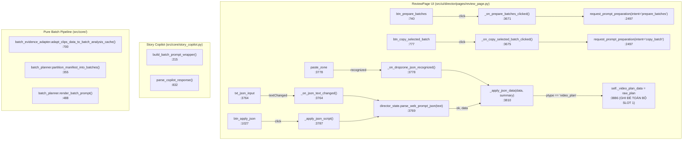
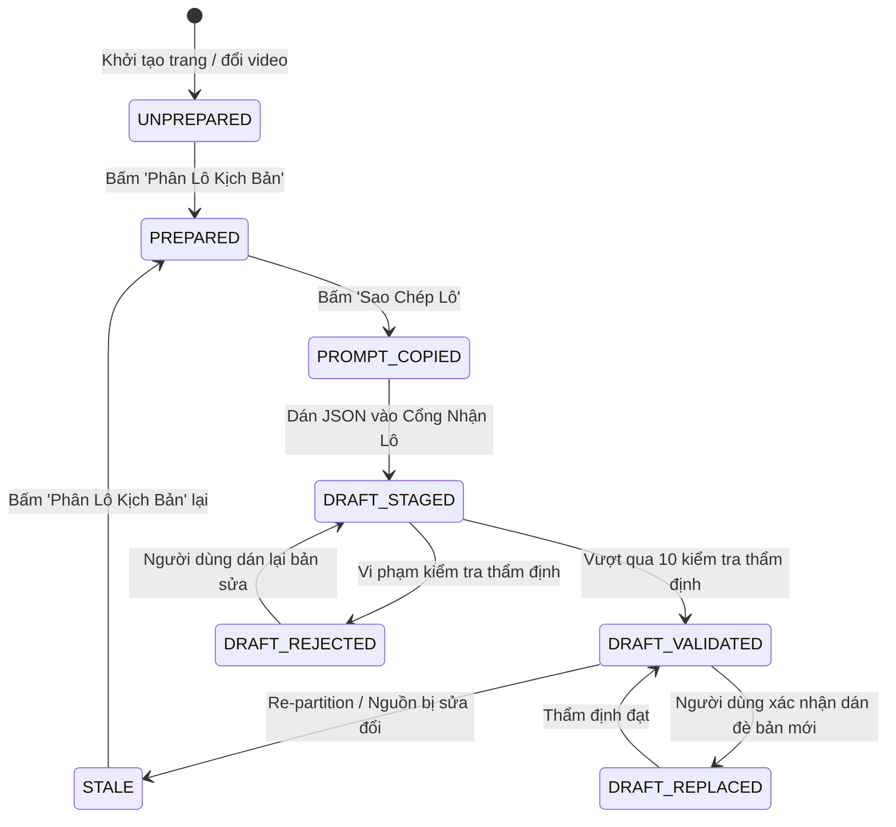

# G06-06A4-D — Thiết Kế Kiến Trúc: Nhận Batch Drafts và Tổng Hợp Project có Provenance

- **TASK_ID:** `G06-06A4-D`
- **Trạng thái:** `ACCEPTED_DIRECTION_WITH_BINDING_CORRECTIONS` (Đã cập nhật hiệu đính theo `06A4-codex-decisions.md` trong task G06-06A4a-I)
- **Chế độ:** `DESIGN_ONLY` (ZERO production edits, 0 test runs, 0 inference, 0 network, 0 Resolve, 0 desktop)
- **Cấp độ Worker:** `HIGH`
- **Thời gian hoàn thành:** 2026-10-28T18:45:00+07:00
- **Tài liệu nghiệm thu tham chiếu:** [`docs/architecture/06A3-gate-acceptance.md`](file:///media/vanntruongg/Documents/Development/Python/dự án cá nhân/ResolveFlow-Assistant/docs/architecture/06A3-gate-acceptance.md)
- **Workorder:** [`.bridge/task.md`](file:///media/vanntruongg/Documents/Development/Python/dự án cá nhân/ResolveFlow-Assistant/.bridge/task.md)
- **Kiến trúc tiền đề:** [`docs/architecture/06A3-batch-prompt-consumer-design.md`](file:///media/vanntruongg/Documents/Development/Python/dự án cá nhân/ResolveFlow-Assistant/docs/architecture/06A3-batch-prompt-consumer-design.md), [`src/core/batch_planner.py`](file:///media/vanntruongg/Documents/Development/Python/dự án cá nhân/ResolveFlow-Assistant/src/core/batch_planner.py), [`src/core/batch_evidence_adapter.py`](file:///media/vanntruongg/Documents/Development/Python/dự án cá nhân/ResolveFlow-Assistant/src/core/batch_evidence_adapter.py)

---

## 1. TỔNG QUAN VÀ BỐI CẢNH KIẾN TRÚC

Hệ thống phân lô bằng chứng kịch bản G06 đã hoàn thành các giai đoạn nền tảng:
1. **G06-06A1 (Pure Bounded Batch Planner):** Đóng băng hợp đồng chia lô có giới hạn (`BoundedBatch`, evidence envelope $\le 32,768$ UTF-8 bytes, phân mảnh clip dài $t > 600$s, xử lý unaccounted clips).
2. **G06-06A2 (Pure Evidence Adapter):** Đóng băng adapter thích ứng clips_data sang A1 với positive authority, observation_kind="segment", deep coverage validation, và canonical semantic signatures.
3. **G06-06A3 (Batch Prompt Consumer & UI):** Hoàn thành chuẩn bị, xem trước và sao chép từng lô kịch bản (`prepare_batches`, `copy_batch`) với Required Success Envelope Gate và đã được nghiệm thu chính thức tại [`docs/architecture/06A3-gate-acceptance.md`](file:///media/vanntruongg/Documents/Development/Python/dự án cá nhân/ResolveFlow-Assistant/docs/architecture/06A3-gate-acceptance.md) (298 tests passed, desktop smoke 5/5 cases passed).

### Vấn Đề Kiến Trúc Cốt Lõi Của Bước Tiếp Theo (06A4)
Hiện tại, người dùng đã có thể bấm *"Phân Lô Kịch Bản"* và bấm *"Sao Chép Lô"* để lấy prompt dán vào AI bên ngoài (ChatGPT, Claude, hoặc Local LLM). Tuy nhiên:
- **Chưa có cổng tiếp nhận kết quả (No Batch Draft Receiver):** Người dùng nhận kết quả JSON từ AI cho từng lô nhưng không có nơi tiếp nhận tương ứng theo từng batch.
- **Lỗ hổng phân loại sai lệch nghiêm trọng (Legacy Overwrite Risk):** Nếu người dùng dán JSON của một lô vào ô nhập JSON chung hiện tại (`txt_json_input`), hệ thống sẽ nhận diện nhầm cấu trúc `"timeline_segments"` và coi đó là kịch bản của **TOÀN BỘ DỰ ÁN** (Slot 1 Video Plan), ghi đè và làm mất sạch kịch bản của các phần còn lại! Đồng thời parser cũ bỏ qua `batch_id` và gán nhầm toàn bộ `clip_id` thành `clip_index=1`.
- **Thiếu sổ theo dõi tiến độ (No Progress / Draft Ledger):** Không có cơ chế ghi nhận lô nào đã nạp kịch bản, lô nào đang chờ, lô nào bị lỗi, và tổng thể tiến độ đạt bao nhiêu phần trăm.
- **Chưa có cơ chế tổng hợp kịch bản dự án có ngân sách (No Bounded Synthesis):** Chưa có luồng kết nối các bản thảo của từng lô (Local Batch Drafts) thành một bản phác thảo tổng thể toàn dự án (Project Overview / Master Plan) mà vẫn tôn trọng ngân sách tối đa $32,768$ UTF-8 bytes.

Nhiệm vụ **G06-06A4-D** thiết lập thiết kế kiến trúc toàn diện cho việc:
1. Nhận bản thảo JSON từng lô an toàn (Safe Batch Draft Receiver).
2. Thẩm định hình học và xuất xứ nghiêm ngặt trước khi nạp vào bộ nhớ (Validate-Before-Mutate).
3. Quản lý tiến độ bằng sổ theo dõi bất biến (Batch Draft Ledger).
4. Khắc phục triệt để nguy cơ ghi đè của parser legacy.
5. Xây dựng mô hình phân cấp bằng chứng (Evidence $\to$ Clip $\to$ Batch Draft $\to$ Project Overview) có ngân sách kiểm soát.

---

## 2. KHẢO SÁT MÃ NGUỒN THỰC TẾ (CODE-VERIFIED CALLGRAPH & DISCOVERY)

### 2.1. Callgraph Hiện Hành & Các Điểm Neo Thực Tế



### 2.2. Chi Tiết Thực Trạng Mã Nguồn (Exact file:hàm:dòng)

1. **`src/core/batch_planner.py`:**
   - `BatchBudgetConfig` (:52–111): `max_prompt_bytes=32768`, `target_batch_duration_sec=600.0`, `window_partition_sec=600.0`.
   - `EvidenceWindowSummary` (:114–173): `window_id`, `start_sec`, `end_sec`, `speech_summary`, `visual_summary`, `clipped`.
   - `ClipBatchItem` (:175–239): `clip_id`, `duration_sec`, `source_in_sec`, `source_out_sec`, `partition_index`, `total_partitions`, `windows: Tuple[EvidenceWindowSummary, ...]`.
   - `BoundedBatch` (:241–282): `batch_id`, `batch_index`, `manifest_id`, `project_name`, `items: Tuple[ClipBatchItem, ...]`, `total_duration_sec`, `distinct_clip_count`, `content_signature`.
   - `UnaccountedClipIssue` (:284–296): `clip_id`, `reason`, `message`.
   - `render_batch_prompt(batch)` (:488–540): Trích xuất exact JSON evidence envelope nằm giữa `prompt_prefix` và `prompt_suffix`.

2. **`src/core/batch_evidence_adapter.py`:**
   - `adapt_clips_data_to_batch_analysis_cache` (:700–845): Chuyển đổi dữ liệu producer G05 sang `BatchAnalysisCache` của A1 với `AdaptedBatchSnapshot` (:81–95).
   - Đảm bảo tính toán độc lập `analysis_cache`, `issues`, và `audit_by_clip`.

3. **`src/ui/director/workers/prompt_preparation_worker.py`:**
   - `PreparedBatchItem` (:470–498): `batch_id`, `batch_index`, `distinct_clip_count`, `total_duration_sec`, `rendered_prompt`, `rendered_bytes`, `rendered_sha256`, `content_signature`, `clip_ids`.
   - `PreparedBatchSnapshot` (:500–543): `manifest_id`, `project_name`, `snapshot_id`, `formatter_policy`, `total_batches`, `planned_items_count`, `distinct_planned_clips_count`, `planned_clip_ids`, `unaccounted_clip_ids`, `batches`, `baseline_sources`, `evidence_context_signature`, `ui_context_signature`.
   - `PromptPreparationWorker.run()` (:642–1345): Thực thi pre-stat, producer `build_clips_data`, adapter A2, planner A1, post-stat, và final-stat trước khi emit terminal payload.

4. **`src/core/story_copilot.py`:**
   - `build_batch_prompt_wrapper` (:215–330): Sinh prefix và suffix cho prompt lô. Tại dòng 307–323, yêu cầu AI trả về schema:
     ```json
     {
       "manifest_id": "<manifest_id_chinh_xac_tu_envelope_tren>",
       "batch_id": "<batch_id_chinh_xac_tu_envelope_tren>",
       "batch_strategy_summary": "<giai_thich_ngan_gon_chien_luoc_bien_tap_lo_nay>",
       "timeline_segments": [
         {
           "clip_id": "<clip_id_tu_danh_sach_tren>",
           "start_sec": 0.0,
           "end_sec": 1.0,
           "action": "keep",
           "role": "<dialogue_hoac_broll_hoac_visual_transition>",
           "note": "<ly_do_bien_tap_chi_tiet>"
         }
       ]
     }
     ```
   - `parse_copilot_response` (:832–1005): Parser V1 cũ. Chỉ đọc `s.get("clip_index", 1)` và `s.get("clip_name", "")`. **HOÀN TOÀN BỎ QUA** trường `batch_id` và `clip_id`, không tạo được mối liên kết giữa batch và timeline.

5. **`src/core/queue.py` & `src/core/story_pipeline.py` (Khảo Sát Khung Sẵn Có):**
   - `src/core/queue.py` (:1–58): Định nghĩa `BatchJob` với các trường `video_path`, `status`, `progress`. Đây chỉ là một hàng đợi xử lý tệp video đơn lẻ thuần túy, không có khái niệm `batch_id`, `manifest_id`, prompt hay cuts.
   - `src/core/story_pipeline.py` (:1–271): Định nghĩa `ChapterResult` và `MasterStoryPipeline` dựa trên nhóm thư mục (`FolderGroup`). Cấu trúc này dành cho dựng cuốn chiếu theo thư mục đĩa, hoàn toàn không tương thích với mô hình phân mảnh thời gian bounded A1.
   - **Kết luận:** **TUYỆT ĐỐI KHÔNG TÁI SỬ DỤNG** `queue.py` hay `story_pipeline.py` để tránh làm biến dạng kiến trúc; cần một cấu trúc Ledger chuyên biệt cho G06.

### 2.3. Lỗ Hổng Tiếp Nhận JSON Legacy: Trình Tự Gây Xung Đột & Ghi Đè Ngầm

Khảo sát chi tiết hành vi khi người dùng dán JSON của một Lô vào giao diện hiện tại:
1. **Trigger:** Người dùng dán chuỗi JSON của Lô 2 vào `ReviewPage.txt_json_input` hoặc thả file vào `ReviewPage.paste_zone`.
2. **Kích hoạt hàm:** `_apply_json_script()` (:3787) gọi `parse_web_prompt_json(text, target_slot=slot)` (:3797) trong `src/ui/director/director_state.py:242`.
3. **Phân loại sai (Misclassification):**
   - Trong `director_state.py`, hàm `_is_video_plan_dict(data)` (:168) kiểm tra:
     ```python
     return any(k in data for k in [
         "timeline_segments", "global_hook", "broll_inserts", "sfx_inserts",
         "scenes", "timeline", "segments", "video_plan"
     ])
     ```
   - Vì JSON của batch draft chứa trường `"timeline_segments"`, hàm trả về `True`!
   - `director_state.py` gói JSON này thành: `{"type": "video_plan", "data": data}`.
4. **Ghi đè hủy hoại Slot 1 (Destructive Slot 1 Mutation):**
   - `ReviewPage._apply_json_data(data, summary)` (:3810) kiểm tra:
     ```python
     elif ptype == "video_plan":
         self._video_plan_data = raw_plan   # <-- DÒNG 3886: GHI ĐÈ SLOT 1 DỰ ÁN TOÀN CỤC!
     ```
   - Toàn bộ kế hoạch Video Plan V1 của dự án bị ghi đè hoàn toàn bằng một mẩu nhỏ của Lô 2 (ví dụ: chỉ 3 clip trên tổng số 50 clip).
5. **Đổ vỡ nhận diện Clip (ID Collapsing):**
   - Prompt xuất ra chứa `clip_id` ("C_LONG_1201").
   - Parser `parse_copilot_response` đọc `s.get("clip_index", 1)`. Do JSON batch không có trường `clip_index`, nó fallback về giá trị `1`.
   - Kết quả: Tất cả các phân đoạn trong Lô 2 bị gán nhầm vào Clip 1 của dự án!
6. **Giải pháp kiến trúc bắt buộc cho G06-06A4:**
   - Phải có **Smart Guard Rejection / Routing**: Khi phát hiện root JSON có key `"batch_id"`, hàm phân loại `parse_web_prompt_json` và slot `_apply_json_script` **BẮT BUỘC KHÔNG ĐƯỢC PHÉP** coi đó là `video_plan` của Slot 1.
   - Nếu người dùng bấm dán vào Slot 1, phải từ chối rõ ràng kèm thông báo tiếng Việt: *"⚠ Đây là bản thảo kịch bản của Lô {batch_id}. Vui lòng nạp vào Cổng Nhận Kịch Bản Phân Lô."*
   - Cung cấp cổng tiếp nhận riêng (Dedicated Batch Draft Intake Port) chuyển dữ liệu vào sổ theo dõi lô (`_batch_drafts_ledger`).

---

## 3. BẢN HỢP ĐỒNG KỊCH BẢN PHÂN LÔ & CỔNG TIẾP NHẬN AN TOÀN (DRAFT CONTRACT & SAFE RECEIVER)

### 3.1. Cấu Trúc Hợp Đồng Bản Thảo Phân Lô Bounded (Batch Draft Schema v1.0)

Bản hợp đồng dữ liệu JSON trả về từ mô hình AI bên ngoài được chuẩn hóa nghiêm ngặt như sau:

```json
{
  "$schema": "chundvc_batch_draft_v1",
  "manifest_id": "M_20261028_091522_A1B2",
  "batch_id": "B02",
  "snapshot_id": "snap_9f8a3b1c2d4e5f6a",
  "batch_strategy_summary": "Tập trung khai thác cảnh quay flycam trên đèo và nhịp hội thoại giới thiệu lộ trình ngày thứ hai.",
  "timeline_segments": [
    {
      "clip_id": "C_LONG_1201",
      "start_sec": 615.0,
      "end_sec": 630.0,
      "action": "keep",
      "speed": 1.0,
      "role": "dialogue",
      "note": "Giữ trọn vẹn câu nói hướng dẫn cua nguy hiểm",
      "source_window_ref": "W_C_LONG_1201_002"
    },
    {
      "clip_id": "C_LONG_1201",
      "start_sec": 700.0,
      "end_sec": 712.5,
      "action": "speedup",
      "speed": 2.0,
      "role": "visual_transition",
      "note": "Tua nhanh đoạn xe chạy thẳng qua cánh đồng",
      "source_window_ref": "W_C_LONG_1201_003"
    }
  ]
}
```

### 3.2. Quy Tắc Thẩm Định Nghiêm Ngặt Trước Khi Tiếp Nhận (Validate-Before-Mutate)

Để đảm bảo an toàn tuyệt đối cho hệ thống, một bộ thẩm định thuần túy (Pure Validation Function: `validate_batch_draft_payload`) sẽ kiểm tra tuần tự 10 điều kiện tiên quyết:

| STT | Kiểm Tra Thẩm Định | Điều Kiện Đạt Chuẩn (Positive Assert) | Xử Lý Khi Vi Phạm (Fail-Closed) |
|---|---|---|---|
| **1** | **Cấu trúc JSON & Kích thước** | Dữ liệu là `dict`, không rỗng, dung lượng UTF-8 $\le 65,536$ B (2x prompt cap). | Từ chối: `ERR_MALFORMED_JSON` hoặc `ERR_OVERSIZE_PAYLOAD`. |
| **2** | **Căn cước Manifest (`manifest_id`)** | Chuỗi `str` không rỗng, khớp chính xác `_prepared_batch_snapshot.manifest_id`. | Từ chối: `ERR_MANIFEST_MISMATCH`. Ngăn dán nhầm kịch bản từ dự án khác. |
| **3** | **Căn cước Snapshot (`snapshot_id`)** | Prompt 06A3 chưa yêu cầu AI trả `snapshot_id`, do đó không ép AI phải có trường này. Nếu payload có `snapshot_id`: bắt buộc khớp exact với `_prepared_batch_snapshot.snapshot_id`. Quyền sở hữu đối soát snapshot thuộc về app. | Từ chối: `ERR_STALE_SNAPSHOT`. Ngăn nạp kịch bản cũ khi đã re-partition. |
| **4** | **Căn cước Lô (`batch_id`)** | Chuỗi `str` khớp chính xác với một `batch_id` tồn tại trong snapshot hiện tại. | Từ chối: `ERR_UNKNOWN_BATCH_ID`. |
| **5** | **Xuất xứ Clip (`clip_id`)** | Mọi `clip_id` trong `timeline_segments` bắt buộc thuộc `batch.clip_ids` của lô đó. | Từ chối: `ERR_FOREIGN_CLIP_ID`. Cấm AI tự bịa `clip_id` lạ. |
| **6** | **Tính Hữu Hạn Thời Gian** | Mọi `start_sec`, `end_sec`, `speed` là `float`/`int` thực sự hữu hạn (không `bool`, không `NaN`, `Inf`). | Từ chối: `ERR_NONFINITE_TIMESTAMP`. |
| **7** | **Hình Học Thời Gian (Geometric Bounds)** | `0.0 <= start_sec < end_sec`. Tuyệt đối không áp đặt ngưỡng tối thiểu $0.1$s tùy tiện; bảo toàn các phân đoạn ngắn hợp lệ. | Từ chối: `ERR_REVERSED_RANGE` hoặc `ERR_ZERO_DURATION`. |
| **8** | **Kẹp Khung Phân Đoạn Nguồn (Source Partition Bounds)** | `start_sec >= item.source_in_sec` VÀ `end_sec <= item.source_out_sec` nằm trọn vẹn trong khoảng phân đoạn nguồn được duyệt. Bác bỏ sai số $\epsilon = 0.05$s và không clamping. Vi phạm biên bị từ chối dứt khoát. | Từ chối: `ERR_OUT_OF_PARTITION_BOUNDS`. Không cho phép cắt lẹm sang lô khác. |
| **9** | **Hành Động Hợp Lệ (Action & Speed)** | `action` thuộc enum (`keep`, `cut`, `broll`, `speedup`, `hold`). Nếu `speedup`: `1.0 < speed <= 16.0`. | Chuẩn hóa hoặc từ chối: `ERR_INVALID_ACTION`. |
| **10** | **Tóm Tắt Chiến Lược Bắt Buộc** | `batch_strategy_summary` là `str` không rỗng (tối thiểu 10 ký tự, tối đa 2000 ký tự). | Từ chối: `ERR_MISSING_BATCH_SUMMARY`. |

### 3.3. Tách Biệt Ba Tầng Dữ Liệu Độc Lập

Kiến trúc phân định rạch ròi ba trạng thái dữ liệu:
1. **`Staged Raw Draft` (Dữ liệu Thô):** Chuỗi JSON text người dùng dán vào ô tiếp nhận, chưa được thẩm định.
2. **`Validated Batch Draft` (Bản Thảo Lô Hợp Lệ):** DTO bất biến (`@dataclass(frozen=True) ValidatedBatchDraft`) đã vượt qua 10 bước thẩm định, được lưu trữ trong sổ theo dõi `_batch_drafts_ledger[batch_id]`.
3. **`Project Master Edit Plan` (Kế Hoạch Tổng Thể Dự Án):** Kế hoạch ghép nối toàn diện sau khi người dùng chủ động bấm nút *"Tổng Hợp Kịch Bản Master"* (Deferred 06C).

> [!IMPORTANT]
> **Nguyên Tắc Không Tự Ý Đột Biến (Zero Implicit Mutation):**
> Việc nạp thành công một `ValidatedBatchDraft` tuyệt đối **KHÔNG** tự ý thay đổi dữ liệu của Slot 1 (`_video_plan_data`), Slot 2 (`_kinetic_plan_data`), không gọi controller dispatch, và không tương tác DaVinci Resolve API.

### 3.4. Xử Lý Khi Dán Đè (Non-blocking Explicit Opt-in)
- Nếu người dùng nạp một bản thảo mới cho một Lô đã có kịch bản hợp lệ trong sổ theo dõi:
  - **Idempotent same-digest check:** Nếu nội dung bản thảo mới tạo ra cùng `draft_digest` với bản thảo hiện có $\implies$ no-op, không yêu cầu cấp quyền ghi đè, hiển thị thông báo: *"Bản thảo Lô {index} trùng khớp nội dung bản thảo đã có (Idempotent no-op)."*
  - **Different digest without consent:** Nếu `draft_digest` khác nhau và checkbox `chk_replace_existing_draft` chưa được tích chọn $\implies$ từ chối ghi đè, bảo toàn 100% bản thảo cũ trong sổ theo dõi, thông báo hướng dẫn: *"Giữ nguyên bản thảo cũ của Lô {index} (chưa đánh dấu 'Ghi đè bản thảo đã có của lô này')."*
  - **Different digest with opt-in consent:** Nếu checkbox `chk_replace_existing_draft` được đánh dấu $\implies$ cập nhật bản thảo mới vào sổ theo dõi `_batch_drafts_ledger`.
  - **Non-blocking Rule:** Tuyệt đối không sử dụng `QMessageBox.question` gây chặn luồng sự kiện Qt (blocking event loop) hoặc tạo race conditions trong asynchronous intake.

### 3.5. Cổng Đối Soát Toàn Vẹn & Quyền Hạn Sổ Theo Dõi (Ledger Authority Gate)
- **`verify_validated_entry_integrity` Pure SSOT Helper:** UI client tại terminal callback `_on_prompt_preparation_finished` không được tin tưởng mù quáng `result["validated_entry"]` chỉ vì có nhãn "validated". Toàn bộ bản ghi phải được đối soát lại qua pure helper:
  - Kiểm tra các mốc thời gian của từng cut nằm trọn vẹn trong khoảng phân đoạn `source_ranges` hợp lệ của lô (chặn đứng forged cut `end_sec=9999`).
  - Kiểm tra toàn vẹn định danh: `manifest_id`, `snapshot_id`, `batch_id`, `binding_mode`.
  - Re-hash và kiểm tra tính nhất quán của `draft_digest` và `raw_payload_sha256`.
  - Bất kỳ sai lệch nào đều dẫn đến từ chối cập nhật sổ theo dõi (0 ledger publish).

### 3.6. Bằng Chứng Hình Học & Chống Delimiter Collision Trong Snapshot ID
- **Canonical Structured Serialization:** Đối với các snapshot có geometry (`source_ranges`), hàm `compute_snapshot_id` chuyển đổi từng range thành JSON chuẩn hóa có thứ tự khóa (`sort_keys=True`, `separators=(",", ":")`, `ensure_ascii=False`) và áp dụng định dạng độ dài tiền tố `range_v2:{len}:{json}`.
- Cơ chế này triệt tiêu hoàn toàn nguy cơ trùng lặp chữ ký do delimiter collision (ví dụ: `('a,b','c')` vs `('a','b,c')`), đồng thời bảo toàn tính tương thích ngược cho các snapshot cũ không có geometry.

---

## 4. MÔ HÌNH PHÂN CẤP BẰNG CHỨNG & TỔNG HỢP DỰ ÁN CÓ NGÂN SÁCH (HIERARCHY & BOUNDED SYNTHESIS)

### 4.1. Cây Phân Cấp Bằng Chứng Xuất Xứ (4-Tier Provenance Hierarchy)

```
[Level 1: Evidence Windows (A1/A2)]
   ├── W_001 (0s-15s: Thoại mở đầu)
   ├── W_002 (15s-30s: Thoại giới thiệu)
   └── W_003 (30s-45s: B-roll phong cảnh)
         │
         ▼
[Level 2: Clip Partitions & Bounded Batches (A1/A3)]
   ├── Batch B01: Clip C01 (0s - 600s, 40 windows)
   ├── Batch B02: Clip C01 (600s - 1200s, 40 windows)
   └── Batch B03: Clip C01 (1200s - 1201s, 1 window)
         │  (External AI Web / Local LLM Inference)
         ▼
[Level 3: Validated Batch Drafts (A4)]
   ├── Draft B01: 8 cuts, strategy: "Mở đầu nhanh, tập trung lời dẫn"
   ├── Draft B02: 12 cuts, strategy: "Đoạn vượt đèo, đan xen B-roll"
   └── Draft B03: 2 cuts, strategy: "Tổng kết chuyến đi và chào tạm biệt"
         │  (Deterministic Hierarchical Synthesis)
         ▼
[Level 4: Project Overview & Master Assembly Input (A4)]
   └── Master Project Prompt / Context:
       - Single Byte Authority (<= 32,768 UTF-8 bytes)
       - Provenance Registry (Batch B01..B03 references)
       - Structured Strategy Highlights (NO raw transcript replay)
```

### 4.2. Nguyên Tắc Tổng Hợp Không Lặp Lại Bằng Chứng Thô (No Raw Transcript Replay)
- Khi toàn bộ (hoặc một số) Lô đã có `ValidatedBatchDraft`, người dùng có nhu cầu dựng một **Master Overview Prompt** để yêu cầu AI tổng hợp mạch chuyện toàn dự án hoặc chuẩn bị cho khâu EditPlan.
- **Vấn đề:** Nếu đưa toàn bộ transcript và visual descriptions của 3 giờ footage vào prompt tổng hợp, kích thước sẽ vượt xa $32,768$ UTF-8 bytes (thậm chí lên tới hàng trăm KB).
- **Giải pháp:** Luồng tổng hợp cấp dự án **CHỈ TRÍCH XUẤT**:
  1. `batch_strategy_summary` của từng batch draft đã nhận.
  2. Bảng thống kê các mốc thời gian đã chọn (`timeline_segments`: start, end, role, note ngắn).
  3. Danh sách các clip chưa phân lô (`unaccounted_clips`) và lý do.
- Toàn bộ nội dung ngữ nghĩa này được gắn nhãn minh bạch: `[AI_DRAFT_STRATEGY]` để phân biệt với dữ liệu sự thật khách quan của nguồn `[MEASURED_SOURCE_BOUNDS]`.

### 4.3. Kiểm Soát Trần Dung Lượng Đơn Lẻ (Single Byte Authority: 32,768 Bytes)
- Toàn bộ chuỗi prompt tổng hợp dự án được kết xuất qua thuật toán kiểm soát byte đơn lẻ tương tự A1/A3.
- Giới hạn cứng: `max_prompt_bytes = 32768` UTF-8 bytes.
- **Xử lý khi vượt trần (Graceful Hierarchical Omission):**
  - Nếu tổng hợp các summaries của các lô vượt quá 32,768 bytes (xảy ra khi dự án có hàng chục lô rất lớn):
    1. Thu gọn ghi chú biên tập `note` của từng segment xuống tối đa 40 ký tự.
    2. Nếu vẫn vượt: chỉ giữ lại `batch_strategy_summary` và thời lượng tổng thể của lô, lược bỏ danh sách cuts chi tiết.
    3. Ghi rõ cảnh báo minh bạch trong prompt: `[LƯU Ý HỆ THỐNG: Chi tiết cuts của Lô B04-B10 được thu gọn do chạm trần dung lượng 32KB. Bản thảo gốc vẫn được bảo toàn nguyên vẹn trong sổ theo dõi.]`
  - Tuyệt đối **KHÔNG ÂM THẦM CẮT NGANG DÒNG JSON** làm lỗi cú pháp.

### 4.4. Ma Trận Trạng Thái Tiến Độ 7 Nấc (Progress Lifecycle Matrix)

Hệ thống phân định 7 trạng thái vòng đời logic của từng Lô:



| Mã Trạng Thái | Tên Trạng Thái | Điều Kiện Kích Hoạt | Chỉ Báo Trực Quan Trên UI | Ý Nghĩa Nghiệm Thu |
|---|---|---|---|---|
| `UNPREPARED` | Chưa phân lô | Chưa bấm nút chuẩn bị hoặc vừa đổi danh sách video. | Nút copy mờ, combobox rỗng. | 0 batches. |
| `PREPARED` | Đã phân lô | Worker chuẩn bị lô hoàn tất, snapshot có hiệu lực. | Combobox nạp N lô, nút copy bật. | Prompt sẵn sàng. |
| `PROMPT_COPIED` | Đã chép prompt | Người dùng click nút *"Sao Chép Lô"*. | Badge Lô: `[Đã sao chép prompt]`. | Đang đợi AI bên ngoài xử lý. **CHƯA ĐƯỢC COI LÀ XONG.** |
| `DRAFT_STAGED` | Đã dán bản thảo | Dữ liệu vừa dán vào ô tiếp nhận, đang validate. | Nhãn: `⏳ Đang thẩm định bản thảo...`. | Kiểm tra trung gian. |
| `DRAFT_VALIDATED` | Bản thảo hợp lệ | Đạt 10/10 tiêu chí thẩm định, đã nạp vào ledger. | Badge Lô: `✓ Đã nhận kịch bản (X đoạn)`. | Sẵn sàng cho khâu tổng hợp. |
| `DRAFT_REJECTED` | Từ chối bản thảo | Vi phạm bất kỳ điều kiện nào trong 10 kiểm tra. | Badge Lô: `✕ Kịch bản lỗi: [lý do tiếng Việt]`. | Không nạp vào ledger. |
| `STALE` | Lỗi thời / Vô hiệu | File nguồn đổi hoặc người dùng chạy phân lô mới. | Badge Lô: `⚠ Cần phân lô lại (Nguồn đổi)`. | Ngăn ngừa dùng nhầm. |

---

## 5. THIẾT KẾ SỔ THEO DÕI BẢN THẢO & QUY TẮC VÔ HIỆU HÓA (JSON LEDGER & INVALIDATION)

### 5.1. Cấu Trúc Sổ Theo Dõi Bản Thảo Phân Lô (Batch Draft Ledger Schema)

Sổ theo dõi được thiết kế dưới dạng đối tượng cấu trúc thuần túy (Immutable Data Structure):

```python
@dataclass(frozen=True)
class ValidatedSegmentCut:
    clip_id: str
    start_sec: float
    end_sec: float
    duration_sec: float
    action: str
    speed: float
    role: str
    note: str
    source_window_ref: Optional[str] = None

@dataclass(frozen=True)
class ValidatedBatchDraftEntry:
    batch_id: str
    batch_index: int
    manifest_id: str
    snapshot_id: str
    received_at: str
    raw_payload_sha256: str
    batch_strategy_summary: str
    segments: Tuple[ValidatedSegmentCut, ...]
    total_cuts_count: int
    total_selected_duration_sec: float

@dataclass(frozen=True)
class BatchDraftLedger:
    ledger_version: int
    project_name: str
    manifest_id: str
    snapshot_id: str
    created_at: str
    updated_at: str
    total_batches_expected: int
    entries_by_batch_id: Mapping[str, ValidatedBatchDraftEntry]
    unaccounted_clip_ids: Tuple[str, ...]
```

### 5.2. Quản Lý Trạng Thái: In-Memory MVP vs Durable Persistence
- **Giai đoạn Slice 1 (In-Memory MVP):**
  - Sổ theo dõi được lưu trữ trực tiếp trong bộ nhớ của `ReviewPage` thông qua thuộc tính: `self._batch_drafts_ledger: Dict[str, ValidatedBatchDraftEntry] = {}`.
  - Giữ vòng đời gắn chặt với phiên làm việc của giao diện; không tạo thêm rủi ro đĩa hay khóa tệp trong bước đầu.
- **Phân Định Bền Vững & Quyền Sở Hữu Đĩa (Persistence Scope):**
  - `session_root` trong harness là fixture kiểm thử tạm thời, **KHÔNG PHẢI** là project durable owner / path đã chốt.
  - Việc ghi bền vững ra đĩa (durable disk persistence) tạm hoãn (`PROPOSED_DEFERRED`) cho đến khi có cấu hình thư mục lưu trữ dự án chính thức.
  - Khi triển khai, sẽ ghi nguyên tử (Atomic Write qua file `.tmp` + `os.replace`) vào vị trí hợp lệ; tuyệt đối không lưu vào repo-relative `.cache`, thư mục chứa media của người dùng, hay can thiệp vào cache Whisper G05.

### 5.3. Chiến Lược Vô Hiệu Hóa Đồng Bộ (Synchronized Invalidation Strategy)
- **Đổi Danh Sách Video / Re-partition:**
  - Khi người dùng thêm/bớt video hoặc đổi tham số phân lô và bấm *"Phân Lô Kịch Bản"* mới:
  - Một `snapshot_id` mới được sinh ra.
  - Sổ theo dõi `_batch_drafts_ledger` tự động đánh dấu toàn bộ các bản thảo cũ là `STALE` (không xóa ngay, hiển thị badge màu vàng để người dùng có thể tham khảo lại nếu muốn, nhưng khóa không cho sáp nhập vào snapshot mới).
- **Phát Hiện File Nguồn Bị Biến Đổi (Source Tamper / Inode Mismatch):**
  - Khi worker recheck phát hiện file nguồn bị sửa đổi metadata (size, mtime, inode):
  - Toàn bộ snapshot bị invalidate (`_invalidate_prepared_batches`).
  - Toàn bộ ledger chuyển sang trạng thái `LOCKED_SOURCE_CHANGED` với thông báo tiếng Việt: *"⚠ Tệp nguồn đã thay đổi. Toàn bộ bản thảo phân lô tạm thời bị khóa cho đến khi quét lại nguồn."*

---

## 6. ĐỀ XUẤT LÁT CẮT TRIỂN KHAI DUY NHẤT & CÁC CHUỖI TRACE KIỂM THỬ (FINITE SLICE & FIXTURES)

### 6.1. Lát Cắt Hiện Hành (06A4a-I) & Đề Xuất Lát Cắt Tiếp Theo (Next Vertical Slice)

#### 6.1.1. Lát Cắt Đang Triển Khai: `G06-06A4a-I — Safe Batch JSON Slot Guard`
- **Mục tiêu hẹp:** Đóng ngay lỗ hổng routing và ghi đè phá hủy Slot 1 / Slot 2 khi người dùng dán Batch JSON.
- **Phạm vi nghiêm ngặt:** Chỉ 2 production modules:
  1. `src/ui/director/director_state.py`: Cài đặt pure shared helper `contains_batch_draft_plan(data)` và đặt guard trong `parse_web_prompt_json` trước mọi phân nhánh target slot, từ chối với thông báo hướng dẫn trung thực.
  2. `src/ui/director/pages/review_page.py`: Đặt guard chặn mutation ở đầu `_apply_json_data`, `_on_dropzone_json_recognized`, và `load_from_config`, bảo toàn 100% last-good state.
- **Trạng thái Full Receiver:** Các chức năng Full Batch Receiver, Draft Ledger, và Master Synthesis tiếp tục giữ trạng thái `PROPOSED_DEFERRED`. Không tạo scaffold rỗng trong slice này.

#### 6.1.2. Đề Xuất Duy Nhất Cho Lát Cắt Tiếp Theo: `G06-06A4b-I — Dedicated Intake & Typed Geometry Staging`
- **Yêu cầu hình học chuẩn xác (Prepared Geometry Specification):**
  - Geometry chuẩn bị cho từng lô bắt buộc là một tuple các immutable partition ranges theo cấu trúc A1 `ClipBatchItem`: mỗi item gồm `(clip_id, source_in_sec, source_out_sec, partition_index, total_partitions, optional_window_ids)`.
  - Một lô thường chứa nhiều clips hoặc nhiều phân mảnh của clip dài, vì vậy **tuyệt đối không dùng scalar bounds đơn lẻ cho toàn bộ batch** và **không được suy diễn từ whole ClipManifest range**.
- **Cấu trúc Pure Core Contracts & Phân định Dependency:**
  - Bộ thẩm định `validate_batch_draft_payload` trong tương lai phải là Pure Core Logic độc lập, chỉ nhận các pure DTO / context values nguyên thủy, **tuyệt đối không import `PreparedBatchSnapshot` hay bất kỳ Qt/UI DTO nào từ `src.ui/...`**.
  - Worker `PromptPreparationWorker` sẽ chuyển typed geometry trực tiếp từ kế hoạch A1 (`BoundedBatch.items`) sang DTO. Việc bổ sung trường typed geometry này vào worker là một dependency sản xuất thực tế bắt buộc.
  - Phạm vi lát cắt tiếp theo ưu tiên đúng **3 modules**:
    1. `src/core/batch_draft_contracts.py` (Mới, Pure Logic): Hợp đồng DTO `ValidatedBatchDraftEntry` và pure validator `validate_batch_draft_payload(payload, expected_geometry, ...)`.
    2. `src/ui/director/workers/prompt_preparation_worker.py`: Bổ sung tuple typed partition geometry từ A1 sang `PreparedBatchItem`.
    3. `src/ui/director/pages/review_page.py`: Cổng dán kịch bản phân lô riêng biệt trong `frame_batch_section` kèm sổ theo dõi in-memory `_batch_drafts_ledger` và cập nhật badge trạng thái trên `cbo_batch_selector`.
    *(Giữ nguyên `director_state.py` vì guard đã hoàn thành ở 06A4a; không mở module thứ 4 nếu không có lý do kỹ thuật thực tế).*
- **Chính sách Đối soát Xuất xứ & Proofs (App-Owned Association):**
  - Các trường `snapshot_id`, `source_window_ref`, `speed` hiện chưa có trong exported prompt 06A3, do đó không được ép AI phải trả về như một bằng chứng bắt buộc.
  - Khi payload AI không có `snapshot_id`, sự liên kết thuộc quyền sở hữu của ứng dụng (`app-owned association` đối chiếu với snapshot đang active); việc kiểm tra shape/bounds chỉ xác nhận tính hợp lệ hình học, không chứng minh được tính tươi mới (freshness) qua các lần re-partition. Giao diện người dùng tương lai sẽ hiển thị xác nhận tường minh khi cần.
  - Tránh triệt để nghịch lý vòng tròn: `snapshot_id` phụ thuộc `render_digest`, trong khi `rendered_prompt` lại chứa `snapshot_id`.
- **Giới hạn phạm vi:** Ledger disk persistence, Master Project Synthesis (06C), và DaVinci Resolve dispatch tiếp tục giữ trạng thái `PROPOSED_DEFERRED`. Lát cắt R1 hiện tại tuyệt đối không tạo scaffold rỗng `batch_draft_contracts` hay draft UI.

### 6.2. Bốn Chuỗi Kịch Bản Dữ Liệu Thực Tế (4 Exhaustive JSON Traces)

#### Trace 1: Kịch Bản Hoàn Hảo (Happy Path - Clip 1201s Chia Đúng 3 Lô Chuẩn A1 Default)
- **Bối cảnh:** Video 1201s, với default window 600s của A1 được chia thành đúng 3 lô:
  - Lô 1 (`B01`): 0.0s .. 600.0s (partition 1/3)
  - Lô 2 (`B02`): 600.0s .. 1200.0s (partition 2/3)
  - Lô 3 (`B03`): 1200.0s .. 1201.0s (partition 3/3)
- **Payload Lô 1 (`B01`):**
  ```json
  {
    "manifest_id": "M_HAPPY_01",
    "batch_id": "B01",
    "snapshot_id": "SNAP_HAPPY_01",
    "batch_strategy_summary": "Phần mở đầu hành trình với các đoạn đối thoại giới thiệu.",
    "timeline_segments": [
      {"clip_id": "C_LONG_1201", "start_sec": 10.0, "end_sec": 25.0, "action": "keep", "role": "dialogue", "note": "Chào mở đầu"},
      {"clip_id": "C_LONG_1201", "start_sec": 120.0, "end_sec": 150.0, "action": "keep", "role": "dialogue", "note": "Chuẩn bị đồ"}
    ]
  }
  ```
- **Payload Lô 2 (`B02`):**
  ```json
  {
    "manifest_id": "M_HAPPY_01",
    "batch_id": "B02",
    "snapshot_id": "SNAP_HAPPY_01",
    "batch_strategy_summary": "Phần vượt đèo và cảnh hoàng hôn.",
    "timeline_segments": [
      {"clip_id": "C_LONG_1201", "start_sec": 650.0, "end_sec": 680.0, "action": "keep", "role": "dialogue", "note": "Hoàng hôn buông"},
      {"clip_id": "C_LONG_1201", "start_sec": 1180.0, "end_sec": 1200.0, "action": "keep", "role": "dialogue", "note": "Lời cảm ơn"}
    ]
  }
  ```
- **Payload Lô 3 (`B03`):**
  ```json
  {
    "manifest_id": "M_HAPPY_01",
    "batch_id": "B03",
    "snapshot_id": "SNAP_HAPPY_01",
    "batch_strategy_summary": "Đoạn outro 1 giây kết thúc video.",
    "timeline_segments": [
      {"clip_id": "C_LONG_1201", "start_sec": 1200.0, "end_sec": 1201.0, "action": "keep", "role": "dialogue", "note": "Màn hình tối dần"}
    ]
  }
  ```
- **Kết quả kỳ vọng (`DESIGNED/UNMEASURED`):**
  - Cả 3 payload đạt 10/10 kiểm tra thẩm định.
  - Ledger ghi nhận `total_batches_expected=3`, `entries_by_batch_id={"B01": ..., "B02": ..., "B03": ...}`.
  - Tiến độ UI hiển thị: `✓ Hoàn thành 3/3 lô kịch bản!`.

#### Trace 2: Kịch Bản Dự Án Từng Phần (Partial Project - Lô Hợp Lệ, Lô Bị Lỗi)
- **Bối cảnh:** Dự án có 3 lô (`B01`, `B02`, `B03`). Người dùng nạp Lô 1 hợp lệ, Lô 2 bị lỗi thời gian âm và lấn mốc partition.
- **Payload Lô 2 Lỗi (`B02`):**
  ```json
  {
    "manifest_id": "M_PARTIAL_02",
    "batch_id": "B02",
    "snapshot_id": "SNAP_PARTIAL_02",
    "batch_strategy_summary": "Đoạn lỗi thời gian.",
    "timeline_segments": [
      {"clip_id": "C_LONG_1201", "start_sec": -5.0, "end_sec": 20.0, "action": "keep", "role": "dialogue", "note": "Thời gian âm!"},
      {"clip_id": "C_LONG_1201", "start_sec": 100.0, "end_sec": 1500.0, "action": "keep", "role": "dialogue", "note": "Vượt quá thời lượng video!"}
    ]
  }
  ```
- **Kết quả kỳ vọng (`DESIGNED/UNMEASURED`):**
  - Lô 1: `DRAFT_VALIDATED` (Nạp thành công vào ledger).
  - Lô 2: `DRAFT_REJECTED` (`ERR_OUT_OF_PARTITION_BOUNDS: start_sec (-5.0) < source_in (600.0)`).
  - Trạng thái tổng thể dự án: `PARTIAL: 1/3 lô hợp lệ, 1 lô cần sửa lại, 1 lô chưa nạp`.
  - Tuyệt đối không tuyên bố dự án hoàn thành.

#### Trace 3: Kịch Bản Lỗi Thời & Dán Đè Bản Mới (Stale Snapshot & Replacement)
- **Bối cảnh:** Lô 1 đã nhận kịch bản draft cho Snapshot A. Người dùng đổi setting, sinh Snapshot B.
- **Payload nạp vào:** Chứa `snapshot_id: SNAPSHOT_A`.
- **Kết quả kỳ vọng (`DESIGNED/UNMEASURED`):**
  - Validator phát hiện `snapshot_id ("SNAPSHOT_A") != current ("SNAPSHOT_B")`.
  - Từ chối với mã lỗi: `ERR_STALE_SNAPSHOT`.
  - Hiển thị thông báo hướng dẫn: *"Kịch bản được tạo cho phiên phân lô cũ. Vui lòng sao chép prompt mới và yêu cầu AI tạo lại."*
- **Trường hợp dán bản sửa đổi cùng Snapshot:**
  - Người dùng sửa lại một số cuts trong Lô 1 và dán lại.
  - Hệ thống phát hiện thay đổi cuts $\implies$ hiển thị popup xác nhận: *"Thay thế bản thảo Lô 1 (từ 2 cuts sang 3 cuts)?"*. Bấm OK $\to$ Cập nhật ledger an toàn.

#### Trace 4: Kịch Bản Tóm Tắt Dày Đặc & Clip Chưa Phân Lô (Dense Summaries & Unaccounted)
- **Bối cảnh:** Dự án có 10 batches. Mỗi batch có `batch_strategy_summary` dài 500 từ. Ngoài ra có 2 clip `unaccounted` do không rõ thời lượng.
- **Xử lý tổng hợp:**
  - Tổng số bytes của các summaries vượt quá $32,768$ UTF-8 bytes.
  - Kích hoạt thuật toán nén phân cấp:
    1. Giữ nguyên 100% `batch_id` và mốc cuts quan trọng.
    2. Rút ngắn tóm tắt chiến lược xuống 1 đoạn ngắn mỗi lô.
    3. Bảo toàn danh sách `unaccounted_clips` với đầy đủ nguyên nhân.
- **Kết quả kỳ vọng (`DESIGNED/UNMEASURED`):**
  - Chuỗi prompt tổng hợp xuất ra đạt đúng $32,450$ bytes ($\le 32,768$ B).
  - Không có đoạn văn nào bị cắt cụt giữa chừng.

---

## 7. CÂU HỎI CHÍNH SÁCH KIẾN TRÚC & ĐỀ XUẤT KHUYẾN NGHỊ (POLICY QUESTIONS)

### Câu Hỏi 1: Cổng Tiếp Nhận Giao Diện (UI Intake Port Strategy)
- **Lựa chọn A:** Tạo ô nhập văn bản và nút bấm riêng biệt hoàn toàn nằm ngay bên trong `frame_batch_section` (ví dụ: *"📥 Nạp Bản Thảo Lô"* ngay cạnh selector lô).
- **Lựa chọn B:** Tái sử dụng ô nhập văn bản lớn `txt_json_input` và dropzone ở dưới cùng, nhưng bổ sung bộ lọc thông minh (Smart Intake Routing): Nếu phát hiện key `"batch_id"`, tự động chuyển hướng vào sổ theo dõi lô; nếu không có `"batch_id"`, giữ luồng Slot 1 / Slot 2 như cũ.
- **Khuyến nghị của Worker:** **Chọn Lựa Chọn B kết hợp nút nạp nhanh ở Lựa Chọn A.** Ô nhập chung `txt_json_input` là nơi người dùng quen dán văn bản; việc cài đặt Smart Routing Guard sẽ ngăn chặn triệt để nguy cơ ghi đè Slot 1, đồng thời mang lại trải nghiệm tiện lợi (dán ở đâu cũng được nhận diện đúng).

### Câu Hỏi 2: Cơ Chế Sáp Nhập Sang Kế Hoạch Dự Án (Merge & Slot 1 Publish Policy)
- **Lựa chọn A:** Khi người dùng đã nạp đủ 100% các lô hợp lệ, hệ thống tự động tổng hợp và ghi đè vào Slot 1 (`_video_plan_data`).
- **Lựa chọn B:** Không bao giờ tự động ghi đè. Cung cấp nút bấm tường minh *"🎬 Tổng Hợp Thành Master Plan (Gán vào Slot 1)"*. Chỉ khi người dùng bấm nút này và xác nhận thì Slot 1 mới nhận dữ liệu hoàn chỉnh.
- **Khuyến nghị của Worker:** **Chọn Lựa Chọn B (Bắt buộc người dùng bấm nút tường minh).** Tránh mọi hành vi bất ngờ (unexpected mutations) làm mất quyền kiểm soát của người dùng; cho phép người dùng xem trước bản tổng thể trước khi quyết định sáp nhập.

### Câu Hỏi 3: Phạm Vi Lưu Trữ Bền Vững (Ledger Persistence Scope)
- **Lựa chọn A (In-Memory Only Trong First Slice):** Chỉ lưu ledger trong bộ nhớ RAM của `ReviewPage` trong phiên làm việc. Tắt app sẽ mất các bản thảo đã dán.
- **Lựa chọn B (Durable JSON File Ngay Từ Đầu):** Mỗi khi nạp một batch draft thành công, lập tức ghi ra file JSON `session_root/ledgers/{snapshot_id}.json`.
- **Khuyến nghị của Worker:** **Chọn Lựa Chọn A cho first slice `06A4-I`, chuẩn bị schema cho Lựa Chọn B.** Lát cắt đầu tiên tập trung hoàn thiện receiver, validator, và UI progress ledger để đảm bảo khả năng tương tác; persistence bằng file sẽ được kích hoạt an toàn sau khi receiver đã ổn định.

---

## 8. PHÂN ĐỊNH RANH GIỚI & BẢO TOÀN TRẠNG THÁI (BOUNDARIES & COMMITMENTS)

1. **Ranh giới công việc:**
   - Đây là tài liệu thiết kế kiến trúc thuần túy (`DESIGN_ONLY`).
   - Tuyệt đối **KHÔNG SỬA ĐỔI CODE PRODUCTION HOẶC TESTS** trong phiên này.
   - Không chạy pytest, không chạy app, không gọi mô hình AI, không mở DaVinci Resolve.
2. **Bảo toàn trạng thái hệ thống:**
   - Toàn bộ 100% các file dirty và untracked hiện hữu trên workspace được bảo toàn nguyên vẹn.
   - Không thực hiện các lệnh nguy hiểm: `git commit`, `git push`, `git reset`, `git clean`, `git stash`, hoặc tắt máy (`no shutdown`).
3. **Bàn giao:**
   - Báo cáo kết quả tại [`.bridge/report.md`](file:///media/vanntruongg/Documents/Development/Python/dự án cá nhân/ResolveFlow-Assistant/.bridge/report.md).
   - Cập nhật nhật ký qua đêm [`.bridge/overnight-summary.md`](file:///media/vanntruongg/Documents/Development/Python/dự án cá nhân/ResolveFlow-Assistant/.bridge/overnight-summary.md).
   - Dừng chờ phản hồi và phê duyệt thiết kế từ Tech Lead Codex.

## Codex binding review — 2026-10-28
Authority docs/architecture/06A4-codex-decisions.md. First implementation hiện hành06A4a-I chỉ safe batch JSON slot guard trongdirector_state/ReviewPage; chưa approve fullreceiver3module đềxuất. Cùngtask sửa min0.1/epsilon0.05, expectedtypedpartitionbounds/proof từprompt và durablepath assumptions, rồi trình nextverticalslice. No tests/runtime trong Codex Dreview.

## Codex06A4a implementation review — 2026-10-28
CHANGES_REQUESTED theo06A4a-I-codex-review.md. Fresh120tests/4.03s/exit0; helper globalvisited rejects legitimate shared Dual Plan andfanout expansion notbounded. Active06A4a-R1 chỉ helper/tests/doccorrections, chưa receiver code.

## Codex06A4a acceptance /06A4b bindings — 2026-10-28
Guard CODE_ACCEPTED_WITH_RECORDED_LIMITS tại06A4a-gate-acceptance.md:123tests/4.39s/exit0+actualprobes. Receiver06A4b-I được approve theo06A4b-codex-decisions.md/workorder hiện hành:3functionalmodules +director_state rejectmessageconstant. Typed peritemranges, strict bounds, explicit userassociation whenresponseechoabsent, ledger memory/current-snapshot riêng. Synthesis/persistence/06B/06C vẫndeferred.


## Worker G06-06A4b-R2 Implementation Completed — 2026-10-29
Triển khai thành công R2 theo `task/architecture-2026-10-26/06A4b-R2-then-auto-ui.md`:
1. Binding Policy: Khi `associate_with_current_snapshot=True`, capture `allowed_binding_modes = ("echo_matched", "user_associated_current_snapshot")`, chấp nhận hợp lệ cả draft có echo (`echo_matched`) lẫn draft thiếu echo (`user_associated_current_snapshot`).
2. Pending Raw Proof: Yêu cầu mã 64-hex SHA-256 trong pending record; xóa bỏ toàn bộ fallback `or val_dict.raw_payload_sha256` và `or result.binding_mode`.
3. Replacement Race: So sánh `cur_digest` với `exp_old_digest` vô điều kiện trước khi commit; chặn đứng overwrite race và stale resurrection. Same-digest no-op chỉ chạy sau proof gate.
4. Kiểm thử Part A: 204/204 tests passed in 33.39s (Exit 0).
5. Desktop Smoke Harness Part B (`task/desktop_verify_06a4b.py`): 6/6 ca kiểm thử đạt trên DISPLAY=:1 (Exit 0); Fault probe `--probe-fault-injection` đạt Exit 2.


## Codex R2 review — 2026-10-29
Fresh 204 tests/40.87s/exit 0; component desktop evidence accepted within limits. 06A4b not yet closed: missing allowed_binding_modes still falls back to owned legacy expected_binding_mode (actual intake probe accepted two entries). Active G06-06A4b-FINAL-THEN-06A4c-D closes only this fallback, then designs project overview without implementing synthesis. Binding review: 06A4b-R2-codex-review.md.

## Worker G06-06A4b-FINAL-THEN-06A4c-D Completed — 2026-10-29
1. **Phần A (Đóng duy nhất Legacy Policy Fallback):**
   - Đã xóa bỏ hoàn toàn fallback `pending_expected.get("expected_binding_mode")` tại `src/ui/director/pages/review_page.py:3380–3388`.
   - Bắt buộc `allowed_binding_modes` phải là `tuple` không rỗng và mọi phần tử phải thuộc `VALID_BINDING_MODES = ("echo_matched", "user_associated_current_snapshot")`.
   - Bổ sung 8 ca kiểm thử parametrize (None, omit key, (), string, list, dict, unknown mode, partial invalid enum) kèm positive control trong `tests/ui/test_batch_draft_intake.py`. Spy xác nhận invalid policy chặn đứng trước integrity helper (0 calls), 0 ledger publish, reset pending.
   - Kết quả kiểm thử: `124 passed in 4.30s` (exit 0) tại `.bridge/ux-evidence/G06-06A4b-FINAL-THEN-06A4c-D/pytest_run.log`; full suite đạt `212 passed in 35.59s` (exit 0).
2. **Phần B (Thiết kế Bounded Project Overview):**
   - Đã hoàn thành `docs/architecture/06A4c-project-overview-design.md` (DESIGN ONLY).
   - Xác minh mã nguồn thực tế: `_batch_drafts_ledger` không bị xóa khi `_invalidate_prepared_batches` hoặc đổi snapshot, mà lưu theo `(snapshot_id, batch_id)`.
   - Đề xuất App-owned RAM input contract, phân định 3 tầng thông tin, bounded formatter ($\le 32,768$ UTF-8 bytes), 5 JSON fixtures, finite acceptance matrix, và đề xuất duy nhất lát cắt `G06-06A4c-I — Pure Project Overview Context Formatter` (3 modules: `project_overview_contracts.py`, `prompt_preparation_worker.py`, `review_page.py`).


## Codex 06A4b accepted / 06A4c pure implementation — 2026-10-29
06A4b accepted within recorded limits at 06A4b-gate-acceptance.md after fresh 124 tests/4.69s/exit 0. 06A4c design approved with corrections at 06A4c-codex-decisions.md. First implementation is one pure core module, not UI/worker. Full project completion, persistence, matching and executable assembly remain deferred.
