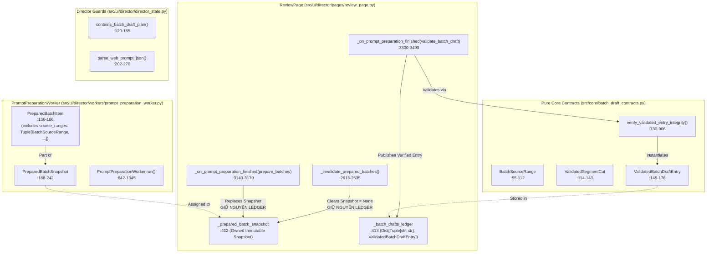

# G06-06A4c-D / R1 / R2 — Thiết Kế Kiến Trúc: Bounded Project Overview, Lossless JSON & Owned Context

> HIỆN HÀNH 2026-10-29: PURE CORE ACCEPTED_WITH_RECORDED_LIMITS theo 06A4c-core-acceptance.md (Codex 54 tests/0.37s/exit 0). Tiếp theo G06-06A4c2-D thiết kế consumer async/copy; UI/worker chưa triển khai. Các review pending/changes-requested cũ bên dưới là lịch sử.

- **TASK_ID:** `G06-06A4c-D` / `G06-06A4c-I` / `G06-06A4c-R1` / `G06-06A4c-R2`
- **Trạng thái:** `IMPLEMENTED_LOSSLESS_OWNED_CONTEXT` (Pure Core Formatter `src/core/project_overview_contracts.py` đã khắc phục triệt để toàn bộ các probe residual; 54 tests finite suite exit 0; UI/worker/copy tiếp tục deferred theo `06A4c-codex-decisions.md`)
- **Cấp độ Worker:** `HIGH`
- **Thời gian hoàn thành:** 2026-10-29T11:15:00+07:00
- **Tài liệu tham chiếu:**
  - [`docs/architecture/06A4b-gate-acceptance.md`](file:///media/vanntruongg/Documents/Development/Python/dự án cá nhân/ResolveFlow-Assistant/docs/architecture/06A4b-gate-acceptance.md)
  - [`docs/architecture/06A4c-codex-decisions.md`](file:///media/vanntruongg/Documents/Development/Python/dự án cá nhân/ResolveFlow-Assistant/docs/architecture/06A4c-codex-decisions.md)
  - [`docs/architecture/06A4c-I-codex-review.md`](file:///media/vanntruongg/Documents/Development/Python/dự án cá nhân/ResolveFlow-Assistant/docs/architecture/06A4c-I-codex-review.md)
  - [`docs/architecture/06A4c-R1-codex-review.md`](file:///media/vanntruongg/Documents/Development/Python/dự án cá nhân/ResolveFlow-Assistant/docs/architecture/06A4c-R1-codex-review.md)
  - [`task/architecture-2026-10-26/06A4c-R2.md`](file:///media/vanntruongg/Documents/Development/Python/dự án cá nhân/ResolveFlow-Assistant/task/architecture-2026-10-26/06A4c-R2.md)
  - [`src/core/project_overview_contracts.py`](file:///media/vanntruongg/Documents/Development/Python/dự án cá nhân/ResolveFlow-Assistant/src/core/project_overview_contracts.py)
  - [`src/core/batch_draft_contracts.py`](file:///media/vanntruongg/Documents/Development/Python/dự án cá nhân/ResolveFlow-Assistant/src/core/batch_draft_contracts.py)
  - [`src/ui/director/workers/prompt_preparation_worker.py`](file:///media/vanntruongg/Documents/Development/Python/dự án cá nhân/ResolveFlow-Assistant/src/ui/director/workers/prompt_preparation_worker.py)
  - [`src/ui/director/pages/review_page.py`](file:///media/vanntruongg/Documents/Development/Python/dự án cá nhân/ResolveFlow-Assistant/src/ui/director/pages/review_page.py)

---

## 1. MỤC TIÊU VÀ BỐI CẢNH KIẾN TRÚC

Trong hệ thống rough-cut ChunDVC (G06):
- **06A1 / 06A2 / 06A3:** Đã giải quyết bài toán chia nhỏ kịch bản dự án thành các lô có giới hạn ngân sách (`BoundedBatch`, $\le 32,768$ UTF-8 bytes).
- **06A4a:** Đã đặt `Safe Batch JSON Slot Guard` tại `director_state.py` và `review_page.py`, ngăn chặn việc dán nhầm batch draft vào Slot 1 / Slot 2.
- **06A4b:** Đã triển khai `Dedicated Batch Draft Intake`, thẩm định hình học chặt chẽ (`verify_validated_entry_integrity`, `BatchSourceRange`), và lưu trữ các bản thảo hợp lệ vào sổ in-memory `_batch_drafts_ledger` theo khóa `(snapshot_id, batch_id)`.

### Vấn Đề Cốt Lõi Của 06A4c (Project Overview Synthesis)
Khi người dùng đã tiếp nhận một số hoặc toàn bộ bản thảo kịch bản của từng lô:
1. **Tránh bùng nổ ngữ cảnh (Context Explosion Avoidance):** Không thể dán lại toàn bộ hàng chục clip transcript thô dài hàng giờ vào AI để tổng hợp, vì sẽ vượt quá context window hoặc gây suy giảm chú ý (needle-in-a-haystack).
2. **Khai thác dữ liệu trung gian đã thẩm định (Leverage Validated Intermediate Proofs):** Các `batch_strategy_summary` và danh sách cuts hợp lệ đã được thẩm định tính toàn vẹn và hình học ở 06A4b chính là bản tóm lược cấp lô (L1 Macro Summaries).
3. **Ngân sách cố định nghiêm ngặt (Strict Budget Ceiling):** Prompt tổng hợp dự án (Project Overview Prompt) phải tuân thủ trần ngân sách UTF-8 ($\le 32,768$ bytes), bao gồm toàn bộ headers, instructions, provenance, partition bounds, và omission warnings.
4. **Không giả mạo tính toàn vẹn (Zero Hallucination / Omission Transparency):** Nếu dự án mới nhận được 2/3 lô, hệ thống phải công bố rõ ràng trạng thái `PARTIAL` (2/3 lô đã nhận, 1 lô còn thiếu); tuyệt đối không tự bịa đặt tóm tắt hay suy diễn kịch bản cho lô chưa có.

> [!IMPORTANT]
> **Ranh Giới Kiến Trúc Của 06A4c-D:**
> - Tài liệu này **CHỈ THIẾT KẾ (DESIGN ONLY)**.
> - **CHƯA** tự động tạo hoặc ghi đè Slot 1 (`_video_plan_data`) hay Slot 2 (`_kinetic_plan_data`).
> - **CHƯA** có EditPlan executor, durable disk persistence, matching engine 06B, hay DaVinci Resolve mutation.

---

## 2. KHẢO SÁT MÃ NGUỒN HIỆN HÀNH (CODE-VERIFIED CALLGRAPH & DISCOVERY)

### 2.1. Callgraph Mã Nguồn Hiện Hành (CODE_VERIFIED)



### 2.2. Chi Tiết Thực Trạng Mã Nguồn (Exact file:hàm:dòng)

1. **`PreparedBatchSnapshot` & `PreparedBatchItem`:**
   - Vị trí: `src/ui/director/workers/prompt_preparation_worker.py:136–242` [CODE_VERIFIED].
   - `PreparedBatchItem` lưu trữ: `batch_id`, `batch_index`, `distinct_clip_count`, `total_duration_sec`, `rendered_prompt`, `rendered_bytes`, `rendered_sha256`, `content_signature`, `clip_ids`, và `source_ranges: Tuple[BatchSourceRange, ...]`.
   - `PreparedBatchSnapshot` lưu trữ: `manifest_id`, `project_name`, `snapshot_id`, `formatter_policy`, `total_batches`, `planned_items_count`, `distinct_planned_clips_count`, `planned_clip_ids`, `unaccounted_clip_ids`, `unaccounted_clips: Tuple[UnaccountedClipEntry, ...]`, `batches: Tuple[PreparedBatchItem, ...]`, `baseline_sources`, `evidence_context_signature`, `ui_context_signature`.
2. **`_batch_drafts_ledger` In-Memory Lifecycle:**
   - Khởi tạo: `src/ui/director/pages/review_page.py:413`: `self._batch_drafts_ledger: Dict[Tuple[str, str], Any] = {}` [CODE_VERIFIED].
   - Khóa tra cứu: `(snapshot_id, batch_id)`.
   - **Xác minh hành vi khi đổi snapshot:**
     - Khi `_invalidate_prepared_batches` (:2613–2635) được gọi: `self._prepared_batch_snapshot` bị gán `None`, các widget combobox, label, preview được xóa sạch. **Tuy nhiên, `self._batch_drafts_ledger` KHÔNG BỊ XÓA (NOT CLEARED)** [CODE_VERIFIED].
     - Khi `_on_prompt_preparation_finished` cho `prepare_batches` (:3140–3170) nạp snapshot mới: `self._prepared_batch_snapshot` được thay thế bằng snapshot mới. **`self._batch_drafts_ledger` CŨNG KHÔNG BỊ XÓA** [CODE_VERIFIED].
     - Bản thảo cũ vẫn tồn tại trong từ điển RAM dưới khóa `(old_snapshot_id, batch_id)`. Khi UI hiển thị badge hoặc đếm tiến độ (:3467, :4086–4096), code thực hiện lọc tường minh theo `sid == current_snapshot.snapshot_id`.
3. **Thẩm Định Integrity Gate Hiện Hành:**
   - `verify_validated_entry_integrity` tại `src/core/batch_draft_contracts.py:730–906` [CODE_VERIFIED].
   - Nhận: `raw_dict`, `expected_manifest_id`, `expected_snapshot_id`, `expected_batch_id`, `expected_binding_mode`, `expected_draft_digest`, `expected_raw_payload_sha256`, `source_ranges`.
   - Kiểm tra: Đối chiếu 100% từng cut với `source_ranges`, tái băm canonical JSON repr và xác nhận trùng khớp hoàn toàn với `expected_draft_digest`. Trả về `ValidatedBatchDraftEntry` bất biến.

---

## 3. HỢP ĐỒNG ĐẦU VÀO RAM THUỘC APP (APP-OWNED IN-MEMORY INPUT CONTRACT)

### 3.1. Nguyên Tắc Thiết Kế Xuất Xứ (Provenance Principle)
- **Không tin cậy ngoại lai (No External Trust):** Toàn bộ dữ liệu dùng để tổng hợp dự án phải được xây dựng từ các đối tượng thuộc quyền sở hữu của ứng dụng (`PreparedBatchSnapshot` và các `ValidatedBatchDraftEntry` đã qua kiểm định `verify_validated_entry_integrity`).
- **Không có nghịch lý vòng tròn (No Circular Dependency):**
  - Prompt tổng hợp không lấy "chứng cứ" từ lời tự khai của external draft.
  - Mỗi bản thảo đã được băm SHA-256 (`draft_digest`) dựa trên canonical JSON và đối chiếu với `source_ranges` hợp lệ.
  - Đầu vào của bộ tổng hợp lấy trực tiếp `draft_digest`, `batch_strategy_summary`, và tóm tắt cuts từ `_batch_drafts_ledger`.

### 3.2. Cấu Trúc Typed Immutable DTO Đề Xuất (PROPOSED Pure Core Contracts)

```python
# src/core/project_overview_contracts.py [PROPOSED]

from dataclasses import dataclass
from typing import Tuple, Optional, Mapping, Any

@dataclass(frozen=True)
class BatchPartitionRef:
    """Tham chiếu phân vùng nguồn của một lô (Bất biến, thuộc App)."""
    batch_id: str
    batch_index: int
    distinct_clip_count: int
    total_duration_sec: float
    clip_ids: Tuple[str, ...]
    source_ranges: Tuple[BatchSourceRange, ...]

@dataclass(frozen=True)
class ValidatedDraftSummaryRef:
    """Tóm lược bản thảo lô đã được xác thực (Bất biến, thuộc App)."""
    batch_id: str
    snapshot_id: str
    draft_digest: str
    received_at: str
    binding_mode: str
    batch_strategy_summary: str
    total_cuts_count: int
    total_selected_duration_sec: float

@dataclass(frozen=True)
class MissingBatchRef:
    """Ghi nhận lô còn thiếu bản thảo (Minh bạch, không giả lập)."""
    batch_id: str
    batch_index: int
    reason: str = "DRAFT_NOT_YET_RECEIVED"

@dataclass(frozen=True)
class ProjectOverviewContextInput:
    """Hợp đồng đầu vào RAM hoàn chỉnh cho bộ định dạng tổng quan dự án."""
    manifest_id: str
    project_name: str
    snapshot_id: str
    evidence_context_signature: Any
    total_batches_expected: int
    received_batches_count: int
    coverage_ratio: str                           # Ví dụ: "2/3"
    is_complete: bool                             # True nếu received == total
    batches_partition_map: Tuple[BatchPartitionRef, ...]
    received_drafts: Tuple[ValidatedDraftSummaryRef, ...]
    missing_batches: Tuple[MissingBatchRef, ...]
    unaccounted_clips: Tuple[UnaccountedClipEntry, ...]
    max_prompt_bytes: int = 32768
```

---

## 4. PHÂN BIỆT RÕ RÀNG BA TẦNG THÔNG TIN (EPISTEMIC SEPARATION)

Để đảm bảo tính trung thực tuyệt đối của kịch bản xuất ra, hệ thống phân định rạch ròi ba tầng dữ liệu:

```
+-------------------------------------------------------------------------------+
| 1. MEASURED_SOURCE_BOUNDS (Sự Thật Vật Lý Đo Lường Được)                      |
|    - File paths, hashes, duration_sec từ scan cache và probe media.           |
|    - Partition source_in_sec / source_out_sec của từng lô.                    |
|    - Danh sách unaccounted clips (mất file, sai duration, v.v.).             |
|    => BẤT BIẾN, KHÔNG THỂ BỊ THAY ĐỔI BỞI BẤT KỲ PROMPT HAY AI NÀO.          |
+-------------------------------------------------------------------------------+
                                      |
                                      v
+-------------------------------------------------------------------------------+
| 2. AI_DRAFT_STRATEGY (Đề Xuất Biên Tập Cấp Lô)                                |
|    - batch_strategy_summary: Lời giải thích ý đồ kịch bản của AI cho lô.      |
|    - ValidatedSegmentCut: Các đoạn keep/drop, role, note đề xuất.             |
|    => LÀ ĐỀ XUẤT BIÊN TẬP (EDITORIAL PROPOSALS), KHÔNG PHẢI FACT.            |
|    => NẾU LÔ CHƯA CÓ BẢN THẢO: TUYỆT ĐỐI KHÔNG TỰ BỊA ĐẶT SUMMARY/CUTS.       |
+-------------------------------------------------------------------------------+
                                      |
                                      v
+-------------------------------------------------------------------------------+
| 3. USER_CHOICES (Quyết Định Của Người Dùng)                                   |
|    - Style intent (travel_vlog, educational, v.v.).                           |
|    - Target aspect ratio, budget limits.                                      |
|    - Hành động người dùng: Associate snapshot, confirm replace draft.         |
|    => ĐIỀU KHIỂN HƯỚNG TỔNG HỢP VÀ PHÊ DUYỆT CUỐI CÙNG.                      |
+-------------------------------------------------------------------------------+
```

### Xử Lý Dữ Liệu Bán Phần (Partial Project Handling)
Khi dự án có $N$ lô nhưng mới nhận được $M < N$ lô (ví dụ 2/3 lô):
- **Hiển thị trung thực:** Header prompt phải ghi rõ: `TRẠNG THÁI: BÁN PHẦN (PARTIAL - 2/3 LÔ ĐÃ NHẬN)`.
- **Cảnh báo tường minh:** Lô còn thiếu phải được liệt kê rõ ràng trong phần `LÔ CHƯA TIẾP NHẬN BẢN THẢO` kèm theo mốc thời gian nguồn chưa có kịch bản.
- **Cấm đoán nghiêm ngặt:** Tuyệt đối cấm AI hoặc hệ thống tuyên bố "Dự án đã hoàn tất kịch bản" khi $M < N$.

---

## 5. BỘ ĐỊNH DẠNG CÓ GIỚI HẠN & THỨ TỰ QUY ĐỊNH (BOUNDED FORMATTER & DETERMINISTIC ORDERING)

### 5.1. Quy Chuẩn Đo Kích Thước UTF-8 Toàn Phần (Full-Prompt Byte Measurement)
- Ngân sách mặc định: `max_prompt_bytes = 32768` ($32\text{ KiB}$).
- **Nguyên tắc đo đạc:**
  $$\text{Total Bytes} = \text{len}(\text{Full Rendered Prompt String}.\text{encode}(\text{"utf-8"}))$$
  - Bao gồm 100%: System header, instructions, project metadata, partition bounds, draft summaries, omission warnings, và JSON output schema requirements.
  - Tuyệt đối không đo byte của riêng JSON envelope rồi bỏ quên prompt template bao quanh.
  - Tuyệt đối không cắt chuỗi JSON giữa chừng (no mid-JSON truncation).

### 5.2. Thứ Tự Sắp Xếp Quyết Định Luận (Deterministic Ordering)
1. **Header Khung Dự Án:** Tên dự án, `manifest_id`, `snapshot_id`, trạng thái (`COMPLETE` hoặc `PARTIAL`), tỷ lệ phủ sóng (`X/N`).
2. **Cảnh Báo Thiếu Sót (Omission Warnings):** Danh sách clips không phân lô được (`unaccounted_clips`) và danh sách các lô chưa nạp (`missing_batches`).
3. **Bản Đồ Phân Vùng Nguồn (Source Partition Map):** Sắp xếp tăng dần theo `batch_index` ($0, 1, 2, \dots$).
4. **Chiến Lược Các Lô Đã Nhận (Received Batch Drafts):** Sắp xếp tăng dần theo `batch_index`. Mỗi lô gồm: `batch_id`, `draft_digest`, `total_cuts_count`, `total_selected_duration_sec`, và `batch_strategy_summary`.
5. **Hướng Dẫn Tổng Hợp Cho AI (Synthesis Instructions):** Yêu cầu AI xây dựng đường dây câu chuyện vĩ mô (Macro Narrative Arc), nhịp điệu (Pacing), và đề xuất chuyển đoạn giữa các lô.
6. **Output Schema Specification:** Quy định JSON schema chuẩn xác mà AI phải trả về.

### 5.3. Chính Sách Xử Lý Tràn Ngân Sách Hữu Hạn (Finite Overflow Policy)
Theo quyết định binding tại `docs/architecture/06A4c-codex-decisions.md`:
- **Trong lát cắt Pure Core đầu tiên:** Giữ nguyên toàn bộ tóm tắt (`batch_strategy_summary`), **KHÔNG** cắt ngắn 200 ký tự và **KHÔNG** nén ngữ nghĩa.
- **Quy tắc trần ngân sách:**
  - Nếu $\text{Total Bytes} \le \text{max\_prompt\_bytes}$: **HỢP LỆ (EQUALITY ACCEPTED)**.
  - Chỉ khi $\text{Total Bytes} > \text{max\_prompt\_bytes}$: Kích hoạt lỗi tràn ngân sách `ERR_OVERVIEW_BUDGET_OVERFLOW`.
- **Hành vi khi tràn ngân sách:**
  - Hệ thống trả về `ok=False`, `error_code="ERR_OVERVIEW_BUDGET_OVERFLOW"`.
  - `rendered_prompt=""`, `rendered_bytes=0`, `rendered_sha256=""`.
  - `required_bytes = len(full_prompt_bytes)` (cung cấp số bytes thực tế cần có để caller thông báo minh bạch cho người dùng).
  - Tuyệt đối không trả prompt dở, không tự ý tăng trần, không phân nhóm vô hạn, không can thiệp sửa ledger.
  - 32,768 bytes là trần UTF-8 byte budget, không phải bảo đảm về token count.

### 5.4. Hoàn Thiện R1 & R2: Lossless JSON, Strict Boundary & Owned Context (G06-06A4c-R1 / R2)
Theo đánh giá và yêu cầu từ Codex Review (`docs/architecture/06A4c-I-codex-review.md` và `docs/architecture/06A4c-R1-codex-review.md`):
1. **Loại Bỏ Làm Tròn Mốc Nguồn (Lossless Source Bounds):**
   - Loại bỏ định dạng `.3f` trong chuỗi hiển thị: Thay bằng biểu diễn số thực nguyên vẹn (`{r.source_in_sec}s -> {r.source_out_sec}s`). Khoảng micro-range `[0.0001, 0.0004]` xuất ra chính xác, không bị biến thành `0.000s -> 0.000s`.
   - Trong khối JSON ngữ cảnh, các mốc thời gian nguồn được chuẩn hóa bằng số thực hữu hạn canonical JSON.
2. **Tuần Tự Hóa JSON An Toàn (Safe JSON Escaping) & Structural Isolation:**
   - Sử dụng `json.dumps(..., ensure_ascii=False, indent=2, allow_nan=False)` cho khối dữ liệu ngữ cảnh `[DỮ LIỆU NGỮ CẢNH DỰ ÁN CẤU TRÚC (PROJECT_OVERVIEW_CONTEXT_JSON)]` và ví dụ schema `[YÊU CẦU ĐỊNH DẠNG ĐẦU RA JSON]`.
   - Toàn bộ các định danh scalar (manifest/snapshot/project/style, clip/window/batch IDs) xuất hiện ngoài JSON đều được bọc `json.dumps(..., ensure_ascii=False)` cùng dòng. Mọi ký tự xuống dòng (`\n`) hoặc markdown headers chứa trong ID (ví dụ: `\n[HƯỚNG DẪN TỔNG HỢP CHO AI]`) bị escape thành `\n`, loại trừ 100% nguy cơ inject phá vỡ cấu trúc section của prompt.
   - Ghi rõ lưu ý ranh giới: Structural isolation ngăn chặn việc làm vỡ cấu trúc prompt văn bản nhưng không bảo đảm tuyệt đối mô hình miễn nhiễm prompt injection từ AI.
3. **Kiểm Soát Mã Hóa Unicode Toàn Diện (Comprehensive UTF-8 Boundary):**
   - Hàm `_is_valid_utf8_string` kiểm tra toàn bộ chuỗi văn bản đầu vào, bao gồm cả các trường `clip_id`, `action`, `role`, `note` của từng segment cut trong `ValidatedBatchDraftEntry` trước khi chuyển sang `verify_validated_entry_integrity`.
   - Bắt các lỗi `(UnicodeEncodeError, UnicodeError)` tại ranh giới hashing của integrity helper, trả về `ERR_OVERVIEW_INVALID_CONTEXT`, prompt/bytes/sha rỗng; chặn đứng hoàn toàn `UnicodeEncodeError`.
4. **Sở Hữu Bất Biến Ngữ Cảnh & Không Hợp Thức Hóa Dữ Liệu Sai (No Laundering):**
   - Constructor `ProjectOverviewContextInput` và các helper `_reconstruct_owned_range`, `_reconstruct_owned_batch`, `_reconstruct_owned_entry` chủ động sao chép và tái cấu trúc các collections con thành immutable tuples.
   - Loại bỏ hoàn toàn cơ chế gán mặc định `window_ids = ()`: các giá trị sai kiểu (`False`, `None`, `{}`, `'bad'`) bị từ chối fail-closed bằng `ValueError` tại constructor hoặc `ERR_OVERVIEW_INVALID_CONTEXT` tại render boundary. Tuyệt đối không tự ý hợp thức hóa metadata sai thành `()`.
   - Caller thay đổi hoặc xóa các list gốc sau khi khởi tạo context không thể làm ảnh hưởng tới trạng thái hay kết quả render của context.
5. **Thẩm Định Kiểu Dữ Liệu Nghiêm Ngặt Tại Ranh Giới (Strict Boundary Validation):**
   - Chặn đứng hoàn toàn silent coercion (bỏ `tuple(value or ())`). `unaccounted_clips=False` hoặc `received_drafts=False` bị từ chối bằng `ValueError` tại constructor hoặc `ERR_OVERVIEW_INVALID_CONTEXT` tại render boundary.
   - Kiểm tra kiểu dữ liệu chuỗi của `batch_id` trước khi tra cứu hash/membership, ngăn chặn `TypeError: unhashable type: 'list'`.
   - Kiểm tra kiểu `segments` và `source_ranges` trước khi gọi `to_dict()`, ngăn chặn `TypeError: 'NoneType' object is not iterable`.
6. **Thẻ Phân Định Nhận Thức Rõ Ràng (Epistemic Separation Tags):**
   - `[THÔNG TIN DỰ ÁN & LỰA CHỌN NGƯỜI DÙNG (USER_CHOICES)]`
   - `[BẢN ĐỒ PHÂN VÙNG NGUỒN (MEASURED_SOURCE_BOUNDS)]` kèm chú thích rõ ràng: Phân vùng nguồn được đo từ scan cache/snapshot ứng dụng cung cấp, formatter không đọc lại đĩa và không chứng minh audio-visual coverage hoặc approval.
   - `[CHIẾN LƯỢC CÁC LÔ ĐÃ NHẬN (AI_DRAFT_STRATEGY)]`
   - Hướng dẫn tổng hợp yêu cầu chỉ dùng các `batch_id` đã nhận cho thứ tự và chuyển cảnh; cảnh báo macro schema chưa có importer tự động.

---

## 6. PHÂN ĐỊNH RANH GIỚI KẾ HOẠCH BÀN GIAO (PLAN HANDOFF & FUTURE BOUNDARIES)

### 6.1. Ngăn Chặn Ghi Đè Slot 1 / Slot 2
- Bộ lọc `contains_batch_draft_plan` và `parse_web_prompt_json` tại `src/ui/director/director_state.py` tiếp tục chặn đứng mọi nỗ lực dán kết quả của từng lô vào Slot 1 / Slot 2 [CODE_VERIFIED].
- Kết quả của Project Overview Synthesis (Macro Narrative Plan) sẽ mang schema riêng (ví dụ: `project_overview_draft`).
- Khi người dùng nhận kết quả này từ AI, hệ thống **CHƯA TỰ ĐỘNG GHI ĐÈ VÀO SLOT 1**. Việc nhập vào Slot 1 (`_video_plan_data`) đòi hỏi quy trình import và phê duyệt tường minh trong tương lai.

### 6.2. Hoãn Lại (Deferred Capabilities — Chuẩn Hóa Lộ Trình Theo Codex Decisions)
- **Durable Disk Persistence:** Sổ theo dõi `_batch_drafts_ledger` tiếp tục lưu trữ in-memory trong RAM của phiên làm việc. Lưu trữ bền vững ra đĩa tạm thời hoãn lại (`DEFERRED`), chưa xếp lịch cố định.
- **Giai đoạn 06B:** Dành riêng cho **Offline Asset Matching** (so khớp media/assets offline), không phải persistence.
- **Giai đoạn 06C:** Dành riêng cho **Edit-Plan Validation & Assembly** (ghép nối và kiểm định kế hoạch dựng), không phải executor trực tiếp.
- **DaVinci Resolve Timeline Mutation:** Thuộc về giai đoạn **G07** (Resolve Execution & Timeline Dispatch). Tuyệt đối không gọi Resolve API trong G06.
- **No Paid AI / Cloud API Call:** Giữ nguyên mô hình Offline Copilot: xuất prompt cho người dùng tự chép (Manual Clipboard Copy) sang AI bên ngoài. Không tự ý kết nối mạng hay upload video.

---

## 7. NĂM FIXTURE DỮ LIỆU JSON KIỂM THỬ THỰC TẾ (5 EXHAUSTIVE PROPOSED FIXTURES)

> [!NOTE]
> Các fixtures dưới đây là **PROPOSED (Illustrative / synthetic 64-hex SHA-256 for design specification)**, hoàn toàn parseable theo chuẩn JSON. Trong unit test thật, các entry được sinh trực tiếp thông qua validator `validate_batch_draft_payload`.

### Fixture 1: Đủ 3/3 Lô — Toàn Bộ Bản Thảo Đã Nhận (`fixture_01_complete_3_batches.json`)
```json
{
  "manifest_id": "M_PROJ_FULL",
  "project_name": "HaGiang_Vlog",
  "snapshot_id": "SNAP_20261029_001",
  "coverage_ratio": "3/3",
  "all_batch_drafts_received": true,
  "source_coverage_complete": true,
  "unaccounted_clips_count": 0,
  "batches": [
    {
      "batch_id": "B01",
      "batch_index": 0,
      "draft_digest": "4a7d0000000000000000000000000000000000000000000000000000000000b1",
      "binding_mode": "echo_matched",
      "total_cuts": 4,
      "selected_duration_sec": 120.0,
      "strategy_summary": "Khởi hành từ TP Hà Giang, vượt dốc Bắc Sum trong sương sớm."
    },
    {
      "batch_id": "B02",
      "batch_index": 1,
      "draft_digest": "8c2e0000000000000000000000000000000000000000000000000000000000f9",
      "binding_mode": "echo_matched",
      "total_cuts": 6,
      "selected_duration_sec": 180.0,
      "strategy_summary": "Chinh phục đèo Mã Pí Lèng, đại cảnh sông Nho Quế hùng vĩ."
    },
    {
      "batch_id": "B03",
      "batch_index": 2,
      "draft_digest": "1f9a00000000000000000000000000000000000000000000000000000000003d",
      "binding_mode": "user_associated_current_snapshot",
      "total_cuts": 3,
      "selected_duration_sec": 90.0,
      "strategy_summary": "Hoàng hôn trên vách đá trắng và kết thúc ngày đầu tiên."
    }
  ]
}
```

### Fixture 2: Thiếu 1 Lô Kèm Unaccounted Clip (`fixture_02_partial_2_of_3_with_unaccounted.json`)
```json
{
  "manifest_id": "M_PROJ_PARTIAL",
  "project_name": "Travel_Review",
  "snapshot_id": "SNAP_20261029_002",
  "coverage_ratio": "2/3",
  "all_batch_drafts_received": false,
  "source_coverage_complete": false,
  "missing_batch_ids": ["B03"],
  "unaccounted_clips": [
    {"clip_id": "C99", "reason": "ERR_UNKNOWN_DURATION", "message": "File video lỗi header không đọc được thời lượng"}
  ],
  "received_batches": [
    {
      "batch_id": "B01",
      "batch_index": 0,
      "draft_digest": "99ee000000000000000000000000000000000000000000000000000000000001",
      "strategy_summary": "Phần mở đầu giới thiệu ẩm thực đường phố."
    },
    {
      "batch_id": "B02",
      "batch_index": 1,
      "draft_digest": "11ab0000000000000000000000000000000000000000000000000000000000cc",
      "strategy_summary": "Phỏng vấn các nghệ nhân nấu ăn truyền thống."
    }
  ]
}
```

### Fixture 3: Bản Thảo Lỗi Thời Bị Loại Bỏ Khỏi Tổng Hợp (`fixture_03_stale_snapshot_excluded.json`)
```json
{
  "active_snapshot_id": "SNAP_CURRENT_NEW",
  "tested_draft_snapshot_id": "SNAP_OLD_STALE",
  "expected_in_ledger_for_current": false,
  "synthesis_input_payload": {
    "manifest_id": "M_TEST",
    "snapshot_id": "SNAP_CURRENT_NEW",
    "received_drafts_count": 0,
    "total_batches_expected": 2,
    "warning": "Toàn bộ bản thảo thuộc SNAP_OLD_STALE đã bị loại trừ khỏi ngữ cảnh tổng hợp hiện tại."
  }
}
```

### Fixture 4: Clip Dài 1201s Chia 3 Phân Vùng Nguồn (`fixture_04_split_partitions_ref.json`)
```json
{
  "manifest_id": "M_LONG_CLIP",
  "clip_id": "C_MAIN_1201",
  "total_duration_sec": 1201.0,
  "partitions": [
    {"batch_id": "B01", "partition_index": 0, "total_partitions": 3, "source_in_sec": 0.0, "source_out_sec": 600.0},
    {"batch_id": "B02", "partition_index": 1, "total_partitions": 3, "source_in_sec": 600.0, "source_out_sec": 1200.0},
    {"batch_id": "B03", "partition_index": 2, "total_partitions": 3, "source_in_sec": 1200.0, "source_out_sec": 1201.0}
  ],
  "invariants_verified": [
    "source_in_sec[i+1] == source_out_sec[i]",
    "Không có khoảng trống (no gaps)",
    "Không có khoảng chồng lấn (no overlaps)"
  ]
}
```

### Fixture 5: Tóm Tắt Dày Đặc Gây Tràn Ngân Sách UTF-8 (`fixture_05_dense_unicode_overflow.json`)
```json
{
  "manifest_id": "M_OVERFLOW_TEST",
  "total_batches": 20,
  "simulated_excessive_bytes": 42150,
  "max_budget_bytes": 32768,
  "overflow_result": {
    "ok": false,
    "error_code": "ERR_OVERVIEW_BUDGET_OVERFLOW",
    "message": "Kích thước kịch bản tổng quan vượt quá trần ngân sách.",
    "required_bytes": 42150,
    "rendered_prompt": "",
    "rendered_bytes": 0
  }
}
```

---

## 8. MA TRẬN NGHIỆM THU HỮU HẠN & KẾT QUẢ TRIỂN KHAI PURE CORE

| ID | Tiêu Chí Kiểm Tra | Điều Kiện Thử Nghiệm | Kết Quả Kỳ Vọng | Trạng Thái Thực Tế |
|---|---|---|---|---|
| **AC-01** | **Khởi tạo DTO đầu vào App-owned** | Đọc `ProjectOverviewContextInput`, `BatchPartitionRef` | Trích xuất đúng 100% `snapshot_id`, coverage, danh sách batches. | **PASS** (`tests/core/test_project_overview_contracts.py`) |
| **AC-02** | **Xác nhận Provenance** | Đối chiếu `draft_digest` qua `verify_validated_entry_integrity` | Chỉ bản thảo có digest trùng khớp mới được đưa vào overview; tampered bị từ chối. | **PASS** (`test_tampered_draft_digest_rejected`) |
| **AC-03** | **Minh bạch Partial Coverage** | Dự án có 3 lô, mới nhận 2 lô | Output prompt chứa chuỗi `"BÁN PHẦN (PARTIAL)"`, liệt kê lô thiếu, `source_coverage_complete=False`. | **PASS** (`test_render_overview_partial_coverage_missing_batch`) |
| **AC-04** | **Trần Ngân Sách $\le 32,768$ B & Equality** | Render prompt với tiếng Việt UTF-8 | `Total Bytes <= max_prompt_bytes` đạt; `> max_prompt_bytes` báo `ERR_OVERVIEW_BUDGET_OVERFLOW`. | **PASS** (`test_budget_exact_equality_accepted`, `test_budget_overflow_one_byte_less_fails`) |
| **AC-05** | **Zero UI / Qt Imports** | Kiểm tra `sys.modules` và imports | Module `src.core.project_overview_contracts` tuyệt đối không import Qt hay UI. | **PASS** (`test_zero_qt_or_ui_imports`) |


---

## 9. KẾT QUẢ TRIỂN KHAI LÁT CẮT PURE CORE (G06-06A4c-I)

- **Lát cắt hiện hành:** `G06-06A4c-I — Pure Project Overview Context Formatter`.
  - **Phạm vi hoàn thành:** Đúng 1 production module `src/core/project_overview_contracts.py` và 1 test module `tests/core/test_project_overview_contracts.py`.
  - **Zero UI/Qt/IO:** 100% độc lập, không import Qt hay UI, không có IO hay network calls.
  - **Quy chuẩn API chốt:**
    - `BatchPartitionRef(batch_id, batch_index, source_ranges)`
    - `OverviewUnaccountedClip(clip_id, reason, message)`
    - `ProjectOverviewContextInput(manifest_id, project_name, snapshot_id, batches, received_drafts, unaccounted_clips, style_intent, max_prompt_bytes)`
    - `render_project_overview_prompt(context_input) -> ProjectOverviewRenderResult`
  - **Hành vi kiểm chứng:**
    - 26 tests unit tests trong `tests/core/test_project_overview_contracts.py` PASS 100% (exit 0).
    - Toàn bộ suite quy định: 43 passed in 0.40s (exit 0).
  - **Phần tiếp tục hoãn lại (Deferred to future slices):**
    - UI/Worker/Clipboard wiring: Consumer trong `PromptPreparationWorker` và `ReviewPage` tạm thời giữ deferred, sẽ triển khai sau khi pure core formatter được Tech Lead nghiệm thu.
    - Slot 1 / Slot 2 integration: Tách biệt hoàn toàn, không tự động mutate Slot 1.

## Codex design review — 2026-10-29
APPROVED_WITH_BINDING_CORRECTIONS: docs/architecture/06A4c-codex-decisions.md is authoritative over pseudo-code and fixtures above. Active G06-06A4c-I implements only pure core formatter plus tests. No summary truncation; overflow only when bytes > budget; distinguish received drafts from source coverage. UI/worker and copy handoff not approved for this slice; fix identified docs errata alongside implementation.


## Codex implementation review — 2026-10-29
CHANGES_REQUESTED theo 06A4c-I-codex-review.md. Fresh 43 tests/0.31s/exit 0; exact probes show lossy bounds, unsafe JSON example interpolation, nested invalid DTO exceptions/falsy normalization and retained mutable aliases. Active G06-06A4c-R1 fixes only pure formatter/tests/docs. UI/worker/copy consumer deferred; 06A4b acceptance remains valid.


## Codex R1 review — 2026-10-29
CHANGES_REQUESTED theo 06A4c-R1-codex-review.md. Fresh 51 tests/0.39s/exit 0; original probes improved but constructor must not launder invalid window_ids, nested cut encoding must reject controlled, raw dynamic text outside structured JSON must be removed or escaped. Active 06A4c-R2 stays within pure module/tests; consumer integration deferred.
