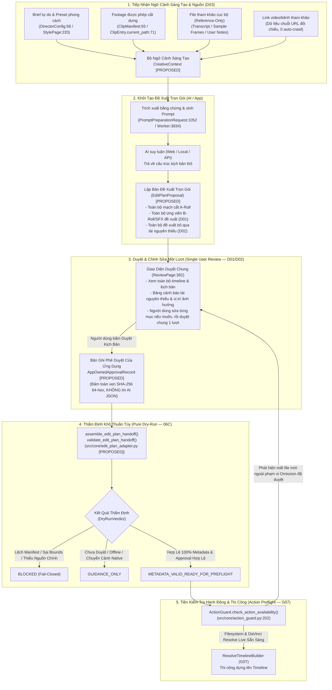

# G06-06C-D: Thiết Kế Chuẩn Hóa Kịch Bản Dựng & Dry-Run Handoff (Edit-Plan Handoff Design)

> **CODEX BINDING REVIEW — 2026-10-29:** DESIGN_DIRECTION_ACCEPTED_WITH_BINDING_SCOPE tại `06C-codex-decisions.md` & CHANGES_REQUESTED giải quyết tại `06C1a-I-codex-review.md`. Active G06-06C1a-R1 đã đóng gộp toàn bộ các điểm A/B/C: xử lý bigint overflow, bỏ duration cap một năm, revalidate typed boundaries, precheck counts trước iteration, mixed unknown keys safe, và UNC share lexical validation tại `src/core/contracts/edit_plan_contracts.py` (25 focused tests passed). Tất cả proposal/approval/geometry/handoff/UI/prompt consumer còn lại đều là `PROPOSED_DEFERRED`. Formula B là chính sách dữ liệu cắt video có điều kiện (CFR metadata đầy đủ); không chứng minh audio tự đồng bộ.

> **TRẠNG THÁI HIỆN HÀNH — 2026-10-29:** `G06-06C1b2-R1-THEN-06C2-D`  
> **Cấp độ thực hiện:** Worker `HIGH`  
> **Trạng thái:** Phần A CODE_TESTED (69 tests pass, timestamp formatrecordv1 đóng hoàn toàn); Phần B DESIGN_READY tại [06C2-frame-geometry-design.md](file:///media/vanntruongg/Documents/Development/Python/dự%20án%20cá%20nhân/ResolveFlow-Assistant/docs/architecture/06C2-frame-geometry-design.md) (Toán học Formula B, ranh giới mapper, phân định origin 0 vs Start TC, đề xuất $\le 2$ pure modules).  
> **Tài liệu căn bản:** `docs/architecture/06C-product-decisions.md` (Canonical user decisions), `docs/architecture/06C-codex-decisions.md` (Codex binding decisions), `docs/architecture/06C1b-codex-decisions.md` (C1b review decisions), `docs/architecture/06C1b-proposal-binding-design.md` (Detailed design 06C1b/06C1b1/06C1b2), `docs/architecture/06C2-frame-geometry-design.md` (Frame Geometry Design 06C2).

---

## 1. Luồng Sản Phẩm & Ma Trận Thẩm Quyền (Product Flow & Authority Matrix)

### 1.1. Luồng Sản Phẩm Tổng Thể (End-to-End Product Flow)

Theo các quyết định sản phẩm D01, D02, D03, luồng tương tác từ chuẩn bị ngữ cảnh đến khi sẵn sàng bàn giao cho DaVinci Resolve được thiết kế thống nhất qua 6 giai đoạn rõ ràng:



### 1.2. Ma Trận Quyền Hạn: Đề Xuất vs Phê Duyệt vs Thực Thi

Bảng ma trận phân định rõ ràng giữa quyền đề xuất của AI/App, quyền phê duyệt của Người dùng, và quyền thi công của hệ thống:

| Hành động / Dữ liệu | Quyền AI / Ứng Dụng | Quyền Người Dựng (User) | Thẩm Quyền Thực Thi (Resolve / FS) | Ràng buộc bảo vệ bắt buộc |
| :--- | :--- | :--- | :--- | :--- |
| **Mạch cắt A-Roll** | Đề xuất phân đoạn cắt theo footage | Xem, chỉnh sửa điểm in/out, đổi thứ tự, duyệt | Chưa thực thi ở 06C (chỉ thẩm định khung hình) | Bắt buộc thuộc `ClipManifest`. Cấm cắt ngoài bounds clip. |
| **Ứng viên B-Roll/SFX** | **Được chọn đề xuất ứng viên hợp lệ** vào bản dựng (D01) | Xem bảng đề xuất, thay đổi tài nguyên khác, duyệt chung | **0 quyền thi công** trước khi có `AppOwnedApprovalRecord` | Tuyệt đối không coi điểm $\ge 90$ hay `top 1` là tự động duyệt. |
| **Tài nguyên bị thiếu** | **Đề xuất bỏ qua (Omission)** kèm lý do & vị trí (D02) | Quyết định nạp bù, thay thế, hoặc chấp thuận bỏ qua | Dựng mạch chính A-Roll, bỏ trống slot B-roll/SFX thiếu | Không tự xóa nhu cầu thiếu, không bịa file giả hay placeholder. |
| **Tài liệu tham khảo (Ref)** | Trích xuất text/transcript/khung hình mẫu (nếu có) | Chọn tệp local tham khảo, nhập URL đối chiếu (D03) | **CẤM TUYỆT ĐỐI** đưa vào timeline cắt dựng sản phẩm | Role `reference_only`. URL chỉ lưu chuỗi, không tự crawl/view. |
| **Phê duyệt kịch bản** | 0 quyền phê duyệt (bỏ qua `user_approved: true` của AI) | **Toàn quyền phê duyệt một lượt** (D01) | Ghi nhận `AppOwnedApprovalRecord` phiên bản bất biến | Bất kỳ thay đổi brief/source/omission đều làm mất hiệu lực approval. |

---

## 2. Bản Đồ Trường Dữ Liệu Nguồn & Ngữ Cảnh Sáng Tạo (Source-Grounded Field Map)

### 2.1. Đối Chiếu Codebase Thực Tế Giữa Hiện Hữu (`[CODE_VERIFIED]`) và Đề Xuất (`[PROPOSED]`)

Khảo sát chính xác cấu trúc thực tế trong codebase để xây dựng cầu nối tối thiểu, không phát sinh lớp trung gian thừa:

1. **`src/ui/director/director_state.py:58` — `DirectorConfig` (`[CODE_VERIFIED]`):**
   - Đã có: `video_paths: List[str]`, `whisper_model: str`, `whisper_language: str`, `style: str = "travel_vlog"`, `pacing: str`, `intensity: int`, `enabled_features: Set[str]`, `ai_engine_mode: str`.
   - Cần bổ sung (`[PROPOSED]`): `free_brief: str = ""` (yêu cầu tự do), `must_keep_rules: List[str]`, `must_not_rules: List[str]`, `reference_paths: List[str]`, `reference_urls: List[str]`.
2. **`src/ui/director/pages/style_page.py:220` — `StylePage` (`[CODE_VERIFIED]`):**
   - Đã có: Các nút chọn preset phong cách (`vlog`, `talking_head`, `cinematic`...), điều khiển nhịp độ (`pacing`), cường độ cắt (`intensity`).
   - Cần bổ sung (`[PROPOSED]`): Ô văn bản nhập Creative Brief tự do; danh sách chọn file tham khảo cục bộ (kèm nhãn cảnh báo `Reference Only - Không dùng để cắt`); ô danh sách link tham khảo (chỉ lưu URL).
3. **`src/ui/director/director_window.py:785` — `_get_current_director_context()` (`[CODE_VERIFIED]`):**
   - Đã có: Đọc `video_paths`, `whisper_model`, `whisper_language`, `vision_endpoint`, `window_sec`, `frames_per_window`, `style_intent`.
   - Cần bổ sung (`[PROPOSED]`): Gom nhóm các trường brief/preset/references thành cấu trúc `CreativeContext` nguyên thủy.
4. **`src/ui/director/workers/prompt_preparation_worker.py:1052` — `PromptPreparationRequest` (`[CODE_VERIFIED]`):**
   - Đã có: `request_id`, `generation`, `intent`, `video_paths`, `vision_context`, `style_intent`, `max_prompt_bytes = 32768`.
   - Cần bổ sung (`[PROPOSED]`): `creative_context: Optional[Dict[str, Any]] = None` chứa dữ liệu văn bản đã lọc an toàn.
5. **`src/core/clip_manifest.py:34, 71, 93` — `ClipManifest` & `ClipEntry` (`[CODE_VERIFIED]`):**
   - `ClipManifest.manifest_id` (dòng 95) là SSOT xác thực phiên bản footage.
   - `ClipEntry.current_path` (dòng 71) là đường dẫn tệp tuyệt đối trên đĩa. Không có lớp `ClipItem`.
6. **`src/core/timeline_mapper.py:65, 186` — `TimelineMapper.add_segment()` (`[CODE_VERIFIED]`):**
   - Thêm phân đoạn qua `add_segment(clip_id, clip_name, clip_duration_sec, src_in_sec, src_out_sec, speed, pad_sec)`. Không có hàm `add_cut`.

### 2.2. Cấu Trúc Ngữ Cảnh Sáng Tạo Tối Thiểu (`CreativeContext`)

```python
# [PROPOSED DATA CONTRACT] — src/core/contracts/edit_plan_contracts.py
@dataclass(frozen=True)
class ReferenceItem:
    reference_id: str                   # ref_01, ref_02
    local_path: str                     # Đường dẫn file trên đĩa
    media_type: str                     # 'video' | 'image' | 'audio'
    role: str = "reference_only"        # BẮT BUỘC 'reference_only', cấm dùng cắt dựng
    user_note: str = ""                 # Ghi chú của user về điểm cần tham khảo
    transcript_text: str = ""           # Bóc băng thoại (nếu có Whisper local)
    sampled_captions: Tuple[str, ...] = ()  # Mô tả khung hình mẫu (nếu có VLM local)

@dataclass(frozen=True)
class CreativeContext:
    free_brief: str = ""                # Yêu cầu tự do của khách / cá nhân (AUTHORITATIVE)
    style_preset: str = "travel_vlog"   # Preset phong cách (vlog, cute, review, cinematic)
    target_duration_sec: float = 60.0   # Thời lượng mục tiêu (ví dụ: 60s)
    must_keep_rules: Tuple[str, ...] = ()   # Ràng buộc bắt buộc (ví dụ: giữ câu slogan mở đầu)
    must_not_rules: Tuple[str, ...] = ()    # Ràng buộc cấm (ví dụ: cấm meme troll, cấm âm thanh giật gân)
    reference_items: Tuple[ReferenceItem, ...] = ()  # File tham khảo cục bộ riêng biệt
    reference_urls: Tuple[str, ...] = ()             # URL đối chiếu tham khảo (chỉ lưu chuỗi, 0 network)
```

### 2.3. Ma Trận Năng Lực Xử Lý File Tham Khảo (Reference Capability Matrix)

Hệ thống phải thể hiện trung thực khả năng phân tích tài nguyên tham khảo, tránh hứa hẹn vượt quá năng lực mô hình cục bộ:

| Khía cạnh tham khảo | Phương thức phân tích hiện có | Mức độ xác thực (`Provenance`) | Trạng thái công bố trên UI |
| :--- | :--- | :--- | :--- |
| **Văn bản & Ghi chú user** | Đọc chuỗi văn bản trực tiếp từ UI | Xác thực 100% từ người dùng | `PROVEN_USER_INPUT` |
| **Thoại trong video mẫu** | Whisper cục bộ bóc băng lời thoại | Transcript kèm timestamp từ Whisper | `PROVEN_TRANSCRIPT` |
| **Bối cảnh hình ảnh tĩnh** | VLM cục bộ chú thích khung hình thưa (1-2 fps) | Mô tả ngắn từng frame mẫu | `PROVEN_SAMPLE_FRAMES` |
| **Nhịp điệu cắt dựng (Pacing)** | Chưa có mô hình đo nhịp cắt tự động | Suy diễn heuristic theo thời lượng | `UNPROVEN / EXPERIMENTAL` |
| **Kiểu chữ & Animation** | Chưa có OCR nhận diện chuyển động chữ | Không phân tích | `UNSUPPORTED (Ghi chú thủ công)` |
| **Màu sắc & Chuyển động máy** | Chưa có bộ phân tích LUT/Motion | Không phân tích | `UNSUPPORTED (Ghi chú thủ công)` |
| **Nội dung từ link web/kênh** | **CẤM TỰ ĐỘNG CÀO/TẢI DỮ LIỆU TỪ LINK MẠNG** | Chỉ lưu vết chuỗi URL phục vụ người dùng | `STORED_URL_ONLY (No Network)` |

> [!IMPORTANT]
> **Nguyên tắc ưu tiên (Precedence Rule):** Khi có mâu thuẫn giữa `free_brief` (văn bản người dùng viết) với suy diễn từ `style_preset` hoặc `reference_items`, **`free_brief` LUÔN CÓ THẨM QUYỀN CAO NHẤT**. Nếu kịch bản không thể thỏa mãn đồng thời các ràng buộc (ví dụ: brief đòi 60s nhưng footage chính chỉ có 40s), hệ thống phải báo cảnh báo rõ ràng để người dùng chỉnh sửa, **tuyệt đối không âm thầm bỏ qua ràng buộc của khách**.

---

## 3. Bản Kế Hoạch Đề Xuất, Hồ Sơ Phê Duyệt & Vòng Đời Invalidation

### 3.1. Phân Biệt Bản Đề Xuất (`EditPlanProposal`) và Bản Dựng Được Duyệt (`ApprovedEditPlanEnvelope`)

Để hiện thực hóa quyết định D01 và D02 mà không phá vỡ tính an toàn hệ thống, 06C phân định cấu trúc thành 2 đối tượng độc lập:

```
┌────────────────────────────────────────────────────────────────────────────────────────┐
│ EDIT PLAN PROPOSAL (Bản Đề Xuất Trọn Gói — Do AI / App Tạo Ra) [PROPOSED]              │
│  - proposal_id: UUID định danh bản đề xuất                                            │
│  - manifest_id: Bắt buộc khớp với footage hiện hành                                   │
│  - creative_context_hash: Mã băm SHA-256 của toàn bộ CreativeContext                  │
│  - proposed_segments: Toàn bộ danh sách phân đoạn A-Roll đề xuất                      │
│  - proposed_asset_assignments: Ứng viên B-Roll/SFX do AI/App đề xuất (chưa duyệt)     │
│  - proposed_omissions: Danh sách B-Roll/SFX bị thiếu đề xuất bỏ qua (kèm lý do/vị trí)│
│  - status: 'PROPOSED_PENDING_USER_REVIEW'                                             │
└───────────────────────────────────────────┬────────────────────────────────────────────┘
                                            │ Người dùng xem, chỉnh sửa & bấm DUYỆT CHUNG (D01)
                                            ▼
┌────────────────────────────────────────────────────────────────────────────────────────┐
│ APP-OWNED APPROVAL RECORD (Hồ Sơ Phê Duyệt Của Ứng Dụng) [PROPOSED]                   │
│  - approval_id: UUID duy nhất                                                         │
│  - proposal_id: Khớp chính xác với proposal được duyệt                                │
│  - full_plan_sha256: Mã băm SHA-256 (64-hex) của TOÀN BỘ kịch bản và gán tài nguyên   │
│  - user_approved_at: Thời điểm ISO-8601 người dùng bấm nút Duyệt qua UI               │
│  - accepted_omissions_count: Số lượng tài nguyên thiếu được người dùng chấp nhận bỏ qua│
│  - approval_scope: 'ENTIRE_PLAN_BATCH'                                                │
└───────────────────────────────────────────┬────────────────────────────────────────────┘
                                            │ Đóng gói phục vụ Thẩm Định Khô (Pure Dry-Run)
                                            ▼
┌────────────────────────────────────────────────────────────────────────────────────────┐
│ EDIT PLAN HANDOFF ENVELOPE (PROPOSED-v3.0)                                             │
│  - proposal: EditPlanProposal                                                         │
│  - approval: AppOwnedApprovalRecord                                                   │
│  - source_fps & timeline_fps: RationalFPS                                             │
│  - geometry_bounds: Khung hình tính toán hai miền nửa mở [src_in, src_out) & [rec...)  │
└────────────────────────────────────────────────────────────────────────────────────────┘
```

### 3.2. Quy Tắc Invalidation (Làm Mất Hiệu Lực Phê Duyệt)

Hồ sơ phê duyệt `AppOwnedApprovalRecord` bị hủy bỏ và trạng thái kịch bản lập tức quay về `PROPOSED_PENDING_USER_REVIEW` khi xảy ra bất kỳ sự kiện nào sau đây:
1. **Thay đổi Ngữ cảnh Sáng tạo:** Người dùng sửa nội dung `free_brief`, đổi `style_preset`, thêm/bớt tệp `reference_items`.
2. **Thay đổi Danh mục Nguồn:** Thêm, xóa clip trong `ClipManifest`, hoặc tráo đổi đường dẫn tệp `current_path`.
3. **Thay đổi Phân đoạn Cắt:** Người dùng thay đổi điểm `src_in`, `src_out`, tốc độ hoặc thứ tự phân đoạn.
4. **Thay đổi Gán Tài Nguyên:** Người dùng thay đổi ứng viên B-Roll/SFX hoặc bỏ chọn một tài nguyên.
5. **Mất File Tại Khâu Preflight (G07 Invalidation):** Khi tiền kiểm tra hành động phát hiện một tài nguyên vốn có trong bản duyệt bị xóa/mất trên đĩa (ngoài danh sách `accepted_omissions` đã duyệt), hệ thống **tuyệt đối không tự động mở rộng danh sách bỏ qua**, mà bắt buộc phải hủy phê duyệt và trả kịch bản về màn hình Review để người dùng xác nhận lại.

---

## 4. Hợp Đồng Hình Học Thời Gian & Điểm Lượng Tử Hóa (Quantization Policy)

### 4.1. Hợp Đồng Khoảng Nửa Mở Hai Miền (Dual-Domain Half-Open Intervals)
Mọi phân đoạn video được định nghĩa nhất quán trên khoảng nửa mở $[in, out)$:
- Miền nguồn: $[src\_in\_f, src\_out\_f)$ theo `source_fps` (Source frames).
- Miền timeline: $[rec\_in\_f, rec\_out\_f)$ theo `timeline_fps` (Record frames). Gapless liên tục cho A-Roll.

### 4.2. Khảo Sát Toán Học Điểm Lượng Tử Hóa (Quantization Point Analysis)

Có hai phương pháp tính toán thời lượng khung hình trên timeline ($seg\_duration\_frames$) khi mixed-FPS:

- **Công Thức A (Tính theo giây thực trước — Seconds-First):**
  $$seg\_duration\_sec = \frac{src\_out\_sec - src\_in\_sec}{applied\_speed}$$
  $$timeline\_frames_A = \text{round}(seg\_duration\_sec \times timeline\_fps)$$

- **Công Thức B (Tính theo khung hình nguồn nguyên tử trước — Source-Frame-First):**
  $$src\_in\_f = \text{round}(src\_in\_sec \times source\_fps)$$
  $$src\_out\_f = \text{round}(src\_out\_sec \times source\_fps)$$
  $$source\_duration\_frames = src\_out\_f - src\_in\_f$$
  $$timeline\_frames_B = \text{round}\left( \frac{source\_duration\_frames \times timeline\_fps}{source\_fps \times applied\_speed} \right)$$

### 4.3. Phản Ví Dụ Thực Tế Lệch 1 Khung Hình (Concrete Counterexample)

Xét trường hợp thực tế: Clip nguồn quay ở **30 FPS**, Timeline dựng ở **24 FPS**, tốc độ phát **1.0x**. Điểm cắt được chỉ định: $src\_in\_sec = 1.000\text{ s}$, $src\_out\_sec = 2.017\text{ s}$:

1. **Theo Công Thức A (Seconds-First):**
   - $seg\_duration\_sec = 2.017 - 1.000 = 1.017\text{ s}$
   - $timeline\_frames_A = \text{round}(1.017 \times 24) = \text{round}(24.408) = \mathbf{24\text{ frames}}$
2. **Theo Công Thức B (Source-Frame-First):**
   - $src\_in\_f = \text{round}(1.000 \times 30) = 30$
   - $src\_out\_f = \text{round}(2.017 \times 30) = \text{round}(60.510) = 61$
   - $source\_duration\_frames = 61 - 30 = 31\text{ source frames}$
   - $timeline\_frames_B = \text{round}\left( \frac{31 \times 24}{30} \right) = \text{round}(24.800) = \mathbf{25\text{ frames}}$

> [!WARNING]
> **Kết luận toán học:** Hai công thức trên **LỆCH NHAU ĐÚNG 1 FRAME** ($24 \ne 25$).  
> - **Trade-off Công thức A:** Ưu tiên khớp chính xác tuyệt đối với dòng thời gian âm thanh liên tục (Audio/Voice track). Tuy nhiên, trên timeline video sẽ bị co/giãn nhẹ so với số lượng khung hình rời rạc thực tế được lấy từ clip gốc.  
> - **Trade-off Công thức B:** Ưu tiên tính nguyên tử của từng khung hình video nguồn $[src\_in\_f, src\_out\_f)$, phù hợp tuyệt đối với bản chất truy xuất frame của DaVinci Resolve và NLE timeline engines.  
> - **Khuyến nghị kiến trúc (Để Codex chốt):** Khuyến nghị chọn **Công thức B (Source-Frame-First)** làm chuẩn tắc cho video cuts, vì các lệnh Scripting API của DaVinci Resolve (`AppendToTimeline`, `InsertMedia`) làm việc trên đơn vị frame nguyên tử. Audio sẽ được tự động canh theo ranh giới frame này. Worker không tự sửa mapper trong task thiết kế này.

---

## 5. Cơ Chế Ra Quyết Định Thẩm Định Khô (Pure Dry-Run Decision Logic)

Bộ thẩm định khô `validate_edit_plan_handoff()` kiểm tra 100% logic trong bộ nhớ, trả về 1 trong 3 trạng thái:

1. **`METADATA_VALID_READY_FOR_PREFLIGHT`:**
   - Kịch bản liên kết khớp 100% với `ClipManifest`. Mọi clip đều tồn tại trên đĩa metadata.
   - Mọi phân đoạn A-Roll hợp lệ về hình học thời gian hai miền $[src\_in, src\_out)$ và $[rec\_in, rec\_out)$.
   - Ràng buộc bắt buộc (`must_keep_rules`, ví dụ slogan thương hiệu) được thỏa mãn đầy đủ.
   - 100% nhu cầu B-Roll/SFX đã được giải quyết: hoặc có tài nguyên hợp lệ gán kèm, hoặc nằm trong danh sách bỏ qua có chủ đích (`accepted_omissions`) đã được người dùng phê duyệt theo D02.
   - Có hồ sơ phê duyệt hợp lệ `AppOwnedApprovalRecord` khớp với mã băm toàn vẹn SHA-256 của kịch bản.
2. **`GUIDANCE_ONLY`:**
   - Cắt thô A-Roll hợp lệ về mặt hình học.
   - Tồn tại nhu cầu tài nguyên chưa khớp (`unresolved_need`) **nhưng chưa được người dùng duyệt bỏ qua** (chưa có D02 approval).
   - Tồn tại tài nguyên được gán nhưng mang trạng thái `offline` trong catalog snapshot.
   - Chứa hiệu ứng chuyển cảnh native `is_native_guidance = True` (chỉ dẫn thao tác thủ công trong Resolve).
3. **`BLOCKED` (Fail-Closed):**
   - Kịch bản thiếu hoặc lệch `manifest_id` so với footage hiện hành.
   - Clip nguồn khai báo trong kịch bản không tồn tại trong `ClipManifest`.
   - Vi phạm ranh giới thời lượng clip ($src\_out > duration$ hoặc $duration \le 0$).
   - Vi phạm ràng buộc bắt buộc của khách hàng (ví dụ: bị mất phân đoạn chứa slogan thương hiệu mở đầu).
   - File tham khảo bị gắn nhầm vào danh sách phân đoạn cắt dựng (vi phạm `reference_only`).

---

## 6. Fixtures Mẫu & Ma Trận Nghiệm Thu (5 JSON Fixtures & Acceptance Matrix)

### 6.1. Năm Fixture JSON Chuẩn Tắc

#### Fixture 1: `legacy_video_dual_input.json`
*Kịch bản kép Slot 1 Video Plan kết hợp Slot 2 Kinetic Plan (định dạng kế thừa V1/V2):*
```json
{
  "manifest_id": "m_sample_project_01",
  "video_plan": {
    "manifest_id": "m_sample_project_01",
    "strategy_summary": "Video ẩm thực 60s",
    "timeline_segments": [
      {"clip_id": "C01", "start_sec": 0.0, "end_sec": 5.0, "action": "keep", "role": "hook"}
    ],
    "broll_inserts": [
      {"timeline_sec": 2.0, "duration_sec": 2.0, "asset_file": "broll/cake.mp4", "asset_type": "broll"}
    ],
    "sfx_inserts": []
  },
  "kinetic_plan": {
    "preset_style": "minimal_bold",
    "lines": [{"timeline_sec": 0.5, "text": "TIỆM BÁNH XIN CHÀO!", "duration_sec": 2.0}]
  }
}
```

#### Fixture 2: `bounded_batch_draft_notfinal.json`
*Bản thảo phân lô của riêng Lô 1 — Phải bị chặn bởi BATCH_DRAFT_REJECT_MSG:*
```json
{
  "manifest_id": "m_sample_project_01",
  "snapshot_id": "snap_batch_01_abc",
  "batch_id": "batch_01",
  "batch_strategy_summary": "Lô 1: Chuẩn bị nguyên liệu",
  "timeline_segments": [
    {"clip_id": "C01", "start_sec": 0.0, "end_sec": 60.0, "action": "keep"}
  ]
}
```

#### Fixture 3: `macro_overview_notfinal.json`
*Bản thảo Tổng quan Dự án — Phải bị chặn bởi PROJECT_OVERVIEW_REJECT_MSG:*
```json
{
  "project_name": "Review Tiệm Bánh",
  "narrative_arc": "Từ nhào bột đến nướng chín",
  "target_pacing": "Vui tươi, nhanh",
  "chapter_outlines": [
    {"chapter_index": 1, "title": "Mở đầu", "target_duration_sec": 15.0}
  ]
}
```

#### Fixture 4: `asset_proposal_with_omission.json`
*Bản đề xuất AI trọn gói theo D01/D02/D03: Có ứng viên đề xuất, có đề xuất bỏ qua tài nguyên thiếu, có ngữ cảnh sáng tạo và tài liệu tham khảo:*
```json
{
  "proposal_id": "prop_20261029_001",
  "manifest_id": "m_sample_project_01",
  "status": "PROPOSED_PENDING_USER_REVIEW",
  "creative_context": {
    "free_brief": "Video cute 60s, bắt buộc giữ câu slogan mở đầu, cấm meme phản cảm",
    "style_preset": "cute_vlog",
    "target_duration_sec": 60.0,
    "must_keep_rules": ["Chào mừng đến với tiệm bánh X"],
    "must_not_rules": ["meme_troll", "sound_scream"],
    "reference_items": [
      {
        "reference_id": "ref_sample_video",
        "local_path": "/media/references/video_mau_cute.mp4",
        "media_type": "video",
        "role": "reference_only",
        "user_note": "Học nhịp dựng nhanh và font chữ dễ thương"
      }
    ],
    "reference_urls": ["https://tiktok.com/@tiembanhx/video/123456789"]
  },
  "segments": [
    {
      "segment_index": 0,
      "clip_id": "C01",
      "src_in_sec": 0.0,
      "src_out_sec": 4.0,
      "role": "hook",
      "note": "Giữ câu chào thương hiệu mở đầu"
    }
  ],
  "proposed_assignments": [
    {
      "slot": "sfx",
      "demand_index": 0,
      "timeline_sec": 0.5,
      "asset_id": "sfx_ting_cute_01",
      "source_kind": "managed",
      "status": "PROPOSED"
    }
  ],
  "proposed_omissions": [
    {
      "slot": "broll",
      "demand_index": 0,
      "timeline_sec": 2.0,
      "duration_sec": 2.5,
      "reason": "ERR_CATALOG_EMPTY",
      "warning_message": "Không tìm thấy cảnh bánh nở trong lò, đề xuất bỏ qua để tiếp tục dựng thô A-Roll"
    }
  ]
}
```

#### Fixture 5: `valid_approved_plan_handoff.json`
*Kịch bản hoàn chỉnh chuẩn Envelope đề xuất (PROPOSED-v3.0) — Đã được người dùng duyệt chung một lượt (D01), chấp thuận bỏ qua B-Roll thiếu (D02), có bản ghi phê duyệt độc lập SHA-256 (64-hex):*
```json
{
  "schema_version": "PROPOSED-v3.0",
  "manifest_id": "m_sample_project_01",
  "plan_revision": "7f9a8b1c2d3e4f5a6b7c8d9e0f1a2b3c4d5e6f7a8b9c0d1e2f3a4b5c6d7e8f9a",
  "source_fps": {"numerator": 30, "denominator": 1},
  "timeline_fps": {"numerator": 24, "denominator": 1},
  "strategy_summary": "Kịch bản tiệm bánh 60s cute đã được người dùng phê duyệt",
  "approval_record": {
    "approval_id": "appr_20261029_999",
    "proposal_id": "prop_20261029_001",
    "full_plan_sha256": "e3b0c44298fc1c149afbf4c8996fb92427ae41e4649b934ca495991b7852b855",
    "approved_at": "2026-10-29T19:40:00Z",
    "user_approved": true,
    "accepted_omissions_count": 1
  },
  "segments": [
    {
      "segment_index": 0,
      "clip_id": "C01",
      "source_path": "/media/footage/clip_intro.mp4",
      "src_in_sec": 0.0,
      "src_out_sec": 4.0,
      "src_in_frame": 0,
      "src_out_frame": 120,
      "timeline_in_sec": 0.0,
      "timeline_out_sec": 4.0,
      "timeline_in_frame": 0,
      "timeline_out_frame": 96,
      "applied_speed": 1.0,
      "role": "hook"
    }
  ],
  "asset_assignments": [
    {
      "slot": "sfx",
      "demand_index": 0,
      "timeline_sec": 0.5,
      "timeline_frame": 12,
      "duration_sec": 1.0,
      "duration_frames": 24,
      "asset_id": "sfx_ting_cute_01",
      "source_kind": "managed",
      "status": "ASSIGNED"
    }
  ],
  "approved_omissions": [
    {
      "slot": "broll",
      "demand_index": 0,
      "timeline_sec": 2.0,
      "timeline_frame": 48,
      "duration_sec": 2.5,
      "duration_frames": 60,
      "reason": "ERR_CATALOG_EMPTY",
      "omission_accepted": true
    }
  ]
}
```

---

### 6.2. Ma Trận Nghiệm Thu Hữu Hạn (Finite Acceptance Matrix)

| Kịch bản kiểm thử | Trạng thái tiếp nhận | Cổng kiểm tra (Gate) | Kết quả Dry-Run | Hành vi hệ thống & Ranh giới bảo vệ |
| :--- | :--- | :--- | :--- | :--- |
| **Fixture 1** (`legacy_video_dual_input`) | `ACCEPTED_WITH_MIGRATION` | `ReviewPage._apply_json_data` | `GUIDANCE_ONLY` | Tiếp nhận vào Slot 1 & 2. Chưa có bản ghi phê duyệt nên dừng ở mức `GUIDANCE_ONLY`. |
| **Fixture 2** (`bounded_batch_draft`) | `REJECTED` | `contains_batch_draft_plan` | `BLOCKED` | Bị từ chối ngay lập tức bởi `BATCH_DRAFT_REJECT_MSG`. Bảo toàn 100% Slot 1/2 hiện có. |
| **Fixture 3** (`macro_overview`) | `REJECTED` | `contains_project_overview_draft` | `BLOCKED` | Bị từ chối ngay lập tức bởi `PROJECT_OVERVIEW_REJECT_MSG`. Bảo toàn 100% last-good plan. |
| **Fixture 4** (`asset_proposal_with_omission`) | `ACCEPTED_PROPOSAL` | `EditPlanDryRunEngine` | `GUIDANCE_ONLY` | Đề xuất hợp lệ. Có omission đề xuất nhưng chưa có Approval Record $\rightarrow$ chờ người dùng duyệt một lượt. |
| **Fixture 5** (`valid_approved_plan_handoff`) | `ACCEPTED_APPROVED` | `EditPlanDryRunEngine` | `METADATA_VALID_READY_FOR_PREFLIGHT` | 100% hợp lệ về metadata, hình học thời gian và Approval Record. Sẵn sàng cho G07 Action Preflight. |
| **Test Boundary 1: Đề xuất chưa duyệt** | `UNAPPROVED_CANDIDATES` | `validate_edit_plan_handoff` | `GUIDANCE_ONLY` | Bản đề xuất có ứng viên $\ge 90$ vẫn **KHÔNG** được coi là đã duyệt; cấm thi công. |
| **Test Boundary 2: Duyệt chung có omission** | `VALID_OMISSION` | `validate_edit_plan_handoff` | `METADATA_VALID_READY_FOR_PREFLIGHT` | Omission hợp lệ có đầy đủ slot, timestamp, duration, lý do; cho phép dựng thô A-Roll. |
| **Test Boundary 3: Lỗi footage chính** | `PRIMARY_SOURCE_MISSING` | `validate_edit_plan_handoff` | `BLOCKED` | Footage chính bị thiếu hoặc lỗi bounds; **tuyệt đối không bị che giấu bởi omission**. |
| **Test Boundary 4: Reference-only isolation** | `REFERENCE_LEAK_CHECK` | `validate_edit_plan_handoff` | `BLOCKED` | Nếu tệp mang role `reference_only` xuất hiện trong timeline segments $\rightarrow$ Chặn đứng lập tức. |
| **Test Boundary 5: URL 0 network** | `URL_AUDIT` | Network Traffic Guard | Exit 0 / 0 Network Calls | Không phát sinh bất kỳ HTTP/TCP request nào khi tiếp nhận `reference_urls`. |
| **Test Boundary 6: Invalidation khi đổi nguồn** | `STALE_APPROVAL_CHECK` | `ApprovalManager` | `INVALIDATED` | Sửa brief, đổi manifest hoặc sửa điểm cắt làm mất hiệu lực approval ngay lập tức. |
| **Test Boundary 7: Bảo toàn last-good** | `FAULT_INJECTION` | `ReviewPage._apply_json_data` | Giữ nguyên last-good | Nạp JSON lỗi không làm hỏng kịch bản và tài nguyên đang hiển thị hợp lệ trước đó. |

---

## 7. Hiện Trạng Triển Khai Lát Cắt Đầu Tiên (Implementation Slice) & Lộ Trình 06C

### 7.1. Lát Cắt Đã Triển Khai (G06-06C1a-R1): Input Pure Contracts Thuần Túy Đã Đóng Gộp A/B/C

Theo chỉ đạo của Codex (`06C-codex-decisions.md` & `06C1a-I-codex-review.md`), lát cắt đầu tiên đã thu hẹp phạm vi và triển khai thành công 1 production module duy nhất với đầy đủ các ràng buộc bảo vệ:

1. **`src/core/contracts/edit_plan_contracts.py` [IMPLEMENTED — 25 Tests PASS]:**
   - Định nghĩa dataclass frozen: `ReferenceItem`, `CreativeContext`.
   - Các helpers chuẩn hóa, chuyển đổi JSON primitives và chữ ký bất biến: `normalize_creative_context`, `creative_context_to_dict`, `compute_creative_context_signature`.
   - Giới hạn intake an toàn: `MAX_REFERENCE_ITEMS=64`, `MAX_REFERENCE_URLS=64`, `MAX_RULES_PER_KIND=128`, `MAX_CREATIVE_CONTEXT_BYTES=32768`.
   - Xử lý dứt điểm các probe A/B/C: Bigint overflow 10**400 ném controlled ValueError; positive control 10**20 hợp lệ; typed boundary revalidation loại trừ mutation bypass; sequence types strict `list`/`tuple`; precheck bounds trước mọi iteration (CountedList overflow có 0 iterations); mixed unknown keys type-safe; UNC share lexical validation nghiêm ngặt; purity 0 IO / 0 network.
   - Thuần túy stdlib, không import PySide6, không import DaVinci Resolve API, không filesystem IO hay network.

2. **Các thành phần còn lại [PROPOSED_DEFERRED - Chờ Codex phê duyệt lát cắt tiếp theo]:**
   - DTOs proposal & approval: `EditPlanProposal`, `AppOwnedApprovalRecord`, `EditPlanHandoffEnvelope`, `EditPlanSegment`, `ProposedAssetAssignment`, `ApprovedOmissionItem`, `DryRunVerdict`, `DryRunHandoffResult`.
   - Adapter & validation: `src/core/edit_plan_adapter.py`.
   - UI wiring: `DirectorConfig`, `StylePage`, `ReviewPage`.
   - Resolve preflight: `ActionGuard` integration.

### 7.2. Lộ Trình Triển Khai 06C (Phân Bổ Theo Lát Cắt Hữu Hạn)

Lộ trình 06C được phân bổ theo các cổng nghiệm thu kỹ thuật độc lập (không ước tính giờ/phần trăm phi thực tế):

```
┌────────────────────────────────────────────────────────────────────────────────────────┐
│ Lát cắt G06-06C1a-R1: Creative Context & Reference Pure Contracts [ĐÃ HOÀN TẤT]        │
│ - Module: src/core/contracts/edit_plan_contracts.py (ReferenceItem, CreativeContext)   │
│ - TDD Finite Suite: tests/core/contracts/test_edit_plan_creative_context.py (25 pass)  │
│ - Kết quả: 100% tests PASS, zero UI/Resolve/IO impact, Exit Code 0.                     │
└───────────────────────────────────────────┬────────────────────────────────────────────┘
                                            ▼
┌────────────────────────────────────────────────────────────────────────────────────────┐
│ Lát cắt G06-06C1b1-I: Bounded Proposal Snapshot Pure Contracts [ĐÃ HOÀN TẤT]           │
│ - Module: src/core/contracts/edit_plan_proposal_contracts.py (EditPlanProposal)        │
│ - TDD Finite Suite: tests/core/contracts/test_edit_plan_proposal_contracts.py (49 pass)│
│ - Kết quả: 100% tests PASS, zero UI/Resolve/IO impact, Exit Code 0.                     │
└───────────────────────────────────────────┬────────────────────────────────────────────┘
                                            ▼
┌────────────────────────────────────────────────────────────────────────────────────────┐
│ Lát cắt G06-06C2: Pure Adapter & Discrete Geometry Validation [PROPOSED_DEFERRED]       │
│ - Module: src/core/edit_plan_adapter.py (validate_edit_plan_handoff, Công thức B)      │
│ - Thẩm định metadata & frame spans với RationalFPS (chỉ video CFR, chưa auto audio)    │
└───────────────────────────────────────────┬────────────────────────────────────────────┘
                                            ▼
┌────────────────────────────────────────────────────────────────────────────────────────┐
│ Lát cắt G06-06C3: ReviewPage UI Presentation & Single Approval Flow [PROPOSED_DEFERRED]│
│ - Giao diện duyệt một lượt D01/D02, hiển thị cảnh báo omission, sinh Approval Record   │
└───────────────────────────────────────────┬────────────────────────────────────────────┘
                                            ▼
┌────────────────────────────────────────────────────────────────────────────────────────┐
│ Lát cắt G06-06C4: Preflight Guard Invalidation & G07 Readiness [PROPOSED_DEFERRED]     │
│ - Kết nối ActionGuard preflight, Gate Acceptance 06C, mở khóa G07 thi công Resolve     │
└────────────────────────────────────────────────────────────────────────────────────────┘
```
