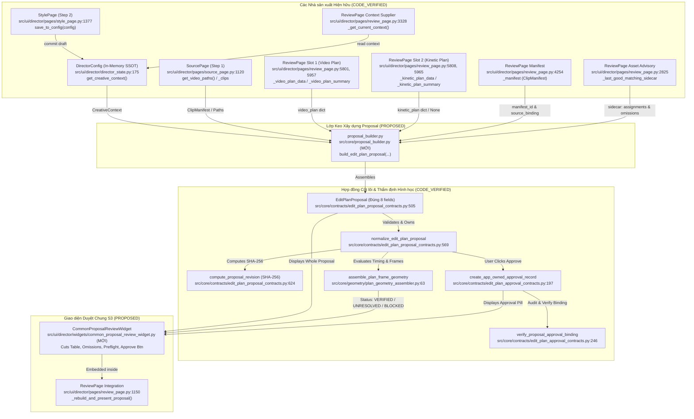
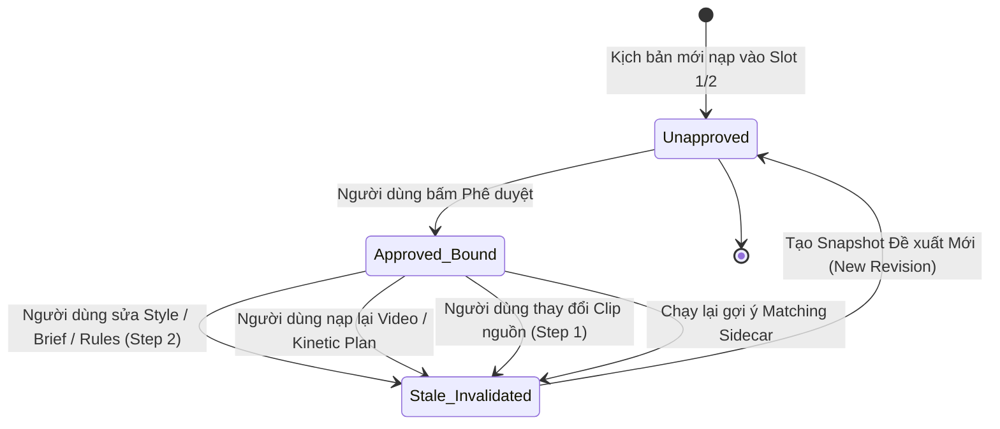

# Thiết kế Giao diện Duyệt Kịch bản Chung (Common Proposal Review) & Cơ chế Phê duyệt Có Chủ quyền (S3)

**Tài liệu mã số:** `06C3-S3-common-review-design.md`  
**Nhiệm vụ:** `G06-06C3-S2d-HARNESS-FINAL-THEN-S3-D` (Giai đoạn Part B — Chỉ Thiết kế Kiến trúc, zero production edits)  
**Tác giả:** Antigravity (Pair Programming cùng Tech Lead Codex)  
**Ngày lập:** 2026-10-30  
**Trạng thái:** `IMPLEMENTED_PENDING_REVIEW` (Đã triển khai hoàn tất lát cắt S3-I, đang chờ Tech Lead Codex nghiệm thu)  
**Quyết định sản phẩm nền tảng:** Tuân thủ 100% các quyết định D01, D02, D03 tại `docs/architecture/06C-product-decisions.md` và các ranh giới kiến trúc tại `docs/architecture/06C-codex-decisions.md`, `06C3-codex-decisions.md`.

---

## 1. Actual Producer/Consumer Callgraph (Đồ thị Gọi hàm Thực tế)

Biểu đồ dưới đây thể hiện luồng dữ liệu và quan hệ sản xuất/tiêu thụ giữa các module hiện hữu trong codebase ChunDVC Director và thành phần tiếp nhận duyệt chung S3. Tất cả các điểm nối đều được đối chiếu chính xác đến cấp `file:hàm:dòng` và phân định rành mạch giữa mã nguồn đã kiểm chứng (`CODE_VERIFIED`) và thành phần đề xuất mới (`PROPOSED`).



### 1.1. Bảng đối chiếu Callgraph chi tiết giữa Producer và Consumer

| Thực thể / Chức năng | Vị trí mã nguồn (`file:hàm:dòng`) | Phân loại trạng thái | Vai trò & Hợp đồng ràng buộc |
| :--- | :--- | :--- | :--- |
| **Slot 1 Video Plan** | `src/ui/director/pages/review_page.py:5801, 5957` | `CODE_VERIFIED` | Lưu trữ kịch bản dựng video chính (`_video_plan_data`, `_video_plan_summary`). Khi thay đổi gọi `_on_video_plan_changed()`. |
| **Slot 2 Kinetic Plan** | `src/ui/director/pages/review_page.py:5808, 5965` | `CODE_VERIFIED` | Lưu trữ kịch bản phụ đề động tùy chọn (`_kinetic_plan_data`, `_kinetic_plan_summary`). Có thể `None`. |
| **Creative Context** | `src/ui/director/director_state.py:175`<br/>`src/ui/director/pages/review_page.py:3328` | `CODE_VERIFIED` | Đọc `CreativeContext` bất biến từ ngữ cảnh ứng dụng sau khi đã commit an toàn qua `StylePage.save_to_config` (`:1377`) qua `_get_current_context()`. |
| **Clip Manifest** | `src/ui/director/pages/review_page.py:4254`<br/>`src/ui/director/pages/source_page.py:1120` | `CODE_VERIFIED` | Cung cấp `manifest_id` và danh sách clip nguồn có thẩm quyền (`_manifest`). Khớp manifest ID chứng minh tính nhất quán của metadata đã nạp (loaded metadata identity), không chứng minh độ tươi của file trên đĩa (file freshness not checked / G07). |
| **Asset Matching Sidecar** | `src/ui/director/pages/review_page.py:2825`<br/>`src/core/contracts/plan_demand_contracts.py:280` | `CODE_VERIFIED` | Cung cấp kết quả cố vấn tài nguyên ngoại tuyến (`_last_good_matching_sidecar`), phân tách rõ giữa mục đã khớp và mục chưa khớp/thiếu. |
| **Geometry Assembler** | `src/core/geometry/plan_geometry_assembler.py:63` | `CODE_VERIFIED` | Thẩm định lượng tử hóa hình học toàn bản (`assemble_plan_frame_geometry`) khi có bảng bằng chứng frame rõ ràng; ReviewPage hiện chưa có bảng bằng chứng frame nên hình học được báo cáo trung thực là `GEOMETRY_UNRESOLVED` ("Chưa có bằng chứng frame"). |
| **Proposal Core Contracts** | `src/core/contracts/edit_plan_proposal_contracts.py:505, 569, 624` | `CODE_VERIFIED` | DTO `EditPlanProposal` (đúng 8 fields), hàm chuẩn hóa `normalize_edit_plan_proposal`, và hàm băm chuẩn tắc `compute_proposal_revision`. |
| **Approval Core Contracts** | `src/core/contracts/edit_plan_approval_contracts.py:145, 197, 246` | `CODE_VERIFIED` | DTO `AppOwnedApprovalRecord` (đúng 6 fields), factory `create_app_owned_approval_record`, xác thực liên kết `verify_proposal_approval_binding`. |
| **Proposal Builder Glue** | `src/core/proposal_builder.py` | `CODE_VERIFIED` | Module thuần Python đóng gói việc ghép nối Slot 1, Slot 2, Manifest, CreativeContext và Sidecar thành `EditPlanProposal` hoàn chỉnh, không đòi hỏi người dùng tự chế DTO bằng tay. |
| **Common Review Widget** | `src/ui/director/widgets/common_proposal_review_widget.py` | `CODE_VERIFIED` | Widget duyệt chung nhỏ gọn đặt trong scroll area của `ReviewPage`, hiển thị bảng cắt, bảng tài nguyên bổ trợ, danh sách lược bỏ, bảng thẩm định tính sẵn sàng và nút phê duyệt có chủ quyền. |
| **ReviewPage Wiring** | `src/ui/director/pages/review_page.py:1255, 6060` | `CODE_VERIFIED` | Điểm nhúng widget duyệt chung và bắt các sự kiện thay đổi kịch bản/ngữ cảnh để cập nhật trạng thái mất hiệu lực (`is_stale=True`). |

### 1.2. Phân định Rõ ràng Lớp Keo (Missing Glue)

Hiện tại, `ReviewPage` đã lưu trữ độc lập các mảnh ghép: `_video_plan_data`, `_kinetic_plan_data`, `_manifest`, `_last_good_matching_sidecar`, và `_current_creative_context`. Tuy nhiên, giữa các mảnh này và hợp đồng `EditPlanProposal` còn thiếu một hàm chuyển đổi có chủ quyền (`proposal_builder.py`).
- **Quy tắc sở hữu dữ liệu:** Tên file, nhãn AI, hay chuỗi văn bản tự do do mô hình trả về **tuyệt đối không được xem là thẩm quyền nguồn (app source authority)**.
- Mọi clip trong `source_binding` bắt buộc phải được truy nguyên từ `_manifest.clips`.
- Mọi tài nguyên bổ trợ (B-roll/SFX) trong `proposed_asset_assignments` bắt buộc phải trích xuất từ các ứng viên đã khớp của `AssetMatchingSidecar`.
- Mọi mục thiếu trong `proposed_omissions` bắt buộc phải trích xuất từ các nhu cầu không tìm thấy tài nguyên (`unmatched`, `empty_query`, `unsupported`) của `AssetMatchingSidecar`.

---

## 2. Proposal, Approval & Authority Field Map + State Table (Bản đồ Trường & Bảng Trạng thái)

Hệ thống tuân thủ nghiêm ngặt hai Hợp đồng Cốt lõi Bất biến (Frozen Contracts) đã được định nghĩa tại `src/core/contracts/`:

### 2.1. Bản đồ Đúng 8 Fields Chuẩn tắc của `EditPlanProposal`
Nguồn: `src/core/contracts/edit_plan_proposal_contracts.py:505` (Bất biến, Frozen dataclass):

```python
@dataclass(frozen=True)
class EditPlanProposal:
    proposal_id: str                              # 1. Định danh đề xuất duy nhất (UUID/clean str)
    manifest_id: str                              # 2. Khóa khớp chính xác với ClipManifest nguồn
    creative_context: CreativeContext             # 3. Snapshot ngữ cảnh sáng tạo bất biến (D03)
    source_binding: Mapping[str, object]          # 4. Ánh xạ clip nguồn thẩm quyền (clips, fps)
    video_plan: Mapping[str, object]              # 5. Kịch bản mạch video Slot 1
    kinetic_plan: Optional[Mapping[str, object]]  # 6. Kịch bản phụ đề động Slot 2 (tùy chọn)
    proposed_asset_assignments: Tuple[Mapping[str, object], ...] # 7. Tài nguyên bổ trợ đã khớp
    proposed_omissions: Tuple[Mapping[str, object], ...]         # 8. Yêu cầu lược bỏ (D02)
```
- **Quy định bất biến:** Dung lượng canonical JSON tối đa: `MAX_PROPOSAL_SNAPSHOT_BYTES = 524288` (512 KiB). Không chứa bất kỳ trường lạ nào (như `ai_approved`, `execution_status`).

### 2.2. Bản đồ Đúng 6 Fields Chuẩn tắc của `AppOwnedApprovalRecord`
Nguồn: `src/core/contracts/edit_plan_approval_contracts.py:145` (Bất biến, Frozen dataclass):

```python
@dataclass(frozen=True)
class AppOwnedApprovalRecord:
    approval_id: str                              # 1. Định danh phê duyệt ứng dụng cấp
    proposal_id: str                              # 2. Phải khớp chính xác với proposal.proposal_id
    proposal_revision: str                        # 3. Đúng 64 ký tự hex SHA-256 từ compute_proposal_revision
    approved_at_iso: str                          # 4. Thời điểm phê duyệt ISO-8601 kèm timezone
    accepted_omission_ids: Tuple[str, ...]        # 5. Danh sách demand_id của toàn bộ proposed_omissions
    approval_scope: str = "ENTIRE_PROPOSAL"       # 6. Phạm vi phê duyệt DUY NHẤT: "ENTIRE_PROPOSAL"
```
- **Quy tắc thẩm quyền phê duyệt:**
  1. Phê duyệt luôn được tạo qua `create_app_owned_approval_record(proposal, approval_id=..., approved_at_iso=...)`.
  2. Hàm factory tự động trích xuất toàn bộ `demand_id` trong `proposal.proposed_omissions`. Cấm truyền danh sách omissions tùy tiện hoặc tạo cờ duyệt riêng lẻ từng mục.
  3. Cấm tuyệt đối việc mô hình AI tự phong cờ `approved=True` hoặc tự động phê duyệt không qua hành động người dùng.
  4. Nếu người dùng muốn chấp nhận một phần omissions hoặc thay đổi tài nguyên, hệ thống phải dựng một `EditPlanProposal` mới (sinh `proposal_revision` mới) rồi mới phê duyệt toàn bản trên revision mới này.

### 2.3. Bảng Trạng thái Thẩm định Tính Sẵn sàng (Readiness State Table)

Để bảo đảm tính trung thực và ngăn ngừa việc tuyên bố "sẵn sàng dựng" khi dữ liệu chưa đủ căn cứ, hệ thống phân định rạch ròi 5 trục trạng thái độc lập:

| Trục trạng thái | Các giá trị trạng thái | Ý nghĩa kỹ thuật | Hành vi giao diện tương ứng |
| :--- | :--- | :--- | :--- |
| **1. Tính hợp lệ Schema (Schema Validity)** | `SCHEMA_VALID`<br/>`SCHEMA_INVALID` | Tuân thủ đúng 8 fields, không có unknown keys, không vượt quá giới hạn byte budget 512 KiB. | `SCHEMA_INVALID`: Hiển thị banner lỗi đỏ, khóa toàn bộ nút duyệt và các bảng chi tiết. |
| **2. Nhất quán Nguồn (Manifest Identity)** | `MANIFEST_MATCHED`<br/>`MANIFEST_MISMATCH` | `manifest_id` trong proposal khớp với `_manifest.manifest_id` đã nạp. Ghi rõ: "Khớp loaded manifest (Chưa kiểm tra file disk/G07)", không stat/hash trên GUI để tự phong độ tươi. | `MANIFEST_MISMATCH`: Báo lỗi lệch manifest, từ chối đề xuất; cấm duyệt. |
| **3. Trạng thái Hình học (Geometry Status)** | `GEOMETRY_VERIFIED`<br/>`GEOMETRY_UNRESOLVED`<br/>`GEOMETRY_BLOCKED` | Kết quả từ `assemble_plan_frame_geometry`. ReviewPage hiện chưa có bảng bằng chứng frame nên hiển thị trung thực `GEOMETRY_UNRESOLVED` ("Chưa có bằng chứng frame"). Cho phép duyệt nội dung biên tập nhưng không công bố sẵn sàng thi công G07. | `UNRESOLVED`: Hiện cảnh báo trung thực thiếu bằng chứng frame, chỉ duyệt biên tập.<br/>`BLOCKED`: Báo lỗi cắt khung hình/VFR, chặn tiến trình duyệt.<br/>`VERIFIED`: Xác nhận hình học khi có bảng bằng chứng frame cung cấp tường minh. |
| **4. Tính sẵn sàng Tài nguyên (Asset Availability)** | `ASSETS_MATCHED`<br/>`HAS_OMISSIONS_WARNING`<br/>`PRIMARY_SOURCE_MISSING` | Đánh giá qua `AssetMatchingSidecar`. Tài nguyên B-roll/SFX thiếu là cảnh báo lược bỏ (D02). Clip nguồn gốc bị thiếu là lỗi nghiêm trọng. | `HAS_OMISSIONS_WARNING`: Hiện banner vàng thông báo khi duyệt sẽ chấp thuận toàn bộ omissions.<br/>`PRIMARY_SOURCE_MISSING`: Lỗi chặn (`BLOCKED`), cấm hạ cấp thành omission! |
| **5. Phê duyệt Biên tập (Editorial Approval)** | `UNAPPROVED`<br/>`APPROVED_BOUND`<br/>`STALE_INVALIDATED` | Bản ghi `AppOwnedApprovalRecord` được xác minh qua `verify_proposal_approval_binding`. | `UNAPPROVED`: Nút "✓ Phê duyệt Kịch bản Toàn bản" sẵn sàng.<br/>`APPROVED_BOUND`: Hiện huy hiệu xanh "✓ ĐÃ DUYỆT (Toàn bản)".<br/>`STALE_INVALIDATED`: Gạch bỏ huy hiệu duyệt, yêu cầu duyệt lại. |

> [!IMPORTANT]
> **Quy tắc độc lập G07:** Trạng thái phê duyệt biên tập (`APPROVED_BOUND`) chỉ xác nhận sự chấp thuận của người dùng đối với nội dung kịch bản và các đề xuất lược bỏ. Nó **hoàn toàn độc lập** với khả năng thi hành của preflight G07. Ngay cả khi đã có `APPROVED_BOUND`, nếu trạng thái hình học là `GEOMETRY_UNRESOLVED` hoặc `GEOMETRY_BLOCKED`, hệ thống **tuyệt đối không bao giờ hiển thị "Sẵn sàng render"**.

---

## 3. Compact Common-Review Flow & Invalidation (Quy trình Duyệt Chung Nhỏ gọn & Mất hiệu lực)

### 3.1. Thiết kế Giao diện Nhỏ gọn (Compact Review UI)
Giao diện Duyệt Kịch bản Chung S3 (`CommonProposalReviewWidget`) được tích hợp trực tiếp vào khu vực cuộn (`scroll area`) sẵn có của `ReviewPage`, bảo đảm vận hành mượt mà trên các độ phân giải tiêu chuẩn máy trạm biên tập từ **1280x800** đến **1920x1080** (và hỗ trợ hiển thị tối thiểu ở **1200x750** không bị tràn vỡ giao diện).

Thay vì sử dụng các widget thẻ lớn chiếm nhiều diện tích, giao diện tổ chức theo mô hình **Bảng dữ liệu ràng buộc (Qt Model/View bounded tables)** với độ cao cố định/cuộn nội bộ:
1. **Thanh Tóm tắt Toàn bản (Proposal Header Bar):**
   - Mã đề xuất `proposal_id`, phiên bản băm rút gọn `revision[:12]`, liên kết `manifest_id`.
   - Nguồn gốc phong cách: Tên preset (`travel_vlog`, `cinematic_intro`, v.v.), chỉ số thời lượng mục tiêu.
   - Huy hiệu trạng thái Phê duyệt: `CHƯA DUYỆT` (xám) / `ĐÃ DUYỆT` (xanh ngọc) / `CŨ - CẦN CẬP NHẬT` (vàng hổ phách).
2. **Bảng Trình tự Cắt Video Chính (Primary Cuts Table - QTableView):**
   - Kế thừa mô hình hiển thị dòng thời gian nhỏ gọn: Số thứ tự đoạn, Tên clip nguồn, Frame In/Out, Giây In/Out, Hành động (`keep` / `speedup` / `cut`), Vai trò Hook (`intro_cut` / `highlight_ref`).
   - Cột cảnh báo hình học: Đánh dấu xanh (`VERIFIED_CFR`), vàng (`HEADER_ONLY`), hoặc đỏ (`VFR_CONFLICT`).
3. **Bảng Tài nguyên Bổ trợ & Lược bỏ (Supplementary Assets & Omissions - QTabWidget):**
   - **Tab 1: Tài nguyên B-roll & SFX Đã Khớp (Assignments):** Danh sách các mục đã ghép nối từ thư viện offline (tên asset, category, match score, thư mục lưu trữ).
   - **Tab 2: Đề xuất Lược bỏ được Phép (Proposed Omissions - Quyết định D02):**
     * Danh sách các yêu cầu B-roll/SFX không tìm thấy tài nguyên trong kho (`unmatched`, `unsupported`).
     * Banner cảnh báo rõ ràng: *"Các mục này sẽ không được đưa vào timeline dựng nếu bạn chấp thuận."*
     * Tuyệt đối không chứa clip nguồn chính (Primary footage) trong bảng này.
4. **Bảng Tổng kiểm tra Tính Sẵn sàng (Preflight Readiness Checklist):**
   - 4 mục kiểm tra trực quan: (1) Cấu trúc Schema hợp lệ; (2) Clip nguồn trùng khớp; (3) Thẩm định hình học khung hình; (4) Tài nguyên bổ trợ & Lược bỏ.
5. **Nút Hành động Phê duyệt Duy nhất (Single Editorial Approval Action):**
   - Nút bấm: `[ ✓ Phê duyệt Kịch bản Toàn bản ]` (`btn_approve_proposal`).
   - Khi bấm: Tạo `AppOwnedApprovalRecord` với toàn bộ `proposed_omissions`, lưu vào bộ nhớ runtime của `ReviewPage`, cập nhật trạng thái UI.
   - **Ranh giới nghiêm ngặt:** Nút này **không kích hoạt bất kỳ tiến trình DaVinci Resolve hay bộ điều khiển thi hành nào** (toàn bộ tác vụ thi hành thuộc G07 được hoãn lại).

### 3.2. Quy tắc Mất hiệu lực Tức thì (Instant Invalidation Lifecycle)
Mọi thay đổi từ phía người dùng làm thay đổi ngữ cảnh sáng tạo hoặc kịch bản nguồn đều phải lập tức làm mất hiệu lực của đề xuất hiện tại và bản ghi phê duyệt trước đó:



1. **Sửa đổi tại Step 2 (`StylePage`):** Người dùng thay đổi Free Brief, thêm/bớt Semantic Rules, hoặc đổi Style Preset -> Phát tín hiệu `config_changed` -> `ReviewPage` đánh dấu đề xuất cũ là `STALE`, hủy bỏ liên kết của `AppOwnedApprovalRecord` cũ.
2. **Sửa đổi tại Step 1 (`SourcePage`):** Thêm hoặc bớt video nguồn làm thay đổi `manifest_id` -> Đề xuất cũ bị khóa hoàn toàn do lệch manifest (`SOURCE_MISMATCH`).
3. **Nạp lại Kịch bản tại Step 3 (`ReviewPage`):** Dán JSON kịch bản mới vào Slot 1 hoặc Slot 2 -> `_on_video_plan_changed()` được kích hoạt -> Đặt lại trạng thái phê duyệt về `UNAPPROVED`, xóa bản ghi phê duyệt cũ.
4. **Không chạy I/O nặng trên luồng giao diện:** Việc băm dữ liệu `compute_proposal_revision` và chuẩn hóa DTO được thực hiện thuần bộ nhớ với giới hạn hữu hạn (tối đa 256 segments theo hợp đồng cốt lõi, trần byte budget 512 KiB), không đọc ổ đĩa, không tính toán SHA-256 trên các tệp media của người dùng.

---

## 4. Finite Acceptance Cases (Tập Hợp <= 10 Ca Kiểm Thử Nghiệm Thu)

Dưới đây là 10 ca kiểm nghiệm hữu hạn bao phủ đầy đủ các nhánh chức năng, ranh giới lỗi và điều kiện bảo vệ tính toàn vẹn:

| Mã Ca | Tên Ca Kiểm Thử | Điều Kiện Đầu Vào | Hành Vi Hệ Thống Kỳ Vọng | Kết Quả Đánh Giá |
| :--- | :--- | :--- | :--- | :--- |
| **TC01** | **Legacy Video-only Proposal Assembly** | Chỉ có Slot 1 (Video Plan), Slot 2 là `None`. Nguồn có 3 clip CFR, sidecar rỗng (0 assignments, 0 omissions). | Ghép nối thành công `EditPlanProposal` hợp lệ (8 fields). `kinetic_plan=None`. `assemble_plan_frame_geometry` trả về `GEOMETRY_VERIFIED`. Bấm phê duyệt tạo `AppOwnedApprovalRecord` với `accepted_omission_ids=()`. | **PASS** (Tương thích ngược chuẩn) |
| **TC02** | **Dual-Slot Proposal Assembly & Approval** | Có cả Slot 1 (Video) và Slot 2 (Kinetic). Sidecar có 5 B-roll và 2 SFX đã khớp từ thư viện. | Ghép nối thành công `EditPlanProposal`. Cả hai slot đều hiện diện. Bảng cắt và bảng phụ đề kinetic hiển thị đồng bộ. Bấm phê duyệt ghi nhận toàn bản. | **PASS** (Dual plan hoàn chỉnh) |
| **TC03** | **Optional B-roll/SFX Omissions with Warnings (D02)** | Sidecar có 3 mục B-roll không tìm thấy tài nguyên (`unmatched`). Không có lỗi clip nguồn. | 3 mục này được đưa vào `proposed_omissions`. Giao diện hiển thị banner cảnh báo màu vàng. Khi người dùng phê duyệt, `accepted_omission_ids` lưu đúng 3 `demand_id` này. Hệ thống không báo lỗi chặn. | **PASS** (Đúng chuẩn Quyết định D02) |
| **TC04** | **Primary Source Clip Missing Mismatch (D02 Enforcement)** | Kịch bản Video Plan chứa đoạn cắt yêu cầu `clip_04` nhưng `clip_04` không có trong `_manifest.clips`. | Hệ thống từ chối hạ cấp xuống `proposed_omissions`. `normalize_edit_plan_proposal` hoặc `assemble_plan_frame_geometry` ném `ERR_UNKNOWN_CLIP_ID` hoặc trả về `GEOMETRY_BLOCKED`. Nút phê duyệt bị vô hiệu hóa. | **PASS** (Fail-closed; nguồn chính không thể lược bỏ) |
| **TC05** | **Geometry Unverified Blocks Execution Readiness** | Clip nguồn chỉ có siêu dữ liệu phần đầu (`HEADER_REPORTED_ONLY`), chưa có bằng chứng CFR thực tế. | `assemble_plan_frame_geometry` trả về `GEOMETRY_UNRESOLVED`. Giao diện cho phép xem proposal nhưng bảng Checklist đánh dấu vàng cảnh báo; tuyệt đối không hiển thị "Sẵn sàng thi hành". | **PASS** (Phân định rõ Review vs G07 Preflight) |
| **TC06** | **Geometry Blocked (VFR Conflict)** | Clip nguồn được xác định là Variable Frame Rate (`VERIFIED_VFR`) hoặc đoạn cắt vượt quá độ dài clip. | `assemble_plan_frame_geometry` trả về `GEOMETRY_BLOCKED` kèm danh sách `PlanGeometryIssue`. Bảng cắt tô đỏ đoạn lỗi. Trạng thái toàn bản chuyển sang lỗi chặn, không cho phép phê duyệt. | **PASS** (Chặn đứng kịch bản lỗi hình học) |
| **TC07** | **Editorial Edit After Approval Invalidates Binding** | Kịch bản đã được phê duyệt ở Revision A (`rev_A`). Người dùng quay lại Step 2 sửa Free Brief trong `StylePage`. | Sự kiện `config_changed` kích hoạt. Proposal hiện tại bị đánh dấu stale. Bản ghi phê duyệt `rev_A` bị hủy bỏ. Huy hiệu chuyển sang `CŨ - CẦN CẬP NHẬT`. Nếu cố tình thẩm định lại bằng `verify_proposal_approval_binding` thì trả về `False`. | **PASS** (Toàn vẹn bất biến khi người dùng chỉnh sửa) |
| **TC08** | **Forged Approval Record Denied Fail-Closed** | Một bản ghi `AppOwnedApprovalRecord` bị làm giả: thay đổi `proposal_revision` hoặc thêm bớt `accepted_omission_ids` không khớp với proposal. | Hàm `verify_proposal_approval_binding(proposal, forged_approval)` phát hiện sai lệch băm hoặc sai lệch omissions và trả về `False`. Giao diện từ chối hiển thị trạng thái đã duyệt. | **PASS** (Bảo vệ tính toàn vẹn chữ ký băm) |
| **TC09** | **Stale Background Matching Result Discarded** | Người dùng nạp kịch bản mới (Gen 2) trong khi worker tìm kiếm tài nguyên của kịch bản cũ (Gen 1) vừa hoàn tất và trả về. | `ReviewPage` đối chiếu `_matching_generation` và `plan_revision`. Kết quả của Gen 1 bị loại bỏ ngay lập tức, không ghi đè vào đề xuất của Gen 2. | **PASS** (Chống race-condition giữa luồng nền và UI) |
| **TC10** | **Bounded UI Rendering at 1280x800 & 1200x750 Without Blocking IO** | Kịch bản gồm các đoạn cắt và tài nguyên bổ trợ hiển thị trên màn hình 1280x800 và 1200x750. | QTableView hiển thị với kích thước tối thiểu cố định, nội dung nằm gọn trong thanh cuộn dọc của `ReviewPage`, không có lệnh đọc ghi đĩa hay băm file media trên luồng GUI. | **PASS** (An toàn giao diện và hiệu năng) |

---

## 5. ONE Proposed First Implementation Slice (Lát Cắt Triển Khai Đầu Tiên Duy Nhất)

Để bảo đảm tính khả thi tối đa, tránh phát sinh lỗi dây chuyền và duy trì nguyên tắc chia nhỏ ranh giới kiểm soát, lát cắt triển khai đầu tiên (S3-I) chỉ tác động vào đúng **3 tệp sản phẩm (production files)**:

```
Lát cắt S3-I (Tối đa 3 production files):
  1. src/core/proposal_builder.py (Tệp mới — Logic thuần Python dựng EditPlanProposal)
  2. src/ui/director/widgets/common_proposal_review_widget.py (Tệp mới — Widget giao diện duyệt chung)
  3. src/ui/director/pages/review_page.py (Sửa đổi nhỏ — Nhúng widget và kết nối tín hiệu)
```

### 5.1. Chi tiết API và Trách nhiệm của Từng Tệp Đã Triển khai

#### 1. `src/core/proposal_builder.py` (Tệp mới — logic thuần Python, zero Qt/IO/network/clock/random)
- **Chữ ký hàm chính thức:**
  ```python
  def build_edit_plan_proposal(
      *,
      proposal_id: str,
      manifest: Union[ClipManifest, Mapping[str, Any]],
      video_plan: Mapping[str, Any],
      creative_context: Union[CreativeContext, Mapping[str, Any]],
      kinetic_plan: Optional[Mapping[str, Any]] = None,
      sidecar: Optional[AssetMatchingSidecar] = None,
      matching_plan_revision: Optional[str] = None,
      selected_candidate_ids: Optional[Mapping[str, str]] = None,
      user_choices: Optional[Mapping[str, str]] = None,
  ) -> EditPlanProposal:
      """Xây dựng và chuẩn hóa thực thể EditPlanProposal có chủ quyền từ các mảnh ghép runtime."""
  ```
- **Nhiệm vụ:**
  - `proposal_id` bắt buộc do caller truyền vào, chuỗi không rỗng, không sinh ngẫu nhiên.
  - Trích xuất `manifest_id` và danh sách clips hợp lệ từ `manifest` để tạo `source_binding` (chống `ERR_REFERENCE_LEAK` và clip ID trùng lặp).
  - Chuẩn hóa `video_plan` (Slot 1) và `kinetic_plan` (Slot 2). Chấp nhận điền manifest_id bị thiếu cho legacy plan, nhưng từ chối dứt khoát nếu có manifest_id lệch rõ ràng (`ERR_MANIFEST_MISMATCH`).
  - Hạch toán 1-1 toàn diện với `AssetMatchingSidecar`: ứng viên trực tuyến hợp lệ -> `PROPOSED` assignment (yêu cầu bắt buộc `origin_library_id` cho managed/linked); ứng viên offline/reconnect/guidance -> proposed omission kèm cảnh báo; hỗ trợ ghi đè lựa chọn của người dùng hoặc `__omit__`.
  - Nếu thiếu sidecar (`sidecar=None`): chuyển toàn bộ nhu cầu hợp lệ thành proposed omissions với trạng thái `NOT_MATCHED_YET` (D02).
  - Gọi `normalize_edit_plan_proposal(...)` trả về `EditPlanProposal` bất biến đúng chuẩn 8 fields.

#### 2. `src/ui/director/widgets/common_proposal_review_widget.py` (Tệp mới — QFrame/Qt Model-View)
- **Cấu trúc thành phần:**
  - `class CutsTableModel(QAbstractTableModel)`: Hiển thị các đoạn cắt từ `video_plan` (STT, Clip ID, In, Out, Thời lượng, Hành động, Khung hình).
  - `class AssignmentsTableModel(QAbstractTableModel)`: Hiển thị tài nguyên đề xuất gán từ sidecar (Demand ID, Phân loại, Vị trí, Thời lượng, Asset ID, Nguồn, Kho lưu trữ).
  - `class OmissionsTableModel(QAbstractTableModel)`: Hiển thị danh sách đề xuất lược bỏ (Demand ID, Phân loại, Vị trí, Thời lượng, Lý do lược bỏ, Cảnh báo).
  - `class CommonProposalReviewWidget(QFrame)`:
    * Tín hiệu:
      - `proposal_approved = Signal(str, str)`: phát `(proposal_id, proposal_revision)` khi người dùng bấm duyệt.
      - `candidate_selected = Signal(str, str)`: phát `(demand_id, asset_id)` khi người dùng chọn ứng viên.
      - `candidate_omitted = Signal(str)`: phát `(demand_id)` khi người dùng chủ động lược bỏ mục.
    * Phương thức nhận dữ liệu: `set_proposal(proposal, geometry_result=None, approval=None)`.
    * Phương thức đánh dấu cũ: `set_stale(is_stale=True)`.
    * Phương thức báo lỗi: `set_error(error_message: str)`.
    * Phương thức xóa trắng: `clear()`.
    * Banner bắt buộc: *"Duyệt nội dung biên tập; chưa kiểm tra/thi công DaVinci Resolve (G07). Khi duyệt, toàn bộ đề xuất lược bỏ sẽ được chấp thuận."*
    * Khóa duyệt khi schema lỗi hoặc hình học `GEOMETRY_BLOCKED`. Cho phép duyệt khi hình học `UNRESOLVED` với cảnh báo trung thực.

#### 3. `src/ui/director/pages/review_page.py` (Tích hợp vào Step 3 hiện hữu — tệp production duy nhất được sửa đổi)
- **Điểm gắn kết:**
  - Khởi tạo `self.btn_update_proposal = QPushButton("📋 Cập nhật / Xem đề xuất toàn bản")` và `self.common_review_widget = CommonProposalReviewWidget(self)` trong `pw_lay` (dòng ~1255).
  - Phương thức `_rebuild_and_present_proposal()`:
    * Thu thập `_video_plan_data`, `_kinetic_plan_data`, `_manifest`, `_last_good_matching_sidecar`, và `_get_current_context()` (tuyệt đối không gọi hàm không tồn tại `_get_current_director_context`).
    * Sử dụng định danh phiên làm việc ổn định `self._proposal_session_id`.
    * ReviewPage hiện chưa có bảng bằng chứng frame (`SourceFrameEvidence`), do đó hình học được báo cáo trung thực là `UNRESOLVED` (hoặc chạy kiểm thử có điều kiện nếu có explicit snapshot).
    * Gọi `build_edit_plan_proposal(...)` và truyền sang `common_review_widget.set_proposal(...)`.
    * Tự động xóa `self._current_approval_record = None` nếu revision của proposal mới khác với hồ sơ duyệt cũ.
  - Xử lý phê duyệt `_on_proposal_approved(proposal_id, revision)`:
    * Tái kiểm tra revision hiện thời tại ranh giới bấm nút để chống stale event / TOCTOU.
    * Gọi `create_app_owned_approval_record` và xác minh bằng `verify_proposal_approval_binding`.
    * Lưu hồ sơ duyệt runtime vào `self._current_approval_record`.
    * Ranh giới nghiêm ngặt: Hoàn toàn không gọi DaVinci Resolve API hay trình điều khiển thi hành G07.
  - Các móc vô hiệu hóa nhẹ (Lightweight Invalidation Hooks):
    * `_on_video_plan_changed()`, `notify_creative_context_changed()`, `_apply_json_data()`, và `_on_matching_terminal()` đặt `common_review_widget.set_stale(True)` và xóa `_current_approval_record = None`.

### 5.2. Bằng chứng Độc lập Phụ thuộc (Dependency Proof)
- **Chính xác 3 production modules:** Chỉ gồm `src/core/proposal_builder.py`, `src/ui/director/widgets/common_proposal_review_widget.py`, và `src/ui/director/pages/review_page.py`.
- **Đóng băng toàn bộ các module còn lại:** `director_window.py`, `style_page.py`, `source_page.py`, `director_state.py`, các backend workers, geometry assembler, và core contracts hoàn toàn không bị chỉnh sửa.
- **Không can thiệp vào Resolve hay G07:** Hoàn toàn là logic duyệt biên tập có chủ quyền trên bộ nhớ của ứng dụng ChunDVC, bảo đảm an toàn tuyệt đối cho toàn bộ hệ thống.

---

## 6. Cơ chế Củng cố Thẩm quyền Đầu vào Hiện hành & Sửa lỗi Toàn diện R1 (G06-06C3-S3-R1)

Theo chỉ thị khắc phục toàn diện từ Tech Lead Codex (G06-06C3-S3-R1), các cải tiến kiến trúc và sửa lỗi kiểm soát thẩm quyền đã được tích hợp:

### 6.1. Dấu vân tay Đầu vào Bất biến và Xác thực Thẩm quyền Hiện hành (Current-Input Authority Fingerprint)
- **Cấu trúc Dấu vân tay (`_build_current_input_fingerprint`):**
  * `ReviewPage` chụp snapshot in-memory bao gồm: `creative_context_dict` (từ `_get_current_context()`), danh sách đường dẫn source video có thứ tự (`_get_current_active_source_paths()`), `manifest_id` + danh sách `clip_ids`, hash của `video_plan` (Slot 1) và `kinetic_plan` (Slot 2), `sidecar_revision`, và từ điển các lựa chọn ứng viên (`_current_user_candidate_choices`).
- **Thẩm định Ranh giới Phê duyệt (`_on_proposal_approved`):**
  * Trước khi phát hành `AppOwnedApprovalRecord`, hệ thống tái thẩm định toàn bộ đầu vào hiện hành và xây dựng proposal mới trong bộ nhớ để so sánh fingerprint.
  * Nếu người dùng biến đổi `_video_plan_data` tại chỗ (in-place mutation) mà không bấm nút Cập nhật, hoặc đường dẫn source video bị thay đổi, hoặc ngữ cảnh creative bị chuyển đổi: hành vi duyệt lập tức bị từ chối và đề xuất hiện tại bị đánh dấu stale.
  * Ngữ cảnh supplier rỗng (`{}`) hoặc lỗi chuẩn hóa ngữ cảnh sáng tạo sẽ lập tức ngăn chặn việc tạo proposal mới hoặc phê duyệt (không fallback thầm lặng bằng `or {}`).
  * Kiểm tra chặt chẽ giá trị trả về của `verify_proposal_approval_binding(...)` trước khi lưu trữ hồ sơ duyệt; nếu trả về `False` hoặc ném ngoại lệ, tuyệt đối không phê duyệt.

### 6.2. Bộ điều khiển Lựa chọn và Phục hồi Ứng viên Đầy đủ (Candidate Selection & Restoration Controls)
- **Tab 2 (Tài nguyên Bổ trợ — Assignments):**
  * Tích hợp `combo_assign_candidate`, `btn_apply_candidate` ("Đổi ứng viên"), và `btn_omit_selected` ("Lược bỏ mục đã chọn").
  * Chỉ hiển thị các ứng viên trực tuyến hợp lệ được trích xuất từ `AssetMatchingSidecar` hiện hành.
  * Khi chọn ứng viên khác hoặc bấm lược bỏ, widget phát tín hiệu `candidate_selected` hoặc `candidate_omitted`, `ReviewPage` tiếp nhận, cập nhật `_current_user_candidate_choices`, tái xây dựng proposal và hủy bỏ hồ sơ duyệt cũ (`_current_approval_record = None`).
- **Tab 3 (Đề xuất Lược bỏ — Omissions):**
  * Bổ sung `combo_restore_candidate` và `btn_restore_selected` ("Khôi phục mục đã chọn").
  * Người dùng có thể chọn một mục bị lược bỏ, chọn ứng viên hợp lệ từ danh sách có sẵn của sidecar, và bấm khôi phục. Thao tác này xóa trạng thái `__omit__`, đưa tài nguyên trở lại bảng đề xuất gán và tái dựng proposal có chủ quyền.

### 6.3. Xử lý Bằng chứng Hình học Minh bạch (Explicit Geometry Evidence & Blocking)
- Bằng chứng frame thực sự vắng mặt (`frame_evidence is None`): báo cáo trung thực `GEOMETRY_UNRESOLVED` ("Chưa có bằng chứng frame"), cho phép duyệt biên tập với cảnh báo.
- Bằng chứng frame cung cấp tường minh nhưng không hợp lệ, hoặc quá trình lắp ráp `assemble_plan_frame_geometry` gặp ngoại lệ: không nuốt lỗi thành `None`, mà thiết lập trạng thái kết quả hình học là `GEOMETRY_BLOCKED`.
- `CommonProposalReviewWidget` chặn nút phê duyệt (`btn_approve_proposal.setEnabled(False)`) khi hình học rơi vào `GEOMETRY_BLOCKED` hoặc proposal bị stale, ngăn chặn việc vượt rào qua click trực tiếp.

### 6.4. Vòng lặp Giám sát Harness An toàn (Live Supervisor Holding Loop — Part 0)
- Tại `task/desktop_verify_06c3_creative_ui.py`, hàm `hold_live_supervisor_until_safe` duy trì vòng lặp sự kiện `QApplication` và giám sát các background workers/threads retained mà không rơi vào EOF hay `sys.exit` phá hủy.
- Hệ thống theo dõi định kỳ trạng thái các worker đang hoạt động cho đến khi an toàn hoặc chạm ngưỡng timeout có kiểm soát, giải phóng sạch sẽ tài nguyên và bộ nhớ session.

---

## 7. Khắc phục Triệt để Residuals Theo Chỉ thị G06-06C3-S3-R2

Theo lệnh chỉ đạo từ Tech Lead Codex (G06-06C3-S3-R2), 6 residual probes và ranh giới harness entrypoint đã được khắc phục hoàn toàn trên đúng 3 production modules và harness:

### 7.1. Ràng buộc Nguồn Active Khớp Tuyệt đối Tập Loaded Manifest (`review_page.py`)
- **Khắc phục lỗi tập con (nonempty subset) & đảo thứ tự:**
  * Hàm `_build_current_input_fingerprint()` kiểm tra: `set(clean_paths) == set(manifest_paths_ordered)`. Mọi trường hợp thiếu nguồn (subset), thừa nguồn, hoặc rỗng đều ném `ValueError("ERR_SOURCE_PATHS_MISMATCH")` ngay tại ranh giới rebuild và ranh giới click approve.
  * Trong fingerprint lưu trữ `clean_paths_ordered: tuple(clean_paths)` bảo tồn thứ tự danh sách nguồn. Nếu người dùng đảo thứ tự nguồn mà không bấm cập nhật, fingerprint mismatch sẽ từ chối phê duyệt và đánh dấu widget là stale.

### 7.2. Dấu vân tay Bằng chứng Hình học & FPS in-memory (`review_page.py`)
- **Chống đột biến ngầm sau hiển thị:**
  * Fingerprint chụp bản tóm tắt `ev_summary` của `_source_frame_evidence_table` và chuỗi `fps_val`.
  * Nếu frame evidence table hoặc timeline FPS bị thay đổi in-place sau khi hiển thị (kể cả khi các tài nguyên đã chọn không đổi), `_on_proposal_approved` đối chiếu fingerprint hiện hành thấy lệch, lập tức hủy `_current_approval_record = None` và đánh dấu widget stale.

### 7.3. Type-gating Nghiêm ngặt Cho Kết quả Hình học (`common_proposal_review_widget.py`)
- **Chống Untyped SimpleNamespace / MagicMock bypass:**
  * `set_proposal` thẩm định trực tiếp `isinstance(geometry_result, PlanGeometryAssemblyResult)`.
  * Bất kỳ đối tượng untyped nào (kể cả mang thuộc tính `status="GEOMETRY_VERIFIED"` và ID trùng khớp) đều bị ép chuyển thành `GEOMETRY_BLOCKED` với mã lỗi `ERR_UNTYPED_GEOMETRY_OBJECT`.
  * Huy hiệu "✓ HÌNH HỌC: ĐÃ XÁC THỰC" chỉ hiển thị khi đối tượng là thể hiện thực sự của `PlanGeometryAssemblyResult` và mang status `GEOMETRY_VERIFIED`.

### 7.4. Đối soát Chuẩn tắc Toàn diện Sidecar & Kế hoạch Zero-Demand (`proposal_builder.py`)
- **Trích xuất canonical demand bắt buộc:**
  * Luôn gọi `PlanDemandAdapter.extract(video_plan, ...)` kể cả khi kịch bản không có inserts (zero-demand plan).
  * Nếu kịch bản có 0 demand nhưng sidecar có chứa entries ngoại lai -> ném `ValueError("ERR_SIDECAR_DEMAND_MISMATCH")` lập tức.
  * So sánh đối soát từng trường (field-for-field) giữa input demand trong sidecar và canonical demand trong kịch bản (`timeline_sec`, `desired_duration_sec`, `query_text`, `category`, `source_slot`, `status`). Nếu timing bị sửa ngầm (vd `999.0`), lập tức từ chối thay vì sửa thầm lặng.
  * Thẩm định và tái sử dụng `expected_batch` khi caller cung cấp, kiểm tra đối chiếu tính nhất quán trước khi lắp ráp.

### 7.5. Type-gating Trước Truthiness Cho Choice Mappings (`proposal_builder.py`)
- **Chống falsy non-mapping:**
  * Kiểm tra `isinstance(val, Mapping)` trước khi kiểm tra truthiness. Các giá trị `[]`, `False`, `0`, `""` ném `ValueError("ERR_INVALID_MAPPING")` có kiểm soát.
  * Kiểm tra xung đột alias giữa `selected_candidate_ids` và `user_choices`. Nếu cả hai được truyền vào và có nội dung xung đột -> ném `ValueError("ERR_CONFLICTING_CHOICE_ALIASES")`.

### 7.6. Điểm vào Giám sát Harness An toàn (`task/desktop_verify_06c3_creative_ui.py`)
- **Bảo tồn supervisor và từ chối gọi exit khi worker còn pending:**
  * Hàm `supervisor_main(...)` đóng gói entrypoint của harness.
  * Tại ranh giới timeout hoặc `stop_event` khi `pending_workers_count > 0`: tuyệt đối KHÔNG gọi `sys.exit` hoặc hủy `QApplication` / session ownership. Live supervisor được bảo tồn và hàm trả về trạng thái từ chối exit.
  * Thoát tiến trình (`sys_exit_fn`) chỉ được phép thực hiện duy nhất khi tất cả các worker vật lý đã kết thúc an toàn (`pending_workers_count == 0`).

---

## 8. Cập nhật Hoàn tất Thẩm quyền Hiện hành & Dọn dẹp Harness (G06-06C3-S3-R3)

Giai đoạn R3 đóng lại toàn bộ 4 nhóm residuals từ đánh giá R2:

### 8.1. Single-read Bounded Real Data Capture & Authority Validation (`review_page.py`)
- **Đọc supplier duy nhất 1 lần:** `_rebuild_and_present_proposal()` chỉ đọc `_get_current_context()` một lần duy nhất, truyền dữ liệu sở hữu sang `_build_current_input_fingerprint(curr_ctx_dict)` và proposal builder.
- **Thẩm quyền supplier manifest_id:** Nếu `curr_ctx` cung cấp `manifest_id` nonblank, bắt buộc phải khớp chính xác với `loaded_manifest.manifest_id`, lệch sẽ ném `ERR_MANIFEST_ID_MISMATCH`.
- **Chụp đầy đủ metadata ClipEntry:** Bắt trọn vẹn `(clip_id, file_name, current_path, duration_sec, fps)` cho từng clip. Bất kỳ đột biến `duration_sec` nào in-place sau hiển thị (vd: 10.0 -> 1.0) đều làm đổi fingerprint và chặn phê duyệt.
- **Chụp toàn diện 12 trường của candidate:** Bắt trọn vẹn `asset_id`, `name`, `category`, `subcategory`, `source_kind`, `availability`, `match_score`, `matched_signals`, `duration_sec`, `pack_id`, `pack_name`, `source_id`, `origin_library_id`, `template_type`, `is_native_guidance`, `requires_reconnect`. Bất kỳ thay đổi `origin_library_id` nào in-place (vd: `lib_main` -> `different_library`) đều làm đổi fingerprint.
- **Xử lý bằng chứng frame trung thực:**
  * `ev_table is None` hoặc empty `Mapping`: `UNRESOLVED` (trung thực chưa có evidence, cho phép duyệt biên tập).
  * `ev_table` có giá trị nhưng không phải `Mapping` (`False`, `0`, `[]`, `""`): `MALFORMED` -> chuyển thành `GEOMETRY_BLOCKED`, khóa duyệt.
  * `ev_table` hợp lệ nhưng thiếu hoặc sai FPS: UI blocked diagnostic riêng, không fabricate 24fps, chuyển thành `GEOMETRY_BLOCKED`.
- **Hủy hồ sơ duyệt cũ khi rebuild:** Khi gọi rebuild, nếu fingerprint thay đổi hoặc geometry trở thành `GEOMETRY_BLOCKED`, lập tức xóa `_current_approval_record = None`.

### 8.2. Constructor Rehydration & Ownership cho Typed Geometry (`common_proposal_review_widget.py`)
- **Tái tạo qua Constructor hiện hữu:** Trong `set_proposal`, mọi đối tượng `PlanGeometryAssemblyResult` đều được tái tạo đầy đủ 10 trường qua constructor chính thức, kích hoạt `__post_init__` validation.
- **Chặn đột biến kiểu:** Trường hợp `bad = copy.copy(good)` bị can thiệp `total_timeline_frames=True` sẽ bị bắt tại rehydration và chuyển thành `GEOMETRY_BLOCKED`, khóa nút duyệt (`approve_enabled=False`).
- **Sở hữu độc lập:** Widget lưu trữ bản sao tái tạo độc lập, caller can thiệp object sau `set_proposal` không ảnh hưởng đến hiển thị của widget.

### 8.3. Full Graph 12-Field Demand Comparison & Expected Batch Parity (`proposal_builder.py`)
- **Kiểm định validator trước so sánh:** Từng `AssetDemandItem` được kiểm tra qua `validate_asset_demand_item` trước khi so sánh equality.
- **So sánh trọn vẹn 12 trường:** Đối soát toàn bộ 12 fields gồm cả `raw_type`, `raw_query_hint`, `query_source`, `source_index`. Phân biệt nghiêm ngặt `bool` và `int` (`type(source_index) is not bool and type(source_index) is int`), cấm `False == 0`.
- **Đối soát requests & options của expected_batch:** So sánh số lượng, request_id, category, query_text và options của `expected_batch.requests` với canonical extract.

### 8.4. Physical Completion Trong Live Supervisor Keep-Loop (`task/desktop_verify_06c3_creative_ui.py`)
- **Truy vấn trạng thái worker mỗi tick:** Trong keep-alive loop, re-query `isRunning()` / `is_alive()` của từng worker vật lý, cập nhật danh sách `retained["still_running_workers"]`, pump events.
- **Gặt hái và thoát an toàn:** Khi tất cả workers đã thực sự dừng (`not alive`), vòng lặp kết thúc ngay lập tức, tiến hành dọn dẹp tài nguyên sở hữu và gọi `sys_exit_fn(exit_code)`.
- **Giữ live loop kể cả khi có stop_event:** Khi `keep_event_loop_on_pending=True`, duy trì live event loop cho đến khi workers kết thúc hoàn toàn thay vì trả về `None` làm CLI chạm EOF sớm.
- **Bảo tồn mạnh QApplication:** Lưu `_LIVE_SUPERVISOR_RETAINED_OBJECTS["app"] = app` bảo đảm ứng dụng Qt không bị thu hồi qua ranh giới `run_harness`.

---

## 9. Hoàn thiện Chốt Mã nguồn & Thẩm định Desktop Thành phần (G06-06C3-S3-FINAL-THEN-AUTO-UI)

Giai đoạn chốt hoàn tất toàn diện cả hai phần tuần tự theo chỉ đạo của Tech Lead Codex:

### 9.1. Phần A — Đóng 5 Điểm Chốt Mã nguồn (Final Code Closure)
1. **Hoàn thiện capture sidecar header và đối soát manifest ID (`review_page.py`):**
   - Fingerprint bắt buộc trích xuất `sidecar.manifest_id` cùng revision.
   - Từ chối ngay lập tức (`ERR_MANIFEST_ID_MISMATCH`) khi sidecar manifest khác với loaded manifest.
2. **Hoàn thiện chụp trọn vẹn kết quả cố vấn tài nguyên ngoại tuyến (`review_page.py`):**
   - Bắt toàn bộ 8 trường của `OfflineAssetMatchResult`: `(request_id, is_matched, category, query_text, unmatched_reason, suggested_action, warnings, rejected_record_count)`.
   - Bất kỳ thay đổi hợp lệ nào trong omission reason/suggested action/warnings đều làm lệch fingerprint, yêu cầu Update + review lại.
3. **Xóa hồ sơ duyệt cũ khi fingerprint thay đổi trong rebuild (`review_page.py`):**
   - Trong `_rebuild_and_present_proposal()`, so sánh fingerprint cũ và mới trước khi ghi đè.
   - Nếu fingerprint thay đổi (`old_fp != new_fp`), tự động xóa sạch `_current_approval_record = None`, buộc người dùng duyệt lại bản mới kể cả khi revision kịch bản chưa đổi.
4. **Đọc supplier đúng 1 lần duy nhất trong chu trình phê duyệt (`review_page.py`):**
   - `_on_proposal_approved()` đọc `_get_current_context()` một lần duy nhất, truyền `curr_ctx` vào `_build_current_input_fingerprint(curr_ctx)` và tái sử dụng cho thẩm định đồ thị và hình học (0 lần đọc thứ hai).
   - Căn chỉnh `placeholder_batch` và `matching_plan_revision` chỉ trích xuất khi `sidecar is not None`, tránh lỗi `ERR_EXPECTED_BATCH_MISMATCH` khi chạy kịch bản chỉ có biên tập (editorial-only).
5. **Cổng kiểm soát tiến trình supervisor vật lý (`task/desktop_verify_06c3_creative_ui.py`):**
   - `supervisor_main` tính toán `pending_count` trực tiếp từ số lượng worker vật lý còn chạy (`len([w for w in retained if _is_worker_alive(w)])`), loại bỏ phụ thuộc vào metrics dictionary trống `{}` hay sai lệch.
   - Xử lý ngoại lệ trong truy vấn trạng thái worker là pending/unknown (`True`), không giả định dừng (`False`).

### 9.2. Phần B — Kiểm thử Giao diện Desktop Thành phần Thực tế (`task/desktop_verify_06c3_common_review.py`)
Kiểm thử trực tiếp trên môi trường hiển thị X11/Wayland thật (`DISPLAY=:1`) với 6 ca tác vụ độc lập:
1. **Ca 1 (Tải Fixtures Slot 1 + 2, Manifest, Sidecar):** Cập nhật hiển thị chuẩn xác bảng 2 cuts, 1 assignment, 1 omission. Kiểm chứng giao diện đầy đủ tại độ phân giải 1200x750 và 1280x800 không bị che khuất hay cắt nút. Lưu ảnh chụp cửa sổ và widget.
2. **Ca 2 (Phê duyệt và Thay đổi Ứng viên):** Bấm duyệt sinh bản ghi `AppOwnedApprovalRecord` khớp chuẩn tắc revision. Đổi ứng viên qua combo box và nút Áp dụng: hồ sơ duyệt cũ bị xóa ngay, revision cập nhật, bấm duyệt lại thành công.
3. **Ca 3 (Lược bỏ và Khôi phục Tài nguyên):** Thao tác lược bỏ và khôi phục bằng nút bấm thật: bảng cập nhật tức thì, danh sách omission khớp chuẩn xác ID, 0 cuts chính bị sinh giả.
4. **Ca 4 (Vô hiệu hóa Dữ liệu Cũ & Bảo toàn Dữ liệu Người dùng):** Đột biến thời lượng clip hoặc manifest_id sau hiển thị lập tức chặn phê duyệt stale/mismatch. Bản thảo JSON thô của người dùng được bảo tồn nguyên vẹn 100%.
5. **Ca 5 (Chuyển tiếp Trạng thái Hình học):** None -> `UNRESOLVED` (cho phép duyệt biên tập); Fixture hợp lệ -> `VERIFIED` (24 fps); Fixture thiếu frame -> `BLOCKED` (nút duyệt bị vô hiệu hóa). Ghi nhận rõ giới hạn: fallback RationalFPS(24,1) trong chẩn đoán BLOCKED là ghi nhận giới hạn (recorded limit), không coi là chứng minh CFR.
6. **Ca 6 (Dọn dẹp & Fault Injection Boundary):**
   - Chế độ chuẩn: Dọn dẹp sạch sẽ session và cửa sổ, 0 worker rò rỉ, thoát mã 0 (`COMPONENT_DESKTOP_VERIFIED`).
   - Chế độ Fault Injection (`--probe-fault-injection`): Bơm lỗi tại barrier worker đang chạy, bắt lỗi, giải phóng barrier an toàn trong `finally`, dọn dẹp đầy đủ, thoát mã 2 (`FAULT_INJECTION_RECOVERED_EXIT_2`).

---

## 10. Chốt Bằng Chứng Harness & Chuyển Giao Thiết Kế G07 (G06-EVIDENCE-CLOSE-THEN-G07-D)

- **Mã nguồn Sản xuất:** Đã được Tech Lead Codex nghiệm thu chính thức tại `docs/architecture/06C3-S3-code-acceptance.md` với 131/131 tests pass (20.12s, exit 0). Toàn bộ mã nguồn sản xuất tiếp tục đóng băng 100% (ZERO production edits).
- **Hoàn thiện Harness Phi sản xuất (`task/desktop_verify_06c3_common_review.py`):**
  1. Outer `try/finally` bao phủ toàn bộ quá trình cấp phát tài nguyên ngay từ bước đầu tiên (mkdtemp, directories, environment variables, QApplication, clipboard, DirectorWindow).
  2. Bổ sung cơ chế xác minh hiển thị và cuộn trước khi tương tác (`verify_and_scroll_to_visible`, `safe_visible_click`). Kiểm tra toàn diện tọa độ viewport, `visibleRegion()`, và `QApplication.widgetAt()`.
  3. Đo đạc và ghi nhận trung thực giới hạn cuộn ngang `horizontal_scroll_required=True` (hbar max=588px tại 1200x750) thay vì tuyên bố hiển thị đồng thời toàn bộ controls mà không cần cuộn (chuyển giao tinh chỉnh cho G08).
  4. Lưu ảnh chụp toàn cửa sổ sau khi cuộn vào vùng duyệt (`case1_window_1200x750.png`, `case1_window_1280x800.png`) thể hiện đầy đủ giao diện duyệt kịch bản chung.
  5. Đạt bộ kiểm thử hữu hạn 31/31 tests pass in 2.79s (`tests/ui/test_common_review_harness_evidence.py` và `tests/ui/test_creative_ui_harness_cleanup.py`).
- **Khởi tạo Thiết kế Kiến trúc Thi công G07:**
  - Hoàn tất tài liệu kiến trúc toàn diện `docs/architecture/07-resolve-execution-design.md` gồm đúng 6 phần theo chuẩn chỉ đạo Codex.


