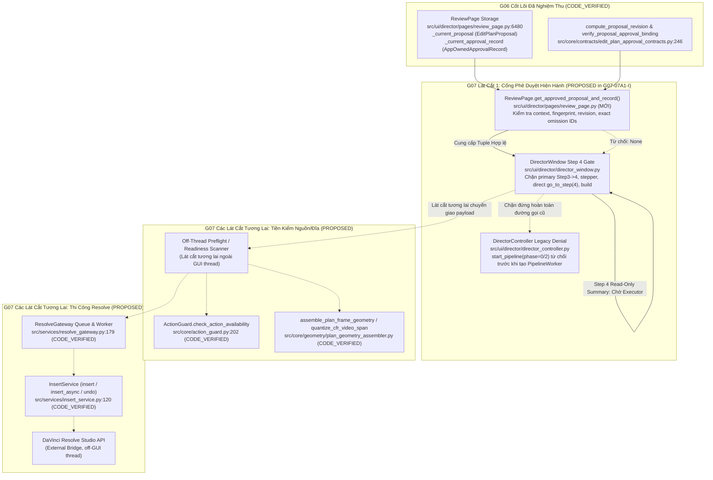

# Thiết Kế Kiến Trúc Thi Công DaVinci Resolve & Thẩm Định Sẵn Sàng (G07 Resolve Execution Design)

- **Tài liệu mã số:** `07-resolve-execution-design.md`
- **Nhiệm vụ:** `G06-EVIDENCE-CLOSE-THEN-G07-D` -> Chuẩn hóa theo chỉ đạo ràng buộc của Tech Lead Codex tại `docs/architecture/07-codex-decisions.md` (Nhiệm vụ `G07-07A1-I`)
- **Tác giả:** Antigravity (Pair Programming cùng Tech Lead Codex)
- **Ngày lập:** 2026-11-02
- **Trạng thái:** `DESIGN_ACCEPTED_WITH_BINDING_CORRECTIONS` (Đã tiếp thu 9 chỉnh sửa bắt buộc của Codex)
- **Ranh giới sản phẩm nền tảng:** Tuân thủ 100% các quyết định D01, D02, D03 (`docs/architecture/06C-product-decisions.md`), các hợp đồng cốt lõi đã nghiệm thu (`edit_plan_proposal_contracts.py`, `edit_plan_approval_contracts.py`, `plan_geometry_contracts.py`, `action_guard.py`), ranh giới nghiệm thu S3 (`docs/architecture/06C3-S3-code-acceptance.md`), và quyết định đóng Gate G06 (`docs/architecture/06-gate-acceptance.md`).

---

## 1. Actual Producer/Consumer Callgraph: CODE_VERIFIED vs PROPOSED

Sơ đồ thể hiện chu trình dữ liệu từ khâu phê duyệt biên tập của người dùng, qua cổng thẩm định phê duyệt hiện hành (Approval Gate), chặn đứng đường bypass AI Build cũ, chuẩn bị cho các lát cắt tiền kiểm và thi công DaVinci Resolve tiếp theo.



### 1.1. Bảng đối chiếu Callgraph chi tiết giữa các thành phần

| Thành phần | Vị trí mã nguồn (`file:hàm:dòng`) | Phân loại trạng thái | Vai trò & Hợp đồng ràng buộc |
| :--- | :--- | :--- | :--- |
| **ReviewPage State SSOT** | `src/ui/director/pages/review_page.py:6480, 6645` | `CODE_VERIFIED` | Nơi lưu giữ duy nhất của `_current_proposal` (`EditPlanProposal` 8 fields) và `_current_approval_record` (`AppOwnedApprovalRecord` 6 fields). |
| **Approval Verification** | `src/core/contracts/edit_plan_approval_contracts.py:246` | `CODE_VERIFIED` | Hàm thuần khiết `verify_proposal_approval_binding(proposal, record)` kiểm tra `proposal_id`, `proposal_revision`, `approval_scope == "ENTIRE_PROPOSAL"`. Lưu ý: `EditPlanProposal` không có trường `proposal_revision`, tính toán bằng `compute_proposal_revision(proposal)`. |
| **ReviewPage Approved Getter** | `src/ui/director/pages/review_page.py` | `PROPOSED` (Thực thi trong G07-07A1-I) | Phương thức `get_approved_proposal_and_record()` trả về `Optional[Tuple[EditPlanProposal, AppOwnedApprovalRecord]]`. Kiểm tra fingerprint ngữ cảnh hiện hành, proposal revision, exact omission IDs, và trạng thái stale/blocked. 1 supplier read, 0 IO, 0 clock. |
| **DirectorWindow Step 4 Gate** | `src/ui/director/director_window.py:443, 455` | `PROPOSED` (Thực thi trong G07-07A1-I) | Cổng kiểm soát toàn bộ ngõ vào Step 4 (primary Next, stepper, `go_to_step(4)`, `_start_build_timeline()`, Build button). Từ chối nếu thiếu approval hợp lệ; cho phép xem tóm tắt nếu đã duyệt hợp lệ, nhưng nút Build trả về thông điệp trung thực "chưa sẵn sàng thi công", không dispatch worker cũ. |
| **DirectorController Legacy Denial** | `src/ui/director/director_controller.py:122` | `PROPOSED` (Thực thi trong G07-07A1-I) | Phương thức `start_pipeline(phase)` chặn đứng tuyệt đối `phase=0` và `phase=2` trước khi khởi tạo `PipelineWorker` hay nạp models, độc lập với giao diện. Giữ nguyên tương thích `phase=1` (phân tích nguồn). |
| **ActionGuard Action-Time** | `src/core/action_guard.py:202` | `CODE_VERIFIED` | Hàm thuần khiết `check_action_availability(asset_metadata, intent, io_provider)` thẩm định sự sẵn sàng của tài nguyên. Không tự duyệt catalog hoặc resolve ID (việc phân giải ID thuộc về caller ngoài GUI thread ở lát cắt tương lai). |
| **Geometry Quantization & Assembly** | `src/core/geometry/plan_geometry_assembler.py:63` | `CODE_VERIFIED` | Lượng tử hóa frame và timeline bounds chuẩn tắc theo Formula B: nguồn native half-even frame bounds, rational span/speed, sau đó mới lượng tử hóa timeline duration. |
| **ResolveGateway** | `src/services/resolve_gateway.py:179` | `CODE_VERIFIED` | Quản lý kết nối API DaVinci Resolve và hàng đợi thực thi tuần tự trên một `QThread` độc lập, 0 lệnh Resolve trên Qt GUI thread. |
| **InsertService** | `src/services/insert_service.py:120` | `CODE_VERIFIED` | Thực hiện chèn tracks, cuts, titles, broll, sfx vào DaVinci Resolve (`insert`, `insert_async`, `undo`), trả về 10-field `InsertResult`. `undo()` là thao tác hoàn tác đơn lẻ, không phải hệ thống rollback toàn phần đa thao tác. |

### 1.2. Phân định với Thao tác Thủ công (Manual Studio / Dock Insert)
- **Workflow Thủ công (Dock/Studio):** Thao tác kéo thả hoặc bấm chèn trực tiếp từ tab Assets / Studio Dock là tương tác chủ động của người dùng (User-Initiated Action), sử dụng trực tiếp `InsertService` và `ActionGuard`, **tuyệt đối không đòi hỏi AI Approval hay Director Proposal Preflight**.
- **Workflow Tự động (Director Step 4):** Bắt buộc 100% phải có phê duyệt biên tập hợp lệ của người dùng qua `ReviewPage.get_approved_proposal_and_record()` trước khi được vào Step 4, và trong các lát cắt tiếp theo phải qua tiền kiểm nguồn/tài nguyên trước khi chạm vào timeline Resolve.

---

## 2. Thẩm Quyền Nguồn & Tài Nguyên (Source & Asset Authority)

### 2.1. Phân biệt Rạch ròi Primary Footage vs Library Stock / Meme Assets
Hệ thống thiết lập thẩm quyền phân tầng nghiêm ngặt:
1. **Primary Footage (Cắt chính Slot 1):**
   - Định danh truy nguyên từ `ClipManifest.clips[i].clip_id` thông qua `source_binding`.
   - Lưu ý cấu trúc `ClipManifest`: gồm `project_name`, `manifest_id`, `clips`, `created_at`, `updated_at`; **không có trường `timeline_name`**.
   - Đường dẫn file tuyệt đối được xác thực qua `ClipEntry.current_path`.
   - **Quy tắc bất biến:** Footage của người dùng là **CHỈ ĐỌC (READ-ONLY)**. Quá trình thi công Resolve chỉ import media pool và đặt in/out points trên timeline, tuyệt đối không chỉnh sửa, di chuyển, hay ghi đè file footage gốc.
2. **Library Stock / Meme Assets (Tài nguyên Bổ trợ Slot 1 B-roll / SFX):**
   - Được định danh thông qua `asset_id` trong catalog hệ thống (vd: `asset_cat_alt`).
   - Tại action-time, việc tra cứu từ catalog sang `asset_id` và xác thực đường dẫn gốc do caller thực hiện ngoài GUI thread (lát cắt tương lai), sau đó truyền vào `ActionGuard.check_action_availability`.
   - **Cấm đoán nghiêm ngặt:** Tuyệt đối không dùng đường dẫn tạm `preview_path` (MP4 nén preview hoặc thumbnail) làm master media để import vào timeline DaVinci Resolve. Nếu file master gốc ở trạng thái `offline` hoặc `missing`, phải báo cáo chính xác là thiếu asset gốc.

### 2.2. Nhất quán Snapshot vs Trạng thái Đĩa Thực tế tại Action-Time
- Việc người dùng bấm "Phê duyệt" tại Step 3 (`G06 Approval Record`) **chỉ chứng minh tính đồng thuận về mặt biên tập kịch bản (editorial consent)** trên snapshot metadata tại thời điểm duyệt.
- Snapshot identity không chứng minh file trên đĩa cứng hoặc ổ đĩa mạng vẫn đang online tại thời điểm thi công Step 4.
- **Nguyên tắc Action-Time Authority:** Trong các lát cắt tiền kiểm/thi công tương lai, việc kiểm tra sự sẵn sàng vật lý của tài nguyên phải thực hiện trực tiếp ngoài GUI thread trước khi gửi lệnh vào ResolveGateway. Editorial approval không thay thế được kiểm tra đĩa thực tế.

### 2.3. Khớp Định danh Dự án & Timeline Bằng Strong UID
- Để ngăn ngừa việc ghi nhầm vào timeline hoặc project khác khi DaVinci Resolve đang mở nhiều project:
  * Phải sử dụng **Strong Project UID và Strong Timeline UID** thật từ API Resolve trên Gateway worker (`project.GetUniqueId()`, `timeline.GetUniqueId()`), không dùng tên lỏng lẻo ("name or UID").
  * Tạo timeline mới thuộc quyền sở hữu của phiên và ghi vào timeline hiện có của người dùng là hai thao tác có thẩm quyền hoàn toàn khác biệt; cần chính sách đích rõ ràng trước khi biến đổi dữ liệu.

---

## 3. Tiền Kiểm Thẩm Định & Ràng Buộc Phê Duyệt (Preflight, Dry-Run & Approval)

### 3.1. Ràng buộc Toàn vẹn Phê duyệt Toàn bản (Entire Proposal Binding)
Hàm kiểm tra phê duyệt hợp lệ bắt buộc thực thi chuỗi kiểm tra bất biến:
1. `verify_proposal_approval_binding(proposal, approval_record) == True`.
2. `approval_record.approval_scope == "ENTIRE_PROPOSAL"` (trường chính xác là `approval_scope`, không phải `scope`).
3. `compute_proposal_revision(proposal) == approval_record.proposal_revision` (`EditPlanProposal` không có trường `proposal_revision` trực tiếp).
4. Danh sách `approval_record.accepted_omission_ids` phải khớp chính xác 100% thứ tự và nội dung danh sách IDs của `proposal.proposed_omissions`.

### 3.2. Quy tắc Xử lý Tài nguyên Bị Mất Sau Phê Duyệt (Tuân thủ Triệt để D02)
- **Quy tắc D02:** Chỉ những tài nguyên B-roll/SFX tùy chọn không tìm thấy đã được người dùng đồng thuận lược bỏ mới trở thành Omission hợp lệ.
- **Kịch bản mất tài nguyên sau khi duyệt:** Giả sử khi duyệt ở Step 3, file `cat_broll.mp4` online. Đến Step 4, ổ đĩa chứa file bị rút ra:
  * **HÀNH VI BỊ CẤM:** Tự ý chuyển tài nguyên đó thành omission rồi âm thầm tiếp tục thi công.
  * **HÀNH VI CHUẨN TẮC:** Quá trình tiền kiểm lập tức từ chối thi công. Cập nhật lại đề xuất omission trong kịch bản và yêu cầu người dùng duyệt lại toàn bản (whole-proposal re-approval).
- **Lỗi Nguồn, Định danh và Sai lệch Thời lượng:** Luôn luôn là lỗi chặn cứng (`CRITICAL_BLOCKER`), không bao giờ được coi là omission tùy chọn.

### 3.3. Lượng Tử Hóa Hình Học Nguồn Trước (Formula B Source-First) & RationalFPS
- **Phân định rõ ranh giới đo lường bằng chứng:**
  * `ABSENT`: Chưa có bảng bằng chứng frame -> Vẫn cho phép phê duyệt biên tập kịch bản (editorial handoff hợp lệ), nhưng **chưa sẵn sàng thi công Resolve**.
  * `HEADER_REPORTED_ONLY`: Metadata từ container header (có thể sai lệch nếu VFR, không coi là bằng chứng CFR đã xác thực).
  * `VERIFIED_CFR`: Đã quét và thẩm định số frame chính xác 100% bằng video stream scanner.
  * `VERIFIED_VFR`: Đã thẩm định là biến thiên khung hình, cần chuẩn hóa trước khi thi công.
  * **Cấm đoán:** Placeholder `RationalFPS(24, 1)` trong các chẩn đoán `GEOMETRY_BLOCKED` chỉ là dữ liệu ghi nhận giới hạn (diagnostic limit), tuyệt đối không được dùng làm bằng chứng cấp quyền thi công hay fallback tự động đoán frame.
- **Tính toán Khung hình Chuẩn tắc (Formula B):**
  * Tái sử dụng trực tiếp `quantize_cfr_video_span` và `assemble_plan_frame_geometry` từ `src/core/geometry/plan_geometry_assembler.py`.
  * Formula B là **source-frame-first**: tính toán native half-even frame bounds trên nguồn, span/speed hữu tỷ, sau đó lượng tử hóa timeline duration. Tuyệt đối không dùng công thức float thô `round(seconds * fps)` hay cộng/trừ epsilon tự chế.

---

## 4. Thi Công & Phục Hồi Thất Bại (Execution & Recovery Architecture)

### 4.1. Thực thi Tuần tự Qua ResolveGateway (0 Resolve Calls on GUI Thread)
- Mọi tương tác với API DaVinci Resolve đều được chuyển giao qua hàng đợi `ResolveGateway` trên worker QThread riêng biệt. Tuyệt đối 0 lệnh Resolve trên Qt GUI thread.
- `submit_sync` chạy event loop cục bộ; cấm gọi `submit_sync` trên main GUI thread hoặc gọi lồng trong worker của chính Gateway gây deadlock.

### 4.2. Điểm Kiểm Soát Đơn Nhất & Trạng Thái Trung Thực (Checkpoints & Status)
- Quá trình thi công có checkpoint kiểm tra hủy (`is_cancelled`) trước mỗi thao tác. Không retry trùng lặp khi gặp timeout.
- Các trạng thái thao tác tương lai (PROPOSED):
  * `SUCCESS`: Thao tác hoàn thành chính xác.
  * `OMITTED`: Mục đã được người dùng phê duyệt lược bỏ từ trước.
  * `FAILED`: Thao tác thất bại, kích hoạt cơ chế thu hồi an toàn.
  * `GUIDANCE_ONLY`: Các hiệu ứng chuyển cảnh native mà API DaVinci Resolve chưa hỗ trợ script -> Xuất hướng dẫn cho người dùng thao tác thủ công, không tạo carrier hay preview giả.

### 4.3. Cơ chế Khôi Phục Thất Bại An Toàn (Safe Rollback Policy)
- Trong trường hợp lỗi hoặc người dùng Hủy:
  * Hệ thống chỉ thu hồi các tài nguyên thuộc sở hữu độc quyền của phiên chạy (owned tracked IDs, bin tạm `ResolveFlow_Build_<Timestamp>`, hoặc timeline do chính phiên tạo ra).
  * **Cấm đoán:** Không xóa timeline hay media pool clips hiện hữu của người dùng; không giữ lại con trỏ project cũ.

---

## 5. Ma Trận Nghiệm Thu Hữu Hạn (Finite Acceptance Matrix)

| # | Kịch bản Kiểm thử | Điều kiện Đầu vào | Hành vi Tiêu cực & Chặn đứng | Hành vi Tích cực & Chấp nhận | Kỳ vọng Trạng thái |
| :--- | :--- | :--- | :--- | :--- | :--- |
| **1** | **Unchanged Approved Editorial Handoff** | Proposal + ApprovalRecord hợp lệ, ngữ cảnh không đổi, frame evidence có thể absent hoặc verified. | Bất kỳ trường nào bị sửa lén -> Bị chặn. | Getter trả về cặp owned tuple nguyên vẹn, 0 IO, binding 1:1. | Tuple[Proposal, Record] hợp lệ |
| **2** | **Stale Proposal / Context / Source Drift** | Sửa kịch bản, đổi fingerprint, hoặc sửa candidate sau khi duyệt. | Chặn vào Step 4; xóa approval stale hoặc đánh dấu cần duyệt lại. | Người dùng ở lại Step 3 xem giao diện cập nhật, drafts được bảo toàn. | Getter trả về None |
| **3** | **Optional Omission Already Approved** | Proposal có B-roll omitted đã được chấp thuận trong `accepted_omission_ids`. | Thêm omission mới ngoài danh sách đã duyệt -> Chặn ngay. | Duyệt đúng danh sách: khớp 1:1 ordered IDs, cho phép chuyển giao biên tập. | Tuple[Proposal, Record] hợp lệ |
| **4** | **Asset Gone Offline After Approval (Lát cắt sau)** | 1 file B-roll bị xóa sau khi duyệt. | Không được tự ý chuyển thành omission (tuân thủ D02). Chặn thi công. | Yêu cầu người dùng duyệt lại toàn bản tại Step 3. | Execution Blocked |
| **5** | **Formula B Source-First Quantization** | Clip kiểm thử với RationalFPS chuẩn. | Đoán mò FPS, dùng float round thô -> Bị cấm. | Lượng tử hóa theo native half-even bounds và Formula B chuẩn xác. | GEOMETRY_VERIFIED |
| **6** | **Legacy Step 4 AI Build Bypass Blocked** | Người dùng hoặc mã gọi trực tiếp Step 4 / Build / Controller `phase=0` hoặc `phase=2`. | Tuyệt đối cấm tạo `PipelineWorker` cũ, cấm nạp model, cấm báo thành công giả. | Chặn đứng với lý do trung thực: "Đã duyệt nội dung; tiền kiểm/thi công G07 chưa sẵn sàng". | Blocked safely, 0 worker created |

---

## 6. Lát Cắt Thi Công Đầu Tiên Được Chọn: G07-07A1-I (First Implementation Slice)

Theo chỉ đạo ràng buộc của Tech Lead Codex tại `docs/architecture/07-codex-decisions.md` và lệnh giao việc `task/architecture-2026-10-26/G07-07A1-I.md`, lát cắt thi công đầu tiên tập trung **chính xác vào việc thiết lập Cổng Phê Duyệt Biên Tập Hiện Hành và đóng hoàn toàn lỗ hổng bypass AI Build cũ**.

### 6.1. Ba Module Sản Xuất Được Phép Chỉnh Sửa (Exactly Three Production Modules)
1. **`src/ui/director/pages/review_page.py`:**
   - Cung cấp API mới:
     ```python
     def get_approved_proposal_and_record(self) -> Optional[Tuple[EditPlanProposal, AppOwnedApprovalRecord]]:
     ```
   - Đọc trực tiếp `_current_proposal` và `_current_approval_record` do app sở hữu (tuyệt đối không đọc cờ bool hay tự tạo approval mới).
   - Xác thực ngữ cảnh: so khớp `_last_displayed_input_fingerprint` với fingerprint hiện hành, so khớp `compute_proposal_revision` với `approval_record.proposal_revision`, kiểm tra trạng thái stale/blocked, và kiểm tra tính hợp lệ của `accepted_omission_ids`.
   - Trả về bản sao an toàn (owned copies) nếu hợp lệ 100%; nếu không hợp lệ trả về `None` và dọn dẹp approval không dùng được.
   - 1 supplier read, 0 IO, 0 clock, 0 UUID, 0 Resolve call, 0 AI model.
   - Chấp nhận frame evidence `ABSENT` cho chuyển giao biên tập (editorial handoff), không coi đây là chứng minh sẵn sàng thi công Resolve.

2. **`src/ui/director/director_window.py`:**
   - Thiết lập cổng kiểm soát tại mọi ngõ vào Step 4: nút Tiếp theo từ Step 3, stepper, gọi trực tiếp `go_to_step(4)`, gọi trực tiếp `_start_build_timeline()`, và nút bấm Build tại Step 4.
   - Sử dụng `page_review.get_approved_proposal_and_record()` để thẩm tra.
   - Nếu thiếu hoặc approval không hợp lệ: ở lại/quay về Step 3 kèm thông báo tiếng Việt ngắn gọn, 0 tạo `PipelineWorker`, 0 nạp model. Giữ nguyên drafts và lựa chọn của người dùng.
   - Nếu approval hợp lệ: cho phép vào Step 4 xem bảng tóm tắt chỉ đọc. Tại Step 4, nút Build trả về thông điệp trung thực: *"Đã duyệt nội dung; tiền kiểm/thi công G07 chưa sẵn sàng"*, tuyệt đối không kích hoạt `PipelineWorker` cũ hay báo thành công giả.

3. **`src/ui/director/director_controller.py`:**
   - Chặn đứng độc lập đường gọi trực tiếp `start_pipeline(phase=0)` và `start_pipeline(phase=2)` trước khi khởi tạo `PipelineWorker`, nạp models hay dựng kwargs.
   - Kiểm tra chặt kiểu int của `phase` (loại trừ bool, string, unknown).
   - Bảo toàn khả năng tương thích của `phase=1` (phân tích nguồn).
   - Trả về `False` kèm chẩn đoán trung thực. Bảo toàn sở hữu `self.worker`, không phát tín hiệu terminal giả mạo làm kết thúc một tác vụ đang chạy khác.

### 6.2. Bộ Kiểm Thử Bắt Buộc Cho Lát Cắt G07-07A1-I
- File kiểm thử mới: `tests/ui/test_director_step4_approval_gate.py` (bao phủ toàn bộ 6 nhóm A–F trong Upfront Finite Acceptance Matrix của lệnh giao việc).
- Bộ kiểm thử hồi quy hữu hạn:
  ```bash
  QT_QPA_PLATFORM=offscreen PYTHONDONTWRITEBYTECODE=1 .venv/bin/pytest tests/ui/test_director_step4_approval_gate.py tests/ui/test_common_proposal_review.py tests/ui/test_creative_context_prompt_routing.py -q
  ```
