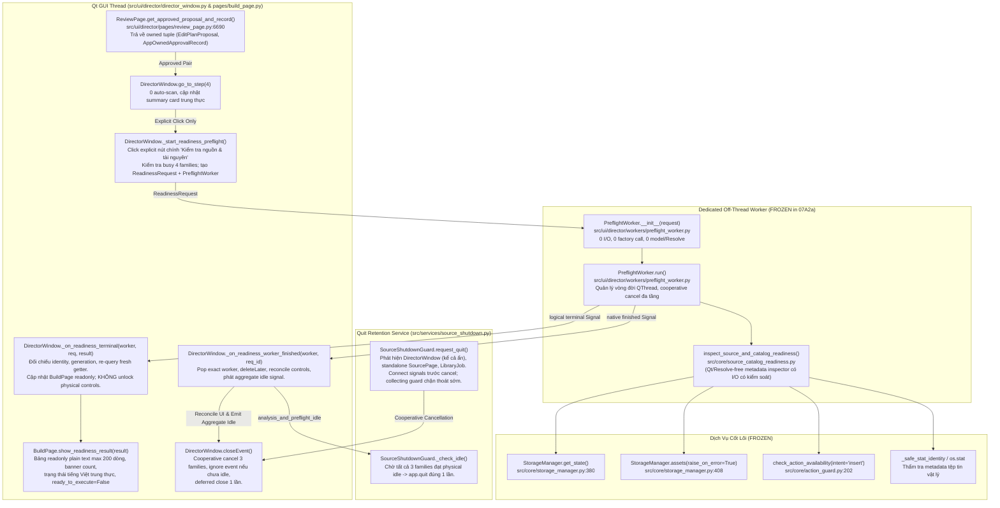

# Thiết Kế Kiến Trúc Tiền Kiểm Nguồn & Thư Viện Tài Nguyên (G07 Source & Catalog Readiness Design)

- **Tài liệu mã số:** `07A2-readiness-design.md`
- **Nhiệm vụ:** `G07-07A2b-I` (Triển khai UI Wiring & App Quit Retention across 3 families)
- **Tác giả:** Antigravity (Pair Programming cùng Tech Lead Codex)
- **Ngày cập nhật:** 2026-11-02
- **Trạng thái phân kỳ:**
  - **G07-07A2a:** `OFFICIALLY_ACCEPTED` (Backend metadata inspection & PreflightWorker đã được nghiệm thu chính thức tại `docs/architecture/07A2a-gate-acceptance.md`; 95/95 tests pass, 12/12 F-matrix pass). Core modules `source_catalog_readiness.py` và `preflight_worker.py` giữ FROZEN hoàn toàn.
  - **G07-07A2b:** `CODE_ACCEPTED_WITH_RECORDED_LIMITS` (Codex thẩm tra độc lập 68/68 tests pass trong 17.11s, exit 0, đóng hai lỗi cached reopen và quit guard connection cleanup tại `docs/architecture/07A2b-code-acceptance.md`).
  - **G07-07A2b-EVIDENCE-FINAL:** `COMPONENT_EVIDENCE_CLOSED` (Harness H1–H8 đạt 8/8 pass; desktop verification trên DISPLAY :1 hoàn tất 3 modes: normal exit 0, fault exit 2, early-failure exit 1; containment kiểm tra trọn vẹn; Step 4 chụp ở 1200x750 & 1280x800).
- **Ranh giới sản phẩm nền tảng:**
  - Kế thừa Gate G06 đã đóng (`docs/architecture/06-gate-acceptance.md`).
  - Kế thừa Gate G07 Slice 1 đã nghiệm thu (`G07-07A1-R1-THEN-07A2-D` / `docs/architecture/07A1-gate-acceptance.md`): Cổng phê duyệt app-owned tại Step 3 và chặn hoàn toàn đường AI Build cũ (`phase 0/2`).
  - Tuân thủ triệt để quyết định D01, D02, D03 (`docs/architecture/06C-product-decisions.md`), `docs/architecture/07A2-codex-decisions.md`, và `docs/architecture/07A2b-codex-decisions.md`.

---

## 1. Callgraph Thực Tế & Quản Lý Luồng / Vòng Đời Tác Vụ (Consumer Callgraph & QThread Lifecycle)

### 1.1. Sơ đồ Callgraph Giữa Các Thành Phần Thực Tế

### 1.2. Phân Định Rõ Ràng: I/O Siêu Dữ Liệu Có Kiểm Soát vs Không Ghi Nhãn Pure
- `src/core/source_catalog_readiness.py` là module thuần Python, hoàn toàn không phụ thuộc PySide6 / UI / DaVinci Resolve API / Network.
- Tuy nhiên, module **có thực hiện I/O siêu dữ liệu** trên hệ thống tệp tin (`os.stat`, `os.access`, đọc cấu hình JSON kho đĩa qua `StorageManager` và `read_matching_storage_context`). Do đó, module **KHÔNG ĐƯỢC GHI NHÃN LÀ PURE**, mà là **Qt/Resolve-free metadata inspector**.
- Mọi thao tác I/O đều hỗ trợ Dependency Injection (`storage_provider`, `storage_context_reader`, `stat_fn`, `realpath_fn`) để phục vụ kiểm thử cô lập hoàn hảo.

### 1.3. Vòng Đời QThread Vật Lý và Tín Hiệu: Native finished vs Logic terminal
- `PreflightWorker` kế thừa `QThread`:
  * Tín hiệu logic nghiệp vụ: `terminal = Signal(object)` phát đúng 1 lần duy nhất đối tượng `SourceCatalogReadinessResult` khi hoàn tất (`completed`), bị hủy (`cancelled`), hoặc gặp sự cố (`failed`).
  * Tín hiệu tiến độ: `progress = Signal(int, str)` phát phần trăm thực tế dựa trên số lượng source clips và asset assignments được kiểm tra.
  * Tín hiệu vòng đời C++: **Giữ nguyên native `QThread.finished`**, không can thiệp, không định nghĩa lại.
- **Tách biệt nghiêm ngặt giữa Logical Terminal và Physical Finished:**
  * Khi logic `terminal` phát tín hiệu: `DirectorWindow._on_readiness_terminal` đối chiếu tính hợp lệ, re-query getter hiện hành, và cập nhật kết quả readonly lên `BuildPage`. **Tuyệt đối không giải phóng physical ownership hay mở khóa điều khiển**.
  * Chỉ khi native `finished` phát tín hiệu: `DirectorWindow._on_readiness_worker_finished` thu hồi worker khỏi registry theo đúng định danh (exact worker pop), gọi `deleteLater()`, phục hồi các điều khiển giao diện theo trạng thái bận tổng hợp, và phát tín hiệu rảnh tổng hợp.
  * Nếu close window hoặc app quit được kích hoạt sau khi logic terminal đã tới nhưng trước khi native finished hoàn tất: hệ thống vẫn chặn close / quit cho đến khi native finished hoàn tất.

---

## 2. Thẩm Định Thư Viện Tài Nguyên Nghiêm Ngặt (Strict Catalog & ActionGuard Integration)

### 2.1. Phân Biệt Snapshot Offline vs Trạng Thái Sống Của Kho (Live State vs Offline Snapshot)
- `StorageManager.assets(raise_on_error=True)` trong cơ chế hiện có có thể trả về một bản ghi snapshot ngoại tuyến nếu kho đã từng được lập chỉ mục trước đó. Việc gọi `assets(raise_on_error=True)` không đồng nghĩa với việc kho đang trực tuyến.
- Do đó, bộ kiểm tra bắt buộc kiểm tra trạng thái sống qua `storage.get_state()` trước:
  * Trạng thái được phép: `ONLINE`, `READ_ONLY`, `FULL`.
  * Trạng thái bị từ chối: `OFFLINE`, `ERROR`. Nếu kho ở trạng thái này, toàn bộ tài nguyên gán lập tức bị đánh dấu `guard_status="offline"`, `all_catalog_ok = False`, fail-closed ngay lập tức.
- **Trường hợp không có tài nguyên gán (`proposed_asset_assignments` rỗng):**
  * Đánh dấu `catalog not_required`.
  * **0 cuộc gọi tới storage factory / storage config / catalog assets / registry**. Kể cả khi chưa cấu hình kho thư viện hoặc kho bị lỗi, kiểm tra vẫn đạt nếu các nguồn footage hợp lệ.

### 2.2. Trần Giới Hạn và Ngăn Chặn Trùng Lặp ID (Catalog Overflow & Duplicate Denial)
- Bổ sung trần an toàn: `MAX_CATALOG_RECORDS = 100_000`. Nếu danh mục tài nguyên vượt quá 100.000 mục, hệ thống lập tức từ chối (`ERR_CATALOG_OVERFLOW`) để ngăn ngừa tấn công làm cạn kiệt bộ nhớ hoặc nghẽn CPU.
- **Phát hiện trùng lặp ID:** Trước khi tra cứu, hệ thống quét phát hiện các `asset_id` xuất hiện từ 2 lần trở lên trong catalog. Nếu phát hiện ID trùng lặp, hệ thống **từ chối toàn bộ các bản ghi mang ID đó** (`ERR_DUPLICATE_ASSET_ID`), không tự ý chọn bản ghi đầu tiên.

### 2.3. Đối Soát Nguồn Gốc (Provenance Matching) & Thẩm Quyền ActionGuard
- Đối soát nghiêm ngặt giữa đề xuất và bản ghi gốc trong catalog:
  * `asset_id` phải khớp chính xác.
  * `source_kind` phải khớp chính xác (`managed`, `linked`, `builtin`, `generated`).
  * Mọi trường nguồn gốc được cung cấp trong assignment (`origin_library_id`, `source_id`, `pack_id`) phải khớp với bản ghi catalog gốc. Sai lệch hoặc thiếu thông tin dẫn đến từ chối (`ERR_PROVENANCE_MISMATCH`).
- **Gọi `check_action_availability`:**
  * Hàm được gọi với `asset=cat_item` (bản ghi catalog gốc). Tuyệt đối không sao chép hay đè siêu dữ liệu từ proposal vào catalog item để cố tình vượt qua cổng kiểm tra.
  * `intent="insert"`.
  * `resolved_path` phải là tệp master vật lý hợp lệ (tồn tại, regular file, readable). Tuyệt đối **không dùng file preview** (proxy/thumbnail) để thay thế master.

---

## 3. Thẩm Định Nguồn Footage & Giới Hạn Chuẩn Tắc Khung Hình

### 3.1. Thẩm Định File Vật Lý Chặt Chẽ
- Danh sách nguồn lấy duy nhất từ `proposal.source_binding.clips` (chứa `clip_id`, `path`/`current_path`, `duration`/`duration_sec`).
- Các tiêu chí kiểm tra tệp tin thông thường:
  1. `path` bắt buộc là đường dẫn tuyệt đối (`os.path.isabs`).
  2. Tệp tin phải tồn tại vật lý (`os.path.exists`).
  3. Phải là regular file (`stat.S_ISREG`), không phải thư mục, device node hay FIFO.
  4. Phải có dung lượng > 0 byte (`st.st_size > 0`).
  5. Tiến trình có quyền đọc (`os.access(..., os.R_OK)`).
- Thiếu tệp tin hoặc lỗi truy cập trả về lỗi cụ thể, không tự ý quét đĩa tìm file thay thế dựa trên tên file (no filename guessing).

### 3.2. Không Có Trusted Full-Content Digest: Bỏ Khái Niệm Sample-Hash Proof
- Trong hợp đồng `EditPlanProposal` kế thừa từ Gate G05/G06, các bản ghi `source_binding.clips` **không chứa mã băm tin cậy của toàn bộ nội dung** (`full_content_sha256`) và không có bảo đảm về nhịp khung hình (FPS proof).
- Việc lấy mẫu byte (sample 1MB đầu/cuối hoặc 64KB) **không thể chứng minh nội dung tệp không bị biến đổi** ở các đoạn giữa. Do đó:
  * Loại bỏ hoàn toàn nhận định "sample hash chứng minh nội dung không đổi".
  * Tiền kiểm **chỉ ghi nhận danh tính stat** `(st_dev, st_ino, st_size, st_mtime_ns, st_ctime_ns)` tại thời điểm kiểm tra ban đầu và tái kiểm tra (`final recheck`) ở cuối tiến trình để phát hiện tệp tin bị ghi đè/thay đổi trong lúc quét.
  * Ghi rõ trong kết quả: Đây là **quan sát khả dụng tại thời điểm kiểm tra (availability observation)**, không phải chứng chỉ toàn vẹn nội dung vĩnh viễn (not content-verified proof).
- **Tuyệt đối không đọc byte media, không hash dữ liệu video, không gọi ffprobe / decoder trong lát cắt này.**

### 3.3. Ràng Buộc Bắt Buộc: `ready_to_execute` Luôn Là `False`
- Trong lát cắt G07-07A2, trường `ready_to_execute` trong mọi đối tượng `SourceCatalogReadinessResult` **BẮT BUỘC PHẢI LÀ `False`**.
- Dù toàn bộ clip nguồn đều hợp lệ và toàn bộ asset thư viện đều online (`checks_passed is True`), hệ thống vẫn **CHƯA ĐỦ ĐIỀU KIỆN SẴN SÀNG THI CÔNG RESOLVE** vì:
  1. Nội dung khung hình và tính chuẩn tắc CFR chưa được thẩm định.
  2. Bố cục hình học timeline (geometry layout) chưa được ráp nối.
  3. Bộ thi công DaVinci Resolve Executor chưa được nghiệm thu.

---

## 4. Giao Diện Người Dùng & Phản Hồi Trung Thực (BuildPage & DirectorWindow Wiring)

### 4.1. Bước 4 Không Tự Động Quét (Zero Auto-Scan)
- Khi người dùng chuyển sang Bước 4 (`go_to_step(4)`), hệ thống chỉ cập nhật thẻ tóm tắt và hiển thị nhãn nút chính: `Kiểm tra nguồn & tài nguyên`.
- **Tuyệt đối không tự động kích hoạt worker quét nguồn hoặc kiểm tra tài nguyên khi vừa bước vào Bước 4**. Tiến trình chỉ bắt đầu khi người dùng nhấn nút chính một cách tường minh (`explicit click`).

### 4.2. BuildPage Readonly Feedback & Loại Bỏ Nhãn Giả Mạo
- **Loại bỏ nhãn giả:** Đổi tiêu đề Bước 4 thành `Bước 4: Xác nhận cấu hình & Kiểm tra nguồn, tài nguyên`; đổi nhãn footage summary thành `{count} clip đã nạp` thay vì `sẵn sàng dựng`.
- **Bảng quan sát thuần văn bản (Readonly Plain Text Table):**
  * 4 cột: Loại, Định danh, Trạng thái, Chi tiết.
  * Giới hạn hiển thị tối đa 200 dòng (`MAX_DISPLAY_ROWS = 200`) kèm dòng thông báo rõ ràng `Hiển thị X/tổng số Y dòng`.
  * Không thumbnail, không preview, không filesystem I/O tại GUI.
- **Nút Hủy khi bận:** Hiển thị nút `Hủy kiểm tra` khi `busy=True`, phát tín hiệu `readiness_cancel_requested`.

---

## 5. Đóng Cửa Sổ & Thoát Ứng Dụng An Toàn (Safe Close & App Quit Across 3 Families)

### 5.1. Ba Nhóm Tác Vụ Ngầm (3 Families)
Hệ thống tổng hợp trạng thái bận và lệnh hủy hợp tác qua 3 families:
1. **Source Family:** `page_source._workers_registry` và `is_source_analysis_active()`.
2. **Review Family:** `page_review.is_analysis_idle()` và `shutdown_analysis_workers()`.
3. **Preflight Family:** `win._preflight_workers`.

### 5.2. Giao Thức Đóng Cửa Sổ (`DirectorWindow.closeEvent`)
- Khi nhận sự kiện đóng cửa sổ:
  1. Gửi lệnh hủy hợp tác tới cả 3 families qua `shutdown_analysis_and_preflight_workers()`.
  2. Kiểm tra `is_analysis_and_preflight_idle()`.
  3. Nếu chưa rảnh: đặt `_close_pending = True`, gọi `event.ignore()`, tuyệt đối không phát tín hiệu `closed`.
  4. Khi toàn bộ 3 families đã đạt trạng thái rảnh vật lý (native finished): tự động kích hoạt đóng cửa sổ và phát tín hiệu `closed` đúng 1 lần duy nhất.

### 5.3. Bảo Lưu Thoát Ứng Dụng (`SourceShutdownGuard`)
- Khi ứng dụng nhận lệnh Quit:
  1. Phát hiện toàn bộ `DirectorWindow` (kể cả cửa sổ ẩn hoặc lồng nhau) có giao thức mới, giữ tham chiếu mạnh và nối tín hiệu `analysis_and_preflight_idle` đúng 1 lần.
  2. Phát hiện các `SourcePage` độc lập (ngoài DirectorWindow) và `LibraryJob`.
  3. Cơ chế `_collecting = True` ngăn chặn việc thoát sớm do tín hiệu idle đồng bộ phát sinh trong lúc thu thập.
  4. Xử lý fail-safe khi truy vấn `isRunning()` của `LibraryJob`: nếu ném ngoại lệ, giữ lại job trong `_library_jobs`, kết nối `job.finished`, và coi trạng thái là bận (không được `except: pass` bỏ rơi owner).
  5. Chỉ sau khi toàn bộ các owner và job đã kết thúc vật lý (`physical idle`), `app.quit()` mới được lập lịch gọi đúng 1 lần duy nhất qua `QTimer.singleShot(0, app.quit)`.

---

## 6. Giao Thức Đóng Gộp G07-07A2b-R1 (Pending Authority, Exactly-Once UI Terminal & Shutdown Hardening)

### 6.1. Pending Authority & Khớp Đủ 5 Trường Kết Quả
- Coordinator `DirectorWindow` ghi nhận bộ tuple thẩm quyền `(request_id, generation, proposal_id, proposal_revision, approval_id)` cùng tham chiếu đối tượng `worker` thực tế khi đăng ký candidate qua `_register_preflight_candidate()`.
- Tại logical terminal (`_on_readiness_terminal`):
  1. Kiểm tra đối tượng `worker` khớp chính xác với `_pending_preflight_worker` và có trong registry `_preflight_workers`.
  2. Kiểm tra `_preflight_terminal_consumed`: nếu đã xử lý terminal trước đó, bỏ qua terminal trùng lặp (bảo toàn kết quả `completed` ban đầu, không cho `failed` sau đó ghi đè).
  3. Chuẩn hóa kết quả bằng `normalize_readiness_result()`.
  4. Đối chiếu nghiêm ngặt cả **5 trường**:
     - `outcome.request_id == exp_req_id`
     - `outcome.generation == exp_gen`
     - `outcome.proposal_id == exp_prop_id`
     - `outcome.proposal_revision == exp_rev`
     - `outcome.approval_id == exp_appr_id`
     Bất kỳ sai lệch nào đều bị hủy bỏ (0 publish, không consume, không render bảng kết quả).
  5. Truy vấn phê duyệt hiện hành in-memory (`get_approved_proposal_and_record()`): nếu approval bị hủy hoặc đổi revision/id, đánh dấu `STALE`, xóa kết quả thành công và thông báo hết hiệu lực.

### 6.2. Tiến Trình (Progress) và Giao Diện Bận (Busy UI)
- `_on_readiness_progress` không truy cập thuộc tính `worker.request` (phantom access). Nhận diện tiến trình trực tiếp từ exact worker instance đang chờ.
- Late progress sau khi terminal đã tiêu thụ bị phớt lờ hoàn toàn, không đè nhãn job mới.
- Nút `Hủy` (Cancel) trên `BuildPage` được quản lý tách biệt khỏi việc xóa bảng kết quả: `clear_readiness_result()` chỉ xóa bảng và cập nhật nhãn trạng thái, không ẩn/vô hiệu nút Hủy khi native thread còn hoạt động. Chỉ khi native finished phát ra thì coordinator `set_readiness_busy(False)` mới ẩn nút Hủy và mở khóa các điều khiển.

### 6.3. Cổng Nhập Liệu (Admission Guard) & Đóng Cửa Sổ Hai Pha (Two-Phase Shutdown)
- `dropEvent` kiểm tra trạng thái bận: từ chối và gọi `event.ignore()` nếu preflight đang chạy, hoặc cửa sổ đang trong quá trình đóng/shutdown (`_close_pending`, `_shutdown_requested`, `_is_closed`). Không gọi `page_source.add_paths()`.
- `shutdown_analysis_and_preflight_workers()` đặt cờ `_shutdown_requested = True` trước khi gửi lệnh hủy tới 3 families bằng 3 khối try-except độc lập. Khi cờ này bật, mọi yêu cầu khởi động tiền kiểm mới bị chặn đứng (0 worker, 0 start).
- Cửa sổ đóng theo cơ chế hai pha: `_is_closed` chỉ được đặt thành `True` khi sự kiện đóng thực sự được chấp nhận (`closeEvent` hoàn tất sau khi toàn bộ native threads kết thúc vật lý).

---

## 7. Lịch Sử Phân Kỳ và Tiến Trình Nghiệm Thu

| Lát cắt | Trọng tâm | Phạm vi mã nguồn | Trạng thái |
| :--- | :--- | :--- | :--- |
| **G07-07A1** | App-owned approval gate at Step 3, block legacy AI build | `review_page.py`, `director_window.py` | `OFFICIALLY_ACCEPTED` (`07A1-gate-acceptance.md`) |
| **G07-07A2a** | Backend metadata inspection & PreflightWorker | `source_catalog_readiness.py`, `preflight_worker.py` | `OFFICIALLY_ACCEPTED` (`07A2a-gate-acceptance.md`) |
| **G07-07A2b-I** | UI wiring, BuildPage readonly feedback, Safe close & Quit retention across 3 families | `director_window.py`, `build_page.py`, `source_shutdown.py` | `CHANGES_REQUIRED` (Codex review) |
| **G07-07A2b-R1** | Pending authority (5 fields), exactly-once terminal, busy Cancel preservation, drop admission, fail-safe query retention | `director_window.py`, `build_page.py`, `source_shutdown.py` | `OFFICIALLY_ACCEPTED_WITH_TWO_RESIDUALS` (Codex review) |
| **G07-07A2b-R2** | Normal reopen transition, child lifecycle resumption, targeted disconnect for own slots, real LibraryJob QThread barrier, automated desktop harness (D1–D4) | `director_window.py`, `source_shutdown.py` | `CODE_ACCEPTED_WITH_RECORDED_LIMITS` (`07A2b-code-acceptance.md`) |
| **G07-07A2b-EVIDENCE-FINAL** | Strict containment (no partial visibility), Step 4 screenshots at 1200x750 & 1280x800, fresh unset barrier for active thread fault injection, independent bookkeeping, separate per-mode output directories (`normal/`, `fault/`, `early-failure/`), H1–H8 harness tests | `task/desktop_verify_07a2b.py`, `tests/task/test_desktop_verify_07a2b.py` | `COMPONENT_EVIDENCE_CLOSED` (8/8 tests pass, normal exit 0, fault exit 2, early-failure exit 1) |

---

## 8. Giao Thức Đóng Gộp G07-07A2b-R2 & Chốt Bằng Chứng Giao Diện Cuối Cùng (Component Evidence Final Closure)

### 8.1. Khôi Phục Vòng Đời Khi Mở Lại Cùng Instance (Normal Reopen Transition)
- **Bối cảnh:** `EdgeDockWindow.open_director` lưu giữ biến `_director_window` nội bộ và gọi `.show()` lại chính instance đó khi người dùng mở lại Director.
- **Phân biệt App Quit và Normal Close:**
  - `shutdown_analysis_and_preflight_workers(application_quit=False)` bổ sung tham số boolean để phân biệt.
  - Khi người dùng thoát ứng dụng (`SourceShutdownGuard.request_quit()`), cờ dính (sticky flag) `_app_quit_requested = True` được bật.
  - Khi cờ `_app_quit_requested` đã bật, lệnh `.show()` trong giai đoạn drain thoát KHÔNG BAO GIỜ reset admission, ngăn chặn hoàn toàn việc tái sinh worker hay mở lại giao diện trái phép.
- **Phục hồi có chủ đích khi Normal Reopen:**
  - `DirectorWindow.showEvent()` kích hoạt `_handle_reopen_admission()`.
  - Chỉ khi normal close đã hoàn tất, không có app quit pending/requested, và **toàn bộ 3 families worker đã physical idle**:
    1. Reset các cờ điều phối của `DirectorWindow`: `_is_closed = False`, `_shutdown_requested = False`, `_close_pending = False`.
    2. Reset vòng đời child `ReviewPage`: `_review_close_pending = False`, phục hồi trạng thái các nút copy prompt (`btn_copy_video_prompt`, `btn_copy_kinetic_prompt`, `btn_prepare_batches`).
    3. Reset vòng đời child `SourcePage`: `_shutdown_pending = False`, mở khóa các điều khiển nạp footage (`btn_folder`, `btn_files`).
    4. Invalidate quan sát tiền kiểm cũ (`_last_readiness_result = None`, `_preflight_terminal_consumed = False`), làm sạch bảng BuildPage và yêu cầu click tường minh để kiểm tra lại.
    5. Bảo toàn 100% cấu hình, phong cách dựng, creative brief, footage nguồn và các bản thảo do người dùng nhập.

### 8.2. Ngắt Kết Nối Có Mục Tiêu (Targeted Signal Disconnection) trong SourceShutdownGuard
- **Nguyên nhân lỗi cũ (L2):** `_check_idle()` gọi bare `job.finished.disconnect()`, làm đứt toàn bộ listener của các bên thứ ba và slot nội bộ `LibraryJob.active_jobs.discard(job)`.
- **Giải pháp chính xác:**
  - Lưu trữ slot callback do guard khởi tạo vào từ điển `self._library_job_slots[job] = slot`.
  - Khi job kết thúc vật lý hoặc trong quá trình cleanup idle, CHỈ ngắt kết nối đúng slot đó qua `job.finished.disconnect(slot)`.
  - Toàn bộ observer kết nối trước và sau guard, cũng như slot dọn dẹp nội bộ của `LibraryJob`, đều được bảo toàn nguyên vẹn và chạy đúng 1 lần khi native thread kết thúc.

### 8.3. Bộ Kiểm Thử Desktop Cô Lập (D1–D4 Harness & Safe Teardown)
- Thực hiện kiểm chứng tự động tại `task/desktop_verify_07a2b.py` trong session `tempfile.mkdtemp` cô lập với cấu hình XDG và StorageManager riêng biệt.
- **D1 (Explicit inspection / UI):** Hiển thị ở 1200x750 và 1280x800, xác thực containment viewport của bảng và trạng thái, QTest click nút chính chạy backend metadata check thật trên fixture MP4 (tạo bởi ffmpeg), `ready_to_execute=False`.
- **D2 (Normal reopen):** Đóng Director rồi mở lại qua cached dock receiver, xác nhận cùng instance, chuyển bước mượt mà và kiểm tra lại thành công.
- **D3 (Cancel/stale + physical busy):** Sử dụng `ControlledBarrierPreflightWorker` (nhãn `CONTROLLED_BOUNDARY`) giữ thread sau logical terminal, chứng minh nút Cancel phản hồi trung thực và giải phóng sạch thread.
- **D4 (Quit guard & LibraryJob):** Giữ real `LibraryJob` QThread tại barrier, chứng minh 0 quit khi đang chạy, show bị chặn, và sau khi release barrier thu được đúng 1 lệnh quit (`INTERCEPTED_APPLICATION_QUIT_VERIFIED`), các observer ngoài guard được gọi đủ, `active_jobs` rỗng.
- **Outer try/finally:** Đảm bảo giải phóng toàn bộ barrier, hủy cooperative worker, đợi thread kết thúc vật lý, xác nhận `running_workers_after=0`, xóa sạch session tạm và hỗ trợ chế độ `--fault-injection` thoát exit code 2 có chủ đích.

### 8.4. Chốt Bằng Chứng Giao Diện Cuối Cùng (Component Evidence Final Closure — G07-07A2b-EVIDENCE-FINAL)
1. **Strict Viewport Containment:** Hàm `check_containment(widget, parent_or_window)` loại bỏ hoàn toàn `or intersects()`, yêu cầu `parent_rect.contains(mapped_rect)` tuyệt đối. Các widget ẩn hoặc chỉ hiển thị một phần (partial) đều trả về `False`.
2. **Ảnh Bước 4 Ở Cả Hai Kích Thước:**
   - Chuyển `go_to_step(4)` trước khi chụp ảnh.
   - `d1_1200x750_step4.png` và `d1_1280x800_step4.png` hiển thị trung thực bảng tiền kiểm, trạng thái và các nút điều khiển Bước 4, đạt chuẩn strict containment.
   - Ghi nhận nguồn `WIDGET_RENDER` (do máy chủ X11 ảo `:1` không compositing nên không chụp root window).
3. **Fault Injection Độc Lập Với Fresh Unset Event:**
   - Sử dụng `barrier_fault = threading.Event()` hoàn toàn mới, chưa kích hoạt.
   - Xác thực `held_at_barrier.is_set() is True` VÀ `isRunning() is True` ngay trước khi ném ngoại lệ deliberate.
   - Bắt ngoại lệ và dọn dẹp qua outer `finally:`, thoát mã `exit 2`.
4. **Independent Bookkeeping & Không Xóa Registry Thay Vì Chờ Kết Thúc Vật Lý:**
   - Theo dõi độc lập `owned_workers` và `native_finished_workers`.
   - Tuyệt đối không xóa registry để tạo số liệu giả `len(registry) == 0`.
   - Nếu còn thread sống: giữ nguyên session và owner, báo cleanup failure, exit 1.
5. **Tách Biệt Thư Mục Output Từng Chế Độ:**
   - `.bridge/ux-evidence/G07-07A2b-EVIDENCE-FINAL/normal/` (exit 0)
   - `.bridge/ux-evidence/G07-07A2b-EVIDENCE-FINAL/fault/` (exit 2)
   - `.bridge/ux-evidence/G07-07A2b-EVIDENCE-FINAL/early-failure/` (exit 1)
6. **Bộ Kiểm Thử Harness H1–H8:**
   - 8/8 tests pass trong 6.63s tại `tests/task/test_desktop_verify_07a2b.py`. Log lưu tại `.bridge/ux-evidence/G07-07A2b-EVIDENCE-FINAL/pytest_run.log`.

---
*Tài liệu kiến trúc đã được cập nhật đầy đủ, chính xác theo mã nguồn và bằng chứng thực tế của G07-07A2b-EVIDENCE-FINAL.*
