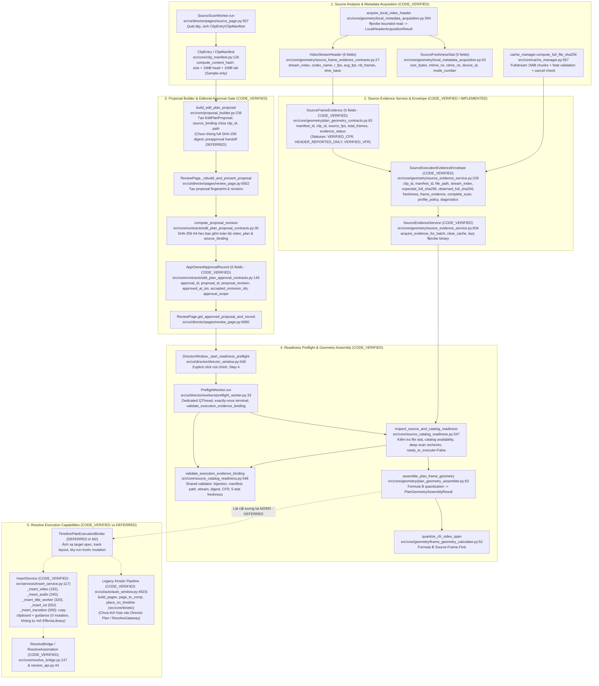

# Thiết Kế Kiến Trúc Thẩm Quyền Nguồn & Thời Gian Thi Công (G07-07A3-R3 Execution Readiness Architecture & Backend API)

- **Tài liệu mã số:** `07A3-execution-readiness-design.md`
- **Nhiệm vụ:** `G07-07A3-R3` (Bảo toàn thiết kế và phản ánh trạng thái triển khai thực tế của Source Evidence Service, Readiness Validator và Preflight Worker)
- **Chế độ:** `IMPLEMENTED_BACKEND_ACCEPTED` — Codex207tests/4.34s/exit0 và62/62 probes; xem [nghiệm thu backend](07A3-code-acceptance.md). UI/preapproval/persistent cache/target executor vẫn DEFERRED.
- **Tác giả:** Antigravity (Pair Programming cùng Tech Lead Codex)
- **Ngày cập nhật:** 2026-11-02
- **Trạng thái:** `ACCEPTED_WITH_RECORDED_LIMITS` — chỉ backend 07A3, chưa toàn M1/G07.
- **Ranh giới sản phẩm nền tảng:**
  - Kế thừa Gate G06 đã nghiệm thu (`docs/architecture/06-gate-acceptance.md`), G07-07A1 (`07A1-gate-acceptance.md`), G07-07A2a (`07A2a-gate-acceptance.md`), và G07-07A2b (`07A2b-code-acceptance.md`).
  - Tuân thủ 100% các quyết định cốt lõi:
    - **D01:** Người dùng phê duyệt toàn bản đề xuất (`whole-proposal review`) và toàn bộ tài nguyên.
    - **D02:** Chỉ cho phép lược bỏ các tài nguyên B-roll/SFX tùy chọn đã được người dùng phê duyệt rõ ràng trong đề xuất; không tự ý lược bỏ khi phát hiện thiếu file.
    - **D03:** Tài nguyên tham chiếu/link không tự động thay thế master file.
  - Tuân thủ triệt để 7 quyết định ràng buộc của Codex tại `docs/architecture/07A3-codex-decisions.md` (C01–C07).
  - Giữ nguyên trạng thái `ready_to_execute=False` và khóa phase 0/2 Director; 0 lệnh gọi DaVinci Resolve.

---

## 1. Callgraph Thực Tế: Producer → Consumer (CODE_VERIFIED vs IMPLEMENTED)

Sơ đồ chi tiết chu trình dữ liệu từ khâu quét nguồn, thu thập siêu dữ liệu, phê duyệt biên tập đến tiền kiểm và thi công:



### Chi tiết các thực thể dữ liệu hiện hữu (CODE_VERIFIED):

1. **`SourceFrameEvidence` (src/core/geometry/plan_geometry_contracts.py:63):**
   Đúng **5 trường chuẩn tắc** đã nghiệm thu, bất biến:
   - `manifest_id: str`
   - `clip_id: str`
   - `source_fps: Optional[RationalFPS]`
   - `total_frames: Optional[int]`
   - `evidence_status: str` (Chỉ chấp nhận 3 giá trị trong `VALID_EVIDENCE_STATUSES`: `"VERIFIED_CFR"`, `"HEADER_REPORTED_ONLY"`, `"VERIFIED_VFR"`).
   *Lưu ý theo C01:* Tuyệt đối không có các trường `source_digest`, `duration_frames`, `rational_fps`, `stream_index`. Không tự ý bổ sung trạng thái ngoài bộ ba chuẩn tắc.

2. **`VideoStreamHeader` (src/core/geometry/source_frame_evidence_contracts.py:27):**
   Đúng **6 trường chuẩn tắc** từ `ffprobe`:
   - `stream_index: int`
   - `codec_name: Optional[str]`
   - `r_frame_rate: Optional[RationalFPS]`
   - `avg_frame_rate: Optional[RationalFPS]`
   - `reported_nb_frames: Optional[int]`
   - `time_base: Optional[Fraction]`

3. **`SourceFreshnessStat` (src/core/geometry/local_metadata_acquisition.py:53):**
   Đúng **5 trường stat định danh bất biến**:
   - `file_size_bytes: int`
   - `mtime_ns: int`
   - `ctime_ns: int`
   - `device_id: int`
   - `inode_number: int`

4. **`ClipManifest.compute_content_hash` (src/core/clip_manifest.py:165):**
   Thực tế mã nguồn đọc: `size` + **1MiB đầu (`head`)** + **1MiB cuối (`tail`)** (không phải 64KB). Đây là hash mẫu nhanh (sample hash), tuyệt đối **không được coi là trusted full-file hash** cho thi công.

5. **`SourceExecutionEvidenceEnvelope` (CODE_VERIFIED: src/core/geometry/source_evidence_service.py:229):**
   Envelope bao bọc đã triển khai cho lát cắt thi công để giữ liên kết giữa siêu dữ liệu tệp và khung hình:
   ```python
   @dataclass(frozen=True)
   class SourceExecutionEvidenceEnvelope:
       clip_id: str
       manifest_id: str
       file_path: str
       stream_index: int
       expected_full_sha256: Optional[str]
       observed_full_sha256: Optional[str]
       freshness: Optional[SourceFreshnessStat]
       frame_evidence: SourceFrameEvidence
       complete_scan: bool = True
       profile_policy: str = "decoded_frame_uniform_ticks_v1"
       diagnostics: Tuple[str, ...] = ()
   ```

---

## 2. Thẩm Quyền Nội Dung & Xác Minh Nhịp Độ Thời Gian (Content & Cadence Timing Authority)

### 2.1. Đảm bảo toàn vẹn nội dung với Full SHA-256 (C02)
- **Tái sử dụng helper chuẩn G05:** Sử dụng hàm `compute_full_file_sha256(file_path, cancelled_fn, chunk_size=1048576)` tại `src/core/cache_manager.py:557`.
  - Đọc tuần tự toàn bộ tệp theo từng khối 1MiB (`chunk_size=1048576`).
  - Kiểm tra an toàn trước và sau khi đọc tệp qua `fstat` đối chiếu `(st_dev, st_ino, st_size, st_mtime_ns, st_ctime_ns)` để chống tấn công/lỗi thay đổi tệp giữa chừng (TOCTOU).
  - Tôn trọng cờ hủy bỏ `cancelled_fn()` giữa các chu kỳ đọc.
- **Tách biệt rõ ràng `expected_full_sha256` vs `observed_now_digest`:**
  1. `expected_full_sha256`: Được tính toán bởi producer ở khâu phân tích nguồn trước khi người dùng bấm duyệt biên tập. Trường này được nhúng vào `source_binding` của proposal và được khóa chặt vào `proposal_revision` thông qua `compute_proposal_revision()`.
  2. `observed_now_digest`: Được đo lường lại trong pha Preflight ở Bước 4 hoặc ngay trước khi thi công.
  3. **Nguyên tắc thẩm quyền:** Nếu `source_binding` trong proposal ban đầu không có `expected_full_sha256` tin cậy, hệ thống **không thể tự ý biến thành green** chỉ vì đo được một mã hash mới tại Bước 4. Khi thiếu liên kết tin cậy, đề xuất bị coi là `STALE` hoặc `UNBOUND`, bắt buộc người dùng bấm cập nhật proposal và duyệt lại theo đúng quyết định D01. Tuyệt đối không mutate ngầm `AppOwnedApprovalRecord` (6 fields) hoặc approved proposal.

### 2.2. Thẩm quyền Cache RAM & Chống TOCTOU (Cache Authority & Invalidation)
- Khóa cache hoàn chỉnh trong RAM per-service instance:
  `cache_key = (file_path_norm, st_dev, st_ino, st_size, st_mtime_ns, st_ctime_ns, global_stream_index, profile_policy)`
- Bỏ hoàn toàn các giả định cache lỏng lẻo (chỉ dùng `path + mtime` hoặc `size + mtime`).
- **Chỉ lưu Complete Proof:** Chỉ lưu trữ vào cache khi tệp đạt chứng chỉ hoàn tất (`evidence_status == "VERIFIED_CFR"` và `complete_scan=True`). Tác vụ dở dang, lỗi, hoặc bị hủy tuyệt đối không được ghi vào cache.
- **Cache Hit vẫn kiểm tra Stat:** Khi cache hit, hệ thống vẫn gọi `_capture_source_freshness` (`os.lstat`) để kiểm tra bộ ngũ 5-stat của tệp trên đĩa (không tuyên bố "0 disk IO"). Nếu `mtime_ns`, `ctime_ns`, kích thước hay inode thay đổi, cache entry bị vô hiệu hóa ngay lập tức và buộc quét lại.
- **Rebind độc quyền cho Caller:** Mỗi request kiểm định mới được gán lại `manifest_id`, `clip_id` và `expected_full_sha256` độc lập; không tái sử dụng biến boolean kết quả của caller trước.
- **Persistent / Cross-restart Cache:** Được hoãn (DEFERRED) sang lát cắt sau; nội dung cache Whisper hiện hành được giữ nguyên vẹn.

### 2.3. Giao Thức Xác Minh Khung Hình Giải Mã Vận Hành Được (Decoded Frame Verification Protocol — `decoded_frame_uniform_ticks_v1`)
Để nâng hạng trạng thái lên `VERIFIED_CFR`, hệ thống áp dụng hồ sơ kiểm định vận hành `decoded_frame_uniform_ticks_v1` dựa trên toàn bộ **khung hình giải mã (decoded frames)** thực tế, không dựa vào packet FIFO hay header danh nghĩa:

1. **Lựa chọn stream theo chỉ số toàn cục (Global Stream Index):**
   - Trích xuất `stream_index` toàn cục từ `VideoStreamHeader` (đọc qua `acquire_local_video_header`).
   - Sử dụng lệnh `ffprobe -select_streams {global_stream_index}` (tuyệt đối không dùng `v:{index}` vì stream specifier `v:N` chọn stream thứ N trong số các luồng video, dẫn đến việc chọn sai 0 frames trong container có audio ở stream 0 và video ở stream 1).
2. **Quét khung hình giải mã (Decoded Frame Presentation Timings):**
   - Đọc danh sách khung hình giải mã qua `ffprobe -select_streams {global_stream_index} -show_frames -show_entries frame=pts,pkt_pts,duration,pkt_duration -of json`.
   - Đọc dạng streaming pipes có giới hạn trần bộ nhớ (stdout trần 128MiB, stderr 64KiB, per-record 16KiB).
   - Không tích lũy toàn bộ danh sách JSON các khung hình trong RAM (O(1) memory per frame).
   - Xác thực:
     + Tiến trình ffprobe kết thúc thành công với mã thoát 0, không có decode error, EOF sạch sẽ.
     + Có tối thiểu 2 khung hình giải mã ($\ge 2$ frames).
     + Toàn bộ giá trị Presentation Timestamps (PTS) là số nguyên hợp lệ.
     + PTS tăng đơn điệu nghiêm ngặt trong thứ tự trình chiếu giải mã (presentation order): $\Delta PTS = PTS_i - PTS_{i-1} > 0$.
     + Toàn bộ $\Delta PTS$ là hằng số dương đồng nhất ($\Delta PTS_i == \Delta PTS_1$).
3. **Xử lý B-frames & Cadence Jitter:**
   - Trong luồng có B-frames, thứ tự gói tin (packet order) trong container có thể không đơn điệu do kiến trúc decode buffer, nhưng thứ tự khung hình sau khi giải mã (presentation order) bắt buộc phải tăng đơn điệu và đều đặn. Do đó, hệ thống quét decoded frames thay vì packet FIFO để tránh gắn nhãn VFR sai lầm cho video B-frames hợp lệ.
4. **Kiểm tra độ bao phủ và Video EOF:**
   - Kiểm tra thời lượng khung cuối cùng: `duration` hoặc `pkt_duration` của khung hình cuối cùng phải khớp chính xác với nhịp $\Delta PTS$.
   - Kiểm tra `total_frames`: Tổng số khung hình giải mã phải khớp với `reported_nb_frames` trong header nếu header có báo cáo.
   - Video EOF được xác định từ luồng video giải mã, tuyệt đối **không so sánh với toàn bộ format duration của container** (bởi vì luồng âm thanh có thể dài hơn luồng hình ảnh).
5. **Suy diễn tốc độ khung hình nguồn (Native Source FPS):**
   - Tốc độ khung hình nguồn được suy diễn từ nhịp thực tế qua số học phân số chuẩn xác:
     $$\text{source\_fps} = \text{RationalFPS.from\_value}\left(\frac{1}{\Delta PTS \times time\_base}\right)$$
   - Tuyệt đối không ghi đè `source_fps` bằng `timeline_fps`.
6. **Xử lý ngoại lệ, nhịp không đều và chính sách không miễn trừ (No VFR Waiver):**
   - Nếu phát hiện nhịp PTS không đều, thiếu PTS, thời lượng khung cuối không khớp, video chỉ có 1 khung hình, hoặc vượt hạn ngạch bộ nhớ/thời gian -> Hạ cấp trạng thái xuống **`HEADER_REPORTED_ONLY`** kèm thông báo chẩn đoán rõ ràng; không tự ý gán `VERIFIED_VFR` khi chưa đủ chứng cứ phân loại.
   - Các định dạng video VFR hoặc không rõ cadence đều bị **CHẶN (BLOCKED)** trong mô hình thi công CFR của G07. Không đưa ra tùy chọn bỏ qua kiểm tra VFR.
   - Tuyệt đối không tự ý transcode hay copy footage của người dùng.

---

## 3. Tái Sử Dụng Công Thức B Hình Học Khung Hình & Ranh Giới Nửa Mở (Formula B Preservation — C04)

### 3.1. Đặc tả chuẩn tắc Formula B theo đúng mã nguồn thực tế
Hệ thống kế thừa nguyên vẹn hàm `quantize_cfr_video_span` tại `src/core/geometry/frame_geometry_calculator.py:52`:

```python
def quantize_cfr_video_span(
    src_in_sec: Union[int, float, Fraction],
    src_out_sec: Union[int, float, Fraction],
    *,
    source_fps: Optional[RationalFPS],
    timeline_fps: RationalFPS,
    total_source_frames: Optional[int],
    is_cfr: Optional[bool],
    applied_speed: Union[int, float, Fraction] = 1,
) -> QuantizedCFRSpan:
```

#### Quy trình tính toán 4 bước bắt buộc (Source-Frame-First):
1. **Kiểm tra ranh giới nguồn bằng Fraction chính xác trước lượng tử hóa:**
   $$\text{max\_source\_sec} = \frac{\text{total\_source\_frames}}{\text{source\_fps.as\_fraction()}}$$
   Xác thực: $0 \le \text{src\_in\_frac} < \text{src\_out\_frac} \le \text{max\_source\_sec}$.
   Bất kỳ vi phạm nào đều ném `ERR_SOURCE_BOUNDS_OVERFLOW` hoặc `ERR_NEGATIVE_INTERVAL`.
2. **Lượng tử hóa khung hình nguồn nguyên bản (Native Source Frames):**
   $$\text{source\_in\_f} = \text{pts\_to\_frame}(\text{src\_in\_frac}, \text{source\_fps})$$
   $$\text{source\_out\_f} = \text{pts\_to\_frame}(\text{src\_out\_frac}, \text{source\_fps})$$
   Khoảng khung hình nguồn: $\text{source\_range} = [\text{source\_in\_f}, \text{source\_out\_f})$ (Ranh giới nửa mở, không có inclusive end bug).
   Độ dài khung hình nguồn: $\text{source\_dur\_f} = \text{source\_out\_f} - \text{source\_in\_f}$. Bắt buộc $> 0$.
3. **Quy đổi thời lượng record timeline bằng số học phân số thuần túy:**
   $$\text{exact\_record\_sec} = \frac{\text{source\_dur\_f}}{\text{source\_fps.as\_fraction()} \times \text{speed\_frac}}$$
   $$\text{record\_dur\_f} = \text{pts\_to\_frame}(\text{exact\_record\_sec}, \text{timeline\_fps})$$
   Bắt buộc $\text{record\_dur\_f} > 0$.
4. **Cấm triệt để:** Không lượng tử hóa thô trực tiếp $\text{round}((\text{src\_out\_sec} - \text{src\_in\_sec}) \times \text{timeline\_fps})$. Không sử dụng floating-point epsilon hay làm tròn tùy tiện.

### 3.2. Trạng thái hình học chuẩn tắc từ `assemble_plan_frame_geometry`
Hàm `assemble_plan_frame_geometry` (`src/core/geometry/plan_geometry_assembler.py:63`) chỉ trả về các trạng thái hình học chuẩn tắc sau:
- **`GEOMETRY_VERIFIED`:** Toàn bộ các segment đường cắt chính đều có evidence `VERIFIED_CFR`, thời lượng hợp lệ, không tràn bờ nguồn.
- **`GEOMETRY_UNRESOLVED`:** Bảng evidence vắng mặt trung thực (honest absence) hoặc có clip chỉ đạt `HEADER_REPORTED_ONLY`. Trạng thái này cho phép duyệt biên tập (editorial approval) nhưng **CHƯA ĐỦ ĐIỀU KIỆN THI CÔNG**.
- **`GEOMETRY_BLOCKED`:** Có ít nhất một lỗi nghiêm trọng (BLOCKING issue) như: `ERR_SOURCE_BOUNDS_OVERFLOW`, `ERR_FPS_MISMATCH`, `ERR_ZERO_FRAME_SEGMENT`, `ERR_VFR_UNSUPPORTED`.

### 3.3. Ma trận Ánh xạ Nguồn → Timeline Resolve

| Trường Nguồn | Nguồn Thẩm Quyền | Trường Đích (Target Spec) | Ràng buộc An toàn |
| :--- | :--- | :--- | :--- |
| `clip_id` / `file_name` | `ClipEntry` | Media Pool Item Name | Khớp định danh đề xuất |
| `current_path` | `os.stat` + 5-stat | Media Pool Clip Import Path | Tệp tồn tại, fstat không đổi |
| `source_in_f` | `quantize_cfr_video_span` | `source_in` trên Clip | $0 \le \text{in\_f} < \text{out\_f}$ |
| `source_out_f` | `quantize_cfr_video_span` | `source_out` trên Clip | $\text{out\_f} \le \text{total\_frames}$ |
| `record_dur_f` | `quantize_cfr_video_span` | `duration` trên Track Timeline | Tương thích `timeline_fps` |
| `record_in_f` | Tích lũy các cut trước | `timeline_start` | Nối tiếp liên tục trên Track V1 |
| `target_track` | Quy tắc định tuyến | Track V1, V2, A1, A2... | Track đích danh nghĩa (Target Spec) |

*Ranh giới:* `TargetSpec` chỉ là thông số kỹ thuật đích danh nghĩa do binder tính toán offline, tuyệt đối **không được coi là ProjectUID của DaVinci Resolve** khi chưa có kết nối Gateway thật.

---

## 4. Năng Lực Định Tuyến & Tránh Khẳng Định Khống (Route Capabilities — C05, C06)

Bảng phân tích đối chiếu năng lực thực thi thực tế trong mã nguồn:

| Nhóm Tài Nguyên | Phương Thức Code Hiện Hữu | Trạng Thái Tích Hợp | Năng Lực Thực Tế & Ranh Giới An Toàn |
| :--- | :--- | :--- | :--- |
| **Primary Video (A-Roll)** | `InsertService._insert_video` (line 192) | **CODE_VERIFIED** (Standalone) | Nạp MediaPool item, chèn vào Track V1. Đã sẵn sàng làm hạt nhân Rough-cut M3. |
| **Source B-Roll** | `InsertService._insert_video` (line 192) | **CODE_VERIFIED** (Standalone) | Chèn vào Track V2 theo record in/out. Sẵn sàng cho M3. |
| **Library B-Roll** | `InsertService._insert_video` (line 192) | **CODE_VERIFIED** (Standalone) | Nạp từ storage cache path. Chỉ dùng master file vật lý (D03). |
| **SFX (Hiệu ứng âm)** | `InsertService._insert_audio` (line 240) | **CODE_VERIFIED** (Standalone) | Chèn vào Track A2/A3. Sẵn sàng cho M3. |
| **BGM (Nhạc nền)** | `InsertService._insert_audio` (line 240) | **CODE_VERIFIED** (Standalone) | Chèn vào Track A4. **Chỉ được thi công nếu nằm trong đề xuất được duyệt**, không tự ý chèn do checkbox config. |
| **Text / Lower Thirds** | `InsertService._insert_title_worker` (320) | **CODE_VERIFIED** (Standalone) | Sinh Fusion Text+ clip cơ bản qua worker. |
| **Chuyển cảnh (Transition)**| `InsertService._insert_transition` (line 500)| **CODE_VERIFIED (GUIDANCE ONLY)** | Copy tên chuyển cảnh vào clipboard và hướng dẫn thao tác (0 mutation, hoàn toàn KHÔNG tự mở Effects Library và KHÔNG tạo chuyển cảnh tự động trên timeline). |
| **Kinetic Typography** | `src/ui/auto/auto_window.py:4923+`<br/>(`build_pages`, `page_to_comp`, `place_on_timeline`) | **CODE_VERIFIED (LEGACY AUTO PIPELINE)** | **Đã có mã nguồn thực tế sinh Fusion .comp**, nhưng **CHƯA ĐƯỢC KẾT NỐI VÀO DIRECTOR PROPOSAL GATEWAY**. |
| **LUT (Màu sắc)** | `InsertService._insert_lut` (line 512) | **CODE_VERIFIED** (Standalone) | Áp dụng LUT vào clip node. Cần file `.cube` hợp lệ trong kho. |

### Chính sách xử lý tính năng chưa tích hợp (C06):
1. **Không bỏ qua âm thầm & Không dùng placeholder:**
   Nếu đề xuất biên tập đã duyệt có chứa Kinetic Typography, hệ thống **tuyệt đối không âm thầm bỏ qua** và **tuyệt đối không chèn placeholder câm**.
2. **Quy tắc tuân thủ D01/D02:**
   - Theo D01, người dùng duyệt toàn bản kịch bản. Nếu hệ thống chưa thể thi công tự động một thành phần đã duyệt (như Kinetic qua Gateway), trạng thái thi công bị **CHẶN (BLOCKED)**.
   - Người dùng có quyền: (a) Xuất kịch bản chữ để dựng qua luồng Auto cũ hoặc thủ công; hoặc (b) Lập đề xuất mới không có thành phần Kinetic để tiến hành dựng tự động phần A-roll/B-roll/Audio.
   - Quyết định D02 chỉ cho phép lược bỏ B-roll/SFX tùy chọn; không cho phép tự ý bỏ Kinetic hay Text.
3. **Không đẩy trách nhiệm sang G08:**
   Gate G08 là về tối ưu hóa giao diện và vòng đời (UI/Lifecycle). Khả năng thi công của G07 phải được xác định trung thực ngay trong G07, không lấy G08 làm lý do trì hoãn lỗ hổng tính năng.

---

## 5. Lộ Trình Hữu Hạn Đóng Toàn Bộ G07 (Max 4 Milestones — C07)

Khối lượng công việc còn lại của G07 được gói gọn trong đúng **4 mốc thi công hữu hạn**, đảm bảo an toàn tuyệt đối trước khi chạm vào DaVinci Resolve:


### Chi tiết 4 Mốc Thi Công:

1. **Mốc 1 (07A3-I) — Dịch Vụ Thẩm Quyền Nguồn & Khung Hình (Source & Frame Authority):**
   - *Mục tiêu:* Operational producer tính toán `SourceFreshnessStat` (5 fields), `compute_full_file_sha256` (1MiB chunks), kiểm chứng nhịp độ CFR theo giao thức packet scan, sinh `SourceFrameEvidence` (5 fields) và đóng gói vào `SourceExecutionEvidenceEnvelope`.
   - *Ranh giới:* **Backend Core & Worker only**. Giữ nguyên UI `BuildPage` (không sửa UI trong lát cắt này, việc hiển thị bảng hình học chi tiết trên GUI được hoãn sang lát cắt UI).
   - *Tiêu chí đóng:* 100% unit tests pass; đối chiếu expected vs observed SHA đạt; 0 lệnh gọi Resolve.

2. **Mốc 2 (07A4-I) — Bộ Liên Kết Thi Công Offline & Dry-Run Timeline (Offline Execution Binder):**
   - *Mục tiêu:* Nhận proposal đã duyệt và evidence envelopes, tính toán Formula B cho toàn bộ các đoạn cắt, phân bổ track layout danh nghĩa (`TargetSpec`), phát hiện va chạm track, tạo báo cáo kế hoạch thi công (Execution Plan).
   - *Ranh giới:* Thuần túy tính toán in-memory/JSON; `TargetSpec` danh nghĩa, **không query hay gán ProjectUID thực của Resolve**; giữ nguyên giới hạn hệ thống `4096 clips` (không hạ xuống 200).
   - *Tiêu chí đóng:* Báo cáo dry-run JSON hoàn chỉnh, 100% test case va chạm và lượng tử hóa thời gian pass.

3. **Mốc 3 (07A5-I) — Thi Công Rough-Cut Qua Bounded Gateway Với Biên Nhận Trước Biến Đổi (Pre-Mutation Receipts):**
   - *Mục tiêu:* Mở kết nối có kiểm soát tới DaVinci Resolve qua `ResolveBridge`.
   - *Ràng buộc an toàn bắt buộc (C07):* **Bắt buộc phải có cơ chế ghi nhận biên nhận (Receipt) và nhật ký thao tác (Journal) TRƯỚC khi thực hiện lệnh biến đổi timeline đầu tiên**. Không hoãn nhật ký an toàn tới sau khi dựng xong.
   - *Phạm vi thi công:* Dựng tự động đường cắt chính A-Roll (V1) và các B-Roll / Audio SFX/BGM đã duyệt.
   - *Tiêu chí đóng:* Tạo timeline mới thành công trong DaVinci Resolve thật; các điểm in/out và thứ tự clip khớp 100% với dry-run plan.

4. **Mốc 4 (07A6-I) — Nhật Ký Giao Dịch Đầy Đủ, Hoàn Tác & Nghiệm Thu Sống Toàn Bộ G07 (Rollback & Final Acceptance):**
   - *Mục tiêu:* Hoàn thiện cơ chế rollback an toàn khi gặp sự cố giữa chừng; thẩm định nghiệm thu trực tiếp kết quả dựng trên timeline DaVinci Resolve đang chạy.
   - *Tiêu chí đóng:* Script tự động xác minh timeline live đạt 100%; đóng chính thức Gate G07; bàn giao sang G08/G09/G10 theo đúng hàng đợi.

---

## 6. Đề Xuất Lát Cắt Thi Công Duy Nhất Kế Tiếp (G07-07A3-I)

### 6.1. Đúng 3 Module Sản Xuất Được Phép Chỉnh Sửa
Lát cắt tiếp theo tập trung trọn vẹn thẩm quyền thu thập bằng chứng khung hình và liên kết vào preflight:
1. `src/core/geometry/source_evidence_service.py` (Mới): Operational service tính toán full SHA-256 (1MiB stream), quản lý cache 5-stat, thực thi giao thức kiểm tra nhịp độ CFR và sinh `SourceExecutionEvidenceEnvelope`.
2. `src/core/source_catalog_readiness.py`: Tích hợp việc đối chiếu `expected_full_sha256` vs `observed_full_sha256` và xác thực hình học khung hình vào `inspect_source_and_catalog_readiness()`.
3. `src/ui/director/workers/preflight_worker.py`: Mở rộng preflight worker để thực thi chu trình kiểm tra nguồn và hình học off-thread, phát kết quả hoàn chỉnh qua tín hiệu terminal.

*Phạm vi giao diện:* `src/ui/director/pages/build_page.py` **FROZEN**, không nằm trong 3 module trên. Giao diện BuildPage hiện tại hiển thị trung thực bảng readiness có sẵn; việc mở rộng cột/bảng hình học chuyên sâu được hoãn sang lát cắt UI sau khi backend M1 được nghiệm thu.

### 6.2. Đặc tả API Nhập/Xuất Đầy Đủ (Đã Triển Khai Trong G07-07A3-I)
```python
@dataclass(frozen=True)
class SourceEvidenceItemRequest:
    clip_id: str
    manifest_id: str
    file_path: str
    stream_index: Optional[int] = None
    expected_full_sha256: Optional[str] = None

@dataclass(frozen=True)
class SourceEvidenceBatchRequest:
    items: Tuple[SourceEvidenceItemRequest, ...]
    timeout_per_file_sec: float = 15.0
    max_decoded_frames: int = 1_000_000
    stdout_budget_bytes: int = 128 * 1024 * 1024
    stderr_budget_bytes: int = 64 * 1024

@dataclass(frozen=True)
class SourceExecutionEvidenceEnvelope:
    clip_id: str
    manifest_id: str
    file_path: str
    stream_index: int
    expected_full_sha256: Optional[str]
    observed_full_sha256: Optional[str]
    freshness: Optional[SourceFreshnessStat]
    frame_evidence: SourceFrameEvidence
    complete_scan: bool = True
    profile_policy: str = "decoded_frame_uniform_ticks_v1"
    diagnostics: Tuple[str, ...] = ()

@dataclass(frozen=True)
class SourceEvidenceBatchResult:
    status: str  # "completed" | "cancelled" | "failed"
    evidence_by_clip: Mapping[str, SourceExecutionEvidenceEnvelope]
    diagnostics: Tuple[str, ...] = ()

class SourceEvidenceService:
    def __init__(self, *, ffprobe_path: Optional[str] = None) -> None:
        ...

    def acquire_evidence_for_batch(
        self,
        request: SourceEvidenceBatchRequest,
        *,
        cancelled_fn: Optional[Callable[[], bool]] = None,
        progress_fn: Optional[Callable[[int, str], None]] = None,
    ) -> SourceEvidenceBatchResult:
        """Thực thi tuần tự quy trình thẩm tra bằng chứng cho danh sách clip nguồn:
        1. Kiểm tra 5-stat: (dev, ino, size, mtime_ns, ctime_ns).
        2. Thu thập tiêu đề luồng video qua acquire_local_video_header.
        3. Tra cứu RAM cache (keyed theo 5-stat + global_stream_index + policy).
        4. Tính toán compute_full_file_sha256 bằng 1MiB chunks có fstat bảo vệ.
        5. Quét decoded frames presentation order qua ffprobe, xác minh nhịp uniform ticks CFR.
        6. Kiểm tra lại stat sau quét (TOCTOU guard) và đóng gói SourceExecutionEvidenceEnvelope.
        """
        ...
```

### 6.3. Tích Hợp Consumer Opt-In (ReadinessRequest & SourceCatalogReadinessResult)
- `ReadinessRequest` bổ sung keyword-only arguments:
  `verify_source_execution: bool = False, timeline_fps: Optional[RationalFPS] = None`
  Giữ nguyên 4 tham số vị trí ban đầu (`request_id, generation, proposal, approval`). Constructor có 0 I/O.
- `SourceCatalogReadinessResult` bổ sung 2 trường tùy chọn ở cuối:
  `source_execution_evidence: Optional[Mapping[str, SourceExecutionEvidenceEnvelope]] = None`
  `source_geometry: Optional[PlanGeometryAssemblyResult] = None`
- `inspect_source_and_catalog_readiness`: Ở chế độ mặc định (`verify_source_execution=False`), không thực hiện đọc dữ liệu media, không băm file, không gọi ffprobe hay service mới (0 deep I/O). Khi opt-in `verify_source_execution=True`, thực hiện kiểm định deep qua `SourceEvidenceService`, so khớp expected vs observed SHA, và lắp ráp hình học `assemble_plan_frame_geometry`.
- `ready_to_execute` luôn là `False`. Các trang UI `BuildPage`, `DirectorWindow`, `ReviewPage` giữ nguyên trạng thái FROZEN; pre-approval handoff cho UI được hoãn sang các lát cắt sau.

### 6.3. Tiêu Chí Nghiệm Thu Hữu Hạn (Đúng 12 Nhóm Kiểm Thử G01–G12)
1. **G01 (CFR Verification Success):** Fixture MP4 CFR chuẩn -> sinh `SourceFrameEvidence` với `VERIFIED_CFR`, đúng `total_frames` và `RationalFPS`.
2. **G02 (Header-Only Fallback):** Tệp video bị timeout packet scan hoặc bị gián đoạn -> giữ nguyên `HEADER_REPORTED_ONLY`, không giả mạo CFR.
3. **G03 (VFR Detection & Blocking):** Fixture video VFR với jitter PTS -> sinh `VERIFIED_VFR`, preflight đánh dấu không tương thích CFR.
4. **G04 (Full SHA-256 Computation):** Tính toán hash toàn vẹn 1MiB chunks khớp chuẩn `sha256sum`; hủy bỏ giữa chừng dọn sạch tài nguyên.
5. **G05 (Stat Invalidation on Mutation):** Thay đổi `ctime_ns` hoặc ghi đè cùng kích thước -> phát hiện TOCTOU và hủy cache cũ.
6. **G06 (Cache Hit on Unchanged Stat):** 5 trường stat nguyên vẹn -> tái sử dụng cache thành công, 0 lần gọi lại `ffprobe` hay đọc lại đĩa.
7. **G07 (Expected vs Observed SHA Match):** `observed_full_sha256 == expected_full_sha256` -> kiểm tra toàn vẹn nội dung đạt `CHECKS_PASSED`.
8. **G08 (Digest Mismatch Tampering):** Tệp tin bị sửa đổi sau khi lập proposal -> báo lỗi `ERR_SOURCE_DIGEST_MISMATCH`, fail-closed an toàn.
9. **G09 (Missing Expected Binding Block):** Proposal không có digest neo ban đầu -> báo lỗi `ERR_UNBOUND_CONTENT_PROVENANCE`, yêu cầu review lại theo D01.
10. **G10 (Formula B Bounds Verification):** Tích hợp envelope vào `assemble_plan_frame_geometry`, phát hiện cắt vượt trần `ERR_SOURCE_BOUNDS_OVERFLOW`.
11. **G11 (Off-Thread Worker Execution):** `PreflightWorker` thực thi trọn vẹn chu trình thẩm tra evidence mà không gây nghẽn GUI thread.
12. **G12 (Cooperative Cancellation):** Phát tín hiệu hủy giữa chu trình batch -> dừng ngay lập tức, không để lại tiến trình ffprobe mồ côi.

### 6.4. Đánh Giá Chi Phí & Giới Hạn Đo Lường Thực Tế (Measured Limits)
- **Chi phí thời gian xử lý clip:** Ghi nhận chính thức là **`UNMEASURED`** (Chưa có benchmark chính thức trên bộ footage thực tế; cấm đưa ra các ước lượng tùy tiện không có căn cứ).
- **Giới hạn hệ thống (Product Cap):** Bảo tồn nguyên vẹn trần `4096 clips` của proposal (con số 200 chỉ là giới hạn hiển thị của bảng UI BuildPage, không áp đặt làm giới hạn tính toán của backend).
- **Ngân sách thời gian:** Timeout tối đa 15.0 giây cho mỗi tệp tin trong khâu phân tích ffprobe; hỗ trợ hủy cooperative ở mọi checkpoint.
- **Tuân thủ chính sách sản phẩm:** Giữ nguyên 100% các quyết định D01, D02, D03 đã chốt.

---

## 7. Chi Tiết Kỹ Thuật Gia Cố Sau Kiểm Thử Độc Lập (G07-07A3-R1 Hardening)

Dựa trên 23 probe kiểm tra độc lập từ Tech Lead Codex (`docs/architecture/07A3-codex-review.md`), các giải pháp kỹ thuật cụ thể đã được triển khai và hoàn tất kiểm chứng trên đúng 3 module được cấp phép:

### 7.1. Bounded Subprocess I/O & Streaming JSON Envelope State Machine
- **Non-blocking read loop:** Sử dụng `os.set_blocking(proc.stdout.fileno(), False)` và đọc khối qua `os.read(fd, READ_CHUNK_BYTES)` bên trong vòng lặp `select.select(..., 0.02)`. Tránh hoàn toàn việc `proc.stdout.read()` dạng buffered bị block khi tiến trình con ghi một đoạn ngắn rồi giữ pipe mở. Toàn bộ tiến trình con bị giới hạn nghiêm ngặt bởi deadline monotonic.
- **State machine xác nhận envelope JSON:** Quá trình streaming JSON theo dõi chính xác các cờ `saw_root_open`, `saw_frames_open`, `saw_frames_close`, `saw_root_close` và cân bằng ngoặc `depth == 0`. Tệp tin kết thúc đột ngột hoặc JSON bị cắt cụt (truncated JSON) dù tiến trình exit code 0 vẫn bị từ chối chuyển sang `VERIFIED_CFR`, ghi nhận lỗi `ERR_TRUNCATED_JSON` và fallback về `HEADER_REPORTED_ONLY`.
- **Kiểm tra stderr khi exit code 0:** Sau khi tiến trình con kết thúc, hệ thống đọc dữ liệu từ `stderr_reader`. Nếu phát hiện các mẫu lỗi giải mã thực tế (`error while decoding`, `corrupt`, `invalid data`, v.v.), bằng chứng bị hạ cấp xuống `HEADER_REPORTED_ONLY` với `ERR_DECODER_ERROR_ON_STREAM`.
- **Reset nhịp frame độc lập:** Thiết lập `last_frame_duration = None` ở mỗi frame; frame cuối cùng nếu thiếu duration hoặc duration không hợp lệ sẽ không được kế thừa từ frame trước, báo lỗi `ERR_LAST_FRAME_DURATION_MISMATCH`.
- **Giới hạn khung hình tức thì (Frame Cap):** Kiểm tra `frame_count >= max_frames` ngay từ frame đầu tiên và frame thứ hai, ngăn chặn việc vượt trần bộ nhớ/thời gian.

### 7.2. Tối Ưu RAM Cache & Điểm Hủy Tiến Trình
- **Cache Hit 0 Probe Call:** Để tránh gọi `acquire_local_video_header` khi truy vấn lại với `stream_index=None`, duy trì bảng ánh xạ `_default_stream_map` (keyed theo 5-stat của tệp tin). Bất kỳ truy vấn trúng cache nào đều trả về ngay kết quả hợp lệ với 0 lần đọc header, 0 lần hash và 0 lần quét frame.
- **Constructor Zero-I/O:** Khởi tạo `SourceEvidenceService.__init__` không thực hiện bất kỳ lệnh `shutil.which` hay thăm dò đĩa nào. Việc phân giải đường dẫn binary ffprobe được trì hoãn lazily qua `_get_ffprobe_bin()` chỉ khi có cache miss cần quét thật.
- **Hủy trong giai đoạn Post-stat:** Kiểm tra `cancelled_fn()` ngay sau khi đo đạc `_capture_source_freshness(is_after=True)` và trước khi ghi vào `self._cache`. Nếu đã bị hủy, phương thức trả về trạng thái `"cancelled"` và giữ nguyên cache với 0 bản ghi mới.

### 7.3. Thẩm Định Nghiêm Ngặt Biên Đầu Vào (Ownership & Validation)
- **Defensive Clone & Ownership:** `SourceEvidenceBatchRequest` tự động clone từng `SourceEvidenceItemRequest` để ngăn chặn mutation từ caller (`items[0] is not item`).
- **Từ chối sớm các trường deep không hợp lệ (Zero I/O):** `inspect_source_and_catalog_readiness` thực hiện kiểm tra kiểu nghiêm ngặt (stream_index không được là bool, SHA canonical) và timeline_fps ngay trước vòng lặp I/O đầu tiên (0 lệnh stat).

### 7.4. Bảo Vệ TOCTOU Sau Quét Deep & Thẩm Tra Tại PreflightWorker
- **Kiểm tra Freshness sau Deep Scan:** Sau khi hoàn thành quá trình quét sâu qua batch evidence service, tiến hành kiểm tra lại 5-stat của toàn bộ các file nguồn. Nếu tệp nguồn bị thay đổi trong lúc đang quét deep, lập tức phát hiện và đánh dấu thất bại với mã lỗi `ERR_SOURCE_MUTATED_DURING_DEEP_SCAN`.
- **Truy xuất thuộc tính chuẩn của Geometry Issue:** Sửa lỗi tham chiếu `issue_type` thành `issue_code` chuẩn tắc (`getattr(issue, "issue_code", getattr(issue, "code", "UNKNOWN_ISSUE"))`) trên đối tượng `PlanGeometryIssue`.
- **Chốt chặn Worker chống bằng chứng giả mạo:** `PreflightWorker.run()` bổ sung kiểm định độc lập đối với `source_execution_evidence`: bất kỳ inspector nào phát tín hiệu `checks_passed=True` nhưng chứa envelope có `complete_scan=False`, `profile_policy` khác `decoded_frame_uniform_ticks_v1`, thiếu `freshness` hoặc không đạt `VERIFIED_CFR` đều bị worker từ chối và phát kết quả thất bại `checks_passed=False`.
