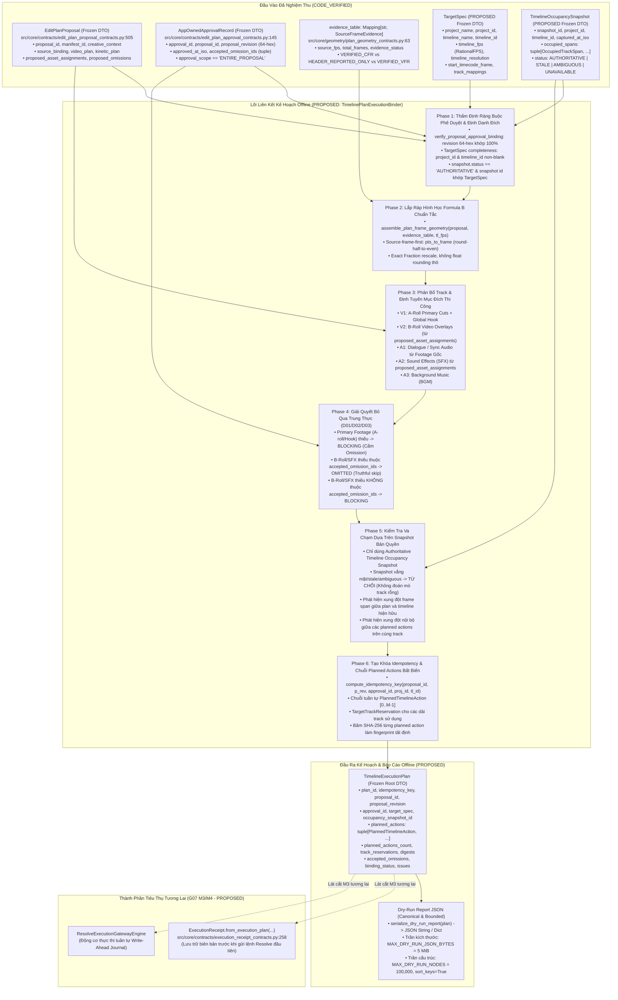

# Thiết Kế Kiến Trúc: Bộ Liên Kết Kế Hoạch Thi Công Timeline Offline & Báo Cáo Dry-Run (TimelinePlanExecutionBinder Design)

- **Tài liệu mã số:** `07B1-timeline-plan-binder-design.md`
- **Nhiệm vụ:** `G07-07B1-D` (Offline Timeline Plan Binder Design)
- **Mức thợ (Worker Level):** `HIGH`
- **Chế độ thực thi:** `DESIGN_ONLY_OFFLINE_EXECUTION_BINDER`
- **Tác giả:** Antigravity (Pair Programming cùng Tech Lead Codex)
- **Ngày lập:** 2026-11-02
- **Trạng thái:** `SUBMITTED_FOR_CODEX_REVIEW`
- **Căn cứ & Quyết định nền tảng:**
  - `docs/architecture/G07-closure-codex-review.md` (Phê duyệt của Codex cho G07-CLOSURE-EVALUATION và chỉ đạo G07-07B1-D).
  - `docs/architecture/G07-closure-evaluation.md` (Đánh giá ma trận M1–M4, phân lập 3 tầng bằng chứng).
  - `docs/architecture/07-resolve-execution-design.md` (Thiết kế tổng thể thi công Resolve, ranh giới an toàn G07).
  - `docs/architecture/07A5-design-review.md` (Chuyển giao thẩm quyền FPS timeline, ranh giới Step 4).
  - `docs/architecture/06C2d-plan-geometry-design.md` (Hợp đồng & bộ lắp ráp hình học Formula B).
  - `docs/architecture/07A6-receipt-journal-recovery-design.md` (Biên bản nhận chứng tiền đột biến & nhật ký thao tác).
  - `docs/architecture/06C-product-decisions.md` (Quyết định sản phẩm D01, D02, D03: AI đề xuất toàn bản, duyệt một lượt, bỏ qua B-roll/SFX thiếu trung thực, brief tự do).
- **Ràng buộc phạm vi tuyệt đối:**
  - **Thuần túy thiết kế kiến trúc tài liệu (DESIGN ONLY)**.
  - **Chính xác 0 sửa đổi** trong `src/` và `tests/`.
  - **Chính xác 0 lệnh chạy** pytest, application, Resolve API, fusionscript, AI inference hoặc network.
  - Tuyệt đối **không kết nối Resolve**, không tạo Executor động, không ghi biên bản/nhật ký thực tế, không đột biến timeline, không rollback.
  - Cờ an toàn `ready_to_execute=False` được bảo toàn 100%. Gate G07 và Milestone M1 tiếp tục giữ **MỞ (OPEN)**.
  - Bảo toàn 100% các file dirty/untracked của người dùng; không commit/push/reset/clean/stash/shutdown.

---

## 1. Actual Producer/Consumer Callgraph: CODE_VERIFIED vs PROPOSED

Sơ đồ thể hiện chu trình xử lý dữ liệu từ các cấu trúc dữ liệu đã được nghiệm thu (`EditPlanProposal`, `AppOwnedApprovalRecord`, `SourceFrameEvidence`, `plan_geometry_assembler.py`) sang bộ liên kết kế hoạch thi công offline (`TimelinePlanExecutionBinder`), tạo ra kế hoạch bất biến (`TimelineExecutionPlan`) và tài liệu xuất bản `Dry-Run JSON` có giới hạn kích thước trần (bounded).



---

## 2. Đặc Tả Chi Tiết Các Hợp Đồng DTO (Core Data Contracts Specification)

Toàn bộ các DTO được thiết kế theo chuẩn thuần Python stdlib (`dataclasses(frozen=True)`), bất biến tuyệt đối (immutable), sở hữu độc lập (defensive copy), không phụ thuộc UI (PySide6), không gọi Resolve API, không truy cập hệ thống tệp và không gọi mạng.

### 2.1. Hợp Đồng Thông Số Đích Danh Nghĩa: `TargetSpec`

`TargetSpec` biểu diễn thông số kỹ thuật đích của dự án và timeline trong DaVinci Resolve do người vận hành cấu hình hoặc do hệ thống tiền kiểm phát hiện.

```python
@dataclass(frozen=True)
class TargetSpec:
    """Thông số kỹ thuật đích danh nghĩa của DaVinci Resolve (Immutable Value Object).
    
    Ranh giới:
    - TargetSpec chỉ là thông số kỹ thuật đích danh nghĩa do binder thẩm định offline.
    - Tuyệt đối KHÔNG tự ý gán hay coi đây là kết nối Gateway thật khi chưa có phiên live.
    - FPS phải là RationalFPS chuẩn tắc (ví dụ: 24/1, 25/1, 30/1, 30000/1001, 60000/1001).
    - Mọi chuỗi ký tự phải được xác thực UTF-8, không chứa ký tự NUL, không rỗng.
    """
    project_name: str
    project_id: str
    timeline_name: str
    timeline_id: str
    timeline_fps: RationalFPS
    timeline_resolution: Tuple[int, int]           # (width, height), ví dụ: (1920, 1080)
    start_timecode_frame: int = 0                  # Khung hình bắt đầu timecode (mặc định 0 hoặc 86400 cho 01:00:00:00)
    video_track_mapping: Mapping[str, int] = field(
        default_factory=lambda: MappingProxyType({"a_roll": 1, "b_roll": 2})
    )
    audio_track_mapping: Mapping[str, int] = field(
        default_factory=lambda: MappingProxyType({"dialogue": 1, "sfx": 2, "bgm": 3})
    )
```

**Quy tắc thẩm định constructor (`__post_init__`):**
1. `project_name`, `project_id`, `timeline_name`, `timeline_id`: Bắt buộc `str`, không rỗng, không chứa ký tự NUL (`\0`), độ dài $\le 1024$ bytes.
2. `timeline_fps`: Bắt buộc là thể hiện của `RationalFPS` hợp lệ (`validate_fps_instance`).
3. `timeline_resolution`: Tuple đúng 2 phần tử `(width, height)` với `width >= 16` và `height >= 16`.
4. `start_timecode_frame`: Số nguyên `int >= 0` (loại trừ `bool`).
5. `video_track_mapping` & `audio_track_mapping`: Bắt buộc là `Mapping` hợp lệ, các index track là số nguyên `int >= 1`. Bản sao phòng thủ chuyển đổi sang `MappingProxyType`.

---

### 2.2. Hợp Đồng Ảnh Chụp Chiếm Dụng Track: `TimelineOccupancySnapshot` & `OccupiedTrackSpan`

Ảnh chụp chiếm dụng track là bằng chứng có thẩm quyền duy nhất được phép sử dụng để kiểm tra va chạm track.

```python
@dataclass(frozen=True)
class OccupiedTrackSpan:
    """Khoảng thời gian khung hình bị chiếm dụng bởi một clip hiện hữu trên track Resolve."""
    track_type: str                                # "video" | "audio"
    track_index: int                               # Chỉ số track >= 1
    start_frame: int                               # Khung hình bắt đầu trên timeline >= 0
    end_frame: int                                 # Khung hình kết thúc trên timeline > start_frame
    item_name: str = ""                            # Tên clip/phân đoạn hiện hữu trên Resolve (nếu có)


VALID_OCCUPANCY_STATUSES = frozenset({
    "AUTHORITATIVE",  # Ảnh chụp tươi mới, đầy đủ thẩm quyền từ phiên Resolve đang mở
    "STALE",          # Đã hết hạn hoặc timeline đã bị thay đổi sau thời điểm chụp
    "AMBIGUOUS",      # Dữ liệu truy vấn không đầy đủ, xung đột định danh, hoặc rớt gói tin
    "UNAVAILABLE",    # Không thể kết nối hoặc timeline chưa được quét chiếm dụng
})


@dataclass(frozen=True)
class TimelineOccupancySnapshot:
    """Ảnh chụp trạng thái chiếm dụng track trên timeline Resolve (Immutable Value Object).
    
    Chính sách an toàn tuyệt đối (Fail-Closed Policy):
    - Chỉ khi status == 'AUTHORITATIVE', project_id khớp, timeline_id khớp, timeline_fps khớp,
      và track đích đã được quét thì mới được phép coi các khoảng trống là 'free'.
    - Nếu snapshot is None, status != 'AUTHORITATIVE', hoặc track đích chưa được quét:
      BẮT BUỘC CHẶN TOÀN BỘ ACTION (ERR_OCCUPANCY_UNAVAILABLE / ERR_OCCUPANCY_AMBIGUOUS).
      TUYỆT ĐỐI KHÔNG BAO GIỜ ĐOÁN MÒ RẰNG TRACK ĐANG TRỐNG!
    """
    snapshot_id: str
    project_id: str
    timeline_id: str
    timeline_fps: RationalFPS
    captured_at_iso: str
    occupied_spans: Tuple[OccupiedTrackSpan, ...] = ()
    scanned_tracks: Tuple[Tuple[str, int], ...] = ()  # Các track đã được quét thực tế ((track_type, index), ...)
    status: str = "UNAVAILABLE"
```

---

### 2.3. Hợp Đồng Thao Tác Thi Công Dự Kiến: `PlannedTimelineAction`

Từng thao tác thi công nguyên tử được lên kế hoạch cụ thể, tương thích hoàn toàn với schema của `JournalEntry` trong `execution_receipt_contracts.py`.

```python
@dataclass(frozen=True)
class PlannedTimelineAction:
    """Thao tác thi công timeline đơn lẻ được lên kế hoạch tất định (Immutable Value Object).
    
    Quy định:
    - action_index: Chỉ số thứ tự thi công tuần tự 0..M-1.
    - action_type: 'INSERT_CLIP' | 'RESERVE_TRACK' | 'IMPORT_CARRIER' | 'SET_CLIP_COLOR' | 'NO_OP'.
    - target_track_type: 'video' | 'audio'.
    - target_track_index: Chỉ số track đích danh nghĩa >= 1.
    - clip_id: Mã clip định danh nguồn trong proposal.source_binding.
    - source_file_path: Đường dẫn tệp nguồn đã được thẩm định an toàn.
    - source_range: Khoảng khung hình nguồn [src_in_f, src_out_f) lượng tử hóa theo Formula B.
    - timeline_range: Khoảng khung hình timeline [rec_in_f, rec_out_f) lượng tử hóa theo Formula B.
    - applied_speed: Tốc độ co giãn khung hình dạng phân số chính xác (Fraction).
    - role: Phân loại vai trò kịch bản: 'a_roll' | 'hook' | 'b_roll' | 'sfx' | 'bgm'.
    - action_idempotency_hash: Mã băm SHA-256 64-hex biểu diễn chữ ký thao tác duy nhất.
    - action_params: Từ điển tham số chuẩn tắc để nạp trực tiếp vào JournalEntry.action_params.
    """
    action_index: int
    action_type: str
    target_track_type: str
    target_track_index: int
    clip_id: str
    source_file_path: str
    source_range: TimeRangeFrames
    timeline_range: TimeRangeFrames
    applied_speed: Fraction
    role: str
    action_idempotency_hash: str
    action_params: Mapping[str, Any]
```

---

### 2.4. Hợp Đồng Bản Ghi Bỏ Qua Trung Thực: `PlannedOmissionRecord`

Thực thi đúng chính sách sản phẩm D01/D02/D03: Bỏ qua B-roll/SFX thiếu một cách trung thực, có bằng chứng chấp thuận của người dùng trong `AppOwnedApprovalRecord.accepted_omission_ids`.

```python
@dataclass(frozen=True)
class PlannedOmissionRecord:
    """Bản ghi tài sản bổ trợ bị bỏ qua trung thực trong bản dựng thô (Immutable Value Object).
    
    Quy định:
    - Chỉ áp dụng cho slot 'broll' hoặc 'sfx'. Tuyệt đối CẤM áp dụng cho footage chính.
    - Bắt buộc demand_id/omission_id phải tồn tại trong approval_record.accepted_omission_ids.
    - Không phát sinh PlannedTimelineAction kiểu 'INSERT_CLIP' cho tài sản này.
    - Tuyệt đối không sinh clip giả, không tự ý chèn carrier, không thay bằng asset ngẫu nhiên.
    """
    demand_id: str
    slot: str                                      # "broll" | "sfx"
    clip_id: Optional[str]
    reason: str
    accepted_by_approval_id: str
    intended_timeline_range: Optional[TimeRangeFrames] = None
```

---

### 2.5. Hợp Đồng Vấn Đề Ràng Buộc: `PlanBindingIssue`

```python
@dataclass(frozen=True)
class PlanBindingIssue:
    """Báo cáo vấn đề/lỗi phát hiện trong quá trình liên kết kế hoạch thi công."""
    severity: str                                  # "BLOCKING" | "WARNING"
    issue_code: str                                # Chuỗi mã lỗi chuẩn tắc ERR_*
    field_path: str                                # Đường dẫn trường dữ liệu gây lỗi
    clip_id: Optional[str] = None
    track_info: Optional[str] = None
    message: str = ""
```

---

### 2.6. Hợp Đồng Gốc Kế Hoạch Thi Công Toàn Bản: `TimelineExecutionPlan`

DTO gốc chứa toàn bộ kế hoạch thi công bất biến sẵn sàng phục vụ báo cáo Dry-Run và là đầu vào duy nhất cho `ExecutionReceipt` ở giai đoạn M3.

```python
VALID_BINDING_STATUSES = frozenset({
    "BOUND_VERIFIED",  # Kế hoạch liên kết thành công 100%, 0 lỗi BLOCKING, sẵn sàng xuất Dry-Run
    "BOUND_BLOCKED",   # Kế hoạch bị chặn do có ít nhất 1 lỗi BLOCKING (sai lệch, va chạm, thiếu nguồn...)
})


@dataclass(frozen=True)
class TimelineExecutionPlan:
    """Kế hoạch thi công timeline trọn gói bất biến (Immutable Root DTO).
    
    Bảo đảm:
    - Toàn bộ các mảng con là tuple bất biến (zero mutable aliases).
    - Toàn bộ từ điển con là MappingProxyType.
    - planned_actions_count khớp chính xác len(planned_actions).
    - idempotency_key được tính toán tất định theo SHA-256 chuẩn.
    - Khi binding_status == 'BOUND_BLOCKED', planned_actions bắt buộc phải rỗng (),
      bảo đảm tính toàn vẹn All-or-Nothing (không phát ra kế hoạch thi công dở dang).
    """
    plan_id: str
    idempotency_key: str                           # 64-hex SHA-256
    proposal_id: str
    proposal_revision: str                         # 64-hex SHA-256
    approval_id: str
    approved_at_iso: str
    target_spec: TargetSpec
    occupancy_snapshot_id: Optional[str]
    binding_status: str                            # "BOUND_VERIFIED" | "BOUND_BLOCKED"
    planned_actions: Tuple[PlannedTimelineAction, ...]
    planned_actions_count: int
    track_reservations: Tuple[TargetTrackReservation, ...]
    source_digests: Tuple[SourceFileDigestBinding, ...]
    catalog_digests: Tuple[CatalogAssetDigestBinding, ...]
    accepted_omissions: Tuple[PlannedOmissionRecord, ...]
    total_timeline_frames: int
    total_timeline_duration_sec: Fraction
    issues: Tuple[PlanBindingIssue, ...]
    created_at_iso: str
    schema_version: int = 1
```

---

## 3. Ma Trận Bảo Toàn Trường Dữ Liệu (Field-Preservation Matrix)

Bảng đối chiếu đảm bảo 100% dữ liệu từ các DTO đầu vào được bảo toàn nguyên vẹn, không bị ép kiểu thô bạo (không làm tròn float, không biến bool thành int, không cắt chuỗi).

| Trường Đầu Vào (Input Field) | Kiểu Dữ Liệu Gốc | DTO Nguồn | Trường Đích (Destination Field) | Kiểu Dữ Liệu Đích | Xử Lý Bảo Toàn & Ràng Buộc |
| :--- | :--- | :--- | :--- | :--- | :--- |
| `proposal.proposal_id` | `str` | `EditPlanProposal` | `plan.proposal_id` | `str` | Giữ nguyên chuỗi, đối chiếu khớp với `approval.proposal_id`. |
| `approval.proposal_revision` | `str` (64-hex) | `AppOwnedApprovalRecord` | `plan.proposal_revision` | `str` (64-hex) | Tính toán lại qua `compute_proposal_revision(proposal)`, khớp từng ký tự. |
| `approval.approval_id` | `str` | `AppOwnedApprovalRecord` | `plan.approval_id` | `str` | Giữ nguyên chuỗi định danh phê duyệt của ứng dụng. |
| `approval.approved_at_iso` | `str` (ISO-8601) | `AppOwnedApprovalRecord` | `plan.approved_at_iso` | `str` | Xác thực ISO timestamp có timezone hợp lệ. |
| `target_spec.project_name` | `str` | `TargetSpec` | `plan.target_spec.project_name` | `str` | Giữ nguyên tên dự án đích. |
| `target_spec.project_id` | `str` | `TargetSpec` | `plan.target_spec.project_id` | `str` | Định danh dự án Resolve, nạp vào tính `idempotency_key`. |
| `target_spec.timeline_name` | `str` | `TargetSpec` | `plan.target_spec.timeline_name` | `str` | Giữ nguyên tên timeline đích. |
| `target_spec.timeline_id` | `str` | `TargetSpec` | `plan.target_spec.timeline_id` | `str` | Định danh timeline Resolve, nạp vào tính `idempotency_key`. |
| `target_spec.timeline_fps` | `RationalFPS` | `TargetSpec` | `plan.target_spec.timeline_fps` | `RationalFPS` | Bảo toàn tỷ số hữu tỷ (Fraction), đối chiếu với geometry assembly. |
| `segment.clip_id` | `str` | `PlanTimelineSegmentGeometry` | `action.clip_id` | `str` | Định danh clip trong `source_binding.clips`. |
| `segment.quantized_span.source_range` | `TimeRangeFrames` | `PlanTimelineSegmentGeometry` | `action.source_range` | `TimeRangeFrames` | Tọa độ `[src_in_f, src_out_f)` tính theo Formula B. |
| `segment.timeline_range` | `TimeRangeFrames` | `PlanTimelineSegmentGeometry` | `action.timeline_range` | `TimeRangeFrames` | Tọa độ `[rec_in_f, rec_out_f)` trên timeline. |
| `segment.quantized_span.applied_speed` | `Fraction` | `PlanTimelineSegmentGeometry` | `action.applied_speed` | `Fraction` | Tốc độ co giãn chính xác phân số, không dùng float xấp xỉ. |
| `proposal.source_binding.clips[i].file_path` | `str` | `EditPlanProposal` | `action.source_file_path` | `str` | Đường dẫn tệp nguồn tuyệt đối đã xác thực. |
| `proposal.proposed_omissions[i].demand_id` | `str` | `EditPlanProposal` | `omission.demand_id` | `str` | Đối chiếu phải nằm trong `approval.accepted_omission_ids`. |
| `snapshot.occupied_spans` | `Tuple[OccupiedTrackSpan, ...]` | `TimelineOccupancySnapshot` | Kiểm tra va chạm RAM | `bool` | Phát hiện chồng lấn `[start_frame, end_frame)` trên cùng track. |
| `source_digests[i]` | `SourceFileDigestBinding` | `evidence_table` / scanner | `plan.source_digests` | `Tuple[SourceFileDigestBinding, ...]` | 5-stat + SHA-256 chunked binding phục vụ M3 Receipt. |

---

## 4. Các Quy Tắc Thuật Toán Cốt Lõi (Core Algorithmic Specifications)

### 4.1. Thẩm Định Ràng Buộc Định Danh & Phê Duyệt (Identity & Approval Binding)

Quá trình liên kết thực thi offline tuân thủ nguyên tắc **Fail-Closed (Từ chối mặc định)**:

1. **Kiểm tra Phê duyệt Hiện hành:**
   - Gọi `compute_proposal_revision(proposal)` để lấy mã băm SHA-256 64-hex tươi mới của toàn bộ nội dung proposal.
   - Đối chiếu: `current_revision == approval_record.proposal_revision`. Nếu sai lệch bất kỳ ký tự nào $\rightarrow$ phát hành lỗi `ERR_STALE_PROPOSAL_REVISION` (BLOCKING).
   - Kiểm tra `approval_record.approval_scope == "ENTIRE_PROPOSAL"`. Nếu không khớp $\rightarrow$ `ERR_INVALID_APPROVAL_SCOPE` (BLOCKING).
2. **Kiểm tra Định danh Đích Danh nghĩa (`TargetSpec`):**
   - `project_id`, `project_name`, `timeline_id`, `timeline_name` không được để trống hoặc chỉ chứa khoảng trắng.
   - `TargetSpec.timeline_fps` phải khớp chính xác với FPS đầu ra của bộ lắp ráp hình học `assemble_plan_frame_geometry`. Nếu lệch $\rightarrow$ `ERR_TARGET_FPS_MISMATCH` (BLOCKING).

---

### 4.2. Lắp Ráp Hình Học Khung Hình Theo Formula B (Formula B Geometry Alignment)

1. Tái sử dụng trọn vẹn bộ lắp ráp chuẩn tắc đã nghiệm thu:
   ```python
   geom_result = assemble_plan_frame_geometry(proposal, evidence_table, target_spec.timeline_fps)
   ```
2. Nếu `geom_result.status != "GEOMETRY_VERIFIED"`:
   - Toàn bộ issues từ `geom_result.issues` được chuyển tiếp sang `plan.issues`.
   - Chuyển trạng thái sang `BOUND_BLOCKED`, danh sách `planned_actions` đặt thành rỗng `()`.
3. Khi `geom_result.status == "GEOMETRY_VERIFIED"`:
   - Các đoạn video A-roll và global hook được chuyển đổi trực tiếp thành các thao tác `PlannedTimelineAction` trên track video V1 (index 1).
   - Tọa độ timeline được điều chỉnh cộng bù với `target_spec.start_timecode_frame` (nếu timeline bắt đầu từ timecode khác 0):
     $$\text{action\_timeline\_in} = \text{seg.timeline\_range.start\_frame} + \text{target\_spec.start\_timecode\_frame}$$
     $$\text{action\_timeline\_out} = \text{seg.timeline\_range.end\_frame} + \text{target\_spec.start\_timecode\_frame}$$

---

### 4.3. Chính Sách Định Tuyến Track & Kiểm Tra Va Chạm (Track Allocation & Collision Policy)

#### A. Định Tuyến Track Chuẩn Tắc (Canonical Track Routing)
- **Track Video V1 (Index 1):** Dành riêng cho mạch cắt chính (A-Roll Primary Cuts) và Global Hook.
- **Track Video V2 (Index 2):** Dành cho B-Roll Video Inserts (lớp phủ hình ảnh).
- **Track Audio A1 (Index 1):** Dành cho âm thanh đồng bộ của footage gốc (Dialogue / Original Sync Audio).
- **Track Audio A2 (Index 2):** Dành cho hiệu ứng âm thanh (SFX Inserts).
- **Track Audio A3 (Index 3):** Dành cho nhạc nền (Background Music - BGM).

#### B. Chính Sách Va Chạm Trên Cơ Sở Ảnh Chụp Bản Quyền (Authoritative Snapshot Collision)
1. **Thẩm định Snapshot:**
   - Phải có `occupancy_snapshot` được truyền vào.
   - `snapshot.status` bắt buộc phải là `"AUTHORITATIVE"`.
   - `snapshot.project_id` phải khớp `target_spec.project_id`.
   - `snapshot.timeline_id` phải khớp `target_spec.timeline_id`.
   - `snapshot.timeline_fps` phải khớp `target_spec.timeline_fps`.
   - Track đích dự kiến thi công phải nằm trong `snapshot.scanned_tracks`.
2. **Quy tắc Từ Chối Khi Thiếu Bằng Chứng (Fail-Closed Absence Policy):**
   > [!CRITICAL]
   > **Nếu snapshot is None, snapshot.status != 'AUTHORITATIVE', hoặc track chưa được quét:**
   > Binder **BẮT BUỘC CHẶN** thao tác thi công với mã lỗi `ERR_OCCUPANCY_UNAVAILABLE` hoặc `ERR_OCCUPANCY_AMBIGUOUS`.
   > **TUYỆT ĐỐI CẤM suy diễn rằng track đang rỗng khi chưa có ảnh chụp chiếm dụng có thẩm quyền!**
3. **Giải thuật Kiểm Tra Chồng Lấn (Overlap Detection Algorithm):**
   Hai khoảng thời gian $[S_1, E_1)$ và $[S_2, E_2)$ trên cùng một track $(T_{type}, T_{index})$ bị coi là va chạm khi và chỉ khi:
   $$\max(S_1, S_2) < \min(E_1, E_2)$$
   - **Kiểm tra va chạm ngoại vi (External Collision):** Đối chiếu từng `PlannedTimelineAction` với toàn bộ `occupied_spans` trên cùng track trong snapshot. Nếu có va chạm $\rightarrow$ phát hành lỗi `ERR_TRACK_COLLISION` (BLOCKING).
   - **Kiểm tra va chạm nội bộ (Internal Collision):** Đối chiếu các `PlannedTimelineAction` trong cùng một bản kế hoạch với nhau. Ví dụ: hai đoạn B-roll trên V2 bị chồng lấn thời gian $\rightarrow$ `ERR_PLAN_INTERNAL_COLLISION` (BLOCKING).

---

### 4.4. Xử Lý Bỏ Qua Trung Thực Theo Quyết Định Sản Phẩm D01/D02/D03

1. **Nguyên Tắc Bất Di Bất Dịch:**
   - Phân đoạn video chính (A-roll cuts) và global hook là **xương sống của video, tuyệt đối không được phép bỏ qua (CẤM OMISSION)**. Nếu thiếu footage chính $\rightarrow$ `ERR_MISSING_PRIMARY_FOOTAGE` (BLOCKING).
2. **Quy Trình Đối Chiếu Tài Sản Bổ Trợ (B-Roll / SFX):**
   - Với mỗi tài sản trong `proposed_omissions`:
     a. Lấy mã định danh `demand_id` (hoặc `omission_id`).
     b. Kiểm tra xem `demand_id` có nằm trong `approval_record.accepted_omission_ids` không.
     c. Nếu **CÓ**: Tạo `PlannedOmissionRecord`, ghi rõ lý do và approval_id đã chấp thuận. Không phát hành `PlannedTimelineAction` dạng `INSERT_CLIP` cho tài sản này. Không chèn placeholder clip giả.
     d. Nếu **KHÔNG** (người dùng chưa duyệt bỏ qua tài sản này, nhưng tài sản lại thiếu tệp nguồn): Phát hành lỗi `ERR_UNAPPROVED_OMISSION` (BLOCKING).

---

### 4.5. Dẫn Xuất Khóa Idempotency & Đếm Thao Tác Thi Công Tất Định

1. **Khóa Idempotency Tổng Thể (`idempotency_key`):**
   Để bảo đảm tính tương thích với `compute_idempotency_key` đã nghiệm thu tại `src/core/contracts/execution_receipt_contracts.py:107`:
   - Chuỗi revision băm 64-hex được chuyển đổi hoặc băm đồng bộ thành định dạng khóa duy nhất:
     $$\text{payload} = \text{f"{proposal\_id}:{proposal\_revision}:{approval\_id}:{project\_id}:{timeline\_id}"}$$
     $$\text{idempotency\_key} = \text{sha256}(\text{payload.encode("utf-8")}).hexdigest()$$
2. **Chữ Ký Thao Tác Riêng Lẻ (`action_idempotency_hash`):**
   Mỗi `PlannedTimelineAction` mang một mã băm định danh riêng:
   $$\text{action\_hash} = \text{sha256}(\text{f"{action\_index}:{clip\_id}:{track\_type}:{track\_index}:{rec\_in}:{rec\_out}:{applied\_speed}"}).hexdigest()$$
3. **Bộ Đếm Thao Tác Thi Công (`planned_actions_count`):**
   - `planned_actions_count` phản ánh **chính xác 100% số lượng thao tác cần thi công thực tế** (`len(planned_actions)`).
   - Không đếm các tài sản đã bị bỏ qua (omitted).
   - Giá trị này được chuyển giao trực tiếp sang `ExecutionReceipt.planned_actions_count` tại Gate M3.

---

### 4.6. Xuất Bản Báo Cáo Dry-Run JSON Có Giới Hạn Dung Lượng Trần (Bounded Serialization)

1. **Giới Hạn Trần Phòng Vệ DoS/OOM:**
   - `MAX_DRY_RUN_JSON_BYTES = 5 * 1024 * 1024` (5 MiB UTF-8).
   - `MAX_DRY_RUN_NODES = 100,000` nodes JSON.
   - `MAX_PLANNED_ACTIONS = 4096`.
   - `MAX_TRACK_RESERVATIONS = 64`.
2. **Định Dạng Báo Cáo Xuất Bản (`dry_run_report`):**
   ```json
   {
     "schema_version": 1,
     "plan_id": "plan_20261102_a1b2c3d4",
     "binding_status": "BOUND_VERIFIED",
     "idempotency_key": "e3b0c44298fc1c149afbf4c8996fb92427ae41e4649b934ca495991b7852b855",
     "binding_metadata": {
       "proposal_id": "prop_001",
       "proposal_revision": "9f83c017c7...",
       "approval_id": "appr_001",
       "approved_at_iso": "2026-11-02T10:00:00Z",
       "created_at_iso": "2026-11-02T10:05:00Z"
     },
     "target_specification": {
       "project_name": "ResolveFlow_Showcase",
       "project_id": "proj_uuid_12345",
       "timeline_name": "RoughCut_V1",
       "timeline_id": "tl_uuid_67890",
       "timeline_fps": "24/1",
       "timeline_resolution": [1920, 1080],
       "start_timecode_frame": 0
     },
     "summary_metrics": {
       "planned_actions_count": 12,
       "total_timeline_frames": 720,
       "total_timeline_duration_sec": "30",
       "track_reservations_count": 3,
       "omissions_count": 1,
       "issues_count": 0
     },
     "track_reservations": [
       {
         "track_type": "video",
         "track_index": 1,
         "reserved_start_frame": 0,
         "reserved_end_frame": 720,
         "intended_usage": "A-Roll Primary Cuts & Hook"
       }
     ],
     "planned_actions": [
       {
         "action_index": 0,
         "action_type": "INSERT_CLIP",
         "target_track_type": "video",
         "target_track_index": 1,
         "clip_id": "clip_cam_a",
         "source_file_path": "/media/footage/cam_a.mp4",
         "source_range_frames": [0, 120],
         "timeline_range_frames": [0, 120],
         "applied_speed": "1/1",
         "role": "hook",
         "action_idempotency_hash": "a1b2c3..."
       }
     ],
     "accepted_omissions": [
       {
         "demand_id": "demand_sfx_whoosh",
         "slot": "sfx",
         "reason": "Sound effect asset missing from local pack, operator approved rough-cut omission",
         "accepted_by_approval_id": "appr_001"
       }
     ],
     "issues": []
   }
   ```

---

## 5. Ma Trận Trạng Thái & Bảng Mã Lỗi (State & Error Matrix)

| Mã Lỗi (Issue Code) | Mức Độ (Severity) | Điều Kiện Kích Hoạt | Trạng Thái Kế Hoạch | Tác Động Lên Planned Actions | Ghi Chú & Khuyến Nghị Khắc Phục |
| :--- | :--- | :--- | :--- | :--- | :--- |
| `ERR_STALE_PROPOSAL_REVISION` | `BLOCKING` | `compute_proposal_revision(prop)` $\ne$ `approval.proposal_revision` | `BOUND_BLOCKED` | Rỗng `()` | Kịch bản đã bị sửa đổi sau khi duyệt. Yêu cầu người dùng duyệt lại tại Step 3. |
| `ERR_INVALID_APPROVAL_SCOPE` | `BLOCKING` | `approval.approval_scope != 'ENTIRE_PROPOSAL'` | `BOUND_BLOCKED` | Rỗng `()` | Phạm vi phê duyệt không hợp lệ. |
| `ERR_TARGET_FPS_MISMATCH` | `BLOCKING` | `target_spec.timeline_fps` $\ne$ `geom_result.timeline_fps` | `BOUND_BLOCKED` | Rỗng `()` | FPS của timeline Resolve đích không khớp với FPS tính toán hình học. |
| `ERR_MISSING_PRIMARY_FOOTAGE` | `BLOCKING` | Tệp nguồn A-roll hoặc Hook không tồn tại trên đĩa hoặc thiếu evidence | `BOUND_BLOCKED` | Rỗng `()` | Footage chính là bắt buộc, không được phép omission (D02). |
| `ERR_VFR_NOT_PERMITTED` | `BLOCKING` | Nguồn có `evidence_status == 'VERIFIED_VFR'` | `BOUND_BLOCKED` | Rỗng `()` | Resolve yêu cầu khung hình ổn định CFR cho cắt dựng frame-accurate. |
| `ERR_SOURCE_BOUNDS_OVERFLOW` | `BLOCKING` | `source_out_f > total_source_frames` | `BOUND_BLOCKED` | Rỗng `()` | Cắt vượt quá tổng số khung hình thực tế của tệp video. |
| `ERR_OCCUPANCY_UNAVAILABLE` | `BLOCKING` | `snapshot is None` hoặc `snapshot.status == 'UNAVAILABLE'` | `BOUND_BLOCKED` | Rỗng `()` | Chưa có thông tin chiếm dụng timeline đích. Cấm đoán mò track rỗng. |
| `ERR_OCCUPANCY_AMBIGUOUS` | `BLOCKING` | `snapshot.status in ('AMBIGUOUS', 'STALE')` hoặc track chưa quét | `BOUND_BLOCKED` | Rỗng `()` | Thông tin chiếm dụng không tin cậy hoặc hết hạn. Yêu cầu quét lại. |
| `ERR_TRACK_COLLISION` | `BLOCKING` | `timeline_range` của action chồng lấn với clip hiện hữu trên track Resolve | `BOUND_BLOCKED` | Rỗng `()` | Xung đột vị trí đặt clip trên timeline Resolve. |
| `ERR_PLAN_INTERNAL_COLLISION` | `BLOCKING` | Hai thao tác trong cùng bản kế hoạch đặt chồng lấn lên cùng một track | `BOUND_BLOCKED` | Rỗng `()` | Lỗi phân bổ track trong kịch bản (ví dụ 2 B-roll đè nhau trên V2). |
| `ERR_UNAPPROVED_OMISSION` | `BLOCKING` | B-roll/SFX thiếu nhưng không nằm trong `accepted_omission_ids` | `BOUND_BLOCKED` | Rỗng `()` | Tài sản thiếu chưa được người dùng phê chuẩn bỏ qua tại Step 3. |
| `ERR_BUDGET_ACTIONS_OVERFLOW` | `BLOCKING` | `len(planned_actions) > MAX_PLANNED_ACTIONS` (4096) | `BOUND_BLOCKED` | Rỗng `()` | Số lượng thao tác vượt quá ngưỡng an toàn hệ thống. |
| `ERR_BUDGET_JSON_OVERFLOW` | `BLOCKING` | Báo cáo Dry-Run vượt quá 5 MiB hoặc 100,000 nodes JSON | `BOUND_BLOCKED` | Rỗng `()` | Dung lượng JSON vượt trần DoS/OOM. |
| `WARN_SUPPLEMENTAL_OMISSION` | `WARNING` | B-roll/SFX được bỏ qua hợp lệ theo `accepted_omission_ids` | `BOUND_VERIFIED` | Bỏ qua action tương ứng | Cảnh báo ghi nhận bỏ qua tài sản bổ trợ trung thực theo D02. |

---

## 6. Ma Trận Kiểm Thử Hữu Hạn (Finite Test Case Matrix — 11 Ca Kiểm Thử)

Ma trận bao phủ toàn diện $\ge 10$ kịch bản kiểm thử độc lập cho bộ liên kết kế hoạch thi công offline:

| Mã Ca (Case ID) | Tên Kịch Bản Kiểm Thử | Dữ Liệu Đầu Vào (Inputs) | Điều Kiện Kiểm Chứng (Verification Checks) | Kết Quả Kỳ Vọng (Expected Outcome) |
| :--- | :--- | :--- | :--- | :--- |
| **TC-PLN-01** | **Happy Path Standard Plan Binding (24fps)** | Proposal hợp lệ 3 cuts A-roll, 1 hook, 1 B-roll, 1 SFX. Evidence VERIFIED_CFR 24fps. TargetSpec 24fps. Snapshot AUTHORITATIVE rỗng. | 1. 100% geometry khớp Formula B.<br/>2. Track mapping chuẩn: V1 cuts+hook, V2 b-roll, A2 sfx.<br/>3. Idempotency key 64-hex hợp lệ.<br/>4. planned_actions_count == 5. | `BOUND_VERIFIED`<br/>Issues = 0<br/>Dry-Run JSON hợp lệ |
| **TC-PLN-02** | **Formula B Cross-FPS Rescale (30fps $\rightarrow$ 24fps)** | Clip nguồn 30fps (30/1), 90 frames. Timeline đích 24fps (24/1). Đoạn cắt $[1.0, 2.017)$s. Speed = 1/1. | 1. Native source: $[30, 61)$ (31 frames).<br/>2. Rescale Formula B: $31/30 \times 24 = 24.8 \rightarrow \mathbf{25}$ record frames.<br/>3. Timeline range: $[0, 25)$. | `BOUND_VERIFIED`<br/>Record duration == 25 frames |
| **TC-PLN-03** | **Source Bounds Overflow Detection** | Clip nguồn 60 frames (max 2.002s). Kịch bản yêu cầu cắt đến 2.5s ($src\_out\_f = 75$). | 1. Phát hiện cắt vượt quá trần khung hình nguồn.<br/>2. Phát sinh `ERR_SOURCE_BOUNDS_OVERFLOW`.<br/>3. Kế hoạch bị hủy bỏ All-or-Nothing. | `BOUND_BLOCKED`<br/>planned_actions = () |
| **TC-PLN-04** | **Stale Proposal Revision Rejection** | Proposal bị sửa đổi `video_plan` sau khi duyệt (revision mới $\ne$ `approval_record.proposal_revision`). | 1. So khớp mã băm SHA-256 thất bại.<br/>2. Phát sinh `ERR_STALE_PROPOSAL_REVISION`.<br/>3. Tuyệt đối không cho phép thi công. | `BOUND_BLOCKED`<br/>Issues chứa `ERR_STALE_PROPOSAL_REVISION` |
| **TC-PLN-05** | **Target Identity Mismatch** | `TargetSpec.timeline_id` là `tl_001`, nhưng `Snapshot.timeline_id` là `tl_999`. | 1. Phát hiện không khớp định danh đích.<br/>2. Từ chối dùng snapshot sai timeline.<br/>3. Phát sinh `ERR_OCCUPANCY_UNAVAILABLE`. | `BOUND_BLOCKED`<br/>planned_actions = () |
| **TC-PLN-06** | **Missing or Header-Reported-Only Source** | Clip A-roll chỉ có trạng thái `HEADER_REPORTED_ONLY` hoặc vắng mặt trong `evidence_table`. | 1. Thiếu căn cứ toán học giải mã khung hình.<br/>2. Phát sinh `ERR_MISSING_PRIMARY_FOOTAGE`.<br/>3. Cấm omission cho footage chính. | `BOUND_BLOCKED`<br/>planned_actions = () |
| **TC-PLN-07** | **Track Collision With Existing Timeline** | Snapshot báo track V1 đã có clip chiếm dụng $[100, 200)$. Kịch bản lên kế hoạch đặt A-roll tại $[50, 150)$. | 1. $\max(50, 100) < \min(150, 200) \rightarrow$ Chồng lấn 50 frames.<br/>2. Phát sinh `ERR_TRACK_COLLISION`.<br/>3. Kế hoạch bị chặn hoàn toàn. | `BOUND_BLOCKED`<br/>Issues chứa `ERR_TRACK_COLLISION` |
| **TC-PLN-08** | **Absent / Stale / Ambiguous Occupancy Snapshot** | `snapshot is None`, hoặc `snapshot.status == "AMBIGUOUS"`, hoặc track V2 chưa được quét. | 1. Thực thi chính sách an toàn Fail-Closed.<br/>2. CẤM đoán mò track rỗng.<br/>3. Phát sinh `ERR_OCCUPANCY_AMBIGUOUS`. | `BOUND_BLOCKED`<br/>planned_actions = () |
| **TC-PLN-09** | **Truthful B-Roll / SFX Omission Handling** | 1 B-roll thiếu file nhưng nằm trong `accepted_omission_ids`; 1 SFX thiếu file và KHÔNG nằm trong `accepted_omission_ids`. | 1. B-roll được ghi nhận vào `accepted_omissions`, không tạo clip giả.<br/>2. SFX chưa duyệt bị chặn với `ERR_UNAPPROVED_OMISSION`. | `BOUND_BLOCKED` (do SFX chưa duyệt)<br/>Nếu chỉ có B-roll đã duyệt $\rightarrow$ `BOUND_VERIFIED` |
| **TC-PLN-10** | **Deterministic Serialization & Budget Overflow** | Kịch bản chứa 4097 planned actions (vượt trần 4096), hoặc kiểm tra tính tất định của chuỗi JSON xuất bản. | 1. Phát sinh `ERR_BUDGET_ACTIONS_OVERFLOW`.<br/>2. Chạy serialize 100 lần độc lập $\rightarrow$ Mã băm SHA-256 của JSON output 100% đồng nhất. | `BOUND_BLOCKED` khi tràn budget.<br/>SHA-256 JSON tất định 100%. |
| **TC-PLN-11** | **Empty Plan / All-Cut Execution Plan** | Toàn bộ phân đoạn kịch bản có action `cut` (không phát ra clip nào). | 1. Lắp ráp hình học thành công 0 frames.<br/>2. `planned_actions` là tuple rỗng `()`.<br/>3. `planned_actions_count == 0`. | `BOUND_VERIFIED`<br/>total_timeline_frames == 0 |

---

## 7. Khuyến Nghị Lát Cắt Triển Khai Tiếp Theo (Next Implementation Slice Recommendation)

Để hoàn tất Milestone M2 một cách chặt chẽ theo phương pháp luận TDD (Test-Driven Development), khuyến nghị Tech Lead Codex phê duyệt và phát hành **DUY NHẤT MỘT LÁT CẮT TRIỂN KHAI** tiếp theo:

- **TASK_ID KHUYẾN NGHỊ:** `G07-07B2-I` (hoặc `G07-M2-I`)
- **TIÊU ĐỀ:** Triển khai Bộ Liên Kết Kế Hoạch Thi Công Timeline Offline & Báo Cáo Dry-Run (`TimelinePlanExecutionBinder Implementation`)
- **MỨC THỢ:** `HIGH`
- **MÔ ĐUN SẢN XUẤT ĐỀ XUẤT (Chính xác 01 file):**
  - `src/core/timeline_plan_execution_binder.py`
  - *Đặc điểm:* Thuần Python stdlib (`dataclasses`, `fractions`, `hashlib`, `json`, `types.MappingProxyType`), 0 import Qt/PySide6, 0 Resolve API, 0 network, 0 file IO.
- **BỘ KIỂM THỬ ĐƠN VỊ TẬP TRUNG (Chính xác 01 file):**
  - `tests/core/test_timeline_plan_execution_binder.py`
  - Bao phủ trọn vẹn 11 ca kiểm thử từ **TC-PLN-01** đến **TC-PLN-11**.
- **RANH GIỚI BẢO VỆ:**
  - Tuyệt đối không chỉnh sửa UI (`BuildPage`, `DirectorWindow`).
  - Tuyệt đối không kết nối Resolve Gateway hay fusionscript.
  - Cờ an toàn `ready_to_execute=False` tiếp tục được bảo toàn nghiêm ngặt.
  - Gate G07 và Milestone M1 tiếp tục giữ MỞ (OPEN).
