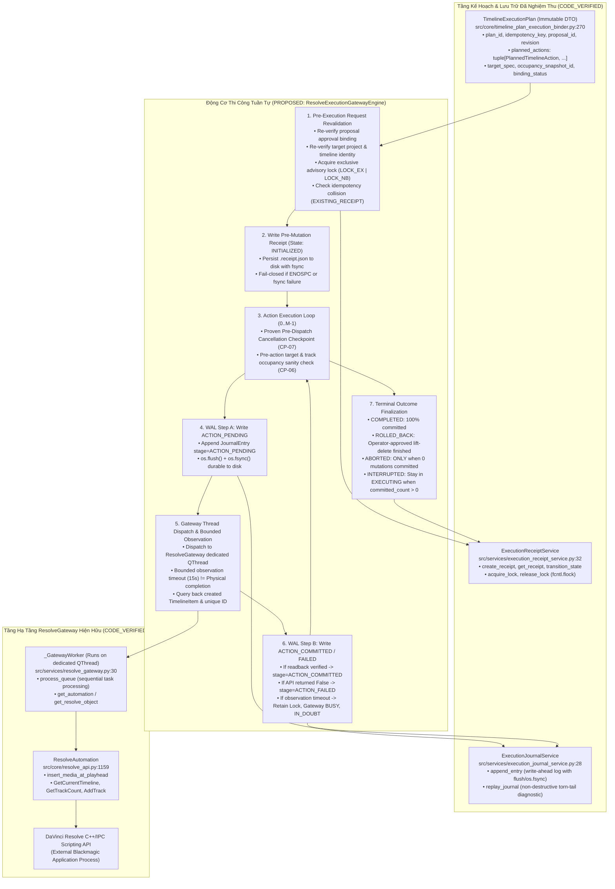
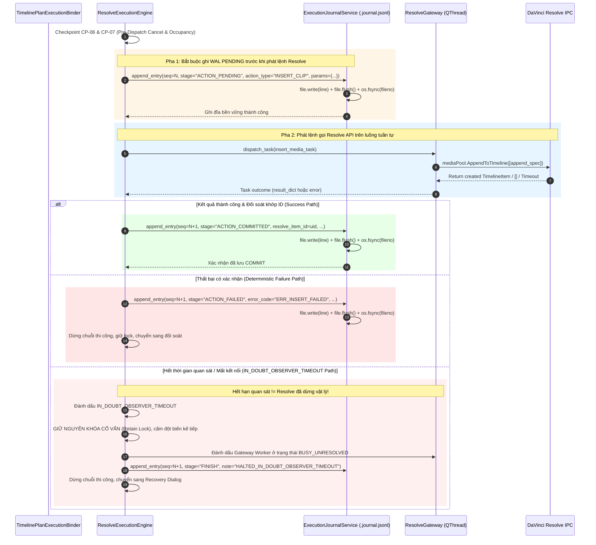

# Thiết Kế Kiến Trúc (Hiệu Chỉnh R1): Động Cơ Thực Thi Resolve Có Kiểm Soát & Tích Hợp Write-Ahead Logging (Bounded Resolve Executor & WAL Integration Design - Safety Refinement)

- **Tài liệu mã số:** `07B3-resolve-executor-design.md` (Phiên bản hiệu chỉnh an toàn `R1`)
- **Nhiệm vụ:** `G07-07B3-D-R1` (Resolve Executor Design Safety Corrections)
- **Mức thợ (Worker Level):** `HIGH`
- **Chế độ thực thi:** `DESIGN_ONLY_EXECUTOR_WAL_SAFETY_REFINEMENT`
- **Tác giả:** Antigravity (Pair Programming cùng Tech Lead Codex)
- **Ngày lập:** 2026-11-02
- **Trạng thái:** `SUBMITTED_FOR_CODEX_REVIEW_R1`
- **Căn cứ & Quyết định nền tảng:**
  - `docs/architecture/07B3-codex-review.md` (Thẩm định của Tech Lead Codex cho G07-07B3-D, yêu cầu 6 điểm hiệu chỉnh an toàn cốt lõi).
  - `docs/architecture/07B2-I-code-acceptance.md` (Nghiệm thu bộ liên kết offline TimelinePlanExecutionBinder, SHA-256: `4748364a0a24f8da4092a0b7e0cea91b7c3279c3d1ec293ad40a43c322d496ae`).
  - `docs/architecture/07B1-timeline-plan-binder-design.md` (Thiết kế kiến trúc binder offline, DTOs và giới hạn dry-run).
  - `docs/architecture/07A6-receipt-journal-recovery-design.md` (Biên bản nhận chứng tiền đột biến, nhật ký thao tác và khóa advisory).
  - `docs/architecture/07A7-recovery-reconciliation-design.md` (Bộ phân loại 8 trạng thái sự cố và cơ chế đối soát phi phá hủy).
  - `docs/architecture/07A8-recovery-assessment-ui-design.md` (Giao diện thẩm định phục hồi chỉ đọc).
  - `docs/architecture/07-resolve-execution-design.md` (Thiết kế tổng thể thi công Resolve, ranh giới an toàn G07).
  - Các module hiện hữu trong codebase: `src/services/resolve_gateway.py`, `src/services/execution_receipt_service.py`, `src/services/execution_journal_service.py`, `src/core/contracts/execution_receipt_contracts.py`.
- **Ràng buộc phạm vi tuyệt đối:**
  - **Thuần túy hiệu chỉnh thiết kế kiến trúc tài liệu (DESIGN ONLY)**.
  - **Chính xác 0 sửa đổi** trong `src/` và `tests/`.
  - **Chính xác 0 lệnh chạy** pytest, application, Resolve API, fusionscript, AI inference hoặc network.
  - Tuyệt đối **không mở kết nối đột biến Resolve**, không cấp quyền thực thi tự động, không ghi đĩa receipt/journal trên dữ liệu người dùng thật, không rollback thực tế.
  - Cờ an toàn `ready_to_execute=False` được bảo toàn 100%. Gate G07 và các Milestone M1, M2, M3 tiếp tục giữ **MỞ (OPEN)**.
  - Bảo toàn 100% các file dirty/untracked của người dùng; không commit/push/reset/clean/stash/shutdown.

---

## 1. Actual Producer/Consumer Callgraph: CODE_VERIFIED vs PROPOSED

DaVinci Resolve Python Scripting API bản chất là giao diện RPC/IPC ngoại vi, **hoàn toàn phi giao dịch (non-transactional)** và **không an toàn đa luồng (not thread-safe)**. Resolve không hỗ trợ giao thức phối hợp giao dịch phân tán (Two-Phase Commit - 2PC), không có `BEGIN TRANSACTION`, `COMMIT`, hay `ROLLBACK` ở tầng C++ engine.

### 1.1. Mô Hình Hóa Mâu Thuẫn Bất Định Ngoại Vi (External Side-Effect / WAL Ambiguity)
- Khi động cơ thực thi phát lệnh IPC sang Resolve (ví dụ: `AppendToTimeline`):
  1. Nếu tiến trình bị crash hoặc mất kết nối **sau khi** Resolve đã chèn clip vào timeline, nhưng **trước khi** dòng log `ACTION_COMMITTED` được ghi bền vững xuống đĩa qua `os.fsync`, thì trên đĩa tệp `.journal.jsonl` chỉ dừng ở `ACTION_PENDING`.
  2. Ngược lại, nếu Resolve nhận lệnh nhưng bị crash nội bộ trước khi chèn, tệp journal trên đĩa cũng dừng ở `ACTION_PENDING`.
- **Hệ quả kiến trúc:** Hệ thống **tuyệt đối không bao giờ được tuyên bố đạt được đột biến "exactly-once" (chính xác một lần)**. Mọi cơ chế khóa cố vấn (advisory lock) và chỉ mục chống trùng lặp (idempotency key) trong Python chỉ bảo đảm **"At-Most-Once Admission" (tiếp nhận tối đa một lần ở tầng tiền kiểm)**, và bắt buộc phải mô hình hóa ranh giới bất định **`IN_DOUBT`** một cách minh bạch khi có sai lệch giữa nhật ký đĩa và ngoại vi.

### 1.2. Sơ Đồ Callgraph Phân Định Thành Phần



---

## 2. Ràng Buộc Yêu Cầu Thi Công & Các Điểm Tiền Kiểm Trước Đột Biến (Executor Request Binding & Pre-Mutation Checkpoints)

Động cơ thi công Resolve **tuyệt đối không bao giờ được tin cậy mù quáng** vào kế hoạch cũ mà không qua các bước tiền kiểm trực tiếp tại thời điểm bắt đầu thi công (Time-of-Use Revalidation):

### 2.1. Ma Trận Điểm Kiểm Tra Bắt Buộc (Revalidation Checkpoints)

| Điểm Kiểm Tra (Checkpoint) | Thời Điểm Thực Hiện | Dữ Liệu Kiểm Chứng | Hành Động Khi Sai Lệch (On Mismatch) |
| :--- | :--- | :--- | :--- |
| **CP-01: Approval & Plan Hash Binding** | Trước khi tạo receipt | `proposal_revision` trong plan phải khớp `compute_proposal_revision(current_proposal)` và `approval.proposal_revision`. | Từ chối thi công ngay lập tức (`ERR_STALE_PROPOSAL_REVISION`). 0 tác vụ đĩa, 0 gọi Resolve. |
| **CP-02: Exclusive Advisory Lock Acquisition (At-Most-Once Admission)** | Trước khi tạo receipt | Yêu cầu khóa độc quyền hệ điều hành `fcntl.flock(fd, LOCK_EX | LOCK_NB)` trên tệp `.receipt.json.lock`. Ngăn chặn nạp đúp đồng thời trong hệ điều hành (không tạo ra tính nguyên tử với Resolve IPC). | Từ chối thi công (`ERR_CONCURRENT_EXECUTION_BLOCKED`). Không cho phép 2 tiến trình hoặc 2 worker cùng chạy trên 1 timeline. |
| **CP-03: Idempotency Key Dedup & Replay Policy** | Trước khi tạo receipt | Kiểm tra xem tệp `.receipt.json` với `idempotency_key` tương ứng đã tồn tại không. | **Xem chi tiết Mục 2.2**: Nếu `COMPLETED` $\rightarrow$ Từ chối dispatch mới, trả về bản ghi tham chiếu lịch sử; Nếu `INITIALIZED`/`EXECUTING` $\rightarrow$ Từ chối vì đang hoạt động; Nếu lỗi dở dang $\rightarrow$ Chuyển sang Recovery Dialog. |
| **CP-04: Target Project & Timeline Match** | Ngay trước đột biến đầu tiên | Truy vấn Resolve: `proj.GetUniqueId() == target_spec.project_id` và `tl.GetUniqueId() == target_spec.timeline_id`. | Nếu người dùng chuyển tab dự án/timeline trên Resolve $\rightarrow$ Dừng khẩn cấp (`ERR_TARGET_TIMELINE_SHIFTED`). 0 đột biến, chuyển Receipt sang `ABORTED` (vì 0 action committed). |
| **CP-05: Target Timeline FPS Match** | Ngay trước đột biến đầu tiên | Truy vấn Resolve: `timeline.GetSetting("timelineFrameRate")` quy đổi sang `RationalFPS` phải khớp `target_spec.timeline_fps`. | Nếu sai lệch FPS $\rightarrow$ Dừng khẩn cấp (`ERR_TARGET_FPS_DRIFT`). 0 đột biến, chuyển Receipt sang `ABORTED`. |
| **CP-06: Pre-Action Track Occupancy Check** | Giữa mỗi planned action (trước khi ghi PENDING) | Trước mỗi thao tác chèn clip vào track $(T_{type}, T_{index})$ tại $[rec\_in, rec\_out)$, kiểm tra nhanh danh sách clip trên track đó. | Nếu xuất hiện clip mới không có trong snapshot $\rightarrow$ Tạm dừng thi công (`ERR_UNEXPECTED_TRACK_OCCUPANCY`), ghi log và chờ người vận hành xử lý. Không chuyển sang `ABORTED` nếu đã có actions committed. |
| **CP-07: Proven Pre-Dispatch Cancellation Boundary** | Ngay trước mỗi dispatch action (trước khi ghi PENDING) | Kiểm tra cờ hủy bỏ hợp tác `is_cancellation_requested()`. | **Xem chi tiết Mục 4.3**: Chỉ dừng tại ranh giới trước dispatch. Nếu 0 actions committed $\rightarrow$ `ABORTED`. Nếu $\ge 1$ actions committed $\rightarrow$ Giữ trạng thái `EXECUTING`, ghi chú `INTERRUPTED_WITH_COMMITTED_ACTIONS`. |

### 2.2. Ngữ Nghĩa Nhất Quán Cho Yêu Cầu Trùng Lặp (Duplicate Request Semantics)

Để triệt tiêu hoàn toàn mâu thuẫn giữa từ chối (CP-03) và báo kết quả (FLT-08):
1. **Trường hợp Khóa Idempotency đã ở trạng thái `COMPLETED`:**
   - Động cơ thi công **KHÔNG chiếm khóa cố vấn thi công** (`LOCK_EX`).
   - Động cơ thi công **KHÔNG phát lệnh (dispatch) sang `ResolveGateway`**.
   - Động cơ thi công **KHÔNG BAO GIỜ báo cáo đây là một lần thi công thành công mới** (Never report a new execution success).
   - Hệ thống trả về cấu trúc tham chiếu lịch sử tường minh:
     ```json
     {
       "status": "DUPLICATE_REQUEST_PREVIOUSLY_COMPLETED",
       "execution_dispatched": false,
       "idempotency_key": "<key>",
       "prior_receipt_id": "<receipt_id_cũ>",
       "prior_completed_at": "<iso_timestamp_cũ>",
       "message": "Kịch bản đã được thi công hoàn tất trong phiên trước đó. Không có thao tác mới nào được gửi tới DaVinci Resolve."
     }
     ```
2. **Trường hợp Khóa Idempotency đang ở trạng thái `INITIALIZED` hoặc `EXECUTING`:**
   - Ném ngoại lệ `IdempotencyDuplicateActiveError` (HTTP/API code tương đương: `409 Conflict`), từ chối tiếp nhận vì đang có phiên thi công đang hoạt động hoặc dở dang.
3. **Trường hợp Khóa Idempotency ở trạng thái `ROLLED_BACK` hoặc lỗi dở dang:**
   - Ném ngoại lệ yêu cầu đối soát phục hồi: `IdempotencyPriorFailureRequiresReconciliationError`, bắt buộc người vận hành vào `RecoveryAssessmentDialog` trước khi cấp phép thực hiện lại.

---

## 3. Trình Tự Nhật Ký Ghi Trước (Write-Ahead Logging - WAL Sequence & IN_DOUBT Policy)

Để bảo đảm tính bền vững (Durability) và khả năng đối soát sau sự cố (Crash Consistency), chu trình thực thi mỗi planned action tuân thủ nghiêm ngặt giao thức 2 bước ghi nhật ký (Two-Phase Action WAL).

### 3.1. Chi Tiết Trình Tự Thực Thi Từng Action



### 3.2. Thời Gian Quan Sát Hữu Hạn vs. Hoàn Tất Vật Lý (Bounded Observation vs. Physical Completion)

> [!CRITICAL]
> **Quy định bản chất của Timeout trong ResolveGateway:**
> - Ngưỡng timeout 15 giây giữa `ResolveExecutionEngine` và `_GatewayWorker` là **Thời Gian Quan Sát Của Người Quan Sát (Observer Observation Timeout)**.
> - **Observer Timeout KHÔNG ĐỒNG NGHĨA VỚI VIỆC LỆNH GỌI RESOLVE ĐÃ DỪNG VẬT LÝ:**
>   - DaVinci Resolve có thể vẫn đang tiếp tục xử lý lệnh chèn clip trong tiến trình C++ nền, hoặc đang bị block bởi một dialog giao diện người dùng trên Resolve.
>   - Việc observer thread hết kiên nhẫn và timeout **không hủy bỏ được** lệnh đang chạy trên luồng IPC.
>
> **HÀNH ĐỘNG BẢO VỆ BẮT BUỘC KHI GẶP OBSERVER TIMEOUT:**
> 1. **TUYỆT ĐỐI KHÔNG GIẢI PHÓNG KHÓA CỐ VẤN (DO NOT RELEASE LOCK):** Tiến trình tiếp tục giữ `fcntl.flock` trên tệp `.receipt.json.lock` để ngăn chặn bất kỳ tiến trình hoặc luồng nào khác nhảy vào can thiệp timeline khi trạng thái Resolve chưa ngã ngũ.
> 2. **TUYỆT ĐỐI CẤM PHÁT BẤT KỲ ĐỘT BIẾN KẾ TIẾP NÀO:** Chuỗi thi công bị đóng băng tức thì.
> 3. **TUYỆT ĐỐI CẤM TỰ ĐỘNG REPLAY (NO AUTOMATIC REPLAY):** Không bao giờ được gửi lại lệnh chèn vừa timeout vì sẽ gây trùng lặp clip.
> 4. **ĐÁNH DẤU GATEWAY LÀ `BUSY_UNRESOLVED`:** Luồng Gateway Worker được đánh dấu đang bận bất định; không nhận thêm task mới cho đến khi có xác nhận kết thúc vật lý từ Resolve hoặc tiến trình được khởi động lại sạch sẽ.
> 5. **TRẠNG THÁI CUỐI CÙNG LÀ `UNRESOLVED_HANG_IN_DOUBT`:** Chuyển giao toàn quyền thẩm định cho người vận hành tại `RecoveryAssessmentDialog`.

---

## 4. Quản Lý Khóa Độc Quyền, Tính Nhất Quán Sự Cố & Bảo Toàn Nhật Ký (Lock Lifecycle, Crash Consistency & Journal Preservation)

### 4.1. Vòng Đời Khóa Cố Vấn Hệ Điều Hành (Advisory Lock Lifecycle)

1. **Cơ chế Khóa:** Sử dụng `fcntl.flock(fileno, fcntl.LOCK_EX | fcntl.LOCK_NB)` trên tệp đồng hành `.receipt.json.lock`.
2. **Thời Điểm Chiếm Khóa:** Được thực hiện tại **Checkpoint CP-02**, ngay trước khi tạo hoặc chuyển trạng thái `ExecutionReceipt` sang `EXECUTING`.
3. **Thời Điểm Giải Phóng Khóa:**
   - **Được giải phóng:**
     - Khi hoàn tất chuỗi thi công thành công 100% (`COMPLETED`).
     - Khi hoàn tất hoàn tác bù trừ được người vận hành phê duyệt (`ROLLED_BACK`).
     - Khi hủy bỏ sạch sẽ ở pha tiền đột biến (`ABORTED` với 0 actions committed).
     - Khi tiến trình Python bị terminate/crash đột ngột (kernel tự động giải phóng fd lock).
   - **KHÔNG ĐƯỢC GIẢI PHÓNG:**
     - Khi gặp Observer Timeout hoặc trạng thái `IN_DOUBT` trong lúc tiến trình còn đang chạy. Khóa phải được giữ nguyên để bảo vệ timeline.

### 4.2. Bảo Toàn Bằng Chứng Nhật Ký: Tuyệt Đối Cấm Tự Động Cắt Gọt (Journal Preservation & Non-Destructive Recovery)

> [!CAUTION]
> **Tuân thủ nghiêm ngặt chính sách 07A6/07A7: Không tự động truncate nhật ký (`No Auto-Truncation`):**
> - Tài liệu thiết kế sơ bộ trước đây có đề cập đến `repair_torn_tail()` (cắt gọt file để làm sạch đuôi rách). **Hành vi này bị BÁC BỎ VÀ CẤM TRIỆT ĐỂ** theo các quyết định kiến trúc đã nghiệm thu tại `07A6` và `07A7`.
> - **Lý do:** Tệp `.journal.jsonl` là bằng chứng pháp lý và đối soát duy nhất về các thao tác ghi đĩa trước sự cố. Mọi thao tác cắt gọt (truncate) hoặc ghi đè tự động đều làm phá hủy hiện trường bằng chứng kiểm toán (audit trail destruction).
> - **Cơ chế Xử Lý Thay Thế (Non-Destructive Diagnostic):**
>   - Khi `replay_journal` phát hiện dòng cuối cùng bị rách (torn line do sập nguồn giữa lúc ghi byte):
>     1. Hệ thống gán cờ chẩn đoán `STATE_TORN_TAIL_DETECTED` (`is_torn == True`).
>     2. Trích xuất vị trí byte offset bị rách và lưu đoạn byte thô bị lỗi vào báo cáo đối soát chẩn đoán sạch sẽ (`OBSERVED_INCOMPLETE_TRAILING_RECORD`).
>     3. **100% tệp gốc `.journal.jsonl` được bảo tồn nguyên vẹn trên đĩa, không bị cắt bớt dù chỉ 1 byte.**
>     4. Toàn bộ các dòng hợp lệ phía trước dòng rách vẫn được nạp đầy đủ để phục vụ trích xuất danh sách ứng viên bù trừ cho người vận hành.
>     5. Đóng tệp nhật ký ở chế độ chỉ đọc; cấm mọi thao tác append tiếp theo vào tệp này.

### 4.3. Ranh Giới Hủy Bỏ Hợp Tác & Tính Trung Thực Của Trạng Thái Kết Thúc (Cancellation Boundary & Truthful Terminal States)

- **Nguyên tắc Ranh Giới Rõ Ràng (Proven Pre-Dispatch Boundary):**
  - Tín hiệu hủy bỏ từ người dùng (`cancel_requested`) chỉ được kiểm tra và thừa nhận tại **Checkpoint CP-07**, tức là **ngay trước khi ghi `ACTION_PENDING`** và phát lệnh sang Gateway.
  - Một khi lệnh đã được dispatch sang Gateway (`ACTION_PENDING` đã ghi bền vững), động cơ **không thể giả định là hủy bỏ an toàn ngay lập tức**. Động cơ bắt buộc phải đợi phản hồi vật lý từ Resolve hoặc chuyển sang `IN_DOUBT_OBSERVER_TIMEOUT`.
- **Tính Trung Thực Của Trạng Thái Kết Thúc (Truthful Terminal States):**
  - Nếu phiên bị hủy tại thời điểm **chưa có bất kỳ action nào được commit** ($0$ actions committed):
    - Trạng thái Receipt được chuyển sang: **`ABORTED`** (với ghi chú `CANCELLED_PRE_DISPATCH`). Giải phóng lock an toàn vì timeline hoàn toàn nguyên vẹn.
  - Nếu phiên bị dừng/hủy sau khi **đã có ít nhất 1 action được commit thành công** ($K \ge 1$ actions committed):
    - **TUYỆT ĐỐI CẤM ĐÁNH DẤU RECEIPT LÀ `ABORTED`.**
    - Trạng thái `ABORTED` gây hiểu lầm nghiêm trọng rằng phiên thi công không để lại tác dụng phụ nào trên timeline.
    - Receipt **bắt buộc phải giữ nguyên ở trạng thái `EXECUTING`** (hoặc trạng thái schema mở rộng nếu được phê duyệt sau này: `PARTIAL_INTERRUPTED_WITH_COMMITTED_ACTIONS`).
    - Nhật ký ghi nhận dòng kết thúc: `stage="FINISH", note="INTERRUPTED_WITH_COMMITTED_ACTIONS"`.
    - Trình bày đầy đủ danh sách $K$ clip đã commit lên giao diện `RecoveryAssessmentDialog` để người vận hành quyết định: giữ nguyên hoặc thực hiện lift-delete bù trừ có kiểm soát.

### 4.4. Xử Lý Sự Cố Không Thể Ghi Đĩa / Hết Dung Lượng (Inability-to-fsync & ENOSPC)

- Mỗi thao tác ghi Receipt hoặc Journal bắt buộc phải qua cặp lệnh:
  ```python
  file.flush()
  os.fsync(file.fileno())
  ```
- **Xử Lý Lỗi Đĩa (Fail-Closed):**
  - Nếu gặp lỗi `IOError`, `OSError` (đặc biệt là mã lỗi `ENOSPC - No space left on device` hoặc hệ thống tệp chỉ đọc `EROFS`):
    - Động cơ thi công **PHẢI DỪNG LẬP TỨC TRƯỚC KHI GỬI BẤT KỲ LỆNH NÀO SANG RESOLVE**.
    - Tuyệt đối không thực hiện thao tác biến đổi timeline nào khi nhật ký không thể ghi đĩa bền vững.
    - Phát hành mã lỗi `ERR_STORAGE_FSYNC_FAILED` (BLOCKING).
    - Nếu xảy ra trước đột biến đầu tiên: Receipt chuyển `ABORTED`.

---

## 5. Chính Sách Năng Lực Hữu Hạn Của Thao Tác Thi Công (Finite Action Capability Policy)

Nhằm đảm bảo an toàn tuyệt đối, giai đoạn đầu của Động cơ Thi công Resolve (Milestone M3) chỉ hỗ trợ một tập hợp thao tác hữu hạn, đã được kiểm chứng đầy đủ khả năng định danh và đối soát:

### 5.1. Bảng Phân Loại Năng Lực Thi Công

| Loại Thao Tác (Action Type) | Trạng Thái Hỗ Trợ | Điều Kiện Thẩm Định Bắt Buộc | Ghi Chú & Cơ Chế Định Danh |
| :--- | :---: | :--- | :--- |
| **`INSERT_CLIP` (CFR Video)** | **HỖ TRỢ (SUPPORTED)** | Nguồn `VERIFIED_CFR`, file tồn tại trên đĩa, 5-stat + SHA khớp. | Chèn qua `mediaPool.AppendToTimeline`. Định danh sau chèn qua `item.GetUniqueId()` (hoặc khớp tên clip, track, start/end timecode). |
| **`INSERT_CLIP` (CFR Audio)** | **HỖ TRỢ (SUPPORTED)** | Nguồn audio hợp lệ, track âm thanh đích đã được dành riêng. | Chèn qua `mediaPool.AppendToTimeline` lên track audio A1/A2/A3. |
| **`RESERVE_TRACK`** | **HỖ TRỢ (SUPPORTED)** | Track đích tồn tại hoặc được tạo mới bằng `timeline.AddTrack`. | Thao tác siêu dữ liệu, ghi nhận vùng an toàn trên timeline. |
| **`SET_CLIP_COLOR`** | **HỖ TRỢ (SUPPORTED)** | Clip đã được chèn và đối soát định danh thành công. | Gán màu nhận diện kịch bản (Orange/Teal/Purple) qua `item.SetClipColor`. |
| **`INSERT_CLIP` (VFR Video)** | **HOÃN / CẤM (DEFERRED)** | Không cho phép nguồn VFR trong lát cắt hiện hành. | Đã bị chặn từ tầng Binder (`ERR_VFR_NOT_PERMITTED`). |
| **Native Video Transitions** | **HOÃN (DEFERRED)** | Đòi hỏi xử lý handles và ranh giới cắt phức tạp. | Resolve scripting API không cung cấp định danh ổn định cho Transition object. Hoãn sang Gate tương lai. |
| **Unsupported Fusion Templates** | **HOÃN (DEFERRED)** | Template không thuộc danh mục đã kiểm chứng. | Tiềm ẩn nguy cơ crash GPU của Resolve. Hoãn sang Gate tương lai. |
| **Generated Media Without Authority** | **CẤM (PROHIBITED)** | Tài nguyên AI generate không có tệp cục bộ xác thực. | Vi phạm nguyên tắc D01/D02/D03. Tuyệt đối không sinh clip ảo. |

---

## 6. Giới Hạn Bù Trừ & Giao Thức Phê Chuẩn Của Người Vận Hành (Compensation Limits & Operator Approval Protocol)

### 6.1. Bản Chất Kỹ Thuật Của Thao Tác Lift-Delete Trong DaVinci Resolve

- DaVinci Resolve Scripting API cung cấp phương thức `timeline.DeleteClips([timeline_item], False)`:
  - Tham số `ripple = False` thực hiện **thao tác nhấc bỏ (Lift Delete)**: xóa clip khỏi track và để lại một khoảng trống (gap) bằng đúng độ dài clip.
  - Các clip khác ở phía trước và phía sau **hoàn toàn không bị dịch chuyển thời gian (No Time Shift)**, bảo toàn tuyệt đối sự đồng bộ âm thanh - hình ảnh của các phân đoạn khác.
  - Tham số `ripple = True` là **Ripple Delete**: xóa clip và tự động co khoảng trống lại, làm trôi lệch toàn bộ timeline phía sau. Do đó, **RIPPLE=TRUE BỊ CẤM TUYỆT ĐỐI TRONG ĐỘNG CƠ BÙ TRỪ**.

### 6.2. Giới Hạn Nghiêm Ngặt Của Việc Bù Trừ Tự Động (Compensation Limits)

> [!WARNING]
> **Không thể cam kết hoàn tác tự động 100% trong mọi tình huống:**
> 1. **Mất Tính Hợp Lệ Của Con Trỏ Python (Dangling C++ Proxy):** Khi DaVinci Resolve bị crash hoặc khởi động lại, toàn bộ các đối tượng `TimelineItem` proxy trong bộ nhớ Python trước đó bị vô hiệu hóa hoàn toàn. Gọi `DeleteClips()` trên con trỏ cũ sẽ phát sinh exception `RuntimeError` hoặc crash.
> 2. **Người Dùng Đã Sửa Đổi Thủ Công:** Nếu sau sự cố, người vận hành đã tự tay kéo rê, cắt gọt, hoặc chèn thêm clip khác vào đúng vị trí đó trên Resolve, việc tự động xóa theo tọa độ cũ có thể xóa nhầm tác phẩm của người dùng.
> 3. **Mâu Thuẫn Định Danh Clip:** Nếu không thể đối soát chắc chắn 100% mã `item.GetUniqueId()` hoặc `File Path` của clip trên track, động cơ **TUYỆT ĐỐI KHÔNG TỰ Ý XÓA**.

### 6.3. Giao Thức Phê Chuẩn Của Người Vận Hành (Operator Approval Protocol)

1. Khi xảy ra sự cố thi công dở dang, động cơ thi công ghi nhận trạng thái cuối cùng và **dừng lại**.
2. Hệ thống **không tự động thực hiện hoàn tác bù trừ ngầm**.
3. Toàn bộ danh sách các thao tác đã thực hiện (`ACTION_COMMITTED`) và các thao tác nghi ngờ (`ACTION_PENDING`) được tổng hợp vào bảng đối soát của `RecoveryAssessmentDialog`.
4. Người vận hành được cung cấp 2 tùy chọn minh bạch:
   - **Tùy chọn A (Giữ nguyên hiện trạng):** Giữ nguyên các clip đã chèn lên timeline để người dùng tự tinh chỉnh thủ công trong Resolve.
   - **Tùy chọn B (Xác nhận nhấc bỏ có kiểm soát - Lift Delete):** Người vận hành nhấn nút xác nhận tường minh. Khi đó, động cơ sẽ duyệt qua các `resolve_item_id` đã lưu trong nhật ký, đối soát lại với Resolve đang chạy, và chỉ thực hiện `timeline.DeleteClips([item], False)` cho các clip khớp định danh tuyệt đối. Sau khi hoàn tất 100% bù trừ, Receipt chuyển sang `ROLLED_BACK` và giải phóng lock.

---

## 7. Ma Trận Xử Lý Sự Cố Hữu Hạn (Finite Fault Handling Matrix - Hiệu Chỉnh R1)

Bảng phân tích toàn diện 11 tình huống sự cố thực tế với ngữ nghĩa nhất quán và bảo toàn bằng chứng:

| Mã Sự Cố (Fault ID) | Kịch Bản Sự Cố Thực Tế | Trạng Thái WAL Tại Điểm Lỗi | Cơ Chế Phát Hiện & Hành Vi Hệ Thống | Kết Quả Cuối Cùng & Trạng Thái Lưu Trữ |
| :--- | :--- | :--- | :--- | :--- |
| **FLT-01** | **Lỗi tiền đột biến (Pre-mutation validation failure)** | Chưa có dòng Journal nào được ghi | Checkpoint CP-01 hoặc CP-02 phát hiện sai lệch revision hoặc không lấy được lock. | `ABORTED` (0 mutations committed). Không gọi Resolve, giải phóng tài nguyên. |
| **FLT-02** | **Hết dung lượng đĩa (ENOSPC / fsync failure)** | Thất bại ngay tại lệnh `os.fsync` khi ghi PENDING | Bắt lỗi `OSError(ENOSPC)`. Dừng ngay lập tức trước khi gọi Resolve API. | `ABORTED` nếu ở action 0. Nếu $K \ge 1$, giữ `EXECUTING`, dừng khẩn cấp trước khi đột biến tiếp. |
| **FLT-03** | **Sai lệch dự án/timeline đích (Target identity shift)** | Giữa 2 actions, người dùng đổi tab dự án Resolve | Checkpoint CP-04 kiểm tra `proj.GetUniqueId()` thấy sai lệch với `TargetSpec`. | Dừng khẩn cấp. Nếu $K=0 \rightarrow$ `ABORTED`. Nếu $K \ge 1 \rightarrow$ Giữ `EXECUTING`, chuyển sang Recovery Dialog. |
| **FLT-04** | **Trôi dạt tệp nguồn (Source media drift / mtime changed)** | File nguồn bị thay đổi dung lượng hoặc mtime trên đĩa | So khớp 5-stat của file nguồn trước khi chèn thấy sai lệch với `SourceFileDigestBinding`. | Dừng khẩn cấp. Nếu $K=0 \rightarrow$ `ABORTED`. Nếu $K \ge 1 \rightarrow$ Giữ `EXECUTING`, chuyển sang Recovery Dialog. |
| **FLT-05** | **Resolve từ chối chèn (API returned failure)** | Đã ghi `ACTION_PENDING`, Resolve trả về `False` hoặc `[]` | Gateway nhận mã lỗi từ Resolve API. Ghi nhận `ACTION_FAILED`. | Dừng chuỗi thi công. Giữ `EXECUTING`, báo danh sách clip đã commit để người dùng xem xét. |
| **FLT-06** | **Hết hạn quan sát Gateway / Mất kết nối (Timeout / Crash)** | Đã ghi `ACTION_PENDING`, không nhận được phản hồi sau 15s | Observer timeout (> 15s). Đánh dấu `IN_DOUBT_OBSERVER_TIMEOUT`. Gateway `BUSY_UNRESOLVED`. | **GIỮ KHÓA CỐ VẤN**. Giữ `EXECUTING`. CẤM replay. Dừng toàn bộ. Chuyển sang Recovery Dialog. |
| **FLT-07** | **Nhật ký bị rách dòng cuối (Torn journal tail on crash)** | Sập nguồn đúng lúc đang ghi byte dở dang vào file `.journal.jsonl` | `replay_journal` phát hiện `STATE_TORN_TAIL_DETECTED`. Trích xuất chẩn đoán dòng rách an toàn. | **BẢO TỒN 100% BYTE GỐC (CẤM truncate)**. Nạp các dòng hợp lệ trước dòng rách, chuyển sang Recovery Dialog. |
| **FLT-08** | **Yêu cầu thi công trùng lặp (Duplicate request)** | Client bấm nút Build đúp hoặc gửi lại plan cũ đã hoàn tất | Checkpoint CP-03 kiểm tra `idempotency_key` thấy receipt đã `COMPLETED`. | **TỪ CHỐI DISPATCH, KHÔNG CHIẾM LOCK**. Trả về `DUPLICATE_REQUEST_PREVIOUSLY_COMPLETED` (execution_dispatched=False). |
| **FLT-09** | **Người dùng nhấn nút Hủy (Cancellation requested)** | Đang thi công dở tại ranh giới tiền dispatch action $K$ trên $N$ | Checkpoint CP-07 phát hiện cờ hủy hợp tác được bật trước khi ghi PENDING. | Dừng vòng lặp trước action $K$. Nếu $K=0 \rightarrow$ `ABORTED`. Nếu $K \ge 1 \rightarrow$ Giữ `EXECUTING` (ghi chú `INTERRUPTED`). |
| **FLT-10** | **Chèn dở dang một phần (Partial insert interruption)** | $K$ actions đã `COMMITTED`, action $K+1$ gặp sự cố | Động cơ dừng lại, bảo toàn nguyên vẹn $K$ dòng `ACTION_COMMITTED`. | Receipt giữ `EXECUTING` (CẤM ghi `ABORTED`). Cung cấp bảng đối soát tại Recovery UI. |
| **FLT-11** | **Hoàn tác bù trừ thất bại (Rollback / Lift-delete failure)** | Gọi `timeline.DeleteClips` nhưng clip đã bị xóa/di chuyển hoặc proxy chết | Bắt lỗi từ Resolve API. Ghi nhận `stage="ROLLBACK_FAILED"`. | Giữ `EXECUTING`. Không cố xóa ép. Báo cáo danh sách clip còn sót để người dùng dọn thủ công. |

---

## 8. Khuyến Nghị Lát Cắt Triển Khai Kế Tiếp & Tách Biệt Ranh Giới Thẩm Quyền (Next Slice & Execution Authorization Boundaries)

### 8.1. Phân Định Tuyệt Đối Giữa Thiết Kế Và Cấp Quyền Thực Thi (Pure Design vs. Execution Authorization)

> [!IMPORTANT]
> **Ranh Giới Thẩm Quyền Bắt Buộc:**
> - Tài liệu này (`07B3-resolve-executor-design.md`, bản `R1`) là **tài liệu thiết kế kiến trúc thuần túy (DESIGN ONLY)**.
> - **Tài liệu này KHÔNG CẤP BẤT KỲ QUYỀN THỰC THI (MUTATION AUTHORIZATION) NÀO** cho động cơ hay giao diện người dùng.
> - Cờ an toàn `ready_to_execute=False` tiếp tục được **khóa cứng bắt buộc** trên toàn bộ hệ thống GUI và backend.
> - Mọi thao tác thi công trực tiếp (live mutation) trên DaVinci Resolve thật **bắt buộc phải có một Implementation Gate và Live Execution Gate riêng biệt** được Tech Lead Codex phê duyệt chính thức (`Gate G07-M3-LIVE-EXEC-GATE`).
> - Lát cắt đề xuất `07B4` dưới đây tuyệt đối không được phép kích hoạt đột biến live dựa trên tài liệu thiết kế này.

### 8.2. Đề Xuất Duy Nhất Một Lát Cắt Triển Khai Kiểm Thử Đóng Kín (Proposed Bounded Next Slice)

Khuyến nghị Tech Lead Codex xem xét ban hành **DUY NHẤT MỘT LÁT CẮT TRIỂN KHAI NỘI BỘ VỚI MOCK HARNESS**:

- **TASK_ID KHUYẾN NGHỊ:** `G07-07B4-I` (hoặc `G07-M3-WAL-ENGINE-I`)
- **TIÊU ĐỀ:** Triển khai Động Cơ Thi Công Tuần Tự Có Nhật Ký Ghi Trước Với Bộ Giả Lập Gateway Đóng Kín (`ResolveExecutionEngine Implementation with Mocked Gateway Harness`)
- **MỨC THỢ:** `HIGH`
- **MÔ ĐUN SẢN XUẤT ĐỀ XUẤT (Chính xác 01 file):**
  - `src/services/resolve_execution_engine.py`
  - *Đặc điểm:* Tiếp nhận `TimelineExecutionPlan` đã nghiệm thu từ `TimelinePlanExecutionBinder`, điều phối ghi `ExecutionReceipt` và `ExecutionJournalService` theo đúng giao thức WAL 2 pha, xử lý đầy đủ các checkpoint CP-01 đến CP-07 và các trạng thái ngoại lệ của ma trận FLT-01 đến FLT-11.
- **BỘ KIỂM THỬ ĐƠN VỊ TẬP TRUNG (Chính xác 01 file):**
  - `tests/services/test_resolve_execution_engine.py`
  - *Hạ tầng kiểm thử:* Sử dụng `MockResolveGateway` thuần túy trong bộ nhớ; **chính xác 0 kết nối Resolve thật, 0 đột biến timeline thật**.
  - Kiểm thử bao phủ toàn bộ 11 mã sự cố (FLT-01 đến FLT-11), kiểm thử Observer Timeout giữ lock, kiểm thử duplicate request trả về tham chiếu lịch sử không dispatch, kiểm thử cancellation không ghi `ABORTED` khi đã có commit.
- **RANH GIỚI BẢO VỆ TIẾP TỤC DUY TRÌ:**
  - `ready_to_execute=False` tiếp tục được bảo toàn nghiêm ngặt 100%.
  - Gate G07, Milestone M1, M2, M3 tiếp tục giữ MỞ (OPEN).

---

## 9. Bổ Sung Các Chuẩn An Toàn Thi Công & Ranh Giới Đóng Kín (G07-07B4-R1 Safety Enhancements)

Nhằm đáp ứng 5 điều kiện ràng buộc bắt buộc (B4-R1 đến B4-R5) từ Tech Lead Codex tại `docs/architecture/07B4-I-code-review.md`, kiến trúc thi công WAL được chuẩn hóa chi tiết như sau:

### 9.1. Target-Scoped Exclusion & Đặt Chỗ Idempotency Nguyên Tử (B4-R1)
- **Khóa loại trừ theo Timeline đích (`target lock`):** Động cơ chiếm giữ khóa độc quyền theo danh tính bền vững `(project_id, timeline_id)` bên cạnh khóa theo `execution_id`. Hai kế hoạch hoặc hai execution ID khác nhau cùng nhắm vào một timeline Resolve sẽ bị loại trừ tương hỗ tuyệt đối; phiên đến sau nhận ngay `ERR_TARGET_TIMELINE_LOCKED` mà không làm nhiễu phiên đang chạy.
- **Đặt chỗ Idempotency nguyên tử:** Hàm `create_receipt()` trong `ExecutionReceiptService` được bao bọc bởi `acquire_idempotency_lock(idempotency_key)` sử dụng tệp khóa cố vấn cross-process, ngăn chặn triệt để race condition giữa các tiến trình đồng thời.

### 9.2. Thẩm Định Chiếm Dụng Track Toàn Diện & Tự Nhận Diện Clip Đã Commit (B4-R2)
- **Kiểm soát ranh giới CP-06 tại từng Action:** Động cơ không chỉ kiểm tra `snapshot.status == "AUTHORITATIVE"`, mà còn thẩm định tính toàn vẹn của `project_id`, `timeline_id`, `timeline_fps`, và sự hiện diện của track mục tiêu trong danh sách `scanned_tracks`.
- **Đối soát va chạm không gian (Spatial collision):** Phát hiện mọi xung đột theo công thức `max(act_start, occ_start) < min(act_end, occ_end)`.
- **Loại trừ clip tự thân (Self-owned committed clip accounting):** Động cơ theo dõi tập hợp `committed_spans` đã ghi nhận trong phiên hiện hành để khi ảnh chụp occupancy ở bước tiếp theo phản ánh clip vừa tạo, động cơ nhận diện chính xác đây là clip của phiên và không báo lỗi va chạm giả.

### 9.3. Xử Lý Lỗi Lưu Trữ Hậu Dispatch & Bảo Toàn Khóa (B4-R3)
- **Phân loại `IN_DOUBT_PERSISTENCE_FAILED`:** Nếu Gateway/Resolve đã chèn clip hoặc xử lý action thành công nhưng việc ghi `ACTION_COMMITTED`, `ACTION_FAILED`, `FINISH`, hoặc `transition_state(COMPLETED)` gặp sự cố I/O đĩa (như `ENOSPC`, `EIO`, disk error):
  - Động cơ **GIỮ NGUYÊN KHÓA CỐ VẤN** (`lock_retained=True`).
  - CẤM replay, cấm phát lệnh đột biến kế tiếp.
  - Bảo tồn nguyên vẹn các byte nhật ký WAL dở dang (không truncate phi pháp).
  - Trả về trạng thái `IN_DOUBT_PERSISTENCE_FAILED` và chuyển quyền kiểm soát sang quy trình đối soát người vận hành.

### 9.4. Registry Sở Hữu Bất Định Có Thể Định Danh (B4-R4)
- **`UnresolvedTargetRegistry`:** Quản lý tập trung các target timeline đang bị khóa giữ do sự cố bất định (`ObserverTimeoutError`, mất kết nối Gateway, hoặc lỗi lưu trữ hậu dispatch).
- **Chặn đứng mọi lệnh thi công mới:** Mọi yêu cầu thi công tiếp theo trên timeline đích (kể cả với execution ID hoặc kế hoạch hoàn toàn mới) đều bị từ chối ngay tại cửa ngõ kiểm tra với mã `ERR_TARGET_HAS_UNRESOLVED_IN_DOUBT`.
- **Điều kiện giải phóng khóa nghiêm ngặt:** Khóa không bao giờ được giải phóng tự động qua timeout. Việc giải phóng duy nhất chỉ được thực hiện khi cung cấp bằng chứng đối soát vật lý hợp lệ từ người vận hành (`verified_by="OPERATOR_RECONCILIATION"`).

### 9.5. Cổng Thẩm Định Mock-Only Prototype & Tách Biệt GUI Tuyệt Đối (B4-R5)
- **Mock-Only Admission Gate:** Động cơ kiểm tra bắt buộc cờ thẩm duyệt `_is_approved_mock_gateway == True`. Mọi adapter tùy ý không có cờ này sẽ bị từ chối ngay tại `ERR_MOCK_ONLY_GATEWAY_REQUIRED`.
- **Negative Adapter Probe:** Từ chối cấu trúc bất kỳ adapter nào mang thuộc tính liên quan tới Resolve live runtime (`_automation`, `resolve`, `_resolve_override`).
- **Zero UI Wiring:** Không có đường dẫn import nào từ `src/ui` tới `resolve_execution_engine` và ngược lại. Cờ `ready_to_execute=False` được bảo vệ bất biến.

---

## 10. Hoàn Thiện Ranh Giới An Toàn Dư Ba (G07-07B4-R2 Residual Repairs)

Nhằm đóng dứt điểm 2 cảnh báo an toàn dư ba được Tech Lead Codex xác lập tại `docs/architecture/07B4-R1-code-review.md`, kiến trúc thi công được nâng cấp bổ sung như sau:

### 10.1. Hợp Đồng Bằng Chứng Đối Soát Có Thể Xác Minh Độc Lập (B4-R1-RES-01)
- **Kiểu dữ liệu sở hữu nghiêm ngặt (`OperatorReconciliationProof`):**
  - Loại bỏ hoàn toàn việc tiếp nhận dict tự do chỉ chứa nhãn `verified_by == "OPERATOR_RECONCILIATION"`.
  - Định nghĩa dataclass bất biến `OperatorReconciliationProof` chứa đầy đủ ràng buộc danh tính: `proof_id`, `target_project_id`, `target_timeline_id`, `target_execution_id`, `in_doubt_action_index`, `verified_outcome`, `physical_evidence_sha256`, `operator_id`, `reconciliation_timestamp_iso`, và `notes`.
- **Thẩm định bằng chứng đối soát (`validate_reconciliation_proof`):**
  - Kiểm tra kiểu dữ liệu nghiêm ngặt: Từ chối `TypeError` nếu caller truyền dict hoặc đối tượng không đúng loại.
  - Kiểm tra toàn vẹn định dạng: `proof_id`, `operator_id`, `target_project_id`, `target_timeline_id`, `target_execution_id` không được để trống.
  - Kiểm tra giá trị kết luận: `verified_outcome` phải thuộc tập hợp cho phép `VALID_RECONCILIATION_OUTCOMES` (`ACTION_COMMITTED_CONFIRMED`, `ACTION_NOT_COMMITTED_CONFIRMED`, `MANUALLY_RECONCILED_ABORTED`).
  - Kiểm tra dấu vân tay bằng chứng vật lý: `physical_evidence_sha256` bắt buộc phải là chuỗi SHA-256 hex 64 ký tự hợp lệ.
  - Kiểm tra ràng buộc danh tính: Khóa chỉ được giải phóng khi target timeline, execution ID, và action index trên bằng chứng khớp chính xác với bản ghi đang bị khóa giữ trong registry. Mọi sai lệch đều bị từ chối với `ValueError`.

### 10.2. Thẩm Định Tiếp Nhận Bền Vững Kháng Crash Tiến Trình (B4-R1-RES-02)
- **Lưu trữ trạng thái sở hữu Target bền vững (`persist_target_state`):**
  - `ExecutionReceiptService` duy trì bản ghi trạng thái đích tại thư mục `.target_states/{project_id}__{timeline_id}.target.json`.
  - Quá trình ghi tuân thủ quy trình 2-stage ghi tệp tạm -> `os.fsync()` -> `os.replace()` -> directory sync, bảo đảm tính nguyên tử và độ bền khi mất điện/crash.
  - Trạng thái target được tự động cập nhật sang `EXECUTING` khi khởi tạo receipt, chuyển `IN_DOUBT` khi phát sinh sự cố bất định/lưu trữ, và chỉ chuyển `RECONCILED` khi có `OperatorReconciliationProof` hợp lệ.
- **Cửa ngõ tiếp nhận bền vững trước thi công (`_check_durable_target_admission`):**
  - Kiểm tra 1 (Durable Target State Check): Đọc tệp trạng thái đích bền vững. Nếu phát hiện target đang có phiên dở dang (`EXECUTING`, `IN_DOUBT`) chưa được giải tỏa sang `RECONCILED`, lập tức từ chối thi công với mã `ERR_TARGET_HAS_UNRESOLVED_DURABLE_EXECUTION`.
  - Kiểm tra 2 (Bounded Receipt & Journal Scan): Quét tối đa 1000 tệp biên bản receipt trên đĩa để phát hiện các phiên dở dang thuộc timeline đích. Nếu phát hiện tệp nhật ký WAL bị rách đuôi (torn tail) hoặc dừng tại `ACTION_PENDING` chưa commit, từ chối thi công.
  - Kiểm tra 3 (Forensic Fail-Closed on Corrupted Evidence): Nếu bất kỳ tệp biên bản nào trên đĩa bị hỏng cấu trúc (corrupted JSON / byte biến dạng), động cơ lập tức fail-closed với mã `ERR_TARGET_CORRUPT_EVIDENCE` để bảo vệ an toàn tối đa cho timeline người dùng.
- **Thực thi giải tỏa đối soát (`reconcile_target`):**
  - Tiếp nhận `OperatorReconciliationProof` hợp lệ.
  - Giải phóng registry trong bộ nhớ (nếu tiến trình chưa restart).
  - Cập nhật biên bản receipt dở dang trên đĩa sang trạng thái kết thúc (`COMPLETED` hoặc `ABORTED`).
  - Cập nhật bản ghi trạng thái target bền vững trên đĩa sang `RECONCILED`, cho phép timeline tiếp nhận các kế hoạch tiếp theo một cách an toàn.

---

## 11. Chuẩn Hóa Xác Minh Bằng Chứng & Tiếp Nhận Bền Vững Hoàn Chỉnh (G07-07B4-R3 Residual Repairs)

Nhằm đóng dứt điểm 3 điểm nghẽn an toàn được Tech Lead Codex xác lập tại `docs/architecture/07B4-R2-code-review.md`, kiến trúc thi công được nâng cấp toàn diện như sau:

### 11.1. Thẩm Định Độc Lập Bằng Chứng Vật Lý & Tính Toán Digest Byte Thực Tế (B4-R2-RES-01)
- **Cơ chế xác minh artifact (`BoundedFileEvidenceVerifier`):**
  - Không chỉ dừng ở kiểm tra cú pháp regex hex-64 của chuỗi hash; bắt buộc inject `ReconciliationEvidenceVerifier` vào động cơ thi công.
  - Tệp artifact bằng chứng được tải trực tiếp từ đĩa (giới hạn an toàn dung lượng `max_bytes = 10MB`).
  - Độc lập tính toán lại mã băm SHA-256 từ các byte tệp thực tế và đối chiếu với `readback_evidence_hash`. Mọi chuỗi hash ngẫu nhiên hoặc không khớp byte tệp đều bị từ chối với `EvidenceVerificationError("ERR_EVIDENCE_HASH_MISMATCH")`.
  - Phân tích cú pháp JSON và thẩm định ngữ nghĩa: đối chiếu 100% `target_project_id`, `target_timeline_id`, `target_execution_id`, `action_index`, và `verified_outcome` với hồ sơ target state bền vững và bản ghi `ACTION_PENDING` trong WAL.
  - Kiểm tra tính tươi mới của bằng chứng (anti-stale): phát hiện và từ chối các bằng chứng bị gắn cờ `is_stale=True`.

### 11.2. Ràng Buộc Đối Soát Hậu Restart Với Thẩm Quyền Bền Vững (B4-R2-RES-02)
- **Thực thi dưới Target Lock:**
  - `reconcile_target()` bắt buộc kiểm tra và chiếm target lock (nếu chưa được giữ trong RAM bởi registry của tiến trình hiện hành), bảo đảm tính nguyên tử và loại trừ tương hỗ tuyệt đối giữa các tiến trình hoặc luồng đối soát đồng thời.
- **Đối chiếu nghiêm ngặt với hồ sơ trên đĩa:**
  - Đối chiếu danh tính phiên đối soát với `active_execution_id` trong tệp `target.state.json`. Nghiêm cấm giải tỏa nếu execution ID trong proof khác với phiên dở dang được ghi nhận bền vững.
  - Nạp receipt từ đĩa và replay journal chế độ chỉ đọc (`read-only replay`). Bắt buộc tìm thấy bản ghi `ACTION_PENDING` dở dang cuối cùng và khớp với `in_doubt_action_index` trong proof.
  - Nghiêm cấm đối soát tự động nếu tệp journal bị rách đuôi (`torn_tail is not None`) khi chưa qua xử lý pháp y.
- **Ngăn chặn triệt để việc nuốt lỗi ghi đĩa:**
  - Loại bỏ hoàn toàn khối `try/except: pass` quanh `transition_state()`. Nếu việc cập nhật receipt sang `COMPLETED` hoặc `ABORTED` thất bại do lỗi I/O đĩa, ngoại lệ lập tức lan truyền và quá trình dừng lại; tệp trạng thái target tuyệt đối **KHÔNG ĐƯỢC** cập nhật sang `RECONCILED`.

### 11.3. Cửa Ngõ Thẩm Định Bền Vững Fail-Closed & Vòng Đời Khóa An Toàn (B4-R2-RES-03)
- **Giới hạn cứng (Hard Cap) 1000 Receipts:**
  - Thay vì cắt lát `[:1000]` gây rủi ro bỏ sót các biên bản dở dang cũ hơn, nếu số lượng biên bản vượt quá 1000, động cơ lập tức fail-closed với mã `ERR_RECEIPT_SCAN_CAP_EXCEEDED` và từ chối thi công.
  - Loại bỏ việc gọi `os.path.getmtime()` trước khối xử lý ngoại lệ; quét trực tiếp toàn bộ danh sách biên bản với xử lý ngoại lệ chặt chẽ.
- **Xử lý tệp Target State hỏng cấu trúc:**
  - `ExecutionReceiptService.get_target_state()` ném ngoại lệ `TargetStateCorruptError` nếu tệp trạng thái tồn tại nhưng bị hỏng cấu trúc JSON hoặc không thể đọc.
  - Cửa ngõ `_check_durable_target_admission()` phân loại lỗi này thành `ERR_TARGET_CORRUPT_EVIDENCE` và fail-closed, tuyệt đối không suy đoán thành "không có trạng thái" (`None`).
- **Bảo toàn vòng đời khóa trên mọi ngoại lệ:**
  - Khối `try/finally` trong `execute_plan()` bao bọc toàn bộ các bước kiểm tra tiền đột biến ngay sau khi chiếm khóa. Mọi ngoại lệ bất ngờ xảy ra trước khi dispatch đều bảo đảm 100% giải phóng sạch sẽ cả target lock và execution lock (trừ trường hợp chủ đích retain lock cho sự cố bất định).

---

## 12. Ngữ Nghĩa Đối Soát Kết Thúc Kế Hoạch Toàn Diện & Nguồn Bằng Chứng Tin Cậy (G07-07B4-R4 Safety Repairs)

Nhằm đóng kín toàn diện 3 rủi ro an toàn được Tech Lead Codex xác lập tại `docs/architecture/07B4-R3-code-review.md`, kiến trúc thi công được nâng cấp toàn diện như sau:

### 12.1. Ngữ Nghĩa Kết Thúc Kế Hoạch Toàn Diện (Whole-Plan Terminal Condition, B4-R3-RES-01)
- **Tách biệt kết quả action đơn lẻ và trạng thái kết thúc kế hoạch:**
  - Kết quả thẩm định đọc lại của một action không được tự ý suy diễn thành trạng thái kết thúc của toàn bộ kế hoạch đa thao tác.
  - **Quy tắc cấm ghi nhận `ABORTED` khi đã có commit:** Nếu trong nhật ký đã có $K \ge 1$ actions committed trước đó trên timeline, receipt tuyệt đối **KHÔNG BAO GIỜ** được chuyển sang `ABORTED`. Nếu action dở dang được xác nhận không dispatch hoặc thất bại, ném `WholePlanReconciliationError("ERR_RECONCILIATION_CANNOT_ABORT_COMMITTED_ACTIONS")`, giữ nguyên target unresolved và locked pending explicit whole-plan disposition.
  - **Quy tắc cấm ghi nhận `COMPLETED` khi còn actions dở dang:** Nếu kế hoạch có nhiều actions và action dở dang được xác nhận committed, nhưng vẫn còn các actions phía sau chưa được thi công (chưa đạt `planned_actions_count`), receipt tuyệt đối **KHÔNG BAO GIỜ** được chuyển sang `COMPLETED`. Ném `WholePlanReconciliationError("ERR_RECONCILIATION_INCOMPLETE_PLAN")`, giữ nguyên target unresolved và locked.
  - **Điều kiện kết thúc toàn diện (Whole-Plan Terminal Condition):**
    - Chuyển sang `COMPLETED` khi và chỉ khi: $\text{committed\_count} + 1 = \text{planned\_actions\_count}$ (toàn bộ các bước lập kế hoạch đều đã commit đầy đủ).
    - Chuyển sang `ABORTED` khi và chỉ khi: $\text{committed\_count} = 0$ (chưa có bất kỳ đột biến nào xảy ra trên timeline Resolve).

### 12.2. Nguồn Bằng Chứng Tin Cậy & Xác Thực Chứng Thực (Trusted Provenance & Attestation Envelope, B4-R3-RES-02)
- **Thẩm định tính xác thực (Authenticity) thay vì chỉ tính toàn vẹn (Integrity):**
  - Không chỉ dừng ở việc caller tự sinh file JSON và tự nộp mã băm SHA-256 tương ứng; bắt buộc tệp artifact phải mang chứng thực nguồn tin cậy (`attestation_signature`) được kiểm chứng qua `EvidenceTrustProvider` (mặc định dùng `HmacEvidenceTrustProvider` với secret anchor của ứng dụng). Mọi artifact giả mạo hoặc không có chứng thực đều bị từ chối với `EvidenceVerificationError("ERR_EVIDENCE_UNTRUSTED_PROVENANCE")`.
- **Thẩm định bắt buộc danh tính quan sát (Observation Identity):**
  - Các trường `observation_id`, `observed_at_iso`, và `observer_identity` bắt buộc phải tồn tại trong artifact, có kiểu `str` không rỗng và đúng định dạng ISO-8601.
- **Thẩm định bắt buộc tính tươi mới (Freshness):**
  - Trường `is_stale` bắt buộc phải tồn tại trong artifact (thiếu sẽ bị từ chối `ERR_EVIDENCE_FRESHNESS_MISSING`), bắt buộc phải là kiểu `bool` thuần (từ chối `ERR_EVIDENCE_FRESHNESS_TYPE`), và phải có giá trị `False` (từ chối `ERR_EVIDENCE_STALE` nếu `is_stale=True`).
- **Giới hạn đọc tệp an toàn & Chống TOCTOU (Descriptor-Bounded Read):**
  - `BoundedFileEvidenceVerifier` chỉ đọc tối đa `max_bytes + 1` (mặc định 10MB + 1 byte) từ file descriptor đang mở. Nếu tệp phát triển vượt trần (file-growth TOCTOU) hoặc dung lượng vượt ngưỡng, lập tức từ chối với `EvidenceVerificationError("ERR_EVIDENCE_SIZE_EXCEEDED")` mà không bao giờ cấp phát bộ nhớ vượt giới hạn.

### 12.3. Ràng Buộc Kiểu Dữ Liệu Nguyên Thủy Nghiêm Ngặt (Strict Primitive Types, B4-R3-RES-03)
- **Ranh giới Proof (`validate_reconciliation_proof`):**
  - Kiểm tra `type(proof.schema_version) is int` (từ chối `bool` với `TypeError("ERR_PROOF_INVALID_SCHEMA_TYPE")`).
  - Kiểm tra `type(proof.in_doubt_action_index) is int` (từ chối `bool`, `float`, `str` với `TypeError("ERR_PROOF_INVALID_ACTION_INDEX_TYPE")`).
  - Kiểm tra toàn bộ 10 trường chuỗi (`proof_id`, `target_project_id`, `target_timeline_id`, `target_execution_id`, `verified_outcome`, `operator_id`, `reconciliation_timestamp_iso`, `readback_evidence_hash`, `notes`, `evidence_artifact_path`) phải có kiểu `type(...) is str`.
- **Ranh giới Decoded Artifact (`verify_evidence`):**
  - Kiểm tra `type(data["action_index"]) is int` (từ chối `bool` và `float` với `EvidenceVerificationError("ERR_EVIDENCE_ACTION_INDEX_TYPE")`).
  - Kiểm tra các trường danh tính và kết quả là `str` thuần, trường `is_stale` là `bool` thuần.

---

## 13. Chứng Thực Tin Cậy, Đối Ánh Đơn Xạ Sổ Nhật Ký & Giao Thức Đối Soát Chống Crash (G07-07B4-R5 Safety Enhancements)

Khắc phục toàn diện 4 điểm nghẽn an toàn được chỉ định trong `docs/architecture/07B4-R4-code-review.md`:

### 13.1. Ranh Giới Nguồn Tin Cậy Thực Thụ & Niêm Phong Phong Bì Chuẩn Tắc (B4-R4-RES-01)
- **Loại bỏ khóa bí mật mặc định trong mã nguồn:** Xóa bỏ hoàn toàn `DEFAULT_TRUST_ANCHOR_SECRET` và các helper ký tự động khỏi production code. Khóa bí mật HMAC bắt buộc phải được cung cấp từ bên ngoài qua cấu hình môi trường hoặc tiến trình kiểm soát.
- **Fail-closed khi chưa cấu hình Trust Provider:** `BoundedFileEvidenceVerifier(trust_provider=None)` lập tức từ chối và ném `EvidenceVerificationError("ERR_EVIDENCE_TRUST_UNCONFIGURED")`. Không bao giờ tự động chấp nhận bằng chứng mà không có neo tin cậy (trust anchor).
- **Niêm phong toàn bộ phong bì chuẩn tắc (Canonical Envelope Sealing):** Chữ ký chứng thực `compute_canonical_attestation` được tính toán trên cấu trúc JSON chuẩn tắc (sorted keys, compact separators) chứa toàn bộ các trường trong artifact ngoại trừ chính chữ ký (`attestation_signature`). Bất kỳ thao tác thêm, bớt, hoặc thay đổi trường nào (kể cả metadata phụ trợ) đều làm thay đổi payload chuẩn tắc và bị từ chối với `ERR_EVIDENCE_UNTRUSTED_PROVENANCE`.
- **Ràng buộc byte và cấu trúc giải mã:** `verify_attestation` thẩm định độc lập `json.loads(raw_bytes.decode("utf-8")) == artifact_data`, bảo đảm tính toàn vẹn tuyệt đối từ byte vật lý đến cấu trúc bộ nhớ.

### 13.2. Đối Ánh Đơn Xạ Sổ Hành Vi Nhật Ký Toàn Diện (Whole-Plan Action Ledger Bijection, B4-R4-RES-02)
- **Thay thế phép đếm số lượng bằng đối ánh đơn xạ toán học:**
  - **Trùng lặp commit:** Nếu phát hiện 2 bản ghi `ACTION_COMMITTED` có cùng `action_index`, từ chối ngay với `WholePlanReconciliationError("ERR_JOURNAL_DUPLICATE_COMMIT")`.
  - **Khoảng trống tuần tự:** Danh sách các `action_index` đã commit bắt buộc phải liên tục từ 0 ($[0, 1, \dots, K-1]$). Nếu phát hiện khoảng trống (gap), từ chối với `WholePlanReconciliationError("ERR_JOURNAL_COMMIT_SEQUENCE_GAP")`.
  - **Phạm vi kế hoạch:** Bất kỳ `action_index` nào trong commit hoặc pending vượt quá khoảng $[0, \text{planned\_actions\_count}-1]$ đều bị từ chối với `WholePlanReconciliationError("ERR_JOURNAL_ACTION_INDEX_OUT_OF_RANGE")`.
  - **Bản ghi dở dang đơn nhất:** Chỉ cho phép duy nhất một bản ghi `ACTION_PENDING` chưa được giải tỏa. Từ chối nhiều pending với `ERR_JOURNAL_MULTIPLE_UNRESOLVED_PENDING` hoặc pending lặp lại với `ERR_JOURNAL_REPEATED_PENDING`.
  - **Thứ tự dở dang khớp tuần tự:** Index của action dở dang bắt buộc phải đúng bằng $\text{len}(\text{committed\_indices})$. Nếu sai lệch, từ chối với `ERR_JOURNAL_PENDING_INDEX_INCONSISTENT`.
- **Ngưỡng quyết định trạng thái kết thúc:**
  - `COMPLETED`: Yêu cầu $\text{committed\_set} \cup \{\text{pending\_index}\} == \{0, 1, \dots, N-1\}$. Mọi action đều có đúng một xác nhận commit.
  - `ABORTED`: Yêu cầu $\text{committed\_count} == 0$ và $\text{pending\_index} == 0$ (chứng minh tuyệt đối không có thao tác nào tạo đột biến trên Resolve).
  - Bất kỳ sự mơ hồ hoặc mâu thuẫn nào đều giữ nguyên target unresolved và locked; tuyệt đối cấm tự động replay.

### 13.3. Thẩm Định Descriptor Metadata Fail-Closed (Descriptor Fail-Closed, B4-R4-RES-03)
- Bắt buộc kiểm tra `os.fstat(f.fileno())` trên descriptor tệp đang mở trong khối `with open(...)`.
- Nếu phát sinh lỗi `OSError` (ví dụ bad descriptor, I/O fault, filesystem failure), không bao giờ nuốt lỗi; ném ngay `EvidenceVerificationError("ERR_EVIDENCE_DESCRIPTOR_STAT_FAILED")`.
- Đảm bảo tính toán dung lượng sau đọc `st_size` và đối chiếu với số bytes đọc thực tế. Nếu `st_size < len(raw_bytes)` hoặc `st_size > max_bytes`, fail-closed ngay lập tức.

### 13.4. Giao Thức Chuyển Đổi Bền Vững Đa Pha Chống Crash (Crash-Safe Reconciliation Protocol, B4-R4-RES-04)
- **Giao thức chuyển trạng thái 4 pha:**
  1. **Pha 1 (Intent Marker):** Persist hồ sơ target state bền vững sang `state="RECONCILING", in_doubt=True, target_terminal_state=terminal_state, reconciliation_proof_id=proof.proof_id`.
  2. **Pha 2 (Receipt Terminal):** Chuyển đổi trạng thái receipt sang `terminal_state` với cờ `update_target_state=False` (không để receipt service ghi đè target state trong pha này).
  3. **Pha 3 (Target State Reconciled):** Persist hồ sơ target state bền vững sang `state="RECONCILED", in_doubt=False`.
  4. **Pha 4 (Release):** Giải phóng in-memory registry và khóa target file lock.
- **Khả năng phục hồi khi sập nguồn (Crash Consistency):**
  - **Sập giữa Pha 1 và Pha 2:** Cổng admission khi khởi động lại (`_check_durable_target_admission`) thấy `state="RECONCILING"` và `in_doubt=True`, lập tức từ chối mọi phiên mới với `ERR_TARGET_HAS_UNRESOLVED_DURABLE_EXECUTION`. Reconcile được kích hoạt lại sẽ chạy tiếp Pha 2 và Pha 3.
  - **Sập giữa Pha 2 và Pha 3:** Receipt đã ở trạng thái terminal (`COMPLETED`/`ABORTED`) nhưng target state vẫn ở `RECONCILING` (`in_doubt=True`). Cổng admission tiếp tục chặn đứng mọi thi công mới. Khi `reconcile_target()` được gọi lại với cùng proof, engine nhận diện chế độ crash recovery (`is_crash_recovering = True`), bỏ qua lỗi `ERR_RECEIPT_ALREADY_TERMINAL`, hoàn tất Pha 3 và giải phóng khóa an toàn.
  - Tuyệt đối bảo tồn nguyên vẹn các bytes nhật ký gốc, không tự ý sửa đổi hay replay.

---

## 14. Ràng Buộc Byte Chuẩn Tắc Tuyệt Đối, Thẩm Quyền Kiểm Toán Bằng Chứng & Máy Trạng Thái WAL (G07-07B4-R6 Enhancements)

Khắc phục toàn diện 3 điểm nghẽn an toàn được chỉ định trong `docs/architecture/07B4-R5-code-review.md`:

### 14.1. Ràng Buộc Byte Chuẩn Tắc Tuyệt Đối 1:1 & Từ Chối Khóa Trùng Lặp (B4-R5-RES-01)
- **Định dạng serialization chuẩn tắc duy nhất:** Định nghĩa phương thức `HmacEvidenceTrustProvider.canonical_serialize(data)` với các tham số cố định: UTF-8, `sort_keys=True`, `separators=(",", ":")`, `ensure_ascii=False`.
- **Ràng buộc byte chính xác trên tệp artifact:** `verify_attestation()` không chỉ so sánh đối tượng sau giải mã mà bắt buộc `raw_bytes == canonical_serialize(artifact_data)`. Mọi thay đổi về khoảng trắng (whitespace, thụt lề `indent=2`, thêm khoảng trắng sau dấu phẩy/hai chấm) hoặc thứ tự khóa trong tệp raw đều bị từ chối với `EvidenceVerificationError("ERR_EVIDENCE_UNTRUSTED_PROVENANCE")`, ngay cả khi nội dung JSON parse ra có cùng giá trị ngữ nghĩa.
- **Phát hiện và từ chối khóa trùng lặp (Duplicate Key Rejection):** Cả `HmacEvidenceTrustProvider` và `BoundedFileEvidenceVerifier` đều sử dụng `object_pairs_hook` trong `json.loads` để lập tức từ chối mọi tệp JSON chứa khóa trùng lặp với `ERR_DUPLICATE_KEY` / `ERR_EVIDENCE_MALFORMED_JSON`.

### 14.2. Ràng Buộc Thẩm Quyền Kiểm Toán Proof Vào Bằng Chứng Được Ký (B4-R5-RES-02)
- **Ký duyệt các trường thẩm quyền trong phong bì chứng thực:** `REQUIRED_ATTESTATION_FIELDS` được mở rộng bắt buộc bao hàm cả `operator_id` và `reconciliation_timestamp_iso`. Toàn bộ dữ liệu này được bảo vệ bởi chữ ký HMAC-SHA256 trên toàn bộ envelope chuẩn tắc.
- **Thẩm định danh tính và thời gian đối soát 1:1:** `BoundedFileEvidenceVerifier.verify_evidence()` kiểm tra:
  - `artifact["operator_id"] == proof.operator_id` (từ chối `ERR_EVIDENCE_OPERATOR_MISMATCH` nếu sai lệch).
  - `artifact["reconciliation_timestamp_iso"] == proof.reconciliation_timestamp_iso` (từ chối `ERR_EVIDENCE_TIMESTAMP_MISMATCH` nếu sai lệch).
- **Bảo lưu tính toàn vẹn khi có hành vi giả mạo (Zero State Mutation):** Nếu caller tái sử dụng artifact hợp lệ nhưng cung cấp proof với `operator_id` hoặc timestamp khác, quá trình thẩm định lập tức fail-closed trước khi bước vào các pha chuyển đổi bền vững. Hồ sơ target state, biên bản receipt và nhật ký không bị sửa đổi, quyền sở hữu unresolved được giữ nguyên.

### 14.3. Máy Trạng Thái WAL Từng Sự Kiện & Tính Toàn Vẹn Thứ Tự Nhật Ký (B4-R5-RES-03)
- **Thẩm định máy trạng thái WAL tuần tự (`_validate_journal_wal_state_machine`):**
  - Quét từng sự kiện trong nhật ký theo chuỗi thời gian, quản lý trạng thái của từng action trong $[0, \text{planned\_actions\_count}-1]$ qua các trạng thái: `UNSEEN` $\rightarrow$ `PENDING` $\rightarrow$ `COMMITTED` (hoặc dừng ở `PENDING`).
  - **Cấm Commit Without Pending:** Một action chỉ được chuyển sang `COMMITTED` khi đang ở trạng thái `PENDING`. Nếu xuất hiện commit trực tiếp hoặc commit khi chưa có pending hợp lệ, từ chối với `WholePlanReconciliationError("ERR_JOURNAL_COMMIT_WITHOUT_PENDING")`.
  - **Cấm Pending After Commit:** Nếu một action đã `COMMITTED`, mọi bản ghi `ACTION_PENDING` phát sinh sau đó cho cùng action index đều bị từ chối với `WholePlanReconciliationError("ERR_JOURNAL_PENDING_AFTER_COMMIT")`.
  - **Cấm Pending Trùng Lặp:** Từ chối nhiều pending chưa giải tỏa (`ERR_JOURNAL_MULTIPLE_UNRESOLVED_PENDING`) hoặc pending lặp lại (`ERR_JOURNAL_REPEATED_PENDING`), ngay cả khi action đó sau này có bản ghi commit.
  - **Tính Nhất Quán Tham Số:** Các tham số `action_type`, `track_type`, `track_index` của `ACTION_COMMITTED` bắt buộc phải khớp 100% với bản ghi `ACTION_PENDING` tương ứng. Nếu sai lệch, từ chối với `WholePlanReconciliationError("ERR_JOURNAL_INCONSISTENT_ACTION_PARAMS")`.
  - **Phát hiện Stage Xung Đột & Không Xác Định:** Từ chối các stage rollback (`ROLLBACK_PENDING`, `ROLLBACK_DONE`, `ROLLBACK_FAILED`) hoặc stage `FINISH` chứa ghi chú `COMPLETED_ALL_ACTIONS` trong khi tiến trình còn dở dang với `ERR_JOURNAL_CONFLICTING_STAGE`. Từ chối mọi stage nằm ngoài danh mục chuẩn với `ERR_JOURNAL_UNKNOWN_STAGE`.
- **Bảo lưu an toàn:** Mọi lịch sử nhật ký không phản ánh đúng giao thức WAL đều chặn đứng quá trình đối soát, bảo lưu target unresolved và locked, ngăn chặn mọi nỗ lực giải tỏa hoặc tái thi công trái phép.

---

## 15. Đóng Kín WAL Stage Kết Thúc, Ràng Buộc Payload Thao Tác Tuyệt Đối & Thẩm Định Thất Bại Ngăn Ngừa (G07-07B4-R7 Enhancements)

Khắc phục toàn diện điểm nghẽn an toàn B4-R6-RES-01 được chỉ định trong `docs/architecture/07B4-R6-code-review.md`:

### 15.1. Đóng Kín WAL Stage Kết Thúc (Terminal WAL Closure)
- **Ghi nhớ cờ kết thúc và cấm mọi thao tác phát sinh:**
  Trong quá trình thẩm định tuần tự `_validate_journal_wal_state_machine()`, một khi bắt gặp stage `FINISH`, biến cờ `has_seen_finish` lập tức được bật `True`. Bất kỳ bản ghi nhật ký nào xuất hiện sau đó (dù là `ACTION_PENDING`, `ACTION_COMMITTED`, `ACTION_FAILED`, hay lặp lại `FINISH`) đều bị lập tức từ chối với `WholePlanReconciliationError("ERR_JOURNAL_STAGE_AFTER_FINISH")`.
- **Phân định rõ ràng các note của stage FINISH:**
  - `VALID_TERMINAL_FINISH_NOTES`: Tập các note biểu thị phiên thi công đã kết thúc hoàn tất hoặc dừng hẳn mà không ở trạng thái bất định in-doubt, bao gồm: `COMPLETED_ALL_ACTIONS`, `HALTED_ON_ACTION_FAILURE`, `CANCELLED_AT_PRE_DISPATCH_BOUNDARY`, `HALTED_OCCUPANCY_SANITY_CHECK_FAILED`.
  - `VALID_IN_DOUBT_FINISH_NOTES`: Tập note duy nhất được chấp nhận trong quy trình đối soát in-doubt, gồm: `HALTED_IN_DOUBT_OBSERVER_TIMEOUT`.
  - Nếu bản ghi `FINISH` chứa note thuộc `VALID_TERMINAL_FINISH_NOTES`, validator từ chối ngay lập tức với `ERR_JOURNAL_CONFLICTING_STAGE`, bảo đảm các phiên dừng thất bại/hoàn tất không bao giờ bị đối soát nhầm thành phiên in-doubt còn dở dang.
  - Nếu bản ghi `FINISH` chứa note lạ không nằm trong danh mục trên, validator từ chối với `ERR_JOURNAL_UNKNOWN_STAGE`.
  - Đối với `HALTED_IN_DOUBT_OBSERVER_TIMEOUT`, bắt buộc phải có đúng một action dở dang ở trạng thái `PENDING` (`ERR_JOURNAL_FINISH_WITHOUT_PENDING` nếu không có), và nếu có trường `action_index` trong `action_params`, trường này phải khớp 100% với action dở dang (`ERR_JOURNAL_INCONSISTENT_ACTION_PARAMS` nếu sai lệch).

### 15.2. Ràng Buộc Tuyệt Đối 1:1 Payload Thao Tác Giữa Pending và Commit/Failed (Exact Action Payload Binding)
- **Thẩm định toàn vẹn payload authority-bearing:**
  Không chỉ so sánh `action_type`, `track_type`, `track_index`, validator tiến hành đối chiếu toàn bộ từ điển tham số thao tác `action_params` (bao gồm `action_index`, `clip_id`, `source_file_path`, các tham số timeline/source range và cấu hình riêng):
  - So sánh tập hợp khóa: `set(p_params.keys()) == set(c_params.keys())` (từ chối mọi hành vi thêm, bớt hoặc đổi tên khóa tham số thao tác).
  - So sánh giá trị từng khóa: `p_params[k] == c_params[k]`.
  - Thẩm định bằng bytes tuần tự hóa chuẩn tắc: `canonical_serialize(p_params) == canonical_serialize(c_params)` bảo đảm không có bất kỳ sai khác nào về kiểu dữ liệu hay cấu trúc.
  - Nếu phát hiện bất kỳ sai khác nào giữa `ACTION_PENDING` và `ACTION_COMMITTED` (hoặc `ACTION_FAILED`), ném ngay `WholePlanReconciliationError("ERR_JOURNAL_INCONSISTENT_ACTION_PARAMS")`.

### 15.3. Thẩm Định Bản Ghi Thất Bại ACTION_FAILED Nghiêm Ngặt
- **Cấm Orphan ACTION_FAILED:** Bắt buộc phải có một `ACTION_PENDING` đang hoạt động trước khi xuất hiện `ACTION_FAILED`. Nếu không, từ chối với `ERR_JOURNAL_ORPHAN_ACTION_FAILED`.
- **Khớp chỉ mục và tham số:** `ACTION_FAILED` phải có chỉ mục thao tác khớp chính xác với `current_pending_action_index` (`ERR_JOURNAL_ACTION_FAILED_INDEX_MISMATCH` nếu sai lệch), và toàn bộ tham số payload phải khớp tuyệt đối với bản ghi pending tương ứng.
- **Giải tỏa dở dang và giải phóng trạng thái:** `ACTION_FAILED` hợp lệ giải tỏa action sang trạng thái `FAILED` và xóa `current_pending_action_index = None`, bảo đảm không còn công việc bất định nào để đối soát.

### 15.4. Nguyên Tắc Fail-Closed & Zero Mutation Toàn Diện
- Mọi vi phạm máy trạng thái WAL đều lập tức abort hàm `reconcile_target()` tại Pha 1 (trước khi thực hiện bất kỳ bước chuyển đổi nào ở Pha 2 hoặc Pha 3).
- Bảo lưu 100%:
  - Quyền sở hữu `unresolved` trong `UnresolvedTargetRegistry` ở cấp tiến trình.
  - Khóa cố vấn `target lock` trên timeline đích.
  - Hồ sơ `target state` trên đĩa tiếp tục giữ `IN_DOUBT`.
  - Biên bản `receipt` tiếp tục giữ `EXECUTING`.
  - Tệp nhật ký `.journal.jsonl` được giữ nguyên vẹn 100% bytes, không có bất kỳ đột biến nào.
  - Tuyệt đối không dispatch hay replay bất kỳ lệnh nào sang Gateway/Resolve.

---

## 16. Thẩm Định Bản Ghi START & Ràng Buộc FINISH In-Doubt Chặt Chẽ (G07-07B4-R8 Standards)

Khắc phục triệt để các tồn dư biên giới nhật ký WAL B4-R7-RES-01 được chỉ định trong `docs/architecture/07B4-R7-code-review.md`:

### 16.1. Thẩm Định Bản Ghi START (START Admission & Boundary Invariants)
- **Bắt buộc START là sự kiện đầu tiên:**
  Sự kiện đầu tiên trong nhật ký thi công (`entries[0]`) bắt buộc phải có `stage == "START"`. Nếu sự kiện đầu tiên không phải là `START` (ví dụ nhật ký bắt đầu ngay bằng `ACTION_PENDING`), quá trình đối soát lập tức từ chối với `WholePlanReconciliationError("ERR_JOURNAL_MISSING_START")`.
- **Kiểm tra kiểu dữ liệu và giá trị số lượng thao tác (`total_actions`):**
  - Khóa `total_actions` là bắt buộc trong `action_params` của bản ghi `START`.
  - Kiểm tra kiểu dữ liệu nguyên thủy nghiêm ngặt: `type(total_actions) is int and type(total_actions) is not bool`. Nghiêm cấm hoàn toàn hành vi ép kiểu ngầm của Python (`bool` kế thừa từ `int`, ví dụ `True == 1`) hoặc chuỗi số (`"1"`). Bất kỳ kiểu dữ liệu nào không phải số nguyên thuần túy đều bị từ chối với `ERR_JOURNAL_TOTAL_ACTIONS_TYPE`.
  - Kiểm tra giá trị khớp 100% với số lượng thao tác dự kiến của kế hoạch: `total_actions == planned_actions_count`. Nếu sai khác, từ chối với `ERR_JOURNAL_TOTAL_ACTIONS_MISMATCH`.
- **Ràng buộc cấu trúc tham số (Exact Shape):**
  - Bản ghi `START` chỉ được phép chứa duy nhất một trường `total_actions`: `set(entry.action_params.keys()) == {"total_actions"}`. Mọi tham số lạ, trái phép hoặc dư thừa đều bị từ chối với `ERR_JOURNAL_INCONSISTENT_ACTION_PARAMS`.
- **Cấm hoàn toàn bản ghi START trùng lặp hoặc đặt sai vị trí:**
  Nếu xuất hiện bất kỳ bản ghi `START` nào ở vị trí `idx > 0` trong dòng thời gian của nhật ký, hệ thống lập tức từ chối với `WholePlanReconciliationError("ERR_JOURNAL_DUPLICATE_START")`.

### 16.2. Ràng Buộc Chặt Chẽ FINISH In-Doubt (Strict In-Doubt FINISH Binding)
- **Bắt buộc trường `action_index` đối với note bất định:**
  Đối với bản ghi `FINISH` mang ghi chú `HALTED_IN_DOUBT_OBSERVER_TIMEOUT`, trường `action_index` trong `action_params` là bắt buộc. Nếu thiếu, từ chối ngay với `WholePlanReconciliationError("ERR_JOURNAL_ACTION_INDEX_MISSING")`.
- **Chặn đứng Python Boolean Coercion trên chỉ mục thao tác:**
  Kiểm tra chặt chẽ: `type(finish_action_index) is int and type(finish_action_index) is not bool`. Nếu truyền giá trị kiểu boolean (như `True` hoặc `False`), validator từ chối lập tức với `ERR_JOURNAL_ACTION_INDEX_TYPE`.
- **Khớp chỉ mục và cấu trúc tham số tuyệt đối:**
  - `finish_action_index` bắt buộc phải khớp chính xác với chỉ mục của action đang bị treo dở dang: `finish_action_index == current_pending_action_index`.
  - Tham số `action_params` của bản ghi `FINISH` in-doubt chỉ được phép chứa đúng một trường duy nhất: `set(entry.action_params.keys()) == {"action_index"}`. Bất kỳ trường phụ nào (kể cả vô hại) đều bị từ chối với `ERR_JOURNAL_INCONSISTENT_ACTION_PARAMS`.

### 16.3. Nguyên Tắc An Toàn Fail-Closed & Không Đột Biến (Zero State Mutation)
- Mọi vi phạm quy tắc nhật ký ở Pha 1 đều kích hoạt chế độ Fail-Closed tức thì:
  - `UnresolvedTargetRegistry`: Target duy trì trạng thái unresolved (`is_target_unresolved(proj_id, tl_id) is True`).
  - `ExecutionReceipt`: Biên bản thi công giữ nguyên trạng thái `EXECUTING`.
  - `TargetState`: Hồ sơ trạng thái timeline giữ nguyên trạng thái `IN_DOUBT`.
  - `Journal Storage`: Tệp `.journal.jsonl` được bảo toàn nguyên vẹn trên đĩa, không có bất kỳ byte nào bị sửa đổi hay ghi đè.
  - `Resolve Gateway`: Tuyệt đối không có lệnh nào được gửi lại hoặc dispatch lại vào DaVinci Resolve.

---

## 17. Thẩm Định Cấu Trúc Phong Bì Bản Ghi Điều Khiển Chuẩn Tắc (G07-07B4-R9 Standards)

Khắc phục toàn diện điểm nghẽn an toàn dư ba B4-R8-RES-01 từ `docs/architecture/07B4-R8-code-review.md`:

### 17.1. Chuẩn Hóa Schema Envelope Bản Ghi Điều Khiển (Control-Record Envelope Schema)
Bản ghi điều khiển trong WAL bao gồm bản ghi khởi động (`stage == "START"`) và bản ghi kết thúc (`stage == "FINISH"`). Mọi bản ghi điều khiển bắt buộc phải tuân thủ nghiêm ngặt schema cấu trúc phong bì (control envelope) thông qua bộ thẩm định chuyên biệt `_validate_control_record_envelope()`:
1. `seq`: Bắt buộc là số nguyên thuần túy `int` $\ge 0$. Cấm tuyệt đối boolean coercion (`bool` kế thừa từ `int`, ví dụ `True`) với mã lỗi `ERR_JOURNAL_CONTROL_RECORD_SEQ_TYPE`.
2. `action_type`: Bắt buộc phải là `"NO_OP"`. Từ chối mọi loại thao tác hành động (ví dụ `"INSERT_CLIP"`, `"RESERVE_TRACK"`, v.v.) trên bản ghi điều khiển với mã lỗi `ERR_JOURNAL_CONTROL_RECORD_ACTION_TYPE`.
3. `timestamp_iso`: Bắt buộc là chuỗi ISO 8601 hợp lệ, không rỗng, phân tích thành công qua `datetime.fromisoformat`. Nếu sai lệch hoặc không thể phân tích cú pháp, ném `ERR_JOURNAL_CONTROL_RECORD_TIMESTAMP`.
4. `resolve_item_id`: Bắt buộc phải là chuỗi rỗng `""`. Nghiêm cấm gán định danh đối tượng Resolve cho bản ghi điều khiển (`ERR_JOURNAL_CONTROL_RECORD_METADATA`).
5. `track_type`: Bắt buộc phải là chuỗi rỗng `""`. Bản ghi điều khiển không gắn liền với bất kỳ track nào (`ERR_JOURNAL_CONTROL_RECORD_METADATA`).
6. `track_index`: Bắt buộc phải là số nguyên thuần túy `0` (loại trừ `bool`). Mọi chỉ mục track khác `0` đều bị từ chối với `ERR_JOURNAL_CONTROL_RECORD_METADATA`.
7. `action_params`: Bắt buộc phải là `dict` (từ chối kiểu khác với `ERR_JOURNAL_INCONSISTENT_ACTION_PARAMS`).

### 17.2. Ràng Buộc Metadata Riêng Biệt Cho Từng Stage
1. **Đối với bản ghi START:**
   - `note`: Bắt buộc phải là chuỗi rỗng `""` (`ERR_JOURNAL_CONTROL_RECORD_METADATA`).
   - `error_code`: Bắt buộc phải là chuỗi rỗng `""` (`ERR_JOURNAL_CONTROL_RECORD_METADATA`).
   - `error_message`: Bắt buộc phải là chuỗi rỗng `""` (`ERR_JOURNAL_CONTROL_RECORD_METADATA`).
   - `action_params`: Chứa duy nhất trường `total_actions` kiểu `int` thuần túy khớp chính xác với `planned_actions_count`.
2. **Đối với bản ghi FINISH:**
   - `note`: Bắt buộc là chuỗi ký tự `str` thuộc danh mục hợp lệ `ALL_VALID_FINISH_NOTES`.
   - Nếu là in-doubt observer timeout (`HALTED_IN_DOUBT_OBSERVER_TIMEOUT`):
     - `error_code`: Bắt buộc phải là chuỗi rỗng `""` (`ERR_JOURNAL_CONTROL_RECORD_METADATA`).
     - `error_message`: Bắt buộc phải là chuỗi rỗng `""` (`ERR_JOURNAL_CONTROL_RECORD_METADATA`).
     - `action_params`: Chứa duy nhất trường `action_index` kiểu `int` thuần túy khớp chính xác với action đang dở dang (`current_pending_action_index`).

### 17.3. Nguyên Tắc An Toàn Bền Vững Fail-Closed & Zero Mutation
Mọi vi phạm cấu trúc phong bì bản ghi điều khiển đều kích hoạt cơ chế Fail-Closed lập tức tại Pha 1:
- Tiến trình từ chối giải tỏa target (`is_target_unresolved == True`).
- Timeline đích tiếp tục bị khóa cố vấn (advisory lock retained).
- Biên bản thi công giữ nguyên trạng thái `EXECUTING`.
- Hồ sơ trạng thái timeline giữ nguyên trạng thái `IN_DOUBT`.
- Tệp nhật ký trên đĩa được giữ nguyên vẹn 100% bytes, không có bất kỳ sửa đổi nào.
- Tuyệt đối không dispatch hoặc replay bất kỳ lệnh nào sang Resolve Runtime.

---

## 18. Thẩm Định Schema JSON Thô Trước Khi Ép Kiểu & Chống Đột Biến (G07-07B4-R10 Standards)

Khắc phục triệt để điểm nghẽn an toàn dư ba B4-R9-RES-01 từ `docs/architecture/07B4-R9-code-review.md`:

### 18.1. Ranh Giới Thẩm Định Schema JSON Thô Trước Deserialization (Raw WAL JSON Validation)
Trước khi phương thức `JournalEntry.from_dict()` chuyển đổi đối tượng từ điển thành đối tượng `JournalEntry`, hàm thẩm định `validate_raw_journal_record(data)` được thực thi ngay trên dữ liệu JSON thô đã giải mã:
1. **Cấm hoàn toàn mọi hình thức ép kiểu ngầm (lossy coercion):**
   - Loại bỏ hoàn toàn các cấu trúc `int(data.get("seq", 0))` hoặc `str(...)` gây suy giảm bảo mật (ví dụ `seq: True` bị ép thành `1`, `seq: 0.75` bị làm tròn thành `0`, `track_index: 0.0` bị ép thành `0`).
   - Kiểm tra kiểu dữ liệu nguyên thủy thuần túy: `type(raw_seq) is int and type(raw_seq) is not bool`. Mọi giá trị boolean hoặc float đều bị từ chối lập tức với mã lỗi `ERR_JOURNAL_FIELD_TYPE`.
2. **Kiểm tra tập khóa cho phép nghiêm ngặt theo từng Stage (`STAGE_ALLOWED_KEYS`):**
   - Định nghĩa chính xác tập hợp khóa hợp lệ cho từng stage: `START`, `FINISH`, `ACTION_PENDING`, `ACTION_COMMITTED`, `ACTION_FAILED`, `ROLLBACK_PENDING`, `ROLLBACK_DONE`, `ROLLBACK_FAILED`, `RECOVERY_NOTE`.
   - Bất kỳ khóa lạ, trường phụ dư thừa (ví dụ `untrusted_extra: "x"`, hoặc `track_index` nằm trong `START`/`FINISH`) đều bị phát hiện và từ chối ngay lập tức với mã lỗi `ERR_JOURNAL_UNKNOWN_KEY`.
3. **Từ chối phát hiện khóa trùng lặp trong tệp JSON (`ERR_JOURNAL_DUPLICATE_KEY`):**
   - Sử dụng hook chuyên dụng `reject_duplicate_journal_keys` truyền vào `json.loads(..., object_pairs_hook=reject_duplicate_journal_keys)` trong `ExecutionJournalService.replay_journal()`.
   - Ngăn chặn mọi cuộc tấn công parsing bất đối xứng (JSON key duplication collision) ở cả cấp độ phong bì bên ngoài (`seq`, `stage`, ...) lẫn cấp độ từ điển lồng nhau (`action_params`).
4. **Phân định rạch ròi giữa Torn Tail và Corrupted Evidence:**
   - Chỉ xem là `TornTailDiagnostic` khi và chỉ khi dòng cuối cùng của tệp nhật ký bị cắt cụt giữa chừng và ném ra `json.JSONDecodeError` hoặc `UnicodeDecodeError` (chứng cứ crash giữa chừng).
   - Mọi dòng JSON hoàn chỉnh về cú pháp nhưng vi phạm schema (như sai kiểu, dư khóa, trùng khóa, đứt gãy sequence) đều được phân loại là dữ liệu bị biến dạng nghiêm trọng (`JournalCorruptedError`), bất kể dòng đó nằm ở giữa tệp hay ở dòng cuối cùng.

### 18.2. Bảo Vệ Toàn Vẹn Không Đột Biến (Fail-Closed & Zero Mutation Protocol)
Khi phát hiện bất kỳ sai lệch nào trên dữ liệu nhật ký thô:
- `reconcile_target()` bắt ngoại lệ từ `replay_journal` và lan truyền thành `WholePlanReconciliationError("ERR_JOURNAL_REPLAY_FAILED: ...")`.
- Không thực hiện bất kỳ thay đổi nào lên registry: Target tiếp tục bị khóa và unresolved (`is_target_unresolved == True`).
- Trạng thái biên bản bền vững tiếp tục duy trì ở `EXECUTING`.
- Trạng thái timeline bền vững tiếp tục duy trì ở `IN_DOUBT`.
- Tệp nhật ký trên đĩa được bảo toàn 100% dung lượng và nội dung byte gốc.
- Tuyệt đối không dispatch thêm bất kỳ lệnh nào sang cổng giao tiếp Resolve Gateway.


