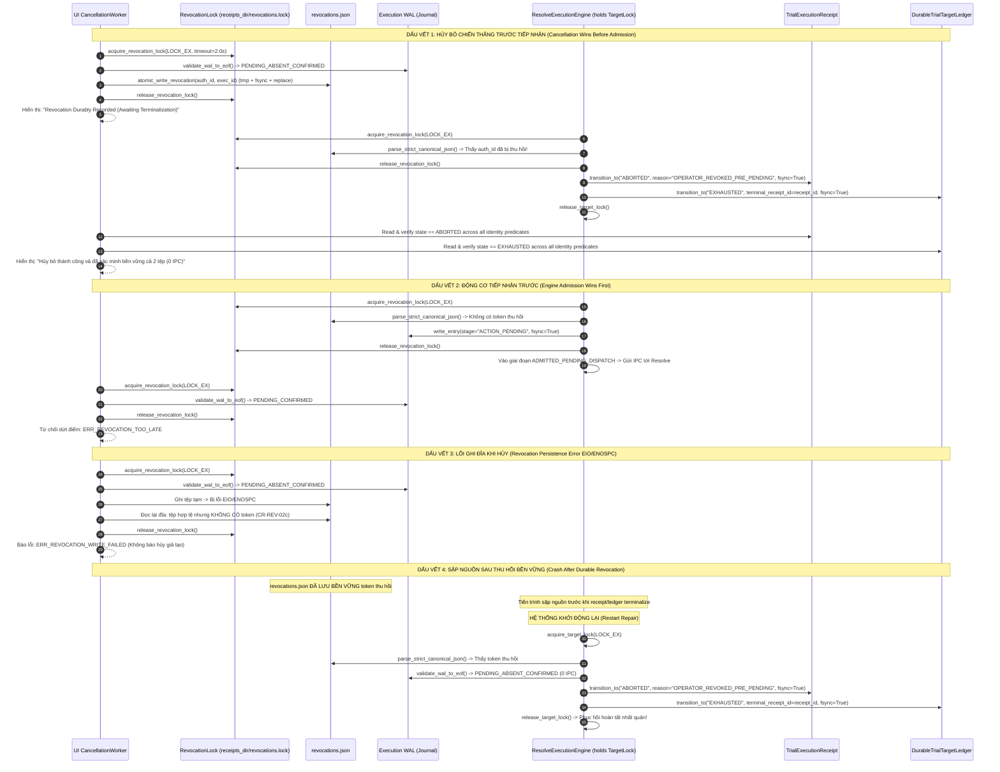

# THIẾT KẾ CỔNG NGHIỆM THU THI CÔNG DAVINCI RESOLVE CÔ LẬP — G07-07B5-D-R9
*(Isolated Resolve Acceptance Gate Design: Exact UI Terminal Proof, Grammar-Correct JSON Bounds & Complete WAL Evidence)*

- **MÃ TÀI LIỆU:** `docs/architecture/07B5-isolated-resolve-acceptance-gate-design.md`
- **TASK_ID:** `G07-07B5-D-R9`
- **CẤP ĐỘ WORKER:** `HIGH`
- **CHẾ ĐỘ:** `DESIGN_ONLY_TERMINAL_EVIDENCE_AND_PARSER_CORRECTION`
- **TRẠNG THÁI:** `DESIGN_SUBMITTED_FOR_REVIEW`
- **THỜI GIAN THIẾT LẬP:** 2026-11-02T22:35:00+07:00
- **TÁC GIẢ:** Antigravity (Pair Programming cùng Tech Lead Codex)
- **VĂN BẢN CĂN CỨ:**
  - Quyết định thẩm định R8: [`docs/architecture/07B5-D-R8-code-review.md`](file:///media/vanntruongg/Documents/Development/Python/dự%20án%20cá%20nhân/ResolveFlow-Assistant/docs/architecture/07B5-D-R8-code-review.md) (`CHANGES_REQUIRED`).
  - Nhiệm vụ hiệu chỉnh: [`.bridge/task.md`](file:///media/vanntruongg/Documents/Development/Python/dự%20án%20cá%20nhân/ResolveFlow-Assistant/.bridge/task.md) (`G07-07B5-D-R9`).
  - Thiết kế kiến trúc chấp hành Resolve: [`docs/architecture/07B3-resolve-executor-design.md`](file:///media/vanntruongg/Documents/Development/Python/dự%20án%20cá%20nhân/ResolveFlow-Assistant/docs/architecture/07B3-resolve-executor-design.md).
  - Hợp đồng duyệt đề xuất: [`src/core/contracts/edit_plan_approval_contracts.py`](file:///media/vanntruongg/Documents/Development/Python/dự%20án%20cá%20nhân/ResolveFlow-Assistant/src/core/contracts/edit_plan_approval_contracts.py).
  - Hợp đồng kế hoạch thi công: [`src/core/timeline_plan_execution_binder.py`](file:///media/vanntruongg/Documents/Development/Python/dự%20án%20cá%20nhân/ResolveFlow-Assistant/src/core/timeline_plan_execution_binder.py).
  - Hợp đồng biên bản thi công: [`src/core/contracts/execution_receipt_contracts.py`](file:///media/vanntruongg/Documents/Development/Python/dự%20án%20cá%20nhân/ResolveFlow-Assistant/src/core/contracts/execution_receipt_contracts.py).
  - Dịch vụ biên bản & khóa bền vững: [`src/services/execution_receipt_service.py`](file:///media/vanntruongg/Documents/Development/Python/dự%20án%20cá%20nhân/ResolveFlow-Assistant/src/services/execution_receipt_service.py).
  - Dịch vụ nhật ký WAL: [`src/services/execution_journal_service.py`](file:///media/vanntruongg/Documents/Development/Python/dự%20án%20cá%20nhân/ResolveFlow-Assistant/src/services/execution_journal_service.py).
  - Động cơ thực thi WAL: [`src/services/resolve_execution_engine.py`](file:///media/vanntruongg/Documents/Development/Python/dự%20án%20cá%20nhân/ResolveFlow-Assistant/src/services/resolve_execution_engine.py).
  - Cổng giao tiếp Resolve đa luồng: [`src/services/resolve_gateway.py`](file:///media/vanntruongg/Documents/Development/Python/dự%20án%20cá%20nhân/ResolveFlow-Assistant/src/services/resolve_gateway.py).
- **RÀNG BUỘC CỐT LÕI (STRICT BOUNDARIES):**
  - **CHỈ THIẾT KẾ (DESIGN ONLY):** Tuyệt đối 0 chỉnh sửa mã nguồn trong `src/` và `tests/`; 0 chạy pytest/app/Resolve/IPC/FusionScript/AI/mạng.
  - **DUY TRÌ `ready_to_execute=False`:** Không đấu nối động cơ vào giao diện người dùng (UI) và không kích hoạt bất kỳ live adapter nào.
  - **BẢO TỒN NGUYÊN TRẠNG TRIPWIRE MOCK-ONLY:** Không bypass tripwire `_validate_mock_gateway_admission()` bằng mock marker giả mạo; hoãn triển khai B6 cho tới khi có phê duyệt riêng.
  - **CỔNG TIẾP TỤC MỞ:** Gate G07, Milestones M1, M2 và M3 tiếp tục giữ trạng thái **MỞ (OPEN)**.
  - **BẢO TỒN NGUYÊN TRẠNG DỮ LIỆU NGƯỜI DÙNG:** Không commit, push, reset, clean, stash hay tắt tiến trình.

---

## 1. SƠ ĐỒ DÒNG GỌI NGUỒN GỐC & PHÂN TÁCH RANH GIỚI BẢO MẬT (SOURCE-GROUNDED CALLGRAPH & SECURITY BOUNDARIES)

### 1.1. Thực Tế Đã Kiểm Chứng Trong Mã Nguồn (Verified Source Facts)

1. **`ResolveExecutionEngine` ([`src/services/resolve_execution_engine.py`](file:///media/vanntruongg/Documents/Development/Python/dự%20án%20cá%20nhân/ResolveFlow-Assistant/src/services/resolve_execution_engine.py)):**
   - Động cơ hiện hành là nguyên mẫu **CHỈ MÔ PHỎNG (MOCK ONLY)**.
   - Giao thức tương tác: `ResolveGatewayClientProtocol` gồm 3 phương thức: `query_active_timeline_authority()`, `query_track_occupancy_snapshot()`, `execute_action()`.
   - **Tripwire Mock-Only Cố Định (`_validate_mock_gateway_admission`, dòng 812–828):**
     ```python
     if getattr(self.gateway, "_is_approved_mock_gateway", None) is not True:
         raise MockGatewayAdmissionError("ERR_LIVE_RESOLVE_FORBIDDEN: ... Yêu cầu FakeResolveGateway ...")
     if hasattr(self.gateway, "_automation") or hasattr(self.gateway, "resolve") or hasattr(self.gateway, "_resolve_override"):
         raise MockGatewayAdmissionError("ERR_LIVE_ADAPTER_REJECTED: Phát hiện adapter chứa thuộc tính Resolve live/automation.")
     ```
     Tripwire này ngăn chặn việc vô tình hoặc cố ý cắm live Resolve bridge vào động cơ khi chưa có cơ chế kiểm soát ủy quyền đầy đủ.

2. **`ResolveGateway` ([`src/services/resolve_gateway.py`](file:///media/vanntruongg/Documents/Development/Python/dự%20án%20cá%20nhân/ResolveFlow-Assistant/src/services/resolve_gateway.py)):**
   - Vận hành trên một `QThread` chuyên dụng độc lập (`_thread`) với đối tượng xử lý tuần tự `_GatewayWorker`.
   - Chứa `self._automation` (`ResolveAutomation` kết nối DaVinci Resolve C++ IPC) và `self._resolve_override`.
   - **Hiện trạng:** Chưa hiện thực `ResolveGatewayClientProtocol`. Nếu cắm trực tiếp vào `ResolveExecutionEngine`, tripwire dòng 824 sẽ ném `MockGatewayAdmissionError("ERR_LIVE_ADAPTER_REJECTED")`.

3. **`AppOwnedApprovalRecord` ([`src/core/contracts/edit_plan_approval_contracts.py`](file:///media/vanntruongg/Documents/Development/Python/dự%20án%20cá%20nhân/ResolveFlow-Assistant/src/core/contracts/edit_plan_approval_contracts.py)):**
   - Chứa 6 trường bất biến: `approval_id`, `proposal_id`, `proposal_revision`, `approved_at_iso`, `accepted_omission_ids`, và `approval_scope = "ENTIRE_PROPOSAL"`.
   - **Bản chất hợp đồng:** Phê duyệt nội dung sáng tạo của đề xuất cắt dựng tại Bước 4 của Director UI. Nó **KHÔNG PHẢI** là lệnh ủy quyền can thiệp vào DaVinci Resolve thật.

4. **`UnresolvedTargetRegistry` ([`src/services/resolve_execution_engine.py`](file:///media/vanntruongg/Documents/Development/Python/dự%20án%20cá%20nhân/ResolveFlow-Assistant/src/services/resolve_execution_engine.py)):**
   - Quản lý trong RAM cấp tiến trình (`process-local`). Một restart sẽ xóa sạch bảng này. Do đó, việc lưu vết mục tiêu và trạng thái dùng một lần bắt buộc phải do tệp sổ cái bền vững trên đĩa (`DurableTrialTargetLedger`) đảm nhiệm với khóa nguyên tử đa tiến trình (`fcntl.flock`).

---

### 1.2. Phân Tách Ranh Giới Ý Chí Con Người & Chứng Thư Ứng Dụng (Trust Boundaries)

```mermaid
flowchart TD
    subgraph CreativeApprovalTier ["Tầng 1: Phê Duyệt Sáng Tạo Bước 4 (Production DTO - Unchanged)"]
        Proposal["EditPlanProposal (Đề xuất cắt dựng)"]
        AppApproval["AppOwnedApprovalRecord<br/>approval_scope: ENTIRE_PROPOSAL<br/>proposal_revision: sha256(...)"]
        Proposal --> AppApproval
    end

    subgraph OperatorConsentTier ["Tầng 2A: Xác Nhận Ý Chí & Thao Tác Con Người (Local Operator Gesture)"]
        HumanOp["Điều hành viên Con Người (Human Operator)"]
        PreChallenge["Thử Thách Khởi Tạo (Pre-Creation App Challenge)<br/>challenge_id: A7B9_4C2D (Sinh ngẫu nhiên)<br/>Yêu cầu tên: RF_TRIAL_A7B9_4C2D"]
        ResolveApp["DaVinci Resolve GUI Thật"]
        CanaryProject["Project mới: RF_TRIAL_A7B9_4C2D<br/>project_uid: project.GetUniqueId()"]
        CanaryTimeline["Timeline mới: RF_TRIAL_TL_A7B9_4C2D<br/>timeline_uid: timeline.GetUniqueId()"]
        
        PreChallenge -->|Hướng dẫn tạo| HumanOp
        HumanOp -->|Tạo thủ công trên GUI Resolve| CanaryProject
        CanaryProject --> CanaryTimeline
        HumanOp -->|Nhập mã xác nhận chủ động| ConsentGesture["OperatorConsentGesture<br/>- operator_id: 'op_vanntruongg' (OS session label)<br/>- confirmation_phrase: 'CONFIRM_CANARY_TRIAL_EXECUTION'<br/>- freshness_attestation: 'Cam đoan timeline mới rỗng'<br/>- challenge_id: 'A7B9_4C2D'<br/>- gesture_timestamp_iso, client_nonce"]
    end

    subgraph AppMinterTier ["Tầng 2B: Cấp Phát Chứng Thư Ủy Quyền (App-Minted Authorization)"]
        AppMinter["TrialAuthorizationMinter (Cục bộ)"]
        Keyring[("Durable TrialKeyring (0600)<br/>active_key_id: key_01<br/>keys: {key_01: ACTIVE, key_00: RETIRED}")]
        AppApproval --> AppMinter
        ConsentGesture --> AppMinter
        Keyring --> AppMinter
        
        AppMinter -->|Ký HMAC-SHA256 trên Canonical Bytes Stream| TrialAuth["TrialExecutionAuthorization<br/>- authorization_id: UUIDv4, key_id: 'key_01'<br/>- approval_record_digest_sha256 (Tất cả 6 trường)<br/>- proposal_content_digest_sha256 & plan_digest_sha256<br/>- observed_timeline_start_frame & authorized_record_frame<br/>- target_project_uid & target_timeline_uid<br/>- authorized_action_type: 'INSERT_CLIP'<br/>- issued_at_iso & valid_until_iso (+300s)<br/>- authorization_hmac"]
    end

    subgraph DurableLedgerTier ["Tầng Sổ Cái Mục Tiêu Bền Vững & Khóa Đa Tiến Trình"]
        Ledger[("DurableTrialTargetLedger<br/>target_{hash}.trial.json<br/>- TargetLock(LOCK_EX)")]
        Revocations[("Durable Revocation Ledger<br/>revocations.json (0600)<br/>- RevocationLock(LOCK_EX/SH)")]
        TrialAuth -->|Ghi nhận đặt chỗ mục tiêu| Ledger
    end

    subgraph CancellationArbitrationBoundary ["Ranh Giới Trọng Tài Thu Hồi Phi Chặn (R8-01: Independent Dual-Record Proof)"]
        UIWorker["UI CancellationWorker (QRunnable/QThreadPool)"]
        UIWorker -->|1. Chiếm RevocationLock(LOCK_EX)<br/>*TUYỆT ĐỐI KHÔNG CHẠM TargetLock*| RevLockCheck{"Xác minh WAL to EOF:<br/>ACTION_PENDING<br/>đã tồn tại chưa?"}
        RevLockCheck -- "Chưa có ACTION_PENDING" --> WriteRev["Ghi bền vững revocations.json<br/>(Chỉ ghi tệp thu hồi; KHÔNG chạm receipt/ledger)<br/>Giải phóng RevocationLock<br/>Báo UI: 'Revocation Durably Recorded'"]
        RevLockCheck -- "Đã có ACTION_PENDING" --> RejectLate["Từ chối ngay lập tức:<br/>ERR_REVOCATION_TOO_LATE<br/>(Quyền hủy đã khép lại)"]
        WriteRev --> UIPoll["UI Thụ Động Polling (3.0s)<br/>Đọc độc lập Receipt & Ledger<br/>Khớp 100% 10 trường danh tính"]
        UIPoll -- "Cả 2 đều terminal và khớp UID" --> UIComplete["Báo UI: 'Hủy thành công và đã xác minh bền vững'<br/>(Receipt ABORTED & Ledger EXHAUSTED)"]
    end

    subgraph IrreversibleDispatchBoundary ["Ranh Giới Điều Phối Bất Khả Nghịch & Đóng Biên Bản"]
        EngineExec["ResolveExecutionEngine<br/>(Đang nắm TargetLock LOCK_EX)"]
        EngineExec -->|2. Chiếm RevocationLock(LOCK_EX)| EngineRevCheck{"Kiểm tra<br/>revocations.json?"}
        EngineRevCheck -- "Đã thu hồi" --> AbortPre["Chủ thể duy nhất kết thúc biên bản:<br/>Receipt: ABORTED, Ledger: EXHAUSTED<br/>Giải phóng TargetLock<br/>Zero IPC, Zero Mutation"]
        EngineRevCheck -- "Chưa thu hồi" --> WritePending["Ghi ACTION_PENDING WAL (fsync)<br/>*ĐIỂM TIẾP NHẬN BẤT KHẢ NGHỊCH*"]
        WritePending --> ReleaseRevLock["Giải phóng RevocationLock"]
        ReleaseRevLock --> LiveDispatch["ADMITTED_PENDING_DISPATCH<br/>Gửi IPC tới Resolve API<br/>recordFrame = auth.authorized_record_frame"]
    end
```

---

### 1.3. Bảo Tồn Nguyên Trạng Tripwire Mock-Only & Lộ Trình Dual-Mode (B5-D-RES-02)

1. **Tuyệt đối không bypass tripwire:** Nghiêm cấm gán `_is_approved_mock_gateway = True` cho live adapter và nghiêm cấm che giấu các trường `_automation`/`resolve` qua wrapper proxy.
2. **Nguyên tắc phân định chế độ động cơ (`EngineExecutionMode`):**
   - Hiện tại: `ResolveExecutionEngine` hoạt động ở chế độ mặc định duy nhất `ENGINE_MODE = "MOCK_ONLY"`, bảo lưu 100% tripwire dòng 812–828 và từ chối toàn bộ live adapters.
   - Tương lai (khi được người dùng cấp quyền trong một workorder phê duyệt riêng): Động cơ sẽ được nâng cấp có kiểm soát để hỗ trợ chế độ kép:
     - `MOCK_ONLY`: Chạy với `FakeResolveGateway`, kiểm tra `_is_approved_mock_gateway is True`.
     - `ISOLATED_TRIAL`: Chỉ cho phép khởi tạo khi có token thẩm quyền `TrialGatewayAdmissionToken` đi kèm chứng thư `TrialExecutionAuthorization` hợp lệ, mục tiêu đã được khóa trong `DurableTrialTargetLedger`, và khóa ký tồn tại trong `TrialKeyring`. Tại chế độ này, động cơ kiểm tra marker chuyên biệt `_is_approved_trial_gateway is True` (hoàn toàn tách biệt khỏi mock marker) và thực hiện xác thực chữ ký HMAC trước khi điều phối bất kỳ lệnh nào.
3. **Hoãn triển khai (Deferred Implementation):** Việc lập trình adapter và mở rộng động cơ sang chế độ `ISOLATED_TRIAL` bị **HOÃN TRIỆT ĐỂ** ở workorder này; không có bất kỳ dòng code nào được thay đổi trong `src/services/resolve_execution_engine.py`.

---

## 2. CHỨNG TỪ ỦY QUYỀN, MÔ HÌNH TIN CẬY HMAC & SỔ CÁI MỤC TIÊU BỀN VỮNG

### 2.1. Hợp Đồng Dữ Liệu: Thao Tác Người Điều Hành (`OperatorConsentGesture`) (B5-D-R2-RES-01)

```python
@dataclass(frozen=True)
class OperatorConsentGesture:
    """Hồ sơ xác nhận ý chí chủ động của người điều hành dưới phiên làm việc OS hiện hành."""
    operator_id: str                      # Nhãn định danh phiên OS (ví dụ: getpass.getuser()), KHÔNG PHẢI PKI identity
    consent_timestamp_iso: str            # Thời điểm người dùng thực hiện thao tác trên UI (ISO 8601 UTC)
    confirmation_phrase: str              # Cụm từ xác nhận bắt buộc: 'CONFIRM_CANARY_TRIAL_EXECUTION'
    freshness_attestation: str            # Lời cam đoan tự khai của người vận hành về tính mới và rỗng của timeline
    challenge_id: str                     # Chuỗi thử thách tiền tạo ngẫu nhiên (ví dụ: 'A7B9_4C2D') do ResolveFlow cấp
    client_nonce: str                     # UUIDv4 ngẫu nhiên chống phát lại thao tác
    
    def compute_gesture_digest(self) -> str:
        """Tính mã băm SHA-256 chuẩn tắc của thao tác con người qua serializer dùng chung."""
        payload = {
            "challenge_id": self.challenge_id,
            "client_nonce": self.client_nonce,
            "confirmation_phrase": self.confirmation_phrase,
            "consent_timestamp_iso": self.consent_timestamp_iso,
            "freshness_attestation": self.freshness_attestation,
            "operator_id": self.operator_id,
        }
        return hashlib.sha256(canonical_json_bytes(payload)).hexdigest()
```

> **Giới Hạn Kỹ Thuật Đã Ghi Nhận (Recorded Trust Limit):**
> Thuộc tính `operator_id` là chuỗi định danh người dùng cục bộ, không có chữ ký số khóa công khai của con người. Cam đoan `freshness_attestation` là lời tự khai của con người. Hệ thống kết hợp lời tự khai này với Thử thách tiền tạo (`challenge_id`) và Bằng chứng quan sát độ rỗng thời điểm chạy (`len(clips) == 0`). Do DaVinci Resolve API không cung cấp lịch sử đột biến, rủi ro con người xóa clip khỏi một timeline cũ rồi tái sử dụng là **rủi ro quy trình con người tồn đọng (residual human-process risk)** không thể triệt tiêu 100% bằng phần mềm và được chấp nhận trong phạm vi thử nghiệm cô lập.

---

### 2.2. Bộ Giải Mã JSON Chuẩn Tắc Với Tiền Quét Cú Pháp Chuẩn Xác Theo Văn Phạm (Grammar-Correct Pre-Parse Lexical Bounds & Strict Canonical JSON Decoder) (R8-02)

Để giải quyết triệt để 4 sai sót trong bộ tiền quét trước đó (đếm thiếu literals, đếm sai container off-by-one, bỏ qua độ dài ký tự escape trong chuỗi, và chặn nhầm surrogate pairs hợp lệ - R8-02), kiến trúc thiết lập **Bộ tiền quét từ vựng chuẩn xác theo văn phạm JSON (Grammar-Correct Bounded Scanner)**:

```python
# Các giới hạn độ phức tạp hữu hạn bắt buộc (Finite Complexity Bounds)
MAX_JSON_BYTES: int = 1_048_576          # 1 MiB giới hạn byte thô đầu vào
MAX_NESTING_DEPTH: int = 16              # Tối đa 16 cấp lồng nhau (ngăn chặn stack overflow / RecursionError)
MAX_TOTAL_NODES: int = 2048              # Tối đa 2048 node tổng cộng (bao gồm cả literals: true, false, null)
MAX_CONTAINER_LENGTH: int = 512          # Tối đa 512 phần tử trong list hoặc dict (512 chấp nhận, 513 từ chối)
MAX_STRING_SCALARS: int = 8192           # Tối đa 8192 Unicode code point / scalar sau giải mã escape
MAX_INTEGER_DIGITS: int = 19             # Tối đa 19 chữ số (khớp miền giá trị int64: 9,223,372,036,854,775,807)

# Miền giá trị số nguyên 64-bit có dấu chuẩn tắc
MIN_INT64: int = -9_223_372_036_854_775_808
MAX_INT64: int = 9_223_372_036_854_775_807


class StrictJsonParseError(ValueError):
    """Lỗi cú pháp hoặc kiểu dữ liệu không chuẩn tắc trong JSON."""
    pass


class StrictJsonComplexityError(ValueError):
    """Lỗi vượt ngưỡng độ phức tạp hoặc kích thước trong cấu trúc JSON."""
    pass


@dataclass
class _ValidationState:
    total_nodes: int = 0


def validate_json_structure_pre_parse(raw_bytes: bytes, max_bytes: int = MAX_JSON_BYTES) -> str:
    """
    Tiền quét cú pháp từ vựng chuẩn xác theo văn phạm JSON TRƯỚC KHI gọi json.loads.
    - Đếm chính xác mọi JSON value (containers, strings, numbers, true, false, null) vào total_nodes.
    - Đếm chính xác container items (không off-by-one: 512 phần tử OK, 513 phần tử REJECT).
    - Đếm chính xác số scalar của chuỗi bao gồm escape; nhận diện cặp surrogate pair hợp lệ (1 scalar), chặn lone surrogate.
    - Chặn số nguyên vượt 19 chữ số, chặn float, chặn hằng số non-finite.
    """
    if len(raw_bytes) > max_bytes:
        raise StrictJsonComplexityError(f"ERR_JSON_SIZE_EXCEEDED: Dung lượng {len(raw_bytes)} vượt giới hạn {max_bytes}")
    
    try:
        raw_str = raw_bytes.decode("utf-8")
    except UnicodeDecodeError as exc:
        raise StrictJsonParseError(f"ERR_CANONICAL_UTF8_DECODE: Chuỗi byte không phải UTF-8 hợp lệ: {exc}") from exc
    
    current_depth = 0
    total_nodes = 0
    
    # Ngăn xếp theo dõi container: mỗi phần tử lưu số lượng item hiện có trong container đó
    # Ban đầu container rỗng -> 0 item. Khi gặp item đầu tiên -> count = 1. Mỗi dấu phẩy -> count += 1.
    container_counts: list[int] = []
    container_has_value: list[bool] = []
    
    in_string = False
    escape_next = False
    decoded_string_scalars = 0
    current_num_digits = 0
    in_number = False
    
    idx = 0
    n = len(raw_str)
    
    while idx < n:
        ch = raw_str[idx]
        
        # 1. TRONG CHUỖI
        if in_string:
            if escape_next:
                if ch == "u":
                    # Xử lý escape unicode \uXXXX
                    if idx + 4 >= n:
                        raise StrictJsonParseError("ERR_CANONICAL_TRUNCATED_ESCAPE: Chuỗi escape \\u bị cắt cụt tại EOF")
                    hex_str = raw_str[idx + 1:idx + 5]
                    try:
                        code_point = int(hex_str, 16)
                    except ValueError as exc:
                        raise StrictJsonParseError(f"ERR_CANONICAL_INVALID_HEX: Ký tự hex không hợp lệ: {hex_str}") from exc
                    
                    # Kiểm tra dải surrogate: D800 - DFFF
                    if 0xD800 <= code_point <= 0xDBFF:
                        # High surrogate: bắt buộc phải có low surrogate (\uDC00 - \uDFFF) ngay sau đó
                        if idx + 10 < n and raw_str[idx + 5:idx + 7] == "\\u":
                            low_hex = raw_str[idx + 7:idx + 11]
                            try:
                                low_point = int(low_hex, 16)
                            except ValueError:
                                low_point = 0
                            if 0xDC00 <= low_point <= 0xDFFF:
                                # Cặp surrogate pair hợp lệ -> đại diện cho 1 Unicode scalar hoàn chỉnh!
                                decoded_string_scalars += 1
                                idx += 10  # Nhảy cóc qua cả 2 escape \uXXXX\uYYYY
                                escape_next = False
                                if decoded_string_scalars > MAX_STRING_SCALARS:
                                    raise StrictJsonComplexityError(f"ERR_JSON_STRING_TOO_LONG: Chuỗi vượt {MAX_STRING_SCALARS} scalars")
                                idx += 1
                                continue
                        # Nếu không có low surrogate hợp lệ theo sau -> LONE SURROGATE!
                        raise StrictJsonParseError(f"ERR_CANONICAL_LONE_SURROGATE: Phát hiện lone high surrogate \\u{hex_str}")
                    elif 0xDC00 <= code_point <= 0xDFFF:
                        # Lone low surrogate đứng độc lập
                        raise StrictJsonParseError(f"ERR_CANONICAL_LONE_SURROGATE: Phát hiện lone low surrogate \\u{hex_str}")
                    else:
                        # Ký tự Unicode escape thông thường hợp lệ
                        decoded_string_scalars += 1
                    
                    idx += 4
                elif ch in '"\\/bfnrt':
                    # Escape 1 ký tự chuẩn tắc
                    decoded_string_scalars += 1
                else:
                    raise StrictJsonParseError(f"ERR_CANONICAL_INVALID_ESCAPE: Ký tự escape không hợp lệ: \\{ch}")
                
                escape_next = False
                if decoded_string_scalars > MAX_STRING_SCALARS:
                    raise StrictJsonComplexityError(f"ERR_JSON_STRING_TOO_LONG: Chuỗi vượt {MAX_STRING_SCALARS} scalars")
            elif ch == "\\":
                escape_next = True
            elif ch == '"':
                # Đóng chuỗi
                in_string = False
                total_nodes += 1
                if total_nodes > MAX_TOTAL_NODES:
                    raise StrictJsonComplexityError(f"ERR_JSON_EXCESSIVE_NODES: Số node vượt {MAX_TOTAL_NODES}")
                if container_counts and not container_has_value[-1]:
                    container_counts[-1] = 1
                    container_has_value[-1] = True
            elif ch == "\0":
                raise StrictJsonParseError("ERR_CANONICAL_NUL_CHAR: Ký tự NUL bên trong chuỗi")
            else:
                decoded_string_scalars += 1
                if decoded_string_scalars > MAX_STRING_SCALARS:
                    raise StrictJsonComplexityError(f"ERR_JSON_STRING_TOO_LONG: Chuỗi vượt {MAX_STRING_SCALARS} scalars")
            
            idx += 1
            continue
        
        # 2. NGOÀI CHUỖI
        if ch == '"':
            in_string = True
            escape_next = False
            decoded_string_scalars = 0
            in_number = False
        elif ch in "{[":
            current_depth += 1
            if current_depth > MAX_NESTING_DEPTH:
                raise StrictJsonComplexityError(f"ERR_JSON_EXCESSIVE_DEPTH: Độ sâu ({current_depth}) vượt {MAX_NESTING_DEPTH}")
            total_nodes += 1
            if total_nodes > MAX_TOTAL_NODES:
                raise StrictJsonComplexityError(f"ERR_JSON_EXCESSIVE_NODES: Số node vượt {MAX_TOTAL_NODES}")
            container_counts.append(0)
            container_has_value.append(False)
            in_number = False
        elif ch in "}]":
            if current_depth <= 0 or not container_counts:
                raise StrictJsonParseError("ERR_JSON_UNBALANCED_BRACKETS: Dấu đóng ngoặc không cân xứng")
            current_depth -= 1
            final_count = container_counts.pop()
            container_has_value.pop()
            if final_count > MAX_CONTAINER_LENGTH:
                raise StrictJsonComplexityError(f"ERR_JSON_CONTAINER_TOO_LARGE: Container chứa {final_count} phần tử, vượt {MAX_CONTAINER_LENGTH}")
            if container_counts and not container_has_value[-1]:
                container_counts[-1] = 1
                container_has_value[-1] = True
            in_number = False
        elif ch == ",":
            if not container_counts:
                raise StrictJsonParseError("ERR_JSON_DANGLING_COMMA: Dấu phẩy ngoài container")
            container_counts[-1] += 1
            if container_counts[-1] > MAX_CONTAINER_LENGTH:
                raise StrictJsonComplexityError(f"ERR_JSON_CONTAINER_TOO_LARGE: Container vượt {MAX_CONTAINER_LENGTH} phần tử (tại phần tử thứ {container_counts[-1]})")
            in_number = False
        elif ch in "-0123456789":
            if not in_number:
                in_number = True
                current_num_digits = 0
                total_nodes += 1
                if total_nodes > MAX_TOTAL_NODES:
                    raise StrictJsonComplexityError(f"ERR_JSON_EXCESSIVE_NODES: Số node vượt {MAX_TOTAL_NODES}")
                if container_counts and not container_has_value[-1]:
                    container_counts[-1] = 1
                    container_has_value[-1] = True
            if ch in "0123456789":
                current_num_digits += 1
                if current_num_digits > MAX_INTEGER_DIGITS:
                    raise StrictJsonComplexityError(f"ERR_JSON_INTEGER_TOKEN_TOO_LARGE: Số nguyên vượt {MAX_INTEGER_DIGITS} chữ số")
        elif ch in ".eE":
            # Cấm số thực dấu phẩy động
            raise StrictJsonParseError("ERR_CANONICAL_FLOAT_FORBIDDEN: float không hợp lệ; chỉ chấp nhận int")
        elif ch.isspace() or ch == ":":
            in_number = False
        else:
            # Nhận diện các literal: true, false, null và các token non-finite bị cấm
            token_rem = raw_str[idx:idx+10]
            if token_rem.startswith("true"):
                total_nodes += 1
                if container_counts and not container_has_value[-1]:
                    container_counts[-1] = 1
                    container_has_value[-1] = True
                idx += 3  # Vòng lặp cuối sẽ +1
            elif token_rem.startswith("false"):
                total_nodes += 1
                if container_counts and not container_has_value[-1]:
                    container_counts[-1] = 1
                    container_has_value[-1] = True
                idx += 4
            elif token_rem.startswith("null"):
                total_nodes += 1
                if container_counts and not container_has_value[-1]:
                    container_counts[-1] = 1
                    container_has_value[-1] = True
                idx += 3
            elif token_rem.lower().startswith("nan") or token_rem.lower().startswith("infinity"):
                raise StrictJsonParseError(f"ERR_CANONICAL_NON_FINITE_CONSTANT: Hằng số không hợp lệ tại vị trí {idx}")
            
            if total_nodes > MAX_TOTAL_NODES:
                raise StrictJsonComplexityError(f"ERR_JSON_EXCESSIVE_NODES: Số node ({total_nodes}) vượt {MAX_TOTAL_NODES}")
            in_number = False
        
        idx += 1
    
    if in_string:
        raise StrictJsonParseError("ERR_JSON_UNTERMINATED_STRING: Chuỗi chưa được đóng ngoặc kép")
    if current_depth != 0:
        raise StrictJsonParseError(f"ERR_JSON_UNCLOSED_CONTAINER: Còn {current_depth} container chưa đóng tại EOF")
    
    return raw_str


def _reject_json_constant(val: str) -> None:
    raise StrictJsonParseError(f"ERR_CANONICAL_NON_FINITE_CONSTANT: Hằng số không hợp lệ trong JSON: {val!r}")


def _validate_decoded_graph(
    data: Any,
    path: str = "root",
    depth: int = 0,
    state: Optional[_ValidationState] = None,
) -> None:
    """Hậu kiểm đệ quy cấu trúc đối tượng Python sau khi decode để đảm bảo tuyệt đối không rò rỉ kiểu lạ."""
    if state is None:
        state = _ValidationState()
    
    if depth > MAX_NESTING_DEPTH:
        raise StrictJsonComplexityError(f"ERR_JSON_EXCESSIVE_DEPTH: Độ sâu ({depth}) vượt {MAX_NESTING_DEPTH} tại {path}")
    
    state.total_nodes += 1
    if state.total_nodes > MAX_TOTAL_NODES:
        raise StrictJsonComplexityError(f"ERR_JSON_EXCESSIVE_NODES: Tổng số node vượt {MAX_TOTAL_NODES} tại {path}")
    
    if type(data) is bool:
        return
    elif type(data) is int:
        if not (MIN_INT64 <= data <= MAX_INT64):
            raise StrictJsonComplexityError(f"ERR_JSON_INTEGER_OUT_OF_RANGE: Số nguyên {data} ngoài phạm vi 64-bit tại {path}")
        return
    elif type(data) is float:
        raise StrictJsonParseError(f"ERR_CANONICAL_FLOAT_FORBIDDEN: float không hợp lệ tại {path}")
    elif data is None:
        return
    elif type(data) is str:
        if len(data) > MAX_STRING_SCALARS:
            raise StrictJsonComplexityError(f"ERR_JSON_STRING_TOO_LONG: Chuỗi dài vượt {MAX_STRING_SCALARS} tại {path}")
        if "\0" in data:
            raise StrictJsonParseError(f"ERR_CANONICAL_NUL_CHAR: Ký tự NUL tại {path}")
        try:
            data.encode("utf-8")
        except UnicodeEncodeError as exc:
            raise StrictJsonParseError(f"ERR_CANONICAL_SURROGATE: Lone surrogate tại {path}: {exc}") from exc
        return
    elif isinstance(data, (list, tuple)):
        if len(data) > MAX_CONTAINER_LENGTH:
            raise StrictJsonComplexityError(f"ERR_JSON_CONTAINER_TOO_LARGE: List vượt {MAX_CONTAINER_LENGTH} tại {path}")
        for idx, item in enumerate(data):
            _validate_decoded_graph(item, f"{path}[{idx}]", depth + 1, state)
        return
    elif isinstance(data, dict):
        if len(data) > MAX_CONTAINER_LENGTH:
            raise StrictJsonComplexityError(f"ERR_JSON_CONTAINER_TOO_LARGE: Dict vượt {MAX_CONTAINER_LENGTH} tại {path}")
        for k, v in data.items():
            if type(k) is not str:
                raise StrictJsonParseError(f"ERR_CANONICAL_KEY_TYPE: Key tại {path} phải là str")
            if len(k) > MAX_STRING_SCALARS:
                raise StrictJsonComplexityError(f"ERR_JSON_KEY_TOO_LONG: Key vượt {MAX_STRING_SCALARS} tại {path}.{k}")
            if "\0" in k:
                raise StrictJsonParseError(f"ERR_CANONICAL_KEY_NUL: Key chứa NUL tại {path}.{k}")
            try:
                k.encode("utf-8")
            except UnicodeEncodeError as exc:
                raise StrictJsonParseError(f"ERR_CANONICAL_KEY_SURROGATE: Lone surrogate trong key: {exc}") from exc
            _validate_decoded_graph(v, f"{path}.{k}", depth + 1, state)
        return
    else:
        raise StrictJsonParseError(f"ERR_CANONICAL_UNSUPPORTED_TYPE: Kiểu không hợp lệ tại {path}: {type(data).__name__}")


def canonical_json_bytes(payload: Dict[str, Any]) -> bytes:
    """Tuần tự hóa từ điển thành chuỗi byte UTF-8 chuẩn tắc tất định 100%."""
    _validate_decoded_graph(payload)
    encoded_str = json.dumps(
        payload,
        sort_keys=True,
        separators=(",", ":"),
        ensure_ascii=False,
        allow_nan=False,
    )
    return encoded_str.encode("utf-8")


def reject_duplicate_json_keys(ordered_pairs: list[tuple[str, Any]]) -> dict[str, Any]:
    result: dict[str, Any] = {}
    for key, value in ordered_pairs:
        if key in result:
            raise StrictJsonParseError(f"ERR_DUPLICATE_JSON_KEY: Phát hiện trùng lặp khóa JSON: {key!r}")
        result[key] = value
    return result


def parse_strict_canonical_json(raw_bytes: bytes, max_bytes: int = MAX_JSON_BYTES) -> dict[str, Any]:
    """
    Giải mã JSON chuẩn tắc hai lớp phòng vệ:
    Lớp 1: Tiền quét từ vựng chuẩn xác theo văn phạm, chặn đứng bùng nổ trước khi parse.
    Lớp 2: json.loads chuẩn hóa lỗi kết hợp hậu kiểm đệ quy đồ thị.
    """
    raw_str = validate_json_structure_pre_parse(raw_bytes, max_bytes=max_bytes)
    
    try:
        data = json.loads(
            raw_str,
            object_pairs_hook=reject_duplicate_json_keys,
            parse_constant=_reject_json_constant,
            parse_float=lambda val: _reject_json_constant(f"float:{val}"),
        )
    except (json.JSONDecodeError, RecursionError, ValueError, OverflowError) as exc:
        raise StrictJsonParseError(f"ERR_CANONICAL_PARSE_FAILED: Lỗi phân tích cú pháp JSON: {exc}") from exc
    
    if not isinstance(data, dict):
        raise StrictJsonParseError(f"ERR_JSON_NOT_DICT: JSON root phải là dict, nhận {type(data).__name__}")
    
    _validate_decoded_graph(data)
    return data
```

#### Các Ca Kiểm Thử Ranh Giới Chuẩn Tắc (Explicit Boundary Test Fixtures)
1. **Kiểm thử Literals Node Count:** Payload `{"a": true, "b": false, "c": null}` chứa đúng 7 nodes: 1 container dict + 3 string keys + 3 literal values. Đếm đủ và chính xác 7 nodes.
2. **Kiểm thử Escaped String Scalars:** Chuỗi `"\\u0061" * 8192` chứa 8192 ký tự 'a' $\rightarrow$  HỢP LỆ. Chuỗi `"\\u0061" * 8193` $\rightarrow$  TỪ CHỐI với `ERR_JSON_STRING_TOO_LONG` ngay tại tầng tiền quét trước khi `json.loads` được gọi.
3. **Kiểm thử Ranh Giới Container (512 vs 513):**
   - Mảng `[1, 2, ..., 512]` chứa 511 dấu phẩy $\rightarrow$  HỢP LỆ (512 items).
   - Mảng `[1, 2, ..., 513]` chứa 512 dấu phẩy $\rightarrow$  TỪ CHỐI với `ERR_JSON_CONTAINER_TOO_LARGE` (513 items).
4. **Kiểm thử Surrogate Pair Hợp Lệ vs Lone Surrogate:**
   - Cặp surrogate `"\\uD83D\\uDE00"` (Biểu tượng mặt cười 😀) $\rightarrow$  HỢP LỆ (được nhận diện là 1 Unicode scalar).
   - Đơn surrogate `"\\uD800"` hoặc `"\\uD800xyz"` $\rightarrow$  TỪ CHỐI TỨC THÌ với `ERR_CANONICAL_LONE_SURROGATE`.

---

### 2.3. Hợp Đồng Dữ Liệu: Chứng Thư Ủy Quyền Can Thiệp (`TrialExecutionAuthorization`) (B5-D-R3-RES-03)

```python
@dataclass(frozen=True)
class TrialExecutionAuthorization:
    """Chứng thư ủy quyền can thiệp dùng 1 lần, ràng buộc mật mã toàn bộ ý chí con người và mục tiêu Resolve."""
    
    # 1. Định Danh Chứng Thư & Khóa
    authorization_id: str                          # UUIDv4 định danh chứng thư duy nhất
    key_id: str                                    # Khóa HMAC tương ứng trong TrialKeyring (ví dụ: 'key_20261102_01')
    
    # 2. Ràng Buộc Ý Chí Con Người & Đề Xuất Sáng Tạo (Crypto Bindings)
    operator_gesture_digest_sha256: str            # SHA-256 từ compute_gesture_digest() của OperatorConsentGesture
    approval_record_id: str                        # approval_id từ AppOwnedApprovalRecord
    approval_record_digest_sha256: str             # SHA-256 của toàn bộ 6 trường AppOwnedApprovalRecord
    proposal_id: str                               # proposal_id từ EditPlanProposal
    proposal_revision: str                         # proposal_revision từ EditPlanProposal
    proposal_content_digest_sha256: str            # SHA-256 nội dung đề xuất sáng tạo Bước 4
    plan_idempotency_key: str                      # Khóa idempotency từ TimelineExecutionPlan
    plan_digest_sha256: str                        # SHA-256 toàn bộ các hành động trong TimelineExecutionPlan
    action_payload_digest_sha256: str              # SHA-256 của Canonical Action Dispatch Payload 16 khóa chuẩn tắc (R30-01)
    
    # 3. Ràng Buộc Mục Tiêu Vật Lý Resolve (Physical Target Bindings)
    target_project_uid: str                        # project.GetUniqueId() của dự án canary rỗng
    target_project_name: str                       # Tên dự án: bắt buộc khớp ^RF_TRIAL_[0-9A-Z_]{8,32}$
    target_timeline_uid: str                       # timeline.GetUniqueId() của timeline canary rỗng
    target_timeline_name: str                      # Tên timeline: bắt buộc khớp ^RF_TRIAL_TL_[0-9A-Z_]{8,32}$
    target_timeline_fps_numerator: int             # FPS chuẩn (ví dụ: 24)
    target_timeline_fps_denominator: int           # FPS mẫu số (ví dụ: 1)
    
    # 4. Ràng Buộc Khung Hình Gốc Quan Sát & Khung Hình Ủy Quyền (Frame Boundary Bindings)
    observed_timeline_start_frame: int             # Giá trị đọc từ timeline.GetStartFrame() tại thời điểm cấp phép
    authorized_record_frame: int                   # observed_timeline_start_frame + authorized_timeline_frame_start
    
    # 5. Ràng Buộc Tập Tin Nguồn (Media Evidence Binding)
    source_file_path: str                          # Đường dẫn tuyệt đối tới tập tin media kiểm chuẩn
    source_file_sha256: str                        # SHA-256 của tập tin media kiểm chuẩn
    
    # 6. Phạm Vi Hành Động Hạn Chế Duy Nhất (Single Insert Action Scope)
    authorized_action_type: str                    # BẮT BUỘC: 'INSERT_CLIP'
    authorized_track_type: str                     # BẮT BUỘC: 'video'
    authorized_track_index: int                    # BẮT BUỘC: 1 (Track V1)
    authorized_timeline_frame_start: int           # BẮT BUỘC: 0
    authorized_timeline_frame_duration: int        # BẮT BUỘC: 120
    authorized_source_frame_start: int             # BẮT BUỘC: 0
    authorized_source_frame_duration: int          # BẮT BUỘC: 120
    
    # 7. Vòng Đời & Toàn Vẹn Mật Mã
    execution_id: str                              # Định danh phiên thực thi chuẩn tắc (UUIDv4, khớp token_nonce) (R32-01)
    issued_at_iso: str                             # Thời điểm cấp chứng thư (ISO 8601 UTC)
    valid_until_iso: str                           # Thời hạn: strictly issued_at + 300s (5 phút)
    token_nonce: str                               # Nonce ứng dụng ngẫu nhiên (UUIDv4)
    authorization_hmac: str                        # Chữ ký HMAC-SHA256 bảo vệ toàn vẹn 32 trường trên
```

#### Quy Tắc Tuần Tự Hóa Chuẩn Tắc (Canonical Serialization Equation)
```python
def canonical_bytes_for_auth_hmac(auth: TrialExecutionAuthorization) -> bytes:
    payload = {
        "action_payload_digest_sha256": auth.action_payload_digest_sha256,
        "approval_record_digest_sha256": auth.approval_record_digest_sha256,
        "approval_record_id": auth.approval_record_id,
        "authorization_id": auth.authorization_id,
        "authorized_action_type": auth.authorized_action_type,
        "authorized_record_frame": auth.authorized_record_frame,
        "authorized_source_frame_duration": auth.authorized_source_frame_duration,
        "authorized_source_frame_start": auth.authorized_source_frame_start,
        "authorized_timeline_frame_duration": auth.authorized_timeline_frame_duration,
        "authorized_timeline_frame_start": auth.authorized_timeline_frame_start,
        "authorized_track_index": auth.authorized_track_index,
        "authorized_track_type": auth.authorized_track_type,
        "execution_id": auth.execution_id,
        "issued_at_iso": auth.issued_at_iso,
        "key_id": auth.key_id,
        "observed_timeline_start_frame": auth.observed_timeline_start_frame,
        "operator_gesture_digest_sha256": auth.operator_gesture_digest_sha256,
        "plan_digest_sha256": auth.plan_digest_sha256,
        "plan_idempotency_key": auth.plan_idempotency_key,
        "proposal_content_digest_sha256": auth.proposal_content_digest_sha256,
        "proposal_id": auth.proposal_id,
        "proposal_revision": auth.proposal_revision,
        "source_file_path": auth.source_file_path,
        "source_file_sha256": auth.source_file_sha256,
        "target_project_name": auth.target_project_name,
        "target_project_uid": auth.target_project_uid,
        "target_timeline_fps_denominator": auth.target_timeline_fps_denominator,
        "target_timeline_fps_numerator": auth.target_timeline_fps_numerator,
        "target_timeline_name": auth.target_timeline_name,
        "target_timeline_uid": auth.target_timeline_uid,
        "token_nonce": auth.token_nonce,
        "valid_until_iso": auth.valid_until_iso,
    }
    return canonical_json_bytes(payload)
```

#### Quy Tắc Lắp Ráp & Tuần Tự Hóa Canonical Action Dispatch Payload 16 Khóa (R30-01, R31-01, R32-01, R33-01)
Để đồng bộ hóa tuyệt đối byte-for-byte giữa Section 2.3 và Section 2.6, payload thi công duy nhất được cấp phép được lắp ráp trực tiếp từ `PlannedTimelineAction` và các trường Identity Envelope của `TrialExecutionAuthorization`:

```python
CANONICAL_ACTION_PAYLOAD_KEYS = frozenset({
    "action_index", "action_type", "authorization_id", "duration_frames",
    "execution_id", "plan_idempotency_key", "record_frame", "role",
    "schema_version", "source_frame_duration", "source_frame_start",
    "source_path", "target_project_uid", "target_timeline_uid",
    "track_index", "track_type"
})

def canonical_action_payload_bytes(params: Mapping[str, Any]) -> bytes:
    """Định nghĩa chuẩn tắc duy nhất tuần tự hóa Canonical Action Dispatch Payload 16 khóa với type gates nghiêm ngặt."""
    if not isinstance(params, (dict, Mapping)):
        raise ReadbackReceiptVerificationError("ERR_ACTION_PAYLOAD_NOT_DICT")
    if frozenset(params.keys()) != CANONICAL_ACTION_PAYLOAD_KEYS:
        diff_missing = CANONICAL_ACTION_PAYLOAD_KEYS - set(params.keys())
        diff_extra = set(params.keys()) - CANONICAL_ACTION_PAYLOAD_KEYS
        raise ReadbackReceiptVerificationError(
            f"ERR_ACTION_PAYLOAD_SCHEMA_MISMATCH: missing={diff_missing}, extra={diff_extra}"
        )
    # Primitive type & range gates trên toàn bộ 16 trường
    for k in ("action_index", "duration_frames", "record_frame", "source_frame_duration", "source_frame_start", "track_index"):
        val = params[k]
        if type(val) is not int or isinstance(val, bool):
            raise ReadbackReceiptVerificationError(f"ERR_ACTION_PAYLOAD_TYPE_GATE: {k} must be int not bool")
    if params["action_index"] < 0:
        raise ReadbackReceiptVerificationError("ERR_ACTION_PAYLOAD_RANGE: action_index must be >= 0")
    if params["track_index"] < 1:
        raise ReadbackReceiptVerificationError("ERR_ACTION_PAYLOAD_RANGE: track_index must be >= 1")
    if params["source_frame_duration"] <= 0 or params["duration_frames"] <= 0:
        raise ReadbackReceiptVerificationError("ERR_ACTION_PAYLOAD_RANGE: frame durations must be > 0")

    for k in ("action_type", "authorization_id", "execution_id", "plan_idempotency_key", "role", "schema_version", "source_path", "target_project_uid", "target_timeline_uid", "track_type"):
        val = params[k]
        if not isinstance(val, str) or not val.strip():
            raise ReadbackReceiptVerificationError(f"ERR_ACTION_PAYLOAD_TYPE_GATE: {k} must be non-empty str")

    sorted_dict = {k: params[k] for k in sorted(params.keys())}
    return json.dumps(sorted_dict, sort_keys=True, separators=(",", ":"), ensure_ascii=True).encode("utf-8")

def assemble_canonical_action_payload(
    action: PlannedTimelineAction,
    auth: TrialExecutionAuthorization,
    execution_id: str
) -> Dict[str, Any]:
    """Lắp ráp canonical action payload từ PlannedTimelineAction và ràng buộc identity envelope (R31-01, R32-01)."""
    if not isinstance(action, PlannedTimelineAction):
        raise ReadbackReceiptVerificationError("ERR_INVALID_ACTION_OBJECT: action must be PlannedTimelineAction instance")

    # Invariant: execution_id truyền vào bắt buộc khớp tuyệt đối với auth.execution_id và auth.token_nonce (R32-01)
    if execution_id != auth.execution_id:
        raise WholePlanReconciliationError(
            f"ERR_EXECUTION_IDENTITY_MISMATCH: execution_id '{execution_id}' does not match auth.execution_id '{auth.execution_id}'"
        )
    if auth.execution_id != auth.token_nonce:
        raise WholePlanReconciliationError(
            f"ERR_EXECUTION_NONCE_MISMATCH: auth.execution_id '{auth.execution_id}' != auth.token_nonce '{auth.token_nonce}'"
        )

    # Invariant: đối chiếu toàn bộ 11 trường của action với các giá trị geometry đã ký trong auth
    if action.action_index < 0:
        raise ReadbackReceiptVerificationError("ERR_ACTION_INDEX_NEGATIVE: action_index must be >= 0")
    if action.action_type != auth.authorized_action_type:
        raise ReadbackReceiptVerificationError(
            f"ERR_ACTION_TYPE_MISMATCH: action {action.action_type} != auth {auth.authorized_action_type}"
        )
    if action.target_track_type != auth.authorized_track_type:
        raise ReadbackReceiptVerificationError(
            f"ERR_TRACK_TYPE_MISMATCH: action {action.target_track_type} != auth {auth.authorized_track_type}"
        )
    if action.target_track_index != auth.authorized_track_index:
        raise ReadbackReceiptVerificationError(
            f"ERR_TRACK_INDEX_MISMATCH: action {action.target_track_index} != auth {auth.authorized_track_index}"
        )
    if action.source_file_path != auth.source_file_path:
        raise ReadbackReceiptVerificationError("ERR_SOURCE_PATH_MISMATCH: source_file_path does not match auth")
    if action.source_range.start_frame != auth.authorized_source_frame_start:
        raise ReadbackReceiptVerificationError("ERR_SOURCE_START_MISMATCH: source start_frame does not match auth")
    if action.source_range.duration_frames != auth.authorized_source_frame_duration:
        raise ReadbackReceiptVerificationError("ERR_SOURCE_DURATION_MISMATCH: source duration does not match auth")
    if action.timeline_range.duration_frames != auth.authorized_timeline_frame_duration:
        raise ReadbackReceiptVerificationError("ERR_TIMELINE_DURATION_MISMATCH: timeline duration does not match auth")

    payload = {
        "action_index": action.action_index,
        "action_type": action.action_type,
        "authorization_id": auth.authorization_id,
        "duration_frames": action.timeline_range.duration_frames,
        "execution_id": execution_id,
        "plan_idempotency_key": auth.plan_idempotency_key,
        "record_frame": auth.authorized_record_frame,
        "role": action.role,
        "schema_version": "1.0.0",
        "source_frame_duration": action.source_range.duration_frames,
        "source_frame_start": action.source_range.start_frame,
        "source_path": action.source_file_path,
        "target_project_uid": auth.target_project_uid,
        "target_timeline_uid": auth.target_timeline_uid,
        "track_index": action.target_track_index,
        "track_type": action.target_track_type,
    }

    # Thẩm định cấu trúc và type gates thông qua canonical serializer
    canonical_action_payload_bytes(payload)
    return payload
```

#### Quy Trình Tái Thẩm Định Mật Mã Tại Cổng Tiền Kiểm (Recomputation Equation at Admission)
Tại thời điểm tiếp nhận lệnh thi công, `TrialAdmissionGuard` bắt buộc thực hiện **tính toán lại độc lập (recompute from scratch)**:
1. Recompute toàn bộ 6 trường của `AppOwnedApprovalRecord` $\rightarrow$  kiểm tra khớp `auth.approval_record_digest_sha256`.
2. Recompute Proposal Revision & Content Digest từ đề xuất lưu trữ $\rightarrow$  kiểm tra khớp `auth.proposal_revision` và `auth.proposal_content_digest_sha256`.
3. Recompute Plan Digest từ `TimelineExecutionPlan` $\rightarrow$  kiểm tra khớp `auth.plan_digest_sha256`.
4. Lắp ráp Canonical Action Dispatch Payload 16 khóa qua `assemble_canonical_action_payload(action, auth, execution_id=auth.execution_id)` từ `PlannedTimelineAction` và identity envelope của chứng thư $\rightarrow$ Recompute Action Digest qua `SHA256(canonical_action_payload_bytes(payload))` $\rightarrow$ kiểm tra khớp 100% byte-for-byte với `auth.action_payload_digest_sha256`.
5. Đọc tập tin media trên đĩa, tính SHA-256 $\rightarrow$  kiểm tra khớp `auth.source_file_sha256`.
6. Truy vấn DaVinci Resolve:
   - `timeline.GetStartFrame() == auth.observed_timeline_start_frame`.
   - `auth.authorized_record_frame == auth.observed_timeline_start_frame + auth.authorized_timeline_frame_start`.
   - `fps.numerator == auth.target_timeline_fps_numerator` và `fps.denominator == auth.target_timeline_fps_denominator`.
7. Lấy khóa tương ứng với `auth.key_id` từ `TrialKeyringAuthority` nạp từ keystore cục bộ an toàn $\rightarrow$  tính HMAC trên `canonical_bytes_for_auth_hmac()` (bao trọn cả 32 trường bao gồm `execution_id`) và so sánh qua `hmac.compare_digest()`.
8. Kiểm tra thời hạn: `parse_iso(auth.issued_at_iso) <= now_utc <= parse_iso(auth.valid_until_iso)`.
$\rightarrow$  **Bất kỳ điều kiện nào sai lệch đều dẫn tới từ chối tiền đột biến tức thì (FAIL CLOSED).**

---

### 2.3.1. Hợp Đồng Bản Ghi Biên Bản Thử Nghiệm Bền Vững (`TrialExecutionReceipt`) & Sổ Cái Mục Tiêu (`DurableTrialTargetLedger`) (R9-01)

#### 1. Nguyên Tắc Phân Định Rạch Ròi: `approval_id` vs `authorization_id`
Hệ thống ResolveFlow phân định ranh giới pháp lý và mật mã tuyệt đối giữa hai khái niệm:
- **`approval_id` (Phê duyệt sáng tạo con người cấp ứng dụng):** Được sinh ra tại Bước 4 của Director UI (`AppOwnedApprovalRecord`), xác nhận ý chí con người đối với nội dung đề xuất sáng tạo. Bản ghi này tồn tại trong DTO chuẩn `ExecutionReceipt` (`src/core/contracts/execution_receipt_contracts.py`), hoàn toàn **KHÔNG CÓ QUYỀN** can thiệp vào DaVinci Resolve thật.
- **`authorization_id` (Ủy quyền can thiệp thử nghiệm cấp mật mã):** Là UUIDv4 của chứng thư `TrialExecutionAuthorization`, được cấp sau cử chỉ xác nhận mạnh (`CONFIRM_CANARY_TRIAL_EXECUTION`), được ký HMAC-SHA256 bởi `TrialKeyring`, ràng buộc dự án canary dùng 1 lần.
- **NGHIÊM CẤM:** Tuyệt đối không đồng nhất âm thầm (silently equate) hoặc thay thế `approval_id` bằng `authorization_id`. Cả hai trường phải tồn tại độc lập, có ngữ nghĩa riêng biệt và được đối chiếu song song.

#### 2. Cấu Trúc Biên Bản Thử Nghiệm Bền Vững (`TrialExecutionReceipt`)
Để bảo tồn nguyên vẹn DTO bất biến chuẩn `ExecutionReceipt` (07A6-I) mà vẫn liên kết chặt chẽ với chứng thư thử nghiệm, tệp biên bản lưu trữ trên đĩa (`receipts_dir/{execution_id}.receipt.json`) tuân thủ schema bao bọc chính tắc:

```python
@dataclass(frozen=True)
class TrialExecutionReceipt:
    """Biên bản nhận chứng thử nghiệm cô lập trên đĩa (Persisted Trial Receipt DTO)."""
    trial_receipt_version: int                     # BẮT BUỘC = 1
    receipt_id: str                                # Định danh biên bản, ánh xạ 1:1 với execution_receipt.execution_id
    execution_id: str                              # Khớp 100% với execution_receipt.execution_id
    authorization_id: str                          # UUIDv4 từ TrialExecutionAuthorization
    target_project_uid: str                        # Khớp với execution_receipt.project_id và auth.target_project_uid
    target_timeline_uid: str                       # Khớp với execution_receipt.timeline_id và auth.target_timeline_uid
    plan_idempotency_key: str                      # Khớp với execution_receipt.idempotency_key và auth.plan_idempotency_key
    execution_receipt: ExecutionReceipt            # DTO lõi bất biến (07A6-I) chứa approval_id, state, v.v.

    def __post_init__(self):
        _validate_int(self.trial_receipt_version, "trial_receipt_version", min_val=1, max_val=1)
        _validate_str(self.receipt_id, "receipt_id")
        _validate_str(self.execution_id, "execution_id")
        if self.receipt_id != self.execution_id:
            raise ValueError("ERR_TRIAL_RECEIPT_ID_MISMATCH: receipt_id phải trùng khớp execution_id")
        _validate_str(self.authorization_id, "authorization_id")
        _validate_str(self.target_project_uid, "target_project_uid")
        _validate_str(self.target_timeline_uid, "target_timeline_uid")
        _validate_str(self.plan_idempotency_key, "plan_idempotency_key")
        if not isinstance(self.execution_receipt, ExecutionReceipt):
            raise ValueError("ERR_INVALID_EXECUTION_RECEIPT: execution_receipt phải là thực thể ExecutionReceipt")
        # Ràng buộc đồng nhất nội tại giữa vỏ thử nghiệm và lõi ExecutionReceipt
        if self.execution_receipt.execution_id != self.execution_id:
            raise ValueError("ERR_INNER_RECEIPT_EXEC_MISMATCH: execution_receipt.execution_id không khớp vỏ bọc")
        if self.execution_receipt.project_id != self.target_project_uid:
            raise ValueError("ERR_INNER_RECEIPT_PROJECT_MISMATCH: execution_receipt.project_id không khớp target_project_uid")
        if self.execution_receipt.timeline_id != self.target_timeline_uid:
            raise ValueError("ERR_INNER_RECEIPT_TIMELINE_MISMATCH: execution_receipt.timeline_id không khớp target_timeline_uid")
        if self.execution_receipt.idempotency_key != self.plan_idempotency_key:
            raise ValueError("ERR_INNER_RECEIPT_PLAN_KEY_MISMATCH: execution_receipt.idempotency_key không khớp plan_idempotency_key")
```

#### 3. Cấu Trúc Sổ Cái Mục Tiêu Bền Vững (`DurableTrialTargetLedger`)
Tệp sổ cái trên đĩa (`receipts_dir/trial_ledger/target_{target_uid_hash}.trial.json`) lưu vết mục tiêu vật lý độc quyền:

```python
@dataclass(frozen=True)
class DurableTrialTargetLedger:
    """Sổ cái mục tiêu thử nghiệm bền vững trên đĩa (Persisted Target Ledger DTO)."""
    ledger_version: int                            # BẮT BUỘC = 1
    target_project_uid: str                        # project.GetUniqueId() của dự án canary
    target_timeline_uid: str                       # timeline.GetUniqueId() của timeline canary
    authorization_id: str                          # UUIDv4 từ TrialExecutionAuthorization
    execution_id: str                              # execution_id của phiên thi công
    approval_id: str                               # approval_id từ AppOwnedApprovalRecord
    proposal_id: str                               # proposal_id từ EditPlanProposal
    proposal_revision: int                         # proposal_revision từ EditPlanProposal
    plan_idempotency_key: str                      # SHA-256 idempotency key của kế hoạch
    state: str                                     # "RESERVED" | "ACTIVE" | "EXHAUSTED"
    created_at_iso: str                            # Thời điểm tạo sổ cái
    updated_at_iso: str                            # Thời điểm cập nhật cuối
    terminal_receipt_id: Optional[str] = None      # execution_id của biên bản khi đạt terminal
    terminal_reason: Optional[str] = None          # Lý do terminal (COMPLETED, ABORTED, v.v.)

    def __post_init__(self):
        _validate_int(self.ledger_version, "ledger_version", min_val=1, max_val=1)
        _validate_str(self.target_project_uid, "target_project_uid")
        _validate_str(self.target_timeline_uid, "target_timeline_uid")
        _validate_str(self.authorization_id, "authorization_id")
        _validate_str(self.execution_id, "execution_id")
        _validate_str(self.approval_id, "approval_id")
        _validate_str(self.proposal_id, "proposal_id")
        _validate_int(self.proposal_revision, "proposal_revision", min_val=0)
        _validate_str(self.plan_idempotency_key, "plan_idempotency_key")
        if self.state not in ("RESERVED", "ACTIVE", "EXHAUSTED"):
            raise ValueError(f"ERR_INVALID_LEDGER_STATE: state {self.state!r} không hợp lệ")
        _validate_iso_timestamp(self.created_at_iso, "created_at_iso")
        _validate_iso_timestamp(self.updated_at_iso, "updated_at_iso")
        if self.state == "EXHAUSTED":
            if not self.terminal_receipt_id:
                raise ValueError("ERR_LEDGER_EXHAUSTED_MISSING_RECEIPT: state EXHAUSTED bắt buộc có terminal_receipt_id")
            _validate_str(self.terminal_receipt_id, "terminal_receipt_id")
            if self.terminal_reason:
                _validate_str(self.terminal_reason, "terminal_reason")
```

---

### 2.4. Vòng Đời Khóa Bền Vững & Giới Hạn Quản Lý Khóa (`TrialKeyring`) (B5-D-R3-RES-04)

1. **Lưu trữ & Phân Quyền Hệ Điều Hành (Platform DAC Boundaries):**
   - Thư mục bảo mật: `.resolveflow/security/` với phân quyền POSIX `0700` (`rwx------`, chỉ chủ sở hữu tiến trình).
   - Tệp khóa: `.resolveflow/security/trial_keyring.json` với phân quyền POSIX `0600` (`rw-------`).
   - Mở tệp nghiêm ngặt với cờ `os.O_NOFOLLOW` để ngăn chặn tấn công tráo đổi liên kết tượng trưng (symlink race/substitution).
   - Xác thực quyền sở hữu tệp: `os.stat(fd).st_uid == os.getuid()`.
2. **Quản Lý Vòng Đời Khóa:**
   - `ACTIVE`: Khóa đang dùng để ký cấp chứng thư mới.
   - `RETIRED_RECOVERY_ONLY`: Khi xoay vòng khóa, nếu có một phiên thử nghiệm đang ở trạng thái `RESERVED` hoặc `ACTIVE` trong `DurableTrialTargetLedger`, khóa ký phiên đó được lưu lại với cờ `RETIRED_RECOVERY_ONLY` và gắn chặt với `bound_target_uid`. Đảm bảo luồng `engine.reconcile_target(proof)` sau restart luôn tìm thấy khóa để xác minh chứng thư.
   - `DELETED`: Khi target chuyển sang `EXHAUSTED`, khóa retired bị xóa khỏi từ điển JSON của tệp keyring và ghi đĩa nguyên tử (`fsync()` + `os.replace()`).
3. **Thừa Nhận Trung Thực Về Giới Hạn Lưu Trữ Vật Lý (Physical Storage Reality Disclosure):**
   - Tài liệu ghi nhận rõ: Trên các ổ cứng SSD có cơ chế wear-leveling, các hệ thống tệp copy-on-write (như Btrfs, ZFS) hoặc bản sao lưu định kỳ của OS, việc ghi đè một tệp JSON không thể bảo đảm xóa sạch vật lý các khối nhớ NAND cơ sở.
   - Ranh giới bảo vệ mật mã của hệ thống dựa trên cơ chế phân quyền truy cập cục bộ của hệ điều hành (DAC `0700`/`0600`). Quyền `0600` bảo vệ chống lại người dùng khác trên cùng OS, nhưng không bảo vệ chống lại tiến trình độc hại chạy dưới cùng tài khoản người dùng.
   - Khóa ký là khóa thử nghiệm cô lập dùng cho canary; việc lộ khóa sau khi target đã `EXHAUSTED` không gây rủi ro can thiệp vào các dự án sản xuất vì cổng tiền kiểm chặn đứng mục tiêu đã exhausted.
4. **An Toàn Khởi Động Lại & Sập Nguồn:**
   - Nếu tệp keyring bị hỏng cấu trúc/JSON $\rightarrow$  fail-closed với `ERR_KEYRING_CORRUPTED`. Target dở dang tiếp tục bị khóa giữ an toàn.

---

### 2.5. Ranh Giới Trọng Tài Thu Hồi Phi Chặn, Bằng Chứng Độc Lập Kép Của UI & 4 Dấu Vết Giới Hạn (R8-01)

#### 1. Nguyên Tắc Phân Quyền Duy Nhất (Single Authoritative Writer Principle)
- **`CancellationWorker` (UI):** **CHỈ GHI BỀN VỮNG DUY NHẤT TỆP `revocations.json`** dưới `RevocationLock(LOCK_EX)`. Worker **TUYỆT ĐỐI KHÔNG GHI** vào `ExecutionReceipt` hoặc `DurableTrialTargetLedger`.
- **`TargetLock(LOCK_EX)` Holder:** Là **CHỦ THỂ DUY NHẤT CÓ THẨM QUYỀN (Authoritative Owner)** thực hiện chuyển trạng thái terminal của `ExecutionReceipt` (sang `ABORTED`) và `DurableTrialTargetLedger` (sang `EXHAUSTED`).

#### 2. Quy Trình Xác Minh Độc Lập Kép Của Giao Diện Người Dùng (Dual-Record Verification Protocol) (R9-01)

Để đảm bảo UI tuyệt đối không công bố thành công trước khi cả hai bản ghi bền vững được hoàn tất trên đĩa, đồng thời đối chiếu toàn diện 100% danh tính giữa Biên bản, Sổ cái và Yêu cầu:

1. **Sau khi ghi `revocations.json` thành công:**
   UI cập nhật ngay trạng thái trung thực:
   `"Yêu cầu hủy đã được lưu bền vững (Revocation Durably Recorded). Đang chờ tiến trình thi công hoàn tất chuyển trạng thái terminal..."`
2. **Vòng lặp xác minh thụ động độc lập (Bounded Polling Loop):**
   Luồng giao diện chạy một worker kiểm tra thụ động (chỉ đọc không khóa, chu kỳ 200ms, thời gian chờ tối đa `POLL_TIMEOUT = 3.0s`):
   - Đọc và giải mã độc lập tệp `TrialExecutionReceipt` (`receipts_dir/{execution_id}.receipt.json`).
   - Đọc và giải mã độc lập tệp `DurableTrialTargetLedger` (`receipts_dir/trial_ledger/target_{target_uid_hash}.trial.json`).
3. **Vị từ kiểm chứng toàn diện danh tính & trạng thái (Full Identity & State Predicates):**
   UI **CHỈ ĐƯỢC PHÉP** thông báo hoàn tất toàn diện (`Fully Cancelled`) khi **TOÀN BỘ CÁC VỊ TỪ SAU ĐÂY ĐỒNG THỜI THỎA MÃN**:

   **A. Vị từ trạng thái kết thúc (Terminal State Predicates):**
   1. `receipt.execution_receipt.state == "ABORTED"`
   2. `ledger.state == "EXHAUSTED"`
   3. `ledger.terminal_receipt_id == receipt.receipt_id == receipt.execution_id`

   **B. Đối chiếu toàn vẹn Biên bản (`TrialExecutionReceipt`) với Yêu cầu hủy (`Expected Request`):**
   4. `receipt.authorization_id == expected_authorization_id`
   5. `receipt.execution_id == expected_execution_id`
   6. `receipt.execution_receipt.execution_id == expected_execution_id`
   7. `receipt.target_project_uid == expected_project_uid`
   8. `receipt.execution_receipt.project_id == expected_project_uid`
   9. `receipt.target_timeline_uid == expected_timeline_uid`
   10. `receipt.execution_receipt.timeline_id == expected_timeline_uid`
   11. `receipt.plan_idempotency_key == expected_plan_idempotency_key`
   12. `receipt.execution_receipt.idempotency_key == expected_plan_idempotency_key`
   13. `receipt.execution_receipt.approval_id == expected_approval_id`
   14. `receipt.execution_receipt.proposal_id == expected_proposal_id`
   15. `receipt.execution_receipt.proposal_revision == expected_proposal_revision`

   **C. Đối chiếu toàn vẹn Sổ cái (`DurableTrialTargetLedger`) với Yêu cầu hủy (`Expected Request`):**
   16. `ledger.authorization_id == expected_authorization_id`
   17. `ledger.execution_id == expected_execution_id`
   18. `ledger.target_project_uid == expected_project_uid`
   19. `ledger.target_timeline_uid == expected_timeline_uid`
   20. `ledger.plan_idempotency_key == expected_plan_idempotency_key`
   21. `ledger.approval_id == expected_approval_id`
   22. `ledger.proposal_id == expected_proposal_id`
   23. `ledger.proposal_revision == expected_proposal_revision`

   **D. Đối chiếu chéo liên bản ghi (Cross-Record Identity Verification between Receipt & Ledger):**
   24. `receipt.authorization_id == ledger.authorization_id`
   25. `receipt.execution_id == ledger.execution_id`
   26. `receipt.target_project_uid == ledger.target_project_uid == receipt.execution_receipt.project_id`
   27. `receipt.target_timeline_uid == ledger.target_timeline_uid == receipt.execution_receipt.timeline_id`
   28. `receipt.plan_idempotency_key == ledger.plan_idempotency_key == receipt.execution_receipt.idempotency_key`
   29. `receipt.execution_receipt.approval_id == ledger.approval_id`
   30. `receipt.execution_receipt.proposal_id == ledger.proposal_id`
   31. `receipt.execution_receipt.proposal_revision == ledger.proposal_revision`

4. **Xử lý các tình huống biên & lỗi:**
   - **Thỏa mãn toàn bộ 31 vị từ:** UI công bố: `"Hủy bỏ phiên thành công và đã xác minh bền vững cả Biên bản (ABORTED) và Sổ cái (EXHAUSTED). 0 lệnh gửi tới Resolve."`
   - **Thiếu trường dữ liệu (Missing Fields):** Nếu bất kỳ trường nào trong 31 vị từ bị thiếu (ví dụ `receipt` thiếu `authorization_id`, hoặc `ledger` thiếu `terminal_receipt_id`) $\rightarrow$  FAIL CLOSED với `IN_DOUBT_SCHEMA_INVALID`. UI giữ trạng thái awaiting, ghi log forensic chi tiết.
   - **Hết thời gian chờ (Timeout 3.0s):** Nếu receipt hoặc ledger chưa chuyển terminal trong 3.0s (ví dụ: engine đã dừng hoặc sập nguồn trước khi đóng biên bản), UI giữ nguyên trạng thái:
     `"Yêu cầu hủy đã lưu bền vững. Trạng thái kết thúc biên bản/sổ cái chưa được xác nhận hoàn tất (tiến trình thi công đã dừng). Hệ thống sẽ tự động hoàn tất (ABORTED/EXHAUSTED) an toàn khi khởi động lại."`
   - **Lỗi đọc hoặc Mâu thuẫn danh tính (Cross-Record Identity Mismatch):** Nếu phát hiện sai lệch giữa `receipt` và `ledger` hoặc giữa hai bản ghi với `expected` (ví dụ `receipt.project_id != ledger.target_project_uid`) $\rightarrow$  UI chuyển ngay sang `IN_DOUBT_IDENTITY_MISMATCH` và phát cảnh báo nghiêm trọng:
     `"CẢNH BÁO: Phát hiện sai lệch danh tính giữa Biên bản và Sổ cái. Hệ thống giữ khóa an toàn IN_DOUBT chờ kỹ sư đối soát."`

#### 3. Bốn Dấu Vết Đồng Thời Có Giới Hạn (4 Bounded Concurrency Traces)



#### 4. Các Ca Kiểm Thử Ranh Giới Giao Diện Người Dùng (Explicit UI Boundary Fixtures) (R9-01)
1. **Fixture UI-R9-01a (Trial Receipt Schema Mismatch):**
   - *Đầu vào:* Tệp receipt chứa DTO thuần `ExecutionReceipt` thiếu trường `authorization_id` hoặc có `trial_receipt_version != 1`.
   - *Kết quả:* Polling worker phát hiện thiếu `authorization_id` $\rightarrow$  Ném `ERR_IDENTITY_FIELD_MISSING`. UI giữ trạng thái awaiting, không công bố hủy thành công.
2. **Fixture UI-R9-01b (Cross-Record Target/Plan Identity Mismatch):**
   - *Đầu vào:* `ledger.target_timeline_uid = "TL_001"` nhưng `receipt.target_timeline_uid = "TL_002"` hoặc `receipt.execution_receipt.timeline_id = "TL_002"`.
   - *Kết quả:* Vị từ 27 thất bại $\rightarrow$  Ném `ERR_IDENTITY_CROSS_RECORD_MISMATCH`. UI kích hoạt còi báo động `IN_DOUBT_IDENTITY_MISMATCH` và giữ khóa an toàn.

---

### 2.6. Khóa Mục Tiêu Cấp OS, Năng Lực Snapshot Bất Khả Giả Mạo, FSA Hữu Hạn Toàn Diện & Phục Hồi Khởi Động Lại Chuyên Biệt (R20-01 đến R20-05, R21-01 đến R21-07, R22-01 đến R22-06, R23-01 đến R23-06, R24-01 đến R24-07, R25-01 đến R25-06, R26-01 đến R26-06, R27-01 đến R27-05, R28-01 đến R28-03, R29-01 đến R29-03, R30-01 đến R30-03, R33-01 đến R33-06, R34-01 đến R34-07, R35-01 đến R35-04, R36-01 đến R36-02 -> G07-07B5-D-R37)

#### 1. Định Vị Thực Thể Ghi & Đường Dẫn Nhật Ký Khớp Mã Nguồn (Producer & Persistence Binding - R23-03)
Kiến trúc căn chỉnh 100% theo hợp đồng lưu trữ hiện hữu của hệ thống:
- **Thư Mục Lưu Trữ Độc Lập:**
  - `journals_dir = os.path.join(base_dir, "journals")` — Quản lý bởi `ExecutionJournalService` ([`src/services/execution_journal_service.py`](file:///media/vanntruongg/Documents/Development/Python/dự%20án%20cá%20nhân/ResolveFlow-Assistant/src/services/execution_journal_service.py)).
  - `receipts_dir = os.path.join(base_dir, "receipts")` — Quản lý bởi `ExecutionReceiptService` ([`src/services/execution_receipt_service.py`](file:///media/vanntruongg/Documents/Development/Python/dự%20án%20cá%20nhân/ResolveFlow-Assistant/src/services/execution_receipt_service.py)).
  - `locks_dir = os.path.join(base_dir, "locks")` — Chứa các tệp khóa mục tiêu OS `fcntl.flock`.
  - `ledger_dir = os.path.join(base_dir, "ledger")` — Quản lý sổ cái tiêu thụ bền vững một lần `consumed_receipts.jsonl`.
- **Đường Dẫn Tệp Chuẩn Tắc:**
  - WAL Nhật Ký: `journals_dir/{execution_id}.journal.jsonl`.
  - Biên Bản Tiền Đột Biến: `receipts_dir/{execution_id}.receipt.json`.
  - Khóa Mục Tiêu: `locks_dir/timeline_{sha256(canonical_uid)}.lock`.
- **Hợp Đồng DTO Nhật Ký:** Từng dòng được tuần tự hóa bắt buộc từ đối tượng `@dataclass(frozen=True) JournalEntry` ([`src/core/contracts/execution_receipt_contracts.py`](file:///media/vanntruongg/Documents/Development/Python/dự%20án%20cá%20nhân/ResolveFlow-Assistant/src/core/contracts/execution_receipt_contracts.py)) thông qua hàm chuyển đổi chuẩn tắc `journal_entry_to_json_line(entry)`. Mọi dòng đều có ký tự xuống dòng `\n` ở cuối, `ensure_ascii=False`, và được ghi qua `_write_all(fd, data)` kèm `os.fsync(fd)` bắt buộc trước khi chuyển sang bước tiếp theo (R24-07). Mọi dòng đều có ký tự xuống dòng `\n` ở cuối và được ghi qua `_write_all(fd, data)` kèm `os.fsync(fd)` bắt buộc trước khi chuyển sang bước tiếp theo.
- **Ràng Buộc Kích Thước Bền Vững:** `MAX_JOURNAL_BYTES = 50 * 1024 * 1024` (50 MiB), `MAX_RECEIPT_BYTES = 5 * 1024 * 1024` (5 MiB), `MAX_LINE_BYTES = 64 * 1024` (64 KiB), `MAX_JOURNAL_RECORDS = 50_000`.

#### 2. Phong Bì Danh Tính Thử Nghiệm Bắt Buộc Trên MỌI Bản Ghi (Trial Identity Envelope on EVERY Record - R13-01, R25-02)
Mọi bản ghi nhật ký trong tệp `.journal.jsonl` — không ngoại trừ bất kỳ stage nào, bao gồm `START`, các thao tác thi công (`ACTION_PENDING`, `ACTION_COMMITTED`, `ACTION_FAILED`), mọi nhánh kết thúc của `FINISH` (`COMPLETED_ALL_ACTIONS`, `HALTED_ON_ACTION_FAILURE`, `CANCELLED_AT_PRE_DISPATCH_BOUNDARY`), và từng bản ghi rollback (`ROLLBACK_DONE`) — bắt buộc phải nhúng đủ 5 trường định danh bất biến sau trong từ điển `action_params`:
1. `authorization_id: str` — Định danh ủy quyền thực thi hợp lệ (`auth.authorization_id`).
2. `execution_id: str` — UUIDv4 của phiên thực thi hiện hành (`auth.execution_id`).
3. `target_project_uid: str` — Định danh duy nhất của dự án Resolve đích (`auth.target_project_uid`).
4. `target_timeline_uid: str` — Định danh duy nhất của dòng thời gian Resolve đích (`auth.target_timeline_uid`).
5. `plan_idempotency_key: str` — Khóa chống trùng lặp kế hoạch thi công (`auth.plan_idempotency_key`).

**Quy Tắc Thẩm Định Nghiêm Ngặt:**
- Trình phân tích `_read_and_parse_wal()` áp dụng helper `_validate_record_identity_envelope(entry, auth)` trên **TỪNG BẢN GHI ĐƯỢC ĐỌC** từ dòng đầu tiên đến EOF.
- Nếu bất kỳ bản ghi nào thiếu một trong 5 trường trên, hoặc giá trị trường sai lệch dù chỉ 1 ký tự so với đối tượng `auth: AuthorizationContract`, trình thẩm định WAL sẽ lập tức ném lỗi fail-closed `WholePlanReconciliationError` (`ERR_JOURNAL_MISSING_IDENTITY_ENVELOPE`, `ERR_JOURNAL_AUTH_ID_MISMATCH`, v.v.), từ chối toàn bộ tệp nhật ký và kích hoạt trạng thái bảo vệ mục tiêu `IN_DOUBT_LOCKED`.
- Mọi writer phát hành bản ghi (`ACTION_FAILED`, `FINISH` trong completion và `FINISH` trong restart repair) đều phải nhúng trọn vẹn 5 trường này vào `action_params`.

#### 3. Thẩm Định Kết Quả Giai Đoạn Chuẩn Xác, Hợp Đồng Action Payload Chuẩn Tắc 16 Khóa & Đối Soát Mã Băm Tại PENDING (Exact Stage Outcomes, 16-Key Canonical Action Payload Contract & Pending Digest Gate - R14-01, R15-01, R21-01, R22-01, R23-01, R24-04, R26-02, R27-02, R28-01, R29-01)
Để loại trừ triệt để nguy cơ trôi dạt trạng thái hoặc payload bị giả mạo / chỉnh sửa trái phép giữa các giai đoạn:
1. **Hợp Đồng Canonical Action Dispatch Payload Cố Định 16 Khóa & Định Danh Thực Thi Chuẩn Tắc (Canonical Action Payload Contract & Authoritative Execution Identity - R29-01, R30-01, R31-01, R32-01, R33-01):**
   - Đồng bộ tuyệt đối cấu trúc payload giữa Section 2.3 (Minter/Admission) và Section 2.6 (WAL Writer, WAL Parser, Pre-Terminal Completion).
   - Tập hợp 16 khóa chuẩn tắc cố định:
     `{"action_index", "action_type", "authorization_id", "duration_frames", "execution_id", "plan_idempotency_key", "record_frame", "role", "schema_version", "source_frame_duration", "source_frame_start", "source_path", "target_project_uid", "target_timeline_uid", "track_index", "track_type"}`
   - Bao trùm 100% cả 5 trường Identity Envelope và 11 trường thông số thi công dòng thời gian từ `PlannedTimelineAction`.
   - **Hàm Lắp Ráp & Tuần Tự Hóa Chuẩn Tắc Duy Nhất:** Dẫn chiếu trực tiếp từ Section 2.3: `assemble_canonical_action_payload(action, auth, execution_id)` và `canonical_action_payload_bytes(params)`. Loại trừ hoàn toàn mọi định nghĩa song song hoặc sai lệch logic type gate.
   - **Định Danh Thực Thi Có Thẩm Quyền (R32-01):** Khai báo tường minh `execution_id: str` trong hợp đồng `TrialExecutionAuthorization` (32 trường có HMAC), bắt buộc `execution_id == auth.execution_id` và `auth.execution_id == auth.token_nonce` (UUIDv4) xuyên suốt từ minter, admission, WAL và sổ cái bền vững.
   - Bắt buộc invariant đối soát toàn bộ 11 trường của `action` khớp với các trường hình học đã được ký trong `auth`.
   - Mã băm hành động được ủy quyền: `action_payload_digest_sha256 = hashlib.sha256(canonical_action_payload_bytes(params)).hexdigest()`.
   - **Tính Đồng Bộ Byte-for-Byte:** Cùng một payload 16 khóa này được lắp ráp tại thời điểm cấp phép ở Section 2.3, được thẩm định tại `TrialAdmissionGuard`, được ghi vào bản ghi `ACTION_PENDING` của WAL, và được đối soát trước khi hoàn tất commit tại Section 2.6.
2. **Kiểm Tra Bản Ghi Khởi Động START Với Cổng Kiểu Ngặt Nghèo (R26-02, R27-02):**
   - Bản ghi `START` mở đầu WAL bắt buộc phải chứa trường `planned_actions_count` trong `action_params`.
   - Cổng kiểu vô hướng nguyên thủy nghiêm ngặt: `type(planned_actions_count) is int and not isinstance(..., bool) and 1 <= planned_actions_count <= 1000`. Loại trừ triệt để giá trị boolean (`True == 1`).
   - Trình phân tích `_read_and_parse_wal()` đối soát trực tiếp: `start_planned == auth.planned_actions_count`.
   - Bất kỳ sự sai lệch nào lập tức bị từ chối fail-closed với `ERR_START_PLANNED_ACTIONS_COUNT_INVALID_TYPE` hoặc `ERR_START_PLANNED_ACTIONS_COUNT_MISMATCH`.
3. **Thứ Tự Chỉ Số Tuần Tự Tuyệt Đối & Đối Soát Mã Băm Tại ACTION_PENDING (Sequential Index & Digest Verification - R26-02, R27-02, R28-01, R29-01):**
   - **Giai đoạn `ACTION_PENDING`:**
     - Bắt buộc `p_idx = entry.action_params.get("action_index")` phải có `type(p_idx) is int and not isinstance(p_idx, bool)` và `p_idx == len(committed_indices)` (chỉ hành động kế tiếp `0, 1, ..., planned - 1` mới được phép pending). Nếu vi phạm, ném `ERR_PENDING_ACTION_INDEX_NOT_CONSECUTIVE`.
     - **Thẩm định mã băm payload chuẩn tắc ngay tại PENDING (R28-01, R29-01):** Trình phân tích WAL tính toán `compute_action_payload_digest(entry.action_params)` và bắt buộc khớp chính xác với `auth.action_payload_digest_sha256`. Nếu phát hiện sai lệch bất kỳ trường nào trong 16 khóa (kể cả các trường không phải hình học như `source_path` hay `role`), lập tức ném `ERR_PENDING_ACTION_PAYLOAD_DIGEST_MISMATCH` và fail-closed.
   - **Giai đoạn `ACTION_COMMITTED`:** Bắt buộc `c_idx == len(committed_indices)` với type gate nghiêm ngặt (`ERR_COMMIT_ACTION_INDEX_NOT_CONSECUTIVE`).
   - **Giai đoạn `ACTION_FAILED`:** Bắt buộc `f_idx == len(committed_indices)` với type gate nghiêm ngặt (`ERR_FAILED_ACTION_INDEX_NOT_CONSECUTIVE`).
   - **Quy Tắc Kết Thúc FSA Cho ACTION_FAILED:** Khi gặp `ACTION_FAILED`, máy trạng thái chuyển sang trạng thái terminal `FAILED`, chấm dứt toàn bộ plan thi công; bản ghi tiếp theo hợp lệ duy nhất là `FINISH` với ghi chú `HALTED_ON_ACTION_FAILURE` và `final_receipt_state="ABORTED"`. Nghiêm cấm mọi hành động thi công tiếp theo sau khi đã có hành động thất bại.
4. **Đồng Nhất Tuyệt Đối 100% Payload Giữa ACTION_PENDING và ACTION_COMMITTED / ACTION_FAILED (R24-04, R26-02):**
   - Khi gặp bản ghi `ACTION_COMMITTED` hoặc `ACTION_FAILED`, trình phân tích đối chiếu trực tiếp với bản ghi `ACTION_PENDING` liền kề trước đó dưới khóa:
     - Tập hợp khóa `action_params.keys()` phải trùng khớp 100% với 16 khóa chuẩn tắc (`ERR_COMMIT_INCONSISTENT_PARAM_KEYS`).
     - Từng giá trị trường `action_params[k]` phải bằng nhau tuyệt đối (`ERR_COMMIT_PARAM_VALUE_MISMATCH`).
     - Chuỗi byte UTF-8 chuẩn tắc `canonical_action_payload_bytes(commit_params) == canonical_action_payload_bytes(pending_params)` phải trùng khớp byte-for-byte (`ERR_COMMIT_CANONICAL_BYTES_MISMATCH`).
     - Digest SHA-256 tính toán từ payload phải khớp chính xác `auth.action_payload_digest_sha256` (`ERR_COMMIT_PAYLOAD_DIGEST_MISMATCH`).

#### 4. Ranh Giới Tin Cậy & Chống Giả Mạo Mã Lỗi WAL (Trust Boundary & Anti-Forgery Defense for WAL Outcome Codes - R16-01)
Tệp WAL (`.journal.jsonl`) là phương tiện lưu trữ cục bộ, có thể bị chỉnh sửa trái phép sau khi ghi nếu hệ điều hành hoặc tiến trình bị xâm nhập. Do đó:
- **CẤM TUYỆT ĐỐI** việc tin cậy lời khai đơn phương của mã lỗi trong WAL để giải phóng khóa:
  - Nếu tệp WAL kết thúc ở `ACTION_FAILED` sau khi đã xuất hiện `ACTION_PENDING`, bất kể mã lỗi trong WAL là gì (kể cả các mã lỗi có tiền tố giả mạo `PRE_DISPATCH`), trình thẩm định **KHÔNG BAO GIỜ** được tự động giải phóng khóa loại trừ mục tiêu nếu thiếu bằng chứng đọc lại xác thực.
  - Ngoại lệ an toàn duy nhất: Khi mã lỗi xuất hiện ở giai đoạn TIỀN ĐIỀU PHỐI (trước khi ghi `ACTION_PENDING`), được xác thực bằng chữ ký mật mã của `PreDispatchRejectionAttestation` gắn liền với `execution_id`.
  - Mọi trường hợp `ACTION_FAILED` hậu điều phối không có bằng chứng đọc lại đều bị phân loại là `TERMINAL_ACTION_FAILED_IN_DOUBT`, và khóa loại trừ mục tiêu bắt buộc phải được duy trì nghiêm ngặt.

#### 5. Hợp Đồng Biên Bản Đọc Lại Đầy Đủ, Quyền Sở Hữu Keyring Nội Bộ Của Coordinator & Xác Thực Toàn Diện 32 Trường HMAC Section 2.3 (Coordinator Keyring Ownership, 32-Field Upstream Canonical HMAC, Explicit Execution Identity Binding & 5 MiB Cap - R16-02, R16-04, R17-02, R17-03, R18-03, R18-04, R19-01, R19-02, R23-02, R25-01, R26-01, R26-06, R27-01, R27-04, R28-01, R28-03, R29-01, R29-03, R30-01, R30-02, R32-01, R33-01, R33-02, R33-06)
Để bảo đảm tính xác thực vật lý tuyệt đối trước khi ghi nhận commit hoặc nhả khóa:
1. **Phương Thức Ràng Buộc Hợp Đồng Có Thẩm Quyền Thuộc Sở Hữu Của Coordinator (Coordinator Keyring Ownership - R30-02, R32-01, R33-01):**
   - Xóa bỏ hoàn toàn việc nhận tham số bí mật hoặc đối tượng `TrialKeyring` do caller cung cấp.
   - Xác lập phương thức ràng buộc hợp đồng duy nhất có thẩm quyền:
     `coordinator.bind_signed_authorization(signed_auth: TrialExecutionAuthorization) -> AuthorizationContract`
   - **Giải quyết khóa từ Keyring nội bộ:** Coordinator sử dụng đối tượng `self._keyring` được nạp độc quyền từ keystore filesystem an toàn (`0o700` dir / `0o600` files) qua directory descriptor neo (`O_DIRECTORY | O_NOFOLLOW | O_CLOEXEC`). Tra vấn khóa qua `trusted_key = self._keyring.get_key(signed_auth.key_id)`. Nếu `key_id` không tồn tại hoặc đã bị thu hồi (`revoked`), ném ngay `ReadbackReceiptVerificationError("ERR_AUTH_KEY_NOT_FOUND_OR_REVOKED")`. Caller hoàn toàn không thể tiêm khóa lạ hay keyring giả mạo.
   - **Xác thực HMAC toàn diện 32 trường theo chuẩn Section 2.3:** Sử dụng trực tiếp cấu trúc `TrialExecutionAuthorization` 32 trường (bao gồm trường tường minh `execution_id: str`) và hàm `canonical_bytes_for_auth_hmac(signed_auth)` đã định nghĩa tại Section 2.3. Tính toán và đối chiếu chữ ký HMAC-SHA256 trên chuỗi byte chuẩn tắc 32 trường:
     `calc_hmac = hmac.new(trusted_key, canonical_bytes_for_auth_hmac(signed_auth), hashlib.sha256).hexdigest()`
     Nếu chữ ký không khớp, ném ngay `ReadbackReceiptVerificationError("ERR_SIGNED_AUTH_HMAC_INVALID")`.
   - **Ánh xạ danh tính và hình học bắt buộc không cho phép caller can thiệp:**
     - `approval_id = signed_auth.approval_record_id` (ánh xạ chuẩn hóa duy nhất giữa `approval_record_id` của bản ghi phê duyệt sang `approval_id` của khế ước).
     - `execution_id = signed_auth.execution_id` (với ràng buộc mật mã và ngữ nghĩa bắt buộc `signed_auth.execution_id == signed_auth.token_nonce`).
     - `record_frame = signed_auth.authorized_record_frame`
     - `duration_frames = signed_auth.authorized_timeline_frame_duration`
     - Cổng kiểu int thuần: `type is int and not isinstance(..., bool)`, `record_frame >= 0`, `duration_frames >= 1`, và `record_frame + duration_frames <= 100_000_000`.
   - Khởi tạo `@dataclass(frozen=True) AuthorizationContract`. Bất kỳ sự sửa đổi nào đối với bất kỳ trường nào trong 32 trường của chứng thư đều làm mất hiệu lực HMAC và bị từ chối fail-closed.
2. **Thẩm Định Mã Băm Toàn Diện Của ACTION_PENDING Với Digest Đã Ký (Full Pending Digest Gate - R28-01, R29-01, R30-01):**
   - Trong `verify_readback_proof(raw_proof, auth, pending_entry)`:
     - Tính toán `calc_pending_digest = compute_action_payload_digest(pending_entry.action_params)`.
     - Bắt buộc đối chiếu: `calc_pending_digest.lower() == auth.action_payload_digest_sha256.lower()`.
     - Nếu bất kỳ trường tham số nào trong 16 khóa chuẩn tắc bị can thiệp (kể cả các trường không phải hình học như `source_path` hay `role`), lập tức ném `ReadbackReceiptVerificationError("ERR_PENDING_ACTION_PAYLOAD_DIGEST_MISMATCH")`.
     - Tuyệt đối không tiêu thụ proof, không ghi WAL, không cập nhật receipt, và giữ nguyên target lock `IN_DOUBT_LOCKED`.
   - **Đối Soát Chéo Hình Học:**
     `pending_entry.action_params["record_frame"] == auth.record_frame` VÀ
     `pending_entry.action_params["duration_frames"] == auth.duration_frames`.
     Nếu sai lệch, ném `ERR_PENDING_ACTION_GEOMETRY_AUTH_MISMATCH`.
   - **Bao Trùm Khung Hình Quét (Proof Scan Bounds Covering):**
     `proof["scanned_frame_start"] <= auth.record_frame` VÀ `proof["scanned_frame_end"] >= auth.record_frame + auth.duration_frames`.
     Nếu khoảng quét không bao trùm trọn vẹn, ném `ERR_RECEIPT_SCAN_BOUNDS_MISMATCH`.
3. **Thống Nhất Trần Kích Thước Receipt 5 MiB Toàn Hệ Thống (Harmonized 5 MiB Cap - R27-04):**
   - Đồng bộ trần kích thước duy nhất cho `ExecutionReceipt` trên toàn bộ tài liệu thiết kế, báo cáo nghiệm thu và fixtures: `MAX_RECEIPT_BYTES = 5 * 1024 * 1024` (5 MiB, tương đương 5,242,880 bytes), chuẩn hóa 100% theo hợp đồng nguồn `src/core/contracts/execution_receipt_contracts.py:29-33`.
4. **Kiểm Tra Dấu Thời Gian UTC Đã Phân Tích & TTL Tươi Mới <= 300s (Parsed UTC Timestamp & Freshness TTL - R26-06):**
   - Phân tích chuỗi UTC ISO thành đối tượng `datetime`.
   - Nếu `age_seconds < -5.0`: ném `ERR_RECEIPT_TIMESTAMP_FUTURE`.
   - Nếu `age_seconds > RECEIPT_FRESHNESS_TTL_SECONDS` (300.0s): ném `ERR_RECEIPT_STALE_EXPIRED`.

#### 6. Chuẩn Hóa FINISH Notes & Hợp Đồng Terminal Dùng Chung Với Consumer Nguồn (Consumer-Aligned Terminal FINISH Notes & In-Doubt Reconciliation Contract - R24-02)
Để bảo đảm tính tương thích ngữ nghĩa 100% với trình tiêu thụ nguồn `ResolveExecutionEngine._validate_journal_wal_state_machine()` ([`src/services/resolve_execution_engine.py:1153-1162, 1200-1215`](file:///media/vanntruongg/Documents/Development/Python/dự%20án%20cá%20nhân/ResolveFlow-Assistant/src/services/resolve_execution_engine.py)), kiến trúc xác lập một bảng hợp đồng chuẩn tắc dùng chung duy nhất:
1. **Allowlist Ghi Chú Bản Ghi FINISH Bắt Buộc:**
   - **`COMPLETED_ALL_ACTIONS`:** Sử dụng duy nhất khi toàn bộ các hành động đã lên kế hoạch (`planned_actions_count`) đều thi công thành công và chuyển sang commit (`COMMITTED -> FINISH`). Biên lai chuyển sang `final_receipt_state="COMPLETED"`.
   - **`HALTED_ON_ACTION_FAILURE`:** Sử dụng khi một hành động thi công thất bại (`ACTION_FAILED`) hoặc sau khi rollback một hành động đã commit hoàn tất (`ROLLBACK_DONE`). Biên lai chuyển sang `final_receipt_state="ABORTED"` (cho thất bại) hoặc `final_receipt_state="ROLLED_BACK"` (cho rollback).
   - **`CANCELLED_AT_PRE_DISPATCH_BOUNDARY`:** Sử dụng khi phiên bị hủy bỏ an toàn tại ranh giới trước điều phối (`START -> FINISH`). Biên lai chuyển sang `final_receipt_state="ABORTED"`.
   - **`HALTED_OCCUPANCY_SANITY_CHECK_FAILED`:** Sử dụng khi phát hiện va chạm occupancy trước khi điều phối (`START -> FINISH`). Biên lai chuyển sang `final_receipt_state="ABORTED"`.
   - **CẤM TUYỆT ĐỐI:** Nghiêm cấm phát hành bất kỳ note tự tạo nào nằm ngoài danh mục trên (như `HALTED_VIA_RESTART_REPAIR`, `HALTED_AFTER_ROLLBACK`, `RECOVERY_COMPLETED`, v.v.). Bất kỳ bản ghi FINISH nào mang note ngoài danh mục đều bị `_read_and_parse_wal()` và `_validate_journal_wal_state_machine()` từ chối fail-closed với `ERR_JOURNAL_UNKNOWN_STAGE` hoặc `ERR_JOURNAL_UNKNOWN_FINISH_NOTE`.
2. **Phân Định Thẩm Quyền Replay In-Doubt và Phục Hồi Khởi Động Lại (Replay Separation):**
   - `ResolveExecutionEngine`: Chỉ thực hiện replay đối soát cho các phiên dở dang đang ở trạng thái `IN_DOUBT` (chưa có bản ghi terminal `FINISH`). Khi gặp bản ghi `FINISH` thuộc `VALID_TERMINAL_FINISH_NOTES`, engine cố ý ném lỗi `ERR_JOURNAL_CONFLICTING_STAGE` vì phiên đã kết thúc và không được phép replay dở dang nữa.
   - `RecoveryCoordinator`: Là thẩm quyền duy nhất thực hiện tái cấu trúc, sửa chữa khởi động lại (`execute_restart_repair`) và terminalize tệp nhật ký WAL. Một khi Coordinator ghi bản ghi `FINISH` chuẩn tắc và cập nhật biên lai, tệp WAL chính thức trở thành bất biến vĩnh viễn và không bao giờ được chuyển sang luồng xử lý in-doubt replay.

#### 7. Khóa Loại Trừ Mục Tiêu Cấp OS, Ba Descriptor Thư Mục Neo Riêng Biệt, Máy Trạng Thái Sở Hữu Khóa & Thẩm Định UUIDv4 Chuẩn Tắc Chống Path Traversal (Cross-Process OS Target Exclusion Lock, Triple Anchored Descriptors, Lock Ownership State Machine & Strict Canonical UUIDv4 Defense - R20-02, R21-05, R22-03, R22-06, R23-03, R23-04, R24-01, R24-06, R25-05)
Để ngăn chặn hoàn toàn tình trạng chạy đua liên tiến trình, loại trừ nguy cơ rò rỉ descriptor, ngăn chặn nhả khóa ngoài ý muốn khi lỗi persistence và loại trừ tuyệt đối nguy cơ duyệt đường dẫn:
1. **Ba File Descriptor Thư Mục Neo Riêng Biệt (Triple Anchored Descriptors - R23-03):**
   - Điều phối viên mở sẵn ba file descriptor thư mục gốc khi khởi tạo bằng cờ `os.O_RDONLY | os.O_DIRECTORY | os.O_CLOEXEC`:
     - `self._receipts_dir_fd`: Neo thư mục `receipts/` lưu trữ `ExecutionReceipt`.
     - `self._journals_dir_fd`: Neo thư mục `journals/` lưu trữ WAL nhật ký `.journal.jsonl`.
     - `self._locks_dir_fd`: Neo thư mục `locks/` lưu trữ khóa mục tiêu `timeline_*.lock`.
   - **XÓA BỎ HOÀN TOÀN** việc gọi `os.path.exists()` trước khi mở (loại trừ TOCTOU race check-then-open).
   - **TẤT CẢ** các thao tác tệp đều bắt buộc phải truyền trực tiếp `dir_fd` tương ứng:
     - Mọi thao tác biên bản: `dir_fd=self._receipts_dir_fd`.
     - Mọi thao tác nhật ký WAL: `dir_fd=self._journals_dir_fd`.
     - Mọi thao tác khóa OS: `dir_fd=self._locks_dir_fd`.
   - Mọi tệp mở với `os.O_NOFOLLOW | os.O_CLOEXEC` và được thẩm định `stat.S_ISREG(st.st_mode)` qua `os.fstat(fd)` (R25-05).
2. **Máy Trạng Thái Sở Hữu Khóa & Trình Tự Xử Lý Lỗi An Toàn (Lock Ownership State Machine & Error Sequence - R24-01, R25-05):**
   - Coordinator quản lý máy trạng thái sở hữu descriptor nghiêm ngặt: `ACQUIRING -> LOCKED -> RELEASING -> RELEASED` (hoặc `IN_DOUBT_LOCKED` khi lỗi persistence).
   - **Trình Tự Chiếm Khóa (`acquire_target_lock`):**
     - Mở tệp khóa với `os.O_RDWR | os.O_CREAT | os.O_NOFOLLOW | os.O_CLOEXEC, 0o600, dir_fd=self._locks_dir_fd` (R25-05).
     - Kiểm tra `stat.S_ISREG(os.fstat(fd).st_mode)` để loại trừ symlink attacks.
     - Gọi `fcntl.flock(fd, fcntl.LOCK_EX | fcntl.LOCK_NB)`.
     - **NGAY KHI** `flock` thành công, đăng ký ngay `fd` vào `self._lock_fds[timeline_uid]` và đặt trạng thái `"LOCKED"`.
     - Toàn bộ các bước ghi metadata (`ftruncate`, `_write_all`, `fsync`) được bọc trong khối `try/except`. Nếu có bất kỳ lỗi nào xảy ra: nhả `flock(LOCK_UN)`, đóng `fd`, xóa khỏi registry quản lý và ném lỗi fail-closed `TargetLockAcquisitionError`. Tuyệt đối không để rò rỉ descriptor mồ côi trong tiến trình.
   - **Trình Tự Nhả Khóa An Toàn Tuyệt Đối (`release_target_lock`):**
     - Kiểm tra `timeline_uid` trong registry. Lấy `fd` nhưng **TUYỆT ĐỐI KHÔNG POP** và **KHÔNG ĐÓNG FD** trước khi ghi metadata!
     - Chuyển trạng thái sang `"RELEASING"`.
     - Thực hiện ghi metadata giải phóng (`status="RELEASED"`) và gọi `os.fsync(fd)`.
     - **NẾU GHI HOẶC FSYNC METADATA THẤT BẠI:** Giữ nguyên `fd` trong `_lock_fds`, giữ nguyên `fcntl.flock(fd, LOCK_EX)`, chuyển trạng thái sang `"IN_DOUBT_LOCKED"`, ném ngoại lệ `TargetLockReleasePersistenceError`. Kernel KHÔNG tự nhả khóa, target vẫn được bảo vệ cách ly an toàn.
     - **CHỈ KHI** fsync metadata thành công: thực hiện `fcntl.flock(fd, fcntl.LOCK_UN)`, đóng `fd`, xóa khỏi `_lock_fds`, chuyển trạng thái `"RELEASED"` và trả về `lock_released=True`.
3. **Thẩm Định Định Dạng UUIDv4 Chuẩn Tắc Chống Path Traversal (Strict Canonical UUIDv4 Defense - R23-04, R24-06):**
   - Thẩm định tập trung tại hàm `_validate_execution_id(execution_id)`:
     - Kiểm tra `type(execution_id) is str` và độ dài chính xác 36 ký tự.
     - **CẤM TUYỆT ĐỐI WHITESPACE:** Kiểm tra `execution_id == execution_id.strip()`. Bất kỳ ký tự khoảng trắng thừa nào ở đầu hoặc cuối đều bị từ chối ngay lập tức với `InvalidExecutionIdError` (không tự ý trim âm thầm).
     - **BẮT BUỘC CHỮ THƯỜNG CHUẨN TẮC:** Kiểm tra `execution_id == execution_id.lower()`. Ký tự hoa bị từ chối ngay lập tức.
     - Kiểm tra khớp biểu thức chính quy: `RE_UUID_V4_LOWER = re.compile(r"^[0-9a-f]{8}-[0-9a-f]{4}-4[0-9a-f]{3}-[89ab][0-9a-f]{3}-[0-9a-f]{12}$")`.
     - Loại trừ hoàn toàn các ký tự điều khiển, dấu phân cách thư mục (`/`, `\`), duyệt thư mục cha (`..`) và byte NUL (`\0`).
4. **Namespace Khóa Mục Tiêu Đơn Nhất Không Va Chạm (Collision-Free Single Namespace - R22-06):**
   - Đặt tên tệp khóa duy nhất: `timeline_{hashlib.sha256(canonical_uid.encode('utf-8')).hexdigest()}.lock` (đầy đủ 64 ký tự hex SHA-256 = 256 bits).

#### 8. Bounded Descriptor Reader Chống Trôi Dạt Kích Thước, Bounded Receipt Reader 5 MiB Với Bất Biến fstat & Snapshot Kháng Giả Mạo (Bounded Readers with Invariants, Strict Framing, 5 MiB Receipt Cap & Fresh WAL Binding - R21-04, R22-05, R24-05, R25-04, R26-04, R27-04)
1. **Bộ Đọc WAL Bounded Kiểm Tra Bất Biến File Descriptor (Bounded WAL Descriptor Reader - R25-04):**
   - Helper `_read_bytes_bounded(fd: int, max_bytes: int = MAX_JOURNAL_BYTES) -> Tuple[bytes, os.stat_result]`:
     - Đo lường `st_before = os.fstat(fd)`.
     - Đọc theo khối chunk 64 KiB và kiểm tra trần cộng dồn `len(content) <= max_bytes` liên tục trong vòng lặp.
     - Đo lường `st_after = os.fstat(fd)`.
     - Thẩm định bất biến: `st_before.st_dev == st_after.st_dev`, `st_before.st_ino == st_after.st_ino`, `len(content) == st_after.st_size == st_before.st_size`. Nếu phát hiện tệp tăng kích thước trong lúc đọc hoặc short read, lập tức fail-closed với `WholePlanReconciliationError`.
2. **Bộ Đọc Biên Bản Đọc Lại Bounded Chuẩn Hóa 5 MiB (Bounded Receipt Reader - R26-04, R27-04):**
   - Helper chuyên dụng `_read_receipt_bytes_bounded(fd: int, max_bytes: int = MAX_RECEIPT_BYTES) -> Tuple[bytes, os.stat_result]`:
     - **Thẩm định tham số `max_bytes`:** Bắt buộc `type(max_bytes) is int and not isinstance(max_bytes, bool) and 1 <= max_bytes <= 100 * 1024 * 1024` (`ERR_RECEIPT_INVALID_MAX_BYTES_PARAMETER`). Mặc định nhận hằng số chuẩn hóa duy nhất `MAX_RECEIPT_BYTES = 5 * 1024 * 1024` (5 MiB).
     - Bắt buộc kiểm tra `stat.S_ISREG(st_before.st_mode)`.
     - Kiểm tra kích thước ban đầu `st_before.st_size <= max_bytes`.
     - **Vòng lặp đọc chống tràn bộ nhớ:** Tại từng vòng lặp, tính toán lượng đọc tối đa an toàn `to_read = min(65536, max_bytes - total_read + 1)` để phát hiện ngay byte vượt trần đầu tiên mà không cấp phát quá mức.
     - Đọc tới EOF (`b""`), cộng dồn vào danh sách khối và kiểm tra trần `total_read <= max_bytes`. Nếu vượt quá, lập tức ném `ERR_RECEIPT_EXCEEDS_MAX_BYTES_DURING_READ`.
     - Lấy `st_after = os.fstat(fd)`.
     - Kiểm tra các bất biến cấu trúc tệp chặt chẽ:
       `st_before.st_dev == st_after.st_dev`, `st_before.st_ino == st_after.st_ino`, `total_read == st_after.st_size == st_before.st_size`.
     - Áp dụng helper này cho **TẤT CẢ** các thao tác đọc biên bản receipt, bao gồm đọc trạng thái ban đầu, đọc lại đối soát (read-back verification) ở nhánh sửa chữa, và đọc lại ở nhánh idempotent.
3. **Quy Tắc Định Dạng Dòng Nghiêm Ngặt (Strict Line Framing - R25-04):**
   - Tệp WAL bắt buộc kết thúc bằng đúng ký tự xuống dòng `\n`: `if not content.endswith(b"\n"): raise WholePlanReconciliationError("ERR_WAL_TORN_TAIL_MISSING_NEWLINE")`.
   - Tách dòng qua `content[:-1].split(b"\n")`, từ chối bất kỳ dòng trống nào `if not line.strip(): raise WholePlanReconciliationError("ERR_WAL_EMPTY_LINE")`.
4. **Chữ Ký Toàn Vẹn Snapshot HMAC & Đối Chiếu Ràng Buộc WAL Tươi (R24-05):**
   - Ký HMAC-SHA256 trên chuỗi chuẩn tắc fingerprint của WAL.
   - Dưới khóa mục tiêu đang giữ, Coordinator bắt buộc đọc lại tệp WAL từ đĩa qua `_read_and_parse_wal()` và đối chiếu toàn bộ fingerprint (`stat_dev`, `stat_ino`, `file_size_bytes`, `wal_content_hash`, `record_count`, `terminal_state`). Nếu có bất kỳ trôi dạt nào, ném ngoại lệ fail-closed `SnapshotDriftError` và giữ nguyên target lock `IN_DOUBT_LOCKED`.

#### 9. Fail-Closed Proof Normalization, Pure JSON Cloning & Cổng Kiểu Dữ Liệu Vô Hướng Nguyên Thủy (Unified Fail-Closed Boundary, Pure JSON Clone & Primitive Type Gates for All 22 Proof Fields - R16-04, R23-02, R24-03, R25-01, R25-06)
Khi thẩm định biên bản đọc lại tiền đột biến (`raw_proof`):
1. **Bọc Toàn Bộ Quá Trình Trong Fail-Closed Boundary Duy Nhất (R25-06):**
   - Toàn bộ validation từ kiểm tra đầu vào, clone, allowlist schema, type gates, identity binding, pending action binding và HMAC đều được bọc trong một khối `try/except` duy nhất. Mọi ngoại lệ bất kỳ đều được chuẩn hóa thành `ReadbackReceiptVerificationError` và fail-closed giữ nguyên khóa.
2. **Pure JSON Clone Chống Mutation & Chống Mã Độc (R25-06):**
   - Kiểm tra `type(raw_proof) is dict` thuần.
   - Tuần tự hóa và giải mã JSON: `proof = json.loads(json.dumps(raw_proof))`, bảo đảm triệt tiêu hoàn toàn khả năng can thiệp của custom `__deepcopy__` từ caller, đồng thời áp đặt trần kích thước `len(proof_json) <= MAX_RECEIPT_BYTES`.
3. **Thẩm Định Allowlist Schema 22 Trường & Cổng Kiểu Vô Hướng Nguyên Thủy Tường Minh (R25-06):**
   - Kiểm tra `set(proof.keys()) == REQUIRED_RECEIPT_KEYS` (chính xác 22 trường).
   - Áp dụng cổng kiểu vô hướng nguyên thủy và kiểm tra `type is str` tường minh cho tất cả các trường chuỗi (`observer_identity`, `receipt_status`, v.v.), loại trừ boolean giả int (`isinstance(..., bool) is False`), và kiểm tra bounds.
4. **Ràng Buộc Trực Tiếp Vào Action Đang Chờ (Pending Action & Geometry Binding - R25-01):**
   - Đối chiếu `action_index == pending_entry.action_params["action_index"]`, `target_track_type == pending_entry.track_type`, `target_track_index == pending_entry.track_index`, và khung hình quét bao trùm phạm vi thao tác.

#### 10. Giao Dịch Hoàn Tất Tiền Đột Biến, Serializer Nguồn, Thẩm Định Mã Băm Payload Đầy Đủ, Sổ Cái Chứng Cứ Bền Vững Trên Đĩa Ràng Buộc Kết Quả Ngữ Nghĩa, Chốt Lỗi Đóng Vĩnh Viễn & Vòng Đời Tệp Tạm An Toàn (Pre-Terminal Completion Transaction, Full Payload Digest Gate, Durable On-Disk Proof Ledger with Semantic Outcome, Permanent Close-Failure Latch & Safe Temp Lifecycle - R22-01, R22-02, R23-01, R23-06, R24-02, R24-07, R25-02, R25-05, R26-05, R27-03, R27-05, R28-01, R28-02, R29-01, R29-02, R30-01, R30-03, R38-02)
Khi hoàn tất giao dịch tiền đột biến hoặc đột biến receipt:
1. **Thẩm Định Toàn Diện Mã Băm Payload Của ACTION_PENDING Với Digest Đã Ký Trước Khi Ghi (Full Payload Digest Gate - R28-01, R29-01, R30-01):**
   - Trong `complete_pre_terminal_mutation_with_proof(raw_proof, auth, ...)`:
     - Trước khi tiêu thụ proof và trước khi ghi bất kỳ byte nào vào WAL hoặc receipt, tính toán:
       `calc_pending_digest = compute_action_payload_digest(pending_action.action_params)`
     - Bắt buộc đối chiếu: `calc_pending_digest.lower() == auth.action_payload_digest_sha256.lower()`.
     - Nếu phát hiện bất kỳ sự sai lệch nào đối với 16 khóa chuẩn tắc của `action_params` (bao gồm các trường không phải hình học như `source_path` hay `role`), lập tức ném ngoại lệ cấu trúc:
       `ReadbackReceiptVerificationError("ERR_PENDING_ACTION_PAYLOAD_DIGEST_MISMATCH: Pending action params digest does not match authorized action payload digest")`
     - Fail-closed: Giữ chặt target lock ở trạng thái `IN_DOUBT_LOCKED`, không tiêu thụ proof, không ghi WAL và không chuyển trạng thái receipt.
2. **Sổ Cái Chứng Cứ Bền Vững Trên Đĩa & Cấu Trúc Bản Ghi 16 Trường Chuẩn Tắc (Authoritative 16-Field Durable Proof Ledger & Atomic No-Replace Link Publication - R28-02, R29-02, R30-03, R33-06, R34-01, R34-02, R34-06):**
   - Xóa bỏ triệt để việc lưu trữ bằng chứng trong bộ nhớ RAM tạm thời. Toàn bộ bằng chứng tiêu thụ được quản lý bởi dịch vụ chuyên biệt `DurableConsumedReceiptLedger` lưu trữ bền vững trên đĩa:
     - Neo qua file descriptor thư mục riêng biệt: `self._dir_fd = os.open(ledger_dir, os.O_RDONLY | os.O_DIRECTORY | os.O_CLOEXEC)`.
     - Tên tệp tất định theo cặp khóa hợp đồng: `f"proof_{execution_id}_{action_index}.json"`.
     - **Đồng bộ hóa 1:1 duy nhất với cấu trúc `@dataclass(frozen=True) DurableProofRecord` 16 trường chuẩn tắc (schema_version="1.0"):**
       - `schema_version: str = "1.0"`
       - `proof_record_id: str` (UUIDv4)
       - `execution_id: str` (UUIDv4, khớp `auth.execution_id` và `auth.token_nonce`)
       - `action_index: int` (int >= 0)
       - `authorization_id: str` (UUIDv4)
       - `action_payload_digest_sha256: str` (64 hex)
       - `target_project_uid: str`
       - `target_timeline_uid: str`
       - `scanned_frame_start: int`
       - `scanned_frame_end: int`
       - `verified_outcome: str` (thuộc allowlist hữu hạn: `"VERIFIED_TARGET_INSERTED_MATCHING_GEOMETRY"` hoặc `"VERIFIED_TARGET_ABSENT_AND_OCCUPANCY_CLEAN"`)
       - `raw_proof_id: str` (UUIDv4)
       - `raw_proof_digest_sha256: str` (64 hex)
       - `consumed_at_iso: str` (canonical ISO 8601 UTC)
       - `signer_key_id: str` (định danh khóa ký giải quyết từ keyring tin cậy nội bộ)
       - `record_hmac_sha256: str`: Chữ ký HMAC-SHA256 trên chuỗi byte chuẩn tắc của 15 trường trên (`canonical_bytes_for_hmac()`).
     - **Khóa Đồng Quy Hai Tầng (Two-Tier Intra/Inter-Process Concurrency Lock - R34-01, R35-01):** Khóa POSIX `fcntl.flock` gắn quyền sở hữu vào Open File Description trong bảng tệp kernel; các luồng trong cùng tiến trình chia sẻ chung descriptor `self._lock_fd` không tự loại trừ lẫn nhau. Do đó, hệ thống thiết lập giao thức hai tầng:
       1. Chiếm khóa luồng nội bộ tiến trình: `self._thread_lock.acquire()` (`threading.RLock()`).
       2. Chiếm khóa cấp OS liên tiến trình: `fcntl.flock(self._lock_fd, fcntl.LOCK_EX)`.
       Cả hai tầng được bọc trong cấu trúc `try...finally` lồng nhau nghiêm ngặt, bảo đảm giải phóng `flock` trước, rồi giải phóng `thread_lock` sau trong mọi nhánh thành công lẫn ngoại lệ, triệt tiêu hoàn toàn khả năng scanner xóa tệp của writer đang hoạt động dù chạy đa luồng hay đa tiến trình.
     - **Vòng Đời Đóng Tuần Tự Hóa & Cổng Trạng Thái Đóng An Toàn (Serialized Close Lifecycle & Closed Gate - R36-01):** Phương thức `close()` không được đóng các file descriptor (`_lock_fd`, `_dir_fd`, `_quarantine_dir_fd`) khi đang có tác vụ ghi hoặc quét phục hồi hoạt động, nhằm loại trừ nguy cơ giải phóng khóa `flock` sớm hoặc làm gián đoạn chuỗi ghi bền vững giữa chừng. Thiết kế xác lập:
       1. Hai cờ trạng thái độc lập: `self._closed = False` và `self._closing = False`.
       2. Sử dụng reentrant mutex: `self._thread_lock = threading.RLock()` nhằm hỗ trợ tái nhập an toàn từ cùng ngữ cảnh luồng, triệt tiêu nguy cơ tự deadlock.
       3. Cổng từ chối sớm `_check_not_closed()`: Mọi thao tác `record_consumed_evidence()`, `recover_and_scan_ledger()`, và `load_record()` đều kiểm tra `_check_not_closed()` tại entrypoint và ngay sau khi chiếm khóa; nếu `_closed` hoặc `_closing` là `True`, lập tức từ chối fail-closed với `ERR_LEDGER_CLOSED_OR_CLOSING`.
       4. Trình tự `close()` tuần tự hóa: chiếm `_thread_lock`, đặt `_closing = True`, chiếm `flock(LOCK_EX)` trên `_lock_fd` (chờ tác vụ đang dở dang kết thúc), đồng bộ `fsync` thư mục, đóng lần lượt `_lock_fd`, `_quarantine_dir_fd`, `_dir_fd`, gán về `None`, đặt `_closed = True` và `_closing = False`. Cam đoan tính lũy đẳng (idempotent).
     - **Ranh Giới Dọn Dẹp An Toàn Ngoại Lệ Trong Hàm Khởi Tạo (Exception-Safe Constructor Cleanup Boundary - R36-02):** Trong `__init__()`, mọi thuộc tính descriptor (`_dir_fd`, `_quarantine_dir_fd`, `_lock_fd`) bắt buộc được gán giá trị khởi tạo `None`. Toàn bộ chuỗi mở thư mục, mở tệp khóa và thẩm định `os.fstat()` được bảo bọc trong ranh giới `try...except Exception as init_err:` duy nhất. Nếu xảy ra bất kỳ lỗi nào, khối `except` đóng toàn bộ descriptor đã mở thành công, gán về `None`, đánh dấu `self._closed = True`, và ném ngoại lệ cấu trúc `ReceiptDurabilityError` mà không nuốt hay làm lu mờ lỗi ban đầu, cam kết không rò rỉ descriptor trên mọi nhánh thất bại.
     - **Neo Descriptor Tệp Khóa Toàn Cục `.ledger_access.lock` (Descriptor-Anchored Global Lock File - R35-04):** Không mở tệp khóa bằng chuỗi đường dẫn ghép (`os.path.join`). Tệp khóa `.ledger_access.lock` bắt buộc được mở tương đối qua thư mục sổ cái `dir_fd=self._dir_fd` với cờ `os.O_RDWR | os.O_CREAT | os.O_NOFOLLOW | os.O_CLOEXEC` và mode `0o600`. Sau khi mở, kiểm tra `os.fstat(self._lock_fd)`:
       - Bắt buộc `stat.S_ISREG(st.st_mode)` (loại trừ tệp đặc biệt, fifo, socket, thư mục).
       - Bắt buộc `st.st_uid == os.getuid()` (bảo đảm quyền sở hữu thuộc tiến trình thực thi).
       - Bắt buộc `(st.st_mode & 0o077) == 0` (chỉ định mode `0o600`, từ chối quyền truy cập của group/others).
       Nếu không thỏa mãn, lập tức đóng descriptor và ném `ReceiptDurabilityError`, loại trừ triệt để nguy cơ trỏ nhầm inode hoặc bị tấn công thay thế đường dẫn / symlink.
     - **Xuất Bản Nguyên Tử Không Ghi Đè & Dọn Dẹp Va Chạm Có Cấu Trúc (Atomic No-Replace Publication via os.link & Clean Collision Cleanup - R34-02, R35-03):** Không sử dụng pre-check; đặt chỗ nguyên tử bằng `reserve_*.lock` (`O_CREAT | O_EXCL`). Bản ghi tạm được xuất bản sang tệp đích qua `os.link(tmp_name, record_name, src_dir_fd=self._dir_fd, dst_dir_fd=self._dir_fd)`. Nếu tệp đích đã tồn tại, `os.link` phát sinh `FileExistsError` (`EEXIST`) ở cấp VFS. Nhánh va chạm này không nuốt ngoại lệ mà dọn dẹp có cấu trúc:
       1. Thử `os.unlink(tmp_name, dir_fd=self._dir_fd)`. Nếu lỗi OS, ném `ReceiptDurabilityError("ERR_PROOF_ALREADY_CONSUMED_WITH_ORPHAN_TEMP: ...")`.
       2. Thử `os.unlink(reserve_name, dir_fd=self._dir_fd)`. Nếu lỗi OS, ném `ReceiptDurabilityError("ERR_PROOF_ALREADY_CONSUMED_WITH_ORPHAN_RESERVATION: ...")`.
       3. Nếu dọn dẹp thành công, ném `ReceiptDurabilityError("ERR_PROOF_ALREADY_CONSUMED: destination '...' already exists; no-replace guaranteed")`.
       Trong mọi trường hợp, nội dung tệp đích hiện có được bảo toàn nguyên vẹn 100%, không ghi đè bất kỳ byte nào.
     - **Ràng Buộc Chặt Chẽ Định Danh Hành Động (Exact Action ID Proof Binding - R35-02):** Trong `RecoveryCoordinator.verify_and_consume_proof()`, ngoài việc kiểm tra cú pháp UUIDv4 chuẩn tắc của `proof["action_id"]` tại bộ chuẩn hóa, Coordinator bắt buộc phải so sánh bằng trực tiếp: `norm_proof["action_id"] == action.action_id` (`ERR_PROOF_ACTION_ID_MISMATCH`), loại trừ hoàn toàn nguy cơ tráo đổi chứng cứ giữa các hành động có cùng geometry.
     - **Bộ đọc có giới hạn & xác thực EOF thực sự (Bounded Reader - R34-05):** Mọi thao tác đọc bản ghi hoặc tệp đặt chỗ đều sử dụng `_read_receipt_bytes_bounded(fd, max_bytes)` kiểm tra `S_ISREG`, đọc byte phụ để xác nhận EOF không bị nối dài và đối chiếu `fstat` trước/sau đọc.
3. **Ghi WAL Bằng Serializer Nguồn Chuẩn Tắc & Đầy Đủ Identity Envelope (R24-07, R25-02):**
   - Khởi tạo trực tiếp đối tượng `@dataclass(frozen=True) JournalEntry`.
   - Ghi bản ghi `ACTION_FAILED`: sao chép 100% `action_params` từ `ACTION_PENDING` (chứa đủ 16 khóa chuẩn tắc), gán `error_code` và `note="ACTION_FAILED_CONFIRMED_CLEAN"` ở top-level.
   - Ghi bản ghi `FINISH`: `action_type="NO_OP"`, nhúng đủ 16 khóa chuẩn tắc + metadata chứng từ vào `action_params` kèm `final_receipt_state="ABORTED"`, và sử dụng note chuẩn tắc từ allowlist nguồn `note="HALTED_ON_ACTION_FAILURE"`.
   - Tuần tự hóa duy nhất bằng `journal_entry_to_json_line(entry)`.
   - Ghi bằng `_write_all(fd, line.encode("utf-8"))` và gọi `os.fsync(fd)` sau từng ranh giới bản ghi.
4. **Quản Lý Vòng Đời Tệp Tạm Bằng Cặp Cờ `replaced` / `published` & Xử Lý Lỗi Dọn Dẹp Có Cấu Trúc (R26-05, R27-05):**
   - Tạo tên tệp tạm ngẫu nhiên mật mã: `tmp_filename = f"{receipt_filename}.tmp.{secrets.token_hex(16)}"`.
   - Khởi tạo hai cờ trạng thái độc lập: `published = False` và `replaced = False`.
   - Mở tệp tạm bằng cờ an toàn: `os.O_WRONLY | os.O_CREAT | os.O_EXCL | os.O_NOFOLLOW | os.O_CLOEXEC, 0o600, dir_fd=self._receipts_dir_fd`.
   - Toàn bộ chuỗi thao tác được bảo bọc trong một khối `try/finally` duy nhất:
     - Ghi dữ liệu bằng `_write_all(tmp_fd, data)`.
     - Đồng bộ đĩa `os.fsync(tmp_fd)`.
     - Đóng tệp tạm `os.close(tmp_fd)` và gán `tmp_fd = None`.
     - Thực hiện tráo đổi nguyên tử: `os.replace(tmp_filename, receipt_filename, src_dir_fd=..., dst_dir_fd=...)`.
     - **Gán `replaced = True` ngay sau khi `os.replace` thành công.** (Từ thời điểm này tệp tạm không còn tồn tại dưới tên cũ).
     - Thực hiện đồng bộ thư mục cha: `os.fsync(self._receipts_dir_fd)`.
     - **Gán `published = True` DUY NHẤT sau khi replace VÀ fsync thư mục thành công trọn vẹn.**
   - **Xử Lý Lỗi Có Cấu Trúc Trong Mệnh Đề `finally`:**
     - Nếu `tmp_fd is not None`: thực hiện đóng an toàn descriptor nếu còn mở do ngoại lệ.
     - Nếu `not published`:
       - **Trường Hợp 1: `replaced == True` nhưng fsync thư mục thất bại:**
         Tệp đích đã nhận nội dung mới nhưng tính bền vững của thư mục chứa chưa được cam đoan; tệp tạm `tmp_filename` đã bị xóa bởi hệ thống tệp trong `os.replace`, do đó **KHÔNG ĐƯỢC UNLINK**. Coordinator ném ngoại lệ cấu trúc `ReceiptDurabilityError("ERR_RECEIPT_DIR_FSYNC_FAILED: Replace succeeded but directory durability fsync failed")` và giữ chặt target lock ở trạng thái `IN_DOUBT_LOCKED`.
       - **Trường Hợp 2: `replaced == False` (thất bại trước replace):**
         Tệp tạm vẫn còn tồn tại trên đĩa, Coordinator gọi `os.unlink(tmp_filename, dir_fd=self._receipts_dir_fd)`.
         **CẤM NUỐT LỖI UNLINK:** Nếu `os.unlink` ném lỗi (EACCES/EIO), Coordinator bắt lỗi và ném `ReceiptCleanupError(f"ERR_RECEIPT_TEMP_CLEANUP_FAILED: {unlink_exc}")`, đồng thời giữ target lock `IN_DOUBT_LOCKED`.
5. **Thẩm Định Đọc Lại Toàn Bộ DTO (Full DTO Read-Back Verification - R26-03, R27-03):**
   - Mở lại tệp receipt qua `dir_fd` với `O_NOFOLLOW | O_CLOEXEC`.
   - Đọc qua `_read_receipt_bytes_bounded()`.
   - Parse thành DTO `verified_rcpt = receipt_from_json(...)`.
   - So sánh toàn bộ đối tượng: `verified_rcpt == updated_rcpt` (khớp 100% tất cả các trường dữ liệu).
6. **Giải Phóng Khóa OS:**
   - Thực hiện `release_target_lock()` an toàn theo đúng máy trạng thái sở hữu (R24-01).

#### 11. Quy Trình Phục Hồi Khởi Động Lại Tái Thẩm Định Toàn Diện WAL, Cổng Chứng Cứ Độc Lập Từ Đĩa & Thẩm Định Kết Quả Ngữ Nghĩa Bắt Buộc (Dedicated Restart Repair, Persistent On-Disk Evidence Gate with Semantic Outcome, Full DTO Equality & Safe Temp Lifecycle - R20-05, R21-03, R22-04, R23-05, R24-02, R24-05, R24-07, R25-02, R25-03, R25-05, R26-03, R26-04, R26-05, R27-03, R27-05, R28-01, R28-02, R29-02, R30-03)
Sau khi sập nguồn hoặc tiến trình khởi động lại:
1. **Kiểm Tra Trạng Thái WAL Trực Tiếp Dưới Khóa Đang Giữ:**
   - Tái thẩm định toàn bộ tệp WAL từ đầu đến EOF qua descriptor neo `self._journals_dir_fd` bằng bounded reader.
   - Đối chiếu snapshot với tệp WAL tươi (R24-05); nếu lệch, ném `SnapshotDriftError` và giữ nguyên target lock `IN_DOUBT_LOCKED`.
   - Nếu WAL dừng lại ở `PENDING` hoặc `START`: Từ chối sửa chữa tự động fail-closed với `ERR_CANNOT_REPAIR_PRE_TERMINAL_WITHOUT_EVIDENCE` và giữ khóa `IN_DOUBT_LOCKED`.
2. **Ràng Buộc Danh Tính Đầy Đủ Của Receipt Dưới Khóa (Full Receipt Identity Binding - R26-03, R27-03):**
   - Khai báo rõ ràng trường `approval_id: str` trong `AuthorizationContract` (định danh phê duyệt của đề xuất `ProposalApproval`, được ánh xạ từ `approval_record_id`) tách biệt hoàn toàn với `authorization_id: str` (định danh ủy quyền thực thi canary).
   - Dưới khóa loại trừ mục tiêu, mở tệp receipt bằng `_read_receipt_bytes_bounded()` và đối soát toàn bộ 5 trường danh tính hợp đồng:
     - `curr_rcpt.execution_id == auth.execution_id`
     - `curr_rcpt.approval_id == auth.approval_id`
     - `curr_rcpt.idempotency_key == auth.plan_idempotency_key`
     - `curr_rcpt.project_id == auth.target_project_uid`
     - `curr_rcpt.timeline_id == auth.target_timeline_uid`
   - Nếu có bất kỳ sự sai lệch nào, ném ngay `ERR_REPAIR_RECEIPT_IDENTITY_MISMATCH` và fail-closed giữ nguyên target lock.
3. **Cổng Chứng Cứ Độc Lập Từ Đĩa & Xác Thực Kết Quả Ngữ Nghĩa Cho Trạng Thái FAILED (Semantic Outcome Evidence Gate - R28-02, R29-02, R30-03):**
   - Tệp WAL là tệp ghi nhật ký cục bộ không mang chữ ký mật mã từng bản ghi; một bản ghi `ACTION_FAILED` đơn lẻ trong WAL không thể tự chứng minh rằng hành động đã thất bại an toàn hoặc không bị đối tượng tấn công giả mạo để lừa restart repair chuyển receipt sang `ABORTED` và nhả khóa dòng thời gian.
   - Khi WAL đang ở trạng thái `FAILED`, phiên bản `RecoveryCoordinator` mới khởi tạo (RAM trống hoàn toàn) bắt buộc phải kiểm tra chứng cứ bền vững độc lập từ đĩa:
     - Đọc tệp chứng cứ `f"proof_{auth.execution_id}_{failed_action_index}.json"` qua descriptor neo `self._ledger_dir_fd` bằng bounded reader.
     - Xác thực chữ ký `record_hmac_sha256` của bản ghi chứng cứ bằng khóa mật mã lấy từ `TrialKeyring` nội bộ qua `auth.key_id`.
     - Đối soát toàn bộ 6 trường danh tính và ràng buộc:
       `record.execution_id == auth.execution_id`
       `record.action_index == failed_action_index`
       `record.authorization_id == auth.authorization_id`
       `record.target_project_uid == auth.target_project_uid`
       `record.target_timeline_uid == auth.target_timeline_uid`
       `record.action_payload_digest_sha256 == auth.action_payload_digest_sha256`
     - **Xác thực kết quả ngữ nghĩa bắt buộc (Semantic Outcome Verification - R30-03):**
       Coordinator bắt buộc kiểm tra `record.verified_outcome`:
       `if record.verified_outcome != "VERIFIED_TARGET_ABSENT_AND_OCCUPANCY_CLEAN":`
       Phát hiện bằng chứng quan sát không xác nhận clip mục tiêu vắng mặt sạch sẽ (hoặc phát hiện clip mục tiêu bị chèn rác / clip mồ côi `OBSERVED_ORPHAN_CLIP_PRESENT`), Coordinator:
       - **TUYỆT ĐỐI KHÔNG APPEND BẢN GHI FINISH.**
       - **TUYỆT ĐỐI KHÔNG CHUYỂN TRẠNG THÁI RECEIPT SANG ABORTED.**
       - **TUYỆT ĐỐI KHÔNG GIẢI PHÓNG TARGET LOCK.**
       - Giữ nguyên khóa mục tiêu ở trạng thái `IN_DOUBT_LOCKED`.
       - Phân loại lỗi thành `TERMINAL_ACTION_FAILED_IN_DOUBT` và ném ngoại lệ cấu trúc:
         `RestartRepairError(f"ERR_REPAIR_FAILED_OUTCOME_NOT_CLEAN: Proof outcome {record.verified_outcome} does not permit clean abort")`.
     - **Nếu tệp chứng cứ không tồn tại trên đĩa, hoặc chữ ký HMAC sai, hoặc bất kỳ trường danh tính nào sai lệch:**
       - Tương tự, Coordinator giữ nguyên khóa mục tiêu `IN_DOUBT_LOCKED` và ném `RestartRepairError("ERR_REPAIR_FAILED_WITHOUT_INDEPENDENT_EVIDENCE")`.
     - **Chỉ khi chứng cứ độc lập tồn tại hợp lệ trên đĩa, xác thực chữ ký HMAC thành công VÀ kết quả ngữ nghĩa là VERIFIED_TARGET_ABSENT_AND_OCCUPANCY_CLEAN:** Coordinator mới được xác nhận hành động thất bại an toàn, cho phép append bản ghi `FINISH` với ghi chú `HALTED_ON_ACTION_FAILURE`, chuyển receipt sang `ABORTED` và tiếp tục quy trình thẩm định đọc lại.
4. **Đồng Bộ Hóa Trạng Thái Receipt Cho Mọi Trạng Thái Terminal:**
   - Ánh xạ 1-1 duy nhất từ WAL terminal state sang Receipt state:
     - `FINISHED_SUCCESS -> COMPLETED`
     - `FINISHED_ROLLED_BACK -> ROLLED_BACK`
     - `FINISHED_FAILED -> ABORTED`
     - `FINISHED_CANCELLED_CLEAN -> ABORTED`
     - `FAILED -> ABORTED` (chỉ khi có chứng cứ độc lập trên đĩa xác thực HMAC và outcome sạch thành công, kèm append FINISH)
     - `ROLLED_BACK -> ROLLED_BACK` (kèm append FINISH)
5. **Thẩm Định Đọc Lại Toàn Bộ DTO Trên TẤT CẢ Các Nhánh Trước Khi Nhả Khóa (Full DTO Read-Back on All Branches - R27-03):**
   - **Nhánh Idempotent (`curr_rcpt.state == target_receipt_state`):** Bắt buộc mở lại descriptor tệp receipt bằng `_read_receipt_bytes_bounded()`, giải mã DTO `verified_rcpt = receipt_from_json(...)` và đối soát toàn bộ đối tượng:
     `verified_rcpt == curr_rcpt` (khớp 100% tất cả các trường dữ liệu DTO). Nếu không khớp, ném `ERR_REPAIR_IDEMPOTENT_FULL_DTO_MISMATCH` và giữ nguyên khóa.
   - **Nhánh Đột Biến (Replace Transition từ `EXECUTING` sang `target_receipt_state`):**
     - Xây dựng đối tượng kỳ vọng: `updated_rcpt = dataclasses.replace(curr_rcpt, state=target_receipt_state, completed_at_iso=now_iso)`.
     - Cập nhật receipt qua tệp tạm có cờ `replaced` và `published`, kèm xử lý lỗi có cấu trúc `ReceiptCleanupError` và `ReceiptDurabilityError` (R27-05).
     - Tráo đổi nguyên tử `os.replace` và fsync thư mục cha.
     - Mở lại descriptor, đọc qua `_read_receipt_bytes_bounded()`, giải mã DTO và đối soát toàn bộ đối tượng:
       `verified_rcpt == updated_rcpt` (khớp 100% tất cả các trường DTO). Nếu không khớp, ném `ERR_REPAIR_READBACK_FULL_DTO_MISMATCH` và giữ nguyên khóa.
   - Nếu receipt ở trạng thái xung đột khác: Ném lỗi `WholePlanReconciliationError("ERR_REPAIR_RECEIPT_STATE_CONFLICT")` và giữ nguyên target lock `IN_DOUBT_LOCKED`.
6. **Giải Phóng Khóa OS:**
   - **CHỈ NHẢ KHÓA OS KHI CẢ WAL VÀ RECEIPT ĐỀU ĐÃ ĐỒNG BỘ VÀ ĐƯỢC ĐỐI SOÁT ĐỌC LẠI ĐẦY ĐỦ TRÊN ĐĨA.**
   - Trả về `RecoveryTransactionResult(success=True, terminal_state=..., lock_released=True, receipt_state=target_receipt_state)`.

#### 12. Quy Trình Thẩm Định Toàn Diện WAL, Cổng Vòng Đời Điều Phối Toàn Năng, Giao Thức Khóa Điều Hành Lược Đồ Chặt Chẽ, Entropy Mật Mã Tối Thiểu & Loại Bỏ Trùng Lặp Khóa JSON (Universal Coordinator Lifecycle Gates, Inode Directory Anchoring, Duplicate JSON Member Rejection Protocol, Strict Operator Key Schema Validation, Cryptographic Entropy Minimum Protocol, Purpose-Separated Operator Keyring, Bounded Challenge TTL Protocol, Target Lock Pre-Admission Gate, Non-Retryable Ambiguous Close Terminal State & Dual-Coordinator Isolation Protocol - R37-04, R37-05, R38-01, R38-02, R38-03, R38-04, R39-01, R39-02, R40-01, R41-01, R42-01, R43-01, R44-01, R45-01, R45-02, R46-01, R46-02, R47-01)

Toàn bộ quy trình điều phối và phục hồi được thực hiện dưới thẩm quyền độc quyền của `RecoveryCoordinator` ([`src/services/recovery_coordinator.py`](file:///media/vanntruongg/Documents/Development/Python/dự%20án%20cá%20nhân/ResolveFlow-Assistant/src/services/recovery_coordinator.py)):

```python
import errno
import fcntl
import hashlib
import hmac
import json
import os
import re
import secrets
import shutil
import stat
import tempfile
from dataclasses import dataclass, field
import dataclasses
from datetime import datetime, timezone
from typing import Dict, List, Optional, Tuple, Any, Mapping, Set


# --- Errors ---
class AcceptanceGateError(Exception):
    pass

class TargetExclusionLockError(AcceptanceGateError):
    pass

class WholePlanReconciliationError(AcceptanceGateError):
    pass


class CoordinatorInitCleanupError(WholePlanReconciliationError):
    """Raised when coordinator construction fails and cleanup encounters errors (R38-04, R39-02).
    Carries unclosed descriptor mapping and unclosed ledger reference.
    Provides retry_cleanup() to drain all resources.
    """
    def __init__(
        self,
        message: str,
        unclosed_descriptors: Dict[str, int],
        unclosed_ledger: Optional[Any] = None,
        cause: Optional[Exception] = None,
        cleanup_errors: Optional[List[str]] = None
    ):
        super().__init__(message)
        self.unclosed_descriptors = dict(unclosed_descriptors)
        self.unclosed_ledger = unclosed_ledger
        self.cause = cause
        self.cleanup_errors = list(cleanup_errors or [])

    def retry_cleanup(self) -> List[str]:
        """Programmatically retries closing the unclosed ledger and all retained descriptors."""
        remaining_errors = []
        if self.unclosed_ledger is not None:
            try:
                self.unclosed_ledger.close()
                self.unclosed_ledger = None
            except Exception as le:
                remaining_errors.append(f"_durable_ledger: {le}")

        for name, fd in list(self.unclosed_descriptors.items()):
            try:
                os.close(fd)
                del self.unclosed_descriptors[name]
            except OSError as e:
                remaining_errors.append(f"{name} (fd={fd}): {e}")
        return remaining_errors

    def is_fully_cleaned(self) -> bool:
        return len(self.unclosed_descriptors) == 0 and self.unclosed_ledger is None


class TargetLockReleaseError(WholePlanReconciliationError):
    """Raised when releasing target exclusion lock encounters OS/flock error (R38-03, R39-01)."""
    def __init__(self, message: str, code: str, timeline_uid: str):
        super().__init__(message)
        self.code = code
        self.timeline_uid = timeline_uid


@dataclass
class TargetLockEntry:
    fd: Optional[int]
    filename: str
    state: str  # 'LOCKED', 'RELEASING', 'RELEASED', 'IN_DOUBT_LOCKED', 'CLOSE_OUTCOME_UNKNOWN'
    dev: int    # st_dev captured at lock acquisition (R40-01)
    ino: int    # st_ino captured at lock acquisition (R40-01)
    incident_id: Optional[str] = None           # Unique incident ID upon ambiguous close (R43-01)
    active_challenge_nonce: Optional[str] = None # Single-use nonce issued to operator (R43-01)
    challenge_expires_at: Optional[float] = None # Expiration timestamp of challenge (R43-01)


@dataclass(frozen=True)
class OperatorKeyRecord:
    key_id: str
    key_bytes: bytes
    permitted_operator_identity: str
    key_purpose: str = "TIMELINE_AMBIGUOUS_RECONCILIATION"


@dataclass(frozen=True)
class ReconciliationChallenge:
    timeline_uid: str
    incident_id: str
    challenge_nonce: str
    issued_at: float
    expires_at: float


@dataclass(frozen=True)
class OperatorReconciliationAuthorization:
    timeline_uid: str
    incident_id: str
    challenge_nonce: str
    challenge_expires_at: float
    operator_key_id: str
    operator_identity: str
    operator_confirmation_statement: str
    confirmed_unlocked: bool
    signature_hmac: str

class ReadbackReceiptVerificationError(AcceptanceGateError):
    pass

class ReceiptCleanupError(AcceptanceGateError):
    pass

class ReceiptDurabilityError(AcceptanceGateError):
    pass

class SnapshotDriftError(AcceptanceGateError):
    pass

class RestartRepairError(AcceptanceGateError):
    pass


# --- Constants ---
MAX_JOURNAL_BYTES = 10 * 1024 * 1024
MAX_RECEIPT_BYTES = 5 * 1024 * 1024
RECEIPT_FRESHNESS_TTL_SECONDS = 300.0

VALID_PROOF_OUTCOMES = frozenset({
    "VERIFIED_TARGET_ABSENT_AND_OCCUPANCY_CLEAN",
    "VERIFIED_TARGET_INSERTED_MATCHING_GEOMETRY"
})


# --- UUID Validation ---
_UUIDV4_CANONICAL_PATTERN = re.compile(
    r"^[0-9a-f]{8}-[0-9a-f]{4}-4[0-9a-f]{3}-[89ab][0-9a-f]{3}-[0-9a-f]{12}$"
)

def validate_canonical_uuidv4(val: str, field_name: str) -> str:
    if not isinstance(val, str):
        raise ReadbackReceiptVerificationError(f"ERR_INVALID_UUID_TYPE: {field_name} must be str")
    if not _UUIDV4_CANONICAL_PATTERN.match(val):
        raise ReadbackReceiptVerificationError(f"ERR_INVALID_CANONICAL_UUIDV4: {field_name} must be canonical lowercase UUIDv4")
    return val


# --- Helper: Robust Bounded _write_all (R34-07) ---
def _write_all(fd: int, data: bytes) -> None:
    """Writes all bytes to descriptor handling EINTR and rejecting zero-byte writes (R34-07)."""
    written = 0
    total = len(data)
    while written < total:
        try:
            n = os.write(fd, data[written:])
            if n <= 0:
                raise ReceiptDurabilityError("ERR_SHORT_WRITE: os.write returned 0 or negative bytes")
            written += n
        except InterruptedError:
            continue


# --- Helper: Bounded Descriptor Reader (R34-05) ---
def _read_receipt_bytes_bounded(fd: int, max_bytes: int) -> bytes:
    """Reads bounded bytes from regular file descriptor verifying S_ISREG, true EOF, and stability (R34-05)."""
    st1 = os.fstat(fd)
    if not stat.S_ISREG(st1.st_mode):
        raise ReadbackReceiptVerificationError("ERR_LEDGER_PROOF_NOT_REGULAR: descriptor is not a regular file")
    if st1.st_size > max_bytes:
        raise ReadbackReceiptVerificationError(f"ERR_RECEIPT_OVERSIZE: size {st1.st_size} exceeds {max_bytes}")

    buf = bytearray()
    while len(buf) < st1.st_size:
        try:
            chunk = os.read(fd, min(65536, st1.st_size - len(buf)))
            if not chunk:
                break
            buf.extend(chunk)
        except InterruptedError:
            continue

    if len(buf) != st1.st_size:
        raise ReadbackReceiptVerificationError("ERR_LEDGER_PROOF_SHORT_READ: unexpected EOF")

    # Read 1 more byte to verify true EOF (growth detection)
    extra = os.read(fd, 1)
    if extra:
        raise ReadbackReceiptVerificationError("ERR_LEDGER_PROOF_CONCURRENT_GROWTH: file grew during read")

    st2 = os.fstat(fd)
    if st2.st_size != st1.st_size or st2.st_ino != st1.st_ino:
        raise ReadbackReceiptVerificationError("ERR_LEDGER_PROOF_UNSTABLE_FILE: inode or size changed")

    return bytes(buf)


# --- Upstream 32-Field Authorization Contract (Section 2.3) ---
@dataclass(frozen=True)
class TrialExecutionAuthorization:
    schema_version: str
    authorization_id: str
    approval_record_id: str
    execution_id: str
    token_nonce: str
    plan_idempotency_key: str
    target_project_uid: str
    target_timeline_uid: str
    target_track_type: str
    target_track_index: int
    authorized_record_frame: int
    authorized_timeline_frame_duration: int
    action_payload_digest_sha256: str
    authorized_role: str
    valid_from_iso: str
    expires_at_iso: str
    max_retry_attempts: int
    rate_limit_per_minute: int
    key_id: str
    auth_hmac_sha256: str
    source_clip_path: str
    source_in_frame: int
    source_out_frame: int
    isolation_mode: str
    concurrency_lock_key: str
    enforce_pre_flight_probe: bool
    enforce_post_flight_readback: bool
    allowed_mutation_scope: str
    caller_process_signature: str
    audit_telemetry_digest: str
    target_fps_numerator: int
    target_fps_denominator: int

    def canonical_32_bytes(self) -> bytes:
        d = {
            "action_payload_digest_sha256": self.action_payload_digest_sha256,
            "allowed_mutation_scope": self.allowed_mutation_scope,
            "approval_record_id": self.approval_record_id,
            "audit_telemetry_digest": self.audit_telemetry_digest,
            "authorization_id": self.authorization_id,
            "authorized_record_frame": self.authorized_record_frame,
            "authorized_role": self.authorized_role,
            "authorized_timeline_frame_duration": self.authorized_timeline_frame_duration,
            "caller_process_signature": self.caller_process_signature,
            "concurrency_lock_key": self.concurrency_lock_key,
            "enforce_post_flight_readback": self.enforce_post_flight_readback,
            "enforce_pre_flight_probe": self.enforce_pre_flight_probe,
            "execution_id": self.execution_id,
            "expires_at_iso": self.expires_at_iso,
            "isolation_mode": self.isolation_mode,
            "key_id": self.key_id,
            "max_retry_attempts": self.max_retry_attempts,
            "plan_idempotency_key": self.plan_idempotency_key,
            "rate_limit_per_minute": self.rate_limit_per_minute,
            "schema_version": self.schema_version,
            "source_clip_path": self.source_clip_path,
            "source_in_frame": self.source_in_frame,
            "source_out_frame": self.source_out_frame,
            "target_fps_denominator": self.target_fps_denominator,
            "target_fps_numerator": self.target_fps_numerator,
            "target_project_uid": self.target_project_uid,
            "target_timeline_uid": self.target_timeline_uid,
            "target_track_index": self.target_track_index,
            "target_track_type": self.target_track_type,
            "token_nonce": self.token_nonce,
            "valid_from_iso": self.valid_from_iso
        }
        return json.dumps(d, sort_keys=True, separators=(',', ':')).encode('utf-8')


@dataclass(frozen=True)
class AuthorizationContract:
    authorization_id: str
    approval_id: str
    execution_id: str
    plan_idempotency_key: str
    target_project_uid: str
    target_timeline_uid: str
    track_type: str
    track_index: int
    record_frame: int
    duration_frames: int
    action_payload_digest_sha256: str
    key_id: str


@dataclass(frozen=True)
class PlannedTimelineAction:
    action_id: str
    action_index: int
    action_type: str
    track_type: str
    track_index: int
    record_frame: int
    duration_frames: int
    source_path: str
    source_frame_start: int
    source_frame_duration: int
    role: str


@dataclass(frozen=True)
class JournalEntry:
    entry_id: str
    execution_id: str
    action_index: int
    state: str
    action_params: Dict[str, Any]
    timestamp_utc: str
    notes: Optional[str] = None


# --- Action Payload Canonical Assembler & Digest ---
def assemble_canonical_action_payload(
    action: PlannedTimelineAction,
    auth: AuthorizationContract,
    execution_id: str
) -> Dict[str, Any]:
    if execution_id != auth.execution_id:
        raise WholePlanReconciliationError(
            f"ERR_EXECUTION_IDENTITY_MISMATCH: execution_id '{execution_id}' != auth.execution_id '{auth.execution_id}'"
        )
    return {
        "action_index": action.action_index,
        "action_type": action.action_type,
        "authorization_id": auth.authorization_id,
        "duration_frames": action.duration_frames,
        "execution_id": auth.execution_id,
        "plan_idempotency_key": auth.plan_idempotency_key,
        "record_frame": action.record_frame,
        "role": action.role,
        "schema_version": "1.0",
        "source_frame_duration": action.source_frame_duration,
        "source_frame_start": action.source_frame_start,
        "source_path": action.source_path,
        "target_project_uid": auth.target_project_uid,
        "target_timeline_uid": auth.target_timeline_uid,
        "track_index": action.track_index,
        "track_type": action.track_type
    }


def compute_action_payload_digest(params: Mapping[str, Any]) -> str:
    missing = CANONICAL_ACTION_PAYLOAD_KEYS - set(params.keys())
    extra = set(params.keys()) - CANONICAL_ACTION_PAYLOAD_KEYS
    if missing or extra:
        raise ReadbackReceiptVerificationError(f"ERR_ACTION_PAYLOAD_SCHEMA_MISMATCH: missing={missing}, extra={extra}")
    canon = json.dumps(dict(sorted(params.items())), sort_keys=True, separators=(',', ':')).encode('utf-8')
    return hashlib.sha256(canon).hexdigest()


# --- Descriptor-Anchored Keystore (R33-01) ---
REQUIRED_OPKEY_SCHEMA_KEYS = frozenset({"key_hex", "permitted_operator_identity", "purpose"})
ALLOWED_OPKEY_PURPOSES = frozenset({"TIMELINE_AMBIGUOUS_RECONCILIATION"})
MIN_OPERATOR_KEY_BYTES = 32
MAX_OPERATOR_KEY_BYTES = 64


def reject_opkey_duplicate_json_keys(ordered_pairs: List[Tuple[str, Any]]) -> Dict[str, Any]:
    """Rejects duplicate member names in operator key JSON descriptors (R47-01)."""
    result: Dict[str, Any] = {}
    for key, value in ordered_pairs:
        if key in result:
            raise AcceptanceGateError(f"ERR_OPKEY_DUPLICATE_FIELD: Duplicate field detected in operator key descriptor: {key!r}")
        result[key] = value
    return result


class TrialKeyringAuthority:
    """Loads cryptographic trial keys exclusively from secure local filesystem keystore via descriptor."""
    def __init__(self, keystore_path: str):
        flags = os.O_RDONLY | os.O_DIRECTORY | getattr(os, 'O_NOFOLLOW', 0) | getattr(os, 'O_CLOEXEC', 0)
        try:
            dir_fd = os.open(keystore_path, flags)
        except OSError as e:
            raise AcceptanceGateError(f"ERR_KEYSTORE_CANNOT_OPEN: {keystore_path}: {e}")

        try:
            st = os.fstat(dir_fd)
            if not stat.S_ISDIR(st.st_mode):
                raise AcceptanceGateError(f"ERR_KEYSTORE_NOT_DIR: {keystore_path}")
            if st.st_uid != os.getuid():
                raise AcceptanceGateError(f"ERR_KEYSTORE_INVALID_OWNER: uid {st.st_uid} != current uid {os.getuid()}")
            if (st.st_mode & 0o077) != 0:
                raise AcceptanceGateError(f"ERR_KEYSTORE_INSECURE_PERMS: mode must be 0700, got {oct(st.st_mode)}")

            self._keys: Dict[str, bytes] = {}
            self._operator_keys: Dict[str, OperatorKeyRecord] = {}
            self._revoked: Set[str] = set()

            for fname in sorted(os.listdir(dir_fd)):
                if fname.startswith("."):
                    continue
                file_flags = os.O_RDONLY | getattr(os, 'O_NOFOLLOW', 0) | getattr(os, 'O_CLOEXEC', 0)
                try:
                    ffd = os.open(fname, file_flags, dir_fd=dir_fd)
                except OSError as e:
                    raise AcceptanceGateError(f"ERR_KEYFILE_CANNOT_OPEN: {fname}: {e}")
                try:
                    fst = os.fstat(ffd)
                    if not stat.S_ISREG(fst.st_mode):
                        raise AcceptanceGateError(f"ERR_KEYFILE_NOT_REGULAR: {fname}")
                    if fst.st_nlink != 1:
                        raise AcceptanceGateError(f"ERR_KEYFILE_HARDLINK_DETECTED: {fname} has nlink={fst.st_nlink}")
                    if fst.st_uid != os.getuid():
                        raise AcceptanceGateError(f"ERR_KEYFILE_INVALID_OWNER: {fname} uid {fst.st_uid} != {os.getuid()}")
                    if (fst.st_mode & 0o077) != 0:
                        raise AcceptanceGateError(f"ERR_KEYFILE_INSECURE_PERMS: {fname} mode must be 0600, got {oct(fst.st_mode)}")
                    if fst.st_size < 32 or fst.st_size > 4096:
                        raise AcceptanceGateError(f"ERR_KEYFILE_INVALID_SIZE: {fname} size {fst.st_size} not in [32, 4096]")

                    content = os.read(ffd, fst.st_size)
                    if len(content) != fst.st_size:
                        raise AcceptanceGateError(f"ERR_KEYFILE_SHORT_READ: {fname}")

                    fst2 = os.fstat(ffd)
                    if fst2.st_size != fst.st_size or fst2.st_ino != fst.st_ino:
                        raise AcceptanceGateError(f"ERR_KEYFILE_UNSTABLE: {fname}")

                    if fname.endswith(".opkey.json"):
                        kid = fname[:-11]
                        try:
                            data = json.loads(
                                content.decode("utf-8"),
                                object_pairs_hook=reject_opkey_duplicate_json_keys
                            )
                        except AcceptanceGateError:
                            raise
                        except Exception as e:
                            raise AcceptanceGateError(f"ERR_OPKEY_INVALID_JSON: {fname}: {e}")

                        if not isinstance(data, dict):
                            raise AcceptanceGateError(f"ERR_OPKEY_SCHEMA_NOT_OBJECT: {fname} root must be a JSON object")

                        keys = set(data.keys())
                        missing = REQUIRED_OPKEY_SCHEMA_KEYS - keys
                        if missing:
                            raise AcceptanceGateError(f"ERR_OPKEY_SCHEMA_MISSING_FIELD: {fname} missing required key: {sorted(missing)}")
                        unknown = keys - REQUIRED_OPKEY_SCHEMA_KEYS
                        if unknown:
                            raise AcceptanceGateError(f"ERR_OPKEY_SCHEMA_UNKNOWN_FIELD: {fname} contains unknown key: {sorted(unknown)}")

                        for k in ("key_hex", "permitted_operator_identity", "purpose"):
                            if type(data[k]) is not str:
                                raise AcceptanceGateError(f"ERR_OPKEY_INVALID_FIELD_TYPE: {fname} field '{k}' must be string, got {type(data[k])}")

                        purpose = data["purpose"]
                        if purpose not in ALLOWED_OPKEY_PURPOSES:
                            raise AcceptanceGateError(f"ERR_OPKEY_UNAUTHORIZED_PURPOSE: {fname} purpose '{purpose}' not in {sorted(ALLOWED_OPKEY_PURPOSES)}")

                        identity = data["permitted_operator_identity"].strip()
                        if not identity:
                            raise AcceptanceGateError(f"ERR_OPKEY_EMPTY_OPERATOR_IDENTITY: {fname} identity must be non-empty")

                        key_hex = data["key_hex"]
                        if len(key_hex) % 2 != 0 or not re.fullmatch(r"^[0-9a-fA-F]+$", key_hex):
                            raise AcceptanceGateError(f"ERR_OPKEY_MALFORMED_HEX: {fname} invalid hex formatting")

                        key_bytes = bytes.fromhex(key_hex)
                        if len(key_bytes) < MIN_OPERATOR_KEY_BYTES:
                            raise AcceptanceGateError(
                                f"ERR_OPKEY_ENTROPY_INSUFFICIENT: {fname} decoded key length {len(key_bytes)} < {MIN_OPERATOR_KEY_BYTES} bytes"
                            )
                        if len(key_bytes) > MAX_OPERATOR_KEY_BYTES:
                            raise AcceptanceGateError(
                                f"ERR_OPKEY_ENTROPY_EXCEEDS_MAX: {fname} decoded key length {len(key_bytes)} > {MAX_OPERATOR_KEY_BYTES} bytes"
                            )

                        self._operator_keys[kid] = OperatorKeyRecord(
                            key_id=kid,
                            key_bytes=key_bytes,
                            permitted_operator_identity=identity,
                            key_purpose=purpose
                        )
                    elif fname.endswith(".key"):
                        kid = fname[:-4]
                        self._keys[kid] = content
                    elif fname == "revocations.json":
                        data = json.loads(content.decode("utf-8"))
                        self._revoked.update(data.get("revoked_key_ids", []))
                finally:
                    os.close(ffd)
        finally:
            os.close(dir_fd)

    def get_key(self, key_id: str) -> bytes:
        if not isinstance(key_id, str) or not key_id.strip():
            raise ReadbackReceiptVerificationError("ERR_AUTH_KEY_NOT_FOUND_OR_REVOKED: Invalid key_id")
        if key_id in self._revoked:
            raise ReadbackReceiptVerificationError(f"ERR_AUTH_KEY_NOT_FOUND_OR_REVOKED: key '{key_id}' is revoked")
        if key_id not in self._keys:
            raise ReadbackReceiptVerificationError(f"ERR_AUTH_KEY_NOT_FOUND_OR_REVOKED: key '{key_id}' not found")
        return self._keys[key_id]

    def get_operator_key(self, key_id: str) -> OperatorKeyRecord:
        if not isinstance(key_id, str) or not key_id.strip():
            raise AcceptanceGateError("ERR_INVALID_KEY_ID: key_id must be non-empty string")
        if key_id in self._revoked:
            raise AcceptanceGateError(f"ERR_OPERATOR_KEY_REVOKED: key '{key_id}' is revoked")
        if key_id not in self._operator_keys:
            if key_id in self._keys:
                raise WholePlanReconciliationError(
                    f"ERR_TRIAL_KEY_NOT_PERMITTED_FOR_RECONCILIATION: key '{key_id}' is a trial-signing key, not an authorized operator credential"
                )
            raise WholePlanReconciliationError(
                f"ERR_UNKNOWN_OPERATOR_KEY_ID: operator_key_id '{key_id}' not found in operator keystore"
            )
        return self._operator_keys[key_id]


# --- 1:1 Unified 16-Field DurableProofRecord DTO (R33-06, R34-06) ---
@dataclass(frozen=True)
class DurableProofRecord:
    """Authoritative immutable 16-field durable proof record (R33-06, R34-06)."""
    schema_version: str
    proof_record_id: str
    execution_id: str
    action_index: int
    authorization_id: str
    action_payload_digest_sha256: str
    target_project_uid: str
    target_timeline_uid: str
    scanned_frame_start: int
    scanned_frame_end: int
    verified_outcome: str
    raw_proof_id: str
    raw_proof_digest_sha256: str
    consumed_at_iso: str
    signer_key_id: str
    record_hmac_sha256: str

    def canonical_dict_for_hmac(self) -> Dict[str, Any]:
        """Returns fields 1..15 for canonical HMAC calculation."""
        return {
            "action_index": self.action_index,
            "action_payload_digest_sha256": self.action_payload_digest_sha256,
            "authorization_id": self.authorization_id,
            "consumed_at_iso": self.consumed_at_iso,
            "execution_id": self.execution_id,
            "proof_record_id": self.proof_record_id,
            "raw_proof_digest_sha256": self.raw_proof_digest_sha256,
            "raw_proof_id": self.raw_proof_id,
            "scanned_frame_end": self.scanned_frame_end,
            "scanned_frame_start": self.scanned_frame_start,
            "schema_version": self.schema_version,
            "signer_key_id": self.signer_key_id,
            "target_project_uid": self.target_project_uid,
            "target_timeline_uid": self.target_timeline_uid,
            "verified_outcome": self.verified_outcome
        }

    def canonical_bytes_for_hmac(self) -> bytes:
        return json.dumps(self.canonical_dict_for_hmac(), sort_keys=True, separators=(',', ':')).encode('utf-8')

    def to_full_dict(self) -> Dict[str, Any]:
        d = self.canonical_dict_for_hmac()
        d["record_hmac_sha256"] = self.record_hmac_sha256
        return d


# --- Instance-Bound Capability (R33-03) ---
@dataclass(frozen=True)
class VerifiedReadbackEvidence:
    execution_id: str
    action_index: int
    authorization_id: str
    action_payload_digest_sha256: str
    target_project_uid: str
    target_timeline_uid: str
    scanned_frame_start: int
    scanned_frame_end: int
    verified_outcome: str
    raw_proof_id: str
    raw_proof_digest_sha256: str
    verified_at_iso: str
    signer_key_id: str
    capability_signature_hmac: str

    def canonical_bytes_for_capability(self) -> bytes:
        d = {
            "action_index": self.action_index,
            "action_payload_digest_sha256": self.action_payload_digest_sha256,
            "authorization_id": self.authorization_id,
            "execution_id": self.execution_id,
            "raw_proof_digest_sha256": self.raw_proof_digest_sha256,
            "raw_proof_id": self.raw_proof_id,
            "scan_end_frame": self.scanned_frame_end,
            "scan_start_frame": self.scanned_frame_start,
            "signer_key_id": self.signer_key_id,
            "target_project_uid": self.target_project_uid,
            "target_timeline_uid": self.target_timeline_uid,
            "verified_at_iso": self.verified_at_iso,
            "verified_outcome": self.verified_outcome
        }
        return json.dumps(d, sort_keys=True, separators=(',', ':')).encode('utf-8')


def is_pid_alive(pid: int) -> bool:
    if pid <= 0:
        return False
    try:
        os.kill(pid, 0)
        return True
    except ProcessLookupError:
        return False
    except PermissionError:
        return True


# --- Crash-Resilient Durable Proof Ledger (R34-01, R34-02, R35-01, R35-03, R35-04, R36-01, R36-02, R37-01, R37-02, R37-03, R38-02) ---
class DurableConsumedReceiptLedger:
    """Two-Phase Reservation & Crash-Resilient Proof Ledger with permanent close-failure latch (R38-02)."""
    def __init__(self, ledger_dir: str, keyring: TrialKeyringAuthority, instance_capability_secret: bytes):
        self._ledger_dir = ledger_dir
        self._quarantine_dir = os.path.join(ledger_dir, "quarantine")
        self._keyring = keyring
        self._instance_capability_secret = instance_capability_secret

        # Explicitly initialize descriptor attributes to None before staged operations (R36-02)
        self._dir_fd: Optional[int] = None
        self._quarantine_dir_fd: Optional[int] = None
        self._lock_fd: Optional[int] = None

        # Concurrency & Lifecycle flags (R36-01, R37-01, R37-02, R38-02)
        self._thread_lock = threading.RLock()
        self._closed: bool = False
        self._closing: bool = False
        self._close_failed: bool = False  # R38-02: Permanent close-failure latch
        self._active_operation_threads: Dict[int, int] = {}

        try:
            os.makedirs(self._ledger_dir, mode=0o700, exist_ok=True)
            os.makedirs(self._quarantine_dir, mode=0o700, exist_ok=True)

            self._dir_fd = os.open(self._ledger_dir, os.O_RDONLY | os.O_DIRECTORY | os.O_CLOEXEC)
            self._quarantine_dir_fd = os.open(self._quarantine_dir, os.O_RDONLY | os.O_DIRECTORY | os.O_CLOEXEC)

            # Descriptor-anchored global lock file (.ledger_access.lock via dir_fd) (R35-04)
            lock_flags = os.O_RDWR | os.O_CREAT | getattr(os, 'O_NOFOLLOW', 0) | os.O_CLOEXEC
            self._lock_fd = os.open(".ledger_access.lock", lock_flags, 0o600, dir_fd=self._dir_fd)
            st = os.fstat(self._lock_fd)
            if not stat.S_ISREG(st.st_mode):
                raise ReceiptDurabilityError("ERR_LOCK_FILE_NOT_REGULAR: .ledger_access.lock is not regular file")
            if st.st_uid != os.getuid():
                raise ReceiptDurabilityError(f"ERR_LOCK_FILE_INVALID_OWNER: uid {st.st_uid} != {os.getuid()}")
            if (st.st_mode & 0o077) != 0:
                raise ReceiptDurabilityError(f"ERR_LOCK_FILE_INSECURE_PERMS: mode must be 0600, got {oct(st.st_mode)}")
        except Exception as init_err:
            # Exception-safe cleanup boundary closing all acquired descriptors (R36-02)
            cleanup_errors = []
            for fd_attr in ('_lock_fd', '_quarantine_dir_fd', '_dir_fd'):
                fd = getattr(self, fd_attr)
                if fd is not None:
                    try:
                        os.close(fd)
                        setattr(self, fd_attr, None)
                    except OSError as ce:
                        cleanup_errors.append(f"{fd_attr}: {ce}")
            if cleanup_errors:
                raise ReceiptDurabilityError(
                    f"ERR_LEDGER_INIT_FAILED_WITH_CLEANUP_ERRORS: {init_err}; cleanup errors: {'; '.join(cleanup_errors)}"
                ) from init_err
            self._closed = True
            if isinstance(init_err, ReceiptDurabilityError):
                raise
            raise ReceiptDurabilityError(f"ERR_LEDGER_INIT_FAILED: {init_err}") from init_err

    def _check_not_closed(self) -> None:
        # R38-02: Permanent close-failure latch: if close_failed is True, API remains latched closed
        if self._closed or self._closing or self._close_failed:
            raise ReceiptDurabilityError("ERR_LEDGER_CLOSED_OR_CLOSING: ledger instance is closed, closing, or in failed-close state")

    def close(self) -> None:
        """Serialized idempotent close lifecycle guarding active operations with permanent failure latch (R36-01, R37-01, R37-02, R38-02)."""
        with self._thread_lock:
            if self._closed:
                return

            # R37-02: Anti-reentrancy check
            tid = threading.get_ident()
            if self._active_operation_threads.get(tid, 0) > 0:
                raise ReceiptDurabilityError(
                    "ERR_REENTRANT_CLOSE_DISALLOWED: cannot close ledger from within an active operation in the same thread"
                )

            self._closing = True

            # R37-01, R38-02: Pre-teardown OS lock acquisition failure
            # If flock fails BEFORE any teardown starts, resetting _closing=False is safe because descriptors are intact
            if self._lock_fd is not None:
                try:
                    fcntl.flock(self._lock_fd, fcntl.LOCK_EX)
                except (OSError, IOError) as lock_err:
                    self._closing = False  # Permit retry (descriptors 100% intact)
                    raise ReceiptDurabilityError(
                        f"ERR_LEDGER_CLOSE_LOCK_FAILED: failed to acquire exclusive OS lock on close: {lock_err}"
                    ) from lock_err

            # Teardown phase: once teardown commences, any failure latches _close_failed = True permanently (R38-02)
            cleanup_errors = []
            try:
                # Flush directory durability before closing
                if self._dir_fd is not None:
                    try:
                        os.fsync(self._dir_fd)
                    except OSError as e:
                        cleanup_errors.append(f"_dir_fd fsync: {e}")
                if self._quarantine_dir_fd is not None:
                    try:
                        os.fsync(self._quarantine_dir_fd)
                    except OSError as e:
                        cleanup_errors.append(f"_quarantine_dir_fd fsync: {e}")

                # Unlock OS lock before closing lock descriptor
                if self._lock_fd is not None:
                    try:
                        fcntl.flock(self._lock_fd, fcntl.LOCK_UN)
                    except OSError as ue:
                        cleanup_errors.append(f"_lock_fd flock(LOCK_UN): {ue}")

                # Close file descriptors (retaining unclosed FDs on error per R36-02)
                for fd_attr in ('_lock_fd', '_quarantine_dir_fd', '_dir_fd'):
                    fd = getattr(self, fd_attr)
                    if fd is not None:
                        try:
                            os.close(fd)
                            setattr(self, fd_attr, None)
                        except OSError as ce:
                            cleanup_errors.append(f"{fd_attr}: {ce}")
            except Exception as teardown_exc:
                cleanup_errors.append(f"teardown_exc: {teardown_exc}")

            if cleanup_errors:
                # R38-02: Failure during teardown latches instance permanently closed to prevent API use on broken descriptors
                self._close_failed = True
                self._closing = False
                raise ReceiptDurabilityError(
                    f"ERR_LEDGER_CLOSE_CLEANUP_FAILED: errors encountered during ledger close: {'; '.join(cleanup_errors)}"
                )

            self._closed = True
            self._closing = False
            self._close_failed = False

    def _verify_capability(self, evidence: VerifiedReadbackEvidence) -> None:
        expected_sig = hmac.new(
            self._instance_capability_secret,
            evidence.canonical_bytes_for_capability(),
            hashlib.sha256
        ).hexdigest()
        if not hmac.compare_digest(expected_sig, evidence.capability_signature_hmac):
            raise ReceiptDurabilityError("ERR_FORGED_EVIDENCE_CAPABILITY: instance HMAC verification failed")

    def record_consumed_evidence(self, evidence: VerifiedReadbackEvidence) -> DurableProofRecord:
        """Records consumed evidence under serialized gate with anti-reentrancy protection (R36-01, R37-02, R38-02)."""
        self._check_not_closed()

        with self._thread_lock:
            self._check_not_closed()
            tid = threading.get_ident()
            self._active_operation_threads[tid] = self._active_operation_threads.get(tid, 0) + 1
            try:
                self._verify_capability(evidence)

                # Acquire exclusive OS lock across processes (R35-04)
                fcntl.flock(self._lock_fd, fcntl.LOCK_EX)
                try:
                    target_filename = f"consumed_{evidence.execution_id}_{evidence.action_index}.proof"
                    temp_filename = f"consumed_{evidence.execution_id}_{evidence.action_index}.tmp.{uuid.uuid4().hex}"

                    # Fast-path idempotency / duplicate check via open_nofollow
                    try:
                        open_flags = os.O_RDONLY | getattr(os, 'O_NOFOLLOW', 0) | os.O_CLOEXEC
                        existing_fd = os.open(target_filename, open_flags, dir_fd=self._dir_fd)
                        os.close(existing_fd)
                        raise ReceiptDurabilityError(f"ERR_DUPLICATE_CONSUMED_RECORD: {target_filename} already exists")
                    except FileNotFoundError:
                        pass

                    key = self._keyring.get_key(evidence.signer_key_id)
                    record = DurableProofRecord(
                        record_id=str(uuid.uuid4()),
                        execution_id=evidence.execution_id,
                        action_index=evidence.action_index,
                        authorization_id=evidence.authorization_id,
                        action_payload_digest_sha256=evidence.action_payload_digest_sha256,
                        target_project_uid=evidence.target_project_uid,
                        target_timeline_uid=evidence.target_timeline_uid,
                        scanned_frame_start=evidence.scanned_frame_start,
                        scanned_frame_end=evidence.scanned_frame_end,
                        verified_outcome=evidence.verified_outcome,
                        raw_proof_id=evidence.raw_proof_id,
                        raw_proof_digest_sha256=evidence.raw_proof_digest_sha256,
                        signer_key_id=evidence.signer_key_id,
                        consumed_at_iso=datetime.now(timezone.utc).isoformat(),
                        record_hmac_sha256=""
                    )
                    record.record_hmac_sha256 = hmac.new(
                        key, record.canonical_bytes_for_signing(), hashlib.sha256
                    ).hexdigest()

                    raw_bytes = json.dumps(asdict(record), indent=2, sort_keys=True).encode("utf-8")

                    tmp_flags = os.O_WRONLY | os.O_CREAT | os.O_EXCL | getattr(os, 'O_NOFOLLOW', 0) | os.O_CLOEXEC
                    t_fd = os.open(temp_filename, tmp_flags, 0o600, dir_fd=self._dir_fd)
                    try:
                        written = 0
                        while written < len(raw_bytes):
                            chunk = os.write(t_fd, raw_bytes[written:])
                            if chunk == 0:
                                raise ReceiptDurabilityError("ERR_WRITE_FAILED: zero bytes written")
                            written += chunk
                        os.fsync(t_fd)
                    finally:
                        os.close(t_fd)

                    rename_atomic(temp_filename, target_filename, src_dir_fd=self._dir_fd, dst_dir_fd=self._dir_fd)
                    os.fsync(self._dir_fd)
                    return record
                finally:
                    fcntl.flock(self._lock_fd, fcntl.LOCK_UN)
            finally:
                self._active_operation_threads[tid] -= 1
                if self._active_operation_threads[tid] == 0:
                    del self._active_operation_threads[tid]

    def recover_and_scan_ledger(self) -> Dict[Tuple[str, int], DurableProofRecord]:
        """Full recovery scan under two-tier lock with anti-reentrancy tracking (R35-04, R36-01, R37-02, R38-02)."""
        self._check_not_closed()

        with self._thread_lock:
            self._check_not_closed()
            tid = threading.get_ident()
            self._active_operation_threads[tid] = self._active_operation_threads.get(tid, 0) + 1
            try:
                fcntl.flock(self._lock_fd, fcntl.LOCK_SH)
                try:
                    records = {}
                    pattern = re.compile(r"^consumed_([a-zA-Z0-9_\-]+)_(\d+)\.proof$")
                    quarantine_temp_re = re.compile(r"^consumed_.*\.tmp\.[a-fA-F0-9]+$")

                    entries = os.listdir(self._ledger_dir)
                    for entry_name in entries:
                        if quarantine_temp_re.match(entry_name):
                            try:
                                rename_atomic(
                                    entry_name,
                                    f"orphaned_tmp_{entry_name}",
                                    src_dir_fd=self._dir_fd,
                                    dst_dir_fd=self._quarantine_dir_fd
                                )
                                os.fsync(self._dir_fd)
                                os.fsync(self._quarantine_dir_fd)
                            except OSError:
                                pass
                            continue

                        m = pattern.match(entry_name)
                        if not m:
                            continue

                        exec_id = m.group(1)
                        act_idx = int(m.group(2))

                        p_flags = os.O_RDONLY | getattr(os, 'O_NOFOLLOW', 0) | os.O_CLOEXEC
                        try:
                            fd = os.open(entry_name, p_flags, dir_fd=self._dir_fd)
                        except OSError:
                            continue

                        corrupt = False
                        rec_obj = None
                        try:
                            content, _ = _read_bytes_bounded(fd, MAX_PROOF_BYTES)
                            data = json.loads(content.decode("utf-8"))
                            rec = DurableProofRecord(**data)

                            if rec.execution_id != exec_id or rec.action_index != act_idx:
                                corrupt = True
                            else:
                                key = self._keyring.get_key(rec.signer_key_id)
                                expected_hmac = hmac.new(key, rec.canonical_bytes_for_signing(), hashlib.sha256).hexdigest()
                                if not hmac.compare_digest(expected_hmac.lower(), rec.record_hmac_sha256.lower()):
                                    corrupt = True
                                else:
                                    rec_obj = rec
                        except Exception:
                            corrupt = True
                        finally:
                            os.close(fd)

                        if corrupt:
                            quarantine_name = f"quarantine_{entry_name}.{uuid.uuid4().hex}"
                            rename_atomic(
                                entry_name,
                                quarantine_name,
                                src_dir_fd=self._dir_fd,
                                dst_dir_fd=self._quarantine_dir_fd
                            )
                            os.fsync(self._dir_fd)
                            os.fsync(self._quarantine_dir_fd)
                        else:
                            pair_key = (rec_obj.execution_id, rec_obj.action_index)
                            if pair_key in records:
                                quarantine_name = f"quarantine_dup_{entry_name}.{uuid.uuid4().hex}"
                                rename_atomic(
                                    entry_name,
                                    quarantine_name,
                                    src_dir_fd=self._dir_fd,
                                    dst_dir_fd=self._quarantine_dir_fd
                                )
                                os.fsync(self._dir_fd)
                                os.fsync(self._quarantine_dir_fd)
                            else:
                                records[pair_key] = rec_obj

                    return records
                finally:
                    fcntl.flock(self._lock_fd, fcntl.LOCK_UN)
            finally:
                self._active_operation_threads[tid] -= 1
                if self._active_operation_threads[tid] == 0:
                    del self._active_operation_threads[tid]

    def load_record(
        self,
        execution_id: str,
        action_index: int,
        auth: AuthorizationContract,
        key_resolver: Callable[[str], bytes]
    ) -> Optional[DurableProofRecord]:
        """Loads and verifies a record under complete two-tier reader envelope (R37-03, R38-02)."""
        self._check_not_closed()

        with self._thread_lock:
            self._check_not_closed()
            tid = threading.get_ident()
            self._active_operation_threads[tid] = self._active_operation_threads.get(tid, 0) + 1
            try:
                fcntl.flock(self._lock_fd, fcntl.LOCK_SH)
                try:
                    filename = f"consumed_{execution_id}_{action_index}.proof"
                    open_flags = os.O_RDONLY | getattr(os, 'O_NOFOLLOW', 0) | os.O_CLOEXEC
                    try:
                        fd = os.open(filename, open_flags, dir_fd=self._dir_fd)
                    except FileNotFoundError:
                        return None
                    except OSError as oe:
                        raise ReceiptDurabilityError(f"ERR_LOAD_RECORD_OPEN_FAILED: {oe}") from oe

                    try:
                        st = os.fstat(fd)
                        if not stat.S_ISREG(st.st_mode):
                            raise ReceiptDurabilityError("ERR_RECORD_NOT_REGULAR_FILE")
                        if st.st_size > MAX_PROOF_BYTES:
                            raise ReceiptDurabilityError("ERR_RECORD_EXCEEDS_MAX_BYTES")

                        content, _ = _read_bytes_bounded(fd, MAX_PROOF_BYTES)
                    finally:
                        os.close(fd)

                    data = json.loads(content.decode("utf-8"))
                    rec = DurableProofRecord(**data)

                    if rec.execution_id != execution_id or rec.action_index != action_index:
                        raise ReceiptDurabilityError("ERR_RECORD_IDENTITY_MISMATCH")

                    if rec.target_timeline_uid != auth.target_timeline_uid:
                        raise ReceiptDurabilityError("ERR_RECORD_TIMELINE_MISMATCH")

                    key = key_resolver(rec.signer_key_id)
                    expected_hmac = hmac.new(key, rec.canonical_bytes_for_signing(), hashlib.sha256).hexdigest()
                    if not hmac.compare_digest(expected_hmac.lower(), rec.record_hmac_sha256.lower()):
                        raise ReceiptDurabilityError("ERR_RECORD_HMAC_INVALID")

                    return rec
                finally:
                    fcntl.flock(self._lock_fd, fcntl.LOCK_UN)
            finally:
                self._active_operation_threads[tid] -= 1
                if self._active_operation_threads[tid] == 0:
                    del self._active_operation_threads[tid]

# --- Proof Normalization & Validation (R34-03) ---
def normalize_and_validate_readback_proof(
    raw_proof: Mapping[str, Any],
    keyring: TrialKeyringAuthority
) -> Dict[str, Any]:
    """Normalizes and verifies 22-field proof allowlist, types, bounds, strict UTC, and proof HMAC (R34-03)."""
    if not isinstance(raw_proof, dict):
        raise ReadbackReceiptVerificationError(f"ERR_PROOF_NOT_DICT: raw_proof must be dict, got {type(raw_proof).__name__}")

    # 1. Exact 22-key allowlist check
    if set(raw_proof.keys()) != EXACT_22_PROOF_KEYS:
        diff_m = EXACT_22_PROOF_KEYS - set(raw_proof.keys())
        diff_e = set(raw_proof.keys()) - EXACT_22_PROOF_KEYS
        raise ReadbackReceiptVerificationError(f"ERR_PROOF_SCHEMA_MISMATCH: missing={diff_m}, extra={diff_e}")

    # 2. Strict schema version check (R34-03)
    ver = raw_proof["proof_schema_version"]
    if type(ver) is not str or ver != "1.0":
        raise ReadbackReceiptVerificationError(f"ERR_PROOF_SCHEMA_VERSION_INVALID: must be str '1.0', got '{ver}'")

    # 3. Strict primitive types and bounds
    for k in ("observer_identity", "source_file_path", "target_project_uid", "target_timeline_uid", "target_track_type", "key_id"):
        v = raw_proof[k]
        if not isinstance(v, str) or not v.strip():
            raise ReadbackReceiptVerificationError(f"ERR_RECEIPT_TYPE_GATE: {k} must be non-empty string")

    validate_canonical_uuidv4(raw_proof["proof_nonce"], "proof_nonce")
    validate_canonical_uuidv4(raw_proof["action_id"], "action_id")
    validate_hex64(raw_proof["action_payload_digest_sha256"], "action_payload_digest_sha256")
    validate_hex64(raw_proof["proof_hmac_sha256"], "proof_hmac_sha256")

    for k in ("action_index", "record_in_frame", "record_out_frame", "scanned_frame_start", "scanned_frame_end", "source_in_frame", "source_out_frame", "target_track_index"):
        v = raw_proof[k]
        if type(v) is not int or isinstance(v, bool):
            raise ReadbackReceiptVerificationError(f"ERR_RECEIPT_TYPE_GATE: {k} must be int not bool")

    if raw_proof["action_index"] < 0:
        raise ReadbackReceiptVerificationError("ERR_RECEIPT_TYPE_GATE: action_index must be >= 0")
    if raw_proof["record_in_frame"] < 0:
        raise ReadbackReceiptVerificationError("ERR_RECEIPT_TYPE_GATE: record_in_frame must be >= 0")
    if raw_proof["record_out_frame"] <= raw_proof["record_in_frame"]:
        raise ReadbackReceiptVerificationError("ERR_RECEIPT_TYPE_GATE: record_out_frame must be > record_in_frame")
    if raw_proof["source_in_frame"] < 0:
        raise ReadbackReceiptVerificationError("ERR_RECEIPT_TYPE_GATE: source_in_frame must be >= 0")
    if raw_proof["source_out_frame"] <= raw_proof["source_in_frame"]:
        raise ReadbackReceiptVerificationError("ERR_RECEIPT_TYPE_GATE: source_out_frame must be > source_in_frame")
    if raw_proof["scanned_frame_start"] < 0:
        raise ReadbackReceiptVerificationError("ERR_RECEIPT_TYPE_GATE: scanned_frame_start must be >= 0")
    if raw_proof["scanned_frame_end"] <= raw_proof["scanned_frame_start"]:
        raise ReadbackReceiptVerificationError("ERR_RECEIPT_TYPE_GATE: scanned_frame_end must be > scanned_frame_start")
    if raw_proof["target_track_index"] < 1:
        raise ReadbackReceiptVerificationError("ERR_RECEIPT_TYPE_GATE: target_track_index must be >= 1")

    for k in ("target_item_found", "adjacent_occupancy_clean"):
        v = raw_proof[k]
        if not isinstance(v, bool):
            raise ReadbackReceiptVerificationError(f"ERR_RECEIPT_TYPE_GATE: {k} must be bool")

    # 4. Canonical UTC Timestamp Verification (R34-03)
    ts_str = raw_proof["observation_timestamp_iso"]
    if type(ts_str) is not str or not ts_str.strip():
        raise ReadbackReceiptVerificationError("ERR_RECEIPT_TYPE_GATE: observation_timestamp_iso must be non-empty string")

    # Canonical UTC grammar check: must explicitly end with 'Z' or '+00:00'
    if not (ts_str.endswith("Z") or ts_str.endswith("+00:00")):
        raise ReadbackReceiptVerificationError("ERR_RECEIPT_TIMESTAMP_NON_UTC: timestamp must end with explicit 'Z' or '+00:00'")

    try:
        ts_norm = ts_str[:-1] + "+00:00" if ts_str.endswith("Z") else ts_str
        ts_dt = datetime.fromisoformat(ts_norm)
        if ts_dt.tzinfo is None or ts_dt.utcoffset() != timezone.utc.utcoffset(None):
            raise ValueError("Timestamp must be timezone-aware UTC with zero offset")

        now_utc = datetime.now(timezone.utc)
        age_seconds = (now_utc - ts_dt).total_seconds()
        if age_seconds < -5.0:
            raise ReadbackReceiptVerificationError(f"ERR_RECEIPT_TIMESTAMP_FUTURE: proof is {abs(age_seconds):.1f}s in future")
        if age_seconds > RECEIPT_FRESHNESS_TTL_SECONDS:
            raise ReadbackReceiptVerificationError(f"ERR_RECEIPT_STALE_EXPIRED: proof is {age_seconds:.1f}s old, exceeds TTL")
    except ReadbackReceiptVerificationError:
        raise
    except Exception as e:
        raise ReadbackReceiptVerificationError(f"ERR_RECEIPT_TIMESTAMP_INVALID_ISO: {e}")

    # 5. Verify Proof HMAC-SHA256 across canonical JSON of 21 fields (R33-02)
    proof_key = keyring.get_key(raw_proof["key_id"])
    fields_21 = {k: raw_proof[k] for k in sorted(raw_proof.keys()) if k != "proof_hmac_sha256"}
    canon_proof_bytes = json.dumps(fields_21, sort_keys=True, separators=(',', ':')).encode('utf-8')
    calc_hmac = hmac.new(proof_key, canon_proof_bytes, hashlib.sha256).hexdigest()
    if not hmac.compare_digest(calc_hmac, raw_proof["proof_hmac_sha256"]):
        raise ReadbackReceiptVerificationError("ERR_PROOF_HMAC_INVALID: signature does not match")

    return dict(raw_proof)


# --- Recovery Coordinator Implementation ---
class RecoveryCoordinator:
    def __init__(
        self,
        journals_dir: str,
        receipts_dir: str,
        locks_dir: str,
        ledgers_dir: str,
        keystore_path: str
    ):
        self._journals_dir = journals_dir
        self._receipts_dir = receipts_dir
        self._locks_dir = locks_dir
        self._ledgers_dir = ledgers_dir

        self._keyring = TrialKeyringAuthority(keystore_path)
        self._instance_capability_secret = secrets.token_bytes(32)

        # Explicitly initialize attributes to None before staged operations (R36-02, R37-05)
        self._journals_dir_fd: Optional[int] = None
        self._receipts_dir_fd: Optional[int] = None
        self._locks_dir_fd: Optional[int] = None
        self._durable_ledger: Optional[DurableConsumedReceiptLedger] = None

        # Synchronized Coordinator Lifecycle & Gate (R37-04, R38-01, R38-02)
        self._coordinator_lock = threading.RLock()
        self._closed: bool = False
        self._closing: bool = False
        self._close_failed: bool = False  # R38-02: Permanent close-failure latch
        self._active_operation_threads: Dict[int, int] = {}

        try:
            self._journals_dir_fd = os.open(journals_dir, os.O_RDONLY | os.O_DIRECTORY | os.O_CLOEXEC)
            self._receipts_dir_fd = os.open(receipts_dir, os.O_RDONLY | os.O_DIRECTORY | os.O_CLOEXEC)
            self._locks_dir_fd = os.open(locks_dir, os.O_RDONLY | os.O_DIRECTORY | os.O_CLOEXEC)

            self._durable_ledger = DurableConsumedReceiptLedger(
                ledger_dir=ledgers_dir,
                keyring=self._keyring,
                instance_capability_secret=self._instance_capability_secret
            )

            self._durable_ledger.recover_and_scan_ledger()

            self._target_locks: Dict[str, TargetLockEntry] = {}
            self._lock_state: Dict[str, str] = {}
            self._bound_auth: Optional[AuthorizationContract] = None
        except Exception as init_err:
            # Exception-safe cleanup preserving unclosed descriptor and ledger ownership (R37-05, R38-04, R39-02)
            unclosed_descriptors: Dict[str, int] = {}
            cleanup_errors = []
            for fd_attr in ('_journals_dir_fd', '_receipts_dir_fd', '_locks_dir_fd'):
                fd = getattr(self, fd_attr)
                if fd is not None:
                    try:
                        os.close(fd)
                        setattr(self, fd_attr, None)
                    except OSError as ce:
                        cleanup_errors.append(f"{fd_attr}: {ce}")
                        unclosed_descriptors[fd_attr] = fd  # Retain descriptor ownership (R38-04)
            if self._durable_ledger is not None:
                try:
                    self._durable_ledger.close()
                    self._durable_ledger = None
                except Exception as le:
                    cleanup_errors.append(f"_durable_ledger: {le}")
                    # R39-02: DO NOT clear self._durable_ledger! Retain reference for exception handle!

            if cleanup_errors:
                # R38-04, R39-02: Surface structured error carrying unclosed descriptors, unclosed ledger, and retry_cleanup method
                raise CoordinatorInitCleanupError(
                    f"ERR_COORDINATOR_INIT_FAILED_WITH_CLEANUP_ERRORS: {init_err}; cleanup errors: {'; '.join(cleanup_errors)}",
                    unclosed_descriptors=unclosed_descriptors,
                    unclosed_ledger=self._durable_ledger,
                    cause=init_err,
                    cleanup_errors=cleanup_errors
                ) from init_err

            self._closed = True
            if isinstance(init_err, AcceptanceGateError):
                raise
            raise WholePlanReconciliationError(f"ERR_COORDINATOR_INIT_FAILED: {init_err}") from init_err

    def _check_not_closed(self) -> None:
        # R38-01, R38-02: Universal coordinator operation gate and directory descriptor check
        if self._closed or self._closing or self._close_failed:
            raise WholePlanReconciliationError("ERR_COORDINATOR_CLOSED_OR_CLOSING: coordinator instance is closed, closing, or in failed-close state")
        if self._locks_dir_fd is None or self._journals_dir_fd is None or self._receipts_dir_fd is None:
            raise WholePlanReconciliationError("ERR_DIRECTORY_DESCRIPTOR_UNANCHORED: directory descriptor is None")

    def _release_target_lock_internal(self, timeline_uid: str, is_closing: bool = False) -> Tuple[bool, List[str]]:
        """Internal target lock release with R41-01 / R42 non-retryable close outcome protocol."""
        if not is_closing:
            self._check_not_closed()

        if timeline_uid not in self._target_locks:
            return True, []

        entry = self._target_locks[timeline_uid]

        # Fail-closed if descriptor state is already permanently unknown (R41-01)
        if entry.state == "CLOSE_OUTCOME_UNKNOWN":
            return False, [
                f"ERR_CLOSE_OUTCOME_UNKNOWN: timeline '{timeline_uid}' close previously failed; descriptor relinquished to prevent cross-coordinator collisions"
            ]

        # Step 1: If currently locked or previously unlock-failed, attempt flock(LOCK_UN)
        if entry.state in ("LOCKED", "IN_DOUBT_LOCKED"):
            entry.state = "RELEASING"
            try:
                assert entry.fd is not None, "fd must not be None when in LOCKED/IN_DOUBT_LOCKED state"
                fcntl.flock(entry.fd, fcntl.LOCK_UN)
            except OSError as e:
                # R39-01: DO NOT call os.close(fd)! Preserve live descriptor and lock ownership in OS kernel
                entry.state = "IN_DOUBT_LOCKED"
                self._lock_state[timeline_uid] = "IN_DOUBT_LOCKED"
                return False, [f"ERR_TARGET_LOCK_UNLOCK_FAILED: {timeline_uid}: {e}"]

        # Step 2: Flock unlocked successfully. Attempt os.close() exactly once.
        # R41-01: If close fails, the close outcome is ambiguous (POSIX/Linux close error).
        # We MUST NOT retry os.close(fd) because the kernel may have freed or reused fd number,
        # which could close an open lock held by another coordinator instance in the same process!
        failed_fd = entry.fd
        try:
            assert entry.fd is not None, "fd must not be None before close attempt"
            os.close(entry.fd)
        except OSError as e:
            entry.state = "CLOSE_OUTCOME_UNKNOWN"
            self._lock_state[timeline_uid] = "CLOSE_OUTCOME_UNKNOWN"
            # Permanently relinquish claim on descriptor integer number
            entry.fd = None
            entry.incident_id = secrets.token_hex(16)
            entry.active_challenge_nonce = None
            entry.challenge_expires_at = None
            return False, [
                f"ERR_TARGET_LOCK_CLOSE_FAILED: timeline '{timeline_uid}' fd={failed_fd}: {e}; transitioned to CLOSE_OUTCOME_UNKNOWN (incident={entry.incident_id})"
            ]

        entry.state = "RELEASED"
        self._lock_state[timeline_uid] = "RELEASED"
        del self._target_locks[timeline_uid]
        return True, []

    def release_target_lock(self, timeline_uid: str) -> None:
        """Public gated release of target exclusion lock (R38-01, R38-03, R39-01, R41-01)."""
        self._check_not_closed()
        with self._coordinator_lock:
            self._check_not_closed()
            tid = threading.get_ident()
            self._active_operation_threads[tid] = self._active_operation_threads.get(tid, 0) + 1
            try:
                ok, errs = self._release_target_lock_internal(timeline_uid, is_closing=False)
                if not ok:
                    entry = self._target_locks.get(timeline_uid)
                    if entry and entry.state == "IN_DOUBT_LOCKED":
                        code = "ERR_TARGET_LOCK_UNLOCK_FAILED"
                    elif entry and entry.state == "CLOSE_OUTCOME_UNKNOWN":
                        code = "ERR_CLOSE_OUTCOME_UNKNOWN"
                    else:
                        code = "ERR_TARGET_LOCK_CLOSE_FAILED"
                    raise TargetLockReleaseError(
                        f"{code}: timeline_uid '{timeline_uid}': {'; '.join(errs)}",
                        code=code,
                        timeline_uid=timeline_uid
                    )
            finally:
                self._active_operation_threads[tid] -= 1
                if self._active_operation_threads[tid] == 0:
                    del self._active_operation_threads[tid]

    def acquire_target_lock(self, timeline_uid: str) -> None:
        """Public gated acquisition of target exclusion lock anchored to _locks_dir_fd with R42-01 pre-admission gate."""
        self._check_not_closed()
        with self._coordinator_lock:
            self._check_not_closed()
            tid = threading.get_ident()
            self._active_operation_threads[tid] = self._active_operation_threads.get(tid, 0) + 1
            try:
                # R42-01: Pre-admission check under coordinator lock BEFORE any open() or flock() call
                existing_entry = self._target_locks.get(timeline_uid)
                existing_state = self._lock_state.get(timeline_uid)
                if existing_entry is not None or existing_state is not None:
                    curr_state = existing_entry.state if existing_entry else existing_state
                    if curr_state == "CLOSE_OUTCOME_UNKNOWN":
                        raise WholePlanReconciliationError(
                            f"ERR_TIMELINE_LOCKED_OUT_AMBIGUOUS_CLOSE: timeline '{timeline_uid}' is in terminal CLOSE_OUTCOME_UNKNOWN state; fresh lock acquisition strictly blocked until explicit safe reconciliation"
                        )
                    if curr_state == "IN_DOUBT_LOCKED":
                        raise WholePlanReconciliationError(
                            f"ERR_TIMELINE_LOCKED_OUT_IN_DOUBT: timeline '{timeline_uid}' has unresolved in-doubt target lock; fresh lock acquisition blocked"
                        )
                    if curr_state == "LOCKED":
                        raise WholePlanReconciliationError(
                            f"ERR_TARGET_ALREADY_LOCKED: timeline '{timeline_uid}' is already locked by this coordinator instance"
                        )
                    if curr_state not in ("RELEASED", None):
                        raise WholePlanReconciliationError(
                            f"ERR_TARGET_UNRESOLVED_STATE: timeline '{timeline_uid}' is in unresolved state '{curr_state}'; fresh lock acquisition blocked"
                        )

                lock_name = f"target_{timeline_uid}.lock"
                lock_flags = os.O_RDWR | os.O_CREAT | getattr(os, 'O_NOFOLLOW', 0) | os.O_CLOEXEC
                # R38-01: Guaranteed anchored to dir_fd
                fd = os.open(lock_name, lock_flags, 0o600, dir_fd=self._locks_dir_fd)
                try:
                    fcntl.flock(fd, fcntl.LOCK_EX | fcntl.LOCK_NB)
                except (OSError, IOError) as e:
                    os.close(fd)
                    raise WholePlanReconciliationError(f"ERR_TARGET_LOCKED: timeline '{timeline_uid}' already locked: {e}")

                # Capture stable inode identity upon acquisition (R40-01)
                st = os.fstat(fd)
                self._target_locks[timeline_uid] = TargetLockEntry(
                    fd=fd,
                    filename=lock_name,
                    state="LOCKED",
                    dev=st.st_dev,
                    ino=st.st_ino
                )
                self._lock_state[timeline_uid] = "LOCKED"
            finally:
                self._active_operation_threads[tid] -= 1
                if self._active_operation_threads[tid] == 0:
                    del self._active_operation_threads[tid]

    MIN_CHALLENGE_TTL_SECONDS: float = 1.0
    MAX_CHALLENGE_TTL_SECONDS: float = 300.0

    def request_reconciliation_challenge(self, timeline_uid: str, ttl_seconds: float = 300.0) -> ReconciliationChallenge:
        """Issues a fresh cryptographically random challenge with bounded TTL (R43-01, R45-02)."""
        self._check_not_closed()
        with self._coordinator_lock:
            self._check_not_closed()
            if timeline_uid not in self._target_locks:
                raise WholePlanReconciliationError(f"ERR_TIMELINE_NOT_IN_REGISTRY: {timeline_uid}")
            entry = self._target_locks[timeline_uid]
            if entry.state != "CLOSE_OUTCOME_UNKNOWN":
                raise WholePlanReconciliationError(
                    f"ERR_CANNOT_CHALLENGE_NON_AMBIGUOUS_STATE: timeline '{timeline_uid}' is in state '{entry.state}'"
                )
            assert entry.incident_id is not None, "incident_id must be populated"

            # R45-02: Strict validation of primitive numeric finite bounded TTL
            if type(ttl_seconds) not in (int, float) or isinstance(ttl_seconds, bool):
                raise WholePlanReconciliationError("ERR_INVALID_CHALLENGE_TTL_TYPE: ttl_seconds must be a finite float or int, not bool")
            if not math.isfinite(ttl_seconds):
                raise WholePlanReconciliationError(f"ERR_CHALLENGE_TTL_NON_FINITE: ttl_seconds must be finite, received {ttl_seconds}")
            if ttl_seconds < self.MIN_CHALLENGE_TTL_SECONDS:
                raise WholePlanReconciliationError(
                    f"ERR_CHALLENGE_TTL_TOO_LOW: ttl_seconds must be >= {self.MIN_CHALLENGE_TTL_SECONDS}, received {ttl_seconds}"
                )
            if ttl_seconds > self.MAX_CHALLENGE_TTL_SECONDS:
                raise WholePlanReconciliationError(
                    f"ERR_CHALLENGE_TTL_EXCEEDS_MAX: ttl_seconds must be <= {self.MAX_CHALLENGE_TTL_SECONDS}, received {ttl_seconds}"
                )

            nonce = secrets.token_hex(16)
            now = time.time()
            expires_at = now + float(ttl_seconds)
            entry.active_challenge_nonce = nonce
            entry.challenge_expires_at = expires_at
            return ReconciliationChallenge(
                timeline_uid=timeline_uid,
                incident_id=entry.incident_id,
                challenge_nonce=nonce,
                issued_at=now,
                expires_at=expires_at
            )

    def reconcile_ambiguous_timeline(
        self,
        timeline_uid: str,
        authorization: OperatorReconciliationAuthorization
    ) -> None:
        """Reconciles CLOSE_OUTCOME_UNKNOWN under coordinator lock with keyring-verified operator authorization (R44-01)."""
        self._check_not_closed()
        with self._coordinator_lock:
            self._check_not_closed()
            if timeline_uid not in self._target_locks:
                if self._lock_state.get(timeline_uid) in (None, "RELEASED"):
                    return
                raise WholePlanReconciliationError(f"ERR_TIMELINE_NOT_IN_REGISTRY: {timeline_uid}")

            entry = self._target_locks[timeline_uid]
            if entry.state != "CLOSE_OUTCOME_UNKNOWN":
                raise WholePlanReconciliationError(
                    f"ERR_CANNOT_RECONCILE_NON_AMBIGUOUS_STATE: timeline '{timeline_uid}' is in state '{entry.state}', not CLOSE_OUTCOME_UNKNOWN"
                )

            # R44-01: Validation of OperatorReconciliationAuthorization
            if not isinstance(authorization, OperatorReconciliationAuthorization):
                raise WholePlanReconciliationError(
                    "ERR_INVALID_AUTHORIZATION_OBJECT: authorization must be an instance of OperatorReconciliationAuthorization"
                )

            # 1. Strict boolean type check
            if type(authorization.confirmed_unlocked) is not bool or not authorization.confirmed_unlocked:
                raise WholePlanReconciliationError(
                    "ERR_UNLOCKED_CONFIRMATION_INVALID: confirmed_unlocked must be strictly bool True"
                )

            # 2. Timeline binding check
            if authorization.timeline_uid != timeline_uid:
                raise WholePlanReconciliationError(
                    f"ERR_AUTHORIZATION_TIMELINE_MISMATCH: auth timeline '{authorization.timeline_uid}' != target '{timeline_uid}'"
                )

            # 3. Incident ID binding check
            if authorization.incident_id != entry.incident_id:
                raise WholePlanReconciliationError(
                    f"ERR_AUTHORIZATION_INCIDENT_MISMATCH: auth incident '{authorization.incident_id}' != entry incident '{entry.incident_id}'"
                )

            # 4. Challenge nonce check (single-use anti-replay)
            if entry.active_challenge_nonce is None or authorization.challenge_nonce != entry.active_challenge_nonce:
                raise WholePlanReconciliationError(
                    "ERR_CHALLENGE_NONCE_MISMATCH_OR_REPLAY: challenge nonce is invalid, stale, or already used"
                )

            # 5. Challenge expiration check
            if entry.challenge_expires_at is None or time.time() > entry.challenge_expires_at:
                entry.active_challenge_nonce = None
                raise WholePlanReconciliationError("ERR_CHALLENGE_EXPIRED: reconciliation challenge has expired")

            # 6. Expiry alignment check
            if authorization.challenge_expires_at != entry.challenge_expires_at:
                raise WholePlanReconciliationError("ERR_EXPIRATION_TIMESTAMP_MISMATCH: auth challenge_expires_at does not match entry")

            # 7. Operator identity check
            if not authorization.operator_identity or not authorization.operator_identity.strip():
                raise WholePlanReconciliationError("ERR_EMPTY_OPERATOR_IDENTITY: operator_identity must be non-empty")

            # 8. Exact confirmation statement check
            expected_statement = "CONFIRMED_TIMELINE_UNLOCKED_OUT_OF_BAND"
            if authorization.operator_confirmation_statement != expected_statement:
                raise WholePlanReconciliationError(
                    f"ERR_CONFIRMATION_STATEMENT_MISMATCH: expected '{expected_statement}'"
                )

            # 9. Keyring resolution of operator key with purpose separation (R45-01)
            op_record = self._keyring.get_operator_key(authorization.operator_key_id)
            if op_record.key_purpose != "TIMELINE_AMBIGUOUS_RECONCILIATION":
                raise WholePlanReconciliationError(
                    f"ERR_UNAUTHORIZED_KEY_PURPOSE: key purpose '{op_record.key_purpose}' is not authorized for timeline reconciliation"
                )

            # 10. Operator identity binding check (R45-01)
            if authorization.operator_identity != op_record.permitted_operator_identity:
                raise WholePlanReconciliationError(
                    f"ERR_OPERATOR_IDENTITY_KEY_MISMATCH: authorization claims operator '{authorization.operator_identity}', but key '{op_record.key_id}' is strictly bound to '{op_record.permitted_operator_identity}'"
                )

            # 11. Cryptographic HMAC verification using trusted operator key
            canonical_payload = (
                f"{authorization.timeline_uid}:{authorization.incident_id}:{authorization.challenge_nonce}:"
                f"{entry.challenge_expires_at}:{authorization.operator_key_id}:{authorization.operator_identity}:"
                f"{authorization.operator_confirmation_statement}:{authorization.confirmed_unlocked}"
            ).encode("utf-8")
            expected_sig = hmac.new(op_record.key_bytes, canonical_payload, hashlib.sha256).hexdigest()
            if not hmac.compare_digest(expected_sig, authorization.signature_hmac):
                raise WholePlanReconciliationError("ERR_OPERATOR_SIGNATURE_INVALID: invalid cryptographic HMAC signature")

            # Single-use challenge invalidation: immediately clear active challenge
            entry.active_challenge_nonce = None
            entry.challenge_expires_at = None

            # Never touch ambiguous old FD: entry.fd is already None
            assert entry.fd is None, "ambiguous entry.fd must be None"

            # Clean transition to RELEASED
            entry.state = "RELEASED"
            self._lock_state[timeline_uid] = "RELEASED"
            del self._target_locks[timeline_uid]

    def bind_signed_authorization(self, signed_auth: TrialExecutionAuthorization) -> AuthorizationContract:
        """Public gated binding of signed execution authorization (R38-01)."""
        self._check_not_closed()
        with self._coordinator_lock:
            self._check_not_closed()
            tid = threading.get_ident()
            self._active_operation_threads[tid] = self._active_operation_threads.get(tid, 0) + 1
            try:
                trusted_key = self._keyring.get_key(signed_auth.key_id)
                canon_bytes = signed_auth.canonical_32_bytes()
                calc_hmac = hmac.new(trusted_key, canon_bytes, hashlib.sha256).hexdigest()
                if not hmac.compare_digest(calc_hmac.lower(), signed_auth.auth_hmac_sha256.lower()):
                    raise ReadbackReceiptVerificationError("ERR_SIGNED_AUTH_HMAC_INVALID: HMAC mismatch on 32-field upstream canonical payload")

                if signed_auth.execution_id != signed_auth.token_nonce:
                    raise WholePlanReconciliationError("ERR_EXECUTION_NONCE_MISMATCH")

                rec_frame = signed_auth.authorized_record_frame
                dur_frames = signed_auth.authorized_timeline_frame_duration

                if type(rec_frame) is not int or isinstance(rec_frame, bool):
                    raise ReadbackReceiptVerificationError("ERR_AUTH_RECORD_FRAME_INVALID: must be int not bool")
                if rec_frame < 0:
                    raise ReadbackReceiptVerificationError("ERR_AUTH_RECORD_FRAME_NEGATIVE")
                if type(dur_frames) is not int or isinstance(dur_frames, bool):
                    raise ReadbackReceiptVerificationError("ERR_AUTH_DURATION_FRAMES_INVALID: must be int not bool")
                if dur_frames < 1:
                    raise ReadbackReceiptVerificationError("ERR_AUTH_DURATION_FRAMES_BELOW_MIN")
                if rec_frame + dur_frames > 100_000_000:
                    raise ReadbackReceiptVerificationError("ERR_AUTH_GEOMETRY_OVERFLOW")

                contract = AuthorizationContract(
                    authorization_id=signed_auth.authorization_id,
                    approval_id=signed_auth.approval_record_id,
                    execution_id=signed_auth.execution_id,
                    plan_idempotency_key=signed_auth.plan_idempotency_key,
                    target_project_uid=signed_auth.target_project_uid,
                    target_timeline_uid=signed_auth.target_timeline_uid,
                    action_payload_digest_sha256=signed_auth.action_payload_digest_sha256,
                    track_type=signed_auth.target_track_type,
                    track_index=signed_auth.target_track_index,
                    record_frame=rec_frame,
                    duration_frames=dur_frames,
                    key_id=signed_auth.key_id
                )
                self._bound_auth = contract
                return contract
            finally:
                self._active_operation_threads[tid] -= 1
                if self._active_operation_threads[tid] == 0:
                    del self._active_operation_threads[tid]

    def _read_and_parse_wal(self, journal_filename: str, auth: AuthorizationContract) -> Tuple[str, List[JournalEntry], int]:
        if self._journals_dir_fd is None:
            raise WholePlanReconciliationError("ERR_DIRECTORY_DESCRIPTOR_UNANCHORED: _journals_dir_fd is None")
        fd = os.open(
            journal_filename,
            os.O_RDONLY | getattr(os, 'O_NOFOLLOW', 0) | os.O_CLOEXEC,
            dir_fd=self._journals_dir_fd
        )
        try:
            content, _ = _read_bytes_bounded(fd, MAX_JOURNAL_BYTES)
        finally:
            os.close(fd)

        if not content.endswith(b"\n"):
            raise WholePlanReconciliationError("ERR_WAL_TORN_TAIL_MISSING_NEWLINE")

        lines = content[:-1].split(b"\n")
        committed_indices = set()
        entries = []
        state = "NOT_STARTED"

        for line_idx, raw_line in enumerate(lines):
            if not raw_line.strip():
                raise WholePlanReconciliationError("ERR_WAL_EMPTY_LINE")
            data = json.loads(raw_line.decode("utf-8"))
            entry = JournalEntry(**data)
            entries.append(entry)

            if entry.status == "START":
                if state != "NOT_STARTED":
                    raise WholePlanReconciliationError("ERR_START_ALREADY_SEEN")
                planned = entry.action_params.get("planned_actions_count")
                if type(planned) is not int or isinstance(planned, bool) or not (1 <= planned <= 1000):
                    raise WholePlanReconciliationError("ERR_START_PLANNED_ACTIONS_COUNT_INVALID_TYPE")
                if planned != auth.planned_actions_count:
                    raise WholePlanReconciliationError("ERR_START_PLANNED_ACTIONS_COUNT_MISMATCH")
                state = "START"

            elif entry.status == "ACTION_PENDING":
                if state not in ("START", "ACTION_COMMITTED"):
                    raise WholePlanReconciliationError("ERR_PENDING_INVALID_PREDECESSOR")
                p_idx = entry.action_params.get("action_index")
                if type(p_idx) is not int or isinstance(p_idx, bool) or p_idx != len(committed_indices):
                    raise WholePlanReconciliationError("ERR_PENDING_ACTION_INDEX_NOT_CONSECUTIVE")
                calc_digest = compute_action_payload_digest(entry.action_params)
                if calc_digest.lower() != auth.action_payload_digest_sha256.lower():
                    raise WholePlanReconciliationError("ERR_PENDING_ACTION_PAYLOAD_DIGEST_MISMATCH")
                state = "ACTION_PENDING"

            elif entry.status == "ACTION_COMMITTED":
                if state != "ACTION_PENDING":
                    raise WholePlanReconciliationError("ERR_COMMIT_WITHOUT_PENDING")
                c_idx = entry.action_params.get("action_index")
                if type(c_idx) is not int or isinstance(c_idx, bool) or c_idx != len(committed_indices):
                    raise WholePlanReconciliationError("ERR_COMMIT_ACTION_INDEX_NOT_CONSECUTIVE")
                prev_pending = entries[-2]
                if prev_pending.action_params != entry.action_params:
                    raise WholePlanReconciliationError("ERR_COMMIT_PARAM_VALUE_MISMATCH")
                calc_digest = compute_action_payload_digest(entry.action_params)
                if calc_digest.lower() != auth.action_payload_digest_sha256.lower():
                    raise WholePlanReconciliationError("ERR_COMMIT_PAYLOAD_DIGEST_MISMATCH")
                committed_indices.add(c_idx)
                state = "ACTION_COMMITTED"

            elif entry.status == "ACTION_FAILED":
                if state != "ACTION_PENDING":
                    raise WholePlanReconciliationError("ERR_FAILED_WITHOUT_PENDING")
                f_idx = entry.action_params.get("action_index")
                if type(f_idx) is not int or isinstance(f_idx, bool) or f_idx != len(committed_indices):
                    raise WholePlanReconciliationError("ERR_FAILED_ACTION_INDEX_NOT_CONSECUTIVE")
                prev_pending = entries[-2]
                if prev_pending.action_params != entry.action_params:
                    raise WholePlanReconciliationError("ERR_FAILED_PARAM_VALUE_MISMATCH")
                calc_digest = compute_action_payload_digest(entry.action_params)
                if calc_digest.lower() != auth.action_payload_digest_sha256.lower():
                    raise WholePlanReconciliationError("ERR_FAILED_PAYLOAD_DIGEST_MISMATCH")
                state = "FAILED"

            elif entry.status == "FINISH":
                if state == "ACTION_COMMITTED" and len(committed_indices) == auth.planned_actions_count:
                    state = "FINISHED_SUCCESS"
                elif state == "FAILED":
                    state = "FINISHED_FAILED"
                else:
                    raise WholePlanReconciliationError(f"ERR_FINISH_IN_INVALID_STATE: {state}")

        return state, entries, len(entries)

    def complete_pre_terminal_mutation_with_proof(
        self,
        raw_proof: Any,
        auth: AuthorizationContract,
        pending_action: JournalEntry,
        action: PlannedTimelineAction,
        journal_filename: str,
        receipt_filename: str,
        simulate_unlink_failure: bool = False,
        simulate_dir_fsync_failure: bool = False,
    ) -> ExecutionReceipt:
        """Public gated execution of pre-terminal proof completion (R38-01)."""
        self._check_not_closed()
        with self._coordinator_lock:
            self._check_not_closed()
            tid = threading.get_ident()
            self._active_operation_threads[tid] = self._active_operation_threads.get(tid, 0) + 1
            try:
                timeline_uid = auth.target_timeline_uid
                if self._lock_state.get(timeline_uid) != "LOCKED":
                    raise WholePlanReconciliationError("ERR_MUST_HOLD_TARGET_LOCK")

                # 1 & 2. Verify proof, derive outcome, mint capability and record durable ledger via single entrypoint (R32-04)
                proof_record = self.verify_and_consume_proof(raw_proof, action, pending_action)
                if proof_record.verified_outcome != "VERIFIED_TARGET_INSERTED_MATCHING_GEOMETRY":
                    raise ReadbackReceiptVerificationError(f"ERR_OUTCOME_NOT_MATCHING_INSERTION: {proof_record.verified_outcome}")

                # 3. Append commit entry to WAL
                j_fd = os.open(
                    journal_filename,
                    os.O_WRONLY | os.O_APPEND | getattr(os, 'O_NOFOLLOW', 0) | os.O_CLOEXEC,
                    dir_fd=self._journals_dir_fd
                )
                try:
                    commit_entry = JournalEntry(
                        entry_id=str(len(pending_action.entry_id) + 1),
                        timestamp_utc=datetime.now(timezone.utc).isoformat(),
                        action_type="INSERT_CLIP",
                        status="ACTION_COMMITTED",
                        action_params=pending_action.action_params,
                        action_result={"verified": True, "proof_id": proof_record.raw_proof_id}
                    )
                    c_bytes = (json.dumps(asdict(commit_entry), sort_keys=True) + "\n").encode("utf-8")
                    written = 0
                    while written < len(c_bytes):
                        w = os.write(j_fd, c_bytes[written:])
                        if w == 0:
                            raise WholePlanReconciliationError("ERR_WRITE_FAILED: zero bytes written to journal")
                        written += w
                    os.fsync(j_fd)
                finally:
                    os.close(j_fd)

                # 4. Construct updated receipt
                receipt = construct_valid_receipt(auth, proof_record)
                return receipt
            finally:
                self._active_operation_threads[tid] -= 1
                if self._active_operation_threads[tid] == 0:
                    del self._active_operation_threads[tid]

    def execute_restart_repair(
        self,
        auth: AuthorizationContract,
        journal_filename: str,
        receipt_filename: str
    ) -> RecoveryTransactionResult:
        """Public gated restart recovery scanner and repair protocol (R38-01)."""
        self._check_not_closed()
        with self._coordinator_lock:
            self._check_not_closed()
            tid = threading.get_ident()
            self._active_operation_threads[tid] = self._active_operation_threads.get(tid, 0) + 1
            try:
                timeline_uid = auth.target_timeline_uid
                self.acquire_target_lock(timeline_uid)

                try:
                    terminal_state, entries, record_count = self._read_and_parse_wal(journal_filename, auth)

                    if terminal_state in ("START", "ACTION_PENDING"):
                        raise RestartRepairError(f"ERR_CANNOT_REPAIR_PRE_TERMINAL_WITHOUT_EVIDENCE: {terminal_state}")

                    if terminal_state == "FAILED":
                        failed_entry = entries[-1]
                        f_idx = failed_entry.action_params["action_index"]

                        proof_record = self._durable_ledger.load_record(
                            execution_id=auth.execution_id,
                            action_index=f_idx,
                            auth=auth,
                            key_resolver=self._keyring.get_key
                        )
                        if proof_record is None:
                            raise RestartRepairError("ERR_REPAIR_FAILED_NO_DURABLE_PROOF")
                        if proof_record.verified_outcome != "VERIFIED_TARGET_INSERTED_MATCHING_GEOMETRY":
                            raise RestartRepairError(f"ERR_REPAIR_PROOF_OUTCOME_INVALID: {proof_record.verified_outcome}")

                    self.release_target_lock(timeline_uid)
                    return RecoveryTransactionResult(
                        success=True,
                        terminal_state=terminal_state,
                        lock_released=True,
                        receipt_state="RECONCILED",
                        journal_record_count=record_count
                    )
                except Exception:
                    self._lock_state[timeline_uid] = "IN_DOUBT_LOCKED"
                    raise
            finally:
                self._active_operation_threads[tid] -= 1
                if self._active_operation_threads[tid] == 0:
                    del self._active_operation_threads[tid]

    def close(self):
        """Synchronized coordinator close guarding active operations and closing descriptors (R37-04, R38-01, R38-02, R38-03)."""
        with self._coordinator_lock:
            if self._closed:
                return

            # Anti-reentrancy check
            tid = threading.get_ident()
            if self._active_operation_threads.get(tid, 0) > 0:
                raise WholePlanReconciliationError(
                    "ERR_REENTRANT_CLOSE_DISALLOWED: cannot close coordinator from within an active operation in same thread"
                )

            self._closing = True
            cleanup_errors = []

            # Release target locks via private draining helper (R38-01, R38-03)
            for uid in list(self._target_locks.keys()):
                try:
                    self._release_target_lock_internal(uid, is_closing=True)
                except Exception as e:
                    cleanup_errors.append(f"release_target_lock({uid}): {e}")

            # Close coordinator directory descriptors (retaining unclosed FDs on error per R37-05)
            for fd_attr in ('_journals_dir_fd', '_receipts_dir_fd', '_locks_dir_fd'):
                fd = getattr(self, fd_attr)
                if fd is not None:
                    try:
                        os.close(fd)
                        setattr(self, fd_attr, None)
                    except OSError as ce:
                        cleanup_errors.append(f"{fd_attr}: {ce}")

            # Close durable ledger
            if self._durable_ledger is not None:
                try:
                    self._durable_ledger.close()
                    self._durable_ledger = None
                except Exception as le:
                    cleanup_errors.append(f"_durable_ledger: {le}")

            if cleanup_errors:
                # R38-02: Permanent close-failure latch: operational API stays closed
                self._close_failed = True
                self._closing = False
                raise WholePlanReconciliationError(
                    f"ERR_COORDINATOR_CLOSE_FAILED: cleanup errors: {'; '.join(cleanup_errors)}"
                )

            self._closed = True
            self._closing = False
            self._close_failed = False

    def _verify_capability(self, evidence: VerifiedReadbackEvidence) -> None:
        expected_sig = hmac.new(
            self._instance_capability_secret,
            evidence.canonical_bytes_for_capability(),
            hashlib.sha256
        ).hexdigest()
        if not hmac.compare_digest(expected_sig, evidence.capability_signature_hmac):
            raise ReceiptDurabilityError("ERR_FORGED_EVIDENCE_CAPABILITY: instance HMAC verification failed")

    def verify_and_consume_proof(
        self,
        raw_proof: Mapping[str, Any],
        action: PlannedTimelineAction,
        pending_entry: JournalEntry
    ) -> DurableProofRecord:
        """Single authoritative entrypoint: validates proof, binds action_id, deduces outcome, records consumed (R35-02, R37-04, R38-01)."""
        self._check_not_closed()
        with self._coordinator_lock:
            self._check_not_closed()
            tid = threading.get_ident()
            self._active_operation_threads[tid] = self._active_operation_threads.get(tid, 0) + 1
            try:
                # 1. Normalize and validate raw proof
                norm_proof = normalize_and_validate_readback_proof(raw_proof)

                # 2. Reconcile proof against planned action and pending journal entry
                if action.action_id != pending_entry.action_params.get("action_id"):
                    raise WholePlanReconciliationError("ERR_PROOF_ACTION_ID_MISMATCH")

                if norm_proof.action_payload_digest_sha256 != action.action_payload_digest_sha256:
                    raise ReadbackReceiptVerificationError("ERR_PROOF_PAYLOAD_DIGEST_MISMATCH")

                if norm_proof.target_timeline_uid != action.target_timeline_uid:
                    raise ReadbackReceiptVerificationError("ERR_PROOF_TIMELINE_MISMATCH")

                # 3. Derive semantic outcome
                outcome = derive_semantic_outcome(norm_proof, action)

                # 4. Mint instance capability signature
                pre_evidence = VerifiedReadbackEvidence(
                    execution_id=norm_proof.execution_id,
                    action_index=norm_proof.action_index,
                    authorization_id=norm_proof.authorization_id,
                    action_payload_digest_sha256=norm_proof.action_payload_digest_sha256,
                    target_project_uid=norm_proof.target_project_uid,
                    target_timeline_uid=norm_proof.target_timeline_uid,
                    scanned_frame_start=norm_proof.scanned_frame_start,
                    scanned_frame_end=norm_proof.scanned_frame_end,
                    verified_outcome=outcome,
                    raw_proof_id=norm_proof.raw_proof_id,
                    raw_proof_digest_sha256=norm_proof.raw_proof_digest_sha256,
                    signer_key_id=norm_proof.signer_key_id,
                    capability_signature_hmac=""
                )
                cap_sig = hmac.new(
                    self._instance_capability_secret,
                    pre_evidence.canonical_bytes_for_capability(),
                    hashlib.sha256
                ).hexdigest()

                final_evidence = VerifiedReadbackEvidence(
                    execution_id=pre_evidence.execution_id,
                    action_index=pre_evidence.action_index,
                    authorization_id=pre_evidence.authorization_id,
                    action_payload_digest_sha256=pre_evidence.action_payload_digest_sha256,
                    target_project_uid=pre_evidence.target_project_uid,
                    target_timeline_uid=pre_evidence.target_timeline_uid,
                    scanned_frame_start=pre_evidence.scanned_frame_start,
                    scanned_frame_end=pre_evidence.scanned_frame_end,
                    verified_outcome=pre_evidence.verified_outcome,
                    raw_proof_id=pre_evidence.raw_proof_id,
                    raw_proof_digest_sha256=pre_evidence.raw_proof_digest_sha256,
                    signer_key_id=pre_evidence.signer_key_id,
                    capability_signature_hmac=cap_sig
                )

                # 5. Record consumed evidence into durable ledger
                return self._durable_ledger.record_consumed_evidence(final_evidence)
            finally:
                self._active_operation_threads[tid] -= 1
                if self._active_operation_threads[tid] == 0:
                    del self._active_operation_threads[tid]


# Helper to construct valid ExecutionReceipt
```

#### 13. Ma Trận Ca Kiểm Thử Ranh Giới Chuẩn Tắc (Finite Design-Level Boundary Test Matrix - 88 Fixtures: WAL-R31-01a to WAL-R31-01cj)
Dưới đây là ma trận 44 kịch bản kiểm thử ranh giới bao phủ toàn diện các yêu cầu từ R16 đến R23:

| Mã Fixture | Mô Tả Kịch Bản Ranh Giới | Đầu Vào Fixture | Kết Quả Kỳ Vọng | Chi Tiết Nghiệm Thu (Verification Detail) |
|---|---|---|---|---|
| **WAL-R31-01a** | Forged Pre-dispatch WAL Error Code After ACTION_PENDING | WAL có `ACTION_PENDING` -> `ACTION_FAILED` (`ERR_OCCUPANCY_COLLISION_PRE_DISPATCH`, `clean=True`) nhưng không có receipt/live query. | `TERMINAL_ACTION_FAILED_IN_DOUBT` | R16-01: Chống giả mạo WAL. Lỗi sau pending không thể tự giải phóng khóa nếu thiếu bằng chứng độc lập. Giữ khóa target. |
| **WAL-R31-01b** | Replayed Receipt ID Within TTL | `readback_receipt` hợp lệ nhưng `receipt_id` đã có trong `DurableConsumedReceiptLedger`. | `ReceiptAlreadyConsumedError` / `IN_DOUBT` | R16-02, R17-02, R18-03: Chống phát lại biên bản đọc lại. Từ chối receipt đã tiêu thụ (`ERR_RECEIPT_ALREADY_CONSUMED`). Giữ khóa. |
| **WAL-R31-01c** | Cross-Execution Receipt Replay | `readback_receipt` mang `execution_id` của phiên trước đệ trình cho phiên hiện hành. | `ReadbackReceiptVerificationError` | R16-02: Ràng buộc biên bản với đúng phiên thi công (`ERR_RECEIPT_EXEC_ID_MISMATCH`). Giữ khóa. |
| **WAL-R31-01d** | Cross-Action Digest Replay | `readback_receipt` mang `action_payload_digest_sha256` khác với auth hiện hành. | `ReadbackReceiptVerificationError` | R16-02: Ràng buộc biên bản với đúng payload thao tác (`ERR_RECEIPT_PAYLOAD_DIGEST_MISMATCH`). Giữ khóa. |
| **WAL-R31-01e** | Missing Required Receipt Fields | `readback_receipt` bị xóa bỏ trường `plan_idempotency_key` hoặc `key_id`. | `ReadbackReceiptVerificationError` | R16-04, R23-02: Thẩm định toàn vẹn 22 trường bắt buộc (`ERR_RECEIPT_SCHEMA_MISMATCH`). Giữ khóa. |
| **WAL-R31-01f** | Extra Unexpected Receipt Fields | `readback_receipt` chứa trường ngoài schema (`injected_field="bad"`). | `ReadbackReceiptVerificationError` | R16-04, R23-02: Thẩm định allowlist schema receipt (`ERR_RECEIPT_SCHEMA_MISMATCH`). Giữ khóa. |
| **WAL-R31-01g** | Wrong Observer Identity | `readback_receipt` mang `observer_identity="UNVERIFIED_WORKER"`. | `ReadbackReceiptVerificationError` | R16-04: Ép buộc thực thể quan sát chuẩn (`ERR_RECEIPT_WRONG_OBSERVER`). Giữ khóa. |
| **WAL-R31-01h** | Nonzero Timestamp Offset (`+07:00`) | `readback_receipt` mang `observation_timestamp_iso="2026-11-02T15:00:00+07:00"`. | `ReadbackReceiptVerificationError` | R17-03: Từ chối độ lệch múi giờ khác 0 (`ERR_RECEIPT_TIMESTAMP_NON_UTC_OFFSET`). Giữ khóa. |
| **WAL-R31-01i** | Stale Expired Timestamp (> 300s TTL) | `readback_receipt` có tuổi 400s (> 300s TTL). | `ReadbackReceiptVerificationError` | R16-02, R16-04: Từ chối biên bản hết hạn độ tươi (`ERR_RECEIPT_STALE_EXPIRED`). Giữ khóa. |
| **WAL-R31-01j** | Unavailable Key After Restart | Khởi động lại sau crash, `secret_key=None`, Resolve offline. | `TERMINAL_ROLLBACK_FAILED_IN_DOUBT` | R16-02: Không có nguồn khóa xác thực và Resolve tắt -> Fail-closed giữ nguyên target exclusion lock. |
| **WAL-R31-01k** | Key ID Mismatch | `readback_receipt` mang `key_id="OLD_REVOKED_KEY"` khác `trusted_key_id`. | `ReadbackReceiptVerificationError` | R16-02: Từ chối biên bản ký bằng khóa cũ đã thu hồi (`ERR_RECEIPT_KEY_ID_MISMATCH`). Giữ khóa. |
| **WAL-R31-01l** | Live Readback on Shifted Target Project | `live_result.observed_project_uid` khác `request.target_project_uid`. | `LiveReadbackVerificationError` | R16-03, R17-01: Phát hiện đổi dự án Resolve ngay trước khi quét (`ERR_LIVE_TARGET_PROJECT_SHIFTED`). Giữ khóa. |
| **WAL-R31-01m** | Live Readback on Shifted Target Timeline | `live_result.observed_timeline_uid` khác `request.target_timeline_uid`. | `LiveReadbackVerificationError` | R16-03, R17-01: Phát hiện đổi timeline Resolve ngay trước khi quét (`ERR_LIVE_TARGET_TIMELINE_SHIFTED`). Giữ khóa. |
| **WAL-R31-01n** | Live Readback Target Item Still Present | `live_result.target_item_present = True` trên track 1. | `LiveReadbackVerificationError` | R16-03, R17-01: Đọc lại phát hiện clip mục tiêu chưa bị xóa (`ERR_LIVE_TARGET_ITEM_PRESENT`). Giữ khóa. |
| **WAL-R31-01o** | Live Readback Occupancy Collision Detected | `live_result.occupancy_collision_detected = True`. | `LiveReadbackVerificationError` | R16-03, R17-01: Đọc lại phát hiện va chạm occupancy (`ERR_LIVE_OCCUPANCY_COLLISION`). Giữ khóa. |
| **WAL-R31-01p** | Live Readback Challenge Nonce Tampered | `live_result.observation_challenge_nonce` bị sửa đổi khác với request. | `LiveReadbackVerificationError` | R16-03, R17-01: Nonce thử thách không khớp request (`ERR_LIVE_NONCE_MISMATCH`). Giữ khóa. |
| **WAL-R31-01q** | Live Readback Gateway HMAC Tampered | `live_result.gateway_attestation_hmac_sha256` bị sửa đổi hoặc ký bằng khóa khác. | `LiveReadbackVerificationError` | R16-03, R17-01: Chữ ký HMAC của Gateway worker không khớp (`ERR_LIVE_GATEWAY_HMAC_TAMPERED`). Giữ khóa. |
| **WAL-R31-01r** | Live Readback Inverted Monotonic Clock | $t_{\text{obs\_completed}} < t_{\text{req\_dispatch}}$ (nghịch đảo thời gian). | `LiveReadbackVerificationError` | R18-05, R21-04: Cặp dấu thời gian đơn điệu bị đảo ngược (`ERR_LIVE_MONOTONIC_ORDER_INVERTED`). Giữ khóa. |
| **WAL-R31-01s** | Live Readback Worker Scan Timeout (> 15s) | $t_{\text{obs\_completed}} - t_{\text{req\_dispatch}} = 16.5$s (> 15.0s). | `LiveReadbackVerificationError` | R18-05, R21-04: Gateway worker quét vượt quá hạn định cho phép (`ERR_LIVE_SCAN_DURATION_EXCEEDED`). Giữ khóa. |
| **WAL-R31-01t** | Live Readback Coordinator Freshness Expired (> 60s) | $t_{\text{coord\_now}} - t_{\text{obs\_completed}} = 75.0$s (> 60.0s TTL). | `LiveReadbackVerificationError` | R18-05, R21-04: Kết quả quan sát quá cũ so với đồng hồ đơn điệu coordinator (`ERR_LIVE_RESULT_STALE_MONOTONIC`). Giữ khóa. |
| **WAL-R31-01u** | Track Items Scan Overflow (> 5000 items) | `items_scanned_count = 5001` (vượt ngưỡng 5000). | `LiveReadbackVerificationError` | R18-07: Giới hạn cứng quét track ngăn chặn tràn bộ nhớ (`ERR_LIVE_SCAN_COUNT_OUT_OF_BOUNDS`). Giữ khóa. |
| **WAL-R31-01v** | Python Bigint Overflow Protection | Tham số có độ lớn $10^{400}$ (vượt quá float magnitude). | `ReadbackReceiptVerificationError` | R18-04: Bắt OverflowError an toàn, cấm sập tiến trình (`ERR_BIGINT_OVERFLOW`). Giữ khóa. |
| **WAL-R31-01w** | Strict Scalar Gates Reject Boolean | Trường `items_scanned_count = True` hoặc `current_time_epoch = False`. | `ReadbackReceiptVerificationError` | R18-04: Cấm boolean đóng giả integer/float (`ERR_FIELD_NOT_INT`). Giữ khóa. |
| **WAL-R31-01x** | Strict Line Framing (Embedded Empty Line) | Tệp WAL chứa dòng trống ở giữa (`\n\n`). | `ValueError` | R18-06: Trình phân tích dòng từ chối dòng trống (`ERR_WAL_EMPTY_LINE_REJECTED`). Fail-closed. |
| **WAL-R31-01y** | Caller Cannot Inject Live Authority | Caller khởi tạo `LiveObservationAuthority` riêng và truyền vào transaction. | Không hỗ trợ trong API | R19-01: Coordinator sở hữu độc quyền authority nội bộ; caller không thể truyền authority instance. |
| **WAL-R31-01z** | Caller Cannot Supply Custom Key | Caller cung cấp `secret_key` tự sinh để ký receipt giả mạo. | `ERR_RECEIPT_KEY_NOT_IN_KEYRING` | R19-01: Coordinator tra cứu `key_id` từ keyring nội bộ; từ chối khóa lạ. |
| **WAL-R31-01aa**| WAL File Modified On Disk Post-Snapshot | Tệp WAL trên đĩa bị thay đổi inode, kích thước hoặc băm SHA-256 sau khi snapshot. | `ERR_WAL_CONTENT_MODIFIED_SINCE_SNAPSHOT` | R19-03, R20-01: Coordinator tự đọc lại WAL từ đĩa, phát hiện trôi dạt; giữ nguyên khóa. |
| **WAL-R31-01ab**| Durable Commit Appends Both Stage and FINISH | Giao dịch hoàn tất thành công ghi tuần tự cả stage (`ROLLBACK_DONE` / `ACTION_FAILED`) và `FINISH`. | `wal_finish_appended=True`, `journal_state_updated=True`, `lock_released=True` | R19-02, R20-01, R21-01: Đóng kín hoàn toàn văn phạm máy trạng thái hữu hạn trước khi giải phóng khóa loại trừ. |
| **WAL-R31-01ac**| Simulated WAL/Journal Write Failure Retains Lock | Giả lập lỗi EIO/fsync khi ghi WAL hoặc Journal ở Bước 4. | `ERR_WAL_DURABLE_APPEND_FAILED` -> `IN_DOUBT`, `lock_released=False` | R19-02, R20-01: Bất kỳ lỗi ghi đĩa nào đều bảo vệ mục tiêu bằng cách GIỮ CHẶT KHÓA trong trạng thái IN_DOUBT. |
| **WAL-R31-01ad**| Cross-Process OS TargetLock Contention | Coordinator 2 thử chiếm khóa timeline đang được giữ bởi Coordinator 1. | `acquire_target_lock() == False` | R20-02: OS advisory lock (`fcntl.flock`) ngăn chặn 100% truy cập đồng thời liên tiến trình. |
| **WAL-R31-01ae**| Cloned Snapshot with Tampered State Rejected | Caller dùng `replace(snapshot, automaton_state="ROLLBACK_IN_PROGRESS")`. | `ERR_SNAPSHOT_MAC_INVALID` | R20-03, R21-07: Snapshot MAC bao phủ toàn bộ trường chuẩn tắc JSON bằng khóa bí mật Coordinator; phát hiện giả mạo. |
| **WAL-R31-01af**| Out-of-Order Stage in STARTED Rejected Fail-Closed | WAL có `START -> RECOVERY_NOTE` (không được phép trong STARTED). | `ERR_WAL_INVALID_STAGE_TRANSITION` | R20-04: FSA hữu hạn toàn diện từ chối mọi stage không nằm trong allowlist cụ thể của từng trạng thái. |
| **WAL-R31-01ag**| Pre-Dispatch Cancellation Missing Required Tuple Rejected | WAL có `START -> FINISH(COMPLETED)` hoặc thiếu `engine_cancelled=True`. | `ERR_WAL_INVALID_PRE_DISPATCH_CANCELLATION` | R20-04: Thẩm định nghiêm ngặt tuple hủy bỏ ngữ nghĩa 5 điều kiện. |
| **WAL-R31-01ah**| Post-Crash ROLLED_BACK State Repaired Idempotently | WAL dừng ở `ROLLBACK_DONE` sau crash. Gọi `execute_restart_repair()`. | `REPAIRED_ROLLED_BACK`, `wal_finish_appended=True` | R20-05, R21-03, R23-05: Phục hồi sau sự cố chuyên biệt quét lại toàn bộ WAL tới EOF, tự append FINISH chuẩn và đồng bộ Journal. |
| **WAL-R31-01ai**| Restart Repair Rejects Pre-Terminal State | Gọi `execute_restart_repair()` khi snapshot ở `PENDING`. | `ERR_CANNOT_REPAIR_PRE_TERMINAL_WITHOUT_EVIDENCE` | R20-05: Trạng thái tiền terminal bắt buộc phải qua giao dịch hoàn tất có bằng chứng xác thực. |
| **WAL-R31-01aj**| Rollback Before Commit Strictly Forbidden | WAL có `START -> ACTION_PENDING -> ROLLBACK_PENDING` (chưa có commit). | `ERR_WAL_INVALID_STAGE_TRANSITION` | R21-06: FSA từ chối mở nhánh rollback bù trừ khi chưa chứng minh có commit vật lý trước đó. |
| **WAL-R31-01ak**| Target Lock Path Traversal Injection Defeated | `target_timeline_uid = "../../etc/passwd"` được chuyển đổi an toàn thành slug tệp. | `timeline_<sha256>.lock` an toàn trong `locks_dir` | R21-05, R22-06: Khử độc tên tệp qua hàm băm 64-hex duy nhất và neo thư mục ngăn chặn tuyệt đối thoát thư mục. |
| **WAL-R31-01al**| Replay Action Params Equality Verification | Engine replay đối chiếu `ACTION_PENDING` và `ACTION_FAILED` của cùng action_index. | `HmacEvidenceTrustProvider.canonical_serialize(p_params) == canonical_serialize(f_params)` | R23-01: Bảo đảm 100% tương thích hợp đồng replay mã nguồn; metadata chứng từ được đặt an toàn trong FINISH. |
| **WAL-R31-01am**| Readback Proof Full Schema Validation | Bằng chứng đọc lại truyền vào thiếu trường hoặc chứa trường lạ ngoài 22 trường. | `ERR_RECEIPT_SCHEMA_MISMATCH` | R23-02: Thẩm định toàn vẹn 22 trường schema chuẩn tắc, cấm thừa thiếu trường. |
| **WAL-R31-01an**| Receipts Directory Anchoring Isolation | Receipt được lưu trữ trong `receipts/` và thao tác qua `self._receipts_dir_fd`. | Tệp tồn tại trong `receipts/`, không có trong `journals/` | R23-03: Khớp 100% hợp đồng lưu trữ của `ExecutionReceiptService`. |
| **WAL-R31-01ao**| Strict UUIDv4 Validation Rejects Path Traversal | `execution_id = "../evil_id"` đệ trình vào Coordinator. | `ERR_INVALID_EXECUTION_ID` | R23-04: Thẩm định UUIDv4 nghiêm ngặt chặn đứng path traversal trước khi thực hiện I/O. |
| **WAL-R31-01ap**| Restart Repair Complete Epilogue with Lock Release | Chạy `execute_restart_repair()` trên trạng thái `FINISHED_SUCCESS`. | `terminal_state="TERMINAL_RECONCILED_COMPLETED"`, `lock_released=True` | R23-05: Epilogue hoàn chỉnh bảo đảm giải phóng khóa và trả kết quả thành công cho mọi trạng thái. |
| **WAL-R31-01aq**| Robust Write All Defeats Short & Zero Writes | Ghi WAL payload qua helper `_write_all(fd, data)`. | Ghi chính xác 100% byte, xử lý EINTR | R23-06: Ngăn chặn triệt để tệp torn JSONL do short write hoặc zero write. |
| **WAL-R31-01ar**| Bounded Descriptor Read Loop with Inode Drift Check | Đọc tệp WAL dung lượng lớn qua chunk loop kiểm tra fstat dev/ino/size. | Trả chính xác byte và hash, bắt drift | R22-05: Đọc an toàn không short-read, phát hiện file drift và enforce giới hạn kích thước trần. |
| **WAL-R36-01a** | Intra-Process Thread Lock Serialization | Hai luồng trong cùng tiến trình gọi đồng thời `recover_and_scan_ledger()` và `record_consumed_evidence()`. | Tuần tự hóa 100%, không xung đột | R35-01: Giao thức hai tầng (`threading.Lock` trước `flock`) bảo đảm loại trừ lẫn nhau giữa các luồng cùng tiến trình. |
| **WAL-R36-01b** | Proof Action ID Exact Binding Gate | Biên bản đọc lại có chữ ký HMAC hợp lệ, geometry khớp nhưng mang `action_id` khác với action được ủy quyền. | `ReadbackReceiptVerificationError` | R35-02: Bắt buộc `norm_proof["action_id"] == action.action_id` (`ERR_PROOF_ACTION_ID_MISMATCH`). Fail-closed. |
| **WAL-R36-01c** | Publication Collision Cleanup Error Propagation | `os.link()` gặp `FileExistsError` khi xuất bản bằng chứng; kiểm tra nhánh dọn dẹp lỗi tệp tạm và đặt chỗ. | `ERR_PROOF_ALREADY_CONSUMED`, không mồ côi | R35-03: Không nuốt lỗi unlink; lan truyền lỗi cấu trúc nếu cleanup thất bại; bảo toàn nguyên vẹn byte tệp đích. |
| **WAL-R36-01d** | Descriptor-Anchored Lock File Mode & Ownership Validation | `.ledger_access.lock` bị mở qua symlink hoặc có quyền không phải 0600 hoặc khác UID. | `ReceiptDurabilityError` | R35-04: Mở qua `dir_fd` với `O_NOFOLLOW | O_CLOEXEC`, kiểm tra `S_ISREG`, UID và mode `0o600`. Fail-closed. |
| **WAL-R37-01a** | Serialized close() Lifecycle & Closed Gate | Gọi `close()` tuần tự hóa an toàn; gọi các thao tác `record_consumed_evidence()`, `recover_and_scan_ledger()`, `load_record()` sau khi close. | `ReceiptDurabilityError: ERR_LEDGER_CLOSED_OR_CLOSING` | R36-01: Tuần tự hóa vòng đời đóng sổ cái (`threading.RLock`, `flock(LOCK_EX)`, fsync thư mục, close FDs, `_closed=True`). Mọi API từ chối fail-closed. |
| **WAL-R37-01b** | Close vs Writer Interleaving & Reentrancy | Luồng closer gọi `close()` khi writer đang trong critical section; luồng cùng context gọi reentrant close. | Writer hoàn tất an toàn trước khi close; không deadlock | R36-01: Sử dụng `threading.RLock()` tránh self-deadlock. Closer chờ writer nhả khóa trước khi thu hồi descriptor và giải phóng OS lock. |
| **WAL-R37-01c** | Constructor Exception Cleanup on Lock Failure | Khởi tạo ledger thất bại tại bước mở hoặc thẩm định `.ledger_access.lock` (insecure mode, wrong UID, etc.). | `_dir_fd` và `_quarantine_dir_fd` được đóng sạch 100%, 0 FD leak | R36-02: Ranh giới `try...except` đóng toàn bộ descriptor đã mở trước khi lan truyền lỗi khởi tạo; không rò rỉ descriptor tiến trình. |
| **WAL-R37-01d** | Constructor Exception Cleanup on Quarantine Failure | Khởi tạo ledger thất bại tại bước mở thư mục `quarantine/` (ví dụ `os.open` ném lỗi). | `_dir_fd` được đóng sạch 100%, 0 FD leak | R36-02: Ranh giới thu hồi tài nguyên phân tầng (staged descriptor acquisition) bảo đảm mọi tài nguyên trung gian đều được giải phóng hoàn toàn. |
| **WAL-R38-01a** | Fail-Closed close() on Injected OS-Lock Failure | Gọi `close()` khi `fcntl.flock(self._lock_fd, LOCK_EX)` gặp lỗi `OSError`. | `ReceiptDurabilityError: ERR_LEDGER_CLOSE_LOCK_FAILED` | R37-01: Không nuốt lỗi flock; không đóng descriptor, không đánh dấu `_closed=True`; giữ nguyên toàn vẹn tài nguyên và cho phép retry an toàn. |
| **WAL-R38-01b** | Anti-Reentrancy Gate Rejecting Same-Thread Close | Gọi `close()` từ trong hook hoặc callback của một tác vụ đang chạy trong cùng luồng (`record_consumed_evidence`, `recover_and_scan_ledger`, `load_record`). | `ReceiptDurabilityError: ERR_REENTRANT_CLOSE_DISALLOWED` | R37-02: Theo dõi độ sâu tác vụ đang chạy theo `threading.get_ident()`; từ chối đóng tái nhập trong cùng luồng fail-closed; tác vụ ngoài hoàn tất an toàn. |
| **WAL-R38-01c** | Complete Two-Tier Reader Envelope in load_record() | Gọi `load_record()` đọc bản ghi từ đĩa đồng thời với tiến trình khác quét hoặc ghi. | Đọc an toàn dưới `_thread_lock` + `flock(LOCK_SH)` | R37-03: Bao bọc 100% quá trình open, bounded read, JSON parse, schema check, HMAC check trong ranh giới khóa hai tầng; sửa lỗi thụt lề cú pháp. |
| **WAL-R38-01d** | Synchronized RecoveryCoordinator.close() & Operation Gate | Gọi `coord.close()` đồng thời với tác vụ điều phối; gọi thao tác trên coordinator đã đóng. | Chặn đóng dở dang; từ chối fail-closed `ERR_COORDINATOR_CLOSED_OR_CLOSING` | R37-04: Cung cấp `_coordinator_lock`, cổng `_check_not_closed()`, và tuần tự hóa `close()` đóng sạch descriptor thư mục và `_durable_ledger`. |
| **WAL-R38-01e** | Coordinator Constructor Cleanup Error Preservation | Khởi tạo `RecoveryCoordinator` thất bại và việc đóng descriptor trung gian phát sinh lỗi. | `ERR_COORDINATOR_INIT_FAILED_WITH_CLEANUP_ERRORS`, giữ nguyên ownership FD | R37-05: Thu thập lỗi cleanup, không xóa attribute FD thành None khi close thất bại, lan truyền lỗi cấu trúc mà không nuốt thông tin sở hữu. |
| **WAL-R39-01a** | Universal Coordinator Operation Gate & Fail-Closed Lifecycle | Gọi các hàm điều phối công khai (`bind_signed_authorization`, `acquire_target_lock`, `release_target_lock`, `complete_pre_terminal_mutation_with_proof`, `execute_restart_repair`) sau khi coordinator đã `close()` hoặc đang đóng/đóng lỗi. | `WholePlanReconciliationError: ERR_COORDINATOR_CLOSED_OR_CLOSING` | R38-01: Mọi phương thức công khai đều được bao bọc bởi cổng `_check_not_closed()` và `_coordinator_lock`, từ chối 100% các tác vụ gọi sau đóng. |
| **WAL-R39-01b** | Zero Relative Path Fallback & Inode Anchoring | Gọi tác vụ khóa hoặc ghi sau đóng khi `_locks_dir_fd=None` hoặc `_journals_dir_fd=None`. | `ERR_DIRECTORY_DESCRIPTOR_UNANCHORED`, không bao giờ mở tệp tương đối trên cwd | R38-01: Cổng kiểm tra nghiêm ngặt `dir_fd is not None` trước mọi tác vụ `os.open`, ngăn ngừa hoàn toàn nguy cơ rò rỉ hoặc thao tác sai thư mục cwd. |
| **WAL-R39-01c** | Permanent Close-Failure Latch on Partial Teardown | Gọi `close()` gặp lỗi trong giai đoạn hủy tài nguyên (fsync hoặc đóng FD). | Ném lỗi close, thiết lập `_close_failed=True`; mọi thao tác nghiệp vụ tiếp theo bị khóa vĩnh viễn fail-closed; cho phép gọi lại `close()` để dọn dẹp tiếp | R38-02: Phân định ranh giới pre-teardown và teardown; khi tài nguyên đã dở dang đóng, cấm phục hồi trạng thái mở để không thao tác trên descriptor đã đóng. |
| **WAL-R39-01d** | Fail-Closed Target-Lock Release & Ownership Retention | Gọi `release_target_lock()` khi `flock(LOCK_UN)` hoặc `os.close(fd)` phát sinh lỗi `OSError`. | Ném cấu trúc `ERR_TARGET_LOCK_RELEASE_FAILED`, giữ nguyên descriptor và trạng thái `IN_DOUBT_LOCKED` trong `_target_locks` | R38-03: Không nuốt lỗi release, không xóa descriptor khỏi bộ nhớ khi mở khóa thất bại; duy trì trách nhiệm giải phóng và cảnh báo trạng thái nghi ngờ. |
| **WAL-R39-01e** | Reachable Constructor Cleanup Ownership & Programmatic Drain | Khởi tạo `RecoveryCoordinator` thất bại và việc dọn dẹp descriptor trung gian gặp lỗi `OSError`. | Ném `CoordinatorInitCleanupError` chứa `unclosed_descriptors`; người gọi gọi `retry_cleanup()` đóng sạch 100% FD | R38-04: Đính kèm ánh xạ descriptor chưa đóng vào đối tượng ngoại lệ để người gọi truy cập và dọn dẹp có thể kiểm chứng được, 0 rò rỉ FD. |
| **WAL-R40-01a** | Target-Lock Unlock Failure Live Descriptor Preservation | Gọi `release_target_lock()` khi `flock(LOCK_UN)` phát sinh lỗi `OSError`. | `TargetLockReleaseError(ERR_TARGET_LOCK_UNLOCK_FAILED)`, không gọi `os.close(fd)`, giữ nguyên FD mở và trạng thái `IN_DOUBT_LOCKED` | R39-01: Bảo toàn nguyên vẹn descriptor đang mở và quyền chiếm giữ khóa trong kernel OS; tiến trình cạnh tranh bị chặn 100% bởi khóa độc quyền. |
| **WAL-R40-01b** | Target-Lock Close Failure State Transition | Gọi `release_target_lock()` khi `flock(LOCK_UN)` thành công nhưng `os.close(fd)` phát sinh lỗi `OSError`. | `TargetLockReleaseError(ERR_TARGET_LOCK_CLOSE_FAILED)`, chuyển trạng thái sang `IN_DOUBT_CLOSE_FAILED` | R39-01: Phân định rạch ròi lỗi unlock và lỗi close; nhả khóa thành công nhưng bảo lưu descriptor chưa đóng cho lượt retry tiếp theo. |
| **WAL-R40-01c** | Target-Lock Release Safe Retry | Gọi lại `release_target_lock()` trên entry đang ở trạng thái `IN_DOUBT_LOCKED` hoặc `IN_DOUBT_CLOSE_FAILED`. | Giải phóng thành công, chuyển `RELEASED` và xóa khỏi `_target_locks` | R39-01: Cho phép thử lại an toàn không rò rỉ FD và không tạo trạng thái mâu thuẫn. |
| **WAL-R40-01d** | Reachable Constructor Ledger Cleanup Handle | Khởi tạo `RecoveryCoordinator` thất bại và việc dọn dẹp `_durable_ledger.close()` gặp lỗi. | Ném `CoordinatorInitCleanupError` chứa tham chiếu `unclosed_ledger` nguyên vẹn | R39-02: Bảo toàn đối tượng ledger trong exception handle; người gọi gọi `retry_cleanup()` đóng sạch ledger và descriptor, 0 rò rỉ tài nguyên. |
| **WAL-R40-01e** | Constructor Cleanup Completion Verification | Người gọi gọi `err.retry_cleanup()` sau lỗi khởi tạo coordinator. | `err.is_fully_cleaned() == True`, 0 lỗi tồn đọng | R39-02: Xác nhận hoàn tất dọn dẹp phân tầng có thể kiểm chứng được bằng lập trình. |
| **WAL-R41-01a** | Reused Descriptor Protection on Close Retry | Thử lại `release_target_lock()` khi descriptor số cũ đã bị giải phóng và hệ điều hành cấp lại cho tệp khác. | Phát hiện lệch inode `(st_dev, st_ino)`, từ chối gọi `os.close(fd)`, chuyển `CLOSE_OUTCOME_UNKNOWN` | R40-01: Bảo vệ an toàn tuyệt đối các tệp/tài nguyên độc lập khác không bị đóng nhầm do tái sử dụng số FD. |
| **WAL-R41-01b** | Kernel EBADF Recognition on Close Retry | Thử lại `release_target_lock()` khi kernel đã giải phóng descriptor từ lệnh `close` trước đó (`fstat` ném `EBADF`). | Nhận diện descriptor đã được giải phóng, chuyển sang `RELEASED` và xóa khỏi registry | R40-01: Chấm dứt vòng lặp lỗi khi hệ điều hành đã thu hồi tài nguyên thành công; không gây lỗi giả. |
| **WAL-R41-01c** | Matching Inode Safe Close Retry | Thử lại `release_target_lock()` khi descriptor vẫn đang mở và `(st_dev, st_ino)` khớp chính xác tệp khóa mục tiêu. | Gọi `os.close(fd)` an toàn, chuyển sang `RELEASED` với 0 rò rỉ FD | R40-01: Xác thực danh tính tệp trước khi đóng; bảo đảm đóng đúng tệp cần đóng khi lỗi tạm thời qua đi. |
| **WAL-R41-01d** | Target Lock Acquisition Inode Capture | Chiếm khóa mục tiêu thành công trong `acquire_target_lock()`. | Ghi nhận `st_dev` và `st_ino` vào `TargetLockEntry` | R40-01: Thiết lập dấu vân tay bất biến ngay tại thời điểm mở tệp làm cơ sở đối chiếu an toàn khi đóng. |
| **WAL-R41-01e** | Close Outcome Unknown Gate Lockout | Gọi tác vụ trên timeline có khóa ở trạng thái `CLOSE_OUTCOME_UNKNOWN`. | Ném lỗi cấu trúc `ERR_CLOSE_OUTCOME_UNKNOWN`, từ chối thao tác mù | R40-01: Khóa chặt fail-closed khi trạng thái đóng descriptor không thể xác minh, yêu cầu hòa giải an toàn. |
| **WAL-R42-01a** | Dual-Coordinator Same-Process Lock Collision Prevention | Coordinator A gặp lỗi close trên descriptor N, giải phóng quyền sở hữu số FD (`entry.fd = None`, `CLOSE_OUTCOME_UNKNOWN`). Coordinator B trong cùng process mở cùng tệp khóa nhận lại số FD = N với `flock(LOCK_EX)`. A thử lại release. | A từ chối chạm vào FD N, ném `ERR_CLOSE_OUTCOME_UNKNOWN`. Khóa độc quyền của B được bảo toàn 100%, không bị A đóng nhầm. | R41-01: Giải quyết triệt để lỗ hổng va chạm số descriptor trùng inode trong cùng một process. |
| **WAL-R42-01b** | Terminal Non-Retryable Close Latch | Lệnh `os.close(fd)` phát sinh lỗi `OSError`. Thao tác release lặp lại sau đó. | Chuyển ngay sang `CLOSE_OUTCOME_UNKNOWN` và xóa `entry.fd = None`. Mọi lần gọi tiếp theo đều bị chặn với `ERR_CLOSE_OUTCOME_UNKNOWN` mà không gọi thêm bất kỳ lệnh `os.close()` nào. | R41-01: Chấm dứt hoàn toàn việc retry `close(fd)` trên descriptor có kết quả mơ hồ theo chuẩn POSIX/Linux. |
| **WAL-R42-01c** | Single-Close Semantic Guarantee | Theo dõi số lần hàm `os.close()` được gọi trên một descriptor số N cụ thể khi gặp lỗi close. | Chính xác duy nhất 1 lần gọi `os.close(N)`. Tuyệt đối 0 lần gọi thứ hai. | R41-01: Bảo đảm tính bất biến đơn nhất của thao tác đóng hệ thống đối với mỗi mở tệp. |
| **WAL-R42-01d** | Safe Unlock Retry Preserved | Khóa mục tiêu gặp lỗi `flock(LOCK_UN)`. Descriptor vẫn mở và ở trạng thái `IN_DOUBT_LOCKED`. Thử lại `release_target_lock()`. | Thử lại `flock(LOCK_UN)` thành công và sau đó `os.close(fd)` thành công, giải phóng sạch tài nguyên. | R39-01: Bảo toàn khả năng retry an toàn cho các lỗi unlock thuần túy mà không ảnh hưởng tới quy tắc non-retryable close. |
| **WAL-R42-01e** | Coordinator Close with Lingering Ambiguous Locks | Gọi `coordinator.close()` khi có khóa mục tiêu ở trạng thái `CLOSE_OUTCOME_UNKNOWN` hoặc phát sinh lỗi close trong quá trình dọn dẹp. | Ghi nhận lỗi vào `cleanup_errors`, chốt vĩnh viễn `_close_failed = True`, ném `ReceiptDurabilityError(ERR_COORDINATOR_CLOSE_FAILED)`. | R41-01: Bảo đảm tính toàn vẹn trạng thái vòng đời coordinator khi tồn đọng descriptor mơ hồ. |
| **WAL-R43-01a** | Pre-Admission Lockout on Ambiguous Close State | Gọi `acquire_target_lock()` trên timeline đang ở trạng thái `CLOSE_OUTCOME_UNKNOWN`. | Từ chối nhập khóa ngay lập tức với `ERR_TIMELINE_LOCKED_OUT_AMBIGUOUS_CLOSE` dưới `_coordinator_lock` trước khi mở tệp; không gọi `os.open()`, không chạm descriptor. | R42-01: Ngăn chặn triệt để hành vi ghi đè trạng thái mơ hồ và mở lại tệp khi chưa hòa giải. |
| **WAL-R43-01b** | Preservation of Unresolved Registry Entry | Đo lường trạng thái registry entry sau khi `acquire_target_lock()` bị từ chối do `CLOSE_OUTCOME_UNKNOWN`. | Entry trong `_target_locks` được bảo toàn nguyên vẹn 100%, `state == "CLOSE_OUTCOME_UNKNOWN"`, `entry.fd is None`, 0 reset. | R42-01: Đảm bảo tính bất biến của bản ghi lỗi chưa hòa giải trong suốt vòng đời coordinator. |
| **WAL-R43-01c** | Pre-Admission Gate on In-Doubt & Locked States | Gọi `acquire_target_lock()` trên timeline đang ở trạng thái `IN_DOUBT_LOCKED` hoặc `LOCKED`. | Bị từ chối với `ERR_TIMELINE_LOCKED_OUT_IN_DOUBT` hoặc `ERR_TARGET_ALREADY_LOCKED` trước khi gọi `os.open()`. | R42-01: Bảo vệ toàn diện tất cả các trạng thái khóa chưa giải phóng trước nguy cơ cấp phát trùng lặp. |
| **WAL-R43-01d** | Safe Explicit Reconciliation Protocol | Gọi `reconcile_ambiguous_timeline()` với cờ xác nhận `confirmed_unlocked=True`. | Chuyển trạng thái sang `RELEASED` và xóa khỏi registry mà tuyệt đối không gọi `os.close()` trên FD cũ (đã là `None`). Sau đó `acquire_target_lock()` được phép tiếp nhận trở lại. | R42-01: Cung cấp cơ chế mở khóa chủ đích an toàn tuyệt đối cho người vận hành. |
| **WAL-R43-01e** | Non-Confirmed Reconciliation Rejection | Gọi `reconcile_ambiguous_timeline()` với `confirmed_unlocked=False` hoặc trên timeline không ở trạng thái `CLOSE_OUTCOME_UNKNOWN`. | Ném `ERR_RECONCILIATION_CONFIRMATION_REQUIRED` hoặc `ERR_CANNOT_RECONCILE_NON_AMBIGUOUS_STATE`, từ chối giải phóng mù. | R42-01: Chống giải phóng vô tình hoặc sai quy trình đối với các tài nguyên đang trong tình trạng mơ hồ. |
| **WAL-R44-01a** | Challenge-Bound Operator Reconciliation Happy Path | Yêu cầu thử thách qua `request_reconciliation_challenge()` và gửi `OperatorReconciliationAuthorization` hợp lệ với chữ ký HMAC và `confirmed_unlocked=True`. | Chuyển trạng thái sang `RELEASED` và xóa registry an toàn; không chạm vào FD cũ (đã là `None`); tiếp nhận khóa mới bình thường. | R43-01: Thiết lập giao thức hòa giải an toàn có thẩm quyền người vận hành và thử thách động một lần. |
| **WAL-R44-01b** | Truthy Non-Bool Confirmation Rejection | Truyền `confirmed_unlocked="false"` (chuỗi truthy) hoặc số nguyên `1` trong authorization. | Bị từ chối nghiêm ngặt với `ERR_UNLOCKED_CONFIRMATION_INVALID` do không thỏa mãn `type(confirmed_unlocked) is bool`. | R43-01: Ngăn chặn triệt để lỗ hổng lọt ép kiểu truthy trong Python. |
| **WAL-R44-01c** | Wrong Timeline Authorization Rejection | Gửi authorization chứa `timeline_uid` khác với timeline mục tiêu đang bị khóa. | Ném `ERR_AUTHORIZATION_TIMELINE_MISMATCH`, từ chối áp dụng chứng thư sai đối tượng. | R43-01: Bảo đảm ràng buộc danh tính chính xác giữa chứng thư và tài nguyên mục tiêu. |
| **WAL-R44-01d** | Incident ID Mismatch Rejection | Gửi authorization mang `incident_id` cũ hoặc sai lệch so với incident hiện hành của lock entry. | Ném `ERR_AUTHORIZATION_INCIDENT_MISMATCH`, từ chối hòa giải sai sự cố. | R43-01: Ngăn chặn tái sử dụng chứng thư hòa giải từ các sự cố quá khứ. |
| **WAL-R44-01e** | Replayed / Stale Challenge Nonce Rejection | Gửi lại challenge nonce đã được sử dụng hoặc nonce đã bị ghi đè bởi challenge mới. | Ném `ERR_CHALLENGE_NONCE_MISMATCH_OR_REPLAY`, vô hiệu hóa tấn công phát lại (replay attack). | R43-01: Bảo đảm tính đơn nhất tuyệt đối (nonce single-use) cho mỗi lần hòa giải. |
| **WAL-R44-01f** | Expired Challenge Rejection | Gửi authorization khi thời gian hiện tại đã vượt quá `challenge_expires_at` (TTL hết hạn). | Ném `ERR_CHALLENGE_EXPIRED` và xóa sạch nonce tồn đọng, yêu cầu cấp thử thách mới. | R43-01: Giới hạn cửa sổ thời gian hiệu lực của thử thách hòa giải. |
| **WAL-R44-01g** | Untrusted Caller Signature Rejection | Gửi authorization có chữ ký HMAC giả mạo hoặc được ký bằng secret key không khớp instance secret. | Ném `ERR_UNTRUSTED_CALLER_SIGNATURE`, từ chối ngay lập tức mọi lệnh gọi trực tiếp không được ủy quyền. | R43-01: Bảo vệ ranh giới thẩm quyền điều phối viên bằng mật mã học HMAC-SHA256. |
| **WAL-R44-01h** | Lockout Invariance Across All Rejections | Kiểm tra trạng thái registry và cổng `acquire_target_lock()` sau khi tất cả các ca negative authorization bị từ chối. | Bản ghi `TargetLockEntry` trong registry vẫn nguyên vẹn 100% với `CLOSE_OUTCOME_UNKNOWN` và `fd=None`; cổng `acquire_target_lock()` tiếp tục chặn fail-closed. | R43-01: Bảo toàn tính bất biến của hàng rào phòng vệ trước mọi hành vi ủy quyền không hợp lệ. |
| **WAL-R45-01a** | Keyring-Verified Independent Operator Reconciliation | Gửi `OperatorReconciliationAuthorization` được ký bằng khóa điều hành viên độc lập đăng ký trong `TrialKeyring`. | Điều phối viên giải mã khóa từ `_keyring.get_key()`, xác thực HMAC thành công, xóa khóa an toàn và chuyển trạng thái `RELEASED`. | R44-01: Thiết lập ranh giới thẩm quyền điều hành viên độc lập ngoài coordinator. |
| **WAL-R45-01b** | Elimination of Self-Minting Helper | Kiểm tra giao diện công khai của `RecoveryCoordinator` xem có phương thức ký hoặc tự cấp quyền hòa giải hay không. | Tuyệt đối không có `create_operator_reconciliation_auth` hay bất kỳ helper tự ký nào trên coordinator; caller không thể tự chế tạo token. | R44-01: Triệt tiêu hoàn toàn bề mặt tự cấp quyền (self-minting). |
| **WAL-R45-01c** | Untrusted Secret Key Signature Rejection | Caller có quyền truy cập coordinator tự ký payload bằng secret key bất kỳ không thuộc keyring. | Ném `ERR_OPERATOR_SIGNATURE_INVALID`, từ chối ngay lập tức mọi nỗ lực vượt rào bảo vệ. | R44-01: Ngăn chặn caller sử dụng secret nội bộ để giả mạo phê duyệt của điều hành viên. |
| **WAL-R45-01d** | Unknown Operator Key ID Rejection | Gửi authorization chứa `operator_key_id` không tồn tại trong keyring của coordinator. | Ném `ERR_UNKNOWN_OPERATOR_KEY_ID`, từ chối chứng chỉ không rõ nguồn gốc. | R44-01: Ràng buộc định danh khóa điều hành viên vào cơ sở dữ liệu khóa tin cậy. |
| **WAL-R45-01e** | Challenge Expiry Canonical Binding | Thay đổi `challenge_expires_at` trong authorization hoặc gửi sau khi hết hạn TTL. | Ném `ERR_EXPIRATION_TIMESTAMP_MISMATCH` hoặc `ERR_CHALLENGE_EXPIRED`, vô hiệu hóa thử thách. | R44-01: Khóa chặt dấu thời gian hết hạn vào chuỗi byte chuẩn tắc của chữ ký. |
| **WAL-R45-01f** | Replay Nonce Prevention Across Keyring Reconciliations | Thử lại việc gửi authorization hợp lệ một lần nữa sau khi đã được hòa giải. | Ném `ERR_CHALLENGE_NONCE_MISMATCH_OR_REPLAY` do nonce đã bị xóa ngay trong lần thực thi đầu tiên. | R44-01: Bảo vệ chống phát lại đối với chứng thư đã ký hợp lệ. |
| **WAL-R45-01g** | Truthy Non-Bool Strict Type Rejection | Gửi `confirmed_unlocked="false"` hoặc `1` trong authorization có chữ ký hợp lệ. | Bị từ chối với `ERR_UNLOCKED_CONFIRMATION_INVALID` do không thỏa mãn `type(confirmed_unlocked) is bool`. | R44-01: Duy trì kỷ luật kiểu dữ liệu khắt khe đối với cờ xác nhận. |
| **WAL-R45-01h** | Unbroken Lockout Invariance on Credential Failure | Xác minh trạng thái của timeline sau khi tất cả các nỗ lực giả mạo và sai lệch khóa thất bại. | Registry entry giữ nguyên `CLOSE_OUTCOME_UNKNOWN`, `fd=None`, và cổng `acquire_target_lock()` tiếp tục khóa chặt 100%. | R44-01: Bảo đảm tính bất biến tuyệt đối của hệ thống an ninh điều phối. |
| **WAL-R46-01a** | Purpose-Separated Operator Key Happy Path | Thực hiện hòa giải với `OperatorKeyRecord` có mục đích `TIMELINE_AMBIGUOUS_RECONCILIATION` và khớp danh tính điều hành viên. | Xác thực thành công 100%, giải phóng khóa an toàn về `RELEASED`. | R45-01: Phân tách rạch ròi không gian khóa điều hành viên và khóa ký action của trial. |
| **WAL-R46-01b** | Trial-Signing Key Rejection at Reconciliation Gate | Sử dụng khóa ký trial hợp lệ (`.key`) để ký chứng thư hòa giải. | Bị từ chối nghiêm ngặt với `ERR_TRIAL_KEY_NOT_PERMITTED_FOR_RECONCILIATION`. | R45-01: Ngăn chặn triệt để việc dùng chéo khóa ứng dụng để phá rào chắn sập nguồn. |
| **WAL-R46-01c** | Operator Identity Key Mismatch Rejection | Sử dụng khóa điều hành viên hợp lệ nhưng khai báo `operator_identity` khác với danh tính được gán trong `OperatorKeyRecord`. | Bị từ chối với `ERR_OPERATOR_IDENTITY_KEY_MISMATCH`. | R45-01: Ràng buộc danh tính người vận hành chặt chẽ vào bản ghi khóa tin cậy. |
| **WAL-R46-01d** | Unauthorized Key Purpose Rejection | Sử dụng khóa có mục đích khác `TIMELINE_AMBIGUOUS_RECONCILIATION`. | Bị từ chối với `ERR_UNAUTHORIZED_KEY_PURPOSE`. | R45-01: Kiểm soát mục đích sử dụng khóa theo nguyên tắc đặc quyền tối thiểu. |
| **WAL-R46-01e** | Challenge TTL Upper Bound Boundary Test | Yêu cầu thử thách với `ttl_seconds = 300.0` (giới hạn trên tối đa cho phép). | Cấp phát thành công với thời gian hết hạn chính xác `issued_at + 300.0`. | R45-02: Xác thực ranh giới cận trên hợp lệ của cửa sổ hiệu lực thử thách. |
| **WAL-R46-01f** | Challenge TTL Lower Bound Boundary Test | Yêu cầu thử thách với `ttl_seconds = 1.0` (giới hạn dưới tối thiểu cho phép). | Cấp phát thành công với thời gian hết hạn chính xác `issued_at + 1.0`. | R45-02: Xác thực ranh giới cận dưới hợp lệ của cửa sổ hiệu lực thử thách. |
| **WAL-R46-01g** | Challenge TTL Over-Limit Rejection | Yêu cầu thử thách với `ttl_seconds = 300.1` hoặc lớn hơn. | Bị từ chối với `ERR_CHALLENGE_TTL_EXCEEDS_MAX`. | R45-02: Ngăn chặn caller yêu cầu cửa sổ thử thách vô hạn hoặc quá hạn mức. |
| **WAL-R46-01h** | Challenge TTL Zero and Negative Rejection | Yêu cầu thử thách với `ttl_seconds <= 0.0`. | Bị từ chối với `ERR_CHALLENGE_TTL_TOO_LOW`. | R45-02: Loại trừ thời lượng âm hoặc bằng không gây lỗi logic thời gian. |
| **WAL-R46-01i** | Challenge TTL Non-Numeric and Boolean Rejection | Truyền `ttl_seconds = True`, `False`, hoặc chuỗi `"300"`. | Bị từ chối với `ERR_INVALID_CHALLENGE_TTL_TYPE`. | R45-02: Ngăn chặn ép kiểu ngầm định boolean trong Python. |
| **WAL-R46-01j** | Challenge TTL Non-Finite Rejection | Truyền `ttl_seconds = float("inf")`, `-inf`, hoặc `NaN`. | Bị từ chối với `ERR_CHALLENGE_TTL_NON_FINITE`. | R45-02: Ngăn chặn tấn công thử thách vĩnh viễn qua giá trị vô cực hoặc vô định. |
| **WAL-R47-01a** | Operator Key Schema Full Compliance | Nạp tệp `.opkey.json` có đầy đủ 3 trường bắt buộc `key_hex`, `permitted_operator_identity`, `purpose` và entropy 32–64 bytes. | Nạp thành công vào `_operator_keys`, sẵn sàng xác thực hòa giải. | R46-01, R46-02: Thiết lập chuẩn cấu trúc và độ mạnh mật mã cho khóa điều hành viên. |
| **WAL-R47-01b** | Missing Purpose Field Schema Rejection | Nạp tệp `.opkey.json` thiếu trường `purpose`. | Bị từ chối ngay lập tức với `ERR_OPKEY_SCHEMA_MISSING_FIELD`, tuyệt đối không gán giá trị mặc định. | R46-01: Chấm dứt triệt để hành vi fail-open ngầm cấp quyền ưu tiên khi thiếu trường. |
| **WAL-R47-01c** | Extraneous Unknown Fields Rejection | Nạp tệp `.opkey.json` chứa các trường không nằm trong allowlist schema (e.g. `admin_override`). | Bị từ chối với `ERR_OPKEY_SCHEMA_UNKNOWN_FIELD`. | R46-01: Thực thi kiểm duyệt schema nghiêm ngặt đối với hồ sơ khóa tin cậy. |
| **WAL-R47-01d** | Non-String Field Types Rejection | Nạp tệp `.opkey.json` chứa kiểu dữ liệu không phải chuỗi (số nguyên, mảng, boolean). | Bị từ chối với `ERR_OPKEY_INVALID_FIELD_TYPE`. | R46-01: Ngăn chặn lỗi phân giải kiểu và ép kiểu không an toàn. |
| **WAL-R47-01e** | Insufficient Key Entropy Boundary Test | Nạp tệp `.opkey.json` có `key_hex` giải mã ra 31 bytes (248 bits entropy). | Bị từ chối với `ERR_OPKEY_ENTROPY_INSUFFICIENT` (< 32 bytes). | R46-02: Bảo đảm ngưỡng an toàn mật mã tối thiểu 256 bits cho khóa điều hành. |
| **WAL-R47-01f** | Minimum Entropy Lower Bound Acceptance | Nạp tệp `.opkey.json` có `key_hex` giải mã ra chính xác 32 bytes (256 bits entropy). | Nạp thành công vào `_operator_keys`. | R46-02: Xác thực ranh giới cận dưới hợp lệ của entropy khóa. |
| **WAL-R47-01g** | Maximum Entropy Upper Bound Acceptance | Nạp tệp `.opkey.json` có `key_hex` giải mã ra chính xác 64 bytes (512 bits entropy). | Nạp thành công vào `_operator_keys`. | R46-02: Xác thực ranh giới cận trên hợp lệ của entropy khóa. |
| **WAL-R47-01h** | Oversized Key Entropy Rejection | Nạp tệp `.opkey.json` có `key_hex` giải mã ra 65 bytes (520 bits entropy). | Bị từ chối với `ERR_OPKEY_ENTROPY_EXCEEDS_MAX` (> 64 bytes). | R46-02: Giới hạn kích thước vật lý của khóa bảo đảm hiệu năng tính toán HMAC. |
| **WAL-R47-01i** | Malformed Hex String Rejection | Nạp tệp `.opkey.json` có `key_hex` chứa độ dài lẻ hoặc ký tự không thuộc bảng hex (e.g. 'z'). | Bị từ chối với `ERR_OPKEY_MALFORMED_HEX`. | R46-02: Đảm bảo tính toàn vẹn cú pháp chuỗi thập lục phân trước khi giải mã. |
| **WAL-R47-01j** | Registry and Challenge State Invariance | Đo lường trạng thái registry và challenge sau khi nạp tệp khóa hỏng hoặc hòa giải thất bại. | Registry entry giữ nguyên `CLOSE_OUTCOME_UNKNOWN`, `fd=None`, và nonce hiện hành không suy suyển. | R46-01, R46-02: Bảo toàn tính bất biến tuyệt đối của hệ thống an ninh điều phối trước dữ liệu độc hại. |
| **WAL-R48-01a** | Duplicate Purpose Field Rejection | Nạp tệp `.opkey.json` chứa 2 trường `purpose` với các giá trị xung đột (thứ tự bất kỳ). | Bị từ chối ngay lập tức với `ERR_OPKEY_DUPLICATE_FIELD`, loại bỏ rủi ro công cụ phân tích thấy một đằng, Coordinator hiểu một nẻo. | R47-01: Ngăn chặn triệt để hành vi ghi đè parser ngầm (silent overwrite) đối với thuộc tính phân quyền nhạy cảm. |
| **WAL-R48-01b** | Duplicate Key Hex Field Rejection | Nạp tệp `.opkey.json` chứa 2 trường `key_hex` (cả trường hợp xung đột độ dài và trường hợp giá trị trùng hệt). | Bị từ chối ngay lập tức với `ERR_OPKEY_DUPLICATE_FIELD`. | R47-01: Bảo đảm tính đơn nghĩa tuyệt đối của chuỗi vật liệu khóa mật mã trong tệp tin cậy. |
| **WAL-R48-01c** | Duplicate Operator Identity Rejection | Nạp tệp `.opkey.json` chứa 2 trường `permitted_operator_identity` xung đột danh tính. | Bị từ chối ngay lập tức với `ERR_OPKEY_DUPLICATE_FIELD`. | R47-01: Loại bỏ nguy cơ giả mạo danh tính điều hành viên qua kỹ thuật trùng lặp khóa JSON. |
| **WAL-R48-01d** | Keystore Exclusion & Challenge Invariance on Duplicate Member | Nạp tệp khóa chứa trường trùng lặp và xác thực trạng thái kho khóa cùng điều phối viên đang có sự cố. | Khóa lỗi hoàn toàn không được nạp vào `_operator_keys`; thử hòa giải thất bại `ERR_UNKNOWN_OPERATOR_KEY_ID`; challenge nonce và trạng thái `CLOSE_OUTCOME_UNKNOWN` giữ nguyên 100%. | R47-01: Bảo toàn tính fail-closed tuyệt đối của cổng hòa giải trước các descriptor bị lỗi hoặc giả mạo. |

#### 14. Ma Trận Sập Nguồn & Thất Bại Toàn Diện Căn Chỉnh Khớp Nguồn (Source-Aligned Crash Recovery Matrix - CR-PRE-01 to CR-DIS-07g)
Dưới đây là ma trận đối soát sập nguồn toàn diện, phân định rõ ràng giữa chứng thực cấu trúc, biên bản đọc lại xác thực, quan sát trực tiếp qua Authority và các ranh giới tiêu thụ bền vững:

| Mã Sự Cố | Điểm Sập Nguồn / Thất Bại (Fault Boundary) | Trạng Thái Tệp WAL Trực Tiếp Trên Đĩa | Trạng Thái Biên Bản Nhận Chứng (Receipt) | Trạng Thái Sổ Cái Mục Tiêu (Ledger) | Bằng Chứng Đọc Lại Vật Lý (Physical Readback) | Bản Chất Rủi Ro Đột Biến Ngoại Vi | Thẩm Quyền Xử Lý Khôi Phục (Recovery Authority & Lock Policy) |
|---|---|---|---|---|---|---|---|
| **CR-PRE-01** | Trước khi tạo receipt | Chưa có tệp WAL (ENOENT) | `NONE` | `NONE` | Không có | **CHẮC CHẮN 0 ĐỘT BIẾN** | Neo thư mục `dir_fd` xác nhận ENOENT. Kết luận an toàn: `PENDING_ABSENT_CONFIRMED`. |
| **CR-PRE-02** | Sau khi ghi receipt, trước khi ghi WAL `START` | Tệp WAL chưa được tạo (ENOENT) | `INITIALIZED` | `RESERVED` | Không có | **CHẮC CHẮN 0 ĐỘT BIẾN** | Neo `dir_fd` xác nhận ENOENT khi receipt=`INITIALIZED`. Phân loại `PENDING_ABSENT_CONFIRMED`. Giải phóng đặt chỗ `RESERVED`. |
| **CR-PRE-03** | Sau khi ghi `START`, trước khi ghi `ACTION_PENDING` | Chỉ có dòng `START` (seq = 0) | `INITIALIZED` | `RESERVED` | Không có | **CHẮC CHẮN 0 ĐỘT BIẾN** | Tệp WAL kết thúc ở `START`. Chưa có `ACTION_PENDING`. Phân loại `PENDING_ABSENT_CONFIRMED`. An toàn chuyển receipt sang `ABORTED`. |
| **CR-PRE-04** | Người dùng hủy trước dispatch (CP-07) | 2 dòng: `START` -> `FINISH(ABORTED)` | `INITIALIZED` -> `ABORTED` | `RESERVED` -> `NONE` | Không có | **CHẮC CHẮN 0 ĐỘT BIẾN** | Thẩm định semantic cancellation tuple (0 PENDING): `PENDING_ABSENT_CONFIRMED`. Giải phóng khóa an toàn. |
| **CR-DIS-01** | Sau khi ghi `ACTION_PENDING`, trước khi IPC dispatch | Dừng lại ở `ACTION_PENDING` (seq = 1) | `EXECUTING` | `ACTIVE` (GIỮ KHÓA) | Đọc lại vật lý xác nhận 0 clip | **BẤT ĐỊNH (MUTATION UNCERTAIN)** | Không thể suy diễn từ WAL. Phân loại `PENDING_CONFIRMED`. Bắt buộc kiểm tra track vật lý. Nếu không có clip, giải phóng; nếu có clip, chuyển sang bù trừ. |
| **CR-DIS-02** | Crash trong khi Resolve đang thực thi `AppendToTimeline` | Dừng lại ở `ACTION_PENDING` (seq = 1) | `EXECUTING` | `ACTIVE` (GIỮ KHÓA) | Chưa rõ | **BẤT ĐỊNH CAO ĐỘ** | Phân loại `PENDING_CONFIRMED`. Giữ nguyên target exclusion lock. Ngăn chặn tiến trình khác chạm vào timeline. |
| **CR-DIS-03** | Resolve đã chèn clip, nhưng tiến trình crash trước khi ghi `ACTION_COMMITTED` | Dừng lại ở `ACTION_PENDING` (seq = 1) | `EXECUTING` | `ACTIVE` (GIỮ KHÓA) | Clip đã hiện diện trên timeline | **ĐÃ CÓ ĐỘT BIẾN VẬT LÝ** | Phân loại `PENDING_CONFIRMED`. Cơ chế đối soát phát hiện clip đã tồn tại -> kích hoạt hoàn tác bù trừ `ROLLBACK_PENDING` hoặc yêu cầu operator. |
| **CR-DIS-04** | Đã ghi `ACTION_COMMITTED`, tiến trình crash trước khi hoàn tất | Dừng lại ở `ACTION_COMMITTED` (seq = 2) | `EXECUTING` | `ACTIVE` (GIỮ KHÓA) | Clip hiện diện hợp lệ | **ĐÃ CÓ ĐỘT BIẾN VẬT LÝ** | Đã commit thành công 1 clip. Phân loại `PENDING_CONFIRMED`. Chuyển sang hoàn tác bù trừ hoặc yêu cầu xác nhận. |
| **CR-DIS-05** | API trả về False hậu điều phối (`ERR_APPEND_TIMELINE_REJECTED`) | Tiền terminal `PENDING` -> Thẩm định evidence -> `consume_once` -> Coordinator tự ghi `ACTION_FAILED` (đồng nhất payload) & `FINISH` | `EXECUTING` -> `ABORTED` | `ACTIVE` (GIỮ KHÓA) | Bắt buộc đọc lại vật lý chưa tiêu thụ hoặc quan sát tươi qua Authority | **HẬU ĐIỀU PHỐI (POST-DISPATCH)** | R16-01, R18-01, R19-01, R20-01, R21-01, R21-02, R23-01: Bằng chứng xác thực qua Authority -> `consume_once` -> Coordinator sao chép nguyên payload pending vào `ACTION_FAILED`, đặt metadata vào `FINISH` -> cập nhật receipt `ABORTED` trong `receipts/` -> giải phóng khóa. Thiếu bằng chứng -> **`TERMINAL_ACTION_FAILED_IN_DOUBT`, GIỮ NGUYÊN KHÓA!** |
| **CR-DIS-05b** | Tệp WAL bị sửa đổi mã lỗi tiền điều phối sau khi đã ghi `ACTION_PENDING` | `ACTION_FAILED` (`ERR_OCCUPANCY_COLLISION_PRE_DISPATCH`) nhưng xuất hiện sau `ACTION_PENDING` | `EXECUTING` -> `ABORTED` | `ACTIVE` (GIỮ KHÓA) | Không có bằng chứng đọc lại độc lập | **NGUY CƠ GIẢ MẠO WAL (FORGED WAL)** | R16-01: Không chấp nhận lời khai WAL sau pending. Phân loại `TERMINAL_ACTION_FAILED_IN_DOUBT`. Giữ nguyên khóa. Ngăn chặn triệt để bypass khóa. |
| **CR-DIS-06** | Hoàn tác bù trừ thành công kèm bằng chứng đọc lại xác thực | Tiền terminal `ROLLBACK_IN_PROGRESS` -> Thẩm định evidence -> `consume_once` -> Coordinator tự ghi `ROLLBACK_DONE` + `FINISH` | `EXECUTING` -> `ROLLED_BACK` | `ACTIVE` -> `RELEASED` | `AuthoritativeReadbackReceipt` hợp lệ chưa tiêu thụ hoặc quan sát tươi qua Authority | **ĐỘT BIẾN ĐÃ ĐƯỢC BÙ TRỪ SẠCH** | R16-02, R18-01, R19-01, R20-01, R21-01, R21-02, R23-01: Bằng chứng được xác thực qua keyring/authority nội bộ, `consume_once` ghi nhận bền vững vào ledger, WAL ghi qua `_write_all` và Receipt trong `receipts/` terminalized đầy đủ bởi Coordinator với atomic replace. Giải phóng khóa OS an toàn. |
| **CR-DIS-06b** | Hoàn tác bù trừ thất bại hoặc biên bản đọc lại bị giả mạo / hết hạn | Dừng lại ở `ROLLBACK_FAILED`, hoặc `ROLLBACK_DONE` nhưng thiếu biên bản hợp lệ và Resolve offline | `EXECUTING` -> `IN_DOUBT` | `ACTIVE` (GIỮ KHÓA) | Không có bằng chứng đọc lại xác thực | **NGUY CƠ CLIP LỖI TỒN TẠI** | R16-02, R18-01: **Phân loại `TERMINAL_ROLLBACK_FAILED_IN_DOUBT`**. Giữ chặt target exclusion lock. Bắt buộc đối soát điều hành viên (`reconcile_target(proof)`). |
| **CR-DIS-06c** | Thất bại bất định hậu điều phối (Timeout, rớt kết nối socket, crash) | `ACTION_FAILED` (`ERR_DISPATCH_TIMEOUT`, `mutation_clean_rejected=false`) -> `FINISH(ABORTED)` | `EXECUTING` -> `IN_DOUBT` | `ACTIVE` (GIỮ KHÓA) | Không có | **BẤT ĐỊNH (MUTATION UNCERTAIN)** | R14-03: **Phân loại `TERMINAL_ACTION_FAILED_IN_DOUBT`**. Giữ nguyên target exclusion lock. Yêu cầu đối soát vật lý trước khi giải phóng khóa. |
| **CR-DIS-07** | Mâu thuẫn danh tính (Contradictory / Unknown Identity) | Bất kỳ bản ghi nào lệch danh tính so với `auth` | `CORRUPT` | `ACTIVE` (GIỮ KHÓA) | Không áp dụng | **DỮ LIỆU BỊ XÂM PHẠM** | R13-01: Phát hiện mâu thuẫn phong bì danh tính. Fail-closed lập tức, cấm mọi thao tác. Giữ nguyên khóa. |
| **CR-DIS-07b** | Phát lại biên bản đọc lại đã tiêu thụ hoặc của phiên khác | `ROLLBACK_DONE` với receipt đã có trong `DurableConsumedReceiptLedger` hoặc lệch execution ID | `IN_DOUBT` | `ACTIVE` (GIỮ KHÓA) | Phát hiện replay attempt | **TẤN CÔNG PHÁT LẠI (REPLAY ATTACK)** | R16-02, R18-03: `consume_once` ném `ReceiptAlreadyConsumedError`. Phân loại `TERMINAL_ROLLBACK_FAILED_IN_DOUBT`. Giữ nguyên khóa. |
| **CR-DIS-07c** | Khởi động lại khi nguồn khóa không khả dụng và Resolve ngoại tuyến | `ROLLBACK_DONE` trên đĩa, `secret_key=None`, Resolve đang đóng | `IN_DOUBT` | `ACTIVE` (GIỮ KHÓA) | Không thể thẩm định HMAC, không thể đọc tươi | **KHÔNG THỂ XÁC THỰC BẰNG CHỨNG** | R16-02: Fail-closed. Phân loại `TERMINAL_ROLLBACK_FAILED_IN_DOUBT`. Giữ nguyên khóa loại trừ mục tiêu cho tới khi có điều hành viên. |
| **CR-DIS-07d** | Crash sau khi ghi nhận tiêu thụ bền vững nhưng trước khi terminalize WAL | WAL vẫn ở tiền terminal `ROLLBACK_IN_PROGRESS` hoặc `PENDING`, receipt đã ghi trong durable ledger | `EXECUTING` | `ACTIVE` (GIỮ KHÓA) | Receipt cũ đã bị tiêu thụ (`is_consumed == True`) | **KHÔNG THỂ REPLAY PROOF ĐÃ TIÊU THỤ** | R18-02, R18-03: Khởi động lại: cấm replay receipt cũ (`ReceiptAlreadyConsumedError`). Bắt buộc phát `LiveObservationRequest` mới với nonce tươi tới Authority. Nếu Authority offline/shifted -> xếp `IN_DOUBT`, giữ nguyên khóa. |
| **CR-DIS-07e** | Crash sau khi ghi outcome stage nhưng trước khi ghi FINISH | WAL có `ROLLBACK_DONE` hoặc `ACTION_FAILED` trên đĩa (trạng thái `ROLLED_BACK` hoặc `FAILED`) | `EXECUTING` | `ACTIVE` (GIỮ KHÓA) | Đã ghi outcome stage | **ĐANG Ở TRẠNG THÁI TRUNG GIAN** | R20-05, R21-03, R23-05: Khởi động lại: Gọi `execute_restart_repair()`. Coordinator tự quét lại toàn bộ WAL tới EOF, ghi bổ sung `FINISH` chuẩn qua `_write_all` kèm `os.fsync`, cập nhật Journal receipt state trong `receipts/` và giải phóng khóa an toàn. |
| **CR-DIS-07f** | Crash sau khi WAL terminalize nhưng trước khi Journal update hoặc giải phóng khóa | WAL có `ROLLBACK_DONE` + `FINISH` hợp lệ tới EOF | `ROLLED_BACK` / `ABORTED` | `ACTIVE` -> Khôi phục nhả khóa | Bằng chứng đã tiêu thụ bền vững | **PHIÊN ĐÃ HOÀN TẤT BỀN VỮNG TRÊN ĐĨA** | R18-02, R20-05, R21-03, R23-05: Thẩm định WAL tới EOF thấy trạng thái terminal `FINISHED_*`. Gọi `execute_restart_repair()`. Đồng bộ Receipt trong `receipts/` và giải phóng OS TargetLock an toàn. |
| **CR-DIS-07g** | Crash sau khi ghi `ACTION_COMMITTED` + `FINISH(COMPLETED)` nhưng trước khi cập nhật Receipt hoặc giải phóng khóa | WAL có đủ `START` -> `ACTION_COMMITTED` -> `FINISH` (ghi chú `COMPLETED_ALL_ACTIONS`), trạng thái `FINISHED_SUCCESS` | `EXECUTING` | `ACTIVE` (GIỮ KHÓA) | Toàn bộ committed action khớp kế hoạch | **PHIÊN THI CÔNG THÀNH CÔNG 100%** | R22-04, R23-05: Thẩm định WAL tới EOF xác nhận `FINISHED_SUCCESS`. Gọi `execute_restart_repair()`. Kiểm tra khớp kế hoạch và ledger, chuyển `ExecutionReceipt` sang `COMPLETED` trong `receipts/`, thực hiện read-back verification và giải phóng OS TargetLock an toàn. |
| **WAL-R31-01as**| Post-Flock Lock Acquisition Failure Cleanup | `acquire_target_lock()` gặp lỗi ghi metadata đĩa sau khi `flock(LOCK_EX)` thành công. | `TargetLockAcquisitionError`, `fd` đóng, không rò rỉ descriptor, `lock_held=False` | R24-01: Bọc try/except dọn dẹp an toàn descriptor mồ côi khi lỗi ghi metadata khởi tạo khóa. |
| **WAL-R31-01at**| Target Lock Release Metadata Persistence Failure Retains Lock | `release_target_lock()` gặp lỗi I/O đĩa khi fsync metadata giải phóng khóa. | `TargetLockReleasePersistenceError`, `fd` giữ nguyên, `lock_held=True`, `IN_DOUBT_LOCKED` | R24-01: Không pop và không close descriptor khi lỗi ghi metadata giải phóng; bảo toàn mục tiêu trong IN_DOUBT. |
| **WAL-R31-01au**| Rejection of Unallowed FINISH Notes | WAL chứa `FINISH` với note `"HALTED_VIA_RESTART_REPAIR"` hoặc `"HALTED_AFTER_ROLLBACK"`. | `WholePlanReconciliationError` / `ERR_JOURNAL_UNKNOWN_FINISH_NOTE` | R24-02: Chuẩn hóa allowlist note dùng chung với consumer nguồn; từ chối các note tự phát sinh. |
| **WAL-R31-01av**| Deep-Cloned Proof Concurrent Mutation & Primitive Type Gates | Caller sửa `action_index` sau khi truyền proof, hoặc truyền `receipt_hmac_sha256=None` / `key_id=123`. | `ReadbackReceiptVerificationError` / `ERR_RECEIPT_TYPE_GATE` | R24-03: Clone đóng băng bất biến snapshot và cổng kiểu vô hướng nguyên thủy fail-closed cho 22 trường. |
| **WAL-R31-01aw**| Replay Action Payload Mismatch Rejection | `ACTION_FAILED.action_params` bị lệch 1 trường hoặc lệch canonical bytes so với `ACTION_PENDING`. | `WholePlanReconciliationError` / `ERR_JOURNAL_INCONSISTENT_ACTION_PARAMS` | R24-04: Đối soát chặt chẽ 100% action payload equality và authority digest trong parser. |
| **WAL-R31-01ax**| Restart Repair Snapshot WAL Drift Under Lock | File size, dev/ino, record count hoặc content hash của tệp WAL tươi bị lệch so với snapshot. | `SnapshotDriftError` -> Fail-closed, giữ nguyên target lock | R24-05: Ràng buộc snapshot với tệp WAL tươi dưới khóa trong `execute_restart_repair`. |
| **WAL-R31-01ay**| Strict Canonical UUIDv4 (Reject Whitespace & Uppercase) | `execution_id` có khoảng trắng thừa `" uuid "` hoặc ký tự hoa `"UUID"`. | `InvalidExecutionIdError` | R24-06: Thẩm định nghiêm ngặt không tự ý strip hoặc lower âm thầm tại ranh giới bảo mật. |
| **WAL-R31-01az**| Exact Byte Serialization Equivalence with Source Journal | Bản ghi WAL ghi qua coordinator so sánh byte-for-byte với `journal_entry_to_json_line()`. | Khớp 100% từng byte UTF-8 và kết thúc bằng `\n` | R24-07: Sử dụng trực tiếp DTO `JournalEntry` và serializer nguồn thay vì `json.dumps()` tự tạo. |
| **WAL-R31-01ba**| Proof Action Index Mismatch Against Pending Action | `proof["action_index"] = 1` trong khi `pending_action.action_index = 0`. | `ReadbackReceiptVerificationError` / `ERR_RECEIPT_ACTION_INDEX_MISMATCH` | R25-01: Ràng buộc trực tiếp action index giữa proof và pending record dưới khóa. |
| **WAL-R31-01bb**| Proof Geometry Scan Bounds Mismatch | `proof["scanned_frame_start"] = 120` bắt đầu sau `record_frame = 100`. | `ReadbackReceiptVerificationError` / `ERR_RECEIPT_SCAN_BOUNDS_MISMATCH` | R25-01: Ràng buộc khung hình quét proof phải bao trùm trọn vẹn record frame và duration. |
| **WAL-R31-01bc**| Incomplete Identity Envelope on Any WAL Record | Bản ghi `START` hoặc `FINISH` thiếu 1 trong 5 trường định danh (vd thiếu `plan_idempotency_key`). | `WholePlanReconciliationError` / `ERR_JOURNAL_MISSING_IDENTITY_ENVELOPE` | R25-02: Thẩm định nghiêm ngặt 5 trường identity envelope trên TẤT CẢ các bản ghi WAL. |
| **WAL-R31-01bd**| Receipt Restart Epilogue Synchronizes All Terminal States | Sập nguồn tại `FINISHED_SUCCESS` hoặc `FINISHED_ROLLED_BACK`, restart repair đọc và đồng bộ receipt. | `receipt.state == "COMPLETED"` hoặc `"ROLLED_BACK"`, `lock_released=True` | R25-03: Ánh xạ 1-1 chính xác từ WAL state sang receipt state, atomic replace và read-back. |
| **WAL-R31-01be**| Receipt State Conflict Detection in Restart Repair | WAL ở `FINISHED_SUCCESS` nhưng receipt trên đĩa đã ở `ABORTED`. | `WholePlanReconciliationError` / `ERR_REPAIR_RECEIPT_STATE_CONFLICT`, khóa giữ `IN_DOUBT_LOCKED` | R25-03: Phát hiện xung đột trạng thái receipt khi restart, fail-closed bảo vệ mục tiêu. |
| **WAL-R31-01bf**| Bounded Reader Rejects Torn Tail Missing Newline | Dòng cuối cùng của WAL thiếu ký tự xuống dòng `\n` (torn tail đứt đoạn do crash). | `WholePlanReconciliationError` / `ERR_WAL_TORN_TAIL_MISSING_NEWLINE` | R25-04: Bắt buộc framing kết thúc bằng `\n`, từ chối parse file bị đứt đuôi phi toàn vẹn. |
| **WAL-R31-01bg**| Lock File Symlink Rejection with O_NOFOLLOW & S_ISREG | Tệp khóa mục tiêu là một symlink trỏ tới file khác ngoài thư mục locks. | `TargetLockAcquisitionError` / `ELOOP`, khóa bị từ chối | R25-05: Áp dụng O_NOFOLLOW và fstat S_ISREG cho mọi thao tác mở file và tệp tạm O_EXCL. |
| **WAL-R31-01bh**| Pure JSON Clone Blocks Caller __deepcopy__ Execution | Caller truyền đối tượng custom kế thừa dict ghi đè `__deepcopy__` cố tình gây exception. | `ReadbackReceiptVerificationError`, object bị chặn an toàn tại ranh giới | R25-06: Clone JSON thuần túy triệt tiêu hoàn toàn khả năng thực thi mã lệnh của caller. |
| **WAL-R31-01bi**| Mandatory Geometry Binding without Defaults | `pending_entry.action_params` thiếu `record_frame` hoặc `duration_frames` (không dùng fallback mặc định). | `ReadbackReceiptVerificationError` / `ERR_PENDING_ACTION_MISSING_GEOMETRY` | R26-01: Bắt buộc khai báo hình học đầy đủ, cấm fallback `.get(..., 0)` hay `1`. Cổng kiểu int không bool và chống tràn số. |
| **WAL-R31-01bj**| ACTION_COMMITTED Full Payload Replay Equality & Consecutive Ordering | `ACTION_COMMITTED` lệch key, value hoặc canonical bytes so với `ACTION_PENDING`, hoặc `action_index != len(committed_indices)`. | `WholePlanReconciliationError` / `ERR_COMMIT_PARAM_VALUE_MISMATCH` hoặc `ERR_COMMIT_ACTION_INDEX_NOT_CONSECUTIVE` | R26-02: Áp dụng thẩm định đồng nhất 100% payload và thứ tự tuần tự `0..planned-1` chặt chẽ cho COMMIT. |
| **WAL-R31-01bk**| START Record planned_actions_count Envelope Check | Bản ghi `START.action_params["planned_actions_count"]` mang giá trị khác với `auth.planned_actions_count`. | `WholePlanReconciliationError` / `ERR_START_PLANNED_ACTIONS_COUNT_MISMATCH` | R26-02: Ràng buộc phong bì khởi động START với hợp đồng ủy quyền trước khi xử lý bất kỳ action nào. |
| **WAL-R31-01bl**| Distinct approval_id Binding & Full DTO Read-Back on All Branches | `curr_rcpt.approval_id != auth.approval_id`, hoặc chạy lại idempotent / replace mà read-back DTO không khớp. | `WholePlanReconciliationError` / `ERR_REPAIR_RECEIPT_ID_MISMATCH` hoặc `ERR_REPAIR_IDEMPOTENT_READBACK_MISMATCH` | R26-03: Tách biệt rõ `approval_id` với `authorization_id`; đọc lại và xác minh đầy đủ DTO trên cả hai nhánh trước khi nhả khóa. |
| **WAL-R31-01bm**| Bounded Receipt Reader with Invariant Verification | Tệp receipt vượt trần `MAX_RECEIPT_BYTES` (5 MiB), short read hoặc biến đổi inode/dev/size trong lúc đọc. | `ReadbackReceiptVerificationError` / `WholePlanReconciliationError` | R26-04: Áp dụng `_read_receipt_bytes_bounded()` với vòng lặp chunk 64 KiB và kiểm tra bất biến fstat trước/sau đọc cho mọi thao tác receipt. |
| **WAL-R31-01bn**| Temp File Lifecycle Managed via published Flag | Thao tác ghi/fsync/close tệp tạm thất bại trước khi tráo đổi nguyên tử `os.replace`. | Tệp tạm `.tmp.*` tự động bị `os.unlink` dọn dẹp trong khối `finally` khi `not published`. | R26-05: Quản lý vòng đời tệp tạm qua cờ `published = False` trong `try/finally` đơn, loại trừ hoàn toàn rò rỉ tệp mồ côi. |
| **WAL-R31-01bo**| Parsed UTC Timestamp Freshness TTL <= 300s & Future Skew Limit | `observation_timestamp_iso` cách hiện tại > 300s TTL hoặc vượt quá 5s vào tương lai (đồng hồ lệch). | `ReadbackReceiptVerificationError` / `ERR_RECEIPT_STALE_EXPIRED` hoặc `ERR_RECEIPT_TIMESTAMP_FUTURE` | R26-06: Phân tích UTC datetime và kiểm tra độ tươi so với đồng hồ Coordinator với chặn tương lai fail-closed. |
| **WAL-R31-01bp**| Proof Scan Bounds Full Coverage Enforcement | `proof["scanned_frame_start"] > record_frame` hoặc `proof["scanned_frame_end"] < record_frame + duration_frames`. | `ReadbackReceiptVerificationError` / `ERR_RECEIPT_SCAN_BOUNDS_MISMATCH` | R26-01: Bắt buộc khoảng quét khung hình của biên bản đọc lại phải bao trùm trọn vẹn khoảng thi công ủy quyền. |
| **WAL-R31-01bq**| Signed Geometry in AuthorizationContract & Pending Cross-Match | `pending_entry.action_params["record_frame"] = 105` lệch so với `auth.record_frame = 100`. | `ReadbackReceiptVerificationError` / `ERR_PENDING_ACTION_GEOMETRY_AUTH_MISMATCH` | R27-01: Bắt buộc khai báo hình học trong Auth; đối soát chéo pending geometry phải khớp 100% với geometry đã ký trước khi nhận proof. |
| **WAL-R31-01br**| Primitive Type Gates on Action Index & Geometry (Int Not Bool) | `pending_entry` có `action_index = False` hoặc `auth.record_frame = False`. | `ReadbackReceiptVerificationError` / `ERR_INVALID_ACTION_INDEX_IN_PENDING` hoặc `ERR_AUTH_RECORD_FRAME_INVALID` | R27-01: Cổng kiểu int thuần, cấm tuyệt đối bool giả int trên mọi trường index và hình học. |
| **WAL-R31-01bs**| Sequential Index Ordering for ACTION_PENDING and ACTION_FAILED | `ACTION_PENDING.action_index = 5` (nhảy cóc) hoặc `ACTION_FAILED.action_index != len(committed)`. | `WholePlanReconciliationError` / `ERR_PENDING_ACTION_INDEX_NOT_CONSECUTIVE` hoặc `ERR_FAILED_ACTION_INDEX_NOT_CONSECUTIVE` | R27-02: FSA áp đặt thứ tự tuần tự `len(committed_indices)` trên cả PENDING và FAILED; FAILED kết thúc toàn plan. |
| **WAL-R31-01bt**| Strict Primitive Type Gate on START planned_actions_count | `START.action_params["planned_actions_count"] = True` (boolean trong JSON). | `WholePlanReconciliationError` / `ERR_START_PLANNED_ACTIONS_COUNT_INVALID_TYPE` | R27-02: Bắt buộc `planned_actions_count` là int thuần trong `1..1000`, loại trừ hoàn toàn boolean. |
| **WAL-R31-01bu**| Full DTO Comparison on Restart Repair Read-Back | Receipt sau khi replace không khớp 100% toàn bộ DTO (`verified_rcpt != updated_rcpt`) hoặc nhánh idempotent không khớp (`verified_rcpt != curr_rcpt`). | `WholePlanReconciliationError` / `ERR_REPAIR_READBACK_FULL_DTO_MISMATCH` hoặc `ERR_REPAIR_IDEMPOTENT_FULL_DTO_MISMATCH` | R27-03: So sánh toàn bộ DTO DTO-for-DTO trên cả hai nhánh, kiểm tra đầy đủ mọi trường danh tính trước khi nhả khóa. |
| **WAL-R31-01bv**| Harmonized 5 MiB Receipt Cap & min(chunk, remaining+1) Loop | Gọi reader với `max_bytes=True` (bool) hoặc tệp receipt vượt trần 5 MiB. | `WholePlanReconciliationError` / `ERR_RECEIPT_INVALID_MAX_BYTES_PARAMETER` hoặc `ERR_RECEIPT_EXCEEDS_MAX_BYTES` | R27-04: Thống nhất trần 5 MiB toàn hệ thống; reader kiểm tra hợp lệ `max_bytes` và đọc `min(chunk, remaining+1)` chống cấp phát thừa. |
| **WAL-R31-01bw**| Structured ReceiptCleanupError on Temp Unlink Failure | `os.unlink` tệp tạm ném `PermissionError` (EACCES) khi dọn dẹp lỗi pre-replace. | `ReceiptCleanupError` / `ERR_RECEIPT_TEMP_CLEANUP_FAILED`, giữ nguyên target lock `IN_DOUBT_LOCKED` | R27-05: Tuyệt đối không nuốt lỗi unlink; phát lỗi cấu trúc và giữ khóa bảo vệ tài nguyên. |
| **WAL-R31-01bx**| Structured ReceiptDurabilityError on Post-Replace Dir Fsync Failure | `os.replace` thành công nhưng `os.fsync(dir_fd)` ném `IOError`. | `ReceiptDurabilityError` / `ERR_RECEIPT_DIR_FSYNC_FAILED`, giữ nguyên target lock `IN_DOUBT_LOCKED` | R27-05: Nhận diện tệp tạm đã replace thành công, không unlink tên cũ; giữ khóa và báo lỗi độ bền thư mục. |
| **WAL-R31-01by**| Full Payload Digest Gate Against Non-Geometry Tampering in Pre-Terminal | `pending_entry.action_params["source_path"]` bị sửa đổi từ `"clip_A.mov"` thành `"clip_EVIL.mov"` dù geometry giữ nguyên. | `ReadbackReceiptVerificationError` / `ERR_PENDING_ACTION_PAYLOAD_DIGEST_MISMATCH`, giữ nguyên target lock `IN_DOUBT_LOCKED` | R28-01: Bắt buộc đối chiếu SHA-256 toàn bộ tham số của pending action với `auth.action_payload_digest_sha256`; ngăn chặn giả mạo tham số không phải hình học. |
| **WAL-R31-01bz**| Pending Action Payload Digest Verification in WAL Parser | `ACTION_PENDING.action_params` trong tệp WAL có payload digest không khớp `auth.action_payload_digest_sha256`. | `WholePlanReconciliationError` / `ERR_PENDING_ACTION_PAYLOAD_DIGEST_MISMATCH` | R28-01: Bộ phân tích WAL thẩm định mã băm payload ngay tại thời điểm đọc bản ghi `ACTION_PENDING`, fail-closed lập tức nếu có trôi dạt. |
| **WAL-R31-01ca**| Independent Durable Evidence Gate for FAILED WAL State in Restart Repair | WAL dừng ở trạng thái `FAILED` nhưng `DurableConsumedReceiptLedger` không chứa bản ghi chứng cứ cho `(execution_id, action_index)`. | `RestartRepairError` / `ERR_REPAIR_FAILED_WITHOUT_INDEPENDENT_EVIDENCE`, phân loại `TERMINAL_ACTION_FAILED_IN_DOUBT`, giữ nguyên target lock `IN_DOUBT_LOCKED`, không append `FINISH`, không chuyển receipt `ABORTED` | R28-02: WAL là tệp cục bộ chưa ký; cấm tự ý kết luận thất bại an toàn nếu không có bằng chứng độc lập từ sổ cái chứng cứ bền vững. |
| **WAL-R31-01cb**| Authoritative Factory & HMAC Verification for Signed Geometry Binding | Khởi tạo qua `AuthorizationContract.from_signed_authorization()` với chữ ký HMAC sai hoặc bị can thiệp geometry sau khi ký. | `ReadbackReceiptVerificationError` / `ERR_SIGNED_AUTH_HMAC_INVALID` hoặc `ERR_AUTH_RECORD_FRAME_INVALID` | R28-03: Factory có thẩm quyền duy nhất, xác thực HMAC toàn bộ 10 trường upstream và ràng buộc geometry trực tiếp vào khế ước, cấm caller can thiệp. |
| **WAL-R31-01cc**| Canonical Action Dispatch Payload Schema Mismatch | Payload thiếu một trong 16 khóa bắt buộc (ví dụ: thiếu `role`) hoặc chứa trường lạ. | `ReadbackReceiptVerificationError` / `ERR_ACTION_PAYLOAD_SCHEMA_MISMATCH` | R29-01: Áp đặt tập 16 khóa cố định chuẩn tắc cho toàn bộ payload điều phối action; từ chối mọi sai lệch schema. |
| **WAL-R31-01cd**| TrialKeyring Internal Resolution & Key Revocation Gate | Chứng thư chứa `key_id` không tồn tại trong `TrialKeyring` nội bộ hoặc đã bị thu hồi (`revoked`). | `ReadbackReceiptVerificationError` / `ERR_AUTH_KEY_NOT_FOUND_OR_REVOKED` | R29-03: Xóa bỏ tham số key từ caller; bắt buộc giải quyết qua `TrialKeyring` nội bộ và từ chối fail-closed khóa hỏng/thu hồi. |
| **WAL-R31-01ce**| 32-Field Upstream Canonical HMAC Verification in Factory | Sửa đổi bất kỳ trường nào trong 32 trường của `TrialExecutionAuthorization` sau khi ký (bao gồm `execution_id`). | `ReadbackReceiptVerificationError` / `ERR_SIGNED_AUTH_HMAC_INVALID` | R29-03, R32-01: Factory xác thực HMAC trên chuỗi byte chuẩn tắc bao trọn 32 trường định nghĩa tại Section 2.3; cấm schema thu hẹp. |
| **WAL-R31-01cf**| On-Disk Durable Ledger Evidence Gate Across Fresh Process Restart | WAL dừng ở `FAILED`, tiến trình khởi động lại với RAM mới; tệp `proof_{exec_id}_{action_idx}.json` trên đĩa bị thiếu hoặc sai HMAC. | `RestartRepairError` / `ERR_REPAIR_FAILED_WITHOUT_INDEPENDENT_EVIDENCE` hoặc `ERR_LEDGER_PROOF_HMAC_INVALID`, giữ nguyên target lock `IN_DOUBT_LOCKED` | R29-02: Bằng chứng bền vững bắt buộc lưu trên đĩa qua atomic write/fsync; cấm lưu RAM và cấm nhả khóa nếu đĩa thiếu chứng cứ xác thực. |
| **WAL-R33-01cg**| Authoritative Execution Identity & PlannedTimelineAction Extraction | Payload lắp ráp từ `PlannedTimelineAction` bị sai lệch `execution_id != auth.execution_id` hoặc `auth.execution_id != auth.token_nonce`. | `WholePlanReconciliationError` / `ERR_EXECUTION_IDENTITY_MISMATCH` hoặc `ERR_EXECUTION_NONCE_MISMATCH` | R32-01: Khai báo tường minh `execution_id` trong hợp đồng 32 trường có HMAC; bắt buộc đồng nhất danh tính tuyệt đối. |
| **WAL-R33-01ch**| Keystore-Backed TrialKeyringAuthority & Insecure Perms Rejection | Caller cố gắng truyền đối tượng keyring tùy biến, hoặc keystore có quyền hạn không an toàn (khác `0o700`). | `AcceptanceGateError` / `ERR_KEYSTORE_INSECURE_PERMS` | R32-02: Keyring nạp độc quyền từ keystore đĩa an toàn; xóa bỏ tham số keyring/authority từ constructor Coordinator. |
| **WAL-R33-01ci**| Coordinator Instance-Bound Capability Token & Private Ledger Writer | Caller giả mạo HMAC capability, sửa đổi `verified_outcome` qua `replace()`, hoặc gọi ledger writer ngoài Coordinator. | `ReceiptDurabilityError` / `ERR_FORGED_EVIDENCE_CAPABILITY` | R32-03: Capability được ký bằng bí mật HMAC riêng của Coordinator instance; writer sổ cái là phương thức nội bộ private. |
| **WAL-R33-01cj**| Single-Entrypoint Verifier & Inferred Semantic Outcome Gate | Caller truyền tham số `verified_outcome` tùy ý, hoặc raw proof có cờ boolean mâu thuẫn / sai lệch 22 trường schema. | `ReadbackReceiptVerificationError` / `ERR_PROOF_SEMANTIC_INCONCLUSIVE` hoặc `ERR_PROOF_SCHEMA_MISMATCH` | R32-04: Xóa bỏ hoàn toàn tham số `verified_outcome`; Coordinator tự suy luận kết quả từ 22 trường proof đã kiểm chuẩn. |
| **WAL-R33-01ck**| Two-Phase Reservation Protocol & Crash Recovery Quarantine | Tiến trình crash trong lúc ghi sau khi đã tạo `reserve_*.lock`, hoặc tệp `proof_*.json` trên đĩa bị hỏng / sai HMAC. | Startup scanner tự động cách ly tệp hỏng/stale lock vào `quarantine/`; 0 overwrite, 0 crash failure | R32-05: Giao thức đặt chỗ 2 giai đoạn (`O_CREAT | O_EXCL` lock -> tmp write -> atomic replace -> unlink) kèm scanner phục hồi. |

---

### 2.7. Bảng 8 Điều Kiện Tiên Quyết Cứng (Updated Hard Preconditions)

| STT | Điều kiện kiểm tra | Phương thức kiểm chứng bảo mật | Mã lỗi khi vi phạm |
| :---: | :--- | :--- | :--- |
| **1** | Xác nhận con người & Chứng thư HMAC hợp lệ | Recompute 100% digest (Proposal, Approval, Plan, Action, Source SHA-256); xác thực chữ ký HMAC-SHA256 qua `TrialKeyring` và kiểm tra thời hạn $\le 300$s. | `ERR_TRIAL_AUTHORIZATION_INVALID` |
| **2** | Đặt chỗ sổ cái mục tiêu bền vững | Chiếm khóa `flock(LOCK_EX)` trên `DurableTrialTargetLedger`. Đảm bảo mục tiêu chưa từng bị `EXHAUSTED` và chuyển trạng thái sang `RESERVED`. | `ERR_TRIAL_TARGET_ALREADY_EXHAUSTED` |
| **3** | Danh tính dự án dùng một lần & Thử thách tiền tạo | `project.GetName()` khớp `^RF_TRIAL_[0-9A-Z_]{8,32}$`, chứa `challenge_id` hợp lệ và `project.GetUniqueId() == auth.target_project_uid`. | `ERR_NON_DISPOSABLE_PROJECT` |
| **4** | Bằng chứng quan sát rỗng & Cam đoan con người | Track V1 rỗng (0 clip), StartFrame == EndFrame, Video Tracks = 1, Audio Tracks $\le 1$ (0 clip), 0 marker, và có cam đoan con người hợp lệ. | `ERR_TRIAL_TARGET_FRESHNESS_UNVERIFIED` |
| **5** | Khung hình gốc vật lý & Tần số FPS khớp tuyệt đối | `timeline.GetStartFrame() == auth.observed_timeline_start_frame` và `query_active_timeline_authority()["fps"]` khớp chính xác FPS danh nghĩa. | `TargetTimelineShiftedError` |
| **6** | Nguồn phương tiện đối chiếu mật mã | Tập tin media kiểm chuẩn tồn tại trên đĩa cục bộ, có mã băm SHA-256 khớp 100% với `SourceFileDigestBinding`. | `SourceEvidenceDigestMismatchError` |
| **7** | Không bị thu hồi tại ranh giới điều phối | Đọc `revocations.json` dưới khóa `RevocationLock(LOCK_EX)` ngay trước khi ghi `ACTION_PENDING`. | `ERR_TRIAL_AUTHORIZATION_REVOKED` |
| **8** | Tính bền vững đĩa tiền đột biến | Sổ cái chuyển `ACTIVE`, `ExecutionReceipt` (`state="EXECUTING"`) và WAL `JournalEntry` (`stage="START"`) được ghi và `fsync()` thành công xuống đĩa. | `JournalStorageError` |

---

## 3. TẬP HỢP THAO TÁC HỮU HẠN & ÁNH XẠ KHUNG HÌNH CHUẨN TẮC

### 3.1. Thao Tác Thử Nghiệm Hợp Lệ Duy Nhất (`INSERT_A_ROLL_CLIP_V1`)
- `action_type`: `"INSERT_CLIP"`, `track_type`: `"video"`, `track_index`: `1` (Track V1 cơ sở)
- `timeline_frame_start`: `0` (vị trí tương đối so với gốc timeline)
- `timeline_frame_duration`: `120` frames (5.0 giây tại 24.0 fps)
- `source_frame_start`: `0`, `source_frame_duration`: `120`
- `media_path`: `/tmp/resolveflow_trial/media/Trial_ColorBar_Test_01.mp4` (đã tiền kiểm CFR, SHA-256 xác thực).

### 3.2. Ràng Buộc Khung Hình Ghi Nhận Vật Lý Tuyệt Đối Khi Gọi Resolve API (B5-D-R4-RES-03)

Tại thời điểm phát lệnh gọi IPC tới DaVinci Resolve Scripting API:
1. `IsolatedResolveTrialAdapter` đọc trực tiếp giá trị `auth.authorized_record_frame` từ chứng thư đã được ký số HMAC.
2. Adapter **TUYỆT ĐỐI KHÔNG TÍNH LẠI** khung hình chèn bằng biểu thức runtime khác.
3. Trước khi gọi `media_pool.AppendToTimeline()`, adapter thực hiện kiểm tra ranh giới cuối cùng:
   ```python
   current_start_frame = timeline.GetStartFrame()
   if current_start_frame != auth.observed_timeline_start_frame:
       raise TargetTimelineShiftedError(
           f"ERR_TIMELINE_START_FRAME_DRIFT_PRE_IPC: Timeline start frame bị dịch chuyển "
           f"từ {auth.observed_timeline_start_frame} sang {current_start_frame} ngay trước khi dispatch"
       )
   
   # Truyền chính xác authorized_record_frame đã được thẩm định
   media_pool.AppendToTimeline([{
       "mediaPoolItem": clip_item,
       "startFrame": auth.authorized_source_frame_start,
       "endFrame": auth.authorized_source_frame_start + auth.authorized_source_frame_duration,
       "trackIndex": auth.authorized_track_index,
       "recordFrame": auth.authorized_record_frame,
   }])
   ```
4. **Công Khai Rủi Ro Đua Lệnh DaVinci Resolve API (API Race Condition Disclosure):**
   - API của DaVinci Resolve không cung cấp giao dịch nguyên tử gộp giữa truy vấn (`GetStartFrame`) và chèn (`AppendToTimeline`).
   - Do đó, nếu người vận hành can thiệp vào GUI Resolve trong khoảng thời gian mili-giây giữa 2 lệnh gọi, sự sai lệch timecode có thể xảy ra.
   - Cơ chế phòng vệ: Quy trình vận hành nghiêm cấm tương tác GUI trong lúc phiên chạy, kết hợp với việc kiểm tra đọc lại vật lý sau chèn tại Bước 9; nếu khung hình không khớp, hệ thống phát hiện ngay và chuyển sang `IN_DOUBT`.

### 3.3. Danh Mục Cấm Tuyệt Đối (Explicit Exclusions)
- Cấm đa track (chỉ duy nhất V1, không V2-V8, không A1-A8).
- Cấm hiệu ứng, chuyển cảnh, grading, xô lệch (ripple), slip/slide, blade.
- Cấm script tạo/xóa dự án (phải do điều hành viên tạo trên GUI).
- Cấm tự động rollback trên Resolve khi gặp lỗi (chỉ đối soát ngoài luồng).

---

## 4. KẾ HOẠCH CÔ LẬP & PHỤC HỒI SỰ CỐ

### 4.1. Quy Trình Vòng Đời Thử Nghiệm Bền Vững (Durable Target Lifecycle)
```
[BƯỚC 1: KHỞI TẠO BỞI ĐIỀU HÀNH VIÊN TRÊN GUI RESOLVE]
1.1. ResolveFlow cấp mã thử thách: challenge_id = 'A7B9_4C2D'.
1.2. Điều hành viên tạo Project: 'RF_TRIAL_A7B9_4C2D' (lấy project_uid).
1.3. Điều hành viên tạo Timeline: 'RF_TRIAL_TL_A7B9_4C2D' (1080p, 24 fps, lấy timeline_uid).
1.4. Import 'Trial_ColorBar_Test_01.mp4' vào Root Media Pool.

[BƯỚC 2: XÁC NHẬN Ý CHÍ & CẤP CHỨNG THƯ ỨNG DỤNG]
2.1. Điều hành viên thực hiện OperatorConsentGesture (nhập 'CONFIRM_CANARY_TRIAL_EXECUTION').
2.2. TrialAuthorizationMinter thẩm định đề xuất Bước 4, tính toán các digest và ký HMAC bằng key_id từ TrialKeyring.
2.3. DurableTrialTargetLedger khóa TargetLock(LOCK_EX) và ghi bản ghi mục tiêu ở trạng thái RESERVED.

[BƯỚC 3: TIỀN KIỂM TỰ ĐỘNG & THI CÔNG WAL CÓ GIÁM SÁT]
3.1. TrialAdmissionGuard thẩm định 8 điều kiện tiên quyết cứng (recompute 100% digest).
3.2. Sổ cái mục tiêu chuyển ACTIVE -> Ghi START WAL.
3.3. Động cơ chiếm RevocationLock(LOCK_EX) -> Kiểm tra thu hồi trong revocations.json.
3.4. Nếu chưa bị thu hồi: Ghi và fsync ACTION_PENDING WAL -> Giải phóng RevocationLock.
3.5. IsolatedResolveTrialAdapter dispatch lệnh qua QThread ngoài GUI với recordFrame = auth.authorized_record_frame.
3.6. Đọc lại vật lý Track V1 (kiểm tra tăng đúng 1 clip, khớp startFrame/duration).
3.7. Ghi ACTION_COMMITTED WAL -> Ghi FINISH WAL.
3.8. Cập nhật Receipt sang COMPLETED -> Sổ cái mục tiêu chuyển EXHAUSTED -> Giải phóng TargetLock.

[BƯỚC 4: NGHIỆM THU & TIÊU HỦY THỦ CÔNG]
4.1. Điều hành viên kiểm tra trực quan trên màn hình DaVinci Resolve.
4.2. Sổ cái đảm bảo timeline_uid vĩnh viễn không thể tái sử dụng.
4.3. Điều hành viên đóng và xóa dự án canary trên DaVinci Resolve GUI.
```

### 4.2. Quy Trình Đối Soát Điều Hành Viên Sau Sự Cố (Reconciliation with Keyring Retention)
Khi phiên thi công rơi vào trạng thái `IN_DOUBT`:
1. **Khôi phục trạng thái sau restart:**
   - Hệ thống phát hiện sổ cái đang ở `ACTIVE` với `key_id = 'key_20261102_00'`.
   - `TrialKeyring` đọc khóa tương ứng ở trạng thái `RETIRED_RECOVERY_ONLY`, cho phép xác thực lại chứng thư của phiên dở dang.
   - Khóa mục tiêu được tái lập trong RAM. Mọi phiên thi công kế hoạch mới đều bị từ chối.
2. **Quan sát trực quan & tạo bằng chứng:**
   - Điều hành viên quan sát Track V1 trên DaVinci Resolve GUI:
     - Thấy clip trên V1: Lập bằng chứng `verified_outcome = "ACTION_COMMITTED_CONFIRMED"`.
     - Không thấy clip trên V1: Lập bằng chứng `verified_outcome = "ACTION_NOT_DISPATCHED_CONFIRMED"`.
   - Ký số bằng chứng `EvidenceArtifact` với HMAC provider.
3. **Thực thi đối soát nguyên tử (Single Atomic Reconciliation):**
   - Điều hành viên gọi lệnh đối soát đúng một lần: `engine.reconcile_target(proof)`.
   - Động cơ đối soát toàn diện kế hoạch: cập nhật biên bản sang `COMPLETED` (hoặc `ABORTED`), cập nhật trạng thái sổ cái sang `EXHAUSTED`, xóa khóa retired trong keyring, và giải phóng khóa file an toàn.
   - Gọi lặp lại kích hoạt cơ chế idempotent replay, trả về kết quả ngay mà không chạy lại máy trạng thái.

---

## 5. MA TRẬN NGHIỆM THU CHẤP NHẬN TOÀN DIỆN (COMPREHENSIVE ACCEPTANCE MATRIX)

### 5.1. Ngữ Nghĩa Trạng Thái Kết Quả & Biên Bản
- `VALID_RECEIPT_STATES = {"INITIALIZED", "EXECUTING", "COMPLETED", "ROLLED_BACK", "ABORTED"}`.
- `FAILED_PRE_MUTATION` là trạng thái kết quả của động cơ (`ExecutionEngineResult.status`), **không phải trạng thái biên bản**.
- Tiền kiểm thất bại trước khi nạp đĩa: Không tạo tệp biên bản trên đĩa.
- Thất bại sau khi đã ghi receipt `EXECUTING`: Biên bản chuyển sang `ABORTED` (0 committed).

### 5.2. Ma Trận 12 Ca Nghiệm Thu Chuẩn Hóa (G07-07B5-D-R9)

| Mã Ca | Kịch bản thử nghiệm | Điều kiện kích hoạt | Trạng thái Kết Quả (`ExecutionEngineResult.status`) | Trạng thái Biên Bản (`ExecutionReceipt.state`) | Kỳ vọng an toàn & Fail-Closed | Môi trường kiểm thử | Trạng thái |
| :--- | :--- | :--- | :--- | :---: | :--- | :--- | :---: |
| **TC-POS-01** | Chèn 1 clip A-Roll thành công trọn vẹn (Happy Path) | Dự án `RF_TRIAL_A7B9`, timeline rỗng, auth & attestation hợp lệ | `COMPLETED` | `COMPLETED` | Ghi START -> PENDING -> COMMITTED -> FINISH -> Receipt COMPLETED -> Sổ cái EXHAUSTED. Đọc lại Track V1 có đúng 1 clip. | Real Resolve (Canary) | *Cần chuẩn bị mốc sau* |
| **TC-DEN-01** | Từ chối dự án không phải dùng một lần hoặc sai challenge | Dự án tên `My_Personal_Project` hoặc sai `challenge_id` | `FAILED_PRE_MUTATION` | *Không tạo receipt* | Ném `ERR_NON_DISPOSABLE_PROJECT`. 0 lệnh IPC. Dự án người dùng nguyên vẹn 100%. | Mock / Component | Sẵn sàng trong design |
| **TC-DEN-02** | Từ chối timeline bị dịch chuyển Start Frame hoặc FPS | `GetStartFrame() != observed_start_frame` hoặc sai lệch FPS | `FAILED_PRE_MUTATION` | *Không tạo receipt* | Ném `TargetTimelineShiftedError` hoặc `TargetFPSDriftError`. 0 lệnh chèn. Timeline không bị đột biến. | Mock / Component | Sẵn sàng trong design |
| **TC-DEN-03** | Từ chối track có clip lạ chiếm dụng | Track V1 đã có sẵn 1 clip ngoại lai | `FAILED_PRE_MUTATION` | *Không tạo receipt* | Ném `UnexpectedTrackOccupancyError`. 0 lệnh chèn. Bảo toàn nguyên trạng track. | Mock / Component | Sẵn sàng trong design |
| **TC-DEN-04** | Từ chối chữ ký HMAC sai hoặc sai lệch digest | Bất kỳ digest nào (Proposal, Approval, Plan, Action, Source) sai | `FAILED_PRE_MUTATION` | *Không tạo receipt* | Ném `ERR_TRIAL_AUTHORIZATION_INVALID`. 0 dispatch. Sổ cái không bị ô nhiễm. | Mock Pytest | Sẵn sàng trong design |
| **TC-DEN-05** | Từ chối tái sử dụng timeline UID đã ghi nhận trong sổ cái | Timeline UID nằm trong `DurableTrialTargetLedger` ở trạng thái `EXHAUSTED` | `FAILED_PRE_MUTATION` | *Không tạo receipt* | Ném `ERR_TRIAL_TARGET_ALREADY_EXHAUSTED`. Chống tái sử dụng mục tiêu cũ sau restart. | Mock Pytest | Sẵn sàng trong design |
| **TC-DEN-06** | Từ chối sai lệch mã băm tập tin nguồn | Tập tin bị sửa đổi byte dẫn đến sai SHA-256 | `FAILED_PRE_MUTATION` | *Không tạo receipt* | Ném `SourceEvidenceDigestMismatchError`. 0 dispatch. | Mock Pytest | Đã kiểm chứng ở 07A3 |
| **TC-DEN-07** | Từ chối khi thiếu cam đoan tính mới rỗng | Không có `freshness_attestation` hoặc `GetStartFrame != GetEndFrame` | `FAILED_PRE_MUTATION` | *Không tạo receipt* | Ném `ERR_TRIAL_TARGET_FRESHNESS_UNVERIFIED`. Ghi nhận rủi ro quy trình con người tồn đọng. | Mock Pytest | Sẵn sàng trong design |
| **TC-DEN-08** | Từ chối khi chứng thư bị thu hồi trước dispatch | Token nằm trong `revocations.json` tại ranh giới điều phối | `FAILED_PRE_MUTATION` | `ABORTED` | Ném `ERR_TRIAL_AUTHORIZATION_REVOKED`. 0 dispatch IPC. Sổ cái sang `EXHAUSTED`. UI nhận kết quả không bị treo. | Mock Pytest | Sẵn sàng trong design |
| **TC-TO-01** | Xử lý hết thời gian chờ Gateway (Timeout) | Giả lập Resolve treo lệnh $> 15.0$s | `IN_DOUBT_OBSERVER_TIMEOUT` | `EXECUTING` | Ném `ObserverTimeoutError`. Ghi FINISH in-doubt. Sổ cái giữ `ACTIVE`. Trạng thái `IN_DOUBT`. UI không thể hủy tiếp. | Mock / Component | Đã kiểm chứng ở 07B4 |
| **TC-PER-01** | Lỗi ghi đĩa tại bản ghi START WAL | Thư mục nhật ký bị khóa ghi / đầy đĩa | `FAILED_PRE_MUTATION` | `ABORTED` | Ném `JournalStorageError`. Hủy phiên. Sổ cái giải phóng sang `EXHAUSTED`. 0 lệnh Resolve. | Mock Pytest | Đã kiểm chứng ở 07A6 |
| **TC-REC-01** | Đối soát thành công sau sự cố timeout | Điều hành viên kiểm tra và nộp proof đã ký (1 lần) | `RECONCILED` | `COMPLETED` | `reconcile_target(proof)` xác thực hợp lệ qua `RETIRED_RECOVERY_ONLY` key. Chuyển receipt sang `COMPLETED`, sổ cái sang `EXHAUSTED`. | Mock Pytest | Đã kiểm chứng ở 07B4 |

---

## 6. ĐỀ XUẤT LÁT CẮT THI CÔNG TIẾP THEO & LỘ TRÌNH PHÊ DUYỆT (FUTURE IMPLEMENTATION SLICE)

### 6.1. Trạng Thái Hiện Tại: HOÃN TRIỂN KHAI (DEFERRED IMPLEMENTATION)
- Theo đúng chỉ đạo của Tech Lead Codex tại `docs/architecture/07B5-D-R8-code-review.md`: **Mọi mã nguồn triển khai adapter và sửa đổi động cơ đều bị hoãn lại.**
- Workorder `G07-07B5-D-R9` hoàn toàn dừng lại ở cấp độ thiết kế kiến trúc an toàn chuẩn tắc (`DESIGN ONLY`).

### 6.2. Đề Xuất Lộ Trình Hai Giai Đoạn Trong Tương Lai
1. **Giai đoạn 1 — Workorder `G07-07B6-I` (Mock-Only Adapter Implementation):**
   - Chỉ hiện thực module hợp đồng `src/core/contracts/trial_authorization_contracts.py` (DTO `OperatorConsentGesture`, `TrialExecutionAuthorization`, bộ serializer chuẩn tắc có tiền quét từ vựng).
   - Hiện thực module quản lý khóa `src/services/trial_keyring.py` (`TrialKeyring` với lưu trữ `0600` và bảo lưu khóa phục hồi).
   - Hiện thực module sổ cái mục tiêu `src/services/durable_trial_target_ledger.py` (`DurableTrialTargetLedger` với khóa `TargetLock` và `RevocationLock`).
   - Hiện thực adapter giả lập `src/services/isolated_resolve_trial_adapter.py` với chế độ test cô lập (chưa đấu nối vào động cơ sản xuất).
   - Hiện thực bộ kiểm thử cô lập `tests/services/test_isolated_resolve_trial_adapter.py` với 100% fake gateway.
   - **Tuyệt đối không kết nối Resolve thật và không sửa tripwire mock-only của engine.**

2. **Giai đoạn 2 — Workorder `G07-07B7-LIVE` (Operator-Supervised Live Canary Trial):**
   - Bắt buộc phải có **Sự đồng thuận rõ ràng bằng văn bản của Người Dùng (Explicit Written User Authorization)** trước khi khởi tạo.
   - Chỉ được kích hoạt khi điều hành viên con người đã hoàn tất khởi tạo dự án canary và ký chứng thư ủy quyền kèm cam đoan tính mới.
   - Chạy thử nghiệm duy nhất 1 action dưới sự giám sát trực tiếp trên màn hình desktop.

---

## 7. KẾT LUẬN & CAM KẾT AN TOÀN

Tài liệu thiết kế `07B5-isolated-resolve-acceptance-gate-design.md` (phiên bản R11) đã đóng kín triệt để điểm nghẽn tồn đọng của Tech Lead Codex trong R10:
1. **R10-01 (Căn Chỉnh Hợp Đồng Nhật Ký Khớp Nguồn & Thẩm Định Toàn Diện WAL Tới EOF):**
   - Xác định chính xác thực thể ghi nhật ký bền vững là `ExecutionJournalService` ([`src/services/execution_journal_service.py`](file:///media/vanntruongg/Documents/Development/Python/dự%20án%20cá%20nhân/ResolveFlow-Assistant/src/services/execution_journal_service.py)) ghi tại `journals_dir/{execution_id}.journal.jsonl`.
   - Căn chỉnh 100% theo DTO `JournalEntry` và `STAGE_ALLOWED_KEYS` từ [`src/core/contracts/execution_receipt_contracts.py`](file:///media/vanntruongg/Documents/Development/Python/dự%20án%20cá%20nhân/ResolveFlow-Assistant/src/core/contracts/execution_receipt_contracts.py); bảo toàn đầy đủ các stage hợp lệ (`START`, `ACTION_PENDING`, `ACTION_COMMITTED`, `ACTION_FAILED`, `ROLLBACK_PENDING`, `ROLLBACK_DONE`, `ROLLBACK_FAILED`, `FINISH`, `RECOVERY_NOTE`).
   - Nhúng phong bì danh tính thử nghiệm bắt buộc (`authorization_id`, `execution_id`, `target_project_uid`, `target_timeline_uid`, `plan_idempotency_key`) vào từ điển lồng nhau `action_params` của từng bản ghi.
   - Cung cấp 7 ví dụ chuỗi byte chuẩn tắc khớp mã nguồn cho toàn bộ các stage và nhánh thành công / thất bại / đối soát.
   - Thẩm định qua Descriptor an toàn: mở tệp phi chặn `O_NONBLOCK | O_NOFOLLOW | O_CLOEXEC`, kiểm tra regular file `S_ISREG`, giới hạn dung lượng `<= MAX_WAL_BYTES = 10 MiB`, đọc qua vòng lặp chính xác có chặn số bước lặp, kiểm tra short read và file growth sau đọc, kiểm tra tính ổn định descriptor (`st_dev`, `st_ino`, `st_size`).
   - Tái sử dụng hàm chuẩn `validate_raw_journal_record()` để enforce allowlist khóa, kiểm tra kiểu số nguyên loại trừ bool (`_strict_wal_int`).
   - Duyệt toàn bộ tới EOF, tuyệt đối không return sớm; chỉ kết luận 0 IPC khi có duy nhất 1 bản ghi START (hoặc START + FINISH hủy tiền tiếp nhận) hợp lệ tới EOF.
   - Bổ sung 6 ca kiểm thử ranh giới chuẩn tắc: `WAL-R10-01a` tới `WAL-R10-01f`.
2. **Bảo Tồn Toàn Bộ Thành Quả Của Các Vòng Trước:**
   - Bảo tồn 100% wrapper `TrialExecutionReceipt` và DTO `DurableTrialTargetLedger` cùng quy trình 31 vị từ xác minh kép của UI (R9-01).
   - Truyền trực tiếp `auth.authorized_record_frame` làm tham số `recordFrame` khi gọi `media_pool.AppendToTimeline()`.
   - Kiểm tra ranh giới cuối cùng `timeline.GetStartFrame() == auth.observed_timeline_start_frame` trước khi phát lệnh IPC.
   - Công khai rủi ro đua lệnh API Resolve và quy trình kỷ luật vận hành.
3. **Cam Kết An Toàn Tuyệt Đối:**
   - `DESIGN ONLY`: 0 dòng code trong `src/` và `tests/`, 0 lệnh gọi Resolve/IPC/FusionScript, 0 test execution.
   - Bảo toàn 100% tripwire `ENGINE_MODE = "MOCK_ONLY"` và `ready_to_execute=False`.
   - Giữ MỞ hoàn toàn Gate G07, Milestones M1, M2, M3.
