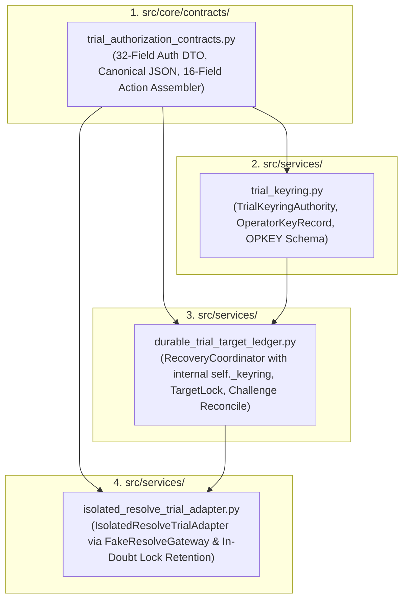
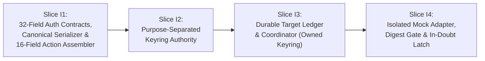

# KẾ HOẠCH TRIỂN KHAI LÁT CẮT THI CÔNG MÔ PHỎNG CÔ LẬP G07-07B6-I
*(Finite Mock-Only Implementation Plan: Strict Contract Mapping, Keyring Authority, Durable Target Ledger & Isolated Trial Adapter)*

- **MÃ TÀI LIỆU:** `docs/architecture/07B6-mock-only-implementation-plan.md`
- **TASK_ID:** `G07-07B6-PLAN-D`
- **PARENT GATE:** `G07` (Automated Acceptance Gate, Live Resolve Canary Validation, and Milestone Sign-off)
- **CẤP ĐỘ WORKER:** `HIGH`
- **CHẾ ĐỘ:** `DESIGN_ONLY_IMPLEMENTATION_PLANNING`
- **TRẠNG THÁI:** `PLANNING_SUBMITTED_FOR_REVIEW_V3`
- **THỜI ĐIỂM THIẾT LẬP:** 2026-11-03T05:22:00+07:00
- **TÁC GIẢ:** Antigravity (Pair Programming cùng Tech Lead Codex)
- **VĂN BẢN THAM CHIẾU & CĂN CỨ KIẾN TRÚC:**
  - Thiết kế kiến trúc tổng thể chấp nhận: [`docs/architecture/07B5-isolated-resolve-acceptance-gate-design.md`](file:///media/vanntruongg/Documents/Development/Python/dự%20án%20cá%20nhân/ResolveFlow-Assistant/docs/architecture/07B5-isolated-resolve-acceptance-gate-design.md) (SHA-256: `e3dc16133e68648535f64dfc03592ed2f449ff6ae50438605e09d7f074df2132`).
  - Đánh giá thẩm định kế hoạch của Codex V1: [`docs/architecture/07B6-PLAN-D-code-review.md`](file:///media/vanntruongg/Documents/Development/Python/dự%20án%20cá%20nhân/ResolveFlow-Assistant/docs/architecture/07B6-PLAN-D-code-review.md) (`CHANGES_REQUIRED`, SHA-256: `8f1ce6e3324143cfa5f96e83a0b87f037288601224007f09359a58cc231fc822`).
  - Đánh giá thẩm định kế hoạch của Codex V2: [`docs/architecture/07B6-PLAN-D-R1-code-review.md`](file:///media/vanntruongg/Documents/Development/Python/dự%20án%20cá%20nhân/ResolveFlow-Assistant/docs/architecture/07B6-PLAN-D-R1-code-review.md) (`CHANGES_REQUIRED`, SHA-256: `435a35fe8c32dc18761a19c109dc19c9256a228b414167222ae0e00b13ab94bc`).
  - Văn bản nghiệm thu thiết kế trước: [`docs/architecture/07B5-D-R48-code-review.md`](file:///media/vanntruongg/Documents/Development/Python/dự%20án%20cá%20nhân/ResolveFlow-Assistant/docs/architecture/07B5-D-R48-code-review.md) (`ACCEPTED`, SHA-256: `dc39ee25c013092a61849d7aaf6363f5d804c11eb459711ab329c13bd3ae23af`).
  - Workorder chỉ đạo nhiệm vụ: [`.bridge/task.md`](file:///media/vanntruongg/Documents/Development/Python/dự%20án%20cá%20nhân/ResolveFlow-Assistant/.bridge/task.md) (`G07-07B6-PLAN-D`, SHA-256: `67e671a041228d3db388d6c87f489de516d07be91519ac23e6a2186803b44871`).
  - Hợp đồng duyệt đề xuất: [`src/core/contracts/edit_plan_approval_contracts.py`](file:///media/vanntruongg/Documents/Development/Python/dự%20án%20cá%20nhân/ResolveFlow-Assistant/src/core/contracts/edit_plan_approval_contracts.py).
  - Hợp đồng biên bản thi công: [`src/core/contracts/execution_receipt_contracts.py`](file:///media/vanntruongg/Documents/Development/Python/dự%20án%20cá%20nhân/ResolveFlow-Assistant/src/core/contracts/execution_receipt_contracts.py).
  - Dịch vụ nhật ký WAL: [`src/services/execution_journal_service.py`](file:///media/vanntruongg/Documents/Development/Python/dự%20án%20cá%20nhân/ResolveFlow-Assistant/src/services/execution_journal_service.py).
  - Động cơ thực thi WAL: [`src/services/resolve_execution_engine.py`](file:///media/vanntruongg/Documents/Development/Python/dự%20án%20cá%20nhân/ResolveFlow-Assistant/src/services/resolve_execution_engine.py).

---

## 1. MỤC TIÊU & RANH GIỚI BẢO VỆ CỐT LÕI (OBJECTIVE & HARD SAFETY BOUNDARIES)

### 1.1. Mục Tiêu Kế Hoạch
Kế hoạch này chuyển đổi phạm vi kiến trúc đã được Tech Lead Codex phê duyệt tại Mục 6.2 của tài liệu `07B5-isolated-resolve-acceptance-gate-design.md` thành một kế hoạch thi công mô phỏng thuần túy (**MOCK-ONLY**) hữu hạn, có căn cứ mã nguồn vững chắc, giải quyết triệt để 2 phát hiện tại review `07B6-PLAN-D-R1`:
1. **B6-R1-01:** Định nghĩa đầy đủ DTO `TrialExecutionAuthorization` 32 trường chuẩn tắc khớp 100% với Section 2.3 của `07B5`. Ràng buộc Adapter phải thực thi chuỗi tiền điều phối bắt buộc qua `coordinator.bind_signed_authorization()` trước khi lắp ráp payload hoặc dispatch.
2. **B6-R1-02:** Phân tách rạch ròi hai pha xử lý lỗi: Tiền điều phối (pre-dispatch clean rejection, 0 WAL pending, giải phóng khóa an toàn) và Hậu điều phối (post-dispatch gateway exception, ghi `ACTION_FAILED` với ngữ nghĩa in-doubt `TERMINAL_ACTION_FAILED_IN_DOUBT`, bắt buộc **GIỮ NGUYÊN KHÓA LOẠI TRỪ MỤC TIÊU** `IN_DOUBT_LOCKED`, nghiêm cấm giải phóng khóa hay kết thúc sạch nếu thiếu hòa giải operator).
3. **B6-R1-03:** Căn chỉnh số lượng ca kiểm thử chính xác tuyệt đối: đúng **23 ca kiểm thử** phân bổ minh bạch qua 4 module (I1: 5 ca, I2: 5 ca, I3: 7 ca, I4: 6 ca).

### 1.2. Ranh Giới An Toàn Cốt Lõi (Hard Safety & Scope Limits)
1. **CHỈ LẬP KẾ HOẠCH (PLANNING ONLY):** Nhiệm vụ `G07-07B6-PLAN-D` tuyệt đối **KHÔNG CẤP QUYỀN THI CÔNG CODE**. Nghiêm cấm chỉnh sửa bất kỳ tệp tin nào trong `src/` và `tests/`.
2. **ZERO THỰC THI (ZERO PROHIBITED EXECUTION):** Không chạy pytest, không chạy prototype validator, không chạy ứng dụng ResolveFlow, DaVinci Resolve, IPC, FusionScript, các mô hình AI hoặc mạng bên ngoài.
3. **BẢO TỒN NGUYÊN TRẠNG TRIPWIRE MOCK-ONLY:** Giữ nguyên 100% `ENGINE_MODE = "MOCK_ONLY"` và cơ chế tripwire `_validate_mock_gateway_admission()` trong `ResolveExecutionEngine`. Không đấu nối adapter vào giao diện người dùng (UI) hay luồng điều phối sản xuất.
4. **BẢO TỒN TRẠNG THÁI CỔNG:** Tiếp tục duy trì `ready_to_execute=False`; Gate G07 cùng Milestones M1, M2, M3 giữ trạng thái **MỞ (OPEN)**.
5. **KHÔNG ỦY QUYỀN CANARY THẬT:** Tuyệt đối không quy hoạch hoặc kích hoạt can thiệp vào DaVinci Resolve thật trong kế hoạch này. Mốc thử nghiệm canary trực tiếp (`G07-07B7-LIVE`) là một nhiệm vụ tách biệt trong tương lai, bắt buộc phải có sự chấp thuận bằng văn bản rõ ràng từ người dùng.
6. **BẢO TOÀN TRẠNG THÁI GIT:** Bảo tồn nguyên vẹn 100% tất cả các tệp uncommitted, modified và untracked hiện hữu. Không thực hiện git commit, push, reset, clean, hoặc stash.

---

## 2. ÁNH XẠ PHẠM VI MÃ NGUỒN SẢN XUẤT & ĐẶC TẢ GIAO DIỆN CÔNG KHAI (PRODUCTION SCOPE & PUBLIC API MAPPING)

Phạm vi sản xuất của lát cắt thi công `G07-07B6-I` được giới hạn nghiêm ngặt trong **chính xác 4 module mới**:



---

### 2.1. Module 1: `src/core/contracts/trial_authorization_contracts.py`

- **Trách nhiệm kiến trúc:** Định nghĩa các DTO bất biến, kiểu dữ liệu chuẩn tắc, bộ tiền quét cú pháp từ vựng JSON, bộ chuyển đổi JSON chuẩn tắc loại bỏ trùng lặp khóa, bộ lắp ráp chuẩn tắc 16 khóa `assemble_canonical_action_payload`, và hệ thống mã lỗi chuẩn tắc.
- **Dependencies bên ngoài:** `dataclasses`, `typing`, `json`, `re`, `hashlib`. (Zero internal project dependencies).
- **Hệ thống Mã Lỗi & Lớp Ngoại Lệ (Error Taxonomy):**
  - `AcceptanceGateError(Exception)`: Lớp cơ sở cho toàn bộ lỗi cổng chấp thuận.
  - `StrictJsonParseError(AcceptanceGateError)`: Lỗi phân tích cú pháp JSON nghiêm ngặt hoặc trùng lặp khóa (`ERR_DUPLICATE_JSON_KEY`, `ERR_CANONICAL_PARSE_FAILED`, `ERR_JSON_PRE_PARSE_VIOLATION`).
  - `TargetExclusionLockError(AcceptanceGateError)`: Lỗi khóa độc quyền mục tiêu.
  - `WholePlanReconciliationError(AcceptanceGateError)`: Lỗi hòa giải trạng thái mục tiêu (`ERR_EXECUTION_IDENTITY_MISMATCH`, `ERR_EXECUTION_NONCE_MISMATCH`, `ERR_ACTION_DIGEST_MISMATCH`).
  - `ReadbackReceiptVerificationError(AcceptanceGateError)`: Lỗi thẩm định payload và schema hành động (`ERR_ACTION_PAYLOAD_NOT_DICT`, `ERR_ACTION_PAYLOAD_SCHEMA_MISMATCH`, `ERR_ACTION_PAYLOAD_TYPE_GATE`, `ERR_ACTION_PAYLOAD_RANGE`, `ERR_INVALID_ACTION_OBJECT`, `ERR_AUTH_KEY_NOT_FOUND_OR_REVOKED`, `ERR_SIGNED_AUTH_HMAC_INVALID`).
  - `TargetLockReleaseError(AcceptanceGateError)`: Lỗi giải phóng khóa mục tiêu tại nhân hệ điều hành.
- **Hợp Đồng Dữ Liệu: Chứng Thư 32 Trường Chuẩn Tắc (B6-R1-01):**
  - `@dataclass(frozen=True) class TrialExecutionAuthorization`:
    - *1. Định danh chứng thư & Khóa:* `authorization_id: str`, `key_id: str`.
    - *2. Ràng buộc ý chí & đề xuất sáng tạo:* `operator_gesture_digest_sha256: str`, `approval_record_id: str`, `approval_record_digest_sha256: str`, `proposal_id: str`, `proposal_revision: str`, `proposal_content_digest_sha256: str`, `plan_idempotency_key: str`, `plan_digest_sha256: str`, `action_payload_digest_sha256: str`.
    - *3. Ràng buộc mục tiêu vật lý Resolve:* `target_project_uid: str`, `target_project_name: str`, `target_timeline_uid: str`, `target_timeline_name: str`, `target_timeline_fps_numerator: int`, `target_timeline_fps_denominator: int`.
    - *4. Ràng buộc khung hình quan sát & cấp phép:* `observed_timeline_start_frame: int`, `authorized_record_frame: int`.
    - *5. Ràng buộc tệp tin nguồn:* `source_file_path: str`, `source_file_sha256: str`.
    - *6. Phạm vi hành động hạn chế duy nhất:* `authorized_action_type: str`, `authorized_track_type: str`, `authorized_track_index: int`, `authorized_timeline_frame_start: int`, `authorized_timeline_frame_duration: int`, `authorized_source_frame_start: int`, `authorized_source_frame_duration: int`.
    - *7. Vòng đời & toàn vẹn mật mã:* `execution_id: str`, `issued_at_iso: str`, `valid_until_iso: str`, `token_nonce: str`, `authorization_hmac: str`.
- **Các DTO Bổ Trợ Bất Biến:**
  - `OperatorConsentGesture`: DTO ghi nhận thao tác xác nhận của điều hành viên (`gesture_id`, `operator_identity`, `gesture_type`, `confirmed_at_iso`, `client_nonce`).
  - `TrialIdentityEnvelope`: DTO phong bì danh tính thử nghiệm nhúng vào WAL (`authorization_id`, `execution_id`, `target_project_uid`, `target_timeline_uid`, `plan_idempotency_key`).
  - `AuthorizationContract`: DTO đại diện cho chứng thư đã được xác thực qua Coordinator (`approval_id`, `execution_id`, `record_frame`, `duration_frames`, `raw_auth`).
  - `TrialExecutionReceipt`: DTO biên bản thi công bao bọc trạng thái cuối cùng.
  - `ReconciliationChallenge`: DTO thử thách hòa giải (`timeline_uid`, `incident_id`, `challenge_nonce`, `issued_at`, `expires_at`).
  - `OperatorReconciliationAuthorization`: DTO ủy quyền hòa giải đã ký của điều hành viên (`timeline_uid`, `incident_id`, `challenge_nonce`, `challenge_expires_at`, `operator_key_id`, `operator_identity`, `operator_confirmation_statement`, `confirmed_unlocked`, `signature_hmac`).
- **Bộ Lắp Ráp & Tuần Tự Hóa Chuẩn Tắc 16 Khóa (B6-PLAN-02):**
  - `CANONICAL_ACTION_PAYLOAD_KEYS = frozenset({"action_index", "action_type", "authorization_id", "duration_frames", "execution_id", "plan_idempotency_key", "record_frame", "role", "schema_version", "source_frame_duration", "source_frame_start", "source_path", "target_project_uid", "target_timeline_uid", "track_index", "track_type"})`
  - `assemble_canonical_action_payload(action: PlannedTimelineAction, auth: TrialExecutionAuthorization, execution_id: str) -> dict[str, Any]`: Lắp ráp duy nhất và bắt buộc, kiểm tra execution identity binding và type gates trên 16 trường.
  - `canonical_action_payload_bytes(params: Mapping[str, Any]) -> bytes`: Tuần tự hóa JSON chuẩn tắc RFC 8785 của 16 khóa với type gates nghiêm ngặt.
  - `canonical_bytes_for_auth_hmac(auth: TrialExecutionAuthorization) -> bytes`: Tuần tự hóa 32 trường đầu tiên của chứng thư để tính và xác thực HMAC.
- **Hàm Tiền Quét & Giải Mã JSON:**
  - `validate_json_structure_pre_parse(raw_bytes: bytes, max_bytes: int = 65536) -> str`: Tiền quét từ vựng văn phạm, kiểm tra độ dài chuỗi (max 8192 chars), độ lồng (max 16 cấp), số nút (max 512 nodes), chặn đứng bùng nổ parser.
  - `reject_duplicate_json_keys(ordered_pairs: list[tuple[str, Any]]) -> dict[str, Any]`: Hook phát hiện và chặn đứng mọi khóa JSON trùng lặp.
  - `parse_strict_canonical_json(raw_bytes: bytes, max_bytes: int = 65536) -> dict[str, Any]`: Giải mã JSON chuẩn tắc hai lớp phòng vệ.
  - `canonical_json_dumps(data: Any) -> bytes`: Tuần tự hóa JSON chuẩn tắc RFC 8785.

---

### 2.2. Module 2: `src/services/trial_keyring.py`

- **Trách nhiệm kiến trúc:** Quản lý kho lưu trữ khóa mật mã trên hệ thống tệp cục bộ, neo giữ thư mục bằng file descriptor, phân tách không gian mục đích khóa (purpose separation), kiểm tra schema nghiêm ngặt cho tệp `*.opkey.json`, loại bỏ trùng lặp khóa và thực thi giới hạn entropy mật mã.
- **Dependencies:** `src/core/contracts/trial_authorization_contracts.py`, `os`, `stat`, `json`, `re`, `secrets`.
- **Hằng Số Kiến Trúc:**
  - `REQUIRED_OPKEY_SCHEMA_KEYS = frozenset({"key_hex", "permitted_operator_identity", "purpose"})`
  - `ALLOWED_OPKEY_PURPOSES = frozenset({"TIMELINE_AMBIGUOUS_RECONCILIATION"})`
  - `MIN_OPERATOR_KEY_BYTES = 32` (256-bit entropy tối thiểu).
  - `MAX_OPERATOR_KEY_BYTES = 64` (512-bit entropy tối đa).
- **Hợp Đồng Dữ Liệu:**
  - `OperatorKeyRecord`: DTO bản ghi khóa điều hành viên (`key_id: str`, `key_bytes: bytes`, `permitted_operator_identity: str`, `key_purpose: str`).
- **Lớp & Giao Diện Công Khai (Public API):**
  - `reject_opkey_duplicate_json_keys(ordered_pairs: list[tuple[str, Any]]) -> dict[str, Any]`: Chặn đứng trùng lặp thuộc tính JSON trong hồ sơ khóa điều hành (R47-01), ném `ERR_OPKEY_DUPLICATE_FIELD`.
  - `class TrialKeyringAuthority`:
    - `__init__(keystore_path: str)`: Neo thư mục qua descriptor (`O_RDONLY | O_DIRECTORY | O_NOFOLLOW | O_CLOEXEC`), kiểm duyệt quyền sở hữu (`uid == getuid()`) và quyền truy cập (`0700` cho thư mục, `0600` cho từng tệp tệp khóa), cấm hardlink (`nlink == 1`), kiểm tra dung lượng ổn định (`fstat`).
    - `get_key(key_id: str) -> bytes`: Truy xuất khóa ký trial tiêu chuẩn. Ném `ERR_AUTH_KEY_NOT_FOUND` hoặc `ERR_AUTH_KEY_REVOKED`.
    - `get_operator_key(key_id: str) -> OperatorKeyRecord`: Truy xuất khóa điều hành hòa giải. Từ chối khóa trial thông thường với `ERR_TRIAL_KEY_NOT_PERMITTED_FOR_RECONCILIATION`. Ném `ERR_UNKNOWN_OPERATOR_KEY_ID` hoặc `ERR_OPERATOR_KEY_REVOKED`.
    - `revoke_key(key_id: str) -> None`: Thu hồi khóa.

---

### 2.3. Module 3: `src/services/durable_trial_target_ledger.py`

- **Trách nhiệm kiến trúc:** Quản lý sổ cái mục tiêu bền vững và điều phối vòng đời khóa mục tiêu cấp OS, bảo đảm loại trừ tương tranh (`fcntl.flock`), duy trì chốt khóa thiết bị đầu cuối `CLOSE_OUTCOME_UNKNOWN`, cổng tiền tiếp nhận (pre-admission gate), và giao thức hòa giải ràng buộc thử thách (challenge-bound reconciliation).
- **Quyền Sở Hữu Keyring Nội Bộ Độc Quyền (B6-PLAN-01):**
  - `RecoveryCoordinator` nhận đường dẫn `keystore_path: str` và **TỰ TẠO** instance `TrialKeyringAuthority(keystore_path)` làm thuộc tính riêng tư `self._keyring`.
  - Tuyệt đối cấm caller truyền `keyring: TrialKeyringAuthority` vào constructor của `RecoveryCoordinator`.
- **Dependencies:** `src/core/contracts/trial_authorization_contracts.py`, `src/services/trial_keyring.py`, `os`, `fcntl`, `hashlib`, `hmac`, `math`, `time`, `threading`.
- **Hằng Số & Lớp Lỗi:**
  - `MIN_CHALLENGE_TTL_SECONDS = 1.0`
  - `MAX_CHALLENGE_TTL_SECONDS = 300.0`
  - `class CoordinatorInitCleanupError(WholePlanReconciliationError)`: Ngoại lệ dọn dẹp khi khởi tạo coordinator thất bại, mang theo ánh xạ descriptor chưa đóng và phương thức `retry_cleanup()`.
- **Hợp Đồng Dữ Liệu:**
  - `TargetLockEntry`: Trạng thái entry (`fd: Optional[int]`, `filename: str`, `state: str`, `dev: int`, `ino: int`, `incident_id: Optional[str]`, `active_challenge_nonce: Optional[str]`, `challenge_expires_at: Optional[float]`).
- **Lớp & Giao Diện Công Khai (Public API):**
  - `class DurableTrialTargetLedger`: Quản lý sổ cái trên đĩa với khóa nguyên tử đa tiến trình `fcntl.flock(LOCK_EX)`.
  - `class RecoveryCoordinator`:
    - `__init__(journals_dir: str, receipts_dir: str, locks_dir: str, ledgers_dir: str, keystore_path: str)`: Khởi tạo an toàn, tự tạo `self._keyring = TrialKeyringAuthority(keystore_path)`.
    - `acquire_target_lock(timeline_uid: str) -> TargetLockEntry`:
      - **Cổng tiền tiếp nhận (Pre-admission gate under lock):** Kiểm tra trạng thái timeline trong registry. Nếu đang là `CLOSE_OUTCOME_UNKNOWN`, `IN_DOUBT_LOCKED`, hoặc `LOCKED`, lập tức từ chối TRƯỚC KHI gọi `os.open()` (0 descriptor touches).
      - Mở tệp an toàn qua descriptor (`O_RDWR | O_CREAT | O_NOFOLLOW | O_CLOEXEC`, mode `0600`).
      - Chiếm giữ khóa hạt nhân `fcntl.flock(fd, LOCK_EX | LOCK_NB)`.
    - `release_target_lock(timeline_uid: str) -> None`:
      - Mở khóa (`fcntl.flock(LOCK_UN)`) trước, đóng tệp (`os.close(fd)`) sau.
      - **Bảo toàn loại trừ hạt nhân khi unlock thất bại (R39-01):** Nếu `flock(LOCK_UN)` ném lỗi, giữ nguyên descriptor mở và kernel lock, ném `TargetLockReleaseError`.
      - **Chốt trạng thái không rõ ràng (Single-Close Guarantee - R42-01):** Nếu `os.close(fd)` thất bại hoặc không xác định, chốt trạng thái `CLOSE_OUTCOME_UNKNOWN`, xóa `entry.fd = None` (tuyệt đối không retry close trên descriptor đã đóng), đăng ký `incident_id`.
    - `bind_signed_authorization(signed_auth: TrialExecutionAuthorization) -> AuthorizationContract`:
      - Xác thực 32 trường DTO, xác minh `signed_auth.execution_id == signed_auth.token_nonce`.
      - Tra vấn khóa `trusted_key = self._keyring.get_key(signed_auth.key_id)` (từ chối khóa chưa nạp hoặc đã bị thu hồi).
      - Tính toán và xác minh `calc_hmac = hmac.new(trusted_key, canonical_bytes_for_auth_hmac(signed_auth), hashlib.sha256).hexdigest()`. Khớp `hmac.compare_digest()`.
      - Kiểm tra thời hạn: `issued_at_iso <= now <= valid_until_iso`.
      - Khởi tạo và trả về `AuthorizationContract`.
    - `has_target_lock(timeline_uid: str) -> bool`: Kiểm tra timeline đang có khóa độc quyền hợp lệ trong tiến trình.
    - `mark_timeline_in_doubt(timeline_uid: str, incident_id: str) -> None`: Chuyển timeline sang trạng thái `IN_DOUBT_LOCKED` khi gặp sự cố hậu điều phối, cấm mở khóa tự động (B6-R1-02).
    - `request_reconciliation_challenge(timeline_uid: str, ttl_seconds: float = 60.0) -> ReconciliationChallenge`:
      - Xác thực `ttl_seconds`: bắt buộc số thực/nguyên hữu hạn không phải bool trong phạm vi `1.0 <= ttl <= 300.0`.
      - Phát hành thử thách mới gắn với `incident_id`.
    - `reconcile_ambiguous_timeline(authorization: OperatorReconciliationAuthorization) -> None`:
      - Thẩm định 8 tiêu chí an ninh qua `self._keyring` nội bộ: nonce thử thách, TTL, khóa điều hành từ keystore, mục đích `TIMELINE_AMBIGUOUS_RECONCILIATION`, danh tính `permitted_operator_identity`, `confirmed_unlocked is True`, HMAC-SHA256 hợp lệ.
      - Hủy ngay nonce sau thẩm định (chống replay). Chuyển timeline sang `RELEASED` mà không đụng chạm descriptor cũ (`entry.fd is None`).

---

### 2.4. Module 4: `src/services/isolated_resolve_trial_adapter.py`

- **Trách nhiệm kiến trúc:** Cung cấp adapter thử nghiệm cô lập đóng vai trò cầu nối giữa `ResolveExecutionEngine` và cổng giả lập `FakeResolveGateway`. Ngăn chặn hoàn toàn rò rỉ lệnh ra ngoài Resolve thật, phối hợp ghi nhận phong bì thử nghiệm vào `ExecutionJournalService`, bắt buộc kiểm tra digest payload 16 khóa trước khi dispatch, và bảo vệ trạng thái in-doubt khi gặp lỗi hậu điều phối.
- **Không Tiếp Nhận Keyring Độc Lập (B6-PLAN-01):**
  - Adapter chỉ nhận `coordinator: RecoveryCoordinator`, `journal: ExecutionJournalService`, `fake_gateway: FakeResolveGateway`.
  - Adapter sử dụng trực tiếp cổng xác thực của `RecoveryCoordinator`, hoàn toàn không nhận vật liệu khóa hay trust store tách rời từ caller.
- **Quy Trình Tiền Điều Phối Bắt Buộc (Mandatory Pre-Dispatch Sequence - B6-R1-01):**
  1. Kiểm tra tripwire mock-only trên `FakeResolveGateway`.
  2. Bắt buộc gọi `bound_contract = self._coordinator.bind_signed_authorization(authorization)`. Thao tác này xác minh HMAC 32 trường, kiểm tra thu hồi khóa, tính hợp lệ của timestamp và execution identity.
  3. Kiểm tra `self._coordinator.has_target_lock(authorization.target_timeline_uid)`.
  4. Lắp ráp payload 16 khóa: `payload = assemble_canonical_action_payload(action, authorization, execution_id=authorization.execution_id)`.
  5. Tính toán `payload_digest = hashlib.sha256(canonical_action_payload_bytes(payload)).hexdigest()`.
  6. So sánh `payload_digest == authorization.action_payload_digest_sha256`. Nếu sai lệch, ném `WholePlanReconciliationError("ERR_ACTION_DIGEST_MISMATCH")` và tuyệt đối 0 dispatch tới gateway.
  7. Ghi nhận `START` và `ACTION_PENDING` vào WAL kèm `TrialIdentityEnvelope`.
- **Phân Tách Xử Lý Lỗi Tiền / Hậu Điều Phối (Strict Pre vs Post Dispatch Failure Handling - B6-R1-02):**
  - **Lỗi Tiền Điều Phối (Pre-Dispatch Failure):** Bất kỳ lỗi nào xảy ra trước khi ghi `ACTION_PENDING` (chứng thư sai, chữ ký HMAC không khớp, khóa bị thu hồi, sai lệch digest, action geometry không hợp lệ) $\rightarrow$ ghi nhận từ chối tiền điều phối, 0 ghi WAL PENDING, 0 dispatch gateway; giải phóng khóa mục tiêu an toàn nếu đã acquire trước đó.
  - **Lỗi Hậu Điều Phối (Post-Dispatch Gateway Exception):** Sau khi `ACTION_PENDING` đã được ghi vào WAL và lệnh đã phát đi tới gateway, nếu gateway ném ngoại lệ hoặc timeout $\rightarrow$
    - Ghi nhận `ACTION_FAILED` vào WAL.
    - **TUYỆT ĐỐI CẤM GIẢI PHÓNG KHÓA MỤC TIÊU (PROHIBIT UNLOCK):** Gọi `self._coordinator.mark_timeline_in_doubt(timeline_uid, incident_id)` để chốt trạng thái `IN_DOUBT_LOCKED`.
    - Kết quả bị phân loại là `TERMINAL_ACTION_FAILED_IN_DOUBT`.
    - Tuyệt đối không ghi bản ghi hoàn tất sạch (`FINISH`), không cho phép thử lại (no retry) hoặc tiếp nhận hành động mới nếu chưa qua hòa giải hợp lệ của điều hành viên qua `reconcile_ambiguous_timeline()`.
- **Dependencies:** `src/core/contracts/trial_authorization_contracts.py`, `src/services/durable_trial_target_ledger.py`, `src/services/execution_journal_service.py`, `src/core/timeline_plan_execution_binder.py`.
- **Lớp & Giao Diện Công Khai (Public API):**
  - `class FakeResolveGateway`: Cổng giả lập đáp ứng đầy đủ `ResolveGatewayClientProtocol`, sở hữu cờ đánh dấu `_is_approved_mock_gateway = True`, tuyệt đối không có thuộc tính `_automation` hay `resolve`.
  - `class IsolatedResolveTrialAdapter`:
    - `__init__(coordinator: RecoveryCoordinator, journal: ExecutionJournalService, fake_gateway: FakeResolveGateway)`: Khởi tạo và thiết lập tripwire mock-only.
    - `validate_mock_tripwire() -> bool`: Kiểm tra tripwire ngăn chặn kết nối live Resolve.
    - `execute_isolated_action(action: PlannedTimelineAction, authorization: TrialExecutionAuthorization) -> dict`: Thực thi chu trình an toàn theo đúng quy trình tiền điều phối và phân tách hậu điều phối nêu trên.

---

## 3. PHÂN CHIA 4 LÁT CẮT THI CÔNG ĐỘC LẬP (FOUR FINITE IMPLEMENTATION SLICES)

Quy trình thi công `G07-07B6-I` được phân rã thành **4 lát cắt tuần tự**, mỗi lát cắt có ranh giới tệp rõ ràng và bộ test độc lập:



### 3.1. Lát cắt I1: `G07-07B6-I1` — Data Contracts & Canonical Serializer
- **Tập tin sản xuất:** `src/core/contracts/trial_authorization_contracts.py`.
- **Tập tin kiểm thử:** `tests/core/contracts/test_trial_authorization_contracts.py`.
- **Mục tiêu:** Xây dựng toàn bộ các Frozen DTOs bao gồm `TrialExecutionAuthorization` 32 trường đầy đủ, cấu trúc lỗi, tiền quét cú pháp từ vựng, hook chặn trùng lặp khóa JSON, bộ lắp ráp 16 khóa `assemble_canonical_action_payload`, hàm tuần tự hóa HMAC `canonical_bytes_for_auth_hmac()`, và bộ serializer chuẩn tắc RFC 8785.
- **Tiêu chí nghiệm thu độc lập:**
  - 100% Frozen DTOs không thể đột biến thuộc tính sau khởi tạo (`FrozenInstanceError`).
  - `TrialExecutionAuthorization` bảo toàn đúng và đủ 32 trường dữ liệu đã ký.
  - Tiền quét từ vựng từ chối chuỗi quá 64 KiB, mảng/dict vượt ngưỡng 512 phần tử, độ sâu đệ quy $> 16$.
  - Hook `reject_duplicate_json_keys` ném `StrictJsonParseError` khi gặp khóa trùng lặp.
  - Bộ lắp ráp 16 khóa từ chối thiếu/thừa trường, ép kiểu số nguyên loại trừ bool, kiểm tra range hợp lệ.
  - Serializer chuẩn tắc đảm bảo tính tất định từng byte.

### 3.2. Lát cắt I2: `G07-07B6-I2` — Purpose-Separated Keyring Authority
- **Tập tin sản xuất:** `src/services/trial_keyring.py`.
- **Tập tin kiểm thử:** `tests/services/test_trial_keyring.py`.
- **Mục tiêu:** Xây dựng `TrialKeyringAuthority` với neo giữ thư mục qua descriptor, phân tách khóa trial và khóa operator, thẩm định schema `*.opkey.json` chặt chẽ, loại bỏ trùng lặp khóa (R47-01), và kiểm tra ranh giới entropy 32–64 bytes (R46-02).
- **Tiêu chí nghiệm thu độc lập:**
  - Từ chối thư mục có quyền khác `0700` hoặc tệp có quyền khác `0600`.
  - Phân tách rạch ròi: gọi `get_operator_key()` với trial key bị từ chối `ERR_TRIAL_KEY_NOT_PERMITTED_FOR_RECONCILIATION`.
  - Khóa operator thiếu/thừa trường hoặc kiểu sai bị từ chối ngay lập tức.
  - Khóa operator chứa khóa JSON trùng lặp bị từ chối với `ERR_OPKEY_DUPLICATE_FIELD` và không được nạp vào bộ nhớ.
  - Khóa có entropy 31 bytes hoặc 65 bytes bị từ chối; 32 bytes và 64 bytes được chấp nhận.

### 3.3. Lát cắt I3: `G07-07B6-I3` — Durable Target Ledger & Locking Coordinator
- **Tập tin sản xuất:** `src/services/durable_trial_target_ledger.py`.
- **Tập tin kiểm thử:** `tests/services/test_durable_trial_target_ledger.py`.
- **Mục tiêu:** Xây dựng `DurableTrialTargetLedger` và `RecoveryCoordinator` sở hữu `TrialKeyringAuthority` nội bộ (B6-PLAN-01), phương thức xác thực `bind_signed_authorization` trên 32 trường HMAC (B6-R1-01), thực thi loại trừ tương tranh hạt nhân, chốt trạng thái `CLOSE_OUTCOME_UNKNOWN` thiết bị đầu cuối với `fd=None`, cổng tiền tiếp nhận không chạm descriptor, và giao thức hòa giải ràng buộc thử thách với TTL giới hạn.
- **Tiêu chí nghiệm thu độc lập:**
  - Khởi tạo coordinator nhận `keystore_path` và tự tạo `self._keyring`; từ chối nếu caller cố inject keyring instance ngoài luồng.
  - `bind_signed_authorization` xác thực thành công chứng thư 32 trường hợp lệ và từ chối fail-closed nếu sai lệch HMAC, khóa bị thu hồi hoặc quá hạn validity window.
  - Pre-admission gate chặn acquire trên timeline bị lockout với đúng 0 lần gọi `os.open()`.
  - Hai coordinator cạnh tranh trên cùng timeline bị chặn bởi `flock(LOCK_EX | LOCK_NB)`.
  - Lỗi khi mở khóa bảo toàn live descriptor và kernel exclusion.
  - Lỗi khi đóng tệp chốt `CLOSE_OUTCOME_UNKNOWN`, xóa `entry.fd = None`, cấm retry close.
  - Thử thách hòa giải xác thực TTL hữu hạn (`1.0 <= ttl <= 300.0`), chặn đứng NaN, inf, boolean.
  - Hòa giải thành công bằng chữ ký hợp lệ chuyển trạng thái sang `RELEASED` mà không chạm descriptor cũ.

### 3.4. Lát cắt I4: `G07-07B6-I4` — Isolated Mock-Only Trial Adapter & Integration
- **Tập tin sản xuất:** `src/services/isolated_resolve_trial_adapter.py`.
- **Tập tin kiểm thử:** `tests/services/test_isolated_resolve_trial_adapter.py`.
- **Mục tiêu:** Xây dựng `IsolatedResolveTrialAdapter` và `FakeResolveGateway` tích hợp trọn vẹn 3 module trên với `ExecutionJournalService`, thực thi chuỗi tiền điều phối bắt buộc qua `bind_signed_authorization` và digest action gate (B6-R1-01), phân tách rạch ròi lỗi tiền điều phối và lỗi hậu điều phối giữ nguyên khóa độc quyền `IN_DOUBT_LOCKED` (B6-R1-02), trên môi trường mock 100%.
- **Tiêu chí nghiệm thu độc lập:**
  - Constructor không nhận keyring; chỉ nhận `coordinator`, `journal`, `fake_gateway`.
  - Bắt buộc gọi `bind_signed_authorization` và `assemble_canonical_action_payload` trước dispatch; sai lệch digest $\rightarrow$ từ chối tiền điều phối, 0 dispatch, 0 WAL pending, giải phóng khóa sạch.
  - Gateway ném ngoại lệ hậu điều phối $\rightarrow$ ghi nhận `ACTION_FAILED`, chốt `IN_DOUBT_LOCKED`, cấm nhả khóa, cấm kết thúc sạch, chặn đứng re-admission nếu chưa hòa giải.
  - Toàn bộ chu trình thi công diễn ra mà không có bất kỳ lệnh gọi Resolve IPC nào ra ngoài tiến trình.

---

## 4. MA TRẬN NHÓM KIỂM THỬ HỮU HẠN ĐỐI CHIẾU CHUẨN XÁC 23 CA (EXACT 23-CASE ACCEPTANCE TEST MATRIX - B6-R1-03)

Ma trận dưới đây phân nhóm chính xác **đúng 23 ca kiểm thử** được đánh mã tường minh, phân bổ rành mạch cho 4 module:
- **Module I1:** 5 ca (`I1-G1` đến `I1-G5`).
- **Module I2:** 5 ca (`I2-G1` đến `I2-G5`).
- **Module I3:** 7 ca (`I3-G1` đến `I3-G7`).
- **Module I4:** 6 ca (`I4-G1` đến `I4-G6`).
- **Tổng cộng:** $5 + 5 + 7 + 6 = 23$ ca kiểm thử.

| Mã Ca | Module / Lát cắt | Tên Kịch Bản Kiểm Thử | Dữ Liệu Đầu Vào & Điều Kiện Kích Hoạt | Kết Quả Kỳ Vọng & Mã Lỗi Chuẩn Tắc | Mục Tiêu Rà Soát Kiến Trúc |
| :---: | :--- | :--- | :--- | :--- | :--- |
| **I1-G1** | I1: Contracts | DTO Immutability & Valid Serialization | Tạo DTO hợp lệ, chuyển đổi sang canonical JSON và parse ngược lại. | Trùng khớp từng byte, DTO không thể mutate thuộc tính (`FrozenInstanceError`). | Đảm bảo tính toàn vẹn dữ liệu hợp đồng. |
| **I1-G2** | I1: Contracts | Pre-Parse Lexical Bounds Rejection | Chuỗi JSON $> 64$ KiB hoặc cấu trúc lồng nhau $> 16$ cấp. | Bị từ chối tại tiền quét với `ERR_JSON_PRE_PARSE_VIOLATION` trước khi gọi decoder. | Chống tấn công làm tràn bộ nhớ parser. |
| **I1-G3** | I1: Contracts | Duplicate JSON Field Rejection | JSON chứa 2 trường trùng tên `{"a": 1, "a": 2}`. | Bị từ chối với `ERR_DUPLICATE_JSON_KEY`. | Chống bất đối xứng ngữ nghĩa parser (RFC 8259). |
| **I1-G4** | I1: Contracts | 16-Key Action Assembler & Type Gates | Lắp ráp payload từ `PlannedTimelineAction` và `TrialExecutionAuthorization`. | Tạo đúng 16 khóa; thiếu/thừa trường ném `ERR_ACTION_PAYLOAD_SCHEMA_MISMATCH`; bool ném `ERR_ACTION_PAYLOAD_TYPE_GATE`. | Chuẩn hóa định dạng lệnh duy nhất (B6-PLAN-02). |
| **I1-G5** | I1: Contracts | 32-Field Authorization DTO Integrity | Khởi tạo `TrialExecutionAuthorization` thiếu trường hoặc sai kiểu trong 32 trường. | Bị từ chối khi khởi tạo hoặc ném `TypeError`/`ValueError` tương ứng. | Bảo toàn đầy đủ 32 trường đã ký (B6-R1-01). |
| **I2-G1** | I2: Keyring | Insecure Keystore Mode Rejection | Thư mục keystore mode `0755` hoặc tệp khóa mode `0644`. | Bị từ chối với `ERR_KEYSTORE_INSECURE_PERMS` hoặc `ERR_KEYFILE_INSECURE_PERMS`. | Bảo mật vật lý kho khóa cục bộ. |
| **I2-G2** | I2: Keyring | Purpose Separation & Key Isolation | Dùng trial key để truy vấn qua `get_operator_key()`. | Bị từ chối với `ERR_TRIAL_KEY_NOT_PERMITTED_FOR_RECONCILIATION`. | Phân tách đặc quyền ký trial và hòa giải (R45-01). |
| **I2-G3** | I2: Keyring | Operator Key Missing/Unknown Fields | Tệp `.opkey.json` thiếu `purpose` hoặc chứa trường lạ. | Bị từ chối với `ERR_OPKEY_SCHEMA_MISSING_FIELD` hoặc `ERR_OPKEY_SCHEMA_UNKNOWN_FIELD`. | Triệt tiêu hành vi fail-open ngầm định (R46-01). |
| **I2-G4** | I2: Keyring | Duplicate Field in Operator Key File | Tệp `.opkey.json` chứa 2 trường `purpose` hoặc `key_hex`. | Bị từ chối với `ERR_OPKEY_DUPLICATE_FIELD`, khóa không được nạp vào trust store. | Ngăn chặn giả mạo phân quyền qua duplicate key (R47-01). |
| **I2-G5** | I2: Keyring | Key Entropy Minimum/Maximum Bounds | Khóa giải mã ra 31 bytes (trượt), 32 bytes (đạt), 64 bytes (đạt), 65 bytes (trượt). | 31 bytes $\rightarrow$ `ERR_OPKEY_ENTROPY_INSUFFICIENT`; 65 bytes $\rightarrow$ `ERR_OPKEY_ENTROPY_EXCEEDS_MAX`. | Đảm bảo entropy mật mã tối thiểu 256 bits (R46-02). |
| **I3-G1** | I3: Ledger | Ambiguous Lockout Pre-Admission Gate | Gọi `acquire_target_lock()` khi timeline đang ở `CLOSE_OUTCOME_UNKNOWN`. | Bị từ chối ngay lập tức under lock, 0 descriptor touches (`os.open` không được gọi). | Chặn đứng ghi đè trạng thái sự cố (R42-01). |
| **I3-G2** | I3: Ledger | Dual Coordinator Lock Contention | Hai coordinator cùng acquire trên 1 timeline UID. | Coordinator 2 bị từ chối với `TargetExclusionLockError` (`EBUSY`/`EAGAIN`). | Loại trừ tương tranh tuyệt đối tại nhân OS (R41-01). |
| **I3-G3** | I3: Ledger | Kernel Lock Preservation on Unlock Fail | Giả lập `fcntl.flock(LOCK_UN)` ném lỗi `OSError`. | Giữ nguyên descriptor mở và kernel exclusion, ném `TargetLockReleaseError`. | Ngăn ngừa rò rỉ khóa khi chưa giải phóng an toàn (R39-01). |
| **I3-G4** | I3: Ledger | Single-Close Terminal Latch | Giả lập `os.close()` ném lỗi hoặc không rõ kết quả. | Chốt `CLOSE_OUTCOME_UNKNOWN`, gán `entry.fd = None`, tuyệt đối không retry close. | Đảm bảo tính đơn nghĩa của lệnh đóng tệp (R42-01). |
| **I3-G5** | I3: Ledger | Bounded Challenge TTL Enforcement | Truyền `ttl_seconds = inf`, `NaN`, `True`, hoặc `300.1s`. | Bị từ chối với mã lỗi tương ứng; nonce thử thách hiện hành giữ nguyên bất biến. | Giới hạn vòng đời thử thách hòa giải (R45-02). |
| **I3-G6** | I3: Ledger | Valid Challenge-Bound Reconciliation | Nộp `OperatorReconciliationAuthorization` hợp lệ đã ký HMAC. | Nonce bị hủy tức thì; timeline chuyển sang `RELEASED` với `entry.fd is None`. | Hòa giải an toàn không chạm descriptor cũ (R44-01). |
| **I3-G7** | I3: Ledger | Coordinator Keyring Ownership | Khởi tạo `RecoveryCoordinator` truyền keyring instance ngoài luồng. | Khởi tạo chỉ nhận `keystore_path`; ném lỗi nếu caller cố ép injector ngoài luồng. | Bảo toàn quyền sở hữu trust authority (B6-PLAN-01). |
| **I4-G1** | I4: Adapter | Mock Gateway Tripwire Enforcement | Cắm gateway chứa thuộc tính `_automation` hoặc `resolve`. | Bị từ chối với `MockGatewayAdmissionError("ERR_LIVE_ADAPTER_REJECTED")`. | Bảo vệ tuyệt đối không gọi nhầm Resolve thật. |
| **I4-G2** | I4: Adapter | Coordinator Authorization Binding Gate | Truyền chứng thư có HMAC sai lệch, key bị thu hồi hoặc quá hạn validity. | `bind_signed_authorization` từ chối fail-closed, 0 gateway dispatch, 0 WAL pending. | Ràng buộc chữ ký toàn diện 32 trường (B6-R1-01). |
| **I4-G3** | I4: Adapter | Action Assembly & Digest Equality Gate | Sửa đổi bất kỳ trường geometry/identity nào trước dispatch. | `assemble_canonical_action_payload` phát hiện mismatch, ném `ERR_ACTION_DIGEST_MISMATCH`, 0 gateway dispatch. | Ngăn chặn thực thi action sai lệch so với chứng thư (B6-PLAN-02). |
| **I4-G4** | I4: Adapter | WAL State Machine & Identity Envelope | Thực thi action thành công qua `FakeResolveGateway`. | Bản ghi WAL ghi nhận `START`, `ACTION_PENDING`, `ACTION_COMMITTED` chứa đủ 5 trường phong bì. | Thẩm tra toàn vẹn nhật ký thi công (R13-01). |
| **I4-G5** | I4: Adapter | Pre-Dispatch Clean Rejection & Unlock | Chứng thư sai lệch bị từ chối tại pha tiền điều phối trước khi ghi WAL PENDING. | 0 WAL pending ghi nhận, 0 gateway dispatch; giải phóng khóa mục tiêu sạch sẽ. | Phân tách rạch ròi lỗi tiền điều phối (B6-R1-02). |
| **I4-G6** | I4: Adapter | Post-Dispatch Exception & In-Doubt Lock Retention | `FakeResolveGateway` ném exception sau khi `ACTION_PENDING` đã ghi. | Ghi `ACTION_FAILED`, chốt `IN_DOUBT_LOCKED`, **CẤM GIẢI PHÓNG KHÓA**, cấm kết thúc sạch. | Chặn đứng tái tiếp nhận khi chưa hòa giải (B6-R1-02). |

---

## 5. DANH SÁCH TỆP CHO PHÉP, CẤM & ĐIỀU KIỆN DỪNG CỨNG (ALLOWLIST & HARD STOP CONDITIONS)

### 5.1. File Allowlist (Chính Xác 4 Tệp Production & 4 Tệp Test)
Lát cắt thi công `G07-07B6-I` trong tương lai chỉ được phép tạo mới và chỉnh sửa **CHÍNH XÁC** danh sách tệp sau:
1. `src/core/contracts/trial_authorization_contracts.py`
2. `src/services/trial_keyring.py`
3. `src/services/durable_trial_target_ledger.py`
4. `src/services/isolated_resolve_trial_adapter.py`
5. `tests/core/contracts/test_trial_authorization_contracts.py`
6. `tests/services/test_trial_keyring.py`
7. `tests/services/test_durable_trial_target_ledger.py`
8. `tests/services/test_isolated_resolve_trial_adapter.py`

### 5.2. Danh Sách Tệp Nghiêm Cấm Chỉnh Sửa (Prohibited Files)
- **Tuyệt đối cấm sửa đổi:**
  - Toàn bộ mã nguồn giao diện: `src/ui/**` (bao gồm Director, Lux, Studio, Auto).
  - Toàn bộ mã nguồn động cơ hiện có: `src/services/resolve_execution_engine.py` (Cấm vô hiệu hóa hoặc sửa đổi tripwire `_validate_mock_gateway_admission()`).
  - Toàn bộ cổng giao tiếp Resolve thật: `src/services/resolve_gateway.py`, `src/core/resolve_bridge.py`, `src/core/resolve_api.py`.
  - Toàn bộ các bài test hiện có: `tests/**` (Ngoại trừ 4 tệp test mới trong allowlist).

### 5.3. Điều Kiện Dừng Khẩn Cấp (Explicit Hard Stop Conditions)
Tiến trình thi công phải lập tức dừng lại, ghi nhận blocker và báo cáo Tech Lead Codex nếu gặp bất kỳ điều kiện nào sau đây:
1. **Phát hiện yêu cầu gọi Resolve thật:** Bất kỳ thao tác nào đòi hỏi mở DaVinci Resolve thật, import `fusionscript`, hoặc mở cổng IPC live $\rightarrow$ **DỪNG NGAY LẬP TỨC**.
2. **Yêu cầu mở rộng phạm vi tệp:** Bất kỳ sự phụ thuộc nào đòi hỏi phải sửa đổi các tệp ngoài allowlist $\rightarrow$ **DỪNG LẠI**, ghi nhận quyết định kiến trúc và trình Codex phê duyệt.
3. **Lỗi kiểm thử ranh giới hạt nhân hệ điều hành:** Nếu hành vi `fcntl.flock`, `O_NOFOLLOW`, hoặc `fstat` trên môi trường Linux hiện tại hoạt động không nhất quán với thiết kế $\rightarrow$ **DỪNG LẠI** để phân tích.

---

## 6. LỆNH KIỂM THỬ TƯƠNG LAI & BẰNG CHỨNG NGHIỆM THU (VERIFICATION COMMANDS & HANDOFF ARTIFACTS)

*(Ghi chú: Toàn bộ các lệnh dưới đây được trình bày dưới dạng văn bản thuần túy nhằm phục vụ quy chuẩn bàn giao; KHÔNG ĐƯỢC PHÉP CHẠY trong nhiệm vụ lập kế hoạch này).*

### 6.1. Các Lệnh Kiểm Thử Tập Trung Tương Lai (Text-Only Verification Commands)
Khi lát cắt thi công `G07-07B6-I` được chính thức ban hành, quy trình kiểm thử cô lập sẽ được thực hiện tuần tự qua các lệnh pytest tập trung:

```bash
# 1. Kiểm thử Hợp đồng Dữ liệu, Serializer chuẩn tắc & 16-Key Assembler (Lát cắt I1 - 5 ca)
pytest tests/core/contracts/test_trial_authorization_contracts.py -v --tb=short

# 2. Kiểm thử Quản lý Khóa, Schema Descriptor & Entropy (Lát cắt I2 - 5 ca)
pytest tests/services/test_trial_keyring.py -v --tb=short

# 3. Kiểm thử Sổ cái Mục tiêu, Điều phối Khóa Hạt nhân & Reconcile (Lát cắt I3 - 7 ca)
pytest tests/services/test_durable_trial_target_ledger.py -v --tb=short

# 4. Kiểm thử Adapter Mô phỏng Cô lập, Digest Gate & In-Doubt Latch (Lát cắt I4 - 6 ca)
pytest tests/services/test_isolated_resolve_trial_adapter.py -v --tb=short

# 5. Kiểm thử Toàn bộ Nhóm Lát cắt G07-07B6-I (Tổng cộng 23 ca)
pytest tests/core/contracts/test_trial_authorization_contracts.py \
       tests/services/test_trial_keyring.py \
       tests/services/test_durable_trial_target_ledger.py \
       tests/services/test_isolated_resolve_trial_adapter.py -v --tb=short
```

### 6.2. Sản Phẩm Bàn Giao Kỳ Vọng Của Từng Lát Cắt (Expected Handoff Deliverables)
Mỗi lát cắt con khi hoàn thành bắt buộc phải cung cấp đầy đủ:
1. Bản ghi log thực thi pytest sạch sẽ với 100% test cases pass, exit code 0.
2. Mã băm SHA-256 đối chiếu từng tệp sản xuất và tệp test.
3. Báo cáo hoàn thành `.bridge/report.md` chi tiết.
4. Cập nhật trạng thái `.bridge/handoff-status.json` và `.bridge/g07-resume-status.json`.

---

## 7. SỔ ĐĂNG KÝ RỦI RO & PHÂN TÁCH BA CẤP ĐỘ BẰNG CHỨNG (RISK REGISTER & EVIDENCE TAXONOMY)

### 7.1. Phân Tách Tuyệt Đối Ba Cấp Độ Bằng Chứng (Strict Evidence Taxonomy)
Để bảo đảm tính trung thực kỹ thuật, dự án thiết lập quy tắc phân tách rạch ròi ba cấp độ bằng chứng:

1. **Cấp độ 1: Kiểm thử Đơn vị & Mô phỏng Thuần túy (`tests/` - MOCK ONLY):**
   - Đây là **PHẠM VI DUY NHẤT** của lát cắt thi công `G07-07B6-I`.
   - Toàn bộ tương tác được thực hiện sau `FakeResolveGateway`. Mọi kết quả pass ở cấp độ này **CHỈ CHỨNG MINH** tính đúng đắn của logic hợp đồng, quản lý khóa trên đĩa, và thuật toán điều phối khóa hạt nhân. Nó **KHÔNG ĐƯỢC PHÉP** coi là bằng chứng nghiệm thu can thiệp thành công vào DaVinci Resolve.
2. **Cấp độ 2: Kiểm thử Thành phần Giao diện Desktop (`task/desktop_verify_*.py`):**
   - Kiểm tra khả năng hiển thị của các widget, dialog, cảnh báo trên màn hình ảo headless (display :1). Không thực thi đột biến dữ liệu thật.
3. **Cấp độ 3: Thử nghiệm Trực tiếp Trên DaVinci Resolve Thật (`G07-07B7-LIVE`):**
   - Chỉ được kích hoạt trong tương lai khi có văn bản ủy quyền rõ ràng từ Người Dùng, trên một project/timeline canary cô lập hoàn toàn.

### 7.2. Sổ Đăng Ký Rủi Ro Kỹ Thuật (Technical Risk Register)

| Mã Rủi Ro | Mô Tả Rủi Ro Kỹ Thuật | Tác Động Tiềm Ẩn | Biện Pháp Giảm Thiểu Trong Bản Kế Hoạch |
| :--- | :--- | :--- | :--- |
| **RSK-01** | Bất đối xứng trong xử lý duplicate key giữa các parser khác nhau | Có thể dẫn đến việc công cụ audit hiểu một đằng, Coordinator hiểu một nẻo | Sử dụng `reject_opkey_duplicate_json_keys` làm `object_pairs_hook` trong `json.loads` để từ chối ngay lập tức mọi duplicate key (R47-01). |
| **RSK-02** | Rò rỉ descriptor mở hoặc tài nguyên khóa khi tiến trình crash giữa chừng | Gây nghẽn truy cập cho các phiên điều phối tiếp theo | Triển khai `CoordinatorInitCleanupError` mang theo danh sách descriptor chưa đóng và cung cấp phương thức `retry_cleanup()`; neo giữ thư mục bằng `O_CLOEXEC` (R38-04, R39-02). |
| **RSK-03** | Khóa điều hành viên có entropy yếu hoặc bị gán nhầm đặc quyền hòa giải | Làm suy giảm tính an toàn của cổng hòa giải trạng thái sự cố | Thực thi nghiêm ngặt phân tách khóa (`get_operator_key`), allowlist purpose, và cận dưới entropy 32 bytes (256-bit) (R45-01, R46-01, R46-02). |
| **RSK-04** | Vô tình gọi nhầm vào DaVinci Resolve thật đang chạy trên máy | Gây ảnh hưởng hoặc làm hỏng project dựng phim thật của người dùng | Duy trì tripwire `_validate_mock_gateway_admission()` và cô lập hoàn toàn adapter sau `FakeResolveGateway` có cờ `_is_approved_mock_gateway = True`. |
| **RSK-05** | Split trust authority do inject keyring từ caller vào Coordinator hoặc Adapter | Cho phép caller tráo đổi keyring độc hại hoặc sai lệch kho khóa | Đóng kín constructor: `RecoveryCoordinator` tự sở hữu `TrialKeyringAuthority(keystore_path)`; `IsolatedResolveTrialAdapter` không nhận keyring (B6-PLAN-01). |
| **RSK-06** | Bỏ qua bộ lắp ráp 16 khóa hoặc làm sai lệch action geometry đã ký | Adapter thực thi lệnh khác với chứng thư ủy quyền mà không bị phát hiện | Bắt buộc gọi `assemble_canonical_action_payload` và so sánh khớp `SHA256(canonical_action_payload_bytes) == auth.action_payload_digest_sha256` trước khi dispatch (B6-PLAN-02). |
| **RSK-07** | Bỏ qua xác thực chữ ký toàn diện 32 trường của chứng thư ủy quyền | Chấp nhận chứng thư bị sửa đổi hoặc giả mạo trước dispatch | Bắt buộc gọi `coordinator.bind_signed_authorization()` thẩm định toàn bộ 32 trường HMAC, tính hợp lệ timestamp và thu hồi khóa (B6-R1-01). |
| **RSK-08** | Nhả khóa độc quyền mục tiêu khi gặp lỗi sau khi đã phát lệnh dispatch | Tạo kẽ hở tương tranh và nguy cơ can thiệp vào timeline đang bị đột biến dở | Phân tách rạch ròi: lỗi hậu điều phối bắt buộc chốt `IN_DOUBT_LOCKED`, nghiêm cấm giải phóng khóa nếu chưa qua hòa giải hợp lệ (B6-R1-02). |

---

## 8. KẾT LUẬN & CAM KẾT AN TOÀN

Tài liệu kế hoạch thi công `docs/architecture/07B6-mock-only-implementation-plan.md` (phiên bản V3) đã đóng kín triệt để cả hai phát hiện B6-R1-01, B6-R1-02 và chỉnh lý số lượng ca kiểm thử B6-R1-03 từ Tech Lead Codex:
1. **Bảo Toàn Hợp Đồng 32 Trường & Chuỗi Tiền Điều Phối Bắt Buộc (B6-R1-01):** Khẳng định `TrialExecutionAuthorization` giữ nguyên 32 trường chuẩn tắc; Adapter bắt buộc gọi `coordinator.bind_signed_authorization()` trước khi lắp ráp payload hoặc dispatch.
2. **Phân Tách Xử Lý Lỗi Tiền/Hậu Điều Phối & Giữ Khóa In-Doubt (B6-R1-02):** Khẳng định lỗi hậu điều phối bắt buộc chốt `IN_DOUBT_LOCKED` và giữ nguyên khóa loại trừ mục tiêu; nghiêm cấm giải phóng khóa hay kết thúc sạch nếu thiếu hòa giải operator.
3. **Chuẩn Hóa Ma Trận 23 Ca Kiểm Thử (B6-R1-03):** Liệt kê chi tiết đúng 23 ca kiểm thử phân bổ cụ thể trên 4 module (I1: 5, I2: 5, I3: 7, I4: 6).

- **Cam kết an toàn:** Kế hoạch này là **CHỈ LẬP KẾ HOẠCH (PLANNING ONLY)**. Đúng 0 dòng mã nguồn trong `src/` và `tests/` bị chỉnh sửa.
- **Trạng thái cổng:** `ready_to_execute=False` được duy trì nghiêm ngặt; Gate G07 cùng Milestones M1, M2, M3 tiếp tục giữ trạng thái **MỞ (OPEN)**.
- Kế hoạch sẵn sàng để trình duyệt thẩm định tĩnh lên Tech Lead Codex.
