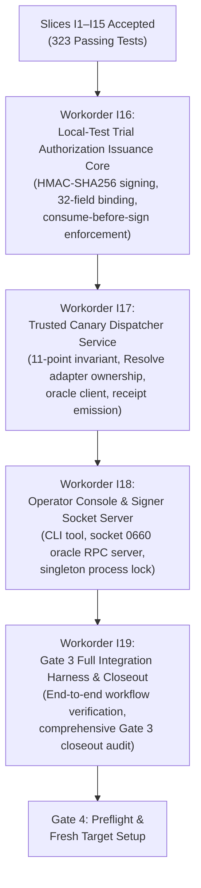

# Gate 3 Consolidated Integration Gap Audit — Plan R7 Implementation Baseline & Proposed Roadmap (Revision R2)

**Document:** `docs/architecture/07B7-AUTH-SIGNER-GATE3-INTEGRATION-AUDIT.md`  
**Parent Gate:** Gate G07 (`OPEN`)  
**Workorder:** `G07-AUTH-SIGNER-GATE3-INTEGRATION-AUDIT` (`.bridge/task.md`)  
**Basis:** Accepted Operator-Supervised Canary Readiness Plan, Revision R7: `docs/architecture/07B7-independent-authorization-signing-workflow-plan.md` (SHA-256 `29e8e8c783bb70911cebb932fc522f9e20aec9d193b4ac1e4c956429c610bcd9`)  
**Prior Static Review Handled:** `docs/architecture/07B7-AUTH-SIGNER-GATE3-INTEGRATION-AUDIT-code-review.md` (SHA-256 `62fd46cf5312e14ed77492360c3cc1554a40999c1c1a006b81db7667ee4f81cb`) — Resolves `G3-AUDIT-01`  
**Mode:** `STATIC_INTEGRATION_AUDIT_ONLY; NO_SOURCE_OR_TEST_CHANGES; NO_LIVE_OPERATIONS`  
**Audit Timestamp:** `2026-11-04T07:00:00+07:00`  
**Author:** Operational Assistant  
**Reviewer:** Tech Lead Codex  

---

## 1. Executive Summary & Audit Objective

Under Workorder `G07-AUTH-SIGNER-GATE3-INTEGRATION-AUDIT`, this document provides a comprehensive, static gap assessment of all Gate 3 implementation slices completed to date against the approved Plan R7 (`docs/architecture/07B7-independent-authorization-signing-workflow-plan.md`).

Revision R2 directly resolves Blocker Finding **`G3-AUDIT-01`** from Tech Lead Codex's review (`07B7-AUTH-SIGNER-GATE3-INTEGRATION-AUDIT-code-review.md`). It corrects the historical classification of slices I5, I11, I12, I13, and I15, distinguishes cryptographic HMAC verification from HMAC token signing/issuance, formally records authorization token issuance as a distinct missing capability across accepted Gate 3 slices, and introduces a dedicated bounded issuance workorder placed in proper dependency order ahead of Dispatcher and socket consumers.

### Context & Safety State
- **Parent Gate G07:** Strictly **`OPEN`**.
- **Gate 6 Incident Disposition:** The prior canary execution on `RF_TRIAL_9A56C835B97208ED` remains permanently recorded as **`NOT ACCEPTED`** and **incident-only**.
- **Execution Safety Flag:** `ready_to_execute = False` is strictly maintained.
- **Milestones:** Milestones M1, M2, and M3 strictly remain **`OPEN`**.
- **Static Audit Boundary:** Zero source or test code modifications; zero test executions; zero production keystore or private key access; zero DaVinci Resolve IPC, UI, or socket operations; zero process or OS account creation.

### High-Level Audit Findings
1. **Core Cryptographic & Verification Primitives Complete:** Slices I1 through I15 have been fully implemented, rigorously tested, reviewed, and officially **`ACCEPTED`** by Tech Lead Codex. The current test suite comprises 323 passing tests (as reported in submitted evidence log `bb1d039732dc595a27baeb215c6015742b2479a2f2cdcfeefcadfb3e7d4032ef`).
2. **Distinct Gap — Authorization Token Issuance Missing (`G3-AUDIT-01`):**
   - Slices I11, I12-R8, I13, I14, and I15 were strictly bounded with safety scope `NO_AUTHORIZATION_ISSUANCE`.
   - `LocalTestSignerKeyHandle` (I13-R3) exposes only `verify_trial_execution_authorization`; it possesses no HMAC signing capability.
   - `LocalTestChallengeAuthority` (I15-R4) consumes challenges and yields consumption evidence; it does not construct or emit `TrialExecutionAuthorization`.
   - Therefore, symmetric HMAC token signing/issuance is an unbuilt capability that must be implemented and accepted before downstream consumers (Dispatcher oracle verification and socket consent handlers) can function.
3. **Local-Test vs. Production Deployment Boundary:** Primitives implemented in slices I4–I15 operate within in-memory test harnesses (`LocalTestKeystore`, `LocalTestChallengeAuthority`) and caller-provided temporary directories. Runtime process isolation (`_resolveflow_signer` vs `_resolveflow_dispatcher`), Unix domain socket `0660` communication, and daemon lifecycle management are not yet assembled.
4. **Identified Missing Components:**
   - Bounded Local-Test Trial Authorization Token Issuance Primitive (`TrialExecutionAuthorization` HMAC generation).
   - `src/services/trusted_canary_dispatch_service.py` (Dispatcher service, 11-point invariant gate, verification oracle client, exclusive Resolve IPC adapter handle ownership).
   - `src/tools/resolveflow_operator_console.py` (Interactive human operator target review and envelope signing CLI).
   - Signer daemon Unix domain socket listener & verification oracle server.
   - End-to-end multi-component integration test suite.
5. **Tracking Discrepancy:** The workspace bridge status files (`.bridge/handoff-status.json` and `.bridge/g07-resume-status.json`) remain frozen at slice `I14-R3`. In accordance with Workorder §2 allowlist constraints, these files are documented as stale and left unedited during this static audit.

---

## 2. Acceptance Baseline for Slices I1–I15

The table below catalogs every implementation slice authorized and delivered under Gate 3, recording the latest accepted revision, the authoritative Tech Lead Codex code review document, the review SHA-256 hash, the submitted test evidence log and hash, reported test metrics, and the implementation file set.

> **Crucial Invariant on Authorization Issuance Scope (`G3-AUDIT-01`):**  
> Across all accepted slices I1 through I15, authorization token issuance has been **strictly excluded** from workorders and review acceptance (`NO_AUTHORIZATION_ISSUANCE`). In particular, `LocalTestSignerKeyHandle` (I13-R3) provides HMAC token *verification* only; it does not possess or expose an HMAC signing key or token emission method. `LocalTestChallengeAuthority` (I15-R4) consumes challenges and records durable evidence, but emits no `TrialExecutionAuthorization`.

| Slice ID | Latest Revision | Focus / Subsystem | Review Document | Review SHA-256 | Test Evidence Log | Test Log SHA-256 | Reported Result | Implementation File Set | Issuance Scope Boundary |
|---|---|---|---|---|---|---|---|---|---|
| **I1** | `I1-R2` | Signed Envelope Contracts & RFC 8785 Serializers | `07B7-AUTH-SIGNER-GATE3-I1-R2-code-review.md` | `054bc26512b7f35c9cf4b759e4ae12d8853f8ae18d9417d66e41cf0309e40f08` | `.bridge/ux-evidence/G07-AUTH-SIGNER-G3-I1/pytest.log` | `2827aa8d3d18fdd5830c4e3c90ae5826a5a3f79ae13ae155d3de817f44ade465` | 110 passed in 0.50s | `src/core/contracts/signed_approval_envelope.py`<br>`src/core/contracts/signed_operator_consent_envelope.py`<br>`tests/core/contracts/test_signed_approval_envelope.py`<br>`tests/core/contracts/test_signed_operator_consent_envelope.py` | Contract schemas only; `NO_LIVE_OPERATIONS` |
| **I2** | `I2-R5` | Append-Only Authoritative Approval Store | `07B7-AUTH-SIGNER-GATE3-I2-R5-code-review.md` | `b5a2543949f21c075059800aa48ddfac3a3a8072c77ffeb49d092a628948105c` | `.bridge/ux-evidence/G07-AUTH-SIGNER-G3-I2/pytest.log` | `766864e09d50bb86056275fba24c75e1b4256f1af896168685bfdbce9288abe9` | 82 passed in 0.42s | `src/services/authoritative_approval_store.py`<br>`tests/services/test_authoritative_approval_store.py` | Storage only; `NO_SIGNING_AUTHORIZATION` |
| **I3** | `I3-R2` | Director Approval Signer Service | `07B7-AUTH-SIGNER-GATE3-I3-R2-code-review.md` | `0af3e9d4d25eafa68d63d84209886d2d0f6511712fd01bfd7d8441cdac4fb3f5` | `.bridge/ux-evidence/G07-AUTH-SIGNER-G3-I3/pytest.log` | `abc15d1b7d025fc11614d52999dab5180d856f707c41898035c8fc11f0149ea2` | 93 passed in 0.53s | `src/services/director_approval_signer.py`<br>`tests/services/test_director_approval_signer.py` | Director Ed25519 signing only; `NO_TRIAL_AUTH` |
| **I4** | `I4-R1` | Director Signature Verification Pure Core | `07B7-AUTH-SIGNER-GATE3-I4-R1-code-review.md` | `ad99dc24e932e2b074578d9b86df490f3a97137c3895943695a2044359f29190` | `.bridge/ux-evidence/G07-AUTH-SIGNER-G3-I4/pytest.log` | `3eab3bfb1a13d49ed58fc4112a8f8ce863e646b733b3319d637d23f2bb104e35` | 104 passed in 0.65s | `src/services/trial_authorization_signer_service.py`<br>`tests/services/test_trial_authorization_signer_service.py` | In-memory verification only; `NO_AUTHORIZATION_ISSUANCE` |
| **I5** | `I5-R2` | Operator Consent Verification Pure Core | `07B7-AUTH-SIGNER-GATE3-I5-R2-code-review.md` | `7dc553cedb87a8388fbe247a627463e811cb261370e7d99f1f8a9b26c9b45a24` | `.bridge/ux-evidence/G07-AUTH-SIGNER-G3-I5/pytest.log` | `fd3b9a1d809a1e6aaf447f8d9816112e39bad40094dd4ffffff75d1b1164ec20` | 138 passed in 0.79s | `src/services/trial_authorization_signer_service.py`<br>`tests/services/test_trial_authorization_signer_service.py` | In-memory 20-check verification only; `NO_AUTHORIZATION_ISSUANCE` |
| **I6** | `I6-R4` | Descriptor-Anchored Atomic Consumed Nonce Ledger | `07B7-AUTH-SIGNER-GATE3-I6-R4-code-review.md` | `e723bafd6326545baa170b0371d9a4df9fbd0dc7c1f3e1df56ba0ff2145d5bfa` | `.bridge/ux-evidence/G07-AUTH-SIGNER-G3-I6-R4/pytest.log` | `61cd8612b962762ed327178b79b0457925361884faff0e528d1d2d63ff86a9c7` | 202 passed, 2 warnings in 2.77s | `src/services/trial_authorization_signer_service.py`<br>`tests/services/test_trial_authorization_signer_service.py` | Ledger persistence only; `NO_AUTHORIZATION_ISSUANCE` |
| **I7** | `I7-R2` | Pure Signed Revocation Manifest Verifier (9-Claim Schema) | `07B7-AUTH-SIGNER-GATE3-I7-R2-code-review.md` | `f578c182eb39c1b780e30f82fec734440798fa449291b6fa75d0121ac39a623f` | `.bridge/ux-evidence/G07-AUTH-SIGNER-G3-I7/pytest.log` | `164b8a09682706faa234659148eb508d9c041b1c8d2f274a71e592b0e3514266` | 166 passed in 0.97s | `src/services/trial_authorization_signer_service.py`<br>`tests/services/test_trial_authorization_signer_service.py` | Pure manifest verification only; `NO_AUTHORIZATION_ISSUANCE` |
| **I8** | `I8-R5` | Digest-Bound Epoch Anchor Anti-Rollback Manager | `07B7-AUTH-SIGNER-GATE3-I8-R5-code-review.md` | `9ea64b6f34ca0eba5db361218e046963beba9ae4965d62c19380368931902843` | `.bridge/ux-evidence/G07-AUTH-SIGNER-G3-I8/pytest.log` | `c85c76ee7b17742c93a466ef2d03fce8d756b92fafd195fee58a7ee663909193` | 185 passed in 2.14s | `src/services/trial_authorization_signer_service.py`<br>`tests/services/test_trial_authorization_signer_service.py` | Local-test anchor management only; `NO_AUTHORIZATION_ISSUANCE` |
| **I9** | `I9-R2` | Composed Revocation Check with Fresh Descriptor Re-Open | `07B7-AUTH-SIGNER-GATE3-I9-R2-code-review.md` | `1347af980a93ec4a1a28838e6e6291bb6c54f661d9af9f92afc259f9b7f0e988` | `.bridge/ux-evidence/G07-AUTH-SIGNER-G3-I9/pytest.log` | `4a2ecb4253ec050acca34ebc482726a32d13463ba4a58ff62abc464e546898b5` | 195 passed in 1.89s | `src/services/trial_authorization_signer_service.py`<br>`tests/services/test_trial_authorization_signer_service.py` | Local-test registry check only; `NO_AUTHORIZATION_ISSUANCE` |
| **I10** | `I10-R3` | Local-Test Descriptor-Anchored Public Key Reader | `07B7-AUTH-SIGNER-GATE3-I10-R3-code-review.md` | `df3ecba57d025d9ad4752455758d67e5a3d4e5b806d96dc71328618eaac464c6` | `.bridge/ux-evidence/G07-AUTH-SIGNER-G3-I10/pytest.log` | `073aae0292e037c66bcaa3c71fd0d4a529a67d5747bbb8b112372d0a0aa07b5a` | 212 passed in 1.89s | `src/services/trial_authorization_signer_service.py`<br>`tests/services/test_trial_authorization_signer_service.py` | Local-test public key reader only; `NO_AUTHORIZATION_ISSUANCE` |
| **I11** | `I11-R1` | Local-Test Revocation Trust-and-Registry Composition | `07B7-AUTH-SIGNER-GATE3-I11-R1-code-review.md` | `c99a4cc2939a461fb43b1007d1c7129cbb7e19829a9c9091a6c9b8791d0e974e` | `.bridge/ux-evidence/G07-AUTH-SIGNER-G3-I11/pytest.log` | `efee63528b9a388fc70d3d4fbea9795e0f8161f697d593249e41f5cefa2450ef` | 218 passed in 2.19s | `src/services/trial_authorization_signer_service.py`<br>`tests/services/test_trial_authorization_signer_service.py` | Trust composition wrapper only; `NO_AUTHORIZATION_ISSUANCE` |
| **I12** | `I12-R8` | Cross-Binding Admission Gate & Incident Target Blacklist | `07B7-AUTH-SIGNER-GATE3-I12-R8-code-review.md` | `37fa3156d066098bb444f10f9d38e37cfdfda64f54856ba146b00732a083200a` | `.bridge/ux-evidence/G07-AUTH-SIGNER-G3-I12/pytest.log` | `19b92b27407734b79236aa9456a8cf37175143d89c9294fe56cc7e03fb4da81c` | 235 passed, 2 warnings in 2.87s | `src/services/trial_authorization_signer_service.py`<br>`tests/services/test_trial_authorization_signer_service.py` | Admission verification only; `NO_AUTHORIZATION_ISSUANCE` |
| **I13** | `I13-R3` | Local-Test Signer Keystore Encapsulation Primitive | `07B7-AUTH-SIGNER-GATE3-I13-R3-code-review.md` | `eaed1e9f5908fba674af47df8fb48dd8ac3aa17065ab4da4138cf03a83256012` | `.bridge/ux-evidence/G07-AUTH-SIGNER-G3-I13/pytest.log` | `2132d1b8756e3e8d1d622161d3b286a8775291eea9b4752a239625d5f39f8c50` | 246 passed, 2 warnings in 2.71s | `src/services/trial_authorization_signer_service.py`<br>`tests/services/test_trial_authorization_signer_service.py` | Verification key handle only (`verify_trial_execution_authorization`); **no HMAC signing capability**; `NO_AUTHORIZATION_ISSUANCE` |
| **I14** | `I14-R3` | Local-Test Authoritative Challenge Issuance Core | `07B7-AUTH-SIGNER-GATE3-I14-R3-code-review.md` | `79b88c1d29ce3a1096d72ca682837651cacc2658bcd7de2290b66475b08bff3c` | `.bridge/ux-evidence/G07-AUTH-SIGNER-G3-I14/pytest.log` | `f7f123f4f9abd046f006151524327b0d87feb57aadd8e38a4e595e882e07a16c` | 279 passed, 2 warnings in 2.92s | `src/services/trial_authorization_signer_service.py`<br>`tests/services/test_trial_authorization_signer_service.py` | In-memory challenge issuance only; `NO_AUTHORIZATION_ISSUANCE` |
| **I15** | `I15-R4` | Descriptor-Anchored Local-Test Operator Consent Verification & Atomic Challenge Consumption | `07B7-AUTH-SIGNER-GATE3-I15-R4-code-review.md` | `ca6f8af10f7be8410b7bac2cbe1bb3aa9e5de70d50f4606432da66559c0e2c6b` | `.bridge/ux-evidence/G07-AUTH-SIGNER-G3-I15/pytest.log` | `bb1d039732dc595a27baeb215c6015742b2479a2f2cdcfeefcadfb3e7d4032ef` | 323 passed, 2 warnings in 3.28s | `src/services/trial_authorization_signer_service.py`<br>`tests/services/test_trial_authorization_signer_service.py` | Consent verification & challenge consumption evidence only; **emits no authorization token**; `NO_AUTHORIZATION_ISSUANCE` |

### Tracking Discrepancy Note (Workorder §3.1)
- **Observed Workspace State:** `.bridge/handoff-status.json` and `.bridge/g07-resume-status.json` both record `task_id: G07-AUTH-SIGNER-GATE3-I14`, `revision: I14-R3`, and `tests_passed: 279`.
- **Actual Verified State:** Slice I14 was followed by the re-revision and acceptance of `I6-R4` (`07B7-AUTH-SIGNER-GATE3-I6-R4-code-review.md`), the implementation and acceptance of `I15-R4` (`07B7-AUTH-SIGNER-GATE3-I15-R4-code-review.md`, 323 passing tests), and the issuance of `G07-AUTH-SIGNER-GATE3-INTEGRATION-AUDIT`.
- **Allowlist Compliance:** Pursuant to the strict artifact allowlist in Workorder §2, these tracking files are NOT modified during this static audit. This discrepancy is formally documented here and will be reconciled when the next implementation workorder is issued.

---

## 3. Plan R7 Traceability Matrix

The following matrix traces every requirement specified in Plan R7 §§3–6, 9, and 10 to its implementation status, corresponding artifact, and accepted review.

| Plan R7 Section | Requirement Summary | Status | Implementation Artifact | Accepted Review | Source-Grounded Justification |
|---|---|---|---|---|---|
| **§3.1** | `SignedOperatorConsentEnvelope` schema (21 fields, `schema_version=1`, frozen dataclass, strict string literals, RFC 8785 canonical serialization) | **`COVERED`** | `src/core/contracts/signed_operator_consent_envelope.py` | `07B7-AUTH-SIGNER-GATE3-I1-R2-code-review.md` | Implemented as frozen dataclass with complete 21-field schema, strict type assertions, IEEE-754 safe integer bounding (`MAX_JCS_SAFE_INTEGER`), canonical bytes generation, and SHA-256 digest helpers. |
| **§3.2 (1)** | Verification-instant challenge expiry gate ($\text{now\_dt} \le \text{chal\_exp\_dt}$) & challenge window check | **`COVERED`** | `src/services/trial_authorization_signer_service.py` (`verify_operator_consent`, `verify_and_consume_challenge_for_local_test`) | `07B7-AUTH-SIGNER-GATE3-I15-R4-code-review.md` | Instantaneous verification check fails closed with `ERR_CHALLENGE_EXPIRED_AT_VERIFICATION` if clock exceeds challenge expiry; validates `issued_at <= consent_ts <= expires_at`. |
| **§3.2 (2)** | Bounded freshness & clock skew gate ($-5\text{s} \le \Delta t \le 120\text{s}$) | **`COVERED`** | `src/services/trial_authorization_signer_service.py` (`verify_operator_consent`) | `07B7-AUTH-SIGNER-GATE3-I15-R4-code-review.md` | Rejects future timestamps ($\Delta t < -5\text{s}$) with `ERR_CONSENT_FUTURE_TIMESTAMP`; rejects stale timestamps ($\Delta t > 120\text{s}$) with `ERR_CONSENT_EXPIRED`. |
| **§3.2 (3)** | Operator identity & key binding (`operator_id == authoritative`, `operator_key_id == active`) | **`COVERED`** | `src/services/trial_authorization_signer_service.py` (`verify_operator_consent`) | `07B7-AUTH-SIGNER-GATE3-I15-R4-code-review.md` | Compares against expected operator identity and active key ID, failing with `ERR_CONSENT_OPERATOR_MISMATCH` or `ERR_CONSENT_KEY_MISMATCH`. |
| **§3.2 (4)** | RFC 8785 canonical Ed25519 signature verification against operator public key | **`COVERED`** | `src/services/trial_authorization_signer_service.py` (`verify_operator_consent`) | `07B7-AUTH-SIGNER-GATE3-I15-R4-code-review.md` | Canonical signing bytes computed via `envelope.canonical_signing_payload_bytes()` and verified using `cryptography.hazmat.primitives.asymmetric.ed25519`. |
| **§3.2 (5)** | Exact string literals: confirmation phrase & freshness attestation | **`COVERED`** | `src/services/trial_authorization_signer_service.py` (`verify_operator_consent`) | `07B7-AUTH-SIGNER-GATE3-I15-R4-code-review.md` | Enforces exact equality with `'CONFIRM_CANARY_TRIAL_EXECUTION'` and `'OPERATOR_VISUAL_ATTESTATION_EMPTY_TIMELINE_VERIFIED'`. |
| **§3.2 (6)** | Challenge nonce equality (`client_nonce == challenge.client_nonce`) | **`COVERED`** | `src/services/trial_authorization_signer_service.py` (`verify_operator_consent`) | `07B7-AUTH-SIGNER-GATE3-I15-R4-code-review.md` | Asserts exact match; fails with `ERR_CHALLENGE_NONCE_MISMATCH`. |
| **§3.2 (7–9)** | Digest bindings (approval envelope, plan, action payload SHA-256) | **`COVERED`** | `src/services/trial_authorization_signer_service.py` (`verify_operator_consent`) | `07B7-AUTH-SIGNER-GATE3-I15-R4-code-review.md` | Recomputes digests and asserts strict equality; fails with `ERR_CONSENT_MUTATION_MISMATCH`. |
| **§3.2 (10–20)** | Target & action parameter equalities (project name/UID, timeline name/UID, media path/SHA-256, action type, track type/index, record frame, duration) | **`COVERED`** | `src/services/trial_authorization_signer_service.py` (`verify_operator_consent`) | `07B7-AUTH-SIGNER-GATE3-I15-R4-code-review.md` | Checks all 11 action and target fields against pending request; fails closed on any discrepancy. |
| **§3.3** | Atomic challenge invalidation into `signer_consumed_nonces.jsonl` with directory descriptor anchoring | **`COVERED`** | `src/services/trial_authorization_signer_service.py` (`verify_and_consume_challenge_for_local_test`) | `07B7-AUTH-SIGNER-GATE3-I15-R4-code-review.md` | Descriptors verified beneath trusted root, passed directly to `SignerConsumedNonceLedger`, atomic append, fsync, challenge state poisoned. |
| **§3.3** | Negative acceptance test fixtures (`FIX-NEG-01` to `FIX-NEG-08`) | **`COVERED`** | `tests/services/test_trial_authorization_signer_service.py` (`test_operator_consent_negative_acceptance_fixtures`) | `07B7-AUTH-SIGNER-GATE3-I15-R4-code-review.md` | All 8 negative test fixtures explicitly tested and verified with matching reason codes. |
| **§4.1** | `SignedApprovalEnvelope` schema (7 fields, `schema_version=1`, frozen dataclass, RFC 8785 canonical serialization) | **`COVERED`** | `src/core/contracts/signed_approval_envelope.py` | `07B7-AUTH-SIGNER-GATE3-I1-R2-code-review.md` | Implemented as frozen dataclass wrapping `AppOwnedApprovalRecord`, with plan and proposal digests, strict string omission ID parsing, and canonical serializers. |
| **§4.2 (1)** | Director Ed25519 signing service & key management | **`COVERED`** | `src/services/director_approval_signer.py` | `07B7-AUTH-SIGNER-GATE3-I3-R2-code-review.md` | Signs approval records with Ed25519 private key over RFC 8785 canonical bytes, emits `SignedApprovalEnvelope`. |
| **§4.2 (2)** | Director signature verification pure core in Signer | **`COVERED`** | `src/services/trial_authorization_signer_service.py` (`verify_director_approval_envelope`) | `07B7-AUTH-SIGNER-GATE3-I4-R1-code-review.md` | Recomputes digests, validates timestamps, and verifies Ed25519 signature over canonical signing payload. |
| **§4.2 (3)** | Provisioning public key at `/var/lib/resolveflow/signer/trusted_roots/director_pubkey.pem` | **`PARTIAL`** | `src/services/trial_authorization_signer_service.py` (`read_trusted_public_key_pem_descriptor_anchored`) | `07B7-AUTH-SIGNER-GATE3-I10-R3-code-review.md` | Descriptor-anchored reader implemented and tested; production directory `/var/lib/resolveflow` not yet provisioned. |
| **§5.1** | Atomic descriptor open protocol (zero path pre-checks, `O_NOFOLLOW | O_CLOEXEC | O_DIRECTORY`, `fsync` directory descriptor) | **`COVERED`** | `src/services/trial_authorization_signer_service.py` (`SignerConsumedNonceLedger`) | `07B7-AUTH-SIGNER-GATE3-I6-R4-code-review.md` | Descriptor-anchored open with `dir_fd`, `O_NOFOLLOW | O_CLOEXEC`, directory fsync on creation, zero path-based checks. |
| **§5.2** | Durable OS singleton lock (`signer_service.singleton.lock`, non-blocking flock) | **`PARTIAL`** | `src/services/authoritative_approval_store.py`<br>`src/services/trial_authorization_signer_service.py` | `07B7-AUTH-SIGNER-GATE3-I2-R5-code-review.md`<br>`07B7-AUTH-SIGNER-GATE3-I6-R4-code-review.md` | Locking implemented inside Store and Ledger classes; standalone daemon-level singleton lock file wrapper is `MISSING`. |
| **§5.3** | Inter-process append & re-read under file lock (`fcntl.flock(LOCK_EX)`, EINTR retry, `fsync`) | **`COVERED`** | `src/services/trial_authorization_signer_service.py` (`SignerConsumedNonceLedger`) | `07B7-AUTH-SIGNER-GATE3-I6-R4-code-review.md` | Full flock serialization, re-read under lock from last offset, collision detection, write loop with EINTR retry, `fsync`. |
| **§5.4** | Fail-closed torn-tail handling (`ERR_SIGNER_LEDGER_TORN_TAIL_DETECTED`, zero silent recovery) | **`COVERED`** | `src/services/trial_authorization_signer_service.py` (`SignerConsumedNonceLedger`) | `07B7-AUTH-SIGNER-GATE3-I6-R4-code-review.md` | Startup scan verifies newline termination and JSON validity for every line; raises `SignerLedgerCorruptionError` on torn tail. |
| **§6.1** | Signed Revocation Manifest schema (exactly 9 non-signature claims + 1 signature field, 128-hex Ed25519 signature) | **`COVERED`** | `src/services/trial_authorization_signer_service.py` (`verify_signed_revocation_manifest_pure`) | `07B7-AUTH-SIGNER-GATE3-I7-R2-code-review.md` | Validates exactly 9 claims, verifies 128-hex signature over RFC 8785 canonical bytes, checks validity period. |
| **§6.1** | Pinned issuer authority (`issuer_id == "security_officer_root"`) | **`COVERED`** | `src/services/trial_authorization_signer_service.py` (`verify_signed_revocation_manifest_pure`) | `07B7-AUTH-SIGNER-GATE3-I7-R2-code-review.md` | Enforces pinned issuer identity; rejects unknown or substituted issuers with `ERR_REVOCATION_UNKNOWN_ISSUER`. |
| **§6.2** | Digest-bound durable local epoch anchor (`revocation_epoch.anchor`, `<epoch>:<sha256>`) | **`COVERED`** | `src/services/trial_authorization_signer_service.py` (`RevocationEpochAnchorManager`) | `07B7-AUTH-SIGNER-GATE3-I8-R5-code-review.md` | Rejects rollback (`epoch < anchored`), rejects same-epoch tampering (`digest != anchored`), advances atomically with directory fsync. |
| **§6.3** | Fresh descriptor-anchored manifest re-read (`openat` with `O_RDONLY | O_NOFOLLOW | O_CLOEXEC`) | **`COVERED`** | `src/services/trial_authorization_signer_service.py` (`verify_revocation_manifest_fresh`) | `07B7-AUTH-SIGNER-GATE3-I9-R2-code-review.md` | Always re-opens manifest file afresh relative to directory descriptor; avoids long-lived descriptors. |
| **§7** | Authoritative Incident Target Blacklist (`RF_TRIAL_9A56C835B97208ED` exclusion) | **`COVERED`** | `src/services/trial_authorization_signer_service.py` (`check_approval_target_binding_admission`) | `07B7-AUTH-SIGNER-GATE3-I12-R8-code-review.md` | Static blacklist of incident project names, timeline names, and execution IDs permanently rejected with `ERR_INCIDENT_TARGET_EXCLUDED`. |
| **§8** | Canonical Claims & Cryptographic Serialization (32-field token authorization HMAC) | **`PARTIAL`** (`G3-AUDIT-01`) | `src/core/contracts/trial_authorization_contracts.py`<br>`src/services/trial_authorization_signer_service.py` | `07B7-AUTH-SIGNER-GATE3-I13-R3-code-review.md` | The dataclass contract and canonical serializer `canonical_bytes_for_auth_hmac` exist in contracts. In-memory HMAC *verification* exists in `LocalTestSignerKeyHandle` (I13). However, **cryptographic HMAC signing/token generation** (`generate_trial_authorization_token`) is **`MISSING`** from accepted Gate 3 slices; slices I11–I15 explicitly operated under `NO_AUTHORIZATION_ISSUANCE`. |
| **§9** | 8-Gate Canary Execution Lifecycle Governance | **`COVERED` (Gate 0–2)** / **`PARTIAL` (Gate 3)** | Workspace architecture & review documentation | `07B7-AUTH-SIGNER-GATE2-code-review.md`<br>`07B7-AUTH-SIGNER-GATE3-I15-R4-code-review.md` | Gate 0 historically completed (1824 tests passed); Gate 1 accepted (Plan R7); Gate 2 granted by human operator; Gate 3 partially completed (Slices I1–I15 accepted); Gates 4–7 strictly pending. |
| **§10.1** | `src/core/contracts/signed_approval_envelope.py` | **`COVERED`** | `src/core/contracts/signed_approval_envelope.py` | `07B7-AUTH-SIGNER-GATE3-I1-R2-code-review.md` | Complete implementation accepted. |
| **§10.2** | `src/core/contracts/signed_operator_consent_envelope.py` | **`COVERED`** | `src/core/contracts/signed_operator_consent_envelope.py` | `07B7-AUTH-SIGNER-GATE3-I1-R2-code-review.md` | Complete implementation accepted. |
| **§10.3** | `src/services/director_approval_signer.py` | **`COVERED`** | `src/services/director_approval_signer.py` | `07B7-AUTH-SIGNER-GATE3-I3-R2-code-review.md` | Complete implementation accepted. |
| **§10.4** | `src/services/authoritative_approval_store.py` | **`COVERED`** | `src/services/authoritative_approval_store.py` | `07B7-AUTH-SIGNER-GATE3-I2-R5-code-review.md` | Complete implementation accepted. |
| **§10.5** | `src/services/trial_authorization_signer_service.py` | **`PARTIAL`** (`G3-AUDIT-01`) | `src/services/trial_authorization_signer_service.py` | `07B7-AUTH-SIGNER-GATE3-I15-R4-code-review.md` | Verification, admission check, challenge lifecycle, and local keystore verification primitives are complete; **authorization token issuance logic** and standalone daemon socket server (`0660`) are `MISSING`. |
| **§10.6** | `src/services/trusted_canary_dispatch_service.py` | **`MISSING`** | File not yet created | None | Dispatcher daemon, 11-point acceptance invariant, verification oracle client, exclusive Resolve IPC ownership. |
| **§10.7** | `src/tools/resolveflow_operator_console.py` | **`MISSING`** | File not yet created | None | Interactive operator console tool for target review and envelope signing. |
| **§10 (Tests)** | Unit test suites for Contracts, Store, Signer, and Dispatcher | **`PARTIAL`** | `tests/core/contracts/test_signed_approval_envelope.py`<br>`tests/core/contracts/test_signed_operator_consent_envelope.py`<br>`tests/services/test_authoritative_approval_store.py`<br>`tests/services/test_director_approval_signer.py`<br>`tests/services/test_trial_authorization_signer_service.py` | `07B7-AUTH-SIGNER-GATE3-I15-R4-code-review.md` | Contract, Store, and Signer unit test suites complete (323 passing tests); Dispatcher test suite, token issuance unit tests, and operator console test suite are `MISSING`. |

---

## 4. Boundary and Trust Model Assessment

Plan R7 establishes a strict separation of privileges between distinct OS principals and isolated runtime boundaries to permanently eliminate the risk of runner self-minting (`LIVE-G6-01`):

```
+---------------------------------------------------------------------------------------+
| HUMAN OPERATOR TERMINAL                                                               |
| - Runs `resolveflow_operator_console` as human user                                    |
| - Inspects fresh target project/timeline UUIDs & media SHA-256                        |
| - Holds operator private key; signs `SignedOperatorConsentEnvelope`                   |
+------------------------------------------+--------------------------------------------+
                                           | (Consent Envelope via local socket/stdin)
                                           v
+---------------------------------------------------------------------------------------+
| SIGNER PROCESS BOUNDARY (UID: `_resolveflow_signer`, Mode: 0700)                      |
| - Exclusively owns `/var/lib/resolveflow/signer/keystore`                             |
| - Holds HMAC signing key (`trial_authorization_key.bin`) and trusted roots            |
| - Manages durable nonce ledger (`signer_consumed_nonces.jsonl`) & epoch anchor        |
| - Issues single-use challenges; verifies 20 operator consent gates                   |
| - ISSUES TrialExecutionAuthorization (HMAC-SHA256 signed) upon consumed challenge    |
| - Listens on restricted Unix domain socket `/var/run/resolveflow/signer.sock` (0660)  |
| - Exposes Verification Oracle RPC to Dispatcher                                       |
+------------------------------------------+--------------------------------------------+
                                           | (Verification Oracle RPC over Socket 0660)
                                           v
+---------------------------------------------------------------------------------------+
| DISPATCHER PROCESS BOUNDARY (UID: `_resolveflow_dispatcher`)                          |
| - Exclusively owns DaVinci Resolve IPC handle (`fusionscript` / Resolve API)           |
| - ZERO possession of HMAC key, keystore directory, or Signer private keys            |
| - Enforces 11-Point Dispatcher Acceptance Invariant before any action                 |
| - Submits token to Signer Oracle for verification before dispatch                     |
| - Emits immutable execution receipt upon completion                                   |
+---------------------------------------------------------------------------------------+
```

### Contrast: Current Local-Test Primitives vs. Plan R7 Target Architecture

1. **HMAC Verification vs. HMAC Token Issuance (`G3-AUDIT-01`):**
   - *Current Implementation:* `LocalTestSignerKeyHandle` (I13-R3) exposes `verify_trial_execution_authorization(auth) -> bool` only. It was explicitly reviewed as a verification-only primitive with `NO_AUTHORIZATION_ISSUANCE`. It has zero capability to generate or sign an HMAC token.
   - *Plan Requirement:* The Signer must possess an internal token generation engine that accepts verified approval, consumed challenge evidence, and verified operator consent, binds all 32 canonical fields, computes HMAC-SHA256 using the symmetric key, and emits a frozen `TrialExecutionAuthorization`. This issuance capability must remain strictly on the Signer side and is completely unaccessible to Dispatcher or runner code.
2. **Signer Keystore & Secrets Custody:**
   - *Current Implementation:* `LocalTestKeystore` encapsulates symmetric HMAC keys and trusted root mappings in memory for unit test isolation.
   - *Plan Requirement:* In production, `/var/lib/resolveflow/signer/keystore` must be strictly restricted to `_resolveflow_signer:resolveflow` (directory mode `0700`, files `0600`), inaccessible to Dispatcher or runner processes.
3. **Verification Oracle Interface:**
   - *Current Implementation:* Verification is performed via an in-memory method `verify_authorization(authorization_token, ...)`.
   - *Plan Requirement:* Must be exposed as an RPC endpoint over a restricted Unix domain socket (`0660`), allowing the Dispatcher to verify tokens without access to the HMAC secret.
4. **Dispatcher IPC Isolation & Invariant Gating:**
   - *Current Implementation:* Not yet implemented.
   - *Plan Requirement:* `TrustedCanaryDispatchService` must run as `_resolveflow_dispatcher`, hold exclusive possession of the DaVinci Resolve IPC connection, verify all 11 invariant conditions (including target blacklist and uncorrupted token verification from oracle), and execute exactly one atomic `INSERT_CLIP` action.
5. **Operator Console Tooling:**
   - *Current Implementation:* `SignedOperatorConsentEnvelope` instances are constructed programmatically in test suites.
   - *Plan Requirement:* `src/tools/resolveflow_operator_console.py` provides the real interactive terminal interface for the operator to inspect target parameters, confirm visual timeline emptiness, and sign the envelope.
6. **Durable Nonce & Revocation State:**
   - *Current Implementation:* Atomic descriptor-anchored open, flock, torn-tail detection, and monotonic epoch anchor advancement are fully implemented in `SignerConsumedNonceLedger` and `RevocationEpochAnchorManager`.
   - *Plan Requirement:* These primitives must be bound to production filesystem paths under `/var/lib/resolveflow/signer/`.

---

## 5. Dependency Closure & Remaining Gate 3 Gaps

Based on static analysis of the codebase, Plan R7 §§3–6, 9, 10, and Codex Finding `G3-AUDIT-01`, the following specific capabilities remain to be completed for Gate 3, ordered by strict dependency logic:

### Gap 1: Bounded Local-Test Trial Authorization Token Issuance Core (`G3-AUDIT-01`)
- **Required Capabilities:**
  1. Pure/local-test token issuance logic in `src/services/trial_authorization_signer_service.py` (e.g. `issue_trial_execution_authorization_for_local_test`).
  2. Binds verified `SignedApprovalEnvelope`, consumed challenge evidence (`LocalTestChallengeConsumptionResult`), verified `SignedOperatorConsentEnvelope`, and an opaque local-test signing key handle.
  3. Validates that challenge consumption in the nonce ledger occurred before token generation.
  4. Validates all 32 canonical fields defined in Plan R7 §8.
  5. Computes HMAC-SHA256 using the symmetric key over RFC 8785 canonical bytes via `canonical_bytes_for_auth_hmac`.
  6. Emits a frozen `TrialExecutionAuthorization` instance.
  7. Enforces strict error boundaries (`ERR_CHALLENGE_NOT_CONSUMED`, `ERR_CONSENT_UNVERIFIED`, `ERR_BINDING_INCOMPLETE`).
- **Dependencies:** Slices I1 (contracts), I5 (consent verifier), I6 (nonce ledger), I12 (cross-binding admission gate), I13 (keystore primitive), I15 (challenge consumption).
- **Consumer Notice:** Downstream components (Dispatcher verification oracle client and Signer socket server) depend directly on this capability.

### Gap 2: Trusted Canary Dispatcher Service (`src/services/trusted_canary_dispatch_service.py`)
- **Required Capabilities:**
  1. **11-Point Dispatcher Acceptance Invariant:** Validates target project/timeline UUIDs, action parameters (1 clip, 120 frames, track 1 video), media SHA-256, active trial authorization token, target blacklist exclusion, and fresh unconsumed nonce state.
  2. **Verification Oracle Client:** Communicates with Signer service over Unix domain socket `0660` (or injected local oracle interface) to verify authorization tokens without possessing HMAC secret.
  3. **Exclusive Resolve IPC Adapter Possession:** Owns the interface to DaVinci Resolve scripting API (`fusionscript`), ensuring no other process can interact with Resolve (using mock adapter for unit tests).
  4. **Execution Receipt Generation:** Produces immutable `ExecutionReceipt` recording dispatch timestamps, observed clip IDs, track coordinates, and terminal status.
- **Dependencies:** Slices I1, I12, and Gap 1 (Authorization Token Issuance capability).

### Gap 3: Operator Console Tool (`src/tools/resolveflow_operator_console.py`)
- **Required Capabilities:**
  1. Interactive CLI tool for human operator to view pending plan, target project UUID, timeline UUID, source media SHA-256, and challenge token.
  2. Operator visual attestation prompt (`OPERATOR_VISUAL_ATTESTATION_EMPTY_TIMELINE_VERIFIED`).
  3. Confirmation phrase input (`CONFIRM_CANARY_TRIAL_EXECUTION`).
  4. Cryptographic Ed25519 signing of `SignedOperatorConsentEnvelope` using operator private key.
- **Dependencies:** `SignedOperatorConsentEnvelope` (I1), Challenge Issuance Authority (I14).

### Gap 4: Signer Daemon Socket Interface & Verification Oracle Server
- **Required Capabilities:**
  1. Unix domain socket server (`0660`) listening on `/var/run/resolveflow/signer.sock`.
  2. RPC handlers for:
     - `request_challenge`: Generates fresh challenge nonce bound to pending target.
     - `submit_operator_consent`: Validates consent envelope, consumes challenge (I15), and emits `TrialExecutionAuthorization` via token issuance engine (Gap 1).
     - `verify_authorization_oracle`: Verifies token validity for Dispatcher without disclosing symmetric key.
  3. Daemon singleton process lock (`signer_service.singleton.lock`).
- **Dependencies:** Gap 1 (Token Issuance), Slices I11, I14, I15, I6.

### Gap 5: End-to-End Gate 3 Integration Test Suite
- **Required Capabilities:**
  1. Multi-component test validating the complete workflow in memory/mock:
     - Director signs approval -> Store persists envelope -> Signer issues challenge -> Operator signs consent -> Signer validates consent, consumes challenge, & issues authorization token (Gap 1) -> Dispatcher queries oracle -> Dispatcher executes dispatch on mock Resolve adapter -> Receipt generated.
  2. Proves end-to-end integration across all Gate 3 components without live Resolve operations.
- **Dependencies:** Gaps 1, 2, 3, 4 and Slices I1–I15.

---

## 6. Consolidated Next-Work Proposal

To address Codex Finding `G3-AUDIT-01` and maintain coherent, bounded workorders without excessive micro-revisions, we propose a bounded sequence of **four sequential workorders** in strict dependency order:



### Workorder I16: Local-Test Trial Authorization Issuance Core (`G3-AUDIT-01`)
- **Objective:** Implement the bounded local-test trial authorization token issuance primitive in `src/services/trial_authorization_signer_service.py` (`issue_trial_execution_authorization_for_local_test`). Binds verified approval envelope, verified operator consent envelope, and confirmed challenge consumption evidence from the nonce ledger; computes HMAC-SHA256 over all 32 canonical fields using the symmetric key handle; and emits a verified `TrialExecutionAuthorization`.
- **Candidate File Allowlist:**
  1. `src/services/trial_authorization_signer_service.py`
  2. `tests/services/test_trial_authorization_signer_service.py`
  3. `.bridge/report.md`
- **Dependencies:** Accepted slices I1, I5, I6, I12, I13, I14, I15.
- **Acceptance Evidence:** 100% of unit tests pass; tests verify exact 32-field canonical bytes, HMAC verification round-trip via `LocalTestSignerKeyHandle.verify_trial_execution_authorization`, rejection of unconsumed challenge or modified consent claims, and fail-closed behavior on missing or unverified evidence.
- **Stop Conditions:** Local temporary directory and ephemeral keys only; zero production keystore or key access; zero live Resolve calls; `ready_to_execute = False`; Gate G07 remains `OPEN`.

### Workorder I17: Trusted Canary Dispatcher Service
- **Objective:** Implement `TrustedCanaryDispatchService` and its comprehensive unit test suite in `src/services/trusted_canary_dispatch_service.py`, enforcing the 11-point acceptance invariant, target blacklist gating (`RF_TRIAL_9A56C835B97208ED`), verification oracle client integration (consuming tokens issued via I16), exclusive Resolve IPC adapter handle ownership (using mock adapter), and immutable execution receipt persistence.
- **Candidate File Allowlist:**
  1. `src/services/trusted_canary_dispatch_service.py`
  2. `tests/services/test_trusted_canary_dispatch_service.py`
  3. `.bridge/report.md`
- **Dependencies:** Slices I1, I12, and Workorder I16 (Token Issuance Core).
- **Acceptance Evidence:** 100% of unit tests pass with mock Resolve adapter; verifies that Dispatcher possesses zero HMAC signing key material; verifies fail-closed gating on unverified or blacklisted tokens; zero live Resolve operations.
- **Stop Conditions:** No live Resolve calls; `ready_to_execute = False`; Gate G07 remains `OPEN`.

### Workorder I18: Operator Console & Signer Socket Server Interface
- **Objective:** Implement `src/tools/resolveflow_operator_console.py` for operator interactive target inspection and envelope signing, and the Unix domain socket `0660` server wrapper for `trial_authorization_signer_service.py` providing the verification oracle RPC, consent submission endpoint (wiring I15 consumption to I16 issuance), and singleton daemon locking.
- **Candidate File Allowlist:**
  1. `src/tools/resolveflow_operator_console.py`
  2. `tests/tools/test_resolveflow_operator_console.py`
  3. `src/services/trial_authorization_signer_service.py` (daemon socket server integration)
  4. `tests/services/test_trial_authorization_signer_service.py`
  5. `.bridge/report.md`
- **Dependencies:** Slices I1, I3, I6, I11, I14, I15, I16, I17.
- **Acceptance Evidence:** Tests verify socket permission checks (mode 0660), JSON-RPC request handling, operator envelope interactive construction and signing, and verification oracle responses.
- **Stop Conditions:** No production keys loaded; zero live operations; `ready_to_execute = False`.

### Workorder I19: Gate 3 Full Integration Harness & Gate 3 Closeout
- **Objective:** Create end-to-end multi-component integration test suite verifying the complete sequence: Director approval -> Approval store -> Challenge issuance -> Operator consent -> Token emission (I16) -> Dispatcher oracle verification (I17) -> Mock dispatch -> Execution receipt. Perform consolidated Gate 3 review and closeout.
- **Candidate File Allowlist:**
  1. `tests/integration/test_gate3_signer_dispatcher_integration.py`
  2. `docs/architecture/07B7-AUTH-SIGNER-GATE3-CLOSEOUT.md`
  3. `.bridge/report.md`
- **Dependencies:** Slices I1 through I18.
- **Acceptance Evidence:** Full test suite passes; static verification that all Plan R7 Gate 3 requirements are met.
- **Stop Conditions:** Completes Gate 3; transitions lifecycle state to `GATE3_ACCEPTED; READY_FOR_GATE4_PREFLIGHT`. Zero live operations.

---

## 7. Gate 3 Closeout Criteria & Lifecycle Governance

Before Gate 3 can be officially marked `COMPLETED` and accepted by Tech Lead Codex, the following explicit criteria must be satisfied:

1. **Implementation Completeness:** All capabilities specified in Plan R7 §10 (modules 1–7 and test suites 1–5), including the token issuance core (I16), are implemented in the workspace.
2. **Review Acceptance:** Workorders I16, I17, I18, and I19 have been reviewed and accepted by Tech Lead Codex with documented review artifacts in `docs/architecture/`.
3. **Verification Evidence:** The complete test suite (unit, contract, and multi-component integration) executes with 100% pass rate, zero failures, zero skipped tests, and zero unhandled warnings.
4. **Trust Boundary Invariants Verified:**
   - Runner cannot self-mint authorization tokens (HMAC secret isolated in Signer; Dispatcher possesses no signing key).
   - Dispatcher cannot bypass verification oracle.
   - Operator consent requires valid unexpired cryptographic challenge bound to exact plan and targets.
   - Nonce reuse and torn-tail replays are impossible.
   - Challenge must be atomically consumed before token issuance can occur.
   - Incident target `RF_TRIAL_9A56C835B97208ED` is permanently blacklisted.
5. **Preservation of Subsequent Gate Boundaries:**
   - Gate 3 completion **does NOT authorize** live DaVinci Resolve operations.
   - Gate 4 (Preflight & Target Setup): Requires fresh challenge nonce, fresh isolated project `RF_TRIAL_<NEW>`, and visual verification of an empty timeline.
   - Gate 5 (Bounded Workorder): Requires explicit issuance by Tech Lead Codex for exactly 1 action.
   - Gate 6 (Supervised Dispatch): Live execution under direct human operator supervision.
   - Gate 6 Incident Disposition: The prior run on `RF_TRIAL_9A56C835B97208ED` remains **permanently `NOT ACCEPTED` and incident-only**.
   - `ready_to_execute = False` is strictly maintained until Gate 5 workorder issuance.

---

## 8. Artifact Checksums & Integrity

```
29e8e8c783bb70911cebb932fc522f9e20aec9d193b4ac1e4c956429c610bcd9  docs/architecture/07B7-independent-authorization-signing-workflow-plan.md
6919f93c287d18e8f13ceb012cab92b154be0448520a2ee0930bd6d9e5f4632b  .bridge/task.md
62fd46cf5312e14ed77492360c3cc1554a40999c1c1a006b81db7667ee4f81cb  docs/architecture/07B7-AUTH-SIGNER-GATE3-INTEGRATION-AUDIT-code-review.md
ca6f8af10f7be8410b7bac2cbe1bb3aa9e5de70d50f4606432da66559c0e2c6b  docs/architecture/07B7-AUTH-SIGNER-GATE3-I15-R4-code-review.md
bb1d039732dc595a27baeb215c6015742b2479a2f2cdcfeefcadfb3e7d4032ef  .bridge/ux-evidence/G07-AUTH-SIGNER-G3-I15/pytest.log
```
