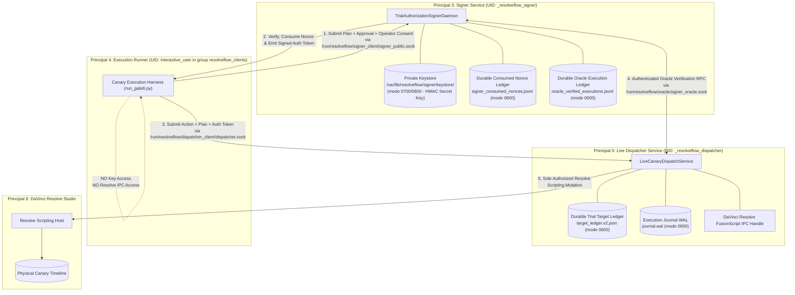
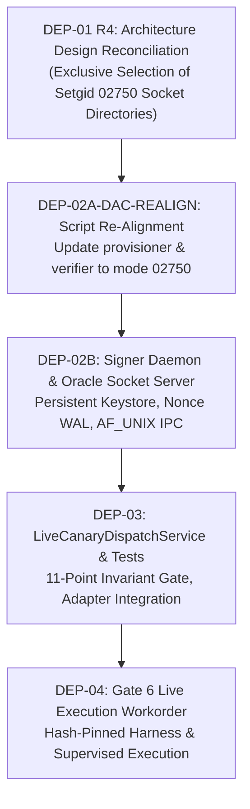

# Live Dispatcher & Oracle Boundary Design Specification (DEP-01 Revision R4 — Socket GID Ownership Reconciliation)

**Workorder:** `G07-07B7-GATE6-DEP01-R4 — Oracle Socket GID Ownership Design Reconciliation`  
**Date:** 2026-11-05T04:00:00Z (UTC) / 2026-11-05T11:00:00+07:00  
**Basis:** Review `docs/architecture/07B7-GATE6-DEP02A-R7-code-review.md` (`ACCEPTED_FOR_ARTIFACTS_ONLY`, SHA-256 `1b5b2fad1b59b700d775cfee9b76d8cc8b70efaae302cc65de892cb7a078e6dd`), Workorder `G07-07B7-GATE6-DEP01-R4` (`.bridge/task.md`, SHA-256 `3cf444615caf157f51af76a5732f5ed797357e23f83191308e5d7dbf13ec086c`), Review findings `DEP01-R4-01`, `DEP01-R4A-01`, and `DEP01-R4V2-01` (`docs/architecture/07B7-GATE6-DEP01-R4-amended-v2-code-review.md`, SHA-256 `e40f33076367f94baf18ab14c1a883e958bea0ee82d51077d122678e45f5b772`)  
**Status:** `DESIGN_PROPOSAL_REVISION_R4_AMENDED_V3_PENDING_CODEX_REVIEW`  
**Mode:** `ARCHITECTURE_DESIGN_ONLY; NO_SOURCE_OR_TEST_CHANGES; NO_HARNESS; NO_RESOLVE_IMPORT_OR_CONNECTION; NO_LIVE_OPERATIONS; NO_KEY_ACCESS`  
**Parent Gate & Milestones:** Gate G07 (`OPEN`), Milestones M1, M2, M3 (`OPEN`), Gate 6 (`NOT ACCEPTED` / incident-only)  
**Execution Safety:** `ready_to_execute = False`; zero Resolve calls; zero live operations; zero candidate harness  

---

## 1. Architectural Objective, Context & Plan R7 Alignment

### 1.1 Objective
This specification resolves the architectural gap identified in Gate 5 R1 (`G5-R1-01`) and confirmed in Gate 6 R2 (`NO_ACCEPTED_LIVE_BOUNDARY`): namely, that the accepted Gate 3 dispatcher (`TrustedCanaryDispatchService`) is strictly mock-only, while the accepted Gate 3 live adapter (`LiveResolveCanaryAdapter`) lacks an authorized live dispatcher and authenticated oracle verification boundary.

In strict compliance with **Plan 07B7 Revision R7 §2** and Workorder `G07-07B7-GATE6-DEP01`, this document defines the architecture, wire protocols, trust boundaries, durable state machines, and threat mitigations required to execute the single authorized canary action on DaVinci Resolve without weakening mock-only test tripwires or compromising cryptographic authority separation.

### 1.2 Non-Execution and Non-Provisioning Declaration
This is a **design specification only**. It does not create OS service principals, provision directories, mint signing keys, open IPC sockets, generate executable code, or interact with DaVinci Resolve in any way. The boundaries described herein represent the **target architecture** that must be implemented under separate, bounded follow-on workorders.

---

## 2. Principals, OS Isolation & Directory DAC Architecture

### 2.1 Principal Decomposition
Plan 07B7 Revision R7 mandates kernel-enforced separation between three distinct system principals:



#### Principal 1 & 2: Editorial Authority & Human Operator
- **Director (Editorial Authority):** Generates and signs `SignedApprovalEnvelope` binding the single-action plan digest via Ed25519.
- **Operator (Human Supervisor):** Performs live visual verification of the empty target timeline on DaVinci Resolve (`DISPLAY=:1`), and executes an authenticated consent gesture signing `SignedOperatorConsentEnvelope`.

#### Principal 3: Signer Service (`_resolveflow_signer`)
- **System Principal:** Dedicated system account `_resolveflow_signer` (UID 901, GID 901 `_resolveflow_signer`).
- **Sole Custodian of HMAC Secret:** Exclusively holds read access to `/var/lib/resolveflow/signer/keystore/trial_auth.key` (mode `0600`).
- **Zero Resolve IPC Access:** Group membership and socket permissions strictly prohibit `_resolveflow_signer` from communicating with the DaVinci Resolve FusionScript IPC socket.
- **State Ownership:** Exclusively owns the durable consumed-nonce ledger (`signer_consumed_nonces.jsonl`), the oracle execution ledger (`oracle_verified_executions.jsonl`), and the epoch revocation anchor directory.

#### Principal 5: Live Dispatcher Service (`_resolveflow_dispatcher`)
- **System Principal:** Dedicated system account `_resolveflow_dispatcher` (UID 902, GID 902 `_resolveflow_dispatcher`).
- **Sole Owner of Resolve IPC:** Exclusively holds credentials and process permissions required to load the DaVinci Resolve scripting library (`fusionscript.so` / `DaVinciResolveScript`) and interact with the running Resolve instance on `DISPLAY=:1`.
- **Zero HMAC Secret Access:** System DAC strictly denies `_resolveflow_dispatcher` read access to `/var/lib/resolveflow/signer/` (`EACCES`). The dispatcher possesses zero private HMAC key material and cannot self-authorize mutations.
- **Oracle Client:** Must submit authorizations to the Signer Verification Oracle over UNIX domain socket to receive an Ed25519-signed verification response before any dispatch.

#### Principal 4: Execution Runner (`interactive_user`)
- **Host User:** Runs under the active developer/operator user account (`vanntruongg`, UID 1000).
- **Group Membership:** Placed in supplementary group `resolveflow_clients` (GID 903).
- **Zero Special Privileges:** Has zero read access to signer private keys (`EACCES`), zero write access to oracle sockets (`EACCES`), and zero permission to invoke Resolve mutation scripts directly.
- **Orchestrator Role:** Serves solely as a transport client passing envelopes between Signer, Operator Console, and Dispatcher over client-facing sockets.

---

### 2.2 Host DAC, Setgid Inheritance & Separate Client Directory Layout (Reconciliation R4)

#### 2.2.1 Architectural Assessment & Selection of Socket GID Ownership Mechanism
Workorder `G07-07B7-GATE6-DEP01-R4` identifies a fundamental DAC mechanism gap:
- Both daemons operate under dedicated primary identities (`_resolveflow_signer` UID/GID `901:901` and `_resolveflow_dispatcher` UID/GID `902:902`) with strictly **zero supplementary groups** to enforce least privilege.
- However, the required socket nodes must carry GID `902` (for `signer_oracle.sock`) and GID `903` (for `signer_public.sock` and `dispatcher.sock`).
- Under standard POSIX / Linux semantics, an unprivileged process creating an inode inherits its effective GID (`fsgid`), and cannot subsequently `chown`/`fchown` the inode to a GID that is not in its supplementary group set (`EPERM`).

To resolve this ownership gap while strictly maintaining process isolation, two architectural alternatives were evaluated:

1. **Alternative 1 — systemd Socket Activation (`.socket` units):**
   - *Mechanics:* systemd (running as PID 1 / root) creates and binds `/run/resolveflow/oracle/signer_oracle.sock` (`SocketUser=_resolveflow_signer`, `SocketGroup=_resolveflow_dispatcher`, `SocketMode=0660`), `/run/resolveflow/signer_client/signer_public.sock`, and `/run/resolveflow/dispatcher_client/dispatcher.sock`. When service units start, systemd passes the pre-bound file descriptors via the `sd_listen_fds()` protocol.
   - *Evaluation:* While systemd socket activation correctly establishes ownership at bind time, it introduces substantial architectural liabilities:
     a) It tightly couples daemon execution to systemd PID 1 IPC, complicating local CLI execution, test harnesses, and isolated mock testing without systemd emulation.
     b) It expands the systemd unit surface by three additional `.socket` units and complex activation dependency graphs (`Requires=`, `After=`).
     c) It splits socket lifecycle responsibility between systemd and Python daemon logic, creating complex edge cases for daemon restart and recovery.
   - *Conclusion:* **Rejected.**

2. **Alternative 2 — Setgid Socket Directories (`02750`) (Selected Mechanism):**
   - *Mechanics:* The parent directory for each socket endpoint is provisioned with the standard POSIX setgid bit set (`mode 02750`, `drwxr-s---`). On Linux, the VFS kernel layer automatically assigns the directory's GID to any new file, FIFO, or UNIX domain socket created via `bind()` inside an `S_ISGID` directory (`inode->i_gid = dir->i_gid`), regardless of the calling process's primary or supplementary GID.
   - *Evaluation:*
     a) **Zero Supplementary Groups Required:** The creating process needs only user write+execute (`rwx`) permissions on its dedicated directory. The kernel automatically guarantees that `signer_oracle.sock` is created with GID `902`, and `signer_public.sock` and `dispatcher.sock` are created with GID `903`.
     b) **Least Privilege Preservation:** Neither daemon is granted cross-service supplementary groups. The signer possesses zero dispatcher or runner memberships; the dispatcher possesses zero signer memberships.
     c) **Standalone & Testable:** Daemons retain full, autonomous control over standard `bind()`, descriptor-relative `unlink()`, and lifecycle management in pure Python without external PID 1 dependencies, enabling rigorous testing in temporary directory harnesses.
   - *Conclusion:* **Exclusively Selected.**

---

#### 2.2.2 Directory DAC, Ownership & Setgid Architecture

```
/var/lib/resolveflow/
├── signer/                              drwx------  _resolveflow_signer:_resolveflow_signer  (0700)
│   ├── keystore/                        drwx------  _resolveflow_signer:_resolveflow_signer  (0700)
│   │   ├── trial_auth.key               -rw-------  _resolveflow_signer:_resolveflow_signer  (0600, HMAC-SHA256 secret)
│   │   └── oracle_private.key           -rw-------  _resolveflow_signer:_resolveflow_signer  (0600, Ed25519 private key)
│   ├── nonces/                          drwx------  _resolveflow_signer:_resolveflow_signer  (0700)
│   │   └── consumed_nonces.db           -rw-------  _resolveflow_signer:_resolveflow_signer  (0600, WAL nonce ledger)
│   └── anchors/                         drwx------  _resolveflow_signer:_resolveflow_signer  (0700)
│       └── epoch.anchor                 -rw-------  _resolveflow_signer:_resolveflow_signer  (0600)
│
/run/resolveflow/                        drwxr-xr-x  root:root                                (0755)
├── oracle/                              drwxr-s---  _resolveflow_signer:_resolveflow_dispatcher (02750, setgid)
│   ├── signer_oracle.lock               -rw-------  _resolveflow_signer:_resolveflow_dispatcher (0600, singleton flock)
│   └── signer_oracle.sock               srw-rw----  _resolveflow_signer:_resolveflow_dispatcher (0660, UNIX domain socket)
│
├── signer_client/                       drwxr-s---  _resolveflow_signer:resolveflow_clients  (02750, setgid)
│   ├── signer_public.lock               -rw-------  _resolveflow_signer:resolveflow_clients  (0600, singleton flock)
│   └── signer_public.sock               srw-rw----  _resolveflow_signer:resolveflow_clients  (0660, UNIX domain socket)
│
└── dispatcher_client/                   drwxr-s---  _resolveflow_dispatcher:resolveflow_clients (02750, setgid)
    ├── dispatcher.lock                  -rw-------  _resolveflow_dispatcher:resolveflow_clients (0600, singleton flock)
    └── dispatcher.sock                  srw-rw----  _resolveflow_dispatcher:resolveflow_clients (0660, UNIX domain socket)
```

#### Detailed Principal Access Matrix

| Filesystem Path | Owner:Group | Mode | `_resolveflow_signer` | `_resolveflow_dispatcher` | `interactive_user` (Runner) |
| :--- | :--- | :---: | :---: | :---: | :---: |
| `/var/lib/resolveflow/signer/` | `_resolveflow_signer:_resolveflow_signer` | `0700` | **`rwx` (Full)** | `---` (`EACCES`) | `---` (`EACCES`) |
| `/run/resolveflow/` | `root:root` | `0755` | `r-x` (Traverse) | `r-x` (Traverse) | `r-x` (Traverse) |
| `/run/resolveflow/oracle/` | `_resolveflow_signer:_resolveflow_dispatcher` | `02750` | `rwx` (Full) | `r-x` (Traverse) | **`---` (`EACCES`)** |
| `/run/resolveflow/oracle/signer_oracle.lock` | `_resolveflow_signer:_resolveflow_dispatcher` | `0600` | `rw-` (flock) | **`---` (`EACCES`)** | **`---` (`EACCES`)** |
| `/run/resolveflow/oracle/signer_oracle.sock` | `_resolveflow_signer:_resolveflow_dispatcher` | `0660` | `rw-` (Listen) | `rw-` (Connect) | **`---` (`EACCES`)** |
| `/run/resolveflow/signer_client/` | `_resolveflow_signer:resolveflow_clients` | `02750` | **`rwx` (Full)** | `---` (`EACCES`) | `r-x` (Traverse) |
| `/run/resolveflow/signer_client/signer_public.lock` | `_resolveflow_signer:resolveflow_clients` | `0600` | `rw-` (flock) | `---` (`EACCES`) | **`---` (`EACCES`)** |
| `/run/resolveflow/signer_client/signer_public.sock` | `_resolveflow_signer:resolveflow_clients` | `0660` | `rw-` (Listen) | `---` (`EACCES`) | `rw-` (Connect) |
| `/run/resolveflow/dispatcher_client/` | `_resolveflow_dispatcher:resolveflow_clients` | `02750` | `---` (`EACCES`) | **`rwx` (Full)** | `r-x` (Traverse) |
| `/run/resolveflow/dispatcher_client/dispatcher.lock` | `_resolveflow_dispatcher:resolveflow_clients` | `0600` | `---` (`EACCES`) | `rw-` (flock) | **`---` (`EACCES`)** |
| `/run/resolveflow/dispatcher_client/dispatcher.sock` | `_resolveflow_dispatcher:resolveflow_clients` | `0660` | `---` (`EACCES`) | `rw-` (Listen) | `rw-` (Connect) |

#### Rationale and Elimination of DAC Bottlenecks:
1. **Signer Socket Creation (`signer_oracle.sock`):** The directory `/run/resolveflow/oracle/` is owned by `_resolveflow_signer:_resolveflow_dispatcher` with mode `02750`. Because the signer possesses user `rwx`, it can bind inside this directory. Because the directory has `S_ISGID` set, the kernel automatically assigns group GID `902` (`_resolveflow_dispatcher`) to `signer_oracle.sock` and `signer_oracle.lock`. The signer process itself remains in primary GID 901 with zero supplementary groups, ensuring it cannot access any dispatcher-private state.
2. **Signer Public Socket Creation (`signer_public.sock`):** Similarly, `/run/resolveflow/signer_client/` is owned by `_resolveflow_signer:resolveflow_clients` with mode `02750`. When the signer creates `signer_public.lock` and binds `signer_public.sock`, the kernel automatically assigns GID `903` (`resolveflow_clients`). The signer gains no supplementary client privileges.
3. **Dispatcher Socket Creation (`dispatcher.sock`):** The directory `/run/resolveflow/dispatcher_client/` is owned by `_resolveflow_dispatcher:resolveflow_clients` with mode `02750`. When the dispatcher (primary GID 902) creates `dispatcher.lock` and binds `dispatcher.sock`, the nodes automatically inherit GID `903` (`resolveflow_clients`). The dispatcher gains no access to `/var/lib/resolveflow/signer/` (mode `0700` signer-only).
4. **Runner Access & Oracle Isolation:** `interactive_user` belongs to supplementary group `resolveflow_clients` (GID 903). It has group `r-x` traversal on `signer_client/` and `dispatcher_client/`, permitting `rw-` connection to both client sockets. `interactive_user` does NOT belong to `_resolveflow_dispatcher` and receives immediate `EACCES` when attempting to traverse `/run/resolveflow/oracle/`, completely isolating the internal oracle listener.
5. **Kernel PEERCRED Defense-in-Depth:** In addition to directory DAC, the oracle socket `/run/resolveflow/oracle/signer_oracle.sock` strictly enforces kernel-level `SO_PEERCRED` checks upon connection, verifying that the connecting peer's effective UID is strictly `902` (`_resolveflow_dispatcher`).

---

### 2.3 Process Lifecycle, Startup Failure Handling & Socket Management

#### 2.3.1 Descriptor-Anchored Daemon Singleton Locking & Race Prevention (DEP01-R4-01 & DEP01-R4A-01)
To prevent concurrent instances of the same daemon identity from misclassifying an active endpoint as stale and unlinking a live socket belonging to an active process, all daemons must acquire an exclusive, nonblocking flock on a dedicated singleton lock file before inspecting, modifying, or binding sockets:

1. **Singleton Lock File Specification & Peer Exclusion (DEP01-R4A-01):**
   - **Signer Oracle Lock:** `/run/resolveflow/oracle/signer_oracle.lock`
     - Owner / Group: `_resolveflow_signer:_resolveflow_dispatcher` (GID `902` inherited via setgid directory)
     - Mode: `0600` (`-rw-------`)
   - **Signer Public Lock:** `/run/resolveflow/signer_client/signer_public.lock`
     - Owner / Group: `_resolveflow_signer:resolveflow_clients` (GID `903` inherited via setgid directory)
     - Mode: `0600` (`-rw-------`)
   - **Dispatcher Client Lock:** `/run/resolveflow/dispatcher_client/dispatcher.lock`
     - Owner / Group: `_resolveflow_dispatcher:resolveflow_clients` (GID `903` inherited via setgid directory)
     - Mode: `0600` (`-rw-------`)
   - **Strict Peer Lock Denial Prevention:** Mode `0600` restricts read and write permissions strictly to the daemon process owner (user UID 901 or 902). Group and other permissions are strictly `---` (`EACCES`). Group members (such as `_resolveflow_dispatcher` traversing `oracle/` or `resolveflow_clients` traversing client directories) receive immediate `EACCES` upon any attempt to open the lock file (even for reading). Consequently, peer processes cannot acquire `flock` on the lock inode, completely eliminating the vulnerability where a peer or client principal could maliciously or accidentally deny service to the daemon.

2. **Descriptor-Relative Open & Inode Validation (Validation-First, Zero Pre-Mutation — DEP01-R4V2-01):**
   - The daemon first opens its target directory descriptor `dir_fd` with `os.O_RDONLY | os.O_DIRECTORY | os.O_NOFOLLOW`.
   - The daemon opens the lock file descriptor-relatively using:
     `lock_fd = os.open(lock_name, os.O_RDWR | os.O_CREAT | os.O_NOFOLLOW, 0o600)`
   - **Validation-First Structural & Ownership Inspection (Zero Pre-Mutation):** The daemon immediately inspects the open descriptor via `st = os.fstat(lock_fd)` BEFORE performing any mode change or other mutation:
     a) Asserts `not stat.S_ISLNK(st.st_mode)` (rejects symbolic links).
     b) Asserts `stat.S_ISREG(st.st_mode)` (strictly a regular file; rejects directories, sockets, FIFOs, special devices).
     c) Asserts `st.st_uid == os.geteuid()` (strictly owned by the service UID).
     d) Asserts `st.st_gid == expected_gid` (strictly matches target directory GID).
     - If ANY of these checks fail, the daemon closes `lock_fd` and aborts immediately fail-closed with fatal error `ERR_FOREIGN_LOCK_NODE`. The inode is NEVER modified, chmodded, truncated, or unlinked.
   - **Strict Fail-Closed Mode Verification (Zero Inode Mutation):**
     - Once structural identity and ownership are confirmed, the daemon asserts `stat.S_IMODE(st.st_mode) == 0o600`.
     - If `stat.S_IMODE(st.st_mode) != 0o600`, the daemon treats the unexpected mode as a DAC policy violation / security anomaly. It closes `lock_fd` and aborts immediately fail-closed with fatal error `ERR_INVALID_LOCK_MODE`.
     - The daemon strictly does NOT call `fchmod` to force the mode onto an anomalous pre-existing file; this eliminates self-fulfilling assertions, prevents unauthorized mode alterations on unexpected files, and preserves unmodified on-disk forensic evidence for audit. The lock file is NEVER unlinked.

3. **Nonblocking Exclusive `flock` Acquisition:**
   - The daemon executes nonblocking exclusive file locking:
     `fcntl.flock(lock_fd, fcntl.LOCK_EX | fcntl.LOCK_NB)`
   - **Fail-Closed Contention Handling:** If `fcntl.flock` raises `BlockingIOError` or `OSError` (e.g., `EWOULDBLOCK` or `EAGAIN`), another instance of the daemon is actively running and holding the lock.
   - The daemon closes `lock_fd` and terminates immediately fail-closed with error `ERR_DAEMON_ALREADY_RUNNING`.
   - **Strict Protection Invariant:** On lock contention, the daemon MUST NOT touch, inspect, unlink, or bind any socket file. An already-active socket endpoint belonging to a live process remains completely untouched and undisturbed.

4. **Lifecycle & Lock Persistence (Never Unlink Lock File):**
   - The daemon keeps `lock_fd` open and locked in memory for its entire operational lifetime.
   - Upon daemon shutdown or exit (graceful, crash, or error), the Linux kernel automatically releases the flock when the process terminates and the file table description is closed.
   - **Mandatory Invariant:** The daemon **MUST NEVER UNLINK THE LOCK FILE**.
   - Preserving the lock file on disk maintains a stable inode, eliminates file-creation race conditions between subsequent daemon instances, and provides deterministic singleton acquisition across service restarts.

#### 2.3.2 Stale Node Inspection, Safe Cleanup & Socket Binding
Only AFTER the singleton lock is successfully acquired and held on `lock_fd`, the daemon proceeds to stale socket inspection and binding:

1. **Stale Node Inspection & Safe Unlink:**
   - Queries existing socket node via descriptor-relative `os.stat(sock_name, dir_fd=dir_fd, follow_symlinks=False)`.
   - **Foreign Node Protection:** If an entry exists:
     a) Asserts `not stat.S_ISLNK(st.st_mode)` (rejects symlinks).
     b) Asserts `stat.S_ISSOCK(st.st_mode)` (rejects regular files, directories, FIFOs).
     c) Asserts `st.st_uid == os.geteuid()` (rejects any foreign-owned socket).
     d) Asserts `st.st_gid == expected_socket_gid` (rejects group-mismatched nodes).
     e) **Critical Rule:** If the entry fails ANY of these checks, the daemon MUST NEVER unlink it. It must log a fatal error (`ERR_FOREIGN_SOCKET_NODE`) and exit immediately fail-closed.
     f) Because the singleton lock is strictly held on `lock_fd`, any owned socket matching the daemon's UID and expected GID is guaranteed to be a truly stale node left by a previous crashed or terminated instance (no concurrent instance could exist). The daemon unlinks the stale socket descriptor-relatively via `os.unlink(sock_name, dir_fd=dir_fd)`.
2. **Socket Binding & Permission Assertion:**
   - Creates UNIX domain socket `sock = socket.socket(socket.AF_UNIX, socket.SOCK_STREAM)`.
   - Binds the socket to path (`sock.bind(full_sock_path)`).
   - Explicitly sets socket mode: `os.chmod(full_sock_path, 0o660)` (or via descriptor).
   - **Post-Bind Verification:** Queries the newly created socket via `os.stat(sock_name, dir_fd=dir_fd, follow_symlinks=False)`. Asserts `stat.S_ISSOCK(st.st_mode)`, `st.st_uid == os.geteuid()`, `st.st_gid == expected_socket_gid`, and `stat.S_IMODE(st.st_mode) == 0o660`.
3. **Graceful Shutdown Protocol:**
   - Upon graceful termination (SIGTERM/SIGINT) or unrecoverable runtime error:
     a) Verifies the socket node descriptor-relatively (`os.stat`) to confirm it remains the daemon's own socket (matching device and inode).
     b) Unlinks the socket via descriptor-relative `os.unlink(sock_name, dir_fd=dir_fd)`.
     c) Closes `sock` and `dir_fd`.
     d) Closes `lock_fd` (releasing the flock), leaving the lock file on disk.

#### 2.3.3 Daemon Startup Sequences
1. **Signer Daemon (`resolveflow-signer.service`):**
   a) Asserts keystore directory permissions (`0700`) and key file permissions (`0600`).
   b) Locks HMAC secret key into memory.
   c) Asserts and verifies durable nonce WAL ledger.
   d) Acquires singleton lock `/run/resolveflow/oracle/signer_oracle.lock` via descriptor `O_NOFOLLOW` and nonblocking `flock`.
   e) Performs descriptor-anchored safe cleanup and binding of `/run/resolveflow/oracle/signer_oracle.sock` (mode `0660`, inherited GID `902`).
   f) Acquires singleton lock `/run/resolveflow/signer_client/signer_public.lock` via descriptor `O_NOFOLLOW` and nonblocking `flock`.
   g) Performs descriptor-anchored safe cleanup and binding of `/run/resolveflow/signer_client/signer_public.sock` (mode `0660`, inherited GID `903`).
   - If any step fails or lock contention occurs, exits immediately non-zero (`fail-closed`).
2. **Dispatcher Daemon (`resolveflow-dispatcher.service`):**
   a) Verifies `/run/resolveflow/oracle/signer_oracle.sock` via `O_NOFOLLOW` descriptor checks and tests initial connection.
   b) Initializes `DurableTrialTargetLedger` on disk and performs restart recovery scan for pending or in-doubt targets.
   c) Acquires singleton lock `/run/resolveflow/dispatcher_client/dispatcher.lock` via descriptor `O_NOFOLLOW` and nonblocking `flock`.
   d) Performs descriptor-anchored safe cleanup and binding of `/run/resolveflow/dispatcher_client/dispatcher.sock` (mode `0660`, inherited GID `903`).
   e) Establishes active connection to DaVinci Resolve scripting host.
   - If Resolve is unreachable or lock contention occurs, exits immediately non-zero (`fail-closed`).

### 2.4 Explicit Target State vs Current Host State
> [!IMPORTANT]
> **Host Gap Declaration:** The system users `_resolveflow_signer`, `_resolveflow_dispatcher`, group `resolveflow_clients`, the `/var/lib/resolveflow/` directory, and the `/run/resolveflow/` subdirectories **do not currently exist on the host**. All current repository tests execute under single-UID (`vanntruongg`). The implementation of these OS principals and daemons is a mandatory dependency (DEP-02A) that must be provisioned and verified under separate workorders before Gate 6 execution.

---

## 3. Signer Service & Authenticated Oracle Verification Protocol

### 3.1 Production Signer Service Architecture
The production Signer Service expands `TrialAuthorizationSignerService` into a system daemon (`TrialAuthorizationSignerDaemon`):
1. **Persistent Keystore Backend:** Replaces `LocalTestSignerKeyHandle` with a descriptor-locked file keystore reading raw 32-byte secret HMAC key material from `/var/lib/resolveflow/signer/keystore/trial_auth.key`.
2. **Atomic Durable Nonce Ledger:** Persists consumed nonces to `/var/lib/resolveflow/signer/nonces/consumed_nonces.db` with atomic file content `fsync()` and directory `fsync()` before authorization issuance.
3. **Durable Oracle Execution Ledger:** Maintains an append-only WAL `/var/lib/resolveflow/signer/nonces/oracle_verified_executions.jsonl` tracking verified execution IDs and terminal statuses.

---

### 3.2 AF_UNIX Oracle IPC Protocol Contract & Framing

```
+-----------------------------------+---------------------------------------------------+
| 4-Byte Header (Big-Endian UInt32) | Payload Bytes (RFC 8785 Canonical JSON)          |
| Length: N (1 <= N <= 65536)       | Exact OracleVerificationRequest / Response DTO    |
+-----------------------------------+---------------------------------------------------+
```

- **Framing Rules:**
  - Length header: Exactly 4 bytes, unsigned 32-bit big-endian integer.
  - Maximum frame length: $65,536$ bytes ($64\text{ KiB}$). Frames exceeding this limit abort the connection immediately with `ERR_FRAME_TOO_LARGE`.
  - Empty frames ($N = 0$) abort with `ERR_EMPTY_FRAME`.
  - Framing or JSON parse errors abort immediately with `ERR_INVALID_FRAME`.
  - Partial frames time out after $5.0$ seconds with `ERR_SOCKET_TIMEOUT`.

---

### 3.3 Exact Schemas, Field Vocabulary & Signature Claims

- **Request ID:** Strictly `request_id` (UUIDv4).
- **Request Nonce:** Strictly `request_nonce` (64-character lowercase hexadecimal string matching `^[0-9a-f]{64}$`).

#### 3.3.1 Request Schema (`OracleVerificationRequest`)
Serialized per RFC 8785 canonical JSON bytes:
```python
@dataclass(frozen=True)
class OracleVerificationRequest:
    schema_version: int                          # Strictly built-in int == 2
    request_id: str                              # UUIDv4 generated fresh by Dispatcher
    request_nonce: str                           # 64-hex cryptographically random nonce
    requested_at_iso: str                        # Strict UTC ISO-8601 timestamp with trailing 'Z'
    signed_authorization: TrialExecutionAuthorization  # Full 32-field authorization DTO
    action_payload_digest_sha256: str            # 64-hex SHA-256 computed by Dispatcher from plan
    target_project_uid: str                      # Target project UID claimed by Dispatcher
    target_timeline_uid: str                     # Target timeline UID claimed by Dispatcher
    proposal_revision: str                       # Canonical 64-hex SHA-256 proposal revision
```

#### 3.3.2 Response Schema (`OracleVerificationResponse`)
Serialized per RFC 8785 canonical JSON bytes:
```python
@dataclass(frozen=True)
class OracleVerificationResponse:
    schema_version: int                          # Strictly built-in int == 2
    response_id: str                             # UUIDv4 generated fresh by Signer Oracle
    request_id: str                              # Echoes req.request_id byte-for-byte
    request_nonce: str                           # Echoes req.request_nonce byte-for-byte
    authorization_digest_sha256: str             # Canonical SHA-256 of the 32 auth claims
    action_payload_digest_sha256: str            # Re-verified 64-hex action payload digest
    target_project_uid: str                      # Verified target project UID
    target_timeline_uid: str                     # Verified target timeline UID
    proposal_revision: str                       # Verified canonical 64-hex proposal revision
    verification_result: str                     # Strictly "VERIFIED_VALID" or "VERIFICATION_FAILED"
    is_valid: bool                               # Strictly True on success; False on failure
    reason_code: str                             # "OK" on success; specific error code on failure
    verified_at_iso: str                         # Instant of verification (UTC ISO-8601)
    valid_until_iso: str                         # verified_at_iso + 60s (strict validity window)
    oracle_signature: str                        # 128-hex Ed25519 signature over non-signature claims
```

#### 3.3.3 Canonical Ed25519 Signature Coverage
The `oracle_signature` field covers **strictly and completely all 14 non-signature claims** serialized in alphabetical key order per RFC 8785:
`action_payload_digest_sha256`, `authorization_digest_sha256`, `is_valid`, `proposal_revision`, `reason_code`, `request_id`, `request_nonce`, `response_id`, `schema_version`, `target_project_uid`, `target_timeline_uid`, `valid_until_iso`, `verification_result`, `verified_at_iso`.

Any unknown or duplicate field causes immediate deserialization failure with `ERR_UNEXPECTED_FIELD`.

---

## 4. Live Dispatcher Service Contract (`LiveCanaryDispatchService`)

### 4.1 Independence from Mock Primitives
- **`TrustedCanaryDispatchService` Remains Unchanged:** Continues to be strictly `LOCAL_TEST_ONLY; MOCK_GATEWAY_ONLY`, serving automated test suites with `IsolatedResolveTrialAdapter` and `FakeResolveGateway`. Its exact-type equality check `type(adapter) is not IsolatedResolveTrialAdapter` remains intact.
- **New Distinct Service Created:** A separate class, `LiveCanaryDispatchService`, is defined in a dedicated module `src/services/live_canary_dispatch_service.py`. It is purpose-built exclusively for live execution, accepting `LiveResolveCanaryAdapter` and communicating with the Signer Oracle over `/run/resolveflow/oracle/signer_oracle.sock`.

### 4.2 11-Point Acceptance Invariant Verification Gate
Before invoking DaVinci Resolve, `LiveCanaryDispatchService` verifies the Plan R7 11-point acceptance invariant against the signed `OracleVerificationResponse`:
1. `bool(response.oracle_signature) is True and len(response.oracle_signature) == 128`.
2. Valid Ed25519 oracle signature over canonical RFC 8785 response payload using pinned oracle public key.
3. `response.request_id == req.request_id and response.request_nonce == req.request_nonce`.
4. `response.target_project_uid == auth.target_project_uid and response.target_timeline_uid == auth.target_timeline_uid`.
5. `response.action_payload_digest_sha256 == computed_action_payload_digest_sha256`.
6. `response.target_project_uid != "RF_TRIAL_9A56C835B97208ED"` and timeline UID not blacklisted.
7. `response.is_valid is True and response.reason_code == "OK"`.
8. `now_utc <= response.valid_until_iso and (now_utc - response.verified_at_iso) <= 60s`.
9. `response.verification_result == "VERIFIED_VALID"`.
10. Pinned oracle public key matches deployment configuration.
11. `execution_id` not previously committed in durable ledger and target not locked or in-doubt.

---

## 5. Action Binding, Execution Envelope & Durable State Machine

### 5.1 Bound Canary Trial Geometry
- **Target Project:** `RF_TRIAL_AEC8F0A7A365D5F5` (UID: `4fd4272d-f0bc-445c-9490-5723cd6831c2`).
- **Target Timeline:** `RF_TRIAL_TL_AEC8F0A7A365D5F5` (UID: `ba6a6775-8ec4-41a4-bf2f-704de902e68d`).
- **Action Type:** `INSERT_CLIP` (one action, exactly).
- **Target Track:** Video Track 1 (`target_track_type = "video"`, `target_track_index = 1`).
- **Source Clip Frame Start:** `0`.
- **Source Clip Duration:** `120` frames ($5.0$ seconds at $24.0$ fps).
- **Timeline Frame Start:** `0` (relative to start of timeline).
- **Authorized Record Frame:** `86400` (absolute frame corresponding to timeline start frame `timeline.GetStartFrame() == 86400` at timecode `01:00:00:00`).
- **Source Media Asset:** `canary_test_1080p24.mp4` (Content SHA-256: `7c83154437b2e05e01f6a795d6295e9827e04907c4479c7b0435e3a4ac18d916`).

---

### 5.2 Complete Durable Persistence, File fsync Protocol & Reconciliation (Addressing `DEP01-R2-02`)

To resolve finding `DEP01-R2-02`, eliminate data loss risks during crashes, and guarantee that an in-doubt state survives process death, the persistence protocol establishes strict file-level data durability ordering, persistent on-disk markers, and an authoritative state reconciliation hierarchy.

#### 5.2.1 The 4-Phase Atomic File Replacement & fsync Protocol
Every authoritative on-disk state file (`target_ledger.v2.json`, `execution_journal.wal`, `receipt.json`, `.in_doubt` marker) MUST be committed using the following 4-phase protocol:
1. **Phase 1 (Unique Temp Creation):** Open temporary file in the same directory using descriptor flags `O_WRONLY | O_CREAT | O_EXCL | O_CLOEXEC` with mode `0600` (`tmp_path = f"{final_path}.tmp.{uuid4().hex}"`).
2. **Phase 2 (Payload Write & File fsync):** Write complete serialized payload bytes. Execute `os.fsync(tmp_fd)` on the file descriptor to flush all data and inode metadata to physical non-volatile storage. Close `tmp_fd`.
3. **Phase 3 (POSIX Atomic Replacement):** Execute `os.replace(tmp_path, final_path)`. This guarantees atomic pointer swap in the filesystem directory table.
4. **Phase 4 (Containing Directory fsync):** Open directory descriptor with `os.open(parent_dir, os.O_RDONLY | os.O_DIRECTORY)`. Execute `os.fsync(dir_fd)` to ensure the directory entry update is durable on disk. Close `dir_fd`.

#### 5.2.2 Strict Pre-Mutation Durability Ordering
Before emitting any mutation command (`media_pool.AppendToTimeline()`) to DaVinci Resolve:
1. **Step 1 (Write-Ahead Audit Intent fsync):** Dispatcher writes `DISPATCH_ATTEMPT_INTENT` to live audit log (`execution.log`) and executes `os.fsync(audit_fd)`.
2. **Step 2 (Durable Target Ledger Reservation fsync):** `ledger.reserve_target(...)` writes `target_ledger.v2.json` using the 4-Phase Protocol (file content `fsync()` $\rightarrow$ atomic `replace()` $\rightarrow$ parent directory `fsync()`), establishing state `RESERVED`.
3. **Step 3 (Durable WAL Reservation fsync):** Journal WAL writes entry `ACTION_PENDING` with payload digest and executes `os.fsync(wal_fd)`.
4. **Step 4 (Kernel Lock):** Target exclusion lock `.locks/{target_ident_hash}.lock` acquired via non-blocking `fcntl.flock()`.
5. **Step 5 (Pre-IPC Two-Tier Re-Query):** Adapter executes Tier 2 tripwire: re-queries active project UID, active timeline UID, start frame, and media pool clip link.
6. **Step 6 (Resolve Mutation):** Calls `media_pool.AppendToTimeline([clip_item])`.
7. **Step 7 (Physical Readback):** Adapter queries live timeline Video Track 1 clip count, duration ($120$), start frame ($86400$), and clip item digest.
8. **Step 8 (Durable Finalization fsync):**
   - **Branch 1 (Verified Success):**
     a) Journal WAL logs `ACTION_COMMITTED` and commits `FINISH(COMPLETED)` with `os.fsync()`.
     b) `ExecutionReceipt` (schema v2) marked `COMPLETED` published via 4-Phase Protocol.
     c) Durable target ledger transitions to `EXHAUSTED(COMPLETED)` via 4-Phase Protocol.
     d) Dispatcher notifies Signer Oracle via `notify_execution_terminal(execution_id, "COMPLETED")`.
     e) Kernel lock released and `.lock` file unlinked.
   - **Branch 2 (Proven Clean Abort - Zero Mutation):**
     a) Journal WAL logs `ACTION_ABORTED` and commits `FINISH(ABORTED)` with `os.fsync()`.
     b) Durable receipt marked `ABORTED` published via 4-Phase Protocol.
     c) Durable target ledger transitions to `EXHAUSTED(ABORTED)` via 4-Phase Protocol.
     d) Dispatcher notifies Signer Oracle via `notify_execution_terminal(execution_id, "ABORTED")`.
     e) Kernel lock released and `.lock` file unlinked.
   - **Branch 3 (In-Doubt / Ambiguous Outcome / Timeout / Crash):**
     a) **NO WAL FINISH RECORD IS WRITTEN.** The WAL remains in `ACTION_PENDING`.
     b) Durable target ledger transitions to `ACTIVE` with flag `IN_DOUBT_LOCKED` via 4-Phase Protocol.
     c) **Persistent In-Doubt Marker File:** `.locks/{target_ident_hash}.in_doubt` (mode `0600`) created via 4-Phase Protocol (file content `fsync()` followed by parent directory `fsync()`).
     d) Dispatcher notifies Signer Oracle via `notify_execution_terminal(execution_id, "IN_DOUBT")`.
     e) **Zero automated cleanup or rollback mutations are attempted.**

#### 5.2.3 Authoritative State Reconciliation Hierarchy (Conflict Resolution)
If system components crash or desynchronize, the dispatcher reconciles state using the following strict priority rules:
1. **Priority 1 (Target Immutability Authority — Supreme):** The combination of `DurableTrialTargetLedger` (`target_ledger.v2.json`) and the on-disk `.in_doubt` marker file is supreme over timeline access. If EITHER the ledger record is in state `RESERVED`, `ACTIVE`, or `IN_DOUBT_LOCKED`, OR a `.locks/{target_ident_hash}.in_doubt` file exists, the timeline is permanently locked. Any dispatch attempt fails closed with `ERR_TARGET_IN_DOUBT_LOCKED`.
2. **Priority 2 (Execution Progress Authority):** The Execution Journal WAL (`execution_journal.wal`) is authoritative over step execution. If the WAL contains `ACTION_PENDING` without a matching `FINISH` record:
   - This proves that mutation may have commenced.
   - Even if the target ledger file was corrupted or the `.in_doubt` marker was partially written, the recovery scanner **reconstructs the `.in_doubt` marker file immediately**, commits it with the 4-Phase Protocol, and forces the target ledger state to `IN_DOUBT_LOCKED`.
3. **Priority 3 (Token Validity Authority):** The Signer Oracle ledger (`oracle_verified_executions.jsonl`) is authoritative over cryptographic token lifecycle. If an `execution_id` is marked `TERMINAL` in the Signer ledger, no subsequent authorization or oracle verification can be issued for that ID.
4. **Priority 4 (Evidentiary Audit Trail):** The live audit log (`execution.log`) is an append-only historical record. It is never used to advance execution state forward. However, if `DISPATCH_ATTEMPT_INTENT` exists in the audit log while the WAL lacks `FINISH`, this mismatch serves as forensic proof of mid-IPC termination, confirming `IN_DOUBT_LOCKED`.

---

## 6. Comprehensive Threat Model & Failure Mode Analysis

| Threat / Failure Scenario | Attack Vector / Root Cause | Architectural Mitigation in DEP-01 Design | Fail-Closed Error Code |
| :--- | :--- | :--- | :--- |
| **T-01: Confused Deputy Attack** | Untrusted runner asks Dispatcher to mutate an unauthorized timeline. | Dispatcher requires signed `TrialExecutionAuthorization` and verifies target project/timeline UIDs against the independent Signer Oracle. | `DispatcherTargetDeniedError` |
| **T-02: Forged / Tampered Authorization** | Runner alters action parameters (e.g. frame count or track) in authorization token. | Signer Oracle verifies HMAC-SHA256 across all 32 claims using secret key unknown to runner and dispatcher. | `ERR_AUTH_HMAC_INVALID` |
| **T-03: Replayed Authorization Token** | Runner resubmits an authorization token from a prior completed trial. | Durable consumed-nonce ledger commits nonce consumption before token issuance; Oracle and Dispatcher ledgers reject replayed `execution_id`. | `ERR_CHALLENGE_ALREADY_CONSUMED` / `ERR_EXECUTION_ALREADY_COMMITTED` |
| **T-04: Compromised Runner (`interactive_user`)** | Attacker compromises runner process and attempts direct Resolve IPC or Oracle query. | Runner UID has zero file permissions on Resolve IPC socket (`EACCES`) and gets `EACCES` traversing `/run/resolveflow/oracle/` (`0750`). | `EACCES` (Kernel DAC) |
| **T-05: Unauthorized Oracle Socket Caller** | Malicious local process queries Signer Oracle to forge responses. | Signer Oracle inspects kernel credentials via `SO_PEERCRED`; only `_resolveflow_dispatcher` UID is accepted. | `ERR_PEER_AUTH_DENIED` |
| **T-06: Socket / Symlink Substitution** | Attacker replaces socket path with symlink to malicious endpoint. | Parent directory `/run/resolveflow/oracle/` is mode `0750` (dispatcher has no write permission); connections use `O_NOFOLLOW` and check `S_ISSOCK`. | `ERR_SOCKET_SECURITY_FAULT` |
| **T-07: Key Revocation** | Director or Operator key is revoked prior to execution. | Signer Oracle checks epoch revocation manifest before signing `OracleVerificationResponse`. | `ERR_KEY_REVOKED` |
| **T-08: Stale Target or Media Pool Item Substitution** | Resolve active timeline changes or media item is swapped before IPC. | Two-tier tripwires re-query active project UID, timeline UID, start frame, and media pool clip file path immediately before IPC call. | `ERR_PRE_IPC_TARGET_MISMATCH` |
| **T-09: Stale / Rollback Manifest State** | Attacker attempts to present an older revocation manifest. | Digest-bound monotonic epoch anchor checked in durable storage; manifest epoch must be $\ge$ anchor epoch. | `ERR_REVOCATION_EPOCH_REGRESSION` |
| **T-10: Signer / Dispatcher Daemon Crash** | Daemon terminates unexpectedly during dispatch. | Write-ahead WAL logging commits `ACTION_PENDING` before IPC; on restart, recovery reconciles WAL and `.in_doubt` file locks target permanently. | `ERR_TARGET_IN_DOUBT_LOCKED` |
| **T-11: Audit Log fsync Failure** | Audit directory storage runs out of space or fails fsync. | Dispatcher requires write-ahead fsync confirmation before adapter call; fsync failure aborts dispatch immediately. | `AuditLogDurabilityError` |
| **T-12: Partial Resolve Mutation** | Resolve crashes or hangs while writing frames. | Physical readback detects incomplete duration; triggers Branch 3 (IN-DOUBT), creates `.in_doubt` file via 4-Phase Protocol, locks target. | `ERR_READBACK_GEOMETRY_MISMATCH` |
| **T-13: Oracle Connection Timeout** | Socket hang while awaiting oracle verification. | Socket client enforces strict $5.0\text{s}$ timeout; aborts fail-closed with zero Resolve calls. | `ERR_ORACLE_TIMEOUT` |

---

## 7. Implementation Roadmap & Exact Workorder Allowlists



### 7.1 Reconciled DEP-02A Status & Dependency Realignment
Workorder `G07-07B7-GATE6-DEP02A` reached formal artifact acceptance at Revision R7 (`ACCEPTED_FOR_ARTIFACTS_ONLY` in `docs/architecture/07B7-GATE6-DEP02A-R7-code-review.md`). That acceptance verified descriptor-anchored traversal, exact-child verification, and non-existent API fixes, but operated under the prior `0750` mode contract.

Following the design reconciliation in this specification (DEP-01 Revision R4), an intermediate bounded configuration workorder is required before daemon implementation:

### 7.2 Workorder DEP-02A-DAC-REALIGN: Runtime Socket Directory Mode & Singleton Lock Policy Re-Alignment
- **Objective:** Update administrative provisioning and verification script artifacts to:
  1. Enforce directory mode `02750` (`drwxr-s---`) for `/run/resolveflow/oracle/`, `/run/resolveflow/signer_client/`, and `/run/resolveflow/dispatcher_client/` matching the reconciled setgid GID inheritance architecture.
  2. Update exact-child verification policy (`verify_socket_dir`) in `verify_resolveflow_dac.sh` to recognize and validate singleton lock files (`signer_oracle.lock`, `signer_public.lock`, `dispatcher.lock`).
  3. Validate exact-child sets in socket directories against permitted runtime states:
     - State A (Idle / pre-daemon): empty set `set()`.
     - State B (Initialized / stopped): exactly `{lock_name}` (regular file, mode `0600` strictly `-rw-------`, matching daemon UID, group/others `---` to prevent peer lock denial).
     - State C (Active running): exactly `{lock_name, sock_name}` (lock file mode `0600` + UNIX domain socket mode `0660`, matching UID and expected GID).
     - Any extraneous, foreign, unreviewed, or symlinked entry causes verification mismatch.
- **Exact File Allowlist:**
  1. `deploy/scripts/provision_resolveflow_principals.sh`
  2. `deploy/scripts/verify_resolveflow_dac.sh`
  3. `.bridge/report.md`
- **Safety Invariant:** Configuration artifacts only; zero script execution, zero host provisioning, zero systemd lifecycle changes.

### 7.3 Workorder DEP-02B: Production Signer Daemon & Oracle Socket Server
- **Preconditions:** Completion and formal Codex acceptance of DEP-01 R4 and DEP-02A-DAC-REALIGN.
- **Objective:** Implement production-grade `TrialAuthorizationSignerDaemon`, persistent file keystore, durable nonce ledger, and length-prefixed AF_UNIX Oracle socket server utilizing descriptor-anchored singleton flock acquisition, safe stale socket validation, safe unlinking, and post-bind GID `902`/`903` verification.
- **Exact File Allowlist:**
  1. `src/services/trial_authorization_signer_daemon.py`
  2. `src/services/signer_keystore_service.py`
  3. `src/services/durable_nonce_ledger.py`
  4. `src/core/contracts/oracle_ipc_contracts.py`
  5. `tests/services/test_trial_authorization_signer_daemon.py`
  6. `tests/services/test_signer_keystore_service.py`
  7. `tests/integration/test_signer_daemon_socket_integration.py`
  8. `.bridge/ux-evidence/DEP02B/pytest.log`
  9. `.bridge/report.md`

### 7.4 Workorder DEP-03: LiveCanaryDispatchService & Integration Tests
- **Objective:** Implement `LiveCanaryDispatchService` validating the 11 acceptance invariants over UNIX socket, integrating the durable target ledger/journal via 4-Phase Protocol, and invoking `LiveResolveCanaryAdapter`.
- **Exact File Allowlist:**
  1. `src/services/live_canary_dispatch_service.py`
  2. `src/services/durable_dispatch_journal.py`
  3. `tests/services/test_live_canary_dispatch_service.py`
  4. `tests/integration/test_live_dispatch_oracle_integration.py`
  5. `.bridge/ux-evidence/DEP03/pytest.log`
  6. `.bridge/report.md`

### 7.5 Workorder DEP-04: Gate 6 Live Execution Workorder & Hash-Pinned Harness
- **Preconditions for Issuance:**
  1. Workorders DEP-02A-DAC-REALIGN, DEP-02B, and DEP-03 fully completed and formally `ACCEPTED` by Tech Lead Codex.
  2. Target project `RF_TRIAL_AEC8F0A7A365D5F5` and timeline `RF_TRIAL_TL_AEC8F0A7A365D5F5` remain untouched and confirmed open on `DISPLAY=:1`.
  3. Contemporaneous direct human presence visual attestation obtained immediately prior to challenge issuance.
  4. Single action strictly bound to Gate 2 parameters (120 frames, track 1, record frame 86400).
- **Exact File Allowlist:**
  1. `.bridge/task.md`
  2. `/tmp/resolveflow-gate6/run_gate6.py`
  3. `.bridge/ux-evidence/G07-07B7-GATE6/run_gate6.py`
  4. `/tmp/resolveflow-gate6/execution.log`
  5. `.bridge/ux-evidence/G07-07B7-GATE6/execution.log`
  6. `.bridge/ux-evidence/G07-07B7-GATE6/resolve_post_execution.png`
  7. `.bridge/ux-evidence/G07-07B7-GATE6/gate6-signoff.json`
  8. `.bridge/report.md`

---

## 8. Plan Compliance, Safety Invariants & Deliverable Hashes

### 8.1 Plan Compliance Statement
This design adheres strictly to **Plan 07B7 Revision R7 §2** without deviation. It does **not** propose relaxing OS-principal separation, using in-process local-test mocks for live execution, or running single-UID shortcuts.

### 8.2 Deliverable SHA-256 Digest
- `docs/architecture/07B7-GATE6-DEP01-live-dispatch-oracle-design.md`: `5b345252609068102d41889885377b7f1601ace8ed93d872e570998eafc905d5` (self-referential base; final hash recorded in report)

### 8.3 Preservation of Safety Invariants
- **Zero Resolve Calls:** No DaVinci Resolve import, scripting API call, or UI inspection was performed.
- **Zero Live Mutations:** No clip insertion, timeline modification, or project change occurred.
- **Target Integrity:** Project `RF_TRIAL_AEC8F0A7A365D5F5` and Timeline `RF_TRIAL_TL_AEC8F0A7A365D5F5` remain untouched and open in DaVinci Resolve on `DISPLAY=:1`.
- **Execution Switch:** `ready_to_execute = False` is strictly maintained.
- **Gate Lifecycle:** Gate G07, Milestones M1, M2, and M3 remain `OPEN`. Gate 6 remains `NOT ACCEPTED` and incident-only.
