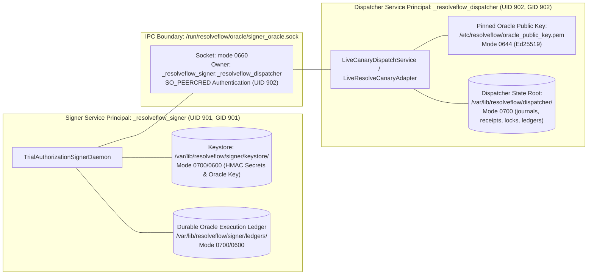
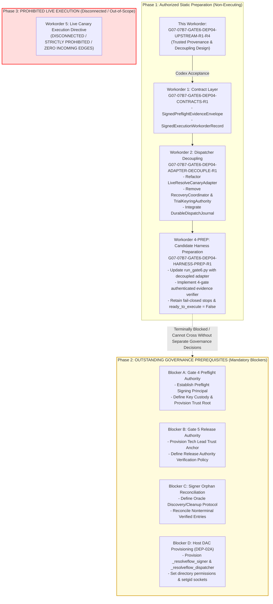

# Workorder G07-07B7-GATE6-DEP04-UPSTREAM-R1 — Trusted Provenance & Dispatcher Recovery Boundary Design (Revision R4)

**Document ID:** `07B7-GATE6-DEP04-UPSTREAM-R1-DESIGN-R4`  
**Issued:** 2026-11-05  
**Status:** `GATE6_DEP04_UPSTREAM_DESIGN_R4_COMPLETED_PENDING_TECH_LEAD_REVIEW`  
**Parent:** Gate 6 readiness dependency. Gate 6 strictly remains `NOT ACCEPTED` and incident-only.  
**Basis:** Plan 07B7 Revision R7 §2; DEP-01 R4 Amended V3; DEP-02B R6; DEP-02C R2; DEP-03 R5; DEP-04-PREP-R5 review `ACCEPTED_FOR_NON_EXECUTING_PREPARATION_ONLY`; DEP-04-UPSTREAM-R1 reviews `CHANGES_REQUIRED` (`docs/architecture/07B7-GATE6-DEP04-UPSTREAM-R1-code-review.md`, `07B7-GATE6-DEP04-UPSTREAM-R1-R2-code-review.md`, and `07B7-GATE6-DEP04-UPSTREAM-R1-R3-code-review.md`).  
**Safety Commitment:** `STATIC_DESIGN_ONLY; NO_EXECUTION; NO_RESOLVE_IMPORT_OR_CONNECTION; NO_LIVE_ADAPTER_CALL; NO_ORACLE_SOCKET_CONNECTION; NO_NETWORK; NO_HOST_PROVISIONING; NO_SYSTEMD; NO_PRODUCTION_KEY_OR_STATE_ACCESS; READY_TO_EXECUTE_FALSE`.

---

## 1. Architectural Objective, Context & Review Remediation

### 1.1 Objective & Context
This design specification resolves all architectural and protocol gaps identified in the Tech Lead Codex reviews `docs/architecture/07B7-GATE6-DEP04-UPSTREAM-R1-code-review.md` and `docs/architecture/07B7-GATE6-DEP04-UPSTREAM-R1-R2-code-review.md`:

1. **Remediation of `DEP04-UPSTREAM-R1-R2-01` (BLOCKER — Terminal Notification Ambiguity & DEP-03 No-Retry Enforcement):**
   Boundary 5B is revised to enforce strict fail-closed behavior under DEP-03. While `NOTIFY_ORACLE_INTENT` distinguishes an unattempted send (Boundary 5A) from an attempted send (Boundary 5B), restart recovery **strictly prohibits retrying terminal notification** if an intent was fsynced without a durable positive Oracle acknowledgement. Persisted intent cannot prove whether the Oracle processed the message before process death. Under DEP-03, any ambiguous send is treated as a permanent `IN_DOUBT` condition: the local target lock is retained permanently, no second request is transmitted, and resolution is left strictly to an authorized out-of-band administrative procedure.
2. **Remediation of `DEP04-UPSTREAM-R1-R2-02` (BLOCKER — Grounding Oracle Durability & Explicit Orphan Dependency):**
   Removed all claims that an orphan `VERIFIED_VALID` execution record at the Oracle "expires" based on authorization timestamps. The accepted `OracleExecutionRecord` schema in `src/services/durable_nonce_ledger.py:127–150` contains `verified_at_iso` but **no expiry field, TTL, or automatic cleanup mechanism**. Once recorded via `record_oracle_execution()`, an execution ID remains permanently in `_verified_execution_ids` until an explicit terminal state is recorded. If a crash occurs after Oracle verification but before Dispatcher local intent (Boundary 1), the resulting orphan entry represents a persistent, nonterminal state under accepted contracts. This gap is formally documented as an **UNRESOLVED UPSTREAM ARCHITECTURAL DEPENDENCY** requiring a separately reviewed contract/workorder before automated orphan reconciliation can exist.
3. **Remediation of `DEP04-UPSTREAM-R1-R2-03` (HIGH — DAG Termination & Governance Gate Realignment):**
   The architecture dependency DAG is restructured to be **terminally blocked** after static contract and adapter decoupling preparation. All lines leading to live execution are severed. Live canary execution cannot be scheduled or authorized until four explicit governance and trust-root dependencies are formally established under separate, approved workorders: (1) Gate 4 preflight signing authority & key custody, (2) Gate 5 Tech Lead trust-root bootstrapping, (3) Signer Oracle orphan discovery/reconciliation protocol, and (4) Host DAC principal provisioning (DEP-02A).

### 1.2 Non-Execution and Non-Provisioning Declaration
This is a **design specification and static source-analysis document only**. It does not:
- Execute or import candidate harness scripts, test runners, or live adapters.
- Access DaVinci Resolve on `DISPLAY=:1`, IPC channels, or UI scripting APIs.
- Connect to or bind AF_UNIX domain sockets (`/run/resolveflow/`).
- Create or modify host system principals (`useradd`), groups, or systemd units.
- Access, generate, or modify production keys, HMAC keystores, or ledgers (`/var/lib/resolveflow/`).
- Issue live challenges, operator attestations, or execution authorizations.

`ready_to_execute = False` is strictly preserved. Gate 6 remains `NOT ACCEPTED` / incident-only. Gate G07, Milestones M1, M2, and M3 strictly remain `OPEN`.

---

## 2. Evidence Provenance & Cryptographic Authority Architecture (§3.1)

### 2.1 Principals, Accountability & Key Custody Matrix

Plan 07B7 §2 and DEP-01 §2.1 establish exactly three operating system principals. All evidence issuance and verification must map strictly to these principals and their accountable human or technical authorities:

| Gate / Evidence | Role & Accountable Authority | Execution Principal (DEP-01 §2.1) | Key Identifier & Type | Trust Root & Key Custody Disposition | Verification Point & Enforcement |
| :--- | :--- | :--- | :--- | :--- | :--- |
| **Gate 2: User Authorization** | Human Director / Creative Approver (`director_id`) | `interactive_user` (UID 1000) / Client UI | `director_key_id` (Ed25519) | Private key in Director keystore; public key registered in Signer trust directory. | Verified by Signer Daemon during token admission check (`verify_approval_envelope`). |
| **Gate 4: Preflight Signoff** | Technical System Verifier (`gate4_preflight_runner`) | `interactive_user` (UID 1000) | **UNRESOLVED DEPENDENCY** | No preflight service principal exists in DEP-01. Private key custody and trust anchor are unprovisioned. | **BLOCKING STOP:** Gate 4 contract and signing authority must be approved before live execution. |
| **Operator Visual Presence** | Physical Supervision & Freshness Attestation | Human Operator physically at `DISPLAY=:1` | `operator_key_id` (Ed25519) | Private key in Operator Console; public key registered in Signer trust directory. | Verified by Signer Daemon against active challenge; digest embedded in `TrialExecutionAuthorization`. |
| **Gate 5: Execution Workorder** | Release / Governance Authority (Tech Lead) | Governance / Administrative Role | `tech_lead_key_id` (Ed25519) | **UNRESOLVED DEPENDENCY** | **BLOCKING STOP:** Requires formal provisioning of Tech Lead trust root before live execution authorization. |
| **Trial Execution Authorization** | Indivisible Mutation Capability Token | `_resolveflow_signer` (UID 901) | `trial_signer_key_id` (HMAC-SHA256) | Keystore `/var/lib/resolveflow/signer/keystore/` (mode `0700/0600`). | Signer Oracle verifies HMAC internally; signs verification response with Oracle Ed25519 key. |
| **Oracle Verification Response** | Cryptographic Dispatch Clearance | `_resolveflow_signer` (UID 901) | `oracle_key_id` (Ed25519) | Key in `/var/lib/resolveflow/signer/keys/`; public key deployed to `/etc/resolveflow/oracle_public_key.pem`. | Dispatcher verifies signature over AF_UNIX IPC using pinned public key (`11-point invariant gate`). |
| **Local Dispatch Receipts** | Local Durable Target Evidence | `_resolveflow_dispatcher` (UID 902) | **NO ASYMMETRIC KEY** (POSIX DAC Authenticated) | Descriptor-anchored directory `/var/lib/resolveflow/dispatcher/receipts/` (mode `0700/0600`). | Authenticated by filesystem UID ownership (`902`), non-blocking flock, and SHA-256 content readback. |

---

### 2.2 Gate 2: User Authorization (`SignedApprovalEnvelope`)

#### 2.2.1 Authority and Contract Binding
Gate 2 represents human creative intent and editorial approval. It is governed by the existing accepted contract: `src/core/contracts/signed_approval_envelope.py` (`SignedApprovalEnvelope`) wrapping `AppOwnedApprovalRecord` (`src/core/contracts/edit_plan_approval_contracts.py`).

#### 2.2.2 Contract Grammar & Canonical Verification
- Enforces `schema_version == 1` (integer, rejecting bool-as-int).
- Signs the 6 canonical RFC 8785 JSON fields (`schema_version`, `approval_record`, `plan_digest_sha256`, `proposal_content_digest_sha256`, `director_key_id`, `signed_at_iso`).
- `director_signature`: 128-character hex string representing an Ed25519 signature over `canonical_json_bytes(signing_fields)`.
- Verified by `TrialAuthorizationSignerService.verify_approval_envelope()` during admission. If the key is revoked in `/var/lib/resolveflow/signer/revocation/`, verification fails closed with `ERR_DIRECTOR_KEY_REVOKED`.

---

### 2.3 Gate 4: Preflight Verification Contract (`SignedPreflightEvidenceEnvelope`)

#### 2.3.1 Architectural Assessment & Missing Dependency
`src/tools/gate4_preflight_runner.py` validates project/timeline UIDs, empty timeline predicates, frame rates, and incident denylists, emitting an RFC 8785 hash-chained audit log. However:
> DEP-01 defines only three principals (`_resolveflow_signer`, `_resolveflow_dispatcher`, `interactive_user`). There is no `Preflight Service Identity` on the host, nor is there an existing checked-in contract or key custody mechanism for preflight signing.

#### 2.3.2 Contract Schema Specification
To enable machine-verifiable admission without relying on unauthenticated audit logs or unsigned JSON files, a contract must be checked into `src/core/contracts/signed_preflight_contracts.py`:

```python
@dataclass(frozen=True)
class SignedPreflightEvidenceEnvelope:
    """Frozen, version-1 envelope encapsulating audited Gate 4 preflight signoff."""
    schema_version: int                             # Strictly 1
    preflight_run_id: str                          # Canonical UUIDv4
    verifier_id: str                               # Verifier identity (e.g., operator or preflight runner)
    verifier_key_id: str                           # Key ID of the signing entity
    verified_at_iso: str                           # UTC ISO-8601 timestamp (Z suffix)
    valid_until_iso: str                           # UTC ISO-8601 timestamp (verified_at_iso + max 1800s)
    
    # Target Identity Bindings
    target_project_uid: str                        # Exact '4fd4272d-f0bc-445c-9490-5723cd6831c2'
    target_project_name: str                       # Exact 'RF_TRIAL_AEC8F0A7A365D5F5'
    target_timeline_uid: str                       # Exact 'ba6a6775-8ec4-41a4-bf2f-704de902e68d'
    target_timeline_name: str                      # Exact 'RF_TRIAL_TL_AEC8F0A7A365D5F5'
    target_timeline_fps_numerator: int             # 24
    target_timeline_fps_denominator: int           # 1
    observed_start_frame: int                      # 86400
    
    # Technical Verifications (all must be True)
    project_and_timeline_active: bool              # True
    empty_timeline_verified: bool                  # True (0 video clips, 0 audio clips, 0 markers)
    topology_verified: bool                        # True (Track count >= 1 video, Video Track 1 exists)
    incident_denylist_verified: bool               # True (Target not in incident denylist)
    media_pool_source_verified: bool               # True (Canary clip present in Media Pool with matching hash)
    
    # Cryptographic Anchors
    source_file_sha256: str                        # Exact canary clip content SHA-256
    audit_chain_head_sha256: str                   # SHA-256 head of fsynced preflight audit log
    
    # Signature
    verifier_signature: str                        # 128-hex Ed25519 signature over canonical RFC 8785 bytes
```

#### 2.3.3 Trust-Root Disposition & Blocking Stop
Because `SignedPreflightEvidenceEnvelope` is not checked into `src/core/contracts/` and no preflight signing key is registered, **Gate 4 is an UNRESOLVED UPSTREAM DEPENDENCY**. The candidate harness must fail closed with:
```
ERR_GATE4_SIGNED_PREFLIGHT_CONTRACT_REQUIRED
```
Unsigned JSON files or raw audit log existence checks are strictly forbidden.

---

### 2.4 Operator Visual Presence Attestation Contract (`SignedOperatorConsentEnvelope`)

#### 2.4.1 Existing Accepted Contract
Visual presence and contemporaneous empty-timeline attestation are governed by `src/core/contracts/signed_operator_consent_envelope.py` (`SignedOperatorConsentEnvelope`).

#### 2.4.2 Contract Grammar & Mandatory Claims
- `schema_version == 1`
- `operator_id`: Human operator identity
- `challenge_id`: Challenge token minted by Signer Daemon (`^[A-Za-z0-9_-]{4,64}$`)
- `client_nonce`: Canonical UUIDv4
- `confirmation_phrase`: Strictly `"CONFIRM_CANARY_TRIAL_EXECUTION"`
- `freshness_attestation`: Strictly `"OPERATOR_VISUAL_ATTESTATION_EMPTY_TIMELINE_VERIFIED"`
- `target_project_uid`: Exact `'4fd4272d-f0bc-445c-9490-5723cd6831c2'`
- `target_timeline_uid`: Exact `'ba6a6775-8ec4-41a4-bf2f-704de902e68d'`
- `source_file_sha256`: Content digest of `canary_test_1080p24.mp4`
- `action_type`: `"INSERT_CLIP"`, `track_type`: `"video"`, `track_index`: `1`, `record_frame`: `86400`, `duration_frames`: `120`
- `operator_key_id`: Registered key ID in Signer keyring
- `operator_signature`: 128-hex Ed25519 signature over canonical RFC 8785 bytes of 22 fields

#### 2.4.3 Clarification of Authorization vs. Attestation Digest Binding
As affirmed in code review `DEP04-PREP-R5`:
`TrialExecutionAuthorization` contains `token_nonce` (the authorization token's own single-use execution nonce), but does NOT contain `challenge_nonce`. The challenge nonce is embedded in `SignedOperatorConsentEnvelope.challenge_id`.
The cryptographic binding between authorization and operator consent is:
$$\text{auth.operator\_gesture\_digest\_sha256} == \text{SHA-256}(\text{canonical\_json\_bytes}(\text{consent\_envelope}))$$
The candidate harness verifies this digest equality against the signed envelope. It does not infer or fabricate fields on the DTO.

---

### 2.5 Gate 5: Active Execution Workorder Contract & Binding

#### 2.5.1 Remediation of Append-Only `.bridge/task.md` Limitation
Parsing `.bridge/task.md` with regex for `Status: GATE6_LIVE_EXECUTION_AUTHORIZED` was rejected in R5 because historical status headers exist in append-only files and markdown text on an unprivileged filesystem lacks cryptographic non-repudiation.

#### 2.5.2 Contract Schema Specification
To bind live execution to an unambiguous Release Authority directive, `SignedExecutionWorkorderRecord` must be checked into `src/core/contracts/signed_execution_workorder_contracts.py`:

```python
@dataclass(frozen=True)
class SignedExecutionWorkorderRecord:
    """Frozen, version-1 envelope encapsulating Release Authority execution signoff."""
    schema_version: int                             # Strictly 1
    workorder_id: str                              # e.g., 'G07-07B7-GATE6-EXEC-R1'
    tech_lead_id: str                              # Tech Lead / Release Authority identity
    tech_lead_key_id: str                          # Pinned Tech Lead Ed25519 key ID
    issued_at_iso: str                             # UTC ISO-8601 timestamp
    valid_until_iso: str                           # UTC ISO-8601 timestamp (max issued_at + 3600s)
    
    # Exact Target & Harness Pinning
    target_project_uid: str                        # '4fd4272d-f0bc-445c-9490-5723cd6831c2'
    target_timeline_uid: str                       # 'ba6a6775-8ec4-41a4-bf2f-704de902e68d'
    reviewed_candidate_sha256: str                 # Exact SHA-256 of candidate harness script
    permitted_command: str                         # Exact permitted command line
    
    # Bound Authorization and Plan Anchors
    plan_digest_sha256: str                        # Exact SHA-256 of TimelineExecutionPlan
    action_payload_digest_sha256: str              # Exact SHA-256 of canonical 16-key action payload
    execution_id: str                              # Exact execution_id authorized
    
    # Signature
    tech_lead_signature: str                       # 128-hex Ed25519 signature over canonical RFC 8785 bytes
```

#### 2.5.3 Trust-Root Disposition & Blocking Stop
Because Tech Lead public key provisioning and trust anchoring are **UNRESOLVED UPSTREAM DEPENDENCIES**, Gate 5 cannot be verified in candidate harnesses. The harness must stop fail-closed with:
```
ERR_GATE5_EXECUTION_UNAUTHORIZED
```

---

## 3. Dispatcher Recovery & Principal Separation Architecture (§3.2)

### 3.1 Principal Separation & Zero Keystore Access Mandate
In strict accordance with **DEP-01 §2.1**, the host enforces Linux DAC isolation between `_resolveflow_signer` (UID 901) and `_resolveflow_dispatcher` (UID 902):



**Architectural Invariants:**
- `_resolveflow_dispatcher` is denied all filesystem access to `/var/lib/resolveflow/signer/` (`EACCES`).
- The Dispatcher possesses **zero HMAC secret keys** and zero symmetric cryptographic capabilities.
- The Dispatcher does **not** sign receipts with asymmetric keys; local receipts are secured by descriptor-anchored directory DAC (`0700/0600`), inode non-blocking flocks, and SHA-256 digest readbacks.

---

### 3.2 Audit & Reassignment of Existing `RecoveryCoordinator` Duties

The table below audits the 7 duties of `RecoveryCoordinator` (`src/services/durable_trial_target_ledger.py`) and specifies their decoupled disposition:

| Duty / Capability | Implementation in `RecoveryCoordinator` | Coupling Issue | New Principal Owner | Target Mechanism |
| :--- | :--- | :--- | :--- | :--- |
| **Keyring Instantiation** | `TrialKeyringAuthority(keystore_path)` | Opens Signer private keystore directly (`EACCES`). | **Signer Service** (`_resolveflow_signer`) | Keystore remains strictly private to Signer. Dispatcher has NO keyring instance. |
| **Authorization HMAC Verification** | `validate_trial_execution_authorization` & `keyring.get_key()` | Requires trial HMAC key. | **Signer Oracle** via IPC | Dispatcher submits `OracleVerificationRequest`. Signer Oracle validates HMAC and returns Ed25519 `OracleVerificationResponse`. |
| **Operator Reconciliation Verification** | `reconcile_timeline()` calls `keyring.get_operator_key()` | Requires operator HMAC/key material. | **Signer Oracle** (Out-of-Band) | Reconciliation requires explicit out-of-band administrative procedure. No automated clearance DTO. |
| **Proof HMAC Verification** | `keyring.get_key(raw_proof['key_id'])` | Requires trial HMAC key. | **Dispatcher Local + Oracle Notification** | Dispatcher verifies physical Resolve state using `DaVinciResolveScript` readback; writes local receipt; reports terminal outcome to Oracle. |
| **Target Exclusion Locking** | Descriptor-anchored `.locks/{hash}.lock` via `fcntl.flock` | None (pure filesystem locking). | **Dispatcher Local** | Retained in Dispatcher's own `/var/lib/resolveflow/dispatcher/locks/`. |
| **Directory Descriptor Anchoring** | Holds open fds for `journals/`, `receipts/`, `locks/`, `ledgers/` | None (pure filesystem safety). | **Dispatcher Local** | Retained in Dispatcher's state directory. |
| **Durable Target Ledger Transitions** | `DurableTrialTargetLedgerService` (`target_ledger.v2.json`) | None (local state). | **Dispatcher Local** | Retained in Dispatcher's local state to enforce zero-redispatch and in-doubt locking. |

---

### 3.3 Wire Protocol Alignment with Checked-In DEP-02C Contracts

All Dispatcher-to-Signer Oracle communication utilizes the accepted contracts in `src/core/contracts/oracle_ipc_contracts.py` over `/run/resolveflow/oracle/signer_oracle.sock`:

#### 3.3.1 Enforced Enums and Fields
- **Terminal States (`VALID_TERMINAL_STATES`):**
  Strictly `COMPLETED`, `ABORTED`, `IN_DOUBT`. Value `FAILED` is forbidden.
- **Terminal Response Statuses (`VALID_TERMINAL_RESPONSE_STATUSES`):**
  Strictly `ACCEPTED`, `TERMINAL_ALREADY_RECORDED`, `REJECTED`, `FAILED`. Value `SUCCESS` is forbidden.

#### 3.3.2 Wire Framing Sequence Diagram
```mermaid
sequenceDiagram
    participant D as LiveCanaryDispatchService / Adapter (UID 902)
    participant S as Signer Verification Oracle (UID 901)

    Note over D: 1. Send OracleVerificationRequest (Schema 2, 4-byte framed)
    D->>S: OracleVerificationRequest [request_id, execution_id, authorization_id, action_payload_digest, target_uids]
    Note over S: Verify SO_PEERCRED (UID == 902)<br/>Verify 32-field HMAC using private keystore<br/>Verify Nonce Ledger & Revocation Manifest<br/>Record VERIFIED_VALID in DurableOracleExecutionLedger
    S-->>D: OracleVerificationResponse [verification_result: VERIFIED_VALID, oracle_signature (Ed25519)]
    Note over D: Verify Ed25519 signature via /etc/resolveflow/oracle_public_key.pem<br/>Verify 11-point acceptance invariants

    Note over D: 2. Pre-Mutation Durability Ordering<br/>Step 1: Write-Ahead Audit Intent fsync<br/>Step 2: Target Ledger Reservation fsync (RESERVED)<br/>Step 3: WAL Reservation fsync (ACTION_PENDING)<br/>Step 4: Target Exclusion Lock (stable inode flock)

    Note over D: 3. Dispatch to Resolve API -> Physical Readback

    alt Branch 1: Verified Success (COMPLETED)
        Note over D: WAL FINISH(COMPLETED) & Receipt COMPLETED fsynced<br/>Step 8c: Write-Ahead NOTIFY_ORACLE_INTENT fsync
        D->>S: OracleTerminalNotificationRequest [terminal_state: "COMPLETED"]
        Note over S: Append to DurableOracleExecutionLedger (mode 0600)
        S-->>D: OracleTerminalNotificationResponse [status: "ACCEPTED", terminal_state: "COMPLETED"]
        Note over D: Local Ledger EXHAUSTED(COMPLETED); Target lock released
    else Branch 2: Clean Abort Before Mutation (ABORTED)
        Note over D: Pre-mutation tripwire or unconsumed capability<br/>WAL FINISH(ABORTED) & Receipt ABORTED fsynced<br/>Step 8c: Write-Ahead NOTIFY_ORACLE_INTENT fsync
        D->>S: OracleTerminalNotificationRequest [terminal_state: "ABORTED"]
        Note over S: Append to DurableOracleExecutionLedger (mode 0600)
        S-->>D: OracleTerminalNotificationResponse [status: "ACCEPTED", terminal_state: "ABORTED"]
        Note over D: Local Ledger EXHAUSTED(ABORTED); Target lock released
    else Branch 3: Ambiguous Failure / Crash (IN_DOUBT)
        Note over D: IPC timeout, Resolve exception, or crash during mutation<br/>Retain target exclusion lock permanently<br/>Write .in_doubt tombstone; Local Ledger IN_DOUBT_LOCKED<br/>Step 8c: Write-Ahead NOTIFY_ORACLE_INTENT fsync
        D->>S: OracleTerminalNotificationRequest [terminal_state: "IN_DOUBT"]
        Note over S: Append to DurableOracleExecutionLedger (mode 0600)
        S-->>D: OracleTerminalNotificationResponse [status: "ACCEPTED", terminal_state: "IN_DOUBT"]
        Note over D: Local Ledger IN_DOUBT_LOCKED; Target lock RETAINED PERMANENTLY
    end
```

---

### 3.4 Crash/Restart State Matrix Grounded in Source Ordering & No-Retry

The execution ordering in `LiveCanaryDispatchService.dispatch_live_canary()` dictates the exact state on disk across crashes:

```
[Oracle Verification] -> [Signer Ledger fsync] -> [Oracle Response]
   -> [Dispatcher Intent fsync] -> [Ledger RESERVED fsync] -> [WAL ACTION_PENDING fsync]
   -> [Target Lock flock] -> [Resolve Mutation] -> [Readback]
   -> [WAL FINISH fsync] -> [Receipt fsync] -> [NOTIFY_ORACLE_INTENT fsync]
   -> [Oracle Terminal Notification] -> [Oracle Response ACCEPTED] -> [Lock Release]
```

The deterministic restart-repair matrix is defined below:

| Crash Boundary | Dispatcher Local State at Crash | Signer Oracle Ledger State | Restart-Repair Determination & Action | Local Target Lock Disposition | Oracle Terminal Disposition |
| :--- | :--- | :--- | :--- | :--- | :--- |
| **Boundary 1: Crash after Oracle records `VERIFIED_VALID`, before Dispatcher Intent fsync** | Idle. No audit intent, no reservation, no WAL. | `VERIFIED_VALID` (active/nonterminal). **No automatic expiry exists.** | **Persistent Unresolved Orphan:** Dispatcher has zero local knowledge of execution ID. At Oracle, `OracleExecutionRecord` remains permanently in `_verified_execution_ids`. Token cannot be re-verified. | Unlocked. | **UNRESOLVED DEPENDENCY:** Current wire API lacks orphan discovery. Signer ledger retains nonterminal record until explicit administrative reconciliation. |
| **Boundary 2: Crash after Intent / Ledger `RESERVED`, before WAL `ACTION_PENDING`** | `target_ledger.v2.json` has `RESERVED`. No WAL entry. | `VERIFIED_VALID`. | **Pre-Mutation Abort:** Zero mutation proven by absence of WAL entry. Transition local ledger to `EXHAUSTED(ABORTED)`. | Cleanly released. | Send first `OracleTerminalNotificationRequest(terminal_state="ABORTED")`. Oracle records `ABORTED`. |
| **Boundary 3: Crash after WAL `ACTION_PENDING`, before Mutation Boundary** | WAL has `ACTION_PENDING`. Clean-abort capability unconsumed. | `VERIFIED_VALID`. | **Pre-Mutation Abort:** Zero mutation proven by unconsumed capability. Write WAL `FINISH(ABORTED)`, receipt `ABORTED`, local ledger `EXHAUSTED(ABORTED)`. | Cleanly released. | Send first `OracleTerminalNotificationRequest(terminal_state="ABORTED")`. Oracle records `ABORTED`. |
| **Boundary 4: Crash during Resolve Mutation or Unverified Readback** | WAL has `ACTION_PENDING`. Mutation boundary crossed. | `VERIFIED_VALID`. | **PERMANENT IN_DOUBT:** Mutation outcome ambiguous. Transition local ledger to `IN_DOUBT_LOCKED`. Write `.in_doubt` tombstone. Zero auto-retry, zero auto-rollback. | **RETAINED PERMANENTLY.** | Send first `OracleTerminalNotificationRequest(terminal_state="IN_DOUBT")`. Oracle records `IN_DOUBT`. |
| **Boundary 5A: Crash after Receipt fsynced, BEFORE `NOTIFY_ORACLE_INTENT` fsync** | Receipt `COMPLETED` durable. No `NOTIFY_ORACLE_INTENT` in journal. | `VERIFIED_VALID`. | **Definite Non-Send:** Fsync proves notification was never attempted. Exactly ONE first send is permitted on restart using `terminal_state="COMPLETED"`. | Released ONLY after verified `ACCEPTED`. | Send first `OracleTerminalNotificationRequest(terminal_state="COMPLETED")`. |
| **Boundary 5B: Crash AFTER `NOTIFY_ORACLE_INTENT` fsync, without recorded Oracle ACK** | Receipt `COMPLETED` durable. `NOTIFY_ORACLE_INTENT` present in journal. | `VERIFIED_VALID` or `COMPLETED`. | **Ambiguous Send (DEP-03 Violation Guard):** Send was possibly attempted. Whether Oracle received it is unknown. **AUTOMATIC RETRY IS STRICTLY FORBIDDEN.** Transition local ledger to `IN_DOUBT_LOCKED`. Write `.in_doubt` tombstone. | **RETAINED PERMANENTLY.** | **NO RESEND / NO RETRY.** Target remains locked in-doubt pending out-of-band administrative reconciliation. |

#### Administrative Reconciliation for Unlocking `IN_DOUBT`
In accordance with finding `DEP04-UPSTREAM-R1-01`, automated IPC reconciliation is rejected because no accepted contract or daemon endpoint exists. Unlocking a target from `IN_DOUBT_LOCKED` requires an out-of-band administrative intervention:
1. An authorized operator physically inspects DaVinci Resolve on `DISPLAY=:1`.
2. Target project and timeline are either manually restored to empty or verified clean.
3. Operator runs a dedicated offline administrative tool with root/service privileges that verifies timeline emptiness, writes an audited reconciliation tombstone, removes the `.in_doubt` marker, and clears the target lock.
4. Any automated in-band protocol is deferred to a future, separately reviewed workorder.

---

### 3.5 Refactoring of `LiveResolveCanaryAdapter`

To decouple `LiveResolveCanaryAdapter` from the Signer private keystore:

#### 3.5.1 Constructor Signature Refactoring
```python
class LiveResolveCanaryAdapter:
    """Decoupled Live Resolve Canary Adapter (OS-Principal Compliant)."""

    def __init__(
        self,
        *,
        journal: DurableDispatchJournal,               # Descriptor-anchored journal (Dispatcher-owned)
        resolve_client: Any,                           # Resolved DaVinciResolveScript client
        pinned_oracle_public_key: Ed25519PublicKey,    # Pinned public key for verification
        proof_ledger_dir: Optional[str] = None,        # Optional proof directory
    ) -> None:
        # KeyringAuthority and keystore_path completely removed.
        ...
```

#### 3.5.2 Verification Logic Refactoring
- **Authorization Binding:** Accepts pre-verified `OracleVerificationResponse` (Ed25519-signed by Signer Oracle). Verifies the 11-point acceptance invariant using `pinned_oracle_public_key`. Eliminates all direct HMAC key access.
- **Physical Readback Verification:** Eliminates HMAC-signed proofs. Queries live DaVinci Resolve timeline (`timeline.GetTrackItems("video", 1)`), computes clip duration (120), start frame (86400), and clip item hash. Outcomes are recorded in the local durable receipt and transmitted to the Oracle via `OracleTerminalNotificationRequest`.

---

## 4. Decision DAG, Governance Blockers & Implementation Sequence (§3.3)

### 4.1 Architecture Dependency DAG & Terminal Execution Block

The follow-on sequence is explicitly divided into an **authorized static preparation sequence** and a **terminal block** representing outstanding governance prerequisites:



> [!IMPORTANT]
> **Complete Disconnection of Live Execution:**
> `WO5 (Live Canary Execution Directive)` is completely disconnected in the DAG above with **zero incoming edges**. There is strictly **no path** from Phase 1 (Authorized Static Preparation) or Phase 2 (Governance Prerequisites) leading to `WO5`. Live canary execution is strictly prohibited. Fulfilling or accepting the Phase 2 governance blockers does NOT automatically authorize, open, or schedule live execution. Any live execution would require an independent, external governance decision and a de novo workorder issued completely outside this preparation hierarchy.

---

### 4.2 Bounded Follow-On Preparation Workorders with Exact File Allowlists

The following bounded workorders cover only Phase 1 static preparation. **No live execution workorder can be scheduled or authorized from this sequence.**

#### Workorder 1: Cryptographic Provenance Contracts (`G07-07B7-GATE6-DEP04-CONTRACTS-R1`)
- **Objective:** Check in frozen data contract definitions and serialization tests for Gate 4 preflight evidence and Gate 5 execution workorders.
- **Prerequisites:** Acceptance of `07B7-GATE6-DEP04-UPSTREAM-R1-DESIGN-R4`.
- **Mode:** `LOCAL_CONTRACTS_ONLY; NO_RUNTIME; NO_EXECUTION`.
- **Exact File Allowlist:**
  1. `src/core/contracts/signed_preflight_contracts.py` (new)
  2. `src/core/contracts/signed_execution_workorder_contracts.py` (new)
  3. `tests/core/contracts/test_signed_preflight_contracts.py` (new)
  4. `tests/core/contracts/test_signed_execution_workorder_contracts.py` (new)
  5. `.bridge/task.md` & `.bridge/report.md` (append-only)

#### Workorder 2: Dispatcher Recovery Decoupling (`G07-07B7-GATE6-DEP04-ADAPTER-DECOUPLE-R1`)
- **Objective:** Refactor `LiveResolveCanaryAdapter` to consume Oracle IPC verification responses and `DurableDispatchJournal` without instantiating `TrialKeyringAuthority` or `keystore_path`.
- **Prerequisites:** Workorder 1 accepted.
- **Mode:** `LOCAL_CODE_AND_MOCK_ADAPTER_TESTS_ONLY; NO_RESOLVE_CONNECTION; NO_HOST_PROVISIONING`.
- **Exact File Allowlist:**
  1. `src/services/live_resolve_canary_adapter.py` (modify constructor and proof verification)
  2. `tests/services/test_live_resolve_canary_adapter_decoupled.py` (new)
  3. `.bridge/task.md` & `.bridge/report.md` (append-only)

#### Workorder 4-PREP: Candidate Harness Preparation (`G07-07B7-GATE6-DEP04-HARNESS-PREP-R1`)
- **Objective:** Update `/tmp/resolveflow-gate6/run_gate6.py` and `.bridge/ux-evidence/G07-07B7-GATE6/run_gate6.py` to consume the decoupled adapter and strict authenticated provenance verifiers, maintaining unconditional line-1 dependency stops and `ready_to_execute = False`.
- **Prerequisites:** Workorders 1 and 2 accepted.
- **Mode:** `STATIC_HARNESS_PREPARATION_ONLY; READY_TO_EXECUTE_FALSE`.
- **Exact File Allowlist:**
  1. `/tmp/resolveflow-gate6/run_gate6.py`
  2. `.bridge/ux-evidence/G07-07B7-GATE6/run_gate6.py`
  3. `docs/architecture/07B7-GATE6-DEP04-HARNESS-PREP-R1-code-review.md`
  4. `.bridge/task.md` & `.bridge/report.md` (append-only)

---

### 4.3 Component Reusability & Review Audit

| Component / File | Current Status | Reusability Disposition | Review Action Required |
| :--- | :--- | :--- | :--- |
| `src/core/contracts/signed_approval_envelope.py` | Accepted (Gate 3) | **100% Reusable**. Satisfies Gate 2 user authorization. | None. Preserved as-is. |
| `src/core/contracts/signed_operator_consent_envelope.py` | Accepted (Gate 3) | **100% Reusable**. Satisfies Operator Visual Presence. | None. Preserved as-is. |
| `src/core/contracts/oracle_ipc_contracts.py` | Accepted (DEP-02B R6) | **100% Reusable**. Governs Oracle IPC framing and DTOs. | None. Preserved as-is. |
| `src/services/trial_authorization_signer_daemon.py` | Accepted (DEP-02B R6) | **100% Reusable**. Production Signer daemon. | None. Preserved as-is. |
| `src/services/durable_dispatch_journal.py` | Accepted (DEP-03 R5) | **100% Reusable**. Descriptor-anchored Dispatcher journal. | None. Preserved as-is. |
| `src/services/live_canary_dispatch_service.py` | Accepted (DEP-03 R5) | **100% Reusable**. Live Dispatcher service wrapper. | None. Preserved as-is. |
| `src/tools/gate4_preflight_runner.py` | Accepted (Gate 4 R16) | **Partially Reusable**. Logic is valid, but needs contract wrapper. | Requires wrapper emitting `SignedPreflightEvidenceEnvelope`. |
| `src/services/live_resolve_canary_adapter.py` | Coupled (Gate 3) | **Requires Refactoring**. Must decouple from `RecoveryCoordinator`. | Subject to Workorder 2 review. |
| `src/services/durable_trial_target_ledger.py` | Coupled (Gate 3) | **Deprecated for Dispatcher**. Replaced by `DurableDispatchJournal`. | Signer retains ledger service; Dispatcher decouples. |
| `/tmp/resolveflow-gate6/run_gate6.py` | Accepted R5 (Non-exec) | **Requires Update**. Must integrate decoupled components. | Subject to Workorder 4-PREP review. |

---

## 5. Completion State & Safety Declarations

1. **Design Coverage:** This document completely remediates findings `DEP04-UPSTREAM-R1-R2-01`, `DEP04-UPSTREAM-R1-R2-02`, `DEP04-UPSTREAM-R1-R2-03`, and `DEP04-UPSTREAM-R1-R3-01`:
   - §3.4: Strictly bans terminal notification retry after an ambiguous send (Boundary 5B). If `NOTIFY_ORACLE_INTENT` is fsynced but no positive ACK is recorded, the Dispatcher fails closed, marks local state `IN_DOUBT_LOCKED`, retains target lock, and never retries automatically.
   - §3.4 (Boundary 1): Grounded Oracle durability in accepted schema (`OracleExecutionRecord`), proving that orphan `VERIFIED_VALID` entries do not expire automatically and documenting this gap as an explicit unresolved upstream dependency.
   - §4.1: Restructured the DAG to be terminally blocked after static preparation; completely removed the directed edge to `WO5`, rendering Phase 3 disconnected with zero incoming edges and prohibiting live execution.
2. **Safety State Preserved:**
   - `ready_to_execute = False` is strictly maintained.
   - Gate 6 remains `NOT ACCEPTED` / incident-only.
   - Gate G07, Milestones M1, M2, and M3 strictly remain `OPEN`.
   - Zero execution, zero Resolve import/connection, zero IPC, zero network, zero host modifications, zero key generation.
