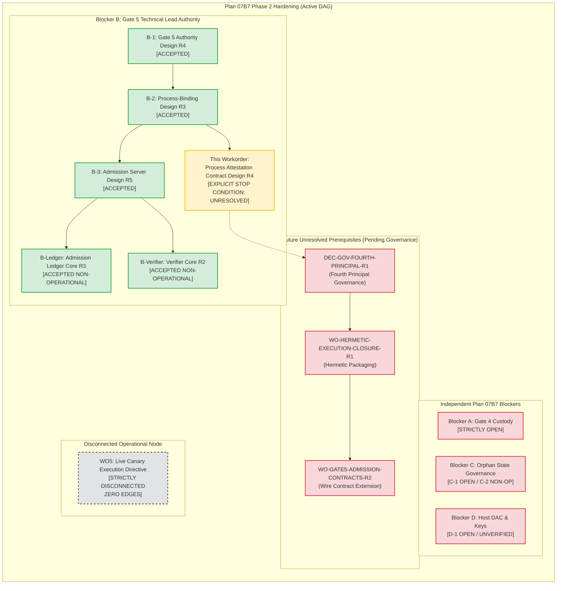

# Gate 6 Phase 2 Blocker B: Same-UID Process Attestation Contract Design (Revision R4)

**Document ID:** `07B7-GATE6-PHASE2-BLOCKER-B-GATE5-PROCESS-ATTESTATION-CONTRACT-DESIGN-R1`  
**Revision:** `R4`  
**Workorder:** `G07-07B7-GATE6-PHASE2-BLOCKER-B-GATE5-PROCESS-ATTESTATION-CONTRACT-DESIGN-R1`  
**Date:** 2026-11-05  
**Parent:** Plan 07B7 Phase 2 Hardening, Blocker B. Follows accepted Gate 5 Process-Binding Design R3 (`07B7-GATE6-PHASE2-BLOCKER-B-GATE5-PROCESS-BINDING-DESIGN-R1.md`), accepted Admission Server Design R5 (`07B7-GATE6-PHASE2-BLOCKER-B-GATE5-ADMISSION-SERVER-DESIGN-R1.md`), accepted Admission Ledger Core R3 (`src/services/durable_admission_ledger.py`), and accepted Admission Verifier Core R2 (`src/services/dispatcher_admission_verifier_core.py`).  
**Mode:** `DOCUMENTATION_AND_STATIC_SOURCE_REVIEW_ONLY; REPOSITORY_READS_ONLY; NO_SOURCE_OR_CONTRACT_EDITS; NO_TESTS_OR_IMPORTS_OR_COMPILATION; NO_HOST_OR_PRODUCTION_STATE_ACCESS; NO_KEY_OR_TRUST_ROOT_ACCESS; NO_SOCKET_OR_NETWORK; NO_RESOLVE; NO_LIVE_OPERATIONS; READY_TO_EXECUTE_FALSE`.

---

## 1. Executive Summary & Problem Formulation

Under Plan 07B7 post-incident hardening, Blocker B governs Gate 5 Technical Lead Release Authority. Gate 5 ensures that no execution workflow can alter the DaVinci Resolve canary target project (`RF_TRIAL_AEC8F0A7A365D5F5`) or timeline (`RF_TRIAL_TL_AEC8F0A7A365D5F5`) without cryptographic authorization from the Technical Lead.

### 1.1 The Accepted B-2 Process-Attestation Gap
In the accepted Gate 5 Release Authority Design R4 (§3.5) and Gate 5 Process-Binding Design R3 (§1.1, §4.3), the Technical Lead cryptographically signs `SignedExecutionWorkorderRecord`, which binds the field `reviewed_candidate_sha256` (the 64-character lowercase hexadecimal SHA-256 digest of the audited entrypoint script `run_gate6.py`).

However, as formally established across the accepted architecture baseline:
1. **Candidate Digest vs. Execution-Image Identity:** A cryptographic signature over `reviewed_candidate_sha256` certifies artifact approval at review time. It binds strictly the static entrypoint file bytes on disk. It does **not** assert kernel-level control or in-memory execution attestation over the operating system process connecting to the `_resolveflow_dispatcher` admission socket.
2. **The Same-UID Sibling Process Threat Model:** On the `AF_UNIX` admission socket (`dispatcher.sock`), `SO_PEERCRED` authenticates only caller POSIX numeric credentials: PID, UID, and GID (`struct ucred { pid_t pid; uid_t uid; gid_t gid; }`). In the accepted Three-Principal architecture (DEP-01 §2.1, Boundary Design R8), both the legitimate candidate runner and any concurrent, arbitrary sibling process in the interactive user session execute under identical credentials: `interactive_user:1000`.
3. **Impotence of `SO_PEERCRED` for Same-UID Provenance:** `SO_PEERCRED` reports `{pid, uid=1000, gid=1000}` equally for an audited candidate harness and an unauthorized adversary process. Because the four signed envelopes (`SignedApprovalEnvelope`, `SignedOperatorConsentEnvelope`, `SignedPreflightEvidenceEnvelope`, `SignedExecutionWorkorderRecord`) are transmitted over the wire and become readable to any process under UID 1000, an unconfined sibling process under UID 1000 could replay or present valid envelopes over the socket while executing completely unreviewed code.
4. **Intra-UID DAC Barrier Absence:** In standard Linux DAC, processes sharing UID 1000 possess identical read and write permissions over user files, tokens, sockets, and memory interfaces (`/proc/<pid>/mem`, subject to Yama ptrace scope). Therefore, a user-space supervised launcher running under UID 1000 cannot protect a private attestation key or secret token from sibling processes under UID 1000.

### 1.2 Objective & Scope of this Workorder
This document provides a source-grounded design for an attestation contract that addresses the B-2 same-UID process identity gap. In strict compliance with Workorder Section 1:
- It evaluates whether a secure attestation protocol is derivable under the accepted Three-Principal model (`_resolveflow_signer:901`, `_resolveflow_dispatcher:902`, `interactive_user:1000`).
- It assesses four candidate protocol mechanism families.
- Because the accepted Three-Principal model and DAC boundary cannot support a secure intra-UID attestation key or Dispatcher-supervised spawn without breaking least-privilege or introducing unapproved authorities, this document records an **EXPLICIT STOP CONDITION** on operational attestation, marking the protocol `UNRESOLVED` and specifying the exact prerequisite governance decisions and workorders required for resolution.
- It defines a draft specification of the target attestation contract to guide future authorized workorders once governance prerequisites are settled.
- It specifies integration ordering, failure modes, and DAG alignment, keeping Node `WO5 (Live Canary Execution Directive)` completely disconnected with zero incoming and zero outgoing edges.

### 1.3 Strict Statement Classification Taxonomy
In adherence to repository governance standards, all statements throughout this document are classified as:
- **[ACCEPTED-DESIGN]:** Formally accepted requirements in accepted architecture documents (e.g. Process-Binding Design R3, Admission Server Design R5, Gate 5 Design R4, Gate 4 Design R10, DEP-01 R4 Amended V3, Phase 2 Boundary Design R8).
- **[IMPLEMENTED-CONTRACT]:** Cryptographic and schema behaviors verified in checked-in repository source code (e.g. `src/core/contracts/`, `src/services/dispatcher_admission_verifier_core.py`, `src/services/durable_admission_ledger.py`).
- **[PACKAGING-DECLARATION]:** Declarations in host setup, systemd units, or packaging scripts (e.g. `deploy/systemd/`, `deploy/scripts/`); facts about configuration code, not proof of host state.
- **[PROPOSAL]:** Architectural policies, mechanism models, and contract specifications proposed in this document.
- **[UNRESOLVED-PREREQUISITE]:** Governance, host-state, or implementation gaps that remain strictly open and require future authorized workorders.

---

## 2. Threat Model & Security Assurance Claim Analysis

### 2.1 Candidate File Digest vs. Execution-Image Identity
- **[ACCEPTED-DESIGN]:** The Technical Lead's signature on `SignedExecutionWorkorderRecord` commits to `reviewed_candidate_sha256`.
- **[PROPOSAL]:** A fundamental security distinction exists between a static file digest and execution-image identity:

```
┌────────────────────────────────────────────────────────────────────────────────────────┐
│              STATIC FILE DIGEST vs. RUNTIME EXECUTION-IMAGE IDENTITY                   │
├──────────────────────────────────────────┬─────────────────────────────────────────────┤
│ Dimension                                │ Static Candidate File Digest                │
├──────────────────────────────────────────┼─────────────────────────────────────────────┤
│ Target of Attestation                    │ Fixed file bytes on disk (run_gate6.py)     │
│ Binding Mechanism                        │ Ed25519 signature over SHA-256 hash        │
│ Kernel Protection                        │ None (passive bytes until opened)           │
│ Interpreter Closure Binding              │ ZERO (Does not bind python3 binary,         │
│                                          │ site-packages, dynamic loader, or glibc)   │
│ Process Binding                          │ ZERO (Does not identify connecting process) │
│ In-Flight Memory Protection              │ ZERO (Does not protect loaded RAM pages)    │
├──────────────────────────────────────────┼─────────────────────────────────────────────┤
│ Dimension                                │ Runtime Execution-Image Identity            │
├──────────────────────────────────────────┼─────────────────────────────────────────────┤
│ Target of Attestation                    │ Live OS process memory, code, & environment │
│ Binding Mechanism                        │ Sealed descriptor / OS kernel attestation   │
│ Kernel Protection                        │ memfd sealing, namespace, or LSM enforcement│
│ Interpreter Closure Binding              │ Complete hermetic runtime manifest          │
│ Process Binding                          │ Bound to specific PID, start-time, & socket │
│ In-Flight Memory Protection              │ Protected against same-UID memory injection │
└──────────────────────────────────────────┴─────────────────────────────────────────────┘
```

An adversary can execute unauthorized code while presenting a valid static candidate digest by:
1. Spawning an arbitrary Python script under UID 1000 that transmits the pre-signed `DispatcherAdmissionRequest` containing the authentic `reviewed_candidate_sha256`.
2. Mutating the Python virtual environment (`.venv/lib/python3.12/site-packages/`), altering module bytecode imported during candidate execution while leaving `run_gate6.py` untouched.
3. Poisoning environment variables (`PYTHONPATH`, `PYTHONHOME`, `LD_PRELOAD`, `LD_LIBRARY_PATH`) to intercept execution prior to `run_gate6.py` entry.

### 2.2 Sibling Processes Under `interactive_user:1000`
- **[ACCEPTED-DESIGN]:** Under the Three-Principal model, DaVinci Resolve Studio and the candidate execution runner must both execute under `interactive_user:1000` to share the X11 display session (`DISPLAY=:1`) and communicate with Resolve's local scripting socket.
- **[PROPOSAL]:** The presence of arbitrary sibling processes under UID 1000 introduces severe intra-UID security vulnerabilities:
  1. **Credential Equivalence:** Every process under UID 1000 returns `uid=1000` and `gid=1000` via `SO_PEERCRED`. The kernel POSIX credential mechanism provides zero granularity to differentiate between a legitimate runner process and an attacker process.
  2. **File and Token Snooping:** In a standard POSIX environment, any process under UID 1000 can read any regular file with permissions `0600` or `0644` owned by UID 1000. An attestation token, symmetric shared secret, or private key stored in `/tmp`, `~/.resolveflow/`, or process memory can be read by any concurrent sibling process under UID 1000.
  3. **Memory Inspection & Tampering (`ptrace`):** Unless Linux Yama ptrace restrictions (`kernel.yama.ptrace_scope >= 2`) or `PR_SET_DUMPABLE=0` are explicitly enforced, any process under UID 1000 can attach to another UID 1000 process via `PTRACE_ATTACH` or open `/proc/<pid>/mem` for read/write access.

### 2.3 Peer Credential Limits, PID Reuse & Descriptor Inheritance
1. **PID Ephemerality & Reuse:** `SO_PEERCRED` reports `pid_t pid`. In Linux, process IDs are non-cryptographic integers bounded by `/proc/sys/kernel/pid_max` (typically 32,768 or 4,194,304). PIDs wrap around quickly under heavy process churn. If a verifier records an authorization for PID $P$, and process $P$ exits, a newly spawned rogue process could be assigned PID $P$ and inherit the prior authorization unless the verifier checks immutable process start time (`/proc/<pid>/stat:starttime` or Linux 5.3+ `pidfd`).
2. **Descriptor Inheritance & Transfer:** On UNIX domain sockets, open file descriptors can be passed between processes using `sendmsg()` with `SCM_RIGHTS`. If an authorized runner process opens a connection to `dispatcher.sock` and inadvertently passes or leaks the socket descriptor across `fork()`, a sibling process can inherit or receive the connected descriptor and issue unauthorized frames.
3. **Process Races & TOCTOU:** Checking `/proc/<peer_pid>/cmdline` or `/proc/<peer_pid>/exe` from the Dispatcher daemon is inherently vulnerable to TOCTOU races:
   - For Python scripts, `/proc/<peer_pid>/exe` points to `/usr/bin/python3`, never the script.
   - `/proc/<peer_pid>/cmdline` is located in user-controlled process memory and can be trivially overwritten by the process itself using `prctl(PR_SET_MM_ARG_START)` or modifying `argv[0]`.

### 2.4 Excluded Threats & Assurance Claim Boundaries
- **[ACCEPTED-DESIGN]:** The following threats are strictly out of scope:
  1. **Kernel Ring-0 / Root Compromise:** An adversary possessing UID 0 or kernel privileges can subvert all kernel seals, namespaces, and DAC.
  2. **Direct DaVinci Resolve Binary Memory Tampering:** Memory injection directly into the running `/opt/resolve/bin/resolve` process on `DISPLAY=:1`.
  3. **Hardware / Physical Attacks:** Cold-boot attacks, bus sniffing, or physical RAM probing.
- **[PROPOSAL]:** *Assurance Claim Boundary:* A valid process attestation protocol must guarantee that **the process connected to `dispatcher.sock` is executing the exact, unmodified entrypoint and hermetic execution closure approved by the Technical Lead, and that no unverified sibling process under UID 1000 can impersonate that connection or inject arbitrary commands.**

---

## 3. Source-Grounded Contract & Interface Inventory

To ensure complete grounding in repository source code, this section inventories every relevant checked-in contract and architecture specification:

```
┌────────────────────────────────────────────────────────────────────────────────────────┐
│                      REPOSITORY CONTRACT & INTERFACE INVENTORY                         │
├───────────────────────────────────┬──────────────────────────────────┬─────────────────┤
│ Contract / Architecture Artifact  │ Implemented Fields & Mechanisms  │ Process-Binding │
│                                   │                                  │ Capability      │
├───────────────────────────────────┼──────────────────────────────────┼─────────────────┤
│ DispatcherAdmissionRequest        │ schema_version (1), request_id,  │ NONE (Zero PID, │
│ (src/core/contracts/              │ approval_env, consent_env,       │ zero token,     │
│  dispatcher_admission_contracts)  │ preflight_env, workorder_rec     │ zero attestation│
├───────────────────────────────────┼──────────────────────────────────┼─────────────────┤
│ SignedExecutionWorkorderRecord    │ workorder_id, execution_id,      │ STATIC ENTRY-   │
│ (src/core/contracts/              │ reviewed_candidate_sha256,       │ POINT ONLY      │
│  signed_execution_workorder)      │ permitted_command, plan_digest   │ (No runtime PID)│
├───────────────────────────────────┼──────────────────────────────────┼─────────────────┤
│ DispatcherAdmissionVerifierCore   │ Pure in-memory verification of 4 │ FAILS CLOSED    │
│ (src/services/                    │ envelopes; revalidates snapshots;│ Reports         │
│  dispatcher_admission_verifier)   │ ALL_UNRESOLVED_PREREQUISITES     │ B2_ATTESTATION_ │
│                                   │ includes B2 attestation          │ UNRESOLVED      │
├───────────────────────────────────┼──────────────────────────────────┼─────────────────┤
│ DurableAdmissionLedger            │ Atomic replay check for          │ REPLAY DEFENSE  │
│ (src/services/                    │ execution_id, preflight_run_id,  │ ONLY            │
│  durable_admission_ledger)        │ workorder_id; append-only WAL    │ (No process PID)│
├───────────────────────────────────┼──────────────────────────────────┼─────────────────┤
│ Admission Server Design R5        │ Wire framing, SO_PEERCRED check, │ PROPOSED /      │
│ (docs/architecture/07B7-...-B-3)  │ Phase 1-8 transaction ordering   │ UNRESOLVED (§5) │
├───────────────────────────────────┼──────────────────────────────────┼─────────────────┤
│ Process-Binding Design R3         │ Evaluates 4 mechanism families;  │ PROPOSED /      │
│ (docs/architecture/07B7-...-B-2)  │ identifies intra-UID gap         │ UNRESOLVED (§4) │
└───────────────────────────────────┴──────────────────────────────────┴─────────────────┘
```

### 3.1 `DispatcherAdmissionRequest` (Checked-in Source)
- **[IMPLEMENTED-CONTRACT]:** In `src/core/contracts/dispatcher_admission_contracts.py`, `DispatcherAdmissionRequest` is an immutable dataclass containing strictly:
  - `schema_version`: int 1
  - `request_id`: Canonical lowercase UUIDv4
  - `approval_envelope`: `SignedApprovalEnvelope`
  - `operator_consent_envelope`: `SignedOperatorConsentEnvelope`
  - `preflight_evidence_envelope`: `SignedPreflightEvidenceEnvelope`
  - `execution_workorder_record`: `SignedExecutionWorkorderRecord`
- **[PROPOSAL]:** *Critical Interface Limitation:* `DispatcherAdmissionRequest` carries **zero fields** for connecting process identity, runner PID, process creation timestamp, execution closure manifest, or launcher attestation token.

### 3.2 `SignedExecutionWorkorderRecord` (Checked-in Source)
- **[IMPLEMENTED-CONTRACT]:** In `src/core/contracts/signed_execution_workorder_contracts.py`, `SignedExecutionWorkorderRecord` carries:
  - `reviewed_candidate_sha256`: Lowercase 64-character hexadecimal SHA-256 hash.
  - `permitted_command`: Non-empty string (`"canary-trial-execute"`).
- **[PROPOSAL]:** The workorder record binds what candidate artifact was approved by the Technical Lead, but contains zero mechanisms to enforce which process executes it.

### 3.3 `DispatcherAdmissionVerifierCore` (Revision R2 Source)
- **[IMPLEMENTED-CONTRACT]:** In `src/services/dispatcher_admission_verifier_core.py`, the core verifier validates the four authorization envelopes against injected public keys and evaluates semantic cross-bindings.
- **[IMPLEMENTED-CONTRACT]:** `ALL_UNRESOLVED_PREREQUISITES` explicitly includes:
  - `UNRESOLVED_PROCESS_IDENTITY = "CANDIDATE_PROCESS_IDENTITY_UNRESOLVED"`
  - `UNRESOLVED_B2_ATTESTATION = "B2_SAME_UID_ATTESTATION_UNRESOLVED"`
- **[IMPLEMENTED-CONTRACT]:** When `require_operational_readiness=True` is requested, the verifier fails closed immediately with `ERR_OPERATOR_CHALLENGE_UNRESOLVED` and reports `operational_admission_permitted=False`.

---

## 4. Evaluation of Candidate Protocol Mechanism Alternatives

In compliance with Workorder Section 3.3, this section assesses four protocol mechanism alternatives against technical feasibility, direct code binding, and compatibility with the Three-Principal model:

```
┌────────────────────────────────────────────────────────────────────────────────────────┐
│                   CANDIDATE PROTOCOL MECHANISM ASSESSMENT                              │
├───────────────────────────────────┬────────────────────────────────────────────────────┤
│ Alternative                       │ Architectural Verdict & Viability                  │
├───────────────────────────────────┼────────────────────────────────────────────────────┤
│ 1. Dispatcher-Supervised Spawn    │ UNVIABLE UNDER 3-PRINCIPAL MODEL:                  │
│    with Inherited Private Socket  │ Dispatcher (UID 902) cannot setuid(1000) or access │
│                                   │ DISPLAY=:1 without root / CAP_SETUID.              │
├───────────────────────────────────┼────────────────────────────────────────────────────┤
│ 2. Sealed Entrypoint + Hermetic   │ PARTIAL PRIMITIVE ONLY: Seals files against TOCTOU │
│    Closure Pinning (memfd)        │ but cannot prove WHICH process under UID 1000      │
│                                   │ connected to dispatcher.sock.                      │
├───────────────────────────────────┼────────────────────────────────────────────────────┤
│ 3. OS-Enforced Launcher Isolation │ UNRESOLVED / REQUIRES 4TH PRINCIPAL:               │
│    (Dedicated UID 903 or User-NS) │ Solves key custody, but requires new OS principal  │
│                                   │ and complex X11 display credential proxying.       │
├───────────────────────────────────┼────────────────────────────────────────────────────┤
│ 4. Kernel / Hardware Attestation  │ UNVIABLE ON STOCK DESKTOP WORKSTATION:             │
│    (Linux IMA/EVM, TPM 2.0, eBPF) │ Requires kernel recompilation, secure boot infra,  │
│                                   │ and root daemons outside repository scope.         │
└───────────────────────────────────┴────────────────────────────────────────────────────┘
```

### 4.1 Alternative 1: Dispatcher-Supervised Spawn with Inherited Private Socket
- **[PROPOSAL]:** The Dispatcher daemon creates an un-named socket pair via `socketpair(AF_UNIX, SOCK_STREAM, 0)`. The Dispatcher directly forks and executes the candidate runner, passing one socket descriptor as fd 3 and retaining the other end.
- **What it Proves:** Complete peer connection provenance. Because the socket descriptor is inherited across `fork()`/`exec()` and was never bound to the filesystem namespace (`no path`), no sibling process under UID 1000 can connect to it.
- **What it Cannot Prove:** Does not prove in-memory closure integrity unless paired with memory sealing.
- **Why it Fails Under Three-Principal Model (Process-Binding Design R3 §4.3):**
  - The Dispatcher daemon runs strictly under unprivileged system user `_resolveflow_dispatcher:902` with `NoNewPrivileges=true` and `ProtectSystem=strict`.
  - The Dispatcher possesses **zero `CAP_SETUID` capability and zero root privileges**. It cannot switch UID to 1000.
  - If the Dispatcher executes the runner under UID 902, the runner cannot connect to DaVinci Resolve Studio (which is owned by UID 1000 and requires user X11 session authority on `DISPLAY=:1`).
  - Granting the Dispatcher root privileges or `CAP_SETUID` would completely dismantle the post-incident privilege separation established under Plan 07B7.
- **Governance / Source Changes Needed:** Would require either rewriting DaVinci Resolve's architecture or granting Dispatcher root execution authority. **Strictly Rejected.**

### 4.2 Alternative 2: Sealed Entrypoint plus Hermetic Execution-Closure Pinning
- **[PROPOSAL]:** Packaging the complete candidate execution closure (Python runtime, standard library, `.venv` dependencies, and entrypoint) into an immutable, write-sealed single-file binary or read-only squashfs image. At runtime, the runner opens the image using `memfd_create()` and applies `F_ADD_SEALS` with `F_SEAL_WRITE | F_SEAL_GROW | F_SEAL_SHRINK | F_SEAL_SEAL`.
- **What it Proves:** Eliminates disk-level TOCTOU races on `run_gate6.py` and closes the mutable `.venv` dependency tampering gap. Guarantees that the executed bytes cannot be modified in-place on disk or in the backing file descriptor.
- **What it Cannot Prove:** **Does NOT prove process connection provenance.** Even if an authorized sealed binary exists, a concurrent rogue script running under UID 1000 can connect to `dispatcher.sock`, present valid signed envelopes (intercepted or read from disk), and trigger admission. The Dispatcher has no kernel-level mechanism over `dispatcher.sock` to verify whether the connecting client is the sealed binary or an arbitrary Python script.
- **Verdict:** Necessary supporting integrity primitive, but **insufficient on its own** to satisfy Prerequisite B-2.

### 4.3 Alternative 3: OS-Enforced Launcher Isolation (Dedicated Fourth Principal or User Namespace)
- **[PROPOSAL]:** Introduce a dedicated system user (e.g. `_resolveflow_launcher:903`) with a distinct systemd service sandbox, or a specialized Linux user namespace container. The launcher holds a private attestation key in `/var/lib/resolveflow/launcher_key.pem` (mode `0600`, owner `903:903`), verifies the candidate script hash, and launches the candidate process while attesting its creation to the Dispatcher.
- **What it Proves:** Resolves the intra-UID DAC key custody problem. Because the launcher runs under UID 903, processes under UID 1000 cannot read its private key or attach via ptrace.
- **What it Cannot Prove:**
  - If the launcher runs as UID 903, it faces the same barrier as Alternative 1: how does it launch a process under UID 1000 with access to `DISPLAY=:1` and user Resolve scripting cookies without root privileges?
  - If the launcher proxies Resolve scripting calls, it becomes an unapproved fourth execution tier.
- **Governance / Source Changes Needed:** Requires formal governance authorization to create an unapproved **Fourth OS Principal** (`_resolveflow_launcher:903`), systemd service unit, DAC layout, and trust anchor.

### 4.4 Alternative 4: Hardware & Kernel-Level Attestation (Linux IMA/EVM, TPM 2.0, eBPF LSM)
- **[PROPOSAL]:** Enforcing process attestation via Linux kernel Integrity Measurement Architecture (IMA appraisal), TPM 2.0 PCR extension, or an eBPF Linux Security Module (LSM) hook on `security_socket_connect()`. The kernel inspects the connecting process's executable inode and enforces that only an exact binary matching a signed appraisal policy can connect to `dispatcher.sock`.
- **What it Proves:** Absolute kernel-level guarantee of executable identity directly on socket connection.
- **What it Cannot Prove:** Does not naturally handle dynamic Python bytecode interpretation without custom kernel Python interpreters (PEP 578 runtime audit hooks).
- **Why it Fails in Current Environment:**
  - ResolveFlow runs on standard unprivileged Linux desktop workstations (Ubuntu/Debian) with generic kernels.
  - Linux IMA appraisal requires custom kernel command-line parameters (`ima_appraise=enforce`), custom x509 certificates in kernel keyring, and root-level provisioning.
  - eBPF LSM hooks require `CAP_SYS_ADMIN` / `CAP_BPF` and kernel 5.7+ with `CONFIG_BPF_LSM=y`.
- **Verdict:** Unviable for standard desktop deployment without extensive, unapproved operating system and kernel modifications.

### 4.5 Formal Prohibition Statement
In adherence to Workorder Section 3.3:
> **PROHIBITION:** `SO_PEERCRED`, filesystem directory ownership (`0750` / `02750`), a caller-supplied PID, a caller-supplied hash, or an unauthenticated token passed over the socket **MUST NOT** be presented or accepted as sufficient same-UID attestation. Any mechanism relying on caller-provided self-attestation without kernel-isolated cryptographic provenance is fundamentally vulnerable to sibling-process impersonation under UID 1000.

---

## 5. Architectural Decision: Explicit Stop Condition & Prerequisite Roadmap

### 5.1 Formal Architectural Decision: EXPLICIT STOP CONDITION
- **[PROPOSAL]:** **Decision Verdict: EXPLICIT STOP CONDITION — STATUS: `UNRESOLVED`.**
- **Justification:**
  1. Under the accepted Three-Principal model (`_resolveflow_signer:901`, `_resolveflow_dispatcher:902`, `interactive_user:1000`), a secure same-UID process attestation protocol **cannot be derived from accepted repository interfaces and POSIX DAC boundaries alone**.
  2. The Dispatcher (UID 902) cannot spawn or supervise processes under UID 1000 without root capabilities (violating least privilege).
  3. A user-space launcher under UID 1000 cannot protect attestation keys or tokens from sibling processes under UID 1000 (intra-UID DAC failure).
  4. Creating a Fourth OS Principal (`_resolveflow_launcher:903`), granting `CAP_SETUID` to the Dispatcher, or mandating kernel-level IMA/eBPF requires governance, systemd, and operating system authority that does not exist in Plan 07B7 Phase 2.
- **Governance Action:** In accordance with Workorder Section 1 ("If no safe contract can be specified from accepted interfaces, document the precise stop condition instead of inventing an authority or trust mechanism"), Prerequisite B-2 is formally recorded as **UNRESOLVED PENDING GOVERNANCE DECISION**.

---

### 5.2 Draft Specification of Target Attestation Contract (For Future Reference)
To ensure that future workorders have a concrete technical foundation once governance decisions are settled, this section specifies the draft contract for a hypothetical process attestation record:

#### 5.2.1 Contract Schema Definition (`SignedProcessAttestationRecord`)
```python
@dataclass(frozen=True)
class SignedProcessAttestationRecord:
    """Draft Version 1 Process Attestation Contract.

    STATUS: UNIMPLEMENTED / SPECIFICATION PROPOSAL ONLY.
    Not approved for runtime or wire transmission under Plan 07B7 Phase 2.
    """

    schema_version: int                          # Strictly int 1 (rejects bool)
    attestation_id: str                          # Canonical lowercase UUIDv4
    process_pid: int                             # Connecting client PID (> 0)
    process_start_time_iso: str                  # ISO 8601 UTC timestamp of process creation
    process_start_time_ticks: int                # uint64 clock ticks (/proc/<pid>/stat:starttime)
    reviewed_candidate_sha256: str               # 64-char lowercase hex (matches Gate 5 workorder)
    execution_closure_sha256: str                # 64-char lowercase hex (hermetic bundle digest)
    connection_nonce: str                        # 64-char lowercase hex (issued by Dispatcher)
    execution_id: str                            # Canonical lowercase UUIDv4 (matches Gate 5)
    attestor_key_id: str                         # Attestor public key identifier
    attestor_signature: str                      # 128-char lowercase hex (PureEd25519)
```

#### 5.2.2 Canonical Signing Payload Dictionary & Bytes
- **Signing Payload Dict:** Excludes detached `attestor_signature`:
  ```python
  def canonical_signing_payload_dict(self) -> Dict[str, Any]:
      return {
          "attestation_id": self.attestation_id,
          "connection_nonce": self.connection_nonce,
          "execution_closure_sha256": self.execution_closure_sha256,
          "execution_id": self.execution_id,
          "process_pid": self.process_pid,
          "process_start_time_iso": self.process_start_time_iso,
          "process_start_time_ticks": self.process_start_time_ticks,
          "reviewed_candidate_sha256": self.reviewed_candidate_sha256,
          "schema_version": self.schema_version,
      }
  ```
- **Signing Bytes:** Deterministic RFC 8785 canonical JSON bytes via `canonical_json_bytes()`.
- **Signature Algorithm:** PureEd25519 (RFC 8032), 128-character lowercase hexadecimal string.

#### 5.2.3 Connection Nonce & Session Binding
- The Dispatcher generates a cryptographically secure 32-byte random challenge (`secrets.token_hex(32)`) immediately upon `accept()` of the client connection.
- The Dispatcher transmits this `connection_nonce` to the client in the initial handshake frame.
- The attestor must include this exact `connection_nonce` in the signed payload.
- This binds the attestation proof strictly to the active, open socket file descriptor, preventing replay across different socket connections.

#### 5.2.4 Process-Start Identity Semantics (Anti-PID-Reuse)
- The Dispatcher reads the client's `SO_PEERCRED` to acquire `peer_pid`.
- The Dispatcher checks `/proc/<peer_pid>/stat` field 22 (`starttime` in clock ticks after boot).
- The Dispatcher asserts:
  $$\text{attestation.process\_pid} \equiv \text{peer\_pid}$$
  $$\text{attestation.process\_start\_time\_ticks} \equiv \text{kernel\_starttime}$$
- If the PID exited and was recycled, `starttime` will differ, triggering immediate fail-closed abort.

#### 5.2.5 Fail-Closed Verification Failure Codes
- `ERR_PROCESS_ATTESTATION_MISSING`: Client omitted attestation frame.
- `ERR_PROCESS_PID_MISMATCH`: Attested PID does not match socket `SO_PEERCRED` PID.
- `ERR_PROCESS_STARTTIME_MISMATCH`: Attested process start time does not match kernel `/proc/<pid>/stat`.
- `ERR_PROCESS_NONCE_MISMATCH`: Attested `connection_nonce` does not match active connection nonce.
- `ERR_PROCESS_CANDIDATE_MISMATCH`: Attested `reviewed_candidate_sha256` does not match Gate 5 workorder.
- `ERR_PROCESS_CLOSURE_MISMATCH`: Attested `execution_closure_sha256` does not match approved hermetic package.
- `ERR_ATTESTOR_SIGNATURE_INVALID`: Ed25519 signature verification fails against attestor trust anchor.
- `ERR_ATTESTOR_TRUST_ANCHOR_MISSING`: Attestor public key trust anchor not provisioned.
- `ERR_PROCESS_ATTESTATION_UNRESOLVED`: Returned in Phase 2 baseline because attestation is unresolved.

---

### 5.3 Prerequisite Governance Decisions & Workorders Roadmap
To resolve the Stop Condition and enable operational process attestation, the following sequential workorders are required:

```
┌────────────────────────────────────────────────────────────────────────────────────────┐
│                      PREREQUISITE RESOLUTION ROADMAP FOR B-2                           │
├────────────────────────────────────────────────────────────────────────────────────────┤
│ 1. DEC-GOV-FOURTH-PRINCIPAL-R1 (Governance Decision)                                   │
│    Formally authorize whether a dedicated Fourth OS Principal                          │
│    (_resolveflow_launcher:903) or a Linux user namespace is adopted.                  │
├────────────────────────────────────────────────────────────────────────────────────────┤
│ 2. WO-HERMETIC-EXECUTION-CLOSURE-R1 (Packaging Engineering)                            │
│    Package the candidate runner and .venv into an immutable, single-file sealed         │
│    executable, generating a deterministic execution_closure_sha256.                    │
├────────────────────────────────────────────────────────────────────────────────────────┤
│ 3. WO-GATE5-ADMISSION-CONTRACTS-R2 (Contract Extension)                                │
│    Formally extend DispatcherAdmissionRequest to carry SignedProcessAttestationRecord   │
│    and implement handshake connection nonce exchange.                                  │
├────────────────────────────────────────────────────────────────────────────────────────┤
│ 4. WO-HOST-DAC-LAUNCHER-PROVISIONING-R1 (Host Hardening under Blocker D)               │
│    Install launcher systemd unit, DAC permissions, and provision launcher trust anchor │
│    /etc/resolveflow/launcher_public_key.pem under root custody.                        │
└────────────────────────────────────────────────────────────────────────────────────────┘
```

---

## 6. Integration, Failure Ordering & DEP-03 Boundary

### 6.1 Transaction Lifecycle & Integration Placement
The attestation verification step integrates into the Dispatcher admission transaction sequence strictly **before** durable admission ledger consumption, Signer Oracle clearance verification, and pre-mutation target journaling/reservation:

```
[Client Connect]
  │
  ├─► Phase 1: SO_PEERCRED Mutual Verification (pid, uid=1000, gid=1000)
  │            (Fails -> ERR_GATE5_PEER_REJECTED -> Socket Close)
  │
  ├─► Phase 2: Dispatcher transmits Ephemeral connection_nonce (32 bytes)
  │
  ├─► Phase 3: Client transmits Framed DispatcherAdmissionRequest
  │
  ├─► Phase 4: Pure Envelope Verification (DispatcherAdmissionVerifierCore R2)
  │            - Evaluates Gate 2, Gate 4, Gate 5 Ed25519 signatures
  │            - Evaluates Semantic Cross-Binding Matrix (§3.3)
  │            (Fails -> Return Typed Failure Code -> Socket Close)
  │
  ├─► Phase 5: Process Attestation Verification (Hypothetical Future Step)
  │            - Verifies attestor Ed25519 signature
  │            - Verifies PID + starttime against kernel
  │            - Verifies connection_nonce matches Phase 2
  │            - Verifies candidate and closure digests
  │            (Fails or Unresolved -> Return ERR_PROCESS_ATTESTATION_UNRESOLVED -> Socket Close)
  │
════════════════════════════════════════════════════════════════════════════════════════
  BOUNDARY B: DURABLE ADMISSION CONSUMPTION (DurableAdmissionLedger R3)
  - Preflight Run ID consumed (consume_admission())
  - Execution ID consumed
  - Workorder ID consumed
  (Replay or Torn Tail -> ERR_GATE5_WORKORDER_ALREADY_CONSUMED / Poison -> Abort)
  *NOTE: Boundary B consumption is permanent and durable on disk. If subsequent
  Phase 6 Oracle clearance or journal steps fail or reject, Boundary B records are
  NOT rolled back. Replay or automatic retry of consumed identifiers is strictly prohibited.*
════════════════════════════════════════════════════════════════════════════════════════
  │
  ├─► Phase 6: Signer Oracle Clearance Verification (Signer Oracle Socket)
  │            - Transmits OracleVerificationRequest over /run/resolveflow/oracle/signer_oracle.sock
  │            - Verifies OracleVerificationResponse against 11 acceptance invariants
  │              via _verify_oracle_verification_response()
  │            (Oracle rejects or fails -> Target remains unreserved / INITIAL;
  │             zero journal writes; client aborts; NO retry of consumed Boundary B tokens)
  │
════════════════════════════════════════════════════════════════════════════════════════
  BOUNDARY C: PRE-MUTATION TARGET JOURNALING & EXCLUSION LOCK
  (DurableDispatchJournal / LiveCanaryDispatchService:835–875)
  - Step 1: write_audit_intent() with fsync -> DISPATCH_ATTEMPT_INTENT committed
  - Step 2: reserve_target() with fsync -> target state in target_ledger.v2.json -> RESERVED
  - Step 3: write_action_pending() with fsync -> target state in target_ledger.v2.json -> ACTIVE
  - Step 4: acquire_target_lock() -> non-blocking exclusive file lock on .locks/.lock
════════════════════════════════════════════════════════════════════════════════════════
  │
  ├─► Phase 7: Live Adapter Execution Boundary (DEP-03)
  │            LiveResolveCanaryAdapter.execute_live_canary_action()
  │            (Crosses process boundary into DaVinci Resolve Scripting API)
  │
  ├─► Phase 8: Terminal Commit & Journal Receipt Publication
  │            self._journal.commit_terminal(execution_id, "COMPLETED", receipt_data=receipt_data) with fsync
  │            -> Directly publishes receipt.json via DurableDispatchJournal
  │            -> Transitions target state in target_ledger.v2.json: ACTIVE -> EXHAUSTED
  │            (Note: receipt publication is performed directly by DurableDispatchJournal;
  │             the separate ExecutionReceiptService belongs exclusively to TrustedCanaryDispatchService
  │             and does NOT participate in this LiveCanaryDispatchService flow)
  │
  └─► Phase 9: Signer Oracle Terminal Notification & Lock Release
               - self._notify_oracle_terminal(): transmits OracleTerminalNotificationRequest(terminal_state="COMPLETED")
                 to Signer Oracle over /run/resolveflow/oracle/signer_oracle.sock
               - self._journal.release_target_lock(): releases ephemeral target exclusion lock (.locks/.lock)
                 only after verified positive terminal notification
```

### 6.2 Failure Scenarios & In-Doubt Lockdown
- **Attestation Failure / Unresolved Prerequisite (Phase 5):** The transaction aborts at Phase 5. Because Boundary B has not been crossed, **zero replay identifiers are consumed, zero target reservation occurs, zero journal writes occur, and zero target mutation is initiated.**
- **Concurrent Connections, Transferred Descriptors & Proof Substitution Limits:**
  - *Distinct Connections:* When two independent processes open separate socket connections to `dispatcher.sock`, each connection receives a distinct, cryptographically random `connection_nonce` (Phase 2). For independent connections, an attestation record bound to Process A's nonce and PID/starttime cannot be presented over Process B's distinct connection.
  - *Transferred or Inherited Descriptors (SCM_RIGHTS / Fork):* As identified in §2.3, Linux UNIX domain socket semantics allow an open connected file descriptor to be transferred across same-UID processes via `SCM_RIGHTS` (or inherited across unconfined `fork()`). If Process B receives or inherits Process A's already-connected socket descriptor, Process B communicates over the exact same socket connection and shares Process A's `connection_nonce`. Because `SO_PEERCRED` samples credentials only at initial connection establishment time (`connect()`), `SO_PEERCRED` continues reporting Process A's PID and credentials.
  - *Unresolved B-2 Threat:* Consequently, the proposed `connection_nonce` plus `SO_PEERCRED` PID/starttime check does **not** by itself detect descriptor handoff or prevent same-UID descriptor reuse by an unreviewed sibling process. This gap remains an **EXPLICITLY UNRESOLVED B-2 THREAT** under the current Three-Principal model and DAC architecture. The draft contract does **not** claim to prevent same-UID process impersonation or proof substitution over transferred descriptors; resolving this threat requires a separately governed, kernel-enforced descriptor/process binding (e.g. Fourth Principal OS isolation via `DEC-GOV-FOURTH-PRINCIPAL-R1` or Landlock/cgroup socket confinement).
- **Oracle Clearance Rejection or Transport Failure (Phase 6):**
  - If the Signer Oracle rejects authorization or the connection over `/run/resolveflow/oracle/signer_oracle.sock` fails, the transaction immediately terminates before any journal records or reservations are made.
  - **Durable Admission Consumption at Boundary B is NOT rolled back:** The identifiers (`workorder_id`, `execution_id`, `preflight_run_id`) remain durably consumed in `DurableAdmissionLedger`. Replay or automatic retry of these consumed identifiers is strictly prohibited.
  - **Target Remains Unreserved:** Because Boundary C was not entered, the target project and timeline remain in the `INITIAL` (unreserved) state in `target_ledger.v2.json`. Zero journal entries (`DISPATCH_ATTEMPT_INTENT` or `ACTION_PENDING`) are written.
  - The client must abort and cannot redispatch without a completely fresh, re-approved workorder and new run IDs.
- **Client Disconnect Prior to Boundary C:** If the client disconnects or crashes before Boundary C (either before or during Phase 6), the Dispatcher aborts the transaction. Target status remains unreserved; ephemeral locks are cleared; consumed Boundary B tokens remain burned.
- **Crash During Boundary C Steps:**
  - *Crash after Step 1 (`write_audit_intent`) but before Step 2 (`reserve_target`):*
    - `write_audit_intent()` appends `DISPATCH_ATTEMPT_INTENT` to `execution.log` with `fsync()`.
    - In checked-in `durable_dispatch_journal.py` source (lines 498–590), `DurableDispatchJournal._recover_from_files()` reads only the `locks/` directory, `target_ledger.v2.json`, and `execution_journal.wal`; **it does NOT read or reconcile `execution.log`**.
    - On restart, journal recovery does not observe this intent-only record and does NOT construct a target reservation in `_target_state` or `target_ledger.v2.json`. The target is **NOT recovered as `RESERVED` by this journal**.
    - **Mandatory Administrative Investigation Gate (Admission Server Design R5 §4.4.3 Sub-boundary C.1):** Under post-incident safety policy, any detected presence of an uncommitted `DISPATCH_ATTEMPT_INTENT` in `execution.log` during audit indicates an interrupted dispatch pipeline and **strictly mandates a formal administrative incident investigation before issuing any fresh workorders against the target**.
    - A fresh workorder, new execution IDs, or re-approved tokens alone are **strictly prohibited** from resuming dispatch without this prior administrative investigation and clearance. Boundary B identifiers remain permanently burned.
  - *Crash after Step 2 (`reserve_target`) but before Step 3 (`write_action_pending`):* Target has transitioned to `RESERVED`. Subsequent dispatch attempts against this target reject with `ERR_TARGET_NOT_AVAILABLE` (`RESERVED_TARGET_COLLISION`).
- **Failure or Disconnect In Mutation Window (After Step 3 / During Phase 7):** In strict compliance with accepted DEP-03 semantics:
  - Once Step 3 (`write_action_pending`) completes, the target is in the `ACTIVE` state.
  - If the connection drops, the process crashes, or the adapter call hangs/fails while the canary action is in flight, crash recovery or timeout forces the target state to `IN_DOUBT_LOCKED`.
  - The `.in_doubt` lock marker is written to disk.
  - Zero automatic retry, zero redispatch, and zero automatic unlocking are permitted.

---

## 7. Decision DAG Alignment & Safety Invariants

### 7.1 Hardening DAG Visualization



### 7.2 Safety Invariants Unconditionally Preserved
- `ready_to_execute = False` is strictly maintained across all modules and documentation.
- Gate 6 strictly remains `NOT ACCEPTED` / incident-only.
- Gate G07, Milestones M1, M2, and M3 strictly remain `OPEN`.
- Blocker A (Gate 4 Preflight Custody) remains `NO_DECISION_RECORDED_PENDING_FULL_QUORUM` and `STRICTLY OPEN`.
- Blocker B (Gate 5 Authority) remains `OPEN / UNRESOLVED`.
- Prerequisite C-1 remains `STRICTLY OPEN`; C-2 remains non-operational implementation artifacts only.
- Prerequisite D-1 remains `OPEN / UNVERIFIED`.
- Node `WO5 (Live Canary Execution Directive)` remains **COMPLETELY DISCONNECTED** in the execution DAG, with strictly zero incoming edges and strictly zero outgoing edges.
- Target project `RF_TRIAL_AEC8F0A7A365D5F5` and timeline `RF_TRIAL_TL_AEC8F0A7A365D5F5` on `DISPLAY=:1` were outside the scope of this workorder and were not inspected, connected to, or altered.
- Zero host modifications, zero private key generation, zero trust-root creation, zero credentials, zero network operations, zero socket IPC, zero launcher implementation, and zero Resolve API calls occurred.

---

## 8. Summary of Evidence Limits

In compliance with Workorder Section 3.7:
1. **Repository Source Facts:** All references to `DispatcherAdmissionRequest`, `SignedExecutionWorkorderRecord`, `SignedApprovalEnvelope`, `SignedOperatorConsentEnvelope`, `SignedPreflightEvidenceEnvelope`, `DispatcherAdmissionVerifierCore`, and `DurableAdmissionLedger` are strictly grounded in checked-in repository source code.
2. **Accepted Architecture Facts:** All citations of DEP-01, DEP-02A, DEP-03, Phase 2 Boundary Design R8, Gate 4 Design R10, Gate 5 Authority Design R4, and Process-Binding Design R3 reflect formally accepted design records.
3. **Proposals & Explicit Stop Conditions:** The analysis of candidate attestation families, the draft `SignedProcessAttestationRecord` schema, and the decision to record an explicit stop condition are architecture proposals. They do not represent approved runtime capabilities or implemented code.
4. **Zero Host Inspection Affirmation:** No commands were executed to inspect `/proc`, active system processes, `/etc/resolveflow`, `/var/lib/resolveflow`, `/run/resolveflow`, private keys, unix domain sockets, systemd services, X11 display state, or DaVinci Resolve application state.
