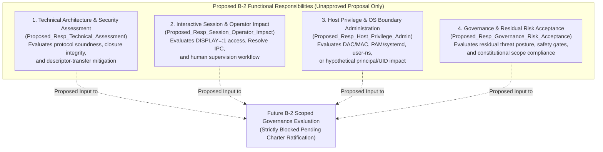
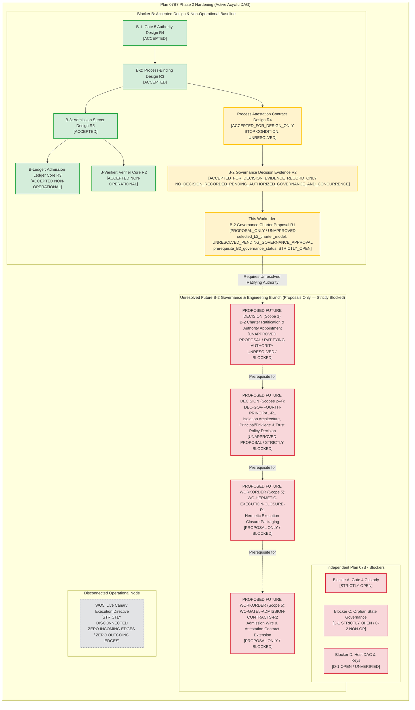

# 07B7-GATE6-PHASE2-BLOCKER-B-GOVERNANCE-CHARTER-PROPOSAL-R1: B-2 Decision Authority and Scope Proposal

**Document ID:** `07B7-GATE6-PHASE2-BLOCKER-B-GOVERNANCE-CHARTER-PROPOSAL-R1`  
**Revision:** `R1`  
**Status:** `PROPOSAL_ONLY_PREREQUISITE_B2_REMAINS_STRICTLY_OPEN`  
**Parent Workorder:** `G07-07B7-GATE6-PHASE2-BLOCKER-B-GOVERNANCE-CHARTER-PROPOSAL-R1`  
**Governing Basis:**
- `docs/architecture/07B7-GATE6-PHASE2-BLOCKER-B-PROCESS-ATTESTATION-GOVERNANCE-DECISION-R1.md` (Revision R2, `ACCEPTED_FOR_DECISION_EVIDENCE_RECORD_ONLY`, recording `NO_DECISION_RECORDED_PENDING_AUTHORIZED_GOVERNANCE_AND_CONCURRENCE`)
- `docs/architecture/07B7-GATE6-PHASE2-BLOCKER-B-GATE5-PROCESS-ATTESTATION-CONTRACT-DESIGN-R1.md` (Revision R4, `ACCEPTED_FOR_DESIGN_ONLY`)
- `docs/architecture/07B7-GATE6-PHASE2-BLOCKER-B-GATE5-PROCESS-BINDING-DESIGN-R1.md` (Revision R3, `ACCEPTED`)
- `docs/architecture/07B7-GATE6-PHASE2-BLOCKER-B-GATE5-ADMISSION-SERVER-DESIGN-R1.md` (Revision R5, `ACCEPTED`)
- `.bridge/task.md` (Lines 1961–2000) and `.bridge/report.md` (Lines 11743–11759, 11859–11883)  
**Author:** Pair Programming Agent (Antigravity)  
**Reviewer:** Tech Lead (Codex)  
**Date:** 2026-11-06  
**Operating Mode:** `DOCUMENTATION_AND_REPOSITORY_STATIC_REVIEW_ONLY; PROPOSAL_ONLY; NO_EXTERNAL_CONTACT; NO_CHARTER_ADOPTION; NO_MODEL_SELECTION; NO_SOURCE_OR_CONFIG_EDITS; NO_TESTS_OR_IMPORTS_OR_COMPILATION; NO_HOST_OR_PRODUCTION_STATE_ACCESS; NO_KEY_OR_TRUST_ROOT_ACCESS; NO_SOCKET_OR_NETWORK; NO_RESOLVE; READY_TO_EXECUTE_FALSE`

---

## 1. Evidence and Authority Boundary

### 1.1 Purpose & Proposal-Only Notice
> [!IMPORTANT]
> **THIS DOCUMENT IS A NON-BINDING GOVERNANCE PROPOSAL ONLY AND DOES NOT CONSTITUTE AN ADOPTED CHARTER.**
> - `selected_b2_charter_model: UNRESOLVED_PENDING_GOVERNANCE_APPROVAL`
> - `prerequisite_B2_governance_status: STRICTLY_OPEN`
> - `b2_charter_ratifying_authority: UNRESOLVED_IN_REPOSITORY_CORPUS`
> - Blocker B and B-2 remain **`OPEN / UNRESOLVED`**.
> - This document appoints **ZERO** decision-makers, establishes **ZERO** binding quorums, selects **ZERO** process-isolation or attestation mechanisms, creates **ZERO** OS principals or UIDs, approves **ZERO** user-namespace or Landlock/cgroup policies, and confers **ZERO** implementation, provisioning, admission, or live execution authority.

Under Plan 07B7 Post-Incident Hardening, the accepted B-2 Governance Decision Evidence Record (`docs/architecture/07B7-GATE6-PHASE2-BLOCKER-B-PROCESS-ATTESTATION-GOVERNANCE-DECISION-R1.md`, Revision R2) established that the reviewed repository corpus contains neither (a) an adopted B-2 governance authority/quorum rule nor (b) attributable affirmative concurrence adopting a specific process-isolation or same-UID attestation direction. Simultaneously, accepted Process Attestation Contract Design R4 (`docs/architecture/07B7-GATE6-PHASE2-BLOCKER-B-GATE5-PROCESS-ATTESTATION-CONTRACT-DESIGN-R1.md`, §5.1–§5.3, §6.2) retains an explicit stop condition (`UNRESOLVED`) because `SO_PEERCRED` and connection nonces cannot distinguish same-UID sibling processes (`interactive_user:1000`) or detect connected socket descriptor transfer (`SCM_RIGHTS` / `fork()`).

This document addresses the missing governance layer by proposing a decision-ready framework for **B-2 decision authority, functional responsibilities, approval scopes, and quorum alternatives** that a future authorized governance action would need to evaluate before any B-2 isolation architecture can be adopted.

### 1.2 Bounded Repository Corpus & Stable Reference Inventory
All statements regarding existing constraints, accepted designs, and absent governance instruments in this proposal are scoped strictly to the following bounded repository corpus:

| Repository Artifact & Stable Section / Heading | Accepted Disposition & Scope | Relevance to B-2 Charter Proposal Boundary |
| :--- | :--- | :--- |
| `docs/architecture/07B7-GATE6-PHASE2-BLOCKER-B-PROCESS-ATTESTATION-GOVERNANCE-DECISION-R1.md` (Revision R2, §1–§7) & `.bridge/report.md` (`## Tech Lead Static Review — G07-07B7-GATE6-PHASE2-BLOCKER-B-PROCESS-ATTESTATION-GOVERNANCE-DECISION-R1 Revision R2`, lines 11859–11883) | `ACCEPTED_FOR_DECISION_EVIDENCE_RECORD_ONLY` | Historical evidence record establishing `NO_DECISION_RECORDED_PENDING_AUTHORIZED_GOVERNANCE_AND_CONCURRENCE`, `selected_process_isolation_model: UNRESOLVED_PENDING_GOVERNANCE_APPROVAL`, and `prerequisite_B2_governance_status: STRICTLY_OPEN` within the reviewed corpus. |
| `docs/architecture/07B7-GATE6-PHASE2-BLOCKER-B-GATE5-PROCESS-ATTESTATION-CONTRACT-DESIGN-R1.md` (Revision R4, §1–§8) & `.bridge/report.md` (`## Tech Lead Static Review — G07-07B7-GATE6-PHASE2-BLOCKER-B-GATE5-PROCESS-ATTESTATION-CONTRACT-DESIGN-R1 Revision R4`, lines 11743–11759) | `ACCEPTED_FOR_DESIGN_ONLY` | Establishes the B-2 explicit stop condition (`UNRESOLVED`), the connected descriptor hand-off threat (§2.3, §6.2), and the prerequisite roadmap (§5.3) requiring governance authorization before engineering. |
| `docs/architecture/07B7-GATE6-PHASE2-BLOCKER-B-GATE5-PROCESS-BINDING-DESIGN-R1.md` (Revision R3, §1.1, §4.3) | `ACCEPTED` (Gate 5 Process-Binding Baseline) | Binds `reviewed_candidate_sha256` in `SignedExecutionWorkorderRecord`; documents that file digest signing does not authenticate the runtime process connecting to `dispatcher.sock` under UID 1000. |
| `docs/architecture/07B7-GATE6-PHASE2-BLOCKER-B-GATE5-ADMISSION-SERVER-DESIGN-R1.md` (Revision R5, §4.3, §4.4.3, §5.2) & `.bridge/report.md` (`## Tech Lead Static Review — G07-07B7-GATE6-PHASE2-BLOCKER-B-GATE5-ADMISSION-SERVER-DESIGN-R1 (Revision R5) — 2026-11-05`) | `ACCEPTED` (Admission Server Design) | Defines Phases 1–9 transaction ordering, Boundary B non-rollbackable token consumption, Boundary C write-ahead journaling, and Sub-boundary C.1 mandatory administrative investigation gate. |
| `src/services/dispatcher_admission_verifier_core.py` (Revision R2) & `src/services/durable_admission_ledger.py` (Revision R3) | `ACCEPTED_FOR_NON_OPERATIONAL_IMPLEMENTATION_ARTIFACTS_ONLY` | Checked-in non-operational core modules; verifier core explicitly fails closed when operational readiness is requested due to `CANDIDATE_PROCESS_IDENTITY_UNRESOLVED` and `B2_SAME_UID_ATTESTATION_UNRESOLVED`. |
| `docs/architecture/07B7-GATE6-PHASE2-GATE4-CUSTODY-POLICY-DECISION-R1.md` (Revision R3, §1–§4) | `NO_DECISION_RECORDED_PENDING_FULL_QUORUM` (Blocker A) | Governs Gate 4 Preflight Verifier key custody; non-transitive and inapplicable to B-2. |
| `docs/architecture/07B7-GATE6-PHASE2-BLOCKER-C-AUTHORITY-CHARTER-DESIGN-R1.md` (Revision R2) & `07B7-GATE6-PHASE2-BLOCKER-C-AUTHORITY-CHARTER-DECISION-R1.md` (Revision R5) | `ACCEPTED_FOR_GOVERNANCE_CHARTER_PROPOSAL_ONLY` / `NO_DECISION_RECORDED_PENDING_FULL_QUORUM` (Blocker C) | Governs offline orphan ledger reconciliation (`C-1`); non-transitive and inapplicable to B-2. |
| `.bridge/task.md` (`# Workorder G07-07B7-GATE6-PHASE2-BLOCKER-B-GOVERNANCE-CHARTER-PROPOSAL-R1`, lines 1961–2000) | `ISSUED_PENDING_COMPLETION` | Authorizes drafting this B-2 governance charter proposal only; forbids charter adoption, model selection, or external contact. |

### 1.3 Strict Statement Classification & Authority Boundary Taxonomy
To prevent conflation of existing constraints with unapproved proposals, every provision in this document is governed by four strict boundaries:
1. **[ACCEPTED-CONSTRAINT]:** Binding architectural and safety invariants already accepted in the repository corpus:
   - The Three-Principal OS boundary (`_resolveflow_signer:901`, `_resolveflow_dispatcher:902`, `interactive_user:1000`) remains the sole accepted principal architecture unless and until a separate, authorized governance decision modifies it.
   - `SO_PEERCRED` and connection nonces cannot prevent same-UID sibling impersonation or connected socket descriptor transfer (`SCM_RIGHTS` / `fork()`).
   - Gate 4 (`Blocker A`) and Blocker C (`C-1`) approval and quorum rules are **strictly non-transitive** and do not transfer to B-2.
   - `ready_to_execute = False`, Gate 6 `NOT ACCEPTED` / incident-only, Gate G07 and Milestones M1/M2/M3 `OPEN`, and Node `WO5` completely isolated with zero edges.
2. **[TECHNICAL-RECOMMENDATION]:** Non-binding engineering assessments comparing trade-offs across candidate governance models or analyzing separation-of-duties risks. Technical recommendations carry **zero** self-executing or ratifying force.
3. **[PROPOSED-GOVERNANCE-PROVISION]:** Candidate responsibilities, approval scopes, quorum models, and concurrence criteria drafted in §§2–5 of this document. All such provisions are strictly **`UNAPPROVED_PROPOSAL_ONLY`**.
4. **[UNRESOLVED-RATIFYING-AUTHORITY]:** A foundational boundary finding of this proposal: **the reviewed repository corpus does not establish which constitutional body, project sponsor, or stakeholder set holds the ultimate meta-governance authority to ratify a B-2 Governance Charter.**
   - Technical Lead static review (`ACCEPTED_FOR_GOVERNANCE_CHARTER_PROPOSAL_ONLY`) verifies only that a proposal document satisfies workorder specifications and safety invariants; **technical review does NOT establish ratifying authority and does NOT ratify the charter.**
   - This proposal explicitly records the charter-ratifying authority as **`UNRESOLVED_IN_REPOSITORY_CORPUS`** rather than inventing an authority or bootstrapping one from Gate 4 or Blocker C.

### 1.4 Corpus-Scoped Absence & Host/Resolve Non-Inspection Boundary
All statements of absence in this document mean strictly *"not found within the bounded repository corpus listed in §1.2."* This document makes zero claims regarding off-repository communications and leaves current host, runtime, process, socket, key, and DaVinci Resolve Studio (`DISPLAY=:1`, project `RF_TRIAL_AEC8F0A7A365D5F5`, timeline `RF_TRIAL_TL_AEC8F0A7A365D5F5`) states completely uninspected and unknown.

---

## 2. Proposed Governance Responsibilities & Separation of Duties

### 2.1 Candidate Functional Responsibilities (Unapproved Proposals Only)
Because resolving B-2 touches cryptographic verification, interactive desktop display access (`DISPLAY=:1`), host OS privilege boundaries, and project risk posture, no single perspective is sufficient to evaluate a B-2 isolation change.

This section proposes four discrete **functional responsibilities** (`[PROPOSED-GOVERNANCE-PROVISION — UNAPPROVED]`). These represent **functional domains of review**, NOT appointed individuals, NOT approved approvers, NOT new POSIX accounts, and NOT cryptographic signing roles, and they do not import Gate 4 or C-1 role sets:

1. **Technical Architecture & Security Assessment Responsibility (`Proposed_Resp_Technical_Assessment`):**
   - *Proposed Scope:* Evaluates whether a candidate B-2 architecture genuinely addresses both the same-UID sibling process threat and the connected descriptor hand-off threat (`SCM_RIGHTS` / `fork()`) identified in Design R4 §§2.3 and 6.2. Verifies that any proposed contract preserves DEP-01 principal isolation, Admission Server Design R5 transaction ordering, and DEP-03 fail-closed in-doubt semantics.
   - *Explicit Limit:* Technical assessment of soundness cannot unilaterally ratify a governance charter, authorize host OS privilege changes, or accept residual operational risk on behalf of project governance.
2. **Interactive Session & Operator Workflow Impact Responsibility (`Proposed_Resp_Session_Operator_Impact`):**
   - *Proposed Scope:* Evaluates how a candidate isolation mechanism affects the physical human operator's workflow on `DISPLAY=:1`, including X11/Wayland session credential handling (`XAUTHORITY`), DaVinci Resolve Studio UI responsiveness, contemporaneous operator presence verification, and the ability to supervise and abort runs safely.
   - *Explicit Limit:* Cannot waive cryptographic attestation requirements, cannot self-approve host privilege escalations for `interactive_user:1000`, and cannot authorize code or host changes.
3. **Host Privilege & OS Boundary Administration Responsibility (`Proposed_Resp_Host_Privilege_Admin`):**
   - *Proposed Scope:* Evaluates the host-level security and administrative consequences of any proposal that would affect Linux DAC/MAC rules, `/etc/resolveflow` or `/var/lib/resolveflow` ownerships, `systemd` service unit directives, kernel sysctls (such as unprivileged user namespaces), Landlock/cgroup hooks, or any hypothetical addition of a fourth POSIX principal.
   - *Explicit Limit:* Cannot unilaterally select an application attestation protocol or authorize live canary dispatch against DaVinci Resolve.
4. **Governance & Residual Risk Acceptance Responsibility (`Proposed_Resp_Governance_Risk_Acceptance`):**
   - *Proposed Scope:* Evaluates whether the residual security risks of a proposed B-2 direction (for example, the complexity of maintaining a fourth principal vs. the residual kernel surface of user namespaces or Landlock/cgroups, or conversely, keeping operational execution permanently blocked until hardware/OS prerequisites exist) are acceptable under project governance standards.
   - *Explicit Limit:* Cannot override a negative technical security finding (`Proposed_Resp_Technical_Assessment`) or force host privilege changes rejected by `Proposed_Resp_Host_Privilege_Admin`.

### 2.2 Separation of Duties & Conflict-of-Interest Rules (`[PROPOSED-GOVERNANCE-PROVISION]`)
To prevent unilateral bypass of the B-2 stop condition, any ratified B-2 charter should enforce the following separation-of-duties constraints:

| Conflict / Role Overlap Scenario | Governance & Security Hazard | Proposed Separation-of-Duties Rule |
| :--- | :--- | :--- |
| **Mechanism Author == Technical Assessor** | **Self-Review Bias:** An engineer who drafts a candidate launcher or confinement mechanism may overlook subtle descriptor-leak or TOCTOU vectors in their own design. | **Mandatory Independent Assessment:** The party performing `Proposed_Resp_Technical_Assessment` for a B-2 mechanism must not be the sole author/implementer of that mechanism. |
| **Session Operator (`UID 1000`) == Host Privilege Approver** | **Intra-UID Privilege Self-Grant:** Because the B-2 threat model specifically concerns untrusted processes sharing `interactive_user:1000`, allowing the session operator role to unilaterally approve host privilege delegations or confinement exemptions violates the core trust boundary. | **Strict Separation:** `Proposed_Resp_Session_Operator_Impact` and `Proposed_Resp_Host_Privilege_Admin` must be exercised by distinct, non-colluding authorities. |
| **Technical Assessor == Governance Risk Acceptor** | **Scope Collapse:** Merging technical verification with constitutional risk acceptance allows a purely technical judgement ("mechanism X compiles and passes tests") to silently become a policy decision ("project accepts the attack surface of mechanism X"). | **Distinct Sign-Off Required:** Technical verification and residual-risk governance acceptance must be recorded as separate functional concurrences; a single individual may not satisfy both slots in a multi-party quorum. |
| **Charter Proposer / Reviewer == Charter Ratifier** | **Bootstrap Circularity:** If drafting or reviewing a charter proposal automatically ratified that charter, technical participants could invent their own governance authority without constitutional mandate. | **Strict Meta-Governance Firewall:** Drafting or reviewing this proposal (`ACCEPTED_FOR_GOVERNANCE_CHARTER_PROPOSAL_ONLY`) is strictly separated from `SCOPE_1_CHARTER_RATIFICATION`. |

---

## 3. Comparison of B-2 Approval & Quorum Alternatives

### 3.1 Candidate Approval Models (`[PROPOSED-GOVERNANCE-PROVISION — UNAPPROVED]`)
Because Gate 4 (`Blocker A`) and Blocker C (`C-1`) quorums do not transfer to B-2, this section compares three candidate approval models tailored to B-2's unique cross-boundary nature. **None of these models is selected or active (`selected_b2_charter_model: UNRESOLVED_PENDING_GOVERNANCE_APPROVAL`).**

| Evaluation Dimension | Option B2-M1: Four-Domain Unanimous Concurrence (4-of-4 Functional Domains) | Option B2-M2: Boundary-Tiered Concurrence (3-of-3 Intra-Boundary vs. 4-of-4 Boundary-Altering) | Option B2-M3: Two-Stage Constitutional Board + Technical/Host Dual Gate |
| :--- | :--- | :--- | :--- |
| **Quorum Structure** | Requires explicit, affirmative concurrence across **all 4 distinct functional responsibilities** (§2.1): Technical Assessment + Session/Operator Impact + Host Privilege Admin + Governance/Risk Acceptance, held by 4 distinct non-conflicted principals. | **Tier 1 (Preserves 3-Principal Boundary):** 3-of-3 concurrence (Technical Assessment + Host Privilege Admin + Governance/Risk Acceptance), with Session/Operator impact statement attached. **Tier 2 (Alters OS Principals / Adds UID / Delegates Privilege):** Full 4-of-4 unanimous concurrence across all 4 domains. | **Stage 1 (Policy & Risk Board):** Governance/Risk Acceptance + Session/Operator Impact jointly define acceptable risk bounds. **Stage 2 (Technical & Host Gate):** Technical Assessment + Host Privilege Admin must both concur that a specific design satisfies Stage 1 bounds. |
| **Protection Against Unilateral Action** | **Maximum:** No architectural direction, principal change, or trust-root policy can be adopted if any single functional domain dissents or abstains. | **High, Risk-Calibrated:** Enforces full 4-domain unanimity whenever the Three-Principal model or host privilege boundary is touched, while avoiding operator veto on purely internal verifier rejections. | **High, Sequenced:** Prevents engineering churn on designs that governance would never accept, while giving Technical and Host authorities an absolute hard veto in Stage 2. |
| **Failure Modes & Vulnerabilities** | **Liveness / Deadlock Sensitivity:** Unavailability or abstention of any 1 of the 4 domain holders halts all B-2 progress indefinitely (fails closed). | **Boundary Classification Dispute:** Stakeholders might dispute whether a kernel mechanism (e.g., Landlock or cgroups) constitutes a Tier 1 or Tier 2 change. Must default fail-closed to Tier 2 on any ambiguity. | **Stage Coupling Risk:** If Stage 1 risk bounds are phrased too abstractly, Stage 2 reviewers may face ambiguity when mapping concrete OS mechanisms (e.g., `SCM_RIGHTS` filtering) to Stage 1 criteria. |
| **Abstention & Conflict Handling** | Any abstention, recusal without an authorized independent delegate, or dual-hatting across two domains **immediately blocks approval** (`NO_DECISION_RECORDED`). | In Tier 1, 3 distinct principals required; in Tier 2, 4 distinct principals required. Any unresolved conflict of interest or abstention fails closed. | Both Stage 1 and Stage 2 require 100% affirmative concurrence within their respective gates; any abstention or conflict in either stage halts the pipeline fail-closed. |
| **Evidence Attribution Requirements** | Four distinct attributable concurrence records bound to the exact document SHA-256 and decision scope enum. | Three (Tier 1) or four (Tier 2) attributable concurrence records bound to the exact document SHA-256, tier justification, and scope enum. | Stage 1 mandate artifact SHA-256 + Stage 2 dual concurrence records bound to both Stage 1 and the target design SHA-256. |
| **Limits of Technical Review** | `Proposed_Resp_Technical_Assessment` is 1 of 4 required concurrences; it holds a hard veto on security unsoundness but **cannot** substitute for the other 3 domains. | Holds a hard veto in both tiers, but **cannot** classify a boundary change as Tier 1 unilaterally or substitute for Host/Governance sign-off. | Holds a hard Stage 2 veto, but **cannot** initiate Stage 1 policy or override Host Privilege Admin. |

### 3.2 Non-Binding Comparative Evaluation (`[TECHNICAL-RECOMMENDATION — NON-BINDING PROPOSAL ONLY]`)
- **Non-Binding Assessment:** For a post-incident hardening program where fail-closed safety strictly supersedes schedule velocity, **Option B2-M1 (Four-Domain Unanimous Concurrence)**—or **Option B2-M2 with a strict rule that any kernel/privilege/principal change defaults to Tier 2 (4-of-4)**—provides the strongest assurance that no B-2 isolation model can be adopted without simultaneous verification of cryptographic soundness (`Technical`), desktop/Resolve session viability (`Operator`), host DAC/MAC integrity (`Host Admin`), and project risk posture (`Governance`).
- **Explicit Non-Selection:** In strict compliance with Workorder §3.3, this recommendation is a **non-binding proposal only**. No model is selected, activated, or ratified by this document (`selected_b2_charter_model: UNRESOLVED_PENDING_GOVERNANCE_APPROVAL`).

### 3.3 Unresolved Meta-Governance Authority Required to Adopt the Charter
Before Option B2-M1, B2-M2, or B2-M3 could become a binding rule for B-2, a prior constitutional question must be answered:
- **Unresolved Question (`b2_charter_ratifying_authority: UNRESOLVED_IN_REPOSITORY_CORPUS`):** Who is authorized to ratify this B-2 Governance Charter Proposal and appoint the real-world principals to its functional responsibilities?
- **Repository Fact:** The bounded repository corpus contains no corporate charter, project constitution, or root governance delegation specifying who ratifies a new blocker governance charter.
- **Stop Rule:** Neither the Pair Programming Agent nor the Technical Lead reviewer may self-appoint as the ratifying authority. Until project ownership/leadership records an explicit constitutional ratification outside this proposal-only workorder, this charter remains an **unadopted proposal**.

---

## 4. Decision Scope Matrix & Strict Inter-Scope Firewalls

Even after a B-2 Governance Charter is eventually ratified, a single omnibus approval must **never** be permitted to collapse architecture selection, OS privilege changes, key custody, code edits, host provisioning, and live execution into one step.

The matrix below defines seven discrete, sequential **Decision Scopes** (`[PROPOSED-GOVERNANCE-PROVISION — UNAPPROVED]`). Approval of an upstream scope is a necessary prerequisite for, but **never authorizes**, any downstream scope:

| Decision Scope Identifier | Exact Decision Subject & Boundary | Mandatory Upstream Prerequisites | Explicit Firewall (What This Scope Does NOT Authorize) |
| :--- | :--- | :--- | :--- |
| **`SCOPE_1_CHARTER_RATIFICATION`** | Ratifying a B-2 Governance Charter, selecting the approval quorum model (e.g., B2-M1/M2/M3), and designating non-conflicted authorities for each functional responsibility. | Resolution of `b2_charter_ratifying_authority` by authorized project ownership. | **Authorizes ZERO technical models.** Does NOT select an isolation mechanism, does NOT alter the Three-Principal boundary, and does NOT close the B-2 stop condition. |
| **`SCOPE_2_ISOLATION_ARCHITECTURE_ADOPTION`** | Selecting a specific B-2 process-isolation and same-UID attestation architecture (including how connected descriptor transfer via `SCM_RIGHTS` / `fork()` is prevented or bounded) and formally accepting its documented residual risks. | Completed `SCOPE_1_CHARTER_RATIFICATION` + accepted technical design addressing all B-2 threat vectors. | **Authorizes ZERO OS principal/UID creation, ZERO key generation, and ZERO code edits.** The accepted Three-Principal boundary remains strictly unchanged unless Scope 3 is separately approved. |
| **`SCOPE_3_PRINCIPAL_UID_PRIVILEGE_DELEGATION`** | Authorizing any change to the accepted Three-Principal boundary (`901`, `902`, `1000`), any hypothetical new POSIX account/UID (note: numeric identities such as UID `903` in prior design alternatives remain strictly hypothetical), user-namespace delegation, PAM/sudo/setuid rules, or Landlock/cgroup confinement policies. | Completed `SCOPE_1` + Completed `SCOPE_2` (if the selected Scope 2 architecture requires an OS boundary or privilege change). | **Authorizes ZERO host mutations (`/etc/passwd`, systemd, `/var/lib/resolveflow`) and ZERO key creation.** Until a separate authorized Scope 3 decision is recorded, the **Three-Principal boundary (`_resolveflow_signer:901`, `_resolveflow_dispatcher:902`, `interactive_user:1000`) remains strictly effective**. |
| **`SCOPE_4_ATTESTATION_SIGNING_AND_TRUST_ROOT_POLICY`** | Defining the attestation signing authority, private key custody model, key rotation/revocation lifecycle, and Dispatcher trust-root verification ceremony for B-2 process attestations. | Completed `SCOPE_1` + `SCOPE_2` + (if applicable) `SCOPE_3`. | **Authorizes ZERO physical key generation on the host and ZERO production trust-root file writes.** |
| **`SCOPE_5_SOURCE_AND_CONTRACT_IMPLEMENTATION`** | Authorizing repository source code, wire contract (`DispatcherAdmissionRequest`, `SignedProcessAttestationRecord`), hermetic closure packaging (`WO-HERMETIC-EXECUTION-CLOSURE-R1`), verifier core extensions, and unit tests. | Completed `SCOPE_1` through `SCOPE_4` + dedicated implementation workorder(s) issued by Tech Lead. | **Authorizes ZERO host provisioning, ZERO socket/daemon launch, ZERO Resolve interaction, and ZERO live execution.** Artifacts remain non-operational (`ready_to_execute = False`). |
| **`SCOPE_6_HOST_PROVISIONING_AND_DEPLOYMENT`** | Authorizing physical host provisioning (`/etc/resolveflow`, `/var/lib/resolveflow`, `/run/resolveflow`, systemd units, DAC permissions, trust-root installation) in coordination with Blocker D (`Prerequisite D-1`). | Completed `SCOPE_1` through `SCOPE_5` + accepted non-operational implementation artifacts + Blocker D authorization. | **Authorizes ZERO live canary execution (`WO5`) and does NOT close Blocker A or Blocker C.** |
| **`SCOPE_7_LIVE_EXECUTION_AUTHORIZATION`** | Authorizing transition of `ready_to_execute` and live canary dispatch (`WO5`). | Full closure of Blockers A, B, C, and D + fresh contemporaneous operator confirmation + independent Gate 6 release authorization. | **Completely disconnected in the current DAG (`WO5` has zero incoming and zero outgoing edges).** |

---

## 5. Evidence Requirements & Fail-Closed Stop Rules

### 5.1 Proposed Requirements for Attributable Affirmative Concurrence (`[PROPOSED-GOVERNANCE-PROVISION]`)
To prevent ambiguous, informal, or out-of-context statements from being treated as governance approval, any future concurrence record submitted under a ratified B-2 charter must satisfy all of the following structural requirements (specified here as abstract validation rules; **no concurrence form or sample completed approval record is created by this document**):
1. **Exact Artifact & Revision Binding:** The concurrence must explicitly state the target document ID, revision number, and exact 64-character lowercase hexadecimal SHA-256 digest of the artifact being approved. Concurrence given for Revision $N$ is automatically invalid for Revision $N+1$.
2. **Explicit Decision Scope Binding:** The concurrence must name the exact single Decision Scope enum from §4 (`SCOPE_1_CHARTER_RATIFICATION` through `SCOPE_7_LIVE_EXECUTION_AUTHORIZATION`). A concurrence that omits the scope enum or bundles multiple scopes without explicit per-scope findings is invalid.
3. **Functional Responsibility Attribution:** The concurrence must identify which specific functional responsibility (§2.1) the concurring authority is exercising and affirm that the authority holds no prohibited conflict of interest (§2.2) with other required sign-offs in the same quorum.
4. **Unconditional Affirmative Disposition & Residual Risk Acknowledgement:** The statement must record an unambiguous affirmative verdict for the specified scope and explicitly acknowledge the documented residual risks and non-authorization firewalls of that scope.
5. **Explicit Recording of Conditions, Reservations, or Dissent:** Any condition, prerequisite caveat, or partial dissent attached to a statement must be recorded verbatim. Under §5.2 Rule 2, a conditional concurrence is treated as **NON-CONCURRENCE (BLOCKED)** until the condition is satisfied and a fresh unconditional concurrence is recorded.

### 5.2 Immutable Fail-Closed & Stop Rules
1. **Missing or Incomplete Quorum Fails Closed:** If any required functional responsibility in the applicable quorum has not recorded an attributable affirmative concurrence in the repository, the decision state MUST remain `NO_DECISION_RECORDED_PENDING_AUTHORIZED_GOVERNANCE_AND_CONCURRENCE`.
2. **Ambiguous, Conditional, Conflicting, or Withdrawn Concurrence Fails Closed:** If any statement is ambiguous, subject to unfulfilled conditions, contradicted by a dissenting domain review, or subsequently withdrawn, the decision state immediately reverts to or remains **BLOCKED / NO ACTION**.
3. **Absolute Prohibition on Inferred or Passive Approval:**
   - Silence, elapsed time, or lack of objection **never** constitutes concurrence.
   - Technical Lead review dispositions (`ACCEPTED_FOR_DESIGN_ONLY`, `ACCEPTED_FOR_DECISION_EVIDENCE_RECORD_ONLY`, or `ACCEPTED_FOR_GOVERNANCE_CHARTER_PROPOSAL_ONLY`) certify only static document compliance within workorder bounds and **never** constitute charter ratification or model adoption.
   - General operator workflow prompts (such as *"Tiếp tục tự động hóa"* or *"Chấp nhận"* in pair-programming chat) authorize only the continuation of bounded repository documentation/review tasks and **never** constitute constitutional charter ratification or B-2 isolation model selection.
4. **Prohibition on Soliciting or Manufacturing Concurrence:** Agents and reviewers operating under Plan 07B7 workorders must not contact external stakeholders, generate pre-filled approval forms, fabricate placeholder sign-offs as evidence, or introduce unapproved operational signing ceremonies.
5. **Current Binding Governance State:**
   - `selected_b2_charter_model: UNRESOLVED_PENDING_GOVERNANCE_APPROVAL`
   - `selected_process_isolation_model: UNRESOLVED_PENDING_GOVERNANCE_APPROVAL`
   - `prerequisite_B2_governance_status: STRICTLY_OPEN`
   - `b2_charter_ratifying_authority: UNRESOLVED_IN_REPOSITORY_CORPUS`

---

## 6. Dependency Mapping & Plan 07B7 Hardening DAG

### 6.1 Acyclic Dependency Graph (Mermaid DAG)
The Directed Acyclic Graph (DAG) below maps the exact prerequisite sequence from the accepted B-2 design and decision-evidence records through this Charter Proposal, the unresolved Charter Ratification step, and the separate future Isolation Model Adoption decision before the blocked B-2 engineering branch.

All future governance and engineering nodes downstream of this proposal are explicitly labeled as **unapproved proposals / blocked prerequisites only**, the graph contains **zero cycles**, and Node `WO5 (Live Canary Execution Directive)` remains completely isolated with **strictly zero incoming edges and strictly zero outgoing edges**:

---

## 7. Decision Brief for Future Authorized Governance

To close the B-2 governance gap in a future, separately authorized governance action, project ownership must address the following concrete choices and unresolved authority questions (**this brief frames the questions only and issues zero implementation, provisioning, ceremony, or execution instructions**):

1. **Question 1 — Meta-Governance Ratifying Authority (`Unresolved Preliminary Question`):**
   - *Choice Needed:* Which constitutional authority or project sponsor holds the mandate to ratify a B-2 Governance Charter (`SCOPE_1_CHARTER_RATIFICATION`) and bind functional responsibilities to specific real-world principals?
2. **Question 2 — Selection of B-2 Approval Quorum & Separation-of-Duties Model (`SCOPE_1_CHARTER_RATIFICATION`):**
   - *Choice Needed:* Shall B-2 governance adopt **Option B2-M1** (Four-Domain Unanimous Concurrence: Technical + Session/Operator + Host Privilege Admin + Governance/Risk), **Option B2-M2** (Boundary-Tiered 3-of-3 / 4-of-4), **Option B2-M3** (Two-Stage Board + Technical/Host Gate), or an alternative explicitly ratified structure?
3. **Question 3 — Isolation Architecture & Connected-Descriptor Mitigation Direction (`SCOPE_2_ISOLATION_ARCHITECTURE_ADOPTION`):**
   - *Choice Needed:* Which architectural direction is selected to resolve the accepted B-2 stop condition (both same-UID sibling spoofing and connected socket descriptor hand-off via `SCM_RIGHTS` / `fork()`), or shall operational admission remain permanently fail-closed until a supported OS/hardware isolation environment is designated?
4. **Question 4 — Preservation vs. Modification of the Three-Principal OS Boundary (`SCOPE_3_PRINCIPAL_UID_PRIVILEGE_DELEGATION`):**
   - *Choice Needed:* Does governance require preserving the accepted Three-Principal model (`901`, `902`, `1000`) strictly unchanged, or does it authorize a separate Scope 3 privilege/principal delegation (recognizing that any hypothetical fourth principal such as UID `903`, user-namespace policy, or Landlock/cgroup confinement in Design R4 remains unapproved and unvalidated today)?
5. **Question 5 — Attestation Authority, Key Custody & Verifier Trust Root (`SCOPE_4_ATTESTATION_SIGNING_AND_TRUST_ROOT_POLICY`):**
   - *Choice Needed:* If a cryptographic process-attestation record is adopted under Scopes 2–3, what principal holds the attestation signing key, how is that key protected against same-UID extraction, and how is the corresponding public key provisioned into the Dispatcher's trust root?

### 7.1 Unchanged Safety Invariants
- `ready_to_execute = False` is unconditionally maintained.
- Gate 6 strictly remains `NOT ACCEPTED` / incident-only.
- Gate G07 and Milestones M1, M2, and M3 strictly remain `OPEN`.
- Blocker A and Prerequisite C-1 remain `STRICTLY OPEN`; Prerequisite C-2 remains non-operational implementation artifacts only; Blocker B and B-2 remain `OPEN / UNRESOLVED`; Prerequisite D-1 remains `OPEN / UNVERIFIED`.
- Node `WO5 (Live Canary Execution Directive)` remains completely isolated with strictly zero incoming and zero outgoing edges.
- Current DaVinci Resolve target state (`DISPLAY=:1`, project `RF_TRIAL_AEC8F0A7A365D5F5`, timeline `RF_TRIAL_TL_AEC8F0A7A365D5F5`) remains outside this workorder's inspection scope and was not accessed or asserted.
