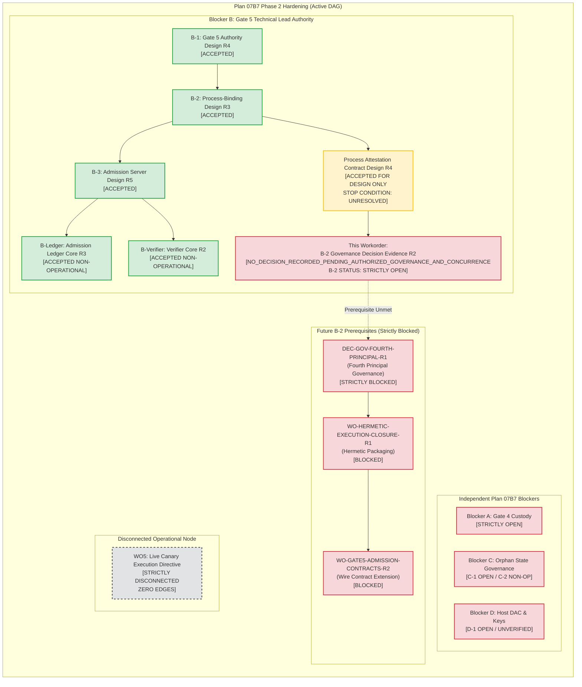

# 07B7-GATE6-PHASE2-BLOCKER-B-PROCESS-ATTESTATION-GOVERNANCE-DECISION-R1: B-2 Governance Decision Evidence Record (Repository-Only)

**Document ID:** `07B7-GATE6-PHASE2-BLOCKER-B-PROCESS-ATTESTATION-GOVERNANCE-DECISION-R1`  
**Revision:** `R2`  
**Status:** `NO_DECISION_RECORDED_PENDING_AUTHORIZED_GOVERNANCE_AND_CONCURRENCE`  
**Parent Workorder:** `G07-07B7-GATE6-PHASE2-BLOCKER-B-PROCESS-ATTESTATION-GOVERNANCE-DECISION-R1`  
**Governing Standard:** `docs/architecture/07B7-GATE6-PHASE2-BLOCKER-B-GATE5-PROCESS-ATTESTATION-CONTRACT-DESIGN-R1.md` (Revision R4, `ACCEPTED_FOR_DESIGN_ONLY`), `docs/architecture/07B7-GATE6-PHASE2-BLOCKER-B-GATE5-PROCESS-BINDING-DESIGN-R1.md` (Revision R3, `ACCEPTED`), `docs/architecture/07B7-GATE6-PHASE2-BLOCKER-B-GATE5-ADMISSION-SERVER-DESIGN-R1.md` (Revision R5, `ACCEPTED`), `.bridge/task.md`, `.bridge/report.md`  
**Author:** Pair Programming Agent (Antigravity)  
**Reviewer:** Tech Lead (Codex)  
**Date:** 2026-11-05  
**Operating Mode:** `REPOSITORY_ONLY_GOVERNANCE_EVIDENCE_REVIEW; NO_EXTERNAL_CONTACT; NO_AUTHORITY_OR_QUORUM_INFERENCE; NO_SOURCE_OR_CONTRACT_EDITS; NO_TESTS_OR_IMPORTS_OR_COMPILATION; NO_HOST_OR_PRODUCTION_STATE_ACCESS; NO_KEY_OR_TRUST_ROOT_ACCESS; NO_SOCKET_OR_NETWORK; NO_RESOLVE; NO_LIVE_OPERATIONS; READY_TO_EXECUTE_FALSE`

---

## 1. Architectural Context, Objective & Governance Basis

### 1.1 Context & Background
Under Plan 07B7 Post-Incident Hardening, the ResolveFlow subsystem is undergoing structured, phase-by-phase recovery following an unauthorized live mutation incident. Gate 6 strictly remains `NOT ACCEPTED` / incident-only. Gate G07 and Milestones M1, M2, and M3 strictly remain `OPEN`. Node `WO5 (Live Canary Execution Directive)` in the post-incident Directed Acyclic Graph (DAG) is completely disconnected with strictly zero incoming and zero outgoing edges.

Under Blocker B (Gate 5 Technical Lead Release Authority), accepted Gate 5 Process-Binding Design R3 (§1.1, §4.3) and accepted Process Attestation Contract Design R1 Revision R4 established that:
1. **The Same-UID Sibling Process Threat:** On the `AF_UNIX` admission socket (`dispatcher.sock`), `SO_PEERCRED` authenticates only caller POSIX numeric credentials: PID, UID, and GID (`interactive_user:1000`). It cannot distinguish an audited candidate runner from an arbitrary concurrent sibling process sharing UID 1000.
2. **The Connected Descriptor Hand-Off Threat:** As established in Design R4 §2.3 and §6.2, open UNIX domain socket descriptors can be transferred across same-UID processes via `SCM_RIGHTS` or inherited across `fork()`. When Process B receives Process A's connected descriptor, Process B shares the connection and nonce, and `SO_PEERCRED` continues reporting Process A's credentials established at `connect()` time.
3. **The Accepted Stop Condition:** Because Linux DAC does not provide user-space isolation between processes sharing UID 1000, and because the Dispatcher daemon (`_resolveflow_dispatcher:902`) cannot setuid or spawn an isolated process under UID 1000 without root privileges, Design R4 recorded an **EXPLICIT STOP CONDITION (TRẠNG THÁI: UNRESOLVED)** on same-UID attestation.
4. **Prerequisite Governance Roadmap:** Design R4 §5.3 identified that resolving this stop condition requires a prerequisite governance decision (`DEC-GOV-FOURTH-PRINCIPAL-R1`) formally deciding whether an additional OS principal (e.g. `_resolveflow_launcher:903`), user namespace, or specific confinement model is adopted before downstream engineering can begin.

### 1.2 Objective & Strict Repository-Only Evidence Mandate
The objective of this workorder is to create an authoritative, repository-grounded **Decision Evidence Record** determining whether the reviewed repository corpus contains:
- **(a)** An accepted B-2-specific governance decision authority and quorum rule; and
- **(b)** Attributable affirmative concurrence adopting a specific process-isolation and attestation model.

In strict compliance with Workorder instructions:
1. **Repository Evidence Scope:** Review is strictly confined to explicit governance concurrence records already committed and present in the repository corpus.
2. **Prohibition on External Inquiries:** No external messages, out-of-band inquiries, approval solicitations, or stakeholder contact may be conducted.
3. **Prohibition on Inferred Concurrence:** Agreement or concurrence cannot be inferred from silence, elapsed time, technical feasibility statements, design recommendations, proposal acceptances, or statements made by other entities.
4. **Non-Transitivity Invariant:** The four-party full-quorum rule established for Gate 4 Preflight Custody (Blocker A: Director, Operator, Tech Lead, System Administrator) is strictly non-transitive and does **NOT** transfer or apply to Blocker B or B-2. B-2 requires its own independently adopted decision rule.

### 1.3 Scope Boundaries & Evidence Limits
- `ready_to_execute = False` is strictly maintained across all modules and documentation.
- Gate 6 strictly remains `NOT ACCEPTED` / incident-only.
- Gate G07, Milestones M1, M2, and M3 strictly remain `OPEN`.
- Blocker A (Gate 4 Preflight Custody) strictly remains `OPEN`.
- Blocker B (Gate 5 Authority) and B-2 (Process Attestation) strictly remain `OPEN / UNRESOLVED`.
- Prerequisite C-1 strictly remains `OPEN`; C-2 strictly remains non-operational implementation artifacts only.
- Prerequisite D-1 strictly remains `OPEN / UNVERIFIED`.
- Node `WO5 (Live Canary Execution Directive)` in the decision DAG remains completely disconnected with strictly zero incoming and zero outgoing edges.
- **DaVinci Resolve Display & Target State Review Boundary:** Target project `RF_TRIAL_AEC8F0A7A365D5F5` and timeline `RF_TRIAL_TL_AEC8F0A7A365D5F5` on `DISPLAY=:1` were strictly outside the scope of this repository-evidence review and were **not accessed, contacted, inspected, or reverified**. Prior contemporaneous observations recorded in `.bridge/report.md:3664–3668` constitute historical repository records of past status only. Zero live UI, process, or display state was inspected or asserted as current.
- Zero private key generation, zero host provisioning, zero systemd lifecycle operations, zero socket creation, zero network traffic, zero tests, zero imports, zero compilation, and zero Resolve API/UI interactions.

---

## 2. Bounded Repository Governance Evidence Inventory

A static review of the relevant governance artifacts within the repository corpus—specifically targeting `docs/architecture/07B7-*.md`, `.bridge/task.md`, and `.bridge/report.md`—yields the following inventory regarding B-2 authority, quorum, and process-isolation model adoption:

| Repository Artifact Path & Scope | Document Status & Governing Scope | Evidence Regarding B-2 Quorum or Model Adoption | Concurrence Determination |
| :--- | :--- | :--- | :--- |
| `docs/architecture/07B7-GATE6-PHASE2-BLOCKER-B-GATE5-PROCESS-ATTESTATION-CONTRACT-DESIGN-R1.md` (Revision R4) | `ACCEPTED_FOR_DESIGN_ONLY` | Assesses 4 candidate protocol alternatives; §5.1–5.3 explicitly marks the protocol as `UNRESOLVED` and defines `DEC-GOV-FOURTH-PRINCIPAL-R1` as an unexecuted future prerequisite. §6.2 records descriptor hand-off as an unresolved threat. | **PROPOSAL & ROADMAP ONLY; ZERO ADOPTION EVIDENCE** |
| `.bridge/report.md` (Section "Tech Lead Static Review — G07-07B7-GATE6-PHASE2-BLOCKER-B-GATE5-PROCESS-ATTESTATION-CONTRACT-DESIGN-R1 Revision R4", lines 11743–11759) | `ACCEPTED_FOR_DESIGN_ONLY` | Review verdict explicitly states: *"Acceptance is limited to the static design and explicit stop-condition record. B-2 remains OPEN / UNRESOLVED; no same-UID attestation mechanism, new principal, key, trust root, Landlock/cgroup policy, contract extension, or implementation is approved."* | **DESIGN ACCEPTANCE ONLY; NO GOVERNANCE ADOPTION** |
| `docs/architecture/07B7-GATE6-PHASE2-BLOCKER-B-GATE5-PROCESS-BINDING-DESIGN-R1.md` (Revision R3) | `ACCEPTED` (Gate 5 Authority Baseline) | Binds static candidate digest `reviewed_candidate_sha256` to `SignedExecutionWorkorderRecord`. §1.1 and §4.3 identify that candidate file signing does not prove runtime process identity under UID 1000. | **IDENTIFIES B-2 GAP AS OPEN; NO QUORUM RULE** |
| `docs/architecture/07B7-GATE6-PHASE2-BLOCKER-B-GATE5-ADMISSION-SERVER-DESIGN-R1.md` (Revision R5) | `ACCEPTED` (Admission Server Design) | Details transaction sequence (Phases 1–9) and crash boundaries; §5.2 records same-UID peer identity as an unproven gap requiring downstream resolution. | **SPECIFIES ADMISSION ORDERING; NO B-2 QUORUM** |
| `docs/architecture/07B7-GATE6-PHASE2-GATE5-RELEASE-AUTHORITY-DESIGN-R1.md` (Revision R4) | `ACCEPTED` (Gate 5 Authority Baseline) | Governs Technical Lead cryptographic signing of `SignedExecutionWorkorderRecord` over reviewed candidate script; does not govern OS launcher or same-UID DAC boundaries. | **GATE 5 TL AUTHORITY ONLY; NO B-2 QUORUM** |
| `docs/architecture/07B7-GATE6-PHASE2-GATE4-CUSTODY-POLICY-DECISION-R1.md` (Revision R3) | `NO_DECISION_RECORDED_PENDING_FULL_QUORUM` | Governs Gate 4 Preflight Verifier key custody (Blocker A) under a 4-party full quorum. Non-transferable to Blocker B / B-2 under the non-transitivity invariant. | **NON-TRANSFERABLE (NON-TRANSITIVITY RULE)** |
| `docs/architecture/07B7-GATE6-PHASE2-BLOCKER-C-AUTHORITY-CHARTER-DECISION-R1.md` (Revision R5) | `NO_DECISION_RECORDED_PENDING_FULL_QUORUM` | Governs Blocker C orphan state reconciliation authority (C-1). Independent from and non-transferable to Blocker B / B-2. | **INDEPENDENT GOVERNANCE SCOPE** |
| `.bridge/task.md` (Lines 1872–1960) | Workorder issuances `PROCESS-ATTESTATION-CONTRACT-DESIGN-R1` and `PROCESS-ATTESTATION-GOVERNANCE-DECISION-R1` | Directs design drafting and repository evidence review; strictly prohibits inferring quorum, contacting stakeholders, or adopting a model. | **TASK DIRECTIVE ONLY** |

---

## 3. Factual Determination on Quorum Rule & Concurrence

### 3.1 Determination on Question (a): Existence of an Adopted B-2 Quorum Rule
- **Evaluation Question:** Does the repository corpus contain a formal, previously adopted B-2 governance decision authority and quorum rule?
- **Factual Finding:** **NEGATIVE (ABSENT)**.
- **Evidence Basis:**
  1. The repository corpus contains only technical evaluations, architectural stop conditions, and a proposed prerequisite roadmap (`DEC-GOV-FOURTH-PRINCIPAL-R1` in Design R4 §5.3).
  2. No repository record exists of project leadership, the Technical Lead, or project stakeholders establishing or ratifying a governance charter or quorum rule specifically governing B-2 process isolation or attestation.
  3. Under the Non-Transitivity Invariant, neither the Gate 4 four-party quorum rule nor any proposed Blocker C quorum structure applies to B-2. B-2 lacks an adopted decision authority and quorum definition.

### 3.2 Determination on Question (b): Existence of Affirmative, Attributable Concurrence
- **Evaluation Question:** Does the repository corpus contain explicit written concurrence from every authority required by an adopted rule, specific to a single process-isolation model, affirmative, attributable, and free of conditions or dissent?
- **Factual Finding:** **NEGATIVE (ABSENT)**.
- **Evidence Basis:**
  1. *Absence of Adopted Quorum:* Because no quorum rule exists defining the authorized decision-makers for B-2, no formal governance vote or concurrence could be validly constituted.
  2. *Audit of Stakeholder and Proposed Roles:* Auditing project stakeholders and potential governance roles across repository records confirms that **zero attributable written concurrences exist adopting any B-2 isolation model**:

| Stakeholder / Role Scope | Repository Evidence Regarding B-2 Model Adoption | Attributable Concurrence Status |
| :--- | :--- | :--- |
| **Technical Lead** (`Role_TechLead` / Codex) | Formally accepted Process Attestation Design R4 as `ACCEPTED_FOR_DESIGN_ONLY`. The review verdict explicitly stated: *"Acceptance is limited to the static design and explicit stop-condition record. B-2 remains OPEN / UNRESOLVED; no same-UID attestation mechanism, new principal, key, trust root, Landlock/cgroup policy, contract extension, or implementation is approved."* | **ABSENT** (Explicitly declined unilateral adoption; design acceptance $\ne$ governance adoption) |
| **Physical Human Operator** (`Role_Operator` / `interactive_user:1000`) | Recorded contemporaneous physical presence and session confirmation for challenge issuance; zero written statement or attestation recorded adopting a Fourth Principal, UID 903, user namespaces, or confinement policy for B-2. | **ABSENT** |
| **System Administrator / Host Authority** (`Role_SystemAdministrator`) | Zero written statement, signed document, or configuration recorded in repository records approving creation of UID 903, user namespace delegation, or PAM/systemd launcher configuration. | **ABSENT** |
| **Creative Director / Project Governance** (`Role_Director`) | Zero written statement or governance concurrence recorded in repository records adopting a B-2 process isolation model. | **ABSENT** |

---

## 4. Formal Decision Disposition

In strict compliance with Workorder `G07-07B7-GATE6-PHASE2-BLOCKER-B-PROCESS-ATTESTATION-GOVERNANCE-DECISION-R1` §1 and §3:

$$\mathbf{Decision: \quad NO\_DECISION\_RECORDED\_PENDING\_AUTHORIZED\_GOVERNANCE\_AND\_CONCURRENCE}$$
$$\mathbf{selected\_process\_isolation\_model: \quad UNRESOLVED\_PENDING\_GOVERNANCE\_APPROVAL}$$
$$\mathbf{prerequisite\_B2\_governance\_status: \quad STRICTLY\_OPEN}$$

### 4.1 Rationale & Mandatory Stop Condition
1. **Absence of Adopted Decision Authority & Quorum:** No governance instrument in the repository defines who holds authority to approve an OS principal addition, privilege delegation, or isolation architecture for ResolveFlow runner execution.
2. **Absence of Affirmative Concurrence:** Zero attributable written concurrences exist in the repository corpus adopting any specific candidate isolation model.
3. **Non-Transitivity of Gate 4 Quorum:** The four-party full-quorum standard from Gate 4 Preflight Custody cannot be applied to B-2 without an explicit, adopted governance decision.
4. **Fail-Closed Governance Invariant:** In post-incident recovery, missing, ambiguous, or incomplete governance concurrence mandates an immediate halt. Approval cannot be assumed, inferred from silence, or substituted by technical design acceptance.
5. **B-2 and Blocker B Remain Strictly Open:** Blocker B and its B-2 process identity component remain `OPEN / UNRESOLVED`. No operational runner attestation can be implemented, configured, or authorized under this state.

---

## 5. Unapproved Proposals & Downstream Dependencies

### 5.1 Status of Evaluated Technical Alternatives
In compliance with Workorder Section 3.5, the technical alternatives evaluated in accepted Process Attestation Contract Design R4 remain strictly **unapproved proposals**:

```
┌────────────────────────────────────────────────────────────────────────────────────────┐
│                      STATUS OF B-2 TECHNICAL PROPOSALS                                 │
├───────────────────────────────────┬────────────────────────────────────────────────────┤
│ Proposal Alternative              │ Architectural & Governance Status                  │
├───────────────────────────────────┼────────────────────────────────────────────────────┤
│ Alternative 1:                    │ UNVIABLE UNDER 3-PRINCIPAL MODEL:                  │
│ Dispatcher-Supervised Spawn with  │ Requires root / CAP_SETUID on Dispatcher (UID 902);│
│ Inherited Private Socket          │ violates least-privilege; UNAPPROVED.              │
├───────────────────────────────────┼────────────────────────────────────────────────────┤
│ Alternative 2:                    │ INSUFFICIENT DAC PRIMITIVE:                        │
│ Sealed Entrypoint + Hermetic      │ Protects files against TOCTOU but cannot prove     │
│ Closure Pinning (memfd)           │ which process under UID 1000 connected; UNAPPROVED.│
├───────────────────────────────────┼────────────────────────────────────────────────────┤
│ Alternative 3:                    │ UNAPPROVED PROPOSAL (PENDING GOVERNANCE):          │
│ OS-Enforced Launcher Isolation    │ Dedicated Fourth Principal (UID 903) or User-NS    │
│ (Dedicated UID 903 or User-NS)    │ requires unrecorded OS & display proxy governance; │
│                                   │ strictly UNAPPROVED.                               │
├───────────────────────────────────┼────────────────────────────────────────────────────┤
│ Alternative 4:                    │ INFEASIBLE ON STOCK HOST:                          │
│ Hardware / Kernel Attestation     │ Requires unverified hardware root of trust;        │
│                                   │ UNAPPROVED.                                        │
├───────────────────────────────────┼────────────────────────────────────────────────────┤
│ Confinement References:           │ UNVALIDATED HYPOTHETICAL ALTERNATIVES:             │
│ Landlock / cgroups confinement    │ Unverified alternatives only; not approved as      │
│                                   │ controls; UNAPPROVED.                              │
└───────────────────────────────────┴────────────────────────────────────────────────────┘
```

### 5.2 Strict Prohibition on Implementation & Configuration
Because no decision is recorded:
- Strictly **NO** new OS principal (e.g. `_resolveflow_launcher:903` or similar) is authorized or created.
- Strictly **NO** user namespace, Landlock confinement policy, or cgroup socket rule is authorized or implemented.
- Strictly **NO** signing key, trust root, or cryptographic verification authority is created or adopted.
- Strictly **NO** wire contract extension to `DispatcherAdmissionRequest` or `SignedProcessAttestationRecord` implementation is authorized.

### 5.3 Downstream Dependency Block
In the Plan 07B7 Hardening DAG:
1. `DEC-GOV-FOURTH-PRINCIPAL-R1` remains **STRICTLY BLOCKED / OPEN**.
2. Hermetic packaging engineering (`WO-HERMETIC-EXECUTION-CLOSURE-R1`) remains **BLOCKED**.
3. Admission wire contract extension (`WO-GATE5-ADMISSION-CONTRACTS-R2`) remains **BLOCKED**.
4. Blocker B remains **OPEN / UNRESOLVED**.

---

## 6. Plan 07B7 Hardening DAG Alignment & Safety Invariants

### 6.1 Hardening DAG Visualization



### 6.2 Preserved Safety Invariants
- `ready_to_execute = False` is strictly maintained across all modules and documentation.
- Gate 6 strictly remains `NOT ACCEPTED` / incident-only.
- Gate G07, Milestones M1, M2, and M3 strictly remain `OPEN`.
- Blocker A (Gate 4 Preflight Custody) strictly remains `OPEN`.
- Blocker B (Gate 5 Authority) and B-2 (Process Attestation) strictly remain `OPEN / UNRESOLVED`.
- Prerequisite C-1 strictly remains `OPEN`; C-2 strictly remains non-operational implementation artifacts only.
- Prerequisite D-1 strictly remains `OPEN / UNVERIFIED`.
- Node `WO5 (Live Canary Execution Directive)` in the execution DAG remains **COMPLETELY DISCONNECTED** with strictly zero incoming and strictly zero outgoing edges.
- Target project `RF_TRIAL_AEC8F0A7A365D5F5` and timeline `RF_TRIAL_TL_AEC8F0A7A365D5F5` on `DISPLAY=:1` were outside the scope of this workorder and were not contacted, inspected, or modified.
- Zero host mutation, zero key access, zero socket IPC, zero network traffic, zero test execution, zero imports, zero compilation, zero daemon lifecycle changes, and zero DaVinci Resolve API calls occurred.

---

## 7. Summary of Evidence Limits

This document records strictly the negative evidence determination established by a static audit of the repository corpus. It asserts only that:
1. No B-2 governance authority/quorum rule exists in the reviewed repository corpus.
2. No attributable affirmative concurrence adopting a process-isolation model exists in the reviewed repository corpus.
3. It makes zero assertion regarding off-repository discussions, hypothetical external authority, or current host runtime state.
4. It grants zero operational, implementation, admission, or execution authority.
