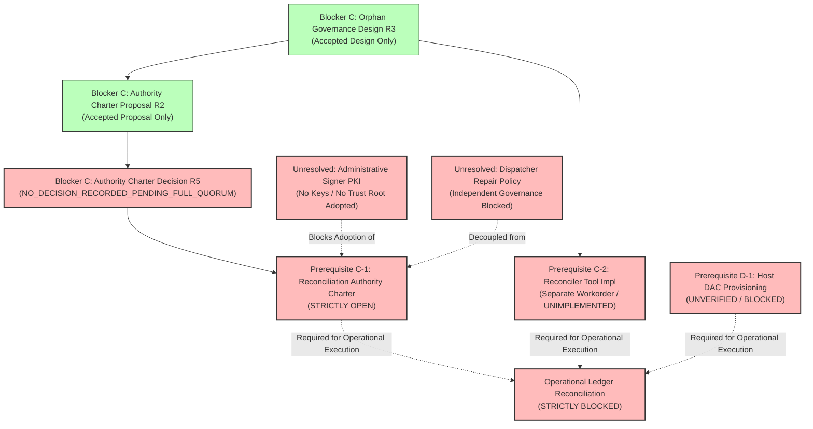
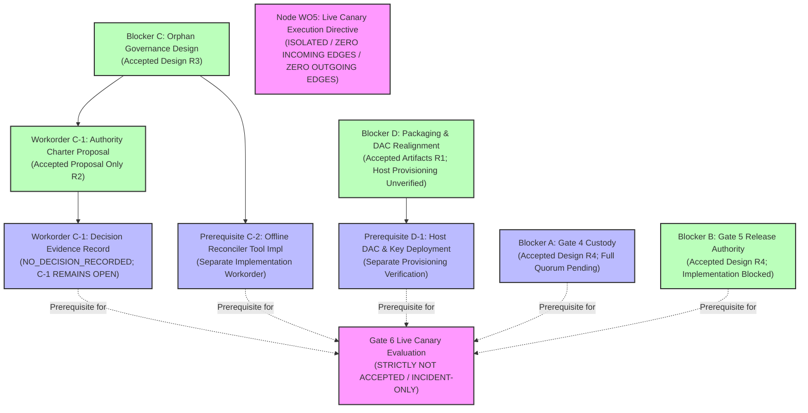

# 07B7-GATE6-PHASE2-BLOCKER-C-AUTHORITY-CHARTER-DECISION-R1: C-1 Governance Decision Evidence Record (Repository-Only)

**Document ID:** `07B7-GATE6-PHASE2-BLOCKER-C-AUTHORITY-CHARTER-DECISION-R1`  
**Revision:** `R5`  
**Status:** `NO_DECISION_RECORDED_PENDING_FULL_QUORUM`  
**Parent Workorder:** `G07-07B7-GATE6-PHASE2-BLOCKER-C-AUTHORITY-CHARTER-DECISION-R1`  
**Governing Standard:** `docs/architecture/07B7-GATE6-PHASE2-BLOCKER-C-AUTHORITY-CHARTER-DESIGN-R1.md` (Revision R2, `ACCEPTED_FOR_GOVERNANCE_CHARTER_PROPOSAL_ONLY`), `docs/architecture/07B7-GATE6-PHASE2-BLOCKER-C-ORPHAN-GOVERNANCE-DESIGN-R1.md` (Revision R3, `ACCEPTED_FOR_DESIGN_ONLY`), `.bridge/task.md`, `.bridge/report.md`  
**Author:** Pair Programming Agent (Antigravity)  
**Reviewer:** Tech Lead (Codex)  
**Date:** 2026-11-05  
**Operating Mode:** `DOCUMENTATION_AND_REPOSITORY_EVIDENCE_REVIEW_ONLY; NO_CHARTER_ADOPTION; NO_QUORUM_SELECTION; NO_APPROVAL_SOLICITATION_OR_EXTERNAL_MESSAGING; NO_INFERRED_CONCURRENCE; NO_SOURCE_OR_CONFIG_EDITS; NO_TESTS_OR_IMPORTS_OR_COMPILATION; NO_HOST_OR_PRODUCTION_STATE_ACCESS; NO_SYSTEMD_LIFECYCLE; NO_KEY_OR_TRUST-ROOT_CONTENT_ACCESS; NO_SOCKET_OR_NETWORK; NO_RESOLVE; NO_LIVE_OPERATIONS; READY_TO_EXECUTE_FALSE`

---

## 1. Architectural Context, Objective & Governance Basis

### 1.1 Context & Background
Under Plan 07B7 Post-Incident Hardening, the ResolveFlow subsystem is undergoing structured, phase-by-phase recovery following an unauthorized live mutation incident. Gate 6 strictly remains `NOT ACCEPTED` / incident-only. Gate G07 and Milestones M1, M2, and M3 strictly remain `OPEN`. Node `WO5 (Live Canary Execution Directive)` in the post-incident Directed Acyclic Graph (DAG) is completely disconnected with strictly zero incoming and zero outgoing edges.

Workorder `G07-07B7-GATE6-PHASE2-BLOCKER-C-AUTHORITY-CHARTER-DESIGN-R1` Revision R2 delivered a decision-ready governance proposal comparing administrative role allocations, quorum structures, approval record schemas, and failure modes for future offline reconciliation of Signer Oracle orphan records (`oracle_verified_executions.jsonl` vs `oracle_execution_terminals.jsonl` under `/var/lib/resolveflow/signer/nonces/`). That document was formally accepted by Technical Lead Codex in `.bridge/report.md` under the restricted status:
$$\mathbf{ACCEPTED\_FOR\_GOVERNANCE\_CHARTER\_PROPOSAL\_ONLY}$$
That acceptance strictly established that:
1. The comparative analysis of roles and quorums is technically sound, source-grounded, and reviewable.
2. The proposal **did not adopt a charter, did not select a quorum, and did not grant operational reconciliation authority**.
3. Prerequisite C-1 remains **STRICTLY OPEN** pending a separate, explicit governance decision.

### 1.2 Objective & Strict Repository-Only Evidence Mandate
The objective of this workorder is to create an authoritative, repository-grounded **Decision Evidence Record** for Prerequisite C-1. In strict compliance with Workorder instructions:
1. **Repository Evidence Scope:** Review is strictly confined to explicit governance concurrence records already committed and present in the repository.
2. **Prohibition on External Inquiries:** No external messages, out-of-band inquiries, approval solicitations, or stakeholder contact may be conducted.
3. **Prohibition on Inferred Concurrence:** Agreement or concurrence cannot be inferred from silence, elapsed time, prior standing authorizations, proposal acceptances, or statements made by other entities.
4. **Non-Transitivity Invariant:** The four-party full-quorum rule established for Gate 4 Preflight Custody (Blocker A: Director, Operator, Tech Lead, System Administrator) does **NOT** transfer or apply to Blocker C. Blocker C requires its own independently adopted quorum rule.

### 1.3 Preserved Safety Invariants & Scope Boundaries
- `ready_to_execute = False` is strictly maintained.
- Gate 6 strictly remains `NOT ACCEPTED` / incident-only.
- Gate G07, Milestones M1, M2, and M3 strictly remain `OPEN`.
- Node `WO5 (Live Canary Execution Directive)` in the decision DAG remains completely disconnected with strictly zero incoming and zero outgoing edges.
- **DaVinci Resolve Display & Target State Review Boundary:** The DaVinci Resolve Studio target project `RF_TRIAL_AEC8F0A7A365D5F5` (UID `4fd4272d-f0bc-445c-9490-5723cd6831c2`) and timeline `RF_TRIAL_TL_AEC8F0A7A365D5F5` (UID `ba6a6775-8ec4-41a4-bf2f-704de902e68d`) on `DISPLAY=:1` were strictly outside the scope of this repository-evidence review and were **not accessed, contacted, or reverified** by this workorder. Prior contemporaneous observations recorded in `.bridge/report.md:3664–3668` (timestamp `2026-11-04T19:07:31Z` UTC, under Gate 4 R16-R3 preflight review: *"Tôi xác nhận đã nhìn thấy trên màn hình Resolve: Project và Timeline rỗng đúng như hồ sơ"*) and subsequent safety invariant assertions (e.g. lines 7893–7899) constitute historical repository records of past status only. Zero live UI, process, or display state was inspected, contacted, reverified, or asserted as current during this static repository audit.
- Zero private key generation, zero host provisioning, zero systemd changes, zero socket creation, zero network traffic, and zero Resolve API/UI interactions.

---

## 2. Bounded Repository Governance Evidence Inventory

A static review of the relevant governance artifacts within the repository corpus—specifically targeting `docs/architecture/07B7-*.md`, `.bridge/task.md`, and `.bridge/report.md`—yields the following inventory regarding Blocker C authority and quorum adoption:

| Repository Artifact Path & Scope | Document Status & Governing Scope | Evidence Regarding Blocker C Quorum Adoption | Concurrence Determination |
| :--- | :--- | :--- | :--- |
| `docs/architecture/07B7-GATE6-PHASE2-BLOCKER-C-AUTHORITY-CHARTER-DESIGN-R1.md` (Revision R2) | `PROPOSAL_ONLY_PREREQUISITE_C1_REMAINS_OPEN` | Compares 3 candidate quorum models (Model 1 Tripartite 3-of-3, Model 2 Dual-Signoff 2-of-2 + Operator, Model 3 Scope-Tiered). §1.3 explicitly disclaims adoption: *"This document is a proposal only and does not constitute an adopted charter."* | **PROPOSAL ONLY; ZERO ADOPTION EVIDENCE** |
| `.bridge/report.md` (Lines 8856–9010) | `ACCEPTED_FOR_GOVERNANCE_CHARTER_PROPOSAL_ONLY` (Tech Lead Review R2) | Review verdict explicitly states: *"This verdict accepts the proposal artifact only. It does not adopt a charter or authorize tool implementation, host/ledger access, reconciliation, Dispatcher repair, target unlock, Gate 4/Gate 5 operation, or Gate 6 execution. C-1 remains OPEN."* | **ARTIFACT ACCEPTANCE ONLY; NO CHARTER ADOPTION** |
| `docs/architecture/07B7-GATE6-PHASE2-BLOCKER-C-ORPHAN-GOVERNANCE-DESIGN-R1.md` (Revision R3) | `ACCEPTED_FOR_DESIGN_ONLY` | Defines technical state model, crash matrix, and 7-stage offline procedure. §6.1 categorizes operational execution as *STRICTLY BLOCKED* pending Prerequisite C-1 adoption. | **NO ADOPTION INSTRUMENT** |
| `docs/architecture/07B7-GATE6-POST-INCIDENT-RECONCILIATION-RUNBOOK-R1.md` (Revision R1) | `INCIDENT_RECOVERY_RUNBOOK_R1` | §5 and §8 baseline Option A offline recovery; explicitly records that authority quorums and roles are missing governance prerequisites. | **IDENTIFIES GOVERNANCE DEFICIT AS OPEN** |
| `.bridge/task.md` (Lines 1160–1270) | Workorder issuances `BLOCKER-C-AUTHORITY-CHARTER-DESIGN-R1` and `BLOCKER-C-AUTHORITY-CHARTER-DECISION-R1` | Directs proposal drafting and evidence auditing; strictly prohibits adopting a charter or selecting a quorum. | **TASK DIRECTIVE ONLY** |
| `docs/architecture/07B7-GATE6-PHASE2-GATE4-CUSTODY-POLICY-DECISION-R1.md` (Revision R3) | `NO_DECISION_RECORDED_PENDING_FULL_QUORUM` | Governs Gate 4 Preflight Verifier key custody (Blocker A). Governs preflight admission; non-transferable to Blocker C offline reconciliation. | **NON-TRANSFERABLE (NON-TRANSITIVITY RULE)** |

---

## 3. Factual Determination on Quorum Rule & Concurrence

### 3.1 Determination on Question (a): Existence of an Adopted Blocker C Quorum Rule
- **Evaluation Question:** Does the repository contain a formal, previously adopted Blocker C authority/quorum rule or decision instrument?
- **Factual Finding:** **NEGATIVE (ABSENT)**.
- **Evidence Basis:** 
  The repository contains only a comparative analysis of three proposed models (`docs/architecture/07B7-GATE6-PHASE2-BLOCKER-C-AUTHORITY-CHARTER-DESIGN-R1.md` §3.2). No repository record exists of project leadership, the Tech Lead, or any stakeholder recording a governance decision selecting or ratifying any of these models.

### 3.2 Determination on Question (b): Existence of Affirmative, Attributable Concurrence
- **Evaluation Question:** Does the repository contain explicit written concurrence from every authority required by an adopted rule, specific to a single charter model, affirmative, attributable, and free of conditions or dissent?
- **Factual Finding:** **NEGATIVE (ABSENT)**.
- **Evidence Basis:** 
  1. *No Adopted Quorum:* Because no quorum rule has been adopted for Blocker C, no official set of authorized approvers exists.
  2. *Non-Transitivity of Gate 4 Roles:* Roles from Gate 4 Preflight Custody (such as Creative Director or Host System Administrator) are specific to preflight admission governance and are **not** presumed to apply to Blocker C offline reconciliation.
  3. *Audit of Proposed Roles:* Auditing the candidate roles evaluated in the C-1 proposal (`Role_Operator`, `Role_TechnicalReviewer`, `Role_GovernanceAuthority`, `Role_ReconciliationExecutor`) confirms that **zero attributable written concurrences exist in repository records** adopting any charter model:

| Proposed Governance Role (C-1 Proposal §2.1) | Repository Evidence Regarding Blocker C Charter Adoption | Attributable Written Concurrence in Repository |
| :--- | :--- | :--- |
| **Governance Authority / Tech Lead** (`Role_GovernanceAuthority`) | Authored static review accepting proposal R2 as `ACCEPTED_FOR_GOVERNANCE_CHARTER_PROPOSAL_ONLY`. Explicitly stated that C-1 remains open, no quorum is adopted, and no operational authority is conferred. | **ABSENT** (Explicitly declined unilateral adoption; proposal acceptance $\ne$ adoption) |
| **Physical Human Operator** (`Role_Operator` / `interactive_user:1000`) | Zero written statement, signature, or attestation recorded in repository records adopting a Blocker C charter model. | **ABSENT** |
| **Independent Technical Reviewer** (`Role_TechnicalReviewer`) | Zero written statement, signature, or attestation recorded in repository records adopting a Blocker C charter model. | **ABSENT** |
| **Reconciliation Executor** (`Role_ReconciliationExecutor` / `_resolveflow_signer:901`) | Zero written statement, signature, or attestation recorded in repository records adopting a Blocker C charter model. | **ABSENT** |

---

## 4. Formal Decision Disposition

In strict compliance with Workorder `G07-07B7-GATE6-PHASE2-BLOCKER-C-AUTHORITY-CHARTER-DECISION-R1` §3 Rule 2 and Rule 3:

$$\mathbf{Decision: \quad NO\_DECISION\_RECORDED\_PENDING\_FULL\_QUORUM}$$
$$\mathbf{selected\_charter\_model: \quad UNRESOLVED\_PENDING\_GOVERNANCE\_APPROVAL}$$
$$\mathbf{prerequisite\_C1\_status: \quad STRICTLY\_OPEN}$$

### 4.1 Rationale & Mandatory Stop Condition
1. **Absence of Adopted Quorum Rule:** No governance rule exists in repository evidence establishing which roles constitute a valid quorum for Blocker C.
2. **Absence of Required Concurrences:** No stakeholder has recorded an attributable concurrence adopting a specific charter in repository evidence.
3. **Fail-Closed Administrative Safety:** Under Option A offline baseline, missing or absent concurrence mandates an immediate halt. Agreement cannot be fabricated, assumed, or substituted by timeout or silence.
4. **Prerequisite C-1 Remains Open:** Blocker C offline reconciliation cannot be performed, chartered, or authorized until a future formal governance ratification is executed by authorized project stakeholders.

---

## 5. Unresolved Governance, Trust & Tool Dependencies

The dependency graph below illustrates the precise relationship among Blocker C prerequisites and governance blockers, maintaining parallel sibling decoupling between C-1 (Charter Adoption) and C-2 (Tool Implementation):

1. **Unresolved Charter Adoption:** A separate, explicit governance decision executed by project stakeholders is required to select and adopt an approval model.
2. **Unresolved Identity & Trust Root Infrastructure:** No public key infrastructure (PKI), PGP/GPG keyrings, SSH administrative identities, or dedicated Ed25519 keys are provisioned, deployed, or accepted in repository configuration for administrative sign-offs.
3. **Unresolved Tool Implementation (Prerequisite C-2):** Offline reconciliation tool `src/tools/reconcile_orphan_ledger.py` does not exist and has zero test coverage. It branches from `C_DESIGN` as an independent implementation workorder.
4. **Unresolved Host DAC & Packaging (Prerequisite D-1):** Physical verification of `/var/lib/resolveflow/signer/nonces` (mode `0700`, owner `901:901`) and `/var/lib/resolveflow/dispatcher` (mode `0700`, owner `902:902`) remains open.
5. **Decoupled Dispatcher State:** Dispatcher persistent journal repair (`execution_journal.wal`, `target_ledger.v2.json`, `.locks/<target_hash>.in_doubt`) remains strictly decoupled and blocked under its own lifecycle.

---

## 6. Plan 07B7 Dependency DAG & Safety Invariants

### 6.1 Dependency Directed Acyclic Graph (DAG) Alignment

- **Node WO5 (`Live Canary Execution Directive`):** Strictly disconnected with zero incoming and zero outgoing edges.
- **Gate 6:** Strictly `NOT ACCEPTED` / incident-only.
- **Gate G07 & Milestones M1, M2, M3:** Strictly `OPEN`.

### 6.2 Explicit Statement of Evidence Boundaries
- **Zero Host Production State Access:** No inspection or access was made to `/var/lib/resolveflow`, `/run/resolveflow`, or `/etc/resolveflow`.
- **Zero Process or Socket Interaction:** No systemd services, Unix domain sockets, or network connections were established.
- **Zero Key Access:** No private keys or trust roots were read, created, exported, or verified.
- **Zero DaVinci Resolve Interaction:** DaVinci Resolve on `DISPLAY=:1` was completely untouched and outside the scope of this workorder; no display or live UI state was contacted or reverified.
- **Operating Invariant:** `ready_to_execute = False` is strictly maintained across the entire system.
