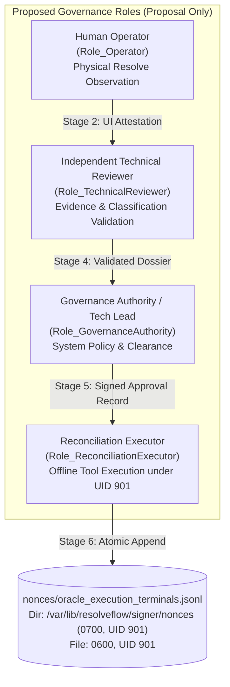
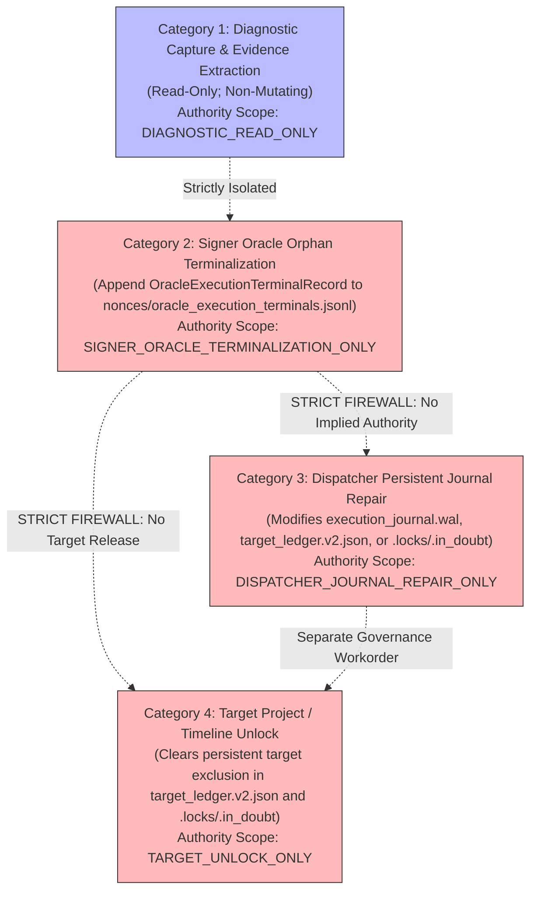
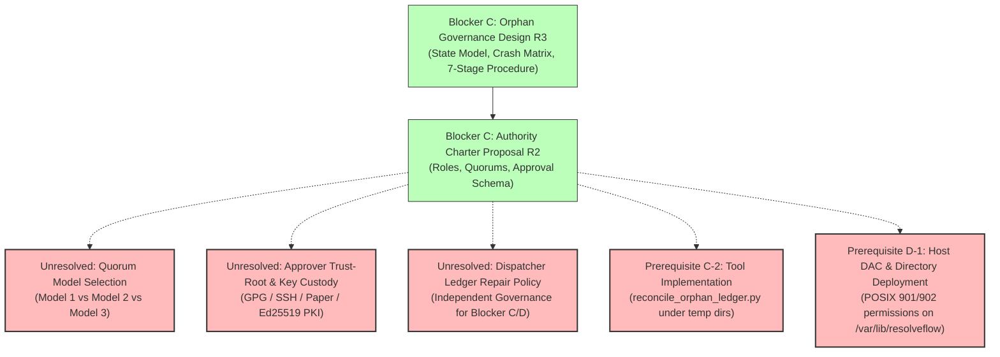
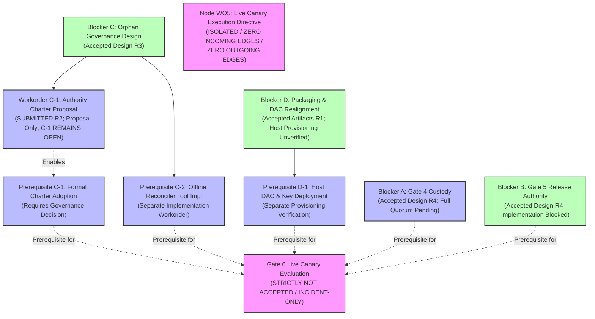

# 07B7-GATE6-PHASE2-BLOCKER-C-AUTHORITY-CHARTER-DESIGN-R1: Offline Reconciliation Authority Charter Proposal

**Document ID:** `07B7-GATE6-PHASE2-BLOCKER-C-AUTHORITY-CHARTER-DESIGN-R1`  
**Revision:** `R2`  
**Status:** `PROPOSAL_ONLY_PREREQUISITE_C1_REMAINS_OPEN`  
**Parent Workorder:** `G07-07B7-GATE6-PHASE2-BLOCKER-C-AUTHORITY-CHARTER-DESIGN-R1`  
**Parent Document:** `07B7-GATE6-PHASE2-BLOCKER-C-ORPHAN-GOVERNANCE-DESIGN-R1` (Revision R3, `ACCEPTED_FOR_DESIGN_ONLY`)  
**Author:** Pair Programming Agent (Antigravity)  
**Reviewer:** Tech Lead (Codex)  
**Date:** 2026-11-05  
**Operating Mode:** `DOCUMENTATION_AND_STATIC_SOURCE_REVIEW_ONLY; GOVERNANCE_CHARTER_PROPOSAL_ONLY; NO_CHARTER_ADOPTION; NO_SOURCE_OR_CONFIG_EDITS; NO_TESTS_OR_IMPORTS_OR_COMPILATION; NO_HOST_OR_PRODUCTION_STATE_ACCESS; NO_SYSTEMD_LIFECYCLE; NO_KEY_OR_TRUST-ROOT_CONTENT_ACCESS; NO_SOCKET_OR_NETWORK; NO_RESOLVE; NO_LIVE_OPERATIONS; READY_TO_EXECUTE_FALSE`

---

## 1. Architectural Context, Purpose & Non-Adoption Status

### 1.1 Context & Background
Under Plan 07B7 Post-Incident Hardening, the ResolveFlow subsystem enforces complete decoupling of authorization, verification, and target dispatch. The accepted `07B7-GATE6-PHASE2-BLOCKER-C-ORPHAN-GOVERNANCE-DESIGN-R1` Revision R3 established the technical state machine, crash boundary matrix, and 7-stage administrative procedure for offline reconciliation of non-terminal verified execution records (orphans) in the Signer Oracle ledger (`oracle_verified_executions.jsonl` under `/var/lib/resolveflow/signer/nonces/`).

However, that predecessor document explicitly established that while the technical state machine and procedure are accepted for design, operational reconciliation is **strictly blocked** by three independent prerequisites:
1. **Prerequisite C-1:** Formal adoption of an Administrative Reconciliation Authority Charter defining human roles, sign-off quorums, and separation of duties.
2. **Prerequisite C-2:** Separately authorized and tested implementation of the offline reconciler tool (`reconcile_orphan_ledger.py`).
3. **Prerequisite D-1:** Host DAC and trust-root deployment under Blocker D.

### 1.2 Objective of this Charter Proposal
The objective of this workorder is to produce a source-grounded, decision-ready **governance proposal** for Prerequisite C-1. This proposal:
- Compares bounded options for administrative roles, sign-off quorums, and separation of duties.
- Defines the required claims and schema for an offline reconciliation approval record.
- Identifies the explicit authority scopes separating Oracle ledger terminalization from Dispatcher persistent journal repair and target unlocking.
- Establishes fail-closed no-action behavior for missing, conflicting, or stale approvals.
- Details the remaining governance gaps and trust-bootstrap dependencies that must be resolved prior to charter adoption.

### 1.3 Explicit Non-Adoption & Non-Authorization Notice
> [!IMPORTANT]
> **THIS DOCUMENT IS A PROPOSAL ONLY AND DOES NOT CONSTITUTE AN ADOPTED CHARTER.**
> - Prerequisite C-1 remains **STRICTLY OPEN** upon completion and review of this document.
> - This proposal confers **ZERO** operational reconciliation authority, authorizes **ZERO** access to host ledgers (`/var/lib/resolveflow/signer/` or `/var/lib/resolveflow/dispatcher/`), and selects no active quorum.
> - Formal adoption of any charter model requires a separate, explicit governance decision executed by project leadership.
> - Adoption of a charter does not bypass or replace Prerequisite C-2 (tool implementation) or Prerequisite D-1 (host provisioning).

### 1.4 Non-Transitivity of Gate 4 Preflight Custody Quorum (Blocker A)
In Workorder `G07-07B7-GATE6-PHASE2-GATE4-CUSTODY-POLICY-DESIGN-R1` (Revision R4), a four-party tripartite authority triad was established for Gate 4 preflight verification (`Role_Director`, `Role_Operator`, `Role_TechLead`, and `Role_Verifier`).

**This proposal explicitly establishes the Non-Transitivity Invariant:**
The full quorum model established for Gate 4 Preflight Custody (Blocker A) does **NOT** automatically transfer or apply to Blocker C Offline Reconciliation. Gate 4 governs live, pre-execution admission to prevent unauthorized execution against active production targets; Blocker C governs post-incident, out-of-band ledger reconciliation on stopped or quarantined systems. Because their threat vectors, operational cadences, and fault regimes differ fundamentally, each blocker requires its own evaluated governance model.

### 1.5 Preserved Safety Invariants
- `ready_to_execute = False` is strictly maintained.
- Gate 6 strictly remains `NOT ACCEPTED` / incident-only.
- Gate G07, Milestones M1, M2, and M3 strictly remain `OPEN`.
- Node `WO5 (Live Canary Execution Directive)` in the Plan 07B7 dependency DAG remains completely disconnected with strictly zero incoming and zero outgoing edges.
- DaVinci Resolve Project `RF_TRIAL_AEC8F0A7A365D5F5` (UID `4fd4272d-f0bc-445c-9490-5723cd6831c2`) and Timeline `RF_TRIAL_TL_AEC8F0A7A365D5F5` (UID `ba6a6775-8ec4-41a4-bf2f-704de902e68d`) on `DISPLAY=:1` remain untouched, uncontacted, and empty.
- Zero private key generation, zero host provisioning, zero systemd changes, zero socket creation, zero network traffic, and zero Resolve API/UI interactions.

---

## 2. Governance Roles & Separation of Duties Analysis

### 2.1 Proposed Governance Roles
To prevent unilateral tampering, collusion, or misclassification of orphan executions, this proposal evaluates four discrete human and technical governance roles:



1. **Human Operator (`Role_Operator`):**
   - *Proposed Responsibility:* Physically present in front of the DaVinci Resolve Studio GUI workstation (`DISPLAY=:1`). Conducts visual inspection of the target project and timeline (confirming whether clips exist, playhead moved, or any media was added). Produces a signed, contemporaneous physical observation attestation.
   - *Boundaries:* Cannot inspect or validate Signer Oracle internal JSONL ledgers. Cannot authorize state changes or execute reconciliation tooling.
2. **Independent Technical Reviewer (`Role_TechnicalReviewer`):**
   - *Proposed Responsibility:* An engineering specialist who was **not** the author or operator of the candidate run. Performs static validation of the complete evidence bundle:
     - Verifies cryptographic digests of GUI screenshots, timeline export logs, systemd journal logs, and Dispatcher journals.
     - Maps the observed failure to the accepted deterministic crash matrix (`07B7-GATE6-PHASE2-BLOCKER-C-ORPHAN-GOVERNANCE-DESIGN-R1.md` §3.2).
     - Confirms that the proposed terminal disposition (`ABORTED` vs `IN_DOUBT`) strictly matches the technical evidence.
   - *Boundaries:* Cannot unilaterally authorize execution. Cannot execute reconciliation tooling.
3. **Governance Authority / Technical Lead (`Role_GovernanceAuthority`):**
   - *Proposed Responsibility:* Holds final technical accountability for subsystem safety and gate integrity. Reviews the validated evidence dossier and technical classification. Verifies that the system remains safely quarantined (no running services, `ready_to_execute = False`, target exclusion maintained). Counter-signs the reconciliation approval record.
   - *Boundaries:* Cannot act as the sole evidence validator without independent technical concurrence. Cannot unilaterally bypass operator attestation if UI state is in question.
4. **Reconciliation Executor (`Role_ReconciliationExecutor`):**
   - *Proposed Responsibility:* A designated technical operator authorized to invoke the future offline reconciliation tool (`reconcile_orphan_ledger.py`) under the appropriate POSIX identity (`_resolveflow_signer:901`) in an offline maintenance session.
   - *Boundaries:* Acts strictly as a mechanism of execution; possesses zero discretion to alter disposition, bypass validation, or execute without a fully concurred approval record. Appends canonical `OracleExecutionTerminalRecord` records to `/var/lib/resolveflow/signer/nonces/oracle_execution_terminals.jsonl`.

### 2.2 Separation of Duties & Conflict Analysis
A central tenet of secure administrative design is that **no single individual should possess the capability to observe, classify, authorize, and execute a state change on an immutable security ledger.**

The table below analyzes role combination permutations and their associated governance risks:

| Role Combination Permutation | Governance Risk & Conflict Evaluation | Recommendation |
| :--- | :--- | :--- |
| **Reviewer == Executor** | **CRITICAL RISK:** Merging evidence review with execution eliminates the independent technical check. A compromised or mistaken reviewer could fabricate classification findings and execute unauthorized terminalizations directly against `oracle_execution_terminals.jsonl`. | **STRICTLY PROHIBITED.** The reviewer and executor must be separate individuals. |
| **Operator == Executor** | **HIGH RISK:** The operator who experienced or observed the runtime failure might prematurely mark an orphan `ABORTED` to clear a blocked pipeline without validating underlying ledger consistency. | **STRICTLY PROHIBITED.** Operators must not execute state mutations on signer ledgers. |
| **Operator == Reviewer** | **MEDIUM-HIGH RISK:** In small teams, the operator might be technically capable of analyzing logs. However, self-attestation of both physical UI state and technical log validity creates confirmation bias and eliminates independent error detection. | **DISCOURAGED.** Independent review is strongly recommended; if allowed in emergency models, must require mandatory Tech Lead countersignature. |
| **Reviewer == Governance Authority** | **MEDIUM RISK:** The Tech Lead might perform the technical evidence review. While technically competent, collapsing governance oversight into evidence review reduces organizational defense-in-depth. | **CONDITIONALLY ACCEPTABLE** only when an independent Operator provides verified UI attestation, but suboptimal compared to 3-party separation. |
| **Executor == Governance Authority** | **HIGH RISK:** Executive authority executing direct disk mutations concentrates total administrative power in a single principal without checks. | **STRICTLY PROHIBITED.** Executive sign-off must be separated from operational command execution. |

### 2.3 Operating System Principal Invariant & Ledger DAC Requirements
In strict alignment with Plan 07B7 and DEP-01 §2.1, the Three-Principal OS Model is an immutable constraint:
1. `_resolveflow_signer` (UID 901 / GID 901)
2. `_resolveflow_dispatcher` (UID 902 / GID 902)
3. `interactive_user` (UID 1000 / GID 1000)

**Source-Grounded DAC Metadata Requirements (`src/services/durable_nonce_ledger.py:39–43, 385–423`):**
- **Ledger Base Directory:** `DEFAULT_NONCES_DIR = "/var/lib/resolveflow/signer/nonces"`. Must be a regular directory (not a symlink), strictly mode `0700`, owned by `PRODUCTION_SIGNER_UID:PRODUCTION_SIGNER_GID` (`901:901`).
- **Ledger Files:** Including `oracle_execution_terminals.jsonl`, `oracle_verified_executions.jsonl`, `consumed_nonces.jsonl`, and `authorization_identities.jsonl`. Must be regular files (not symlinks), strictly mode `0600`, owned by `901:901`.
- **Zero New POSIX Principals:** This proposal strictly forbids inventing new system accounts or groups (such as `_resolveflow_reconciler:903` or `reconcile_group`).
- **Execution Principal:** When the future offline tool is chartered and implemented (Prerequisite C-2), it must be invoked under existing POSIX principal `_resolveflow_signer:901` (e.g. via `sudo -u _resolveflow_signer`), which is the sole custodian of `/var/lib/resolveflow/signer/nonces/`.
- **Zero Invented Trust Roots:** This proposal does not invent or assume the existence of a production cryptographic public key infrastructure (PKI) or hardware security module (HSM) for administrative roles. Cryptographic sign-off mechanisms are proposed as schema-level claims, with key custody and trust-root bootstrapping documented as unresolved dependencies.

---

## 3. Quorum and Approval Options Comparison

### 3.1 Bounded Operation Categories & Authority Scopes
To enforce defense-in-depth, authority must be partitioned into strict, non-overlapping categories. Approval granted for one category must never grant implied authority for another:



1. **Category 1: Diagnostic Capture & Static Inspection (`DIAGNOSTIC_READ_ONLY`):**
   - *Scope:* Capturing screenshot of `DISPLAY=:1`, exporting timeline XML/EDL, reading journalctl logs, computing SHA-256 digests of ledger files descriptor-relatively.
   - *Mutation Risk:* Zero. Read-only operation.
2. **Category 2: Signer Oracle Orphan Terminalization (`SIGNER_ORACLE_TERMINALIZATION_ONLY`):**
   - *Scope:* Appending a single canonical `OracleExecutionTerminalRecord` DTO (`ABORTED` or `IN_DOUBT`, schema version 1 per `durable_nonce_ledger.py:227–228`) to `/var/lib/resolveflow/signer/nonces/oracle_execution_terminals.jsonl` (mode `0600`, directory mode `0700`, owner `901:901`).
   - *Mutation Risk:* Permanently closes the orphan execution in the Oracle ledger, preventing replay.
   - *Boundary Constraint:* **Does NOT mutate Dispatcher state. Does NOT clear target exclusion. Does NOT release persistent target locks.**
3. **Category 3: Dispatcher Persistent Journal Repair (`DISPATCHER_JOURNAL_REPAIR_ONLY`):**
   - *Scope:* Modifying persistent Dispatcher state under `/var/lib/resolveflow/dispatcher/` (directory mode `0700`, owner `902:902`) as defined in `DurableDispatchJournal` (`src/services/durable_dispatch_journal.py:188–225, 518–623, 657–665`):
     - Modifying execution journal entries in `execution_journal.wal` (`WAL_FILE_NAME`).
     - Modifying target state records in `target_ledger.v2.json` (`TARGET_LEDGER_NAME`).
     - Inspecting or modifying persistent in-doubt marker files in `.locks/<target_hash>.in_doubt` (`LOCKS_DIR_NAME`).
     - Modifying execution receipt entries in `receipt.json` (`RECEIPT_FILE_NAME`).
   - *Boundary & Nonce Invariant:* **Dispatcher does NOT possess or manage nonces.** Nonce consumption is strictly the domain of `DurableNonceLedger` (`consumed_nonces.jsonl` under `/var/lib/resolveflow/signer/nonces/`). Category 3 authority is strictly restricted to Dispatcher persistent journal records and marker operations, and confers zero authority over nonces.
4. **Category 4: Target Project / Timeline Unlock (`TARGET_UNLOCK_ONLY`):**
   - *Scope:* Releasing durable target exclusion in `DurableDispatchJournal` persistent state:
     - Mutating `target_ledger.v2.json` to transition a quarantined target status away from `IN_DOUBT_LOCKED` or `EXHAUSTED`.
     - Removing or unlinking persistent `.locks/<target_hash>.in_doubt` marker files.
     - Resetting target reservation state in Dispatcher journal recovery structures.
   - *Kernel flock vs Durable Target Exclusion Boundary:*
     - The operating system kernel `flock` lock (`fcntl.flock`) is an ephemeral, process-held lock that is automatically released by the Linux kernel when the process terminates or its file descriptor is closed. In a post-incident offline recovery state, all services are stopped; hence, no process-held flock exists to be released.
     - Durable target exclusion is reconstructed from persistent on-disk state (`target_ledger.v2.json` and `.locks/<target_hash>.in_doubt`). Category 4 governs mutations to this **durable on-disk state**, not an ephemeral process flock.
   - *Boundary Constraint:* Highest operational risk. Must never occur automatically upon orphan terminalization. Must be evaluated under a separate, dedicated lifecycle workorder.

### 3.2 Comparison of Bounded Approval Quorum Models
This proposal presents three concrete approval models for authorizing Category 2 (Oracle Orphan Terminalization):

| Feature / Criterion | Model 1: Tripartite Full-Consensus (3-of-3) | Model 2: Dual-Signoff Technical (2-of-2 + Operator Input) | Model 3: Scope-Tiered Escalation Quorum |
| :--- | :--- | :--- | :--- |
| **Quorum Definition** | Full concurrence of 3 distinct individuals: `Role_Operator` + `Role_TechnicalReviewer` + `Role_GovernanceAuthority`. | Concurrence of 2 distinct technical roles: `Role_TechnicalReviewer` + `Role_GovernanceAuthority`, with verified contemporaneous Operator UI Attestation attached as a mandatory prerequisite artifact. | Tiered by Category: <br>• Cat 1: 1 Reviewer.<br>• Cat 2 (`ABORTED`): Model 2 (2-of-2).<br>• Cat 2 (`IN_DOUBT`): Model 1 (3-of-3).<br>• Cat 3 & 4: Full Consensus + Project Sponsor. |
| **Separation of Duties** | Maximum. Every governance role is occupied by a separate person. Total prevention of unilateral action. | High technical separation. Operator does not have direct voting veto over cryptographic analysis, but their UI observation is a required cryptographic input. | Calibrated. Matches governance weight to blast radius and ambiguity of the disposition. |
| **Failure Modes & Vulnerabilities** | **Availability Bottleneck:** If any one of the 3 individuals is unreachable, reconciliation deadlocks indefinitely. (Fails safe/closed). | **Collusion Vulnerability:** If Reviewer and Governance Authority collude, they could override or misinterpret operator observations. | **Complexity Risk:** Higher policy complexity. Ambiguity in classifying whether an edge case is `ABORTED` vs `IN_DOUBT` could lead to jurisdiction disputes. |
| **Accountability & Audit Trail** | Cryptographically or administratively signed by all 3 parties. Unambiguous shared accountability. | Two formal technical approval signatures, with linked hash of operator attestation document. | Explicitly tiered signatures matched to the operation scope enum. |
| **Operational Cadence** | Slowest. Suitable for high-stakes post-incident forensic recovery where latency is irrelevant. | Moderate. Efficient for operational incidents while maintaining strict engineering rigor. | Flexible. Fast for clear-cut crashes; maximally stringent for ambiguous executions. |
| **Evaluation Recommendation** | **Recommended Baseline for Incident Recovery:** Plan 07B7 is an incident hardening program where safety strictly supersedes velocity. | Viable Alternative if operational staffing limits prevent 3 distinct individuals during off-hours. | Viable Future Option once reconciliation tooling and telemetry mature. |

### 3.3 Proposed Approval Record Schema
An offline reconciliation operation must be authorized by a single, canonical, tamper-evident **Approval Record**. The schema below specifies the structural claims and field requirements:

```json
{
  "$schema": "https://resolveflow.local/schemas/offline-reconciliation-approval-record.v1.json",
  "approval_record_id": "<PROPOSED_RECONCILIATION_UUID_PLACEHOLDER>",
  "incident_reference_id": "INC-07B7-20261026-UNAUTHORIZED-MUTATION",
  "authority_scope": "SIGNER_ORACLE_TERMINALIZATION_ONLY",
  "execution_target": {
    "execution_id": "<TARGET_EXECUTION_ID_HEX64_PLACEHOLDER>",
    "authorization_id": "<TARGET_AUTHORIZATION_ID_PLACEHOLDER>",
    "nonce": "<TARGET_NONCE_HEX_PLACEHOLDER>",
    "target_project_uid": "4fd4272d-f0bc-445c-9490-5723cd6831c2",
    "target_project_name": "RF_TRIAL_AEC8F0A7A365D5F5",
    "target_timeline_uid": "ba6a6775-8ec4-41a4-bf2f-704de902e68d",
    "target_timeline_name": "RF_TRIAL_TL_AEC8F0A7A365D5F5",
    "display": ":1"
  },
  "crash_boundary_classification": {
    "boundary_id": "<CLASSIFICATION_ENUM_e.g._BOUNDARY_1_PRE_TRANSPORT_CRASH>",
    "justification": "<TECHNICAL_JUSTIFICATION_GROUNDED_IN_CRASH_MATRIX_PLACEHOLDER>"
  },
  "proposed_terminal_disposition": "<PROPOSED_DISPOSITION_ABORTED_OR_IN_DOUBT>",
  "evidence_bundle_digests": {
    "operator_ui_attestation_sha256": "<SHA256_DIGEST_OF_OPERATOR_ATTESTATION_OR_NULL>",
    "resolve_screenshot_sha256": "<SHA256_DIGEST_OF_RESOLVE_SCREENSHOT_OR_NULL>",
    "dispatcher_journal_sha256": "<SHA256_DIGEST_OF_DISPATCHER_JOURNAL_OR_NULL>",
    "signer_verified_ledger_sha256": "<SHA256_DIGEST_OF_SIGNER_VERIFIED_LEDGER_OR_NULL>"
  },
  "approvals": [
    {
      "role": "Role_Operator",
      "identity": "<PROPOSED_OPERATOR_ROLE_OR_NULL>",
      "utc_timestamp": "<UTC_ISO8601_TIMESTAMP_OR_NULL>",
      "concurrence": false,
      "attestation": "<SAMPLE_OPERATOR_ATTESTATION_PLACEHOLDER_NOT_REAL_DECISION>"
    },
    {
      "role": "Role_TechnicalReviewer",
      "identity": "<PROPOSED_REVIEWER_ROLE_OR_NULL>",
      "utc_timestamp": "<UTC_ISO8601_TIMESTAMP_OR_NULL>",
      "concurrence": false,
      "attestation": "<SAMPLE_TECHNICAL_REVIEW_PLACEHOLDER_NOT_REAL_DECISION>"
    },
    {
      "role": "Role_GovernanceAuthority",
      "identity": "<PROPOSED_GOVERNANCE_ROLE_OR_NULL>",
      "utc_timestamp": "<UTC_ISO8601_TIMESTAMP_OR_NULL>",
      "concurrence": false,
      "attestation": "<SAMPLE_GOVERNANCE_SIGN_OFF_PLACEHOLDER_NOT_REAL_DECISION>"
    }
  ],
  "designated_executor": {
    "role": "Role_ReconciliationExecutor",
    "posix_principal": "_resolveflow_signer",
    "posix_uid": 901,
    "authorized_tool": "<UNAPPROVED_TOOL_PATH_PREREQUISITE_C2_UNRESOLVED>"
  }
}
```

> [!WARNING]
> **SAMPLE SCHEMA NOTICE & FABRICATION DISCLAIMER:**
> The JSON structure above is an illustrative schema specification defining field layouts and semantic claims only.
> 1. All digests, timestamps, identities, and attestation texts are explicit **non-values and placeholders**.
> 2. `concurrence` is set to `false` for all entries. No sample approval or attestation constitutes evidence of an actual governance decision or concurrence.
> 3. The `authorized_tool` field is explicitly labeled `<UNAPPROVED_TOOL_PATH_PREREQUISITE_C2_UNRESOLVED>`. No production tool path has been chartered, approved, or deployed.
> 4. Generating or using an approval record requires a future adopted charter and an authorized operational workorder.

### 3.4 Explicit No-Action & Fail-Closed Behavior
To prevent accidental, coerced, or stale state modifications, any future charter must enforce the following immutable **Fail-Closed Rules**:
1. **Missing Concurrence:** If any required role in the selected quorum model fails to sign or provide concurrence, the reconciliation operation is **IMMEDIATELY ABORTED**. No state changes may occur.
2. **Conflicting Concurrence:** If any approver dissents or indicates a discrepancy between evidence and disposition (e.g. Operator notes clips on timeline while Reviewer proposes `ABORTED`), the process halts immediately. The disposition defaults to **BLOCKED**; resolution requires an escalated forensic review.
3. **Stale Approvals (Time-Window Expiry):** Approval records must carry a strict validity window (e.g., maximum 2 hours from first signature to execution). If execution does not occur within this window, the approval record becomes **VOID**, requiring fresh evidence capture and complete re-verification.
4. **Absolute Prohibition on Elapsed-Time Defaults:** No elapsed-time rule, timeout, passive consensus, or lack-of-objection mechanism may **ever** substitute for an explicit, positive approval signature. Silence or timeout strictly equals **NO ACTION**.

---

## 4. Decision Boundaries & Non-Authorization

### 4.1 Strict Firewalls Across Architectural Boundaries
In accordance with Option A offline baseline:
1. **Oracle Terminalization Does NOT release Dispatcher Target Exclusion:**
   - Appending `ABORTED` or `IN_DOUBT` (`OracleExecutionTerminalRecord`) to `/var/lib/resolveflow/signer/nonces/oracle_execution_terminals.jsonl` marks the execution token as closed in the Signer daemon's replay ledger.
   - However, `DurableDispatchJournal` on the Dispatcher maintains its own persistent target exclusion state (`target_ledger.v2.json`, `execution_journal.wal`, and `.locks/<target_hash>.in_doubt`).
   - Terminalizing an Oracle orphan record **never** releases target exclusion on DaVinci Resolve. The target project and timeline remain strictly quarantined until a separate Dispatcher lifecycle decision is authorized.
2. **Administrative-Only Offline Posture:**
   - There is **no background daemon**, **no automatic reaper thread**, **no periodic garbage collector**, and **no automated retry loop** for orphans.
   - All reconciliation is strictly manual, out-of-band, and administrative.
   - In-place mutation or truncation of `oracle_verified_executions.jsonl` is **strictly prohibited**. The ledger is immutable and append-only.

### 4.2 Unresolved Governance & Technical Dependencies
Adoption of an Offline Reconciliation Authority Charter is blocked by several critical dependencies that cannot be resolved within this design proposal:



1. **Quorum Selection Decision:** Project leadership must formally decide which approval model (Model 1 Tripartite, Model 2 Dual-Signoff, or Model 3 Tiered) is adopted as the operational standard.
2. **Approver Trust-Root & Authentication Mechanism:** Accepted repository contracts define programmatic wire DTOs (`oracle_ipc_contracts.py`), but do not establish an administrative Public Key Infrastructure (PKI) or identity provider for human approvers. Establishing whether approvers sign via PGP/GPG, SSH user keys, dedicated Ed25519 keys, or a witnessed physical paper checklist remains an open engineering decision.
3. **Dispatcher Ledger Repair Policy:** Resolving how Dispatcher journals recover from torn transactions without automated wire communication is an independent architectural domain that must not be conflated with Oracle orphan terminalization.
4. **Tool Implementation (Prerequisite C-2):** A safe, validated, unit-tested offline CLI tool (`src/tools/reconcile_orphan_ledger.py`) must be developed and verified against mock filesystems under temporary directories before any operational execution can occur.
5. **Host DAC & Keystore Provisioning (Prerequisite D-1):** The physical directories (`/var/lib/resolveflow/signer/nonces`, `/var/lib/resolveflow/dispatcher`, `/etc/resolveflow`) must be verified on the host under their required DAC ownerships and permissions.

---

## 5. Architectural State Machine & Decision DAG

### 5.1 Plan 07B7 Dependency DAG Alignment
The dependency graph below illustrates the exact positioning of Blocker C governance and prerequisites within the post-incident recovery architecture:



- **Node WO5 (`Live Canary Execution Directive`):** Strictly disconnected with zero incoming and zero outgoing edges.
- **Gate 6:** Strictly `NOT ACCEPTED` / incident-only.
- **Gate G07 & Milestones M1, M2, M3:** Strictly `OPEN`.

---

## 6. Static Analysis Verification & Evidence Boundaries

### 6.1 Static Files & Code Ranges Reviewed
This charter proposal was developed exclusively through static source inspection of the following repository artifacts without runtime execution:
1. `docs/architecture/07B7-GATE6-PHASE2-BLOCKER-C-ORPHAN-GOVERNANCE-DESIGN-R1.md` (Revision R3): Complete governance design, state model, crash matrix, and 7-stage offline procedure.
2. `docs/architecture/07B7-GATE6-POST-INCIDENT-RECONCILIATION-RUNBOOK-R1.md`: Baseline Option A operational boundaries and manual recovery checklists.
3. `docs/architecture/07B7-GATE6-PHASE2-GATE4-CUSTODY-POLICY-DESIGN-R1.md` (Revision R4): Tripartite authority triad, six-role key separation invariant, and non-transitivity boundary.
4. `src/services/durable_nonce_ledger.py`: Lines 39–46 (`DEFAULT_NONCES_DIR = "/var/lib/resolveflow/signer/nonces"`, `oracle_verified_executions.jsonl`, `oracle_execution_terminals.jsonl`, `consumed_nonces.jsonl`, `authorization_identities.jsonl`), lines 200–260 (`OracleExecutionRecord`, `OracleExecutionTerminalRecord` DTOs), lines 385–423 (directory mode `0700`, file mode `0600`, UID/GID `901:901`), lines 520–565 (Torn-tail corruption detection and handling), lines 721–803 (`record_oracle_terminal_state`).
5. `src/services/durable_dispatch_journal.py`: Lines 188–225 (`WAL_FILE_NAME = "execution_journal.wal"`, `TARGET_LEDGER_NAME = "target_ledger.v2.json"`, `RECEIPT_FILE_NAME = "receipt.json"`, `LOCKS_DIR_NAME = ".locks"`), lines 518–665 (`_recover_from_files`, `is_target_locked_or_in_doubt`, `.locks/<target_hash>.in_doubt` marker management, target exclusion logic).
6. `src/core/contracts/oracle_ipc_contracts.py`: Lines 20–85 (Wire protocol DTOs for verification and terminal notification).

### 6.2 Explicit Statement of Evidence Boundaries
- **Zero Host Production State Access:** No inspection or access was made to `/var/lib/resolveflow`, `/run/resolveflow`, or `/etc/resolveflow`.
- **Zero Process or Socket Interaction:** No systemd services, Unix domain sockets, or network connections were established.
- **Zero Key Access:** No private keys or trust roots were read, created, exported, or verified.
- **Zero DaVinci Resolve Interaction:** DaVinci Resolve on `DISPLAY=:1` was completely untouched; project `RF_TRIAL_AEC8F0A7A365D5F5` and timeline `RF_TRIAL_TL_AEC8F0A7A365D5F5` remain outside scope and empty.
- **Operating Invariant:** `ready_to_execute = False` is strictly maintained across the entire system.
