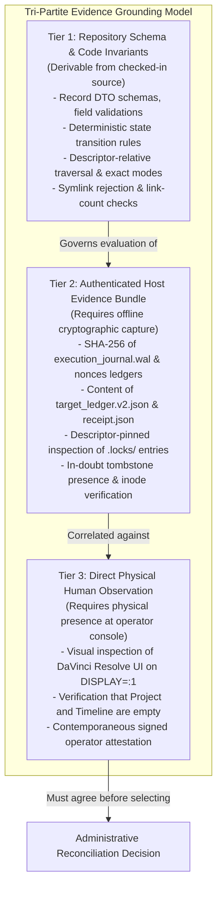
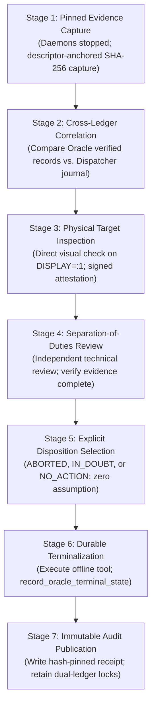
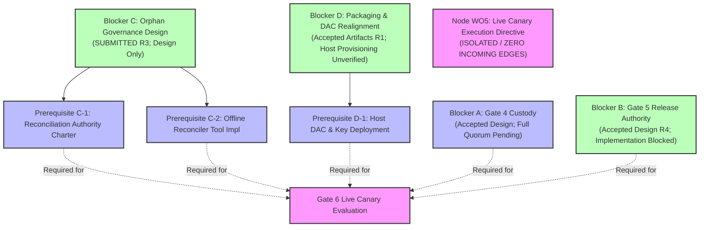

# 07B7-GATE6-PHASE2-BLOCKER-C-ORPHAN-GOVERNANCE-DESIGN-R1: Signer Oracle Orphan Governance & Offline Reconciliation Policy

**Document ID:** `07B7-GATE6-PHASE2-BLOCKER-C-ORPHAN-GOVERNANCE-DESIGN-R1`  
**Revision:** `R3`  
**Status:** `SUBMITTED_FOR_REVIEW`  
**Workorder Reference:** `G07-07B7-GATE6-PHASE2-BLOCKER-C-ORPHAN-GOVERNANCE-DESIGN-R1`  
**Author:** Pair Programming Agent (Antigravity)  
**Reviewer:** Tech Lead (Codex)  
**Operating Mode:** `DOCUMENTATION_AND_STATIC_SOURCE_REVIEW_ONLY; NO_SOURCE_OR_CONFIG_EDITS; NO_TESTS_OR_IMPORTS_OR_COMPILATION; NO_HOST_OR_PRODUCTION_STATE_ACCESS; NO_SYSTEMD_LIFECYCLE; NO_KEY_OR_TRUST-ROOT_CONTENT_ACCESS; NO_SOCKET_OR_NETWORK; NO_RESOLVE; NO_LIVE_OPERATIONS; READY_TO_EXECUTE_FALSE`

---

## 1. Executive Summary & Governance Basis

### 1.1 Context & Incident Background
Under Plan 07B7 Post-Incident Hardening, the ResolveFlow architecture strictly isolates execution authorization, cryptographic verification, and target dispatch across distinct failure domains and OS principals. A primary finding of the post-incident boundary analysis (`docs/architecture/07B7-GATE6-PHASE2-BOUNDARY-DESIGN-R1.md` §3 and `docs/architecture/07B7-GATE6-DEP04-UPSTREAM-R1-dependency-resolution-design.md` §3.4) is the **Signer Oracle Orphan State Blocker (Blocker C)**:
When the Signer Oracle (`TrialAuthorizationSignerDaemon`) approves an `OracleVerificationRequest`, it durably commits an `OracleExecutionRecord` to `DurableNonceLedger` (persisted in `oracle_verified_executions.jsonl`) before transmitting its signed response over the AF_UNIX socket. If the client (`LiveCanaryDispatchService`) crashes, terminates, or encounters a transport failure immediately after Oracle verification (Boundary 1) or before terminal notification completion, the verified execution token is permanently consumed in the Oracle ledger, but never transitions to a terminal state (`COMPLETED`, `ABORTED`, or `IN_DOUBT`).

Because the accepted `OracleExecutionRecord` schema intentionally contains **no expiry timestamp, no wall-clock time-to-live (TTL), and no background garbage collector**, such non-terminal records remain permanently on disk as "orphans". Subsequent attempts to verify or reuse that `execution_id` fail closed with `ERR_EXECUTION_ALREADY_VERIFIED`.

### 1.2 Objective & Scope
This document resolves Blocker C by establishing a comprehensive, source-grounded **governance and architecture design** for identifying, classifying, and reconciling non-terminal verified execution records in the Signer Oracle ledger.

In accordance with the accepted **Option A: Administrative-Only Offline Reconciliation** posture established in `Receipt/WAL Binding Design R3` and `Phase 2 Boundary Design R8`:
1. Reconciliation is strictly **out-of-band, offline, and administrative**.
2. Automated in-flight background reconciliation daemons, automatic TTL/wall-clock expiry, automatic retry/resend, automatic rollback on DaVinci Resolve, automatic target unlocking, and new wire discovery protocols are **strictly prohibited**.
3. Terminalization of an Oracle orphan record does **NOT** release, clear, or modify Dispatcher target exclusion.
4. This workorder establishes **policy and design only**. It authorizes zero implementation code, zero helper scripts, zero host inspection, and zero live operations.

### 1.3 Preconditions & Preserved Safety Invariants
- `ready_to_execute = False` is strictly maintained.
- Gate 6 remains strictly `NOT ACCEPTED` / incident-only.
- Gate G07 and Milestones M1, M2, and M3 strictly remain `OPEN`.
- Node `WO5 (Live Canary Execution Directive)` in the decision DAG remains completely disconnected with strictly zero incoming edges.
- DaVinci Resolve Project `RF_TRIAL_AEC8F0A7A365D5F5` and Timeline `RF_TRIAL_TL_AEC8F0A7A365D5F5` on `DISPLAY=:1` remain completely outside scope, untouched, and pristine empty.
- Zero private key generation, zero host provisioning, zero systemd changes, zero socket creation, zero network traffic, and zero Resolve API/UI interactions.

---

## 2. Source-Grounded State Model & Ledger Architecture

### 2.1 Schema Grounding in `DurableNonceLedger`
The authoritative durable state of the Signer Oracle is governed exclusively by `DurableNonceLedger` (`src/services/durable_nonce_ledger.py`). The accepted filenames, schemas, and storage contracts relevant to execution verification and terminalization are:

#### Ledger File Architecture (`src/services/durable_nonce_ledger.py:39–46`)
- `DEFAULT_NONCES_DIR = "/var/lib/resolveflow/signer/nonces"` (mode `0700`, owner `_resolveflow_signer:901`)
- `DEFAULT_ORACLE_EXECUTIONS_FILE = "oracle_verified_executions.jsonl"` (mode `0600`, owner `901:901`)
- `DEFAULT_ORACLE_TERMINALS_FILE = "oracle_execution_terminals.jsonl"` (mode `0600`, owner `901:901`)
- Companion ledgers: `consumed_nonces.jsonl` (Gate 3 nonce coordinates) and `authorization_identities.jsonl` (Gate 2 authorization bindings).

#### 1. `OracleExecutionRecord` (`src/services/durable_nonce_ledger.py:140–201`)
Recorded atomically with `fsync` durability via `record_oracle_execution()`:
```python
@dataclass(frozen=True)
class OracleExecutionRecord:
    schema_version: int = 1
    execution_id: str = ""
    authorization_id: str = ""
    proposal_revision: str = ""
    target_project_uid: str = ""
    target_timeline_uid: str = ""
    verification_status: str = ""  # strictly "VERIFIED_VALID"
    verified_at_iso: str = ""
```
- **Serialization:** Strict canonical JSON (RFC 8785 / JCS) appended to `oracle_verified_executions.jsonl`, followed by `os.fsync(file_fd)` and `os.fsync(dir_fd)`.
- **Query APIs:**
  - `is_execution_verified(execution_id: str) -> bool`: Returns `True` if `execution_id in self._verified_execution_ids`.
  - `get_oracle_execution(execution_id: str) -> Optional[OracleExecutionRecord]`: Retrieves the immutable verified record.
- **Enforcement:** Re-verification of the same `execution_id` raises `SignerLedgerSecurityError("ERR_EXECUTION_ALREADY_VERIFIED")`.

#### 2. `OracleExecutionTerminalRecord` (`src/services/durable_nonce_ledger.py:227–300`)
Recorded atomically with `fsync` durability via `record_oracle_terminal_state()`:
```python
@dataclass(frozen=True)
class OracleExecutionTerminalRecord:
    schema_version: int = 1
    execution_id: str = ""
    authorization_id: str = ""
    terminal_state: str = ""  # strictly "COMPLETED" | "ABORTED" | "IN_DOUBT"
    proposal_revision: str = ""
    target_project_uid: str = ""
    target_timeline_uid: str = ""
    action_payload_digest_sha256: str = ""
    recorded_at_iso: str = ""
```
- **Serialization:** Canonical JCS appended to `oracle_execution_terminals.jsonl`, followed by `os.fsync(file_fd)` and `os.fsync(dir_fd)`.
- **Query APIs:**
  - `is_execution_terminal(execution_id: str) -> bool`: Returns `True` if `execution_id in self._terminal_records`.
  - `get_oracle_terminal_state(execution_id: str) -> Optional[OracleExecutionTerminalRecord]`: Retrieves the terminal transition.
- **Idempotency & Conflict:**
  - If a terminal record already exists with the **identical** `terminal_state`, the method returns `False` (idempotent success; no duplicate line appended).
  - If a terminal record already exists with a **conflicting** `terminal_state`, the method raises `SignerLedgerSecurityError("ERR_TERMINAL_STATE_CONFLICT")`.

### 2.2 Separation of Replay Prevention vs. Target Lock Ownership
A fundamental security boundary exists between the Signer Oracle and the Dispatcher:
1. **Signer Oracle Responsibility (Execution Nonce Replay Prevention):**
   - The Oracle ledger tracks per-execution tokens. Once `record_oracle_execution()` executes, the `execution_id` is durably consumed in `oracle_verified_executions.jsonl` to prevent replay attacks against the Oracle.
   - **Crucial Boundary Limitation:** `DurableNonceLedger` **does NOT own, index, or enforce target locks**. While `target_project_uid` and `target_timeline_uid` are stored in the record for cryptographic binding and non-repudiation audit trails, the Oracle does not check whether a project/timeline is currently locked or in doubt.
2. **Dispatcher Responsibility (Durable Target Exclusion & Concurrency Control):**
   - Target locking and target exclusion (`is_target_locked_or_in_doubt(target_project_uid, target_timeline_uid)`) are **exclusively owned, acquired, evaluated, and released by the Dispatcher journal** (`DurableDispatchJournal` in `src/services/durable_dispatch_journal.py:326–395`, `591–665`).
   - The Dispatcher enforces two distinct lock layers:
     - *Ephemeral Process Lock (`fcntl.flock`):* Held on `.locks/<target_hash>.lock` by the active runner process. Automatically released by the OS kernel upon process crash or exit.
     - *Durable Target Exclusion:* Evaluated from persistent on-disk state (`target_ledger.v2.json` states `RESERVED`, `ACTIVE`, `EXHAUSTED`, `IN_DOUBT_LOCKED`, and `.locks/<target_hash>.in_doubt` tombstone markers). This logical exclusion survives process death and host reboot.
   - Under the canary architecture, targets are **strictly one-shot**: reaching terminal states `EXHAUSTED` or `COMPLETED` releases the kernel `flock`, but leaves durable target exclusion permanently active (`reserve_target()` fails closed with `ERR_TARGET_NOT_AVAILABLE`).

### 2.3 Narrow Definition of an Oracle Orphan Record
An **Oracle Orphan Record** is strictly and narrowly defined as:
$$\text{Orphan}(E) \iff (\text{is\_execution\_verified}(E) = \text{True}) \land (\text{is\_execution\_terminal}(E) = \text{False})$$

#### Key Architectural Properties of the Orphan State:
1. **Permanent Persistence:** Because `OracleExecutionRecord` has no TTL or expiry timestamp, an orphan record remains in `DurableNonceLedger._verified_executions` indefinitely until an authorized terminal record is explicitly committed to `oracle_execution_terminals.jsonl`.
2. **Deterministic Re-verification Rejection:** Any subsequent call to `_process_oracle_verification()` presenting an orphaned `execution_id` fails immediately with `ERR_EXECUTION_ALREADY_VERIFIED` (`src/services/trial_authorization_signer_daemon.py:858–867`, `947–956`).
3. **Dual-Ledger Inconsistency:** The Oracle ledger views $E$ as active/consumed, while the Dispatcher journal may have zero record of $E$ (Boundary 1) or an ambiguous/in-doubt record of $E$ (Boundaries 3–5B).

---

## 3. Crash Boundary & Dual-Ledger Ordering Matrix

### 3.1 Strict Execution Pipeline Ordering
The deterministic execution sequence defined in `LiveCanaryDispatchService.dispatch_live_canary()` establishes the dual-ledger write ordering:
```
Step 1: [Oracle AF_UNIX IPC Verification Request]
Step 2:   -> Signer Daemon: Verify HMAC & Authorization
Step 3:   -> Signer Ledger: record_oracle_execution() -> fsync(oracle_verified_executions.jsonl) -> fsync(signer_dir)
Step 4:   -> Signer Daemon: Ed25519 Sign Response -> Transmit OracleVerificationResponse
           ======================================================================== [BOUNDARY 1]
Step 5: Dispatcher: Validate Oracle Signature & 11-Point Invariants
Step 6: Dispatcher: record_intent() -> fsync(execution_journal.wal)
Step 7: Dispatcher: reserve_target() -> Atomic Replace target_ledger.v2.json (RESERVED) -> fsync(parent_dir)
           ======================================================================== [BOUNDARY 2]
Step 8: Dispatcher: record_action_pending() -> fsync(execution_journal.wal)
Step 9: Dispatcher: acquire_target_lock() -> fcntl.flock on .locks/<target_hash>.lock
Step 10: Dispatcher: Preflight Fresh Check -> Live Adapter execute_live_canary_action()
           ======================================================================== [BOUNDARY 3 & 4]
Step 11: Dispatcher: Post-execution readback verification
Step 12: Dispatcher: commit_terminal():
          - WAL append ACTION_COMMITTED & FINISH(COMPLETED) -> fsync(execution_journal.wal)
          - Atomic publish receipt.json -> fsync(file_fd) -> fsync(parent_dir)
          - Atomic replace target_ledger.v2.json (EXHAUSTED) -> fsync(parent_dir)
           ======================================================================== [BOUNDARY 5A-1 / 5A-2]
Step 13: Dispatcher: record_notify_oracle_intent() -> fsync(execution_journal.wal)
Step 14: Dispatcher: Transmit OracleTerminalNotificationRequest(terminal_state)
           ======================================================================== [BOUNDARY 5B]
Step 15:   -> Signer Daemon: record_oracle_terminal_state() -> fsync(oracle_execution_terminals.jsonl) -> fsync(signer_dir)
Step 16:   -> Signer Daemon: Transmit OracleTerminalNotificationResponse(ACCEPTED)
Step 17: Dispatcher: Validate Oracle Terminal Signature & ACK
Step 18: Dispatcher: release_target_lock() -> Kernel flock released
```

### 3.2 Dual-Ledger Crash / Recovery Matrix

> [!IMPORTANT]
> **Source Grounding on Recovery Capabilities:**  
> `DurableDispatchJournal._recover_from_files()` (`src/services/durable_dispatch_journal.py:518–589`) is strictly a local state recovery routine. It parses existing files, validates modes, loads target status, and reconstructs `.in_doubt` tombstone files for unmatched `ACTION_PENDING` entries. **It does NOT perform automated socket connections, does NOT transmit terminal notifications, and does NOT execute wire retries.**  
> Under accepted Option A governance and Runbook R5, automated in-flight daemon reconciliation is strictly prohibited. Any state change or notification transmission requires an out-of-band administrative workorder.

| Crash Boundary | Oracle Ledger State | Dispatcher Journal State | Kernel flock vs. Durable Exclusion | DaVinci Resolve Target Mutation Status | Exact Risk Assessment & Governance Determination | Authorized Reconciliation Action |
| :--- | :--- | :--- | :--- | :--- | :--- | :--- |
| **Boundary 1: Crash after Oracle fsync, before Dispatcher Intent fsync** | `verified: True`<br>`terminal: False` | Zero local record of `execution_id`; target ledger unmodified; zero WAL entries. | `flock`: Never acquired.<br>Durable exclusion: NOT asserted. | **Zero Mutation:** Dispatcher process never crossed pre-intent boundary. Zero action dispatched. | **True Orphan:** `execution_id` permanently consumed at Oracle. Re-verification rejected. Cross-ledger audit inconsistency. Must transition Oracle record to terminal `ABORTED`. **No retry** with same ID. | Offline administrative reconciliation verifying absence of Dispatcher intent. Terminalize Oracle record as `ABORTED`. Target remains unreserved. |
| **Boundary 2: Crash after Intent/RESERVED, before WAL `ACTION_PENDING` fsync** | `verified: True`<br>`terminal: False` | `target_ledger.v2.json` has `RESERVED`. Zero WAL entry. | `flock`: Never acquired.<br>Durable exclusion: IS asserted (`RESERVED`). | **Zero Mutation:** Absence of WAL record proves adapter boundary was never crossed. | **Pre-Mutation Abort:** Zero mutation proven by absence of WAL intent. Target is durably reserved. Note: Automated wire transmission on restart is **unimplemented and unauthorized** in current code. Under Option A, wire transmission cannot occur automatically. | Diagnostic inspection only under Runbook R5. Any transition of local ledger to `EXHAUSTED(ABORTED)` or sending of Oracle terminal notification requires a separately authorized administrative procedure. |
| **Boundary 3: Crash after WAL `ACTION_PENDING`, before terminal receipt fsync** | `verified: True`<br>`terminal: False` | WAL contains unmatched `ACTION_PENDING`. Target ledger `ACTIVE`. | `flock`: Released by kernel.<br>Durable exclusion: `IN_DOUBT_LOCKED` reconstructed with `.in_doubt` tombstone. | **Ambiguous Mutation:** Adapter may or may not have executed. Volatile memory capabilities do NOT survive a crash. | **Permanent In-Doubt:** Fail-closed mandate requires treating unverified post-WAL crashes as ambiguous. Zero automated abort assumption. Zero automated rollback. Target permanently locked in doubt. Automated wire notification is **unimplemented**. | Requires physical human inspection on `DISPLAY=:1`. Terminalize Oracle record as `IN_DOUBT` under separate administrative authorization. Tombstone retained. |
| **Boundary 4: Crash during Resolve Mutation or Unverified Readback** | `verified: True`<br>`terminal: False` | WAL has `ACTION_PENDING`. Target ledger `ACTIVE`. | `flock`: Released by kernel.<br>Durable exclusion: Permanent `.in_doubt` tombstone. | **Ambiguous Mutation:** Timeline state unknown without physical readback inspection. | **Permanent In-Doubt:** Mutation outcome ambiguous. Zero automated retry, zero automated rollback. Target permanently locked in doubt. Automated wire notification is **unimplemented**. | Physical inspection of timeline on `DISPLAY=:1`. Terminalize Oracle as `IN_DOUBT` under separate administrative authorization. Target tombstone retained. |
| **Boundary 5A-1: Crash inside `commit_terminal()`, after Receipt fsync, before Ledger `EXHAUSTED`** | `verified: True`<br>`terminal: False` | WAL has `ACTION_COMMITTED` and `FINISH(COMPLETED)`. `receipt.json` published. Target ledger still `ACTIVE`. | `flock`: Released by kernel.<br>Durable exclusion: Asserted via `ACTIVE`. | **Mutation Succeeded:** Timeline modified and readback verified before crash. | **Pre-Terminal Ledger Inconsistency:** WAL schema contains no receipt digest binding; automated restart cannot synthesize `EXHAUSTED`. Automated repair strictly prohibited. Target remains locked in `ACTIVE`. | Offline administrative reconciliation: inspect `receipt.json` and timeline, update target ledger to `EXHAUSTED`, authorize terminal notification to Oracle under separate workorder. |
| **Boundary 5A-2: Crash after `commit_terminal()` completion, before `NOTIFY_ORACLE_INTENT` fsync** | `verified: True`<br>`terminal: False` | WAL has `ACTION_COMMITTED` and `FINISH(COMPLETED)`. `receipt.json` exists. Target ledger `EXHAUSTED`. | `flock`: Released by kernel.<br>Durable exclusion: Asserted via `EXHAUSTED`. | **Mutation Succeeded:** Timeline modified and verified. | **Definite Non-Send:** Local journal fully terminalized. Absence of `NOTIFY_ORACLE_INTENT` proves notification never sent. Note: Automated wire send on restart is **unimplemented and unauthorized** in current code. | Diagnostic verification under Runbook R5. Offline administrative authorization required to transmit terminal notification `COMPLETED` to Oracle. |
| **Boundary 5B: Crash after `NOTIFY_ORACLE_INTENT` fsync, without recorded Oracle ACK** | `verified: True`<br>`terminal: Unknown` | `receipt.json` durable. Target ledger `EXHAUSTED`. `NOTIFY_ORACLE_INTENT` in journal. No Oracle ACK recorded. | `flock`: Released by kernel.<br>Durable exclusion: Transitions to `IN_DOUBT_LOCKED`. | **Mutation Succeeded:** Target modified. | **Ambiguous Send:** Wire notification state in-doubt. **AUTOMATIC RETRY / RESEND IS STRICTLY FORBIDDEN.** Transition local ledger to `IN_DOUBT_LOCKED`. Target permanently locked in doubt. | **NO RESEND / NO RETRY.** Target remains logically locked in doubt pending offline administrative reconciliation. Check Oracle ledger out-of-band. |

### 3.3 Evidence Classification & Grounding
To prevent speculation and ungrounded claims, evidence used in orphan classification is categorized into three strict tiers:



1. **Tier 1 (Derivable from Repository Schema & Source):**
   - The exact fields and validation rules of `OracleExecutionRecord`, `OracleExecutionTerminalRecord`, `TargetLedgerRecord`, and WAL entry types.
   - The ordering of operations in `LiveCanaryDispatchService.dispatch_live_canary()`.
   - The absence of TTL, expiry, or reaper routines in `DurableNonceLedger`.
2. **Tier 2 (Requires Authenticated Host Evidence Bundle):**
   - The actual existence of entries in `/var/lib/resolveflow/signer/nonces/` and `/var/lib/resolveflow/dispatcher/`.
   - The cryptographic checksums of WAL files and target ledgers.
   - The specific crash boundary identifiable from on-disk markers.
   - *Explicit Invariant:* This design claims **zero** Tier 2 facts about current host state.
3. **Tier 3 (Requires Direct Physical Human Operator Observation):**
   - The physical presence or absence of video clips on Track 1 of Timeline `RF_TRIAL_TL_AEC8F0A7A365D5F5` in Project `RF_TRIAL_AEC8F0A7A365D5F5` on `DISPLAY=:1`.
   - *Explicit Invariant:* No mutation status may be asserted for ambiguous boundaries (Boundaries 3, 4, 5B) without fresh, contemporaneous Tier 3 attestation.

---

## 4. Proposed Offline Administrative Decision Procedure & Governance Gaps

### 4.1 Seven-Stage Offline Administrative Procedure (Proposed Design)
Under accepted Option A governance, reconciliation of an orphan record is designed exclusively as an offline, out-of-band administrative procedure:



#### Stage 1: Pinned Evidence Capture (Daemons Stopped)
1. Both `resolveflow-signer.service` and `resolveflow-dispatcher.service` must be verified as stopped (`ActiveState=inactive` or confirmed absent from process tree).
2. The administrative tool opens `/var/lib/resolveflow/signer` and `/var/lib/resolveflow/dispatcher` descriptor-relatively (`O_NOFOLLOW | O_DIRECTORY`).
3. Cryptographic SHA-256 digests and file metadata (inode, size, mtime, mode `0600`, UID/GID) are captured for all ledger and journal files.

#### Stage 2: Cross-Ledger Correlation & Boundary Classification
1. The tool reads `oracle_verified_executions.jsonl` and `oracle_execution_terminals.jsonl` from the Signer ledger to compile the set of orphan records:
   $$\text{Orphans} = \{E \in \text{VerifiedExecutions} \mid E \notin \text{TerminalExecutions}\}$$
2. For each orphan $E$, the Dispatcher journal is inspected:
   - Check presence of $E$ in `execution_journal.wal`.
   - Check `target_ledger.v2.json` status (`RESERVED`, `ACTIVE`, `EXHAUSTED`, `IN_DOUBT_LOCKED`, or absent).
   - Check presence of `receipt.json` matching $E$.
   - Check presence of `.locks/<target_hash>.in_doubt`.
3. The orphan is classified into exactly one crash boundary from §3.2.

#### Stage 3: Physical Target State Verification
1. For any orphan associated with a boundary where Dispatcher intent was written (Boundaries 2–5B), the human operator physically inspects DaVinci Resolve on `DISPLAY=:1`.
2. The operator verifies whether the target Project and Timeline contain any media clips.
3. The operator generates a signed, timestamped physical attestation record.

#### Stage 4: Independent Review & Separation of Duties
1. Evidence from Stages 1–3 is compiled into an immutable candidate bundle.
2. An independent technical reviewer (Tech Lead role) verifies that:
   - File hashes match pinned values.
   - Classification strictly matches the §3.2 matrix.
   - Physical attestation is fresh and signed.
   - No automatic assumptions of zero mutation were made without proof.

#### Stage 5: Explicit Disposition Selection & Minimum Evidence Thresholds
The disposition for an orphan record must be chosen strictly according to the following criteria:

| Selected Disposition | Required Minimum Evidence Threshold | Prohibited Basis |
| :--- | :--- | :--- |
| **`ABORTED`** | **Conclusive proof of zero mutation:**<br>1. Conclusive evidence that Dispatcher never wrote intent (Boundary 1: zero record in Dispatcher journal), OR<br>2. Conclusive evidence of pre-mutation abort (Boundary 2: `RESERVED` in ledger, zero WAL records) **AND** signed physical attestation that timeline is empty on `DISPLAY=:1`. | **STRICTLY PROHIBITED:**<br>- Assuming zero mutation because in-memory capability was absent.<br>- Assuming zero mutation because process crashed quickly.<br>- Choosing `ABORTED` when WAL contains `ACTION_PENDING`. |
| **`IN_DOUBT`** | **Any boundary where mutation could have occurred:**<br>1. WAL contains `ACTION_PENDING` (Boundaries 3, 4, 5B).<br>2. Ambiguous transport outcome during terminal notification.<br>3. Inability to physically verify timeline state on `DISPLAY=:1`. | N/A (Safe fail-closed fallback). |
| **`NO_ACTION`** | **Corrupt, conflicting, or active state:**<br>1. Torn-tail or hash mismatch in ledger records.<br>2. Daemon was detected running during evidence capture.<br>3. Evidence bundle is incomplete or disputed. | N/A (Preserves state for forensic escalation). |

#### Stage 6: Durable Terminalization Mechanism (Proposed Design)
1. The disposition is committed to the Signer Oracle ledger using **Option 6A: Direct Offline Administrative Invocation**:
   - The administrative tool would run under primary identity `_resolveflow_signer:901` (EUID 901) with zero supplementary groups.
   - It invokes `DurableNonceLedger.record_oracle_terminal_state()` directly against the pinned nonces directory descriptor.
   - The new `OracleExecutionTerminalRecord` is appended to `oracle_execution_terminals.jsonl` with immediate `fsync(file_fd)` and `fsync(dir_fd)`.
2. **Post-Action Verification:**
   - The tool re-reads `oracle_execution_terminals.jsonl` descriptor-relatively.
   - It asserts that `is_execution_terminal(execution_id)` returns `True` and that `get_oracle_terminal_state(execution_id).terminal_state` exactly matches the selected disposition.

#### Stage 7: Immutable Audit Record Generation
1. The tool outputs a signed, canonical JSON audit receipt into `.bridge/ux-evidence/` and logs the event to `.bridge/report.md`.
2. **Decoupling Invariant Check:** The tool verifies that Dispatcher target exclusion was **NOT** modified. The target remains locked or exhausted.

### 4.2 Governance Gaps & Unresolved Authority Charter (STOP CONDITION)
To prevent unilateral modification of financial or operational audit logs, the proposed design outlines three human roles:
1. **Human Operator:** Physically present at the console; verifies Resolve UI; signs Tier 3 physical attestation.
2. **Technical Reviewer (Tech Lead):** Evaluates cryptographic logs, verifies crash boundary classification, approves disposition.
3. **Designated Executor:** Possesses local administrative execution access to invoke the offline tool under UID 901.

> [!CAUTION]
> **UNRESOLVED GOVERNANCE PREREQUISITE (STOP CONDITION):**  
> Accepted contracts (`oracle_ipc_contracts.py`, `durable_nonce_ledger.py`, `trial_authorization_signer_daemon.py`) define **only programmatic wire interfaces and daemon logic**. They do **NOT** establish human administrative sign-off roles, cryptographic key roles for offline reconciliation, or an accepted quorum charter.  
> **The proposed roles, UID 901 execution path, and "signed" receipt represent an unapproved, unadopted design proposal.**  
> **NO STATE-CHANGING ACTION CAN BE AUTHORIZED OR EXECUTED** until a formal Administrative Reconciliation Authority Charter is established and accepted by Tech Lead Codex under a separate governance workorder.

### 4.3 Decoupling Oracle Terminalization from Dispatcher Target Locks
A critical principle of the ResolveFlow security model is **Zero Silent Coupling**:
1. Terminalizing an orphan record in `DurableNonceLedger` (e.g. to `ABORTED` or `IN_DOUBT`) resolves the Signer Oracle's replay ledger.
2. **It does NOT unlock the Dispatcher target.**
3. If the Dispatcher target was placed in `IN_DOUBT_LOCKED` or `EXHAUSTED`, clearing that state requires an entirely separate, independently authorized target-repair procedure.
4. An operator must never assume that resolving an Oracle orphan makes the underlying project/timeline available for another canary dispatch.

---

## 5. Safety Invariants, Audit Specification & Failure Handling

### 5.1 Categorical Safety Prohibitions
The following actions are strictly prohibited in all circumstances:
- **No Automatic TTL Expiry:** An orphan record must never be expunged, ignored, or treated as aborted simply because a given duration of wall-clock time has elapsed.
- **No Background Reaper Daemon:** The Signer Oracle must not spawn background threads or processes that sweep and terminalize non-terminal executions.
- **No Automatic Verification Retry:** A client must never retry an `OracleVerificationRequest` using an orphaned `execution_id`.
- **No Automatic Notification Replay:** A client must never re-transmit terminal notifications without explicit restart recovery authorization.
- **No Automatic Rollback:** Reconciliation must never issue API or GUI commands to delete clips from DaVinci Resolve.
- **No Ledger Record Rewriting:** Ledger records are append-only. Non-terminal records must never be modified in-place or deleted.
- **No Automatic Target Unlock:** Terminalization at the Oracle must never trigger an unlock of the Dispatcher target ledger.

### 5.2 Fail-Closed Failure Modes & Handling

| Failure Scenario | Detection Mechanism | Immediate Fail-Closed Action | Escalation & Recovery Path |
| :--- | :--- | :--- | :--- |
| **Tamper / Checksum Mismatch** | SHA-256 of WAL/JSONL files does not match expected capture digest. | Halt procedure immediately. Do not write terminal record. | Quarantine state directory. Escalate for security forensic audit. |
| **Torn Tail in Signer Ledger** | `_recover_terminal_records` or `_recover_oracle_executions` detects missing trailing newline (`content[-1:] != b"\n"`). | Ledger replay immediately raises `SignerLedgerCorruptionError("ERR_SIGNER_LEDGER_TORN_TAIL_DETECTED: ...")` (`src/services/durable_nonce_ledger.py:528, 561`). Read-only startup stops. *(Note: `_poisoned = True` is reserved for write/fsync failures, not startup replay)*. | **Halt procedure.** Ledger truncation or repair is **unapproved and unstandardized**. Requires a separately authorized forensic governance procedure; no automatic truncation. |
| **Identity Binding Mismatch** | Terminal record fields (`authorization_id`, `proposal_revision`, UIDs) do not match verified execution record. | `record_oracle_terminal_state()` raises `ERR_IDENTITY_BINDING_MISMATCH`. | Halt procedure. Reject candidate disposition. Re-examine authorization evidence. |
| **Conflicting Terminal State** | Execution record is already terminal with a conflicting state. | `record_oracle_terminal_state()` raises `ERR_TERMINAL_STATE_CONFLICT`. | Halt procedure. Do not override existing terminal record. Investigate prior terminalization event. |
| **Active Daemon Detected** | Socket file responds or PID file exists during offline evidence capture. | Administrative tool refuses to open ledger files (`ERR_DAEMON_ACTIVE`). | Stop daemons cleanly before attempting offline reconciliation. |
| **Physical Observation Conflict** | Dispatcher records indicate pre-mutation, but physical timeline contains clip. | Operator refuses Tier 3 attestation. Tool aborts disposition selection. | Force classification to `IN_DOUBT`. Halt reconciliation. Investigate unexpected target mutation. |

### 5.3 Illustrative Audit Record Schema Specification
Every administrative reconciliation disposition must produce an immutable audit receipt. Below is an **illustrative schema template** demonstrating required fields, classification metadata, and attestation structures:

```json
{
  "schema_version": 1,
  "reconciliation_id": "urn:uuid:00000000-0000-0000-0000-000000000000",
  "execution_id": "<EXAMPLE_EXECUTION_UUID_PLACEHOLDER>",
  "authorization_id": "<EXAMPLE_AUTHORIZATION_ID_PLACEHOLDER>",
  "proposal_revision": "<EXAMPLE_PROPOSAL_REVISION_PLACEHOLDER>",
  "target_project_uid": "4fd4272d-f0bc-445c-9490-5723cd6831c2",
  "target_timeline_uid": "ba6a6775-8ec4-41a4-bf2f-704de902e68d",
  "crash_boundary_classification": "BOUNDARY_1",
  "observed_oracle_verified_executions_digest_sha256": "<EXAMPLE_ILLUSTRATIVE_SHA256_DIGEST_NOT_REAL_EVIDENCE>",
  "observed_oracle_execution_terminals_digest_sha256": "<EXAMPLE_ILLUSTRATIVE_SHA256_DIGEST_NOT_REAL_EVIDENCE>",
  "observed_dispatcher_state": "ABSENT",
  "observed_dispatcher_wal_sha256": null,
  "physical_timeline_emptiness_attested": true,
  "selected_terminal_state": "ABORTED",
  "rationale": "Conclusive evidence of Boundary 1 crash: zero Dispatcher intent or WAL records. Timeline verified pristine empty on DISPLAY=:1.",
  "human_operator_identity": "<PROPOSED_OPERATOR_IDENTITY_PENDING_CHARTER>",
  "technical_reviewer_identity": "<PROPOSED_REVIEWER_IDENTITY_PENDING_CHARTER>",
  "reconciliation_executed_at_iso": "2026-11-05T00:00:00Z",
  "governance_authorization_reference": "<WORKORDER_AUTHORIZATION_REFERENCE_PLACEHOLDER>"
}
```

> [!WARNING]
> **Audit Integrity Statement & Non-Operational Disclaimer:**  
> The above JSON is strictly an illustrative structural template. The timestamp `reconciliation_executed_at_iso` reflects UTC wall-clock time at receipt creation and does not prove cryptographic signing time. Audit records must never contain secret keys, HMAC secrets, or private key material. The signer and operator identity fields remain unapproved pending the Authority Charter.

---

## 6. Governance DAG Status & Next Phase Sequencing

### 6.1 Blocker C Status Determination
- **Design & Policy Layer:** **RESOLVED FOR DESIGN ONLY (`ACCEPTED_FOR_DESIGN_ONLY`)**.  
  This document provides a complete, source-grounded state model, crash matrix, 7-stage offline procedure, and failure governance for Signer Oracle orphans under Option A.
- **Operational & Implementation Layer:** **STRICTLY BLOCKED**.  
  Reconciliation cannot be performed operationally until the following concrete prerequisites are satisfied:
  1. *Prerequisite C-1 (Authority Charter):* Formal adoption of an Administrative Reconciliation Authority Charter defining sign-off quorums and human roles.
  2. *Prerequisite C-2 (Tool Implementation):* A separately authorized workorder for implementing the offline reconciliation tool (`src/tools/reconcile_orphan_ledger.py`) with full test coverage under temporary directories.
  3. *Prerequisite D-1 (Host DAC Provisioning):* Resolution of Blocker D host provisioning and trust-root deployment.

### 6.2 Plan 07B7 DAG Alignment


- **Node WO5 (`Live Canary Execution Directive`):** Strictly disconnected with zero incoming edges.
- **Gate 6:** Strictly `NOT ACCEPTED` / incident-only.
- **Gate G07 & Milestones M1, M2, M3:** Strictly `OPEN`.
- **Operating Mode:** Strictly non-executing.

---

## 7. Evidence & Static Analysis Verification

### 7.1 Static Files & Code Ranges Reviewed
This governance design was developed through exhaustive static inspection of the following repository artifacts without runtime execution:
1. `src/services/durable_nonce_ledger.py`: Lines 39–46 (Filenames), 135–270 (Record DTOs), 520–565 (Torn-tail corruption handling), 675–720 (`record_oracle_execution`), 721–803 (`record_oracle_terminal_state`), 849–890 (Query APIs).
2. `src/services/trial_authorization_signer_daemon.py`: Lines 633–710 (`_handle_oracle_client`), 790–980 (`_process_oracle_verification`), 981–1070 (`_process_oracle_terminal_notification`).
3. `src/services/durable_dispatch_journal.py`: Lines 188–225 (Layout constants), 320–395 (`_traverse_and_open_state_dir`), 518–665 (`_recover_from_files`, `reserve_target`, target exclusion checks).
4. `src/services/live_canary_dispatch_service.py`: Lines 658–725 (`_notify_oracle_terminal`), 1040–1070, 1195–1211 (flock release ordering).
5. `src/core/contracts/oracle_ipc_contracts.py`: Wire contract DTOs for verification and terminal notification.
6. `docs/architecture/07B7-GATE6-PHASE2-BOUNDARY-DESIGN-R1.md`: Section 3 (Blocker C preliminary analysis).
7. `docs/architecture/07B7-GATE6-POST-INCIDENT-RECONCILIATION-RUNBOOK-R1.md`: Sections 5 & 8 (Option A baseline and authority gaps).

### 7.2 Explicit Statement of Host Boundary
No host state under `/var/lib/resolveflow`, `/run/resolveflow`, or `/etc/resolveflow` was accessed, inspected, or modified during the preparation of this document. No DaVinci Resolve processes or sockets were contacted.
