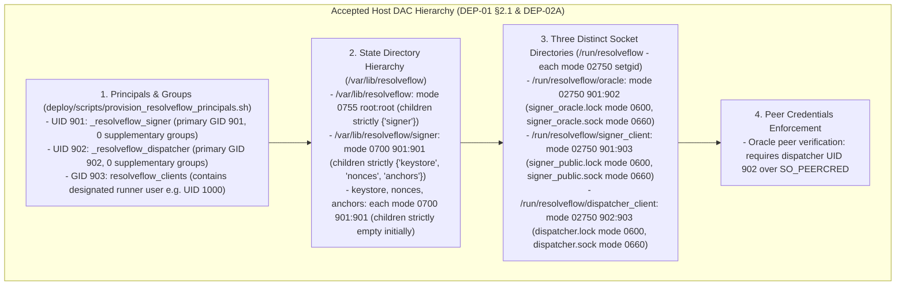
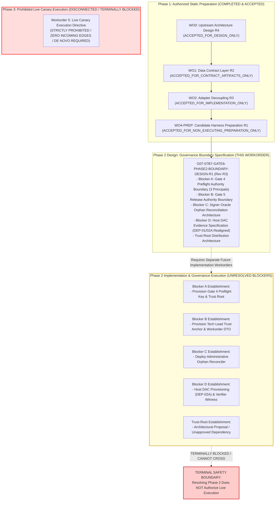

# Gate 6 Phase 2 Governance Prerequisite Boundary Design (Revision R3)

**Workorder:** `G07-07B7-GATE6-PHASE2-BOUNDARY-DESIGN-R1` (Revision R3 — Remediation of Findings R2-01, R2-02, and R2-03)  
**Parent Architecture:** `docs/architecture/07B7-GATE6-DEP04-UPSTREAM-R1-dependency-resolution-design.md` (Revision R4)  
**Accepted Baselines Cited:**
- DEP-01: `docs/architecture/07B7-GATE6-DEP01-live-dispatch-oracle-design.md` (§§2.1–2.3, 3.2–3.3, 4.1–4.2, 5.1–5.2.3, 7.4)
- DEP-02A: `docs/architecture/07B7-GATE6-DEP02A-DAC-REALIGN-code-review.md` (ACCEPTED_FOR_ARTIFACTS_ONLY)
- DEP-02C: `docs/architecture/07B7-GATE6-DEP02C-R2-code-review.md` (ACCEPTED_FOR_IMPLEMENTATION_ONLY)
- DEP-03: `docs/architecture/07B7-GATE6-DEP03-R5-code-review.md` (ACCEPTED_FOR_IMPLEMENTATION_ONLY)
- DEP-04 UPSTREAM Design: `docs/architecture/07B7-GATE6-DEP04-UPSTREAM-R1-R4-code-review.md` (ACCEPTED_FOR_DESIGN_ONLY)
- DEP-04 Contracts: `docs/architecture/07B7-GATE6-DEP04-CONTRACTS-R2-code-review.md` (ACCEPTED_FOR_CONTRACT_ARTIFACTS_ONLY)
- DEP-04 Candidate Harness: `docs/architecture/07B7-GATE6-DEP04-HARNESS-PREP-R1-code-review.md` (ACCEPTED_FOR_NON_EXECUTING_PREPARATION_ONLY)

**Review Reference:** `docs/architecture/07B7-GATE6-PHASE2-BOUNDARY-DESIGN-R1-R2-code-review.md` (CHANGES_REQUIRED Remediation)  
**Status:** `GATE6_PHASE2_BOUNDARY_DESIGN_R1_R3_COMPLETED_PENDING_TECH_LEAD_REVIEW`  
**Mode:** `DOCUMENTATION_AND_STATIC_SOURCE_REVIEW_ONLY; NO_IMPLEMENTATION; NO_KEY_OR_TRUST_ROOT_CREATION; NO_HOST_PROVISIONING; NO_SYSTEMD; NO_SOCKET_OR_NETWORK; NO_RESOLVE; NO_LIVE_OPERATIONS; READY_TO_EXECUTE_FALSE`.

---

## 1. Executive Summary & Review Remediation Context

Under Plan 07B7 and Gate 6 post-incident hardening, **Phase 1: Authorized Static Preparation (Non-Executing)** is 100% complete and accepted. The candidate runner (`/tmp/resolveflow-gate6/run_gate6.py` and `.bridge/ux-evidence/G07-07B7-GATE6/run_gate6.py`, SHA-256: `1c0d437173f66d42973d668b63d69dd2a020f0469051f8f86583f48434121f8e`) is statically prepared and protected by an unconditional line-1 runtime dependency stop:
```python
raise Gate6HarnessSecurityError("ERR_GATE6_PREPARATION_ONLY: ...")
```

This document establishes the formal architecture boundaries, crash-recovery matrices, and evidence criteria for **Phase 2 Governance Prerequisites (Blockers A–D)**. In response to Tech Lead Codex static reviews `07B7-GATE6-PHASE2-BOUNDARY-DESIGN-R1-code-review.md` and `07B7-GATE6-PHASE2-BOUNDARY-DESIGN-R1-R2-code-review.md`, Revision R3 resolves all identified findings:

1. **Remediation of `PHASE2-BOUNDARY-R2-01` (HIGH — Signer Client Socket Endpoint Correction):**
   - Corrected the socket and lock file names in `/run/resolveflow/signer_client/` from the erroneous `signer_client.sock` to the accepted **`signer_public.sock`** (and `signer_public.lock`).
   - Aligned all socket endpoint declarations strictly with accepted DEP-01 R4 §2.2.2 and `deploy/scripts/verify_resolveflow_dac.sh`:
     - `/run/resolveflow/oracle`: `signer_oracle.lock` and `signer_oracle.sock` (mode `02750`, owner `901:902`).
     - `/run/resolveflow/signer_client`: `signer_public.lock` and `signer_public.sock` (mode `02750`, owner `901:903`).
     - `/run/resolveflow/dispatcher_client`: `dispatcher.lock` and `dispatcher.sock` (mode `02750`, owner `902:903`).
2. **Remediation of `PHASE2-BOUNDARY-R2-02` (BLOCKER — Grounded Oracle Ledger Semantics vs. Dispatcher Target Lock):**
   - Eliminated the incorrect claim that an orphan `OracleExecutionRecord` creates a target-level lock at the Signer Oracle.
   - Grounded the Oracle ledger semantics strictly in accepted source (`src/services/durable_nonce_ledger.py`): `record_oracle_execution()` tracks and denies reuse of the specific `execution_id` (`is_execution_verified(execution_id)`). It prevents execution replay of that token, but does not index or lock target projects or timelines.
   - Target lock state (`is_target_locked_or_in_doubt(target_project_uid, target_timeline_uid)`) is strictly owned and enforced by the Dispatcher journal (`src/services/durable_dispatch_journal.py`).
   - Formulated the orphan risk accurately: permanent consumption and invalidation of the un-terminalized `execution_id` (causing any re-verification attempt to be rejected with `ERR_EXECUTION_ALREADY_VERIFIED`) and ledger inconsistency, without target-level lock confusion.
3. **Remediation of `PHASE2-BOUNDARY-R2-03` (MEDIUM — Trust-Root Attribution Correction):**
   - Corrected the misattribution of `/etc/resolveflow/trusted_roots/`. Citing accepted DEP-01 §2.1 accurately: DEP-01 established only the single Oracle public key file at `/etc/resolveflow/oracle_public_key.pem`; it did NOT establish a `trusted_roots/` directory or Gate 4/Gate 5 key filenames.
   - Formally classified any proposed `/etc/resolveflow/trusted_roots/` directory strictly as an **unapproved architectural proposal and unresolved dependency**, requiring its own formal design decision and deployment workorder.
4. **Preserved Prior Remediations (from R1 review):**
   - Maintained strict adherence to the **three approved OS principals** in DEP-01 §2.1 (`_resolveflow_signer`, `_resolveflow_dispatcher`, `interactive_user`). No unapproved `_resolveflow_preflight` user.
   - Reconciled Host DAC to DEP-02A-DAC-REALIGN (zero supplementary groups for daemons, client group `resolveflow_clients` GID 903).
   - Maintained complete disconnection of node `WO5 (Live Canary Execution Directive)` with strictly **zero incoming edges**.

---

## 2. Source-Grounded Evidence & Authority Matrix (Blockers A & B)

Plan 07B7 §2, DEP-01 §2.1, and DEP-04-UPSTREAM-R1 §2 define exactly three operating system execution principals. All cryptographic claims, custody policies, and verifications must map strictly to these principals and their accountable authorities:

### 2.1 Complete Authority & Key Custody Matrix

| Prerequisite / Gate | Role & Accountable Authority | Execution Principal (DEP-01 §2.1) | Key Identifier & Type | Trust Anchor Storage & Custody Source | Verification Point & Enforcement API | Failure Code & Fail-Closed Behavior |
| :--- | :--- | :--- | :--- | :--- | :--- | :--- |
| **Gate 2: User Authorization** | Human Director / Creative Approver | `interactive_user` (UID 1000) / Client UI | `director_key_id` (Ed25519) | Private key in Director keystore; public key registered in Signer daemon keystore. | Signer Daemon during token admission (`verify_approval_envelope`). | `ERR_DIRECTOR_KEY_REVOKED` / `ERR_INVALID_DIRECTOR_SIGNATURE`: Rejects admission. |
| **Blocker A: Gate 4 Preflight Authority** | Technical System Verifier | `interactive_user` (UID 1000) (Audit Context) | `verifier_key_id` (Ed25519) | **UNRESOLVED DEPENDENCY:** No preflight service OS principal exists in DEP-01. Custody and public trust root location are unprovisioned. | Candidate Runner (`_load_and_validate_preflight_envelope`) and Dispatcher. | `ERR_GATE4_TRUST_ROOT_MISSING`: Immediate fail-closed stop before any runtime initialization. |
| **Operator Visual Presence** | Human Operator physically present at `DISPLAY=:1` | Human Operator / Interactive Shell | `operator_key_id` (Ed25519) | Private key in Operator Console; public key registered in Signer daemon keyring. | Signer Daemon against active challenge nonce; digest bound into Authorization token. | `ERR_OPERATOR_SIGNATURE_INVALID` / `ERR_CHALLENGE_EXPIRED`: Rejects token minting. |
| **Blocker B: Gate 5 Release Authority** | Technical Lead / Governance Authority | Governance Role (Independent of Developer/Operator) | `tech_lead_key_id` (Ed25519) | **UNRESOLVED DEPENDENCY:** Requires independent Tech Lead Trust Anchor provisioned outside Signer private sandbox. | Candidate Runner (`_load_and_validate_workorder_record`) before execution admission. | `ERR_GATE5_TRUST_ANCHOR_MISSING`: Immediate fail-closed stop before journal construction. |
| **Mutation Capability Token** | Signer Oracle Service | `_resolveflow_signer` (UID 901) | `trial_signer_key_id` (HMAC-SHA256) | Keystore `/var/lib/resolveflow/signer/keystore/trial_auth.key` (mode `0700/0600`). | Signer Oracle internally over AF_UNIX IPC. | `ERR_HMAC_INVALID`: Rejects dispatch clearance. |
| **Oracle Verification Response** | Cryptographic Dispatch Clearance | `_resolveflow_signer` (UID 901) | `oracle_key_id` (Ed25519) | Private key in `/var/lib/resolveflow/signer/keystore/oracle_private.key`; public key deployed to `/etc/resolveflow/oracle_public_key.pem`. | Dispatcher / Adapter verifies over AF_UNIX IPC using pinned public key (`11-point gate`). | `ERR_ORACLE_SIGNATURE_MISMATCH`: Dispatch latches `IN_DOUBT_LOCKED`. |
| **Local Dispatch Receipts** | Local Target Proof & Journal | `_resolveflow_dispatcher` (UID 902) | **POSIX DAC & Descriptor Anchored** | Directory `/var/lib/resolveflow/dispatcher/receipts/` (mode `0700/0600`). | Authenticated via file descriptor lock (`flock`), UID 902, and SHA-256 readback digest. | `ERR_JOURNAL_LOCKED` / `ERR_IN_DOUBT`: Halts dispatch, retains target lock. |

---

### 2.2 Blocker A: Gate 4 Preflight Authority Boundary Specification

#### 2.2.1 Principal Designation & Separation of Duties
- **Execution Context:** Gate 4 preflight verification executes under the `interactive_user` (UID 1000) context to inspect DaVinci Resolve target topology and empty-timeline state.
- **Three-Principal Constraint:** DEP-01 §2.1 establishes exactly three OS principals (`_resolveflow_signer`, `_resolveflow_dispatcher`, `interactive_user`). No fourth OS principal exists or is authorized.
- **Role Isolation & Prohibited Key Reuse:**
  - The entity signing preflight evidence (`verifier_key_id`) must be cryptographically distinct from the Director (`director_key_id`), Operator (`operator_key_id`), and Tech Lead (`tech_lead_key_id`). Reusing keys across roles violates separation of duties and is strictly forbidden.
- **Unresolved Key Custody Dependency:**
  - Where the preflight signing private key resides (e.g. an offline key, an interactive operator-held token, or an unprivileged user keystore) has NOT been decided by governance and is not provisioned by accepted DEP-02A.
  - This is documented as an **UNRESOLVED GOVERNANCE PREREQUISITE**.
- **Signing & Verification Policy:**
  - Governed strictly by the accepted nominal contract `SignedPreflightEvidenceEnvelope` (`src/core/contracts/signed_preflight_contracts.py`).
  - Serialized via RFC 8785 canonical JSON bytes (`canonical_signing_payload_bytes()`).
  - Validity window: Strictly bounded to $\le 1800\text{ seconds}$ (30 minutes) from `verified_at_iso`.
  - Pinned target verification: Project `RF_TRIAL_AEC8F0A7A365D5F5`, Timeline `RF_TRIAL_TL_AEC8F0A7A365D5F5`, 24/1 fps, start frame 86400, clip SHA-256 `7c83154437b2e05e01f6a795d6295e9827e04907c4479c7b0435e3a4ac18d916`.
  - Mandatory boolean predicates: `project_and_timeline_active`, `empty_timeline_verified`, `topology_verified`, `incident_denylist_verified`, and `media_pool_source_verified` must all be `True`.
- **Missing-Authority Stop Condition:**
  - When the preflight issuer public key cannot be found or read by the runner, the runner immediately raises:
    ```
    Gate6HarnessSecurityError("ERR_GATE4_TRUST_ROOT_MISSING: Gate 4 preflight issuer public key is not established...")
    ```
  - Zero key fabrication, zero self-signed synthetic evidence, zero mock bypass.

---

### 2.3 Blocker B: Gate 5 Release Authority Boundary Specification

#### 2.3.1 Technical Lead Trust Anchor Bootstrap & Policy
- **Role Isolation:** The Tech Lead / Release Authority is an independent governance entity. The Tech Lead private key represents explicit release signoff for a specific, audited candidate harness.
- **Independence:** The Tech Lead cannot act as the physical operator supervising execution (`operator_id`), nor as the creative director (`director_id`).
- **Unresolved Trust-Root Publication Dependency:**
  - The public trust anchor must be verifiable by the candidate runner (`interactive_user` UID 1000) and Dispatcher (`_resolveflow_dispatcher` UID 902).
  - It CANNOT be stored inside `/var/lib/resolveflow/signer/` because that tree has mode `0700` owned by `_resolveflow_signer:901` (`EACCES`).
  - Establishing an accessible, world-readable trust-anchor location (e.g. a dedicated public key path outside Signer state) is an **UNRESOLVED GOVERNANCE DEPENDENCY** requiring an approved architecture decision and deployment workorder.
- **Candidate-Hash and Workorder Binding:**
  - Governed strictly by `SignedExecutionWorkorderRecord` (`src/core/contracts/signed_execution_workorder_contracts.py`).
  - `reviewed_candidate_sha256`: Must match the exact SHA-256 digest of the audited candidate script (`1c0d437173f66d42973d668b63d69dd2a020f0469051f8f86583f48434121f8e`). Any modification of a single byte in `run_gate6.py` invalidates the signature.
  - Action and plan bindings: `plan_digest_sha256`, `action_payload_digest_sha256`, and `execution_id` must match the admitted authorization token and execution plan exactly.
  - Validity window: Strictly bounded to $\le 3600\text{ seconds}$ (1 hour) from `issued_at_iso`.
- **Missing-Authority Stop Condition:**
  - If the Tech Lead trust anchor does not exist or cannot be read, the candidate runner immediately raises:
    ```
    Gate6HarnessSecurityError("ERR_GATE5_TRUST_ANCHOR_MISSING: Gate 5 release trust anchor is not established...")
    ```
  - Text-based regex checks on `.bridge/task.md` remain permanently deprecated and disallowed for execution clearance.

---

## 3. Signer Oracle Orphan State Reconciliation Architecture (Blocker C)

### 3.1 Grounding in Accepted Schema & Ledger Behavior
In the accepted DEP-02C and DEP-01 architecture, Signer Oracle state is managed by `DurableNonceLedger` (`src/services/durable_nonce_ledger.py:127–185`, `721–880`). Its durable records consist of:
1. `OracleExecutionRecord`: written by `record_oracle_execution()` upon approving an `OracleVerificationRequest`. Stores `execution_id`, `authorization_id`, `proposal_revision`, `target_project_uid`, `target_timeline_uid`, `verification_status`, and `verified_at_iso`.
2. `OracleExecutionTerminalRecord`: written by `record_oracle_terminal_state()` upon receiving an `OracleTerminalNotificationRequest`. Stores `execution_id`, `terminal_state` (`COMPLETED` | `ABORTED` | `IN_DOUBT`), `reason`, and `terminalized_at_iso`.

#### Separation of Execution Nonce Replay Prevention vs. Target Lock Ownership:
- **Oracle Ledger Boundary:** `DurableNonceLedger` tracks per-execution replay prevention. Method `is_execution_verified(execution_id)` returns `True` as soon as `record_oracle_execution()` completes. **It does NOT create, index, or enforce a target-level lock.** The Oracle ledger records metadata fields `target_project_uid` and `target_timeline_uid` for cryptographic binding and audit trail, but does not provide target locking.
- **Dispatcher Journal Boundary:** Target locking (`is_target_locked_or_in_doubt(target_project_uid, target_timeline_uid)`) is exclusively owned, acquired, and released by the Dispatcher journal (`src/services/durable_dispatch_journal.py:326–395`).

#### Separation of Process-Held Kernel Lock vs. Durable Logical Target Exclusion & Replay Prevention:
A critical distinction exists between ephemeral process file descriptor locks and durable journal target exclusion:
1. **Process-Held Kernel Lock (`fcntl.flock`):** An ephemeral lock acquired on the target lock file descriptor by the active Dispatcher process (`_acquire_target_lock()`). Under Linux OS semantics, when the process crashes, terminates, or is killed, the kernel automatically closes all file descriptors and immediately releases the kernel `flock`. **No process-held `flock` physically survives a crash.** Furthermore, in normal execution, the Dispatcher explicitly holds the kernel `flock` until *after* `_notify_oracle_terminal()` completes successfully (`src/services/live_canary_dispatch_service.py:1045–1062`; the pre-mutation abort path does the same at `:1198–1210`).
2. **Durable Logical Target Exclusion & Permanent Replay Prevention:** Reconstructed from persistent on-disk state by `DurableDispatchJournal.is_target_locked_or_in_doubt(target_project_uid, target_timeline_uid)`. It evaluates durable on-disk state: ledger states `RESERVED`, `ACTIVE`, `EXHAUSTED`, `IN_DOUBT_LOCKED`, and the presence of an `.in_doubt` tombstone file (`src/services/durable_dispatch_journal.py:591–623`). This durable exclusion survives process termination. Crucially, under the accepted canary architecture, the target project and timeline are **one-shot**: reaching a terminal state such as `EXHAUSTED` (from abort) or `COMPLETED` (from success) releases the process-held kernel `flock`, but does **NOT** clear durable target exclusion or make the target eligible for another dispatch. Replay prevention is enforced because `is_target_locked_or_in_doubt()` returns `True` for `EXHAUSTED` and `reserve_target()` fails closed with `ERR_TARGET_NOT_AVAILABLE` (`src/services/durable_dispatch_journal.py:659–665`). The target remains permanently exhausted and ineligible for subsequent dispatch unless an out-of-band administrative reset/reconciliation is explicitly authorized and executed.

#### The Persistent Orphan Problem (Crash Boundary 1):
1. **Scenario:** The Signer Oracle approves verification and persists `OracleExecutionRecord(execution_id=E1)`. It transmits `OracleVerificationResponse` over AF_UNIX IPC.
2. **Crash:** The Dispatcher process crashes *before* writing its local write-ahead audit intent (`Boundary 1` in DEP-04 UPSTREAM §3.4).
3. **State on Disk:**
   - Dispatcher journal: Zero record of `E1` exists; local target lock is NOT held.
   - Oracle ledger: `is_execution_verified(E1) == True`, but `is_execution_terminal(E1) == False`.
4. **Risk & Invariant Impact:**
   - `E1` is permanently consumed at the Oracle. If any caller or restart routine attempts to re-verify `E1`, `TrialAuthorizationSignerDaemon` rejects it with `ERR_EXECUTION_ALREADY_VERIFIED`.
   - The token `E1` is effectively dead / burned, yet exists in an un-terminalized state on the Oracle ledger.
   - The Oracle ledger schema contains **no expiry timestamp, no TTL, and no background garbage collector**. Without terminalization or reconciliation, `E1` remains an orphan indefinitely in the verified ledger.

---

### 3.2 Crash/Orphan State Reconciliation Matrix

The execution ordering in `LiveCanaryDispatchService.dispatch_live_canary()` dictates the exact state across crashes:
```
[Oracle Verification] -> [Signer Ledger fsync] -> [Oracle Response]
   -> [Dispatcher Intent fsync] -> [Ledger RESERVED fsync] -> [WAL ACTION_PENDING fsync]
   -> [Target Lock flock] -> [Resolve Mutation] -> [Readback]
   -> [commit_terminal(): WAL ACTION_COMMITTED + FINISH fsync -> Receipt fsync -> Ledger EXHAUSTED fsync]
   -> [NOTIFY_ORACLE_INTENT fsync] -> [Oracle Terminal Notification] -> [Oracle Response ACCEPTED]
   -> [Kernel Lock Release]
```

The deterministic restart-repair matrix maps every crash boundary to its exact durable on-disk state, kernel lock disposition, and recovery semantics:

| Crash Boundary | Signer Oracle Ledger State | Dispatcher Journal & WAL State | Kernel flock vs Durable Target Exclusion | DaVinci Resolve Mutation Status | Exact Risk Assessment & Determination | Required Authorization & Action |
| :--- | :--- | :--- | :--- | :--- | :--- | :--- |
| **Boundary 1: Crash after Oracle records `VERIFIED_VALID`, before Dispatcher Intent fsync** | `is_execution_verified: True`, `is_terminal: False` | Zero local record of `execution_id`; no reservation; no WAL | Kernel flock never acquired; durable target exclusion NOT asserted (`is_target_locked_or_in_doubt() == False`) | Zero mutation attempted (zero dispatch) | **Persistent Unresolved Orphan:** `execution_id` permanently consumed at Oracle; cannot be re-verified (`ERR_EXECUTION_ALREADY_VERIFIED`). Inconsistent audit state across dual ledgers. Must transition `execution_id` to terminal `ABORTED`. **No retry** with same `execution_id`. | Requires authenticated administrative reconciliation proving zero dispatch intent. Signer ledger retains non-terminal record until explicit out-of-band administrative intervention. |
| **Boundary 2: Crash after Intent / Ledger `RESERVED`, before WAL `ACTION_PENDING` fsync** | `is_execution_verified: True`, `is_terminal: False` | `target_ledger.v2.json` has `RESERVED`. Zero WAL entry. | Kernel flock never acquired (or released on crash). Durable exclusion IS asserted: `RESERVED` causes `is_target_locked_or_in_doubt() == True`. | Zero mutation attempted (proven by total absence of WAL entry) | **Pre-Mutation Abort:** Zero mutation proven. Exactly ONE first send permitted on restart: transmit `OracleTerminalNotificationRequest(terminal_state="ABORTED")`. Oracle records `ABORTED`. Transition local ledger to `EXHAUSTED(ABORTED)`. Ephemeral kernel `flock` is released, but target remains **durably exhausted and permanently ineligible for subsequent dispatch** (`is_target_locked_or_in_doubt() == True`, one-shot canary target). | Dispatcher restart-repair transmits first abort notification; updates journal to `EXHAUSTED(ABORTED)`. |
| **Boundary 3: Crash after WAL `ACTION_PENDING`, before terminal receipt fsync** | `is_execution_verified: True`, `is_terminal: False` | `target_ledger.v2.json` has `ACTIVE`. WAL contains unmatched `ACTION_PENDING`. | Kernel flock released by OS kernel on crash. Journal recovery detects unmatched `ACTION_PENDING` and reconstructs `.in_doubt` tombstone; target is **PERMANENTLY LOGICALLY IN_DOUBT_LOCKED** (`is_target_locked_or_in_doubt() == True`). | Ambiguous on restart. The in-memory `PreMutationAbortCapability` is volatile process memory and does not survive a crash. Without a durable mutation-boundary WAL record, zero mutation cannot be proven. | **Unmatched Action Intent / Permanent In-Doubt:** Fail-closed mandate requires treating unverified post-WAL crashes as ambiguous. Zero automated assumption of abort, zero automated retry, zero automated rollback. Transmit `OracleTerminalNotificationRequest(terminal_state="IN_DOUBT")`. Oracle records `IN_DOUBT`. | Target retained permanently in-doubt. Strictly out-of-band administrative reconciliation: requires physical human operator inspection on `DISPLAY=:1` to verify timeline emptiness before manual tombstone clearance. |
| **Boundary 4: Crash during Resolve Mutation or Unverified Readback** | `is_execution_verified: True`, `is_terminal: False` | WAL has `ACTION_PENDING`. Mutation boundary crossed. | Kernel flock released by OS kernel on crash. Durable state transitions to `IN_DOUBT_LOCKED` with `.in_doubt` tombstone file. Target is **PERMANENTLY LOGICALLY LOCKED**. | Mutation status ambiguous (timeline may or may not contain clip) | **Permanent In-Doubt:** Mutation outcome ambiguous. **Zero automatic retry, zero automatic rollback, zero automatic unlock.** Send first `OracleTerminalNotificationRequest(terminal_state="IN_DOUBT")`. Oracle records `IN_DOUBT`. | Target retained permanently in-doubt. Strictly out-of-band administrative reconciliation: requires physical human operator inspection on `DISPLAY=:1` to verify timeline emptiness before manual clearance. |
| **Boundary 5A-1: Crash inside `commit_terminal()`, AFTER Receipt fsync but BEFORE Ledger `EXHAUSTED` publication** | `is_execution_verified: True`, `is_terminal: False` | WAL has `ACTION_COMMITTED` and `FINISH(COMPLETED)`. Receipt `COMPLETED` published (`receipt.json`). Target ledger still `ACTIVE`. Zero `NOTIFY_ORACLE_INTENT`. | Kernel flock released by kernel on crash. Target remains **durably logically excluded** on restart (`is_target_locked_or_in_doubt() == True` via `ACTIVE`). | Mutation succeeded and verified by readback (timeline contains clip; `receipt.json` on disk) | **Definite Non-Send & Pre-Terminal Target Ledger Inconsistency:** Under the accepted WAL schema (`ACTION_COMMITTED` and `FINISH` in `durable_dispatch_journal.py:788–804`), WAL records store `execution_id`, `status`, and `timestamp_iso`, but contain **no receipt digest**. Therefore, the journal cannot cryptographically bind `receipt.json` to the WAL on restart recovery. Furthermore, accepted `_recover_from_files()` (`:518–589`) does not synthesize an `EXHAUSTED` ledger update from WAL+receipt. Consequently, **automated restart repair is strictly prohibited** under the current schema. Latch target into fail-closed state; target remains permanently excluded from re-dispatch (`is_target_locked_or_in_doubt() == True`). Any automated repair would require a separately reviewed schema revision to durably commit a receipt digest in the WAL. | **Requires Administrative Reconciliation:** Under the current schema and implementation, an `ACTIVE` target ledger with terminal WAL cannot be repaired automatically without a durable receipt digest binding in the WAL. Requires offline administrative reconciliation to inspect `receipt.json` and timeline, manually transition target ledger to `EXHAUSTED(COMPLETED)`, and authorize the first terminal notification send to Oracle. Upon Oracle `ACCEPTED` response, process-held flock is released (not held); target remains permanently ineligible for re-dispatch. |
| **Boundary 5A-2: Crash AFTER `commit_terminal()` completion, BEFORE `NOTIFY_ORACLE_INTENT` fsync** | `is_execution_verified: True`, `is_terminal: False` | WAL has `ACTION_COMMITTED` and `FINISH(COMPLETED)`. Receipt `COMPLETED` published (`receipt.json`). Target ledger already `EXHAUSTED(COMPLETED)`. Zero `NOTIFY_ORACLE_INTENT`. | Kernel flock released by kernel on crash. Target is already **durably exhausted** (`is_target_locked_or_in_doubt() == True`). | Mutation succeeded and verified; timeline contains clip | **Definite Non-Send (Local Journal Already Terminalized):** Local journal is already completely committed as `EXHAUSTED`. Absence of `NOTIFY_ORACLE_INTENT` proves notification was never attempted. Exactly ONE first send permitted on restart: transmit `OracleTerminalNotificationRequest(terminal_state="COMPLETED")`. | Dispatcher restart-repair transmits first terminal notification to Oracle. Upon receiving verified Oracle `ACCEPTED` response, Oracle acknowledges completion. Zero local journal modification required (already `EXHAUSTED`); process-held flock is released (not held); target remains permanently ineligible for re-dispatch. |
| **Boundary 5B: Crash AFTER `NOTIFY_ORACLE_INTENT` fsync, without recorded Oracle ACK** | `is_execution_verified: True`, `is_terminal: Unknown` (`VERIFIED_VALID` or `COMPLETED`) | Receipt `COMPLETED` durable. Target ledger `EXHAUSTED`. `NOTIFY_ORACLE_INTENT` fsynced in journal. No Oracle ACK recorded. | Kernel flock released by OS kernel on crash. Durable state transitions to `IN_DOUBT_LOCKED` with `.in_doubt` tombstone. Target is **PERMANENTLY LOGICALLY LOCKED**. | Mutation completed; timeline contains clip | **Ambiguous Send (DEP-03 Violation Guard):** Wire notification in-doubt. **AUTOMATIC RETRY / RESEND IS STRICTLY FORBIDDEN.** Transition local ledger to `IN_DOUBT_LOCKED`. Target remains logically locked. | **NO RESEND / NO RETRY.** Target remains logically locked in-doubt pending out-of-band administrative reconciliation. Zero automated resend. |

---

### 3.3 Comparative Analysis: Administrative/Manual vs. Automated Discovery Protocol

| Architectural Dimension | Approach 1: Out-of-Band Administrative Reconciliation | Approach 2: Automated IPC Wire Discovery Protocol |
| :--- | :--- | :--- |
| **Protocol Mechanism** | Offline administrative CLI tool run by operator/Tech Lead against Signer state. | New AF_UNIX IPC wire contract (`OracleOrphanDiscoveryRequest` / `Response`). |
| **Wire Schema Changes** | **Zero wire changes**. Reuses existing `durable_nonce_ledger.py` administrative APIs. | **Requires new contract DTOs** in `src/core/contracts/oracle_ipc_contracts.py`. |
| **Attack Surface** | Minimal. Operates only when daemon is stopped or via dedicated admin socket. | Higher. Exposes orphan query and reconciliation over active daemon socket. |
| **Principal Authorization** | Authenticated by Tech Lead Ed25519 signature and root/operator credentials. | Must enforce `SO_PEERCRED` checks ensuring caller is `_resolveflow_dispatcher`. |
| **Idempotency & Audit** | Generates an immutable, hash-chained audit receipt in `.bridge/ux-evidence/`. | Emits internal daemon audit log entry. |
| **Implementation Scope** | Standalone maintenance tool (`src/tools/reconcile_orphan_ledger.py`). | Requires modifying `TrialAuthorizationSignerDaemon`, `OracleIPCServer`, and Dispatcher. |
| **Governance Recommendation** | **RECOMMENDED FOR GATE 6 CANARY:** Given single-action canary scope, manual administrative reconciliation minimizes codebase mutation and prevents runaway unlock loops. | Deferred to multi-action production engine (post-Gate 6). |

#### Strict Constraints on Orphan Reconciliation (Regardless of Approach):
1. **Zero Automatic TTL Expiry:** An orphan entry must never expire simply because of elapsed wall-clock time.
2. **Zero Automatic Rollback:** Reconciliation must never trigger reverse operations on DaVinci Resolve.
3. **Permanent Audit Trail:** Any transition of an `execution_id` to terminal `ABORTED` or `IN_DOUBT` must record reconciler identity, timestamp, authorization reference, and justification.
4. **Implementation Prerequisite:** Any implementation of either approach constitutes a new workorder requiring its own file allowlist and Tech Lead review.

---

## 4. Host DAC Provisioning Evidence Architecture (Blocker D)

### 4.1 Distinction Between Artifact Acceptance and Host Deployment
Workorder `G07-07B7-GATE6-DEP02A-DAC-REALIGN` achieved static acceptance for configuration templates and provisioning scripts (`deploy/scripts/provision_resolveflow_principals.sh`, `deploy/scripts/verify_resolveflow_dac.sh`). However:
> **Static script acceptance is NOT host provisioning.** No system service users have been created on the Linux OS, no permissions on `/var/lib/resolveflow` have been modified, and no systemd daemons have been installed or started.

### 4.2 Objective Evidence Checklist Realigned to DEP-01 / DEP-02A

To satisfy Blocker D without architectural deviations, host evidence must strictly match the accepted DEP-01 R4 and DEP-02A-DAC-REALIGN specifications:



#### Detailed Verifiable Inspection Rubric:
1. **User and Group Existence:**
   - Command: `getent passwd _resolveflow_signer _resolveflow_dispatcher`
   - Command: `getent group _resolveflow_signer _resolveflow_dispatcher resolveflow_clients`
   - Assertions:
     - `_resolveflow_signer`: UID `901`, GID `901`, shell `/usr/sbin/nologin`. Zero supplementary groups (`id -G` outputs only `901`).
     - `_resolveflow_dispatcher`: UID `902`, GID `902`, shell `/usr/sbin/nologin`. Zero supplementary groups (`id -G` outputs only `902`).
     - `resolveflow_clients`: GID `903`. Designated interactive runner user (`UID 1000`) is a member.
2. **Directory DAC and Ownership:**
   - `/var/lib/resolveflow`: Mode `0755`, owner `0:0` (`root:root`). Direct child set strictly `{"signer"}`.
   - `/var/lib/resolveflow/signer`: Mode `0700`, owner `901:901`. Direct child set strictly `{"keystore", "nonces", "anchors"}`.
   - Subdirectories `keystore`, `nonces`, `anchors`: Each mode `0700`, owner `901:901`, empty before runtime.
3. **Three Socket Directories & Exact Endpoint Nodes (DEP-01 §2.2.2 & DEP-02A):**
   - `/run/resolveflow`: Mode `0755`, owner `0:0` (`root:root`). Direct child set strictly `{"oracle", "signer_client", "dispatcher_client"}`.
   - `/run/resolveflow/oracle`: Mode `02750` (setgid), owner `901:902` (`_resolveflow_signer:_resolveflow_dispatcher`).
     - Socket node: `signer_oracle.sock` (mode `0660`, owner `901:902`).
     - Lock node: `signer_oracle.lock` (mode `0600`, regular file, owner `901:902`).
   - `/run/resolveflow/signer_client`: Mode `02750` (setgid), owner `901:903` (`_resolveflow_signer:resolveflow_clients`).
     - Socket node: `signer_public.sock` (mode `0660`, owner `901:903`).
     - Lock node: `signer_public.lock` (mode `0600`, regular file, owner `901:903`).
   - `/run/resolveflow/dispatcher_client`: Mode `02750` (setgid), owner `902:903` (`_resolveflow_dispatcher:resolveflow_clients`).
     - Socket node: `dispatcher.sock` (mode `0660`, owner `902:903`).
     - Lock node: `dispatcher.lock` (mode `0600`, regular file, owner `902:903`).
4. **Peer Credential Validation:**
   - Signer daemon asserts `SO_PEERCRED` on connections to `signer_oracle.sock`: caller UID must be strictly `902` (`_resolveflow_dispatcher`).

### 4.3 Public Trust-Root Distribution Architecture & Unresolved Dependency
Because `/var/lib/resolveflow/signer` is mode `0700` and its child set is strictly `{"keystore", "nonces", "anchors"}`, public trust roots (for Gate 4 Preflight Authority and Gate 5 Release Authority) **CANNOT be co-located inside the Signer directory tree**.

- **Accepted Baseline Fact vs. Proposed Architecture:**
  - Accepted Baseline: DEP-01 §2.1 establishes only the Oracle public key file at `/etc/resolveflow/oracle_public_key.pem`.
  - Unapproved Proposal / Dependency: An `/etc/resolveflow/trusted_roots/` directory (mode `0755`, root:root) or specific key paths (`gate4_preflight_pubkey.pem`, `gate5_release_pubkey.pem`) have **NOT** been established by DEP-01 or DEP-02A.
- **Status:** The public trust-root publication and distribution mechanism for Gate 4 and Gate 5 is an **UNRESOLVED GOVERNANCE DEPENDENCY**. Any deployment of a dedicated trust-root directory requires a separate architecture decision and provisioning workorder.

### 4.4 Independent Authorization Boundary
- **Zero Host Mutation:** This design workorder authorizes **zero** execution of `sudo`, `useradd`, `chmod`, `chown`, or `systemctl`.
- **Future Governance Boundary:** Any future host provisioning must be authorized under a distinct, dedicated workorder (`G07-07B7-GATE6-HOST-PROVISION-R1`), requiring explicit operator supervision and consent.

---

## 5. Architectural Decision DAG & Absolute Execution Disconnection

The complete dependency graph governing Plan 07B7 post-incident hardening is structured below:



> [!IMPORTANT]
> **Cardinal Architecture Rule:**
> Node `WO5 (Live Canary Execution Directive)` remains completely disconnected with **zero incoming edges**. Neither the acceptance of this design (`PHASE2-BOUNDARY-DESIGN-R1`) nor the potential future resolution of Blockers A–D authorizes or schedules live canary execution. Any future canary execution on live DaVinci Resolve would require:
> 1. Complete resolution and verification of Blockers A, B, C, D, and Trust-Root Distribution.
> 2. Independent human operator physical confirmation and written user authorization in session.
> 3. An explicit, de novo execution directive workorder issued outside this preparation hierarchy.

---

## 6. Implementation Dependencies & Next Steps

This document identifies the following explicit implementation workorders required if governance decides to progress Phase 2:

1. **Workorder `G07-07B7-GATE6-DEP04-GATE4-WRAPPER-R1`:**
   - Wrap `src/tools/gate4_preflight_runner.py` to produce and sign `SignedPreflightEvidenceEnvelope`.
   - Allowlist: `src/tools/gate4_preflight_runner.py`, `tests/tools/test_gate4_preflight_runner.py`.
2. **Workorder `G07-07B7-GATE6-DEP04-ORPHAN-RECONCILE-R1`:**
   - Implement standalone out-of-band administrative reconciliation tool `src/tools/reconcile_orphan_ledger.py`.
   - Allowlist: `src/tools/reconcile_orphan_ledger.py`, `tests/tools/test_reconcile_orphan_ledger.py`.
3. **Workorder `G07-07B7-GATE6-DEP04-HOST-AUDIT-R1`:**
   - Update read-only host DAC verification script `deploy/scripts/verify_resolveflow_dac.sh`.
   - Allowlist: `deploy/scripts/verify_resolveflow_dac.sh`, `tests/scripts/test_verify_resolveflow_dac.py`.

---

## 7. Safety Invariants & Preserved State Declarations

- `ready_to_execute = False` is strictly maintained across all candidate runners and services.
- Gate 6 strictly remains `NOT ACCEPTED` / incident-only.
- Gate G07, Milestones M1, M2, and M3 strictly remain `OPEN`.
- Zero DaVinci Resolve SDK imports, IPC calls, or connections; target project `RF_TRIAL_AEC8F0A7A365D5F5` and timeline `RF_TRIAL_TL_AEC8F0A7A365D5F5` on `DISPLAY=:1` remain untouched and empty.
- Zero Oracle socket connection, zero network traffic, zero host provisioning, zero systemd changes.
- Zero production key access, zero private key generation, zero synthetic evidence creation.
