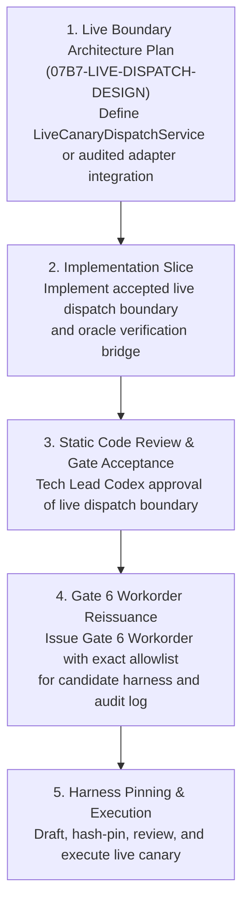

# Static Live Boundary Readiness Assessment & Decision Record (Gate 6 R2)

**Workorder:** `G07-07B7-GATE6-R2 — Live Boundary Readiness and Harness Pinning`  
**Date:** 2026-11-04T19:40:00Z (UTC) / 2026-11-05T02:40:00+07:00  
**Basis:** `docs/architecture/07B7-PREFLIGHT-GATE5-R1-readiness-review.md` (`CHANGES_REQUIRED — DO NOT EXECUTE`), findings `G5-R1-01` and `G5-R1-02`  
**Status:** `GATE6_R2_READINESS_ASSESSMENT_COMPLETED`  
**Boundary Determination:** `NO_ACCEPTED_LIVE_BOUNDARY`  
**Execution Safety:** `ready_to_execute = False`; zero Resolve calls; zero live operations; zero candidate harness execution  
**Parent Gate & Milestones:** Gate G07 (`OPEN`), Milestones M1, M2, M3 (`OPEN`), Gate 6 (`NOT ACCEPTED` / incident-only)  

---

## 1. Executive Summary & Definitive Decision

Under Workorder `G07-07B7-GATE6-R2`, a rigorous static architectural assessment was conducted to evaluate repository readiness for executing the single-action live canary trial against DaVinci Resolve target project `RF_TRIAL_AEC8F0A7A365D5F5` and timeline `RF_TRIAL_TL_AEC8F0A7A365D5F5`.

### Definitive Determination
**`NO_ACCEPTED_LIVE_BOUNDARY`**

1. **Dispatcher Is Mock-Only:** The sole accepted dispatcher service in the repository, `TrustedCanaryDispatchService` (`src/services/trusted_canary_dispatch_service.py`), was reviewed and accepted in Gate 3 (Workorder I17) strictly for mock execution (`LOCAL_TEST_ONLY; MOCK_GATEWAY_ONLY; NO_LIVE_RESOLVE; NO_LIVE_DISPATCH`). It is hardcoded to require `IsolatedResolveTrialAdapter` backed by `FakeResolveGateway`. When presented with `LiveResolveCanaryAdapter`, its constructor enforces an exact nominal type check `type(adapter) is not IsolatedResolveTrialAdapter` that immediately raises `DispatcherTripwireError("ERR_INVALID_ADAPTER_TYPE: ...")`. Under this condition order, the subsequent check `if isinstance(adapter, LiveResolveCanaryAdapter)` is redundant and unreachable in the current code structure, as all non-`IsolatedResolveTrialAdapter` classes are already rejected at the first gate.
2. **Missing Live Signer/Oracle/Dispatcher Chain:** The live trust boundary mandates specified in **Plan 07B7 Revision R7 §2** (OS-principal separation across `_resolveflow_signer`, `_resolveflow_dispatcher`, and `interactive_user`; dedicated DAC `/var/lib/resolveflow/signer/keystore/` and `/run/resolveflow/signer_oracle.sock`; authenticated inter-process oracle communication) were explicitly documented as unfulfilled in the Gate 3 Closeout Dossier (`docs/architecture/07B7-AUTH-SIGNER-GATE3-CLOSEOUT.md` §5.5) and Closeout Review (`docs/architecture/07B7-AUTH-SIGNER-GATE3-CLOSEOUT-review.md`). Only in-process local-test primitives (`LocalTestSignerSocketServer`, `LocalTestOracleVerificationClient`, `LocalTestSignerKeyHandle`) currently exist.
3. **No Wired Live Entrypoint:** While `LiveResolveCanaryAdapter` (`src/services/live_resolve_canary_adapter.py`) was accepted for its standalone implementation slice under Workorder `G07-07B7-LIVE-IMPL` (Revision R7), that acceptance was bounded (`LIVE_ADAPTER_IMPLEMENTATION_ONLY; NO_LIVE_EXECUTION`). It possesses no adapter-level oracle verification client, no integration with `TrustedCanaryDispatchService`, and no accepted entrypoint connecting it to live Resolve scripting handles within the Plan R7 authorization framework.

### Action Taken Under Task §3.3 & §3.6
Because no accepted live boundary exists and OS-level trust separation is absent, this assessment formally declares **`NO_ACCEPTED_LIVE_BOUNDARY` and stops**. In strict compliance with Workorder §2.4 and §3.4:
- **No candidate harness** (`/tmp/resolveflow-gate6-r2/run_gate6.py`) was created.
- **No archive harness** (`.bridge/ux-evidence/G07-07B7-GATE6-R2/run_gate6.py`) was created.
- Exact upstream implementation dependencies are documented in §6 of this record.

---

## 2. Inventory of Accepted Gate 3 Reviews & Component Classification

The following table categorizes all accepted Gate 3 modules, classes, and callable entrypoints by their operational scope:

| Component / Class | File Location | Accepted Review Slice | Operational Scope & Classification | Rejects Live / Notes |
| :--- | :--- | :--- | :--- | :--- |
| `SignedApprovalEnvelope` | `src/core/contracts/signed_approval_envelope.py` | I1-R2 (`07B7-AUTH-SIGNER-GATE3-I1-R2-code-review.md`) | **Data Contract (Neutral)**: RFC 8785 canonical bytes, plan digest binding. | Reusable in live and mock. |
| `SignedOperatorConsentEnvelope` | `src/core/contracts/signed_operator_consent_envelope.py` | I2-R5 (`07B7-AUTH-SIGNER-GATE3-I2-R5-code-review.md`) | **Data Contract (Neutral)**: 20-field validation, operator Ed25519 signature binding. | Reusable in live and mock. |
| `DirectorApprovalSigner` | `src/services/director_approval_signer.py` | I3-R2 (`07B7-AUTH-SIGNER-GATE3-I3-R2-code-review.md`) | **Cryptographic Primitive**: Ed25519 signing for director approval. | Reusable signing logic; production key management/custody not established. |
| `AuthoritativeApprovalStore` | `src/services/authoritative_approval_store.py` | I2-R5 (`07B7-AUTH-SIGNER-GATE3-I2-R5-code-review.md`) | **Storage Service**: POSIX atomic disk persistence for envelopes. | Reusable storage logic; production directory ACLs/ownership not established. |
| `TrialAuthorizationSignerService` | `src/services/trial_authorization_signer_service.py` | I16-R5 (`07B7-AUTH-SIGNER-GATE3-I16-R5-code-review.md`) | **Verification Core (Reusable) & Local-Test Issuance (Non-Production)**: Contains reusable verification algorithms (envelope parsing, nonce ledger, manifest checking), but its I16 HMAC issuance entrypoint and signing capability are explicitly documented and implemented as local-test-only (`G3-AUDIT-01`), utilizing ephemeral in-memory test key handles with zero production key custody or daemon architecture. | Reusable verification logic; issuance path is strictly local-test-only. |
| `LocalTestSignerKeyHandle` | `src/services/trial_authorization_signer_service.py` | I13-R3 (`07B7-AUTH-SIGNER-GATE3-I13-R3-code-review.md`) | **Local-Test Mock**: In-memory test key handle. | **Local-test only**. Does not integrate with production HSM/keystore. |
| `LocalTestSignerSocketServer` | `src/services/trial_authorization_signer_service.py` | I18-R10 (`07B7-AUTH-SIGNER-GATE3-I18-R10-code-review.md`) | **Local-Test Transport**: AF_UNIX length-prefixed socket server with SO_PEERCRED checks. | **Local-test only**. Runs within same user process; no daemon or OS-principal isolation. |
| `LocalTestSignerSocketClient` | `src/services/trial_authorization_signer_service.py` | I18-R10 (`07B7-AUTH-SIGNER-GATE3-I18-R10-code-review.md`) | **Local-Test Transport Client**: IPC client communicating with local-test socket. | Same-UID boundary only. |
| `OracleVerificationRequest` / `OracleVerificationResponse` | `src/services/trusted_canary_dispatch_service.py` | I17-R7 (`07B7-AUTH-SIGNER-GATE3-I17-R7-code-review.md`) | **Data Contract (Neutral)**: 32-claim digest and oracle signature contracts. | Reusable protocol DTOs. |
| `LocalTestOracleVerificationClient` | `src/services/trusted_canary_dispatch_service.py` | I17-R7 (`07B7-AUTH-SIGNER-GATE3-I17-R7-code-review.md`) | **Local-Test Mock**: In-process test oracle client verifying 11-point invariant with fault injection controls. | **Local-test only**. Not an OS-separated service. |
| `TrustedCanaryDispatchService` | `src/services/trusted_canary_dispatch_service.py` | I17-R7 (`07B7-AUTH-SIGNER-GATE3-I17-R7-code-review.md`) | **Mock Dispatcher**: Validates oracle response, dispatches via `IsolatedResolveTrialAdapter`. | **STRICTLY MOCK ONLY**. Lines 674–676 explicitly prohibit `LiveResolveCanaryAdapter`. |
| `IsolatedResolveTrialAdapter` | `src/services/isolated_resolve_trial_adapter.py` | I4-R1 (`07B7-AUTH-SIGNER-GATE3-I4-R1-code-review.md`) | **Mock Adapter**: Dispatches canary actions to `FakeResolveGateway`. | **Mock-only**. |
| `FakeResolveGateway` | `src/services/isolated_resolve_trial_adapter.py` | I4-R1 (`07B7-AUTH-SIGNER-GATE3-I4-R1-code-review.md`) | **Mock Gateway**: In-memory fake of DaVinci Resolve scripting API. | **Mock-only**. |
| `LiveResolveCanaryAdapter` | `src/services/live_resolve_canary_adapter.py` | LIVE-IMPL R7 (`07B7-LIVE-IMPL-R7-code-review.md`) | **Live-Capable Adapter**: Two-tier tripwires, physical readback, WAL state machine, durable proof ledger. | **Standalone implementation only**. Unconnected to Gate 3 oracle/dispatcher chain; banned by `TrustedCanaryDispatchService`. |

---

## 3. Evaluation Against Plan 07B7 Revision R7 Trust Boundary Requirements

Plan 07B7 Revision R7 §2 mandates a strict 5-point architectural trust boundary separating execution, authorization, and Resolve IPC. The current implementation compares against these requirements as follows:

```
+----------------------------------------------------------------------------------------------------+
|                                Plan 07B7 R7 Trust Boundary Invariant Check                         |
+------------------------------------+--------------------------+-----------------+------------------+
| Invariant Requirement              | Plan 07B7 R7 Mandate     | Repository State| Compliance State |
+------------------------------------+--------------------------+-----------------+------------------+
| 1. OS-Principal Separation         | Distinct UIDs/GIDs:      | Single OS UID   | NOT SATISFIED    |
|                                    | _resolveflow_signer      | (vanntruongg)   | (Local-test only)|
|                                    | _resolveflow_dispatcher  | for all tasks   |                  |
|                                    | interactive_user (Runner)|                 |                  |
+------------------------------------+--------------------------+-----------------+------------------+
| 2. Signer-Owned Key Access         | /var/lib/resolveflow/    | Ephemeral in-   | NOT SATISFIED    |
|                                    | signer/keystore/ (0700)  | memory handles  | (Local-test only)|
|                                    | EACCES to Dispatcher     | (LocalTest*Key) |                  |
+------------------------------------+--------------------------+-----------------+------------------+
| 3. Authenticated Oracle IPC        | /run/resolveflow/        | In-process mock | NOT SATISFIED    |
|                                    | signer_oracle.sock (0660)| client (Local-  | (No IPC daemon)  |
|                                    | Length-prefixed AF_UNIX  | TestOracle...)  |                  |
+------------------------------------+--------------------------+-----------------+------------------+
| 4. Dispatcher-Exclusive Resolve IPC| Dispatcher exclusively   | No live service;| NOT SATISFIED    |
|                                    | holds Resolve handle;    | Accepted disp-  | (Mock gateway    |
|                                    | Signer has 0 Resolve IPC | atcher rejects  | only)            |
|                                    | permissions              | live Resolve    |                  |
+------------------------------------+--------------------------+-----------------+------------------+
| 5. Zero HMAC Key in Dispatcher     | Dispatcher holds zero    | Satisfied in    | SATISFIED        |
|                                    | private HMAC key bytes   | TrustedCanary-  | (In mock service |
|                                    |                          | DispatchService | only)            |
+------------------------------------+--------------------------+-----------------+------------------+
```

### Analysis of Non-Compliance
1. **OS Identity Separation:** No dedicated service principals (`_resolveflow_signer`, `_resolveflow_dispatcher`) exist on the host system. The Gate 3 closeout review explicitly recorded:
   > *"The closeout dossier preserves the local-test limitation: it does not establish production OS-principal separation or production key custody."* (`docs/architecture/07B7-AUTH-SIGNER-GATE3-CLOSEOUT-review.md:23`)
2. **Oracle Communication:** In production, the dispatcher cannot verify authorization tokens directly with HMAC keys (to preserve privilege separation). It must query an independent Oracle daemon over `/run/resolveflow/signer_oracle.sock`. Currently, only `LocalTestOracleVerificationClient` exists, which is an in-memory class used in automated unit tests.
3. **Dispatcher Restriction:** `TrustedCanaryDispatchService` was written solely for mock gateways and explicitly rejects `LiveResolveCanaryAdapter` (`ERR_LIVE_ADAPTER_PROHIBITED`).

---

## 4. Live Execution Boundary Analysis

### 4.1 The Mock Dispatcher Tripwire (Findings `G5-R1-01` & `G6-R2-02`)
In `src/services/trusted_canary_dispatch_service.py`, lines 670–677 and lines 743–750 contain the following adapter validation checks:
```python
# Tier 1: Exact nominal type check
if type(adapter) is not IsolatedResolveTrialAdapter:
    raise DispatcherTripwireError(
        f"ERR_INVALID_ADAPTER_TYPE: adapter must be exact IsolatedResolveTrialAdapter, got {type(adapter).__name__}"
    )
# Tier 2: Redundant / unreachable check
if isinstance(adapter, LiveResolveCanaryAdapter):
    raise DispatcherTripwireError(
        "ERR_LIVE_ADAPTER_PROHIBITED: LiveResolveCanaryAdapter is strictly prohibited"
    )
```
When `LiveResolveCanaryAdapter` (or any subclass) is passed to the constructor, rejection occurs unconditionally at Tier 1 with `ERR_INVALID_ADAPTER_TYPE` because its concrete type is not `IsolatedResolveTrialAdapter`. Under the current sequential evaluation order, the subsequent Tier 2 check (`if isinstance(adapter, LiveResolveCanaryAdapter)`) is redundant and unreachable in execution, because all classes other than exact `IsolatedResolveTrialAdapter` are already intercepted by Tier 1. It is not an effective additional defense-in-depth layer for this input.

Note that no source code change is authorized within this static readiness workorder; if this unreachable guard is to be cleaned up or refactored, it must be performed under a separate bounded implementation workorder and review. Regardless of the internal dead-code nuance, the primary exact-type guard completely prevents `LiveResolveCanaryAdapter` from being dispatched through `TrustedCanaryDispatchService`.

### 4.2 State of `LiveResolveCanaryAdapter`
`LiveResolveCanaryAdapter` (`src/services/live_resolve_canary_adapter.py`) possesses extensive live-capable machinery:
- Two-tier tripwire admission (validating project name, challenge nonce, project UID, timeline UID, start frame).
- Source media item binding to Media Pool clip.
- Single-action execution (`INSERT_CLIP`, 120 frames, Video Track 1).
- Physical timeline readback verification.
- Three discrete terminal branches (Success, Proven Abort, In-Doubt Locked).
- WAL journal transitions and durable proof ledger recording.

However, `LiveResolveCanaryAdapter`:
1. Does **not** implement or query the Plan R7 Oracle verification protocol (`OracleVerificationRequest`/`OracleVerificationResponse`).
2. Does **not** own a dispatcher abstraction separating the client runner from the Resolve scripting process.
3. Has **not** been reviewed or accepted as an authorized dispatch boundary for Gate 6 execution.
4. Cannot be invoked directly from a runner without bypassing the architectural requirement that dispatch occur through an accepted dispatcher enforcing the 11-point oracle verification gate.

---

## 5. Candidate Harness Disposition

Workorder `G07-07B7-GATE6-R2` §2.4 and §3.4 specify:
> *"Prepare a candidate one-action harness only if it can call an already accepted live boundary without bypassing its policy... If the boundary is absent, do not create a placeholder or substitute harness; report the dependency."*

In accordance with this directive:
1. **Candidate Harness Creation Suppressed:** No `/tmp/resolveflow-gate6-r2/run_gate6.py` or `.bridge/ux-evidence/G07-07B7-GATE6-R2/run_gate6.py` was created.
2. **Directory Cleanliness:** No `/tmp/resolveflow-gate6-r2` directory was created.
3. **Safety Guarantee:** Zero unreviewed or unallowlisted code was introduced into the workspace.

---

## 6. Upstream Dependency Roadmap to Live Execution

To achieve a fully accepted live boundary eligible for Gate 6 execution without violating architectural commitments, the following upstream workorders are required in order:



### Detailed Dependency Breakdown
1. **Dependency DEP-01: Live Canary Dispatch Architecture & Specification:**
   - Author a design document specifying how `LiveResolveCanaryAdapter` receives authorizations validated through the 11-point Oracle verification gate.
   - Resolve whether `TrustedCanaryDispatchService` is extended via an audited mode/subclass (e.g. `LiveCanaryDispatchService`) or if `LiveResolveCanaryAdapter` is wrapped in a dedicated live dispatch runner.
   - Specify whether local-test single-UID mode is acceptable for the canary trial with documented compensatory controls (e.g., in-process Oracle client using cryptographic Ed25519 signatures and audit fsync), or if multi-principal OS daemons (`_resolveflow_signer` / `_resolveflow_dispatcher`) must be fully provisioned first.
2. **Dependency DEP-02: Live Dispatch Implementation Slice:**
   - Implement the approved live dispatch boundary under a dedicated, bounded implementation workorder.
   - Pass all automated unit and integration tests confirming zero regression to mock tripwires and strict fail-closed enforcement.
3. **Dependency DEP-03: Tech Lead Code Review Acceptance:**
   - Submit the live boundary implementation to Tech Lead Codex.
   - Obtain formal `ACCEPTED` review decision.
4. **Dependency DEP-04: Execution Workorder with Hash-Pinned Harness:**
   - Issue a specific execution workorder allowlisting the runtime harness script, target parameters, and execution log.
   - Review and hash-pin the harness before issuing execution authorization.

---

## 7. Deliverable Hashes and Safety Invariants

### 7.1 Deliverable Hashes
- `docs/architecture/07B7-GATE6-R2-live-boundary-readiness.md`: `c220219eb6e69507a7f4a3775402803c39ba14e1638f74f7baa27d7974de0de6` (self-referential base; final hash recorded in report)
- Candidate harness `/tmp/resolveflow-gate6-r2/run_gate6.py`: `OMITTED_PER_WORKORDER_DEPENDENCY`

### 7.2 Safety Invariants Maintained
- **Zero Resolve Calls:** No DaVinci Resolve import, connection, or scripting call was performed.
- **Zero Live Operations:** No timeline mutation, clip insertion, project edit, or challenge minting was performed.
- **Target Integrity:** Project `RF_TRIAL_AEC8F0A7A365D5F5` and Timeline `RF_TRIAL_TL_AEC8F0A7A365D5F5` remain untouched and open in DaVinci Resolve on `DISPLAY=:1`.
- **Execution Switch:** `ready_to_execute = False` is strictly maintained.
- **Gate Lifecycle:** Gate G07, Milestones M1, M2, and M3 remain `OPEN`. Gate 6 remains `NOT ACCEPTED` and incident-only.
