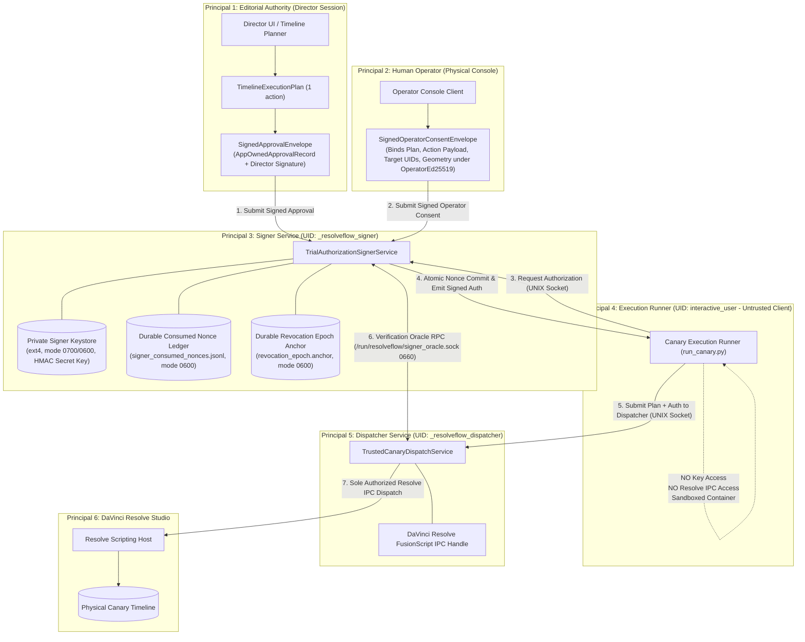
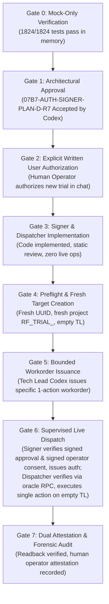

# Architectural Design Plan: Independent Trial Authorization Signing Workflow (G07-AUTH-SIGNER-PLAN-D)

**Document ID:** `07B7-AUTH-SIGNER-PLAN-D-R7` (Revision R7)  
**Parent Gate:** Gate G07 (Isolated Resolve Acceptance Gate — Strictly `OPEN`)  
**Workstream:** Post-Incident Trust-Boundary Remediation Planning  
**Status:** `DESIGN_ONLY_PLAN_PENDING_REVIEW`  
**Mode:** `DESIGN_ONLY; NO_SOURCE_OR_TEST_CHANGES; NO_LIVE_OPERATIONS`  
**Date:** `2026-11-03`  
**Target:** Independent, approval-grounded signing authority and isolated dispatcher boundary eliminating runner self-minting, verifier key leakage, and unauthenticated provenance.  
**Prior Gate 7 Incident Review Decision:** `ACCEPTED_FOR_INCIDENT_RECORD_ONLY` (`docs/architecture/07B7-LIVE-GATE7-R1-code-review.md`, SHA-256: `4e80be4441c2666fcab9d5daa4463ba9d85cb1b1e9d61c7575f870e2211f2e78`)  
**Prior Gate 6 Live Dispatch Decision:** `CHANGES_REQUIRED` / `NOT ACCEPTED` (`docs/architecture/07B7-LIVE-GATE6-code-review.md`)  
**Prior Static Review Decisions:**  
- Revision R1: `CHANGES_REQUIRED` (`docs/architecture/07B7-AUTH-SIGNER-PLAN-D-code-review.md`)  
- Revision R2: `CHANGES_REQUIRED` (`docs/architecture/07B7-AUTH-SIGNER-PLAN-D-R2-code-review.md`)  
- Revision R3: `CHANGES_REQUIRED` (`docs/architecture/07B7-AUTH-SIGNER-PLAN-D-R3-code-review.md`)  
- Revision R4: `CHANGES_REQUIRED` (`docs/architecture/07B7-AUTH-SIGNER-PLAN-D-R4-code-review.md`)  
- Revision R5: `CHANGES_REQUIRED` (`docs/architecture/07B7-AUTH-SIGNER-PLAN-D-R5-code-review.md`)  
- Revision R6: `CHANGES_REQUIRED` (`docs/architecture/07B7-AUTH-SIGNER-PLAN-D-R6-code-review.md`, SHA-256: `f81b711f8e38819fa7074221c027bf0f6bc27e2c00f923a223d5ec9e5ebdc0d8`)

---

## 1. Executive Summary & Incident Forensic Context

### 1.1. Context and Incident Diagnosis
During the execution of Gate 6 under Workorder `G07-07B7-LIVE`:
- Physical insertion was observed on DaVinci Resolve: 1 clip (`canary_test_1080p24.mp4`, 120 frames) was appended to Video Track 1 (`V1`) at record frame 86400 on timeline `RF_TRIAL_TL_9A56C835B97208ED` (UID: `e4e5a587-661d-4854-8f37-8a279d3f2ee1`) in project `RF_TRIAL_9A56C835B97208ED` (UID: `0ee71404-6405-47ca-89e1-aaeaac142398`).
- Readback receipt and WAL transition artifacts were written to disk.

However, the run **did not satisfy the complete 07B5 / Gate 6 acceptance contract** because its authority, isolation, and cleanup controls failed:
1. **`LIVE-G6-01` (Self-Minted Authority — Root Failure):** The execution runner script (`run_canary.py`) generated its own trial key and operator key locally, manufactured placeholder/constant approval and gesture digests, assembled authorization claims, and signed the HMAC using its own self-minted key.
2. **`LIVE-G6-02` (Dangerous Filesystem Operations):** The runner invoked `shutil.rmtree` on runtime directories, violating isolation boundaries.
3. **`LIVE-G6-03` (Keystore Permission Degradation):** Runtime keys were staged on a `fuseblk` NTFS mount with `0777` permissions, violating POSIX DAC requirements.

Under the ruling of Tech Lead Codex:
- Gate 6 was designated **`NOT ACCEPTED`**.
- The run and its physical timeline mutation are classified **permanently as an immutable, unaccepted incident-only forensic record**.
- Nothing in this design plan retroactively validates, cures, or accepts Gate 6. Gate G07 and Milestones M1, M2, and M3 remain strictly **`OPEN`** with `ready_to_execute = False`.

### 1.2. Design Objective for Revision R7
This document specifies the architectural remediation required before any future canary lifecycle can be authorized. It resolves the two remaining findings from Codex review R6 (`07B7-AUTH-SIGNER-PLAN-D-R6-code-review.md`):
1. **Unambiguous 9-Field Revocation Signature Contract & Pinned Issuer (`AUTH-SIGNER-R6-01`):** Formally defines the exact 9 canonical fields covered by `manifest_signature` (including `issuer_id`), specifies pinned `issuer_id == "security_officer_root"` lookup, 128-hex Ed25519 signature format, and replaces ambiguous sample signatures with non-parseable placeholders. Adds negative tests for issuer substitution, missing fields, and unknown claims.
2. **Strict Verification-Instant Challenge Expiry Enforcement (`AUTH-SIGNER-R6-02`):** Mandates that the challenge must remain strictly active and unexpired at the exact moment of verification: `now_utc <= challenge.expires_at_utc`. Precludes delayed submission of gestures signed near expiry, enforces atomic challenge consumption on issuance, ensures expired challenges are purged, and adds boundary negative test fixture `FIX-NEG-08`.

---

## 2. Principals and Trust Boundary Architecture

### 2.1. Principal Decomposition with Kernel-Enforced Boundaries



### 2.2. OS Identity Separation, Runtime Directory DAC & Oracle Protocol
1. **Three Distinct OS Identities:**
   - **`_resolveflow_signer` UID/GID:**
     - Owns `/var/lib/resolveflow/signer/keystore/` (mode `0700`). Holds secret HMAC key (`trial_auth.key`, mode `0600`).
     - **Zero DaVinci Resolve IPC access:** No permission to access Resolve socket or load scripting libraries.
   - **`_resolveflow_dispatcher` UID/GID:**
     - Exclusively owns DaVinci Resolve scripting connection (`fusionscript`).
     - **Zero HMAC key access:** Inaccessible `/var/lib/resolveflow/signer/` (`EACCES`).
   - **`interactive_user` UID/GID (Runner):**
     - Runs `run_canary.py`. 0 keys, 0 Resolve IPC access.
2. **Parent Runtime Directory & Socket Permissions:**
   - **Directory Path:** `/run/resolveflow/`
     - Ownership: `_resolveflow_signer:_resolveflow_dispatcher`
     - Mode: **`0750`** (`rwxr-x---`)
     - Owner `_resolveflow_signer` has `rwx` (read, write, execute/traverse).
     - Group `_resolveflow_dispatcher` has `r-x` (read and execute/traverse, **zero write permission**, preventing file substitution, deletion, or symlink tampering).
     - Others have `---` (untrusted runner receives `EACCES` upon attempting directory traversal).
   - **Oracle Socket Path:** `/run/resolveflow/signer_oracle.sock`
     - Ownership: `_resolveflow_signer:_resolveflow_dispatcher`
     - Mode: **`0660`** (`rw-rw----`)
     - Signer has read/write; Dispatcher has read/write.
   - **Pre-Connect Verification by Dispatcher:**
     Before connecting to the socket, Dispatcher executes `stat()` and `fstat()`:
     - Confirms `/run/resolveflow` is owned by `_resolveflow_signer:_resolveflow_dispatcher` with mode `0750`.
     - Confirms `/run/resolveflow/signer_oracle.sock` is a UNIX domain socket (`S_ISSOCK`), not a symlink (`O_NOFOLLOW`), owned by `_resolveflow_signer:_resolveflow_dispatcher` with mode `0660`.
     - Any permission anomaly or unexpected ownership fails closed immediately.
3. **Strict Verification Oracle RPC Protocol Contract:**
   - **Framing:** Length-prefixed RFC 8785 canonical JSON bytes over UNIX domain socket.
   - **Request Schema (`OracleVerificationRequest`):**
     ```python
     @dataclass(frozen=True)
     class OracleVerificationRequest:
         request_id: str                      # UUIDv4
         request_nonce: str                   # 32-byte hex random nonce
         requested_at_iso: str                # UTC ISO-8601 timestamp
         signed_authorization: TrialExecutionAuthorization  # The 32 claims + HMAC
         action_payload_digest_sha256: str    # Recomputed by Dispatcher from plan
         target_project_uid: str              # Target Resolve project UID
         target_timeline_uid: str             # Target Resolve timeline UID
     ```
   - **Signer Oracle Evaluation Gates:**
     The Signer strictly evaluates:
     1. Constant-time HMAC comparison using `_resolveflow_signer` secret key:
        `hmac.compare_digest(calc_hmac, auth.authorization_hmac)`
     2. Validates validity window: `now <= auth.valid_until_iso`.
     3. Checks authoritative revocation registry (`revocations.signed.json`).
     4. Verifies `req.action_payload_digest_sha256 == auth.action_payload_digest_sha256`.
     5. Verifies **BOTH** target UIDs:
        `req.target_project_uid == auth.target_project_uid` AND  
        `req.target_timeline_uid == auth.target_timeline_uid`.
   - **Response Schema (`OracleVerificationResponse`):**
     ```python
     @dataclass(frozen=True)
     class OracleVerificationResponse:
         response_id: str                     # UUIDv4
         request_id: str                      # Echoes request_id
         request_nonce: str                   # Echoes fresh request_nonce
         authorization_digest_sha256: str     # SHA-256 of 32 claims canonical bytes
         action_payload_digest_sha256: str    # Verified payload digest
         target_project_uid: str              # Verified project UID
         target_timeline_uid: str             # Verified timeline UID
         verification_result: str             # Strictly "VERIFIED_VALID" or "VERIFICATION_FAILED"
         is_valid: bool                       # Strictly True on success; False on failure
         reason_code: str                     # "OK" on success; error code on failure
         verified_at_iso: str                 # Instant of verification
         valid_until_iso: str                 # verified_at + 60s
         oracle_signature: str                # 128-hex Ed25519 signature by Signer Oracle Key
     ```
   - **Dispatcher Strict Acceptance Invariant:**
     The Dispatcher **FAILS CLOSED** and refuses dispatch unless ALL of the following conditions evaluate to `True`:
     1. `response.oracle_signature` is cryptographically valid against `signer_oracle_pubkey.pem`.
     2. `response.is_valid is True`.
     3. `response.verification_result == "VERIFIED_VALID"`.
     4. `response.reason_code == "OK"`.
     5. `response.request_id == pending_request.request_id`.
     6. `response.request_nonce == pending_request.request_nonce`.
     7. `response.authorization_digest_sha256 == computed_auth_digest`.
     8. `response.action_payload_digest_sha256 == recomputed_action_payload_digest`.
     9. `response.target_project_uid == pending_request.target_project_uid`.
     10. `response.target_timeline_uid == pending_request.target_timeline_uid`.
     11. Bounded UTC freshness: $0 \le (\text{now} - \text{verified\_at\_iso}) \le 60\text{s}$ and $\text{now} \le \text{valid\_until\_iso}$.
     If any check fails, the Dispatcher records a security fault and executes ZERO DaVinci Resolve IPC calls.

---

## 3. Independently Authenticated Operator Consent Channel (`AUTH-SIGNER-R6-02`)

### 3.1. Contract: `SignedOperatorConsentEnvelope`
- **Location:** `src/core/contracts/signed_operator_consent_envelope.py`
- **Schema:**
  ```python
  @dataclass(frozen=True)
  class SignedOperatorConsentEnvelope:
      schema_version: int                       # Strictly 1
      operator_id: str                          # Human operator user identifier
      challenge_id: str                         # Cryptographic challenge token
      client_nonce: str                         # UUIDv4 nonce
      confirmation_phrase: str                  # Strictly 'CONFIRM_CANARY_TRIAL_EXECUTION'
      consent_timestamp_iso: str                # UTC ISO-8601 timestamp
      freshness_attestation: str                # 'OPERATOR_VISUAL_ATTESTATION_EMPTY_TIMELINE_VERIFIED'
      
      # Complete Action & Target Binding
      approval_envelope_digest_sha256: str      # SHA-256 of SignedApprovalEnvelope
      plan_digest_sha256: str                   # SHA-256 of TimelineExecutionPlan
      action_payload_digest_sha256: str         # SHA-256 of 16-key canonical action payload
      target_project_name: str                  # Fresh project name (e.g. RF_TRIAL_CANARY_P02)
      target_project_uid: str                   # Fresh project UUID
      target_timeline_name: str                 # Fresh timeline name (e.g. RF_TRIAL_TL_CANARY_T02)
      target_timeline_uid: str                  # Fresh timeline UUID
      source_file_path: str                     # Absolute path to canary media
      source_file_sha256: str                   # SHA-256 digest of canary media bytes
      action_type: str                          # Strictly 'INSERT_CLIP'
      track_type: str                           # Strictly 'video'
      track_index: int                          # Strictly 1
      record_frame: int                         # Strictly 86400 (or observed start frame)
      duration_frames: int                      # Strictly 120
      
      # Signature Member
      operator_key_id: str                      # Key identifier for Operator key
      operator_signature: str                   # 128-hex Ed25519 signature
  ```

### 3.2. Exhaustive Signer Validation Gate (20 Checks + Verification-Instant Expiry) (`AUTH-SIGNER-R6-02`)
Before accepting `SignedOperatorConsentEnvelope` and issuing authorization, the Signer enforces 20 strict validation checks:
1. **Verification-Instant & Challenge Expiry Window (`AUTH-SIGNER-R6-02`):**
   - Active challenge must exist in memory: `challenge = active_challenges.get(env.challenge_id)`.
   - Challenge must not be marked consumed or expired.
   - Parse `now_dt = datetime.now(timezone.utc)`.
   - Parse `chal_exp_dt = parse_iso_utc_timestamp(challenge.expires_at_iso)`.
   - **Crucial Invariant:** $\text{now\_dt} \le \text{chal\_exp\_dt}$. If current verification time is past challenge expiration, fail closed immediately:
     `raise SignerConsentMismatchError("ERR_CHALLENGE_EXPIRED_AT_VERIFICATION")`.
   - Signed timestamp bounds: `challenge.issued_at_iso <= env.consent_timestamp_iso <= challenge.expires_at_iso`.
2. **Bounded Freshness & Clock Skew Gate:**
   - Parse `consent_dt = parse_iso_utc_timestamp(env.consent_timestamp_iso)`.
   - Calculate $\Delta t = \text{now\_dt} - \text{consent\_dt}$.
   - Must satisfy: $-5\text{s} \le \Delta t \le 120\text{s}$.
   - Rejects future timestamps ($\Delta t < -5\text{s}$) with `ERR_CONSENT_FUTURE_TIMESTAMP`.
   - Rejects stale timestamps ($\Delta t > 120\text{s}$) with `ERR_CONSENT_EXPIRED`.
3. **Operator Identity & Key Binding:**
   - `env.operator_id == authoritative_operator_id`.
   - `env.operator_key_id == active_operator_key_id`.
4. **Signature Verification:**
   - Canonical RFC 8785 bytes of the envelope (excluding `operator_signature`) verified against `operator_pubkey.pem`.
5. **Exact String Literals:**
   - `env.confirmation_phrase == "CONFIRM_CANARY_TRIAL_EXECUTION"`.
   - `env.freshness_attestation == "OPERATOR_VISUAL_ATTESTATION_EMPTY_TIMELINE_VERIFIED"`.
6. **Challenge Nonce Equality:**
   - `env.client_nonce == challenge.client_nonce`.
7. **Approval Envelope Binding:**
   - `env.approval_envelope_digest_sha256 == computed_approval_envelope_digest`.
8. **Plan Digest Binding:**
   - `env.plan_digest_sha256 == computed_plan_digest`.
9. **Action Payload Digest Binding:**
   - `env.action_payload_digest_sha256 == computed_action_payload_digest`.
10. **Target Project Name Equality:**
    - `env.target_project_name == pending_req.target_project_name`.
11. **Target Project UID Equality:**
    - `env.target_project_uid == pending_req.target_project_uid`.
12. **Target Timeline Name Equality:**
    - `env.target_timeline_name == pending_req.target_timeline_name`.
13. **Target Timeline UID Equality:**
    - `env.target_timeline_uid == pending_req.target_timeline_uid`.
14. **Source Media File Path Equality:**
    - `env.source_file_path == pending_req.source_file_path`.
15. **Source Media SHA-256 Equality:**
    - `env.source_file_sha256 == pending_req.source_file_sha256`.
16. **Action Type Equality:**
    - `env.action_type == "INSERT_CLIP"`.
17. **Track Type Equality:**
    - `env.track_type == "video"`.
18. **Track Index Equality:**
    - `env.track_index == 1`.
19. **Record Frame Equality:**
    - `env.record_frame == pending_req.record_frame`.
20. **Duration Frames Equality:**
    - `env.duration_frames == 120`.

### 3.3. Atomic Challenge Invalidation & Negative Acceptance Test Fixtures
- **Atomic Invalidation:** Upon successful verification, the challenge is atomically consumed into `signer_consumed_nonces.jsonl` with `fsync` before the authorization is emitted. Expired challenges are swept from memory and never restored on restart.
- **Negative Fixtures:**
| Fixture ID | Injected Fault | Expected Result | Reason Code |
|---|---|---|---|
| `FIX-NEG-01` | Future timestamp ($\Delta t = -15\text{s}$) | **REJECTED** | `ERR_CONSENT_FUTURE_TIMESTAMP` |
| `FIX-NEG-02` | Expired timestamp ($\Delta t = 135\text{s}$) | **REJECTED** | `ERR_CONSENT_EXPIRED` |
| `FIX-NEG-03` | Altered `source_file_path` | **REJECTED** | `ERR_CONSENT_MUTATION_MISMATCH` |
| `FIX-NEG-04` | Altered `target_timeline_name` | **REJECTED** | `ERR_CONSENT_MUTATION_MISMATCH` |
| `FIX-NEG-05` | Altered `track_index` (2 instead of 1) | **REJECTED** | `ERR_CONSENT_MUTATION_MISMATCH` |
| `FIX-NEG-06` | Wrong `operator_key_id` | **REJECTED** | `ERR_CONSENT_KEY_MISMATCH` |
| `FIX-NEG-07` | Replayed `challenge_id` | **REJECTED** | `ERR_SIGNER_NONCE_ALREADY_CONSUMED` |
| `FIX-NEG-08` | Verification after challenge expiry instant ($\text{now} > \text{challenge.expires\_at}$) | **REJECTED** | `ERR_CHALLENGE_EXPIRED_AT_VERIFICATION` |

---

## 4. Signed Approval Envelope & Director Key Lifecycle

### 4.1. Contract: `SignedApprovalEnvelope`
- **Location:** `src/core/contracts/signed_approval_envelope.py`
- **Schema:**
  ```python
  @dataclass(frozen=True)
  class SignedApprovalEnvelope:
      schema_version: int                      # Strictly 1
      approval_record: AppOwnedApprovalRecord  # Frozen 6-field 07B5 contract object
      plan_digest_sha256: str                  # 64-hex RFC 8785 digest of TimelineExecutionPlan
      proposal_content_digest_sha256: str      # 64-hex RFC 8785 digest of proposal snapshot
      director_key_id: str                     # Identifier of Director signing key
      director_signature: str                  # 128-hex Ed25519 signature
      signed_at_iso: str                       # ISO 8601 UTC timestamp
  ```

### 4.2. Director Signing & Verification Protocol
1. **Director Ed25519 Keypair:**
   - Director environment holds `director_privkey.pem`.
   - Public key is provisioned at `/var/lib/resolveflow/signer/trusted_roots/director_pubkey.pem`.
2. **Canonical Signing Serialization:**
   $$\text{payload} = \{ \text{"approval\_record"}: \text{record\_dict}, \text{"director\_key\_id"}: \dots, \text{"plan\_digest\_sha256"}: \dots, \dots \}$$
   $$\text{director\_signature} = \text{Ed25519\_Sign}(\text{director\_privkey}, \text{RFC8785\_Canonical\_JSON}(\text{payload}))$$
3. **Signer Verification Gate:**
   - Signer reads envelope, recomputes plan digest from raw plan bytes, recomputes proposal digest from authoritative proposal snapshot, and verifies `director_signature` using `director_pubkey.pem`.
   - Mismatches or unverified signatures fail closed (`ERR_APPROVAL_DIRECTOR_SIGNATURE_INVALID`).

---

## 5. Atomic Nonce Ledger Creation & Singleton Concurrency Control

### 5.1. Atomic Descriptor Open Protocol (Zero Path Pre-Checks)
```python
dir_fd = os.open("/var/lib/resolveflow/signer/keystore", os.O_RDONLY | os.O_DIRECTORY | os.O_CLOEXEC)
try:
    fd = os.open(
        "signer_consumed_nonces.jsonl",
        os.O_RDWR | os.O_CREAT | os.O_APPEND | os.O_NOFOLLOW | os.O_CLOEXEC,
        0o600,
        dir_fd=dir_fd
    )
    st = os.fstat(fd)
    if st.st_size == 0:
        os.fsync(dir_fd)
finally:
    os.close(dir_fd)
```

### 5.2. Durable OS Singleton Lock
- The Signer acquires an exclusive non-blocking lock on:
  `/var/lib/resolveflow/signer/keystore/signer_service.singleton.lock`.
- `fcntl.flock(lock_fd, fcntl.LOCK_EX | fcntl.LOCK_NB)`.
- If another instance holds the lock: `raise SignerConcurrencyError("ERR_SIGNER_PROCESS_ALREADY_ACTIVE")`.

### 5.3. Inter-Process Append & Re-Read Under File Lock
Before emitting an authorization:
1. `fcntl.flock(fd, fcntl.LOCK_EX)`.
2. **Re-Read under lock:** Read all bytes from last known offset to end of file; parse lines into `in_memory_index`.
3. Check collisions on `challenge_id`, `client_nonce`, or `(approval_record_id, proposal_revision)`. If collision: fail closed (`ERR_SIGNER_NONCE_ALREADY_CONSUMED`).
4. Write-all loop with `EINTR` retry; format compact JSON strictly ending with `\n`.
5. `os.fsync(fd)`.
6. `fcntl.flock(fd, fcntl.LOCK_UN)`.

### 5.4. Fail-Closed Torn-Tail Handling
Upon startup, Signer scans `signer_consumed_nonces.jsonl`:
- Every line must terminate in `\n` and parse as valid JSON.
- If an incomplete line or torn tail is detected:
  `raise SignerLedgerCorruptionError("ERR_SIGNER_LEDGER_TORN_TAIL_DETECTED")`.
- The Signer **never** silently truncates or skips. Startup is halted until administrative resolution.

---

## 6. Complete Signed Revocation Contract & Key Lifecycle (`AUTH-SIGNER-R6-01`)

### 6.1. Signed Revocation Manifest Schema & Pinned Issuer Lookup
- **Path:** `/var/lib/resolveflow/signer/keystore/revocations.signed.json`
- **Exhaustive Schema (Exactly 9 Non-Signature Fields + 1 Signature Field):**
  ```json
  {
    "manifest_version": 1,
    "epoch": 105,
    "issued_at_iso": "2026-11-03T15:00:00Z",
    "valid_until_iso": "2026-11-04T15:00:00Z",
    "revoked_trial_key_ids": [
      "canary_live_key_01"
    ],
    "revoked_director_key_ids": [
      "director_key_compromised_01"
    ],
    "revoked_operator_key_ids": [
      "operator_key_compromised_01"
    ],
    "revoked_authorization_ids": [
      "auth_9a56c835b97208ed"
    ],
    "issuer_id": "security_officer_root",
    "manifest_signature": "00000000000000000000000000000000000000000000000000000000000000000000000000000000000000000000000000000000000000000000000000000000_NON_RUNNABLE_PLACEHOLDER_ED25519_128_HEX_CHARS"
  }
  ```
- **Exact 9 Canonical Claims Covered by Signature:**
  The canonical payload serialized per RFC 8785 covers **strictly and completely all 9 non-signature claims** in alphabetical order:
  1. `epoch` [int, >= 1]
  2. `issued_at_iso` [str, UTC ISO-8601]
  3. `issuer_id` [str, strictly matching pinned authority ID]
  4. `manifest_version` [int, strictly 1]
  5. `revoked_authorization_ids` [list of unique str]
  6. `revoked_director_key_ids` [list of unique str]
  7. `revoked_operator_key_ids` [list of unique str]
  8. `revoked_trial_key_ids` [list of unique str]
  9. `valid_until_iso` [str, UTC ISO-8601 strictly after issued_at_iso]
- **Pinned Issuer Authority:**
  - `manifest["issuer_id"]` must strictly equal `"security_officer_root"`.
  - The public key is pinned at `/var/lib/resolveflow/signer/trusted_roots/sec_officer_pubkey.pem`.
  - Any manifest presenting an unknown or substituted `issuer_id` fails closed (`ERR_REVOCATION_UNKNOWN_ISSUER`).
- **Signature Member:**
  - `manifest_signature`: Exactly 128 hexadecimal characters representing a 64-byte Ed25519 digital signature.
- **Explicit Expiry:**
  - If $\text{now}_{\text{UTC}} > \text{valid\_until\_iso}$, fails closed (`ERR_REVOCATION_REGISTRY_EXPIRED`).

### 6.2. Digest-Bound Durable Local Epoch Anchor (`revocation_epoch.anchor`)
1. **Anchor Format:** Stores both the highest observed epoch AND the exact SHA-256 digest of the canonical RFC 8785 bytes of the 9 manifest claims:
   ```
   105:7f83b1657ff1fc53b92dc18148a1d65dfc2d4b1fa3d677284addd200126d9069
   ```
2. **Anchor Evaluation Rules:**
   - **Case 1 ($\text{manifest.epoch} < \text{anchored\_epoch}$):** Immediate rollback rejection: `ERR_REVOCATION_ROLLBACK_DETECTED`.
   - **Case 2 ($\text{manifest.epoch} == \text{anchored\_epoch}$):**
     - Computes $\text{current\_digest} = \text{SHA-256}(\text{canon\_9\_claims\_bytes})$.
     - Must satisfy: $\text{current\_digest} == \text{anchored\_manifest\_sha256}$.
     - If digests differ: **Immediate tamper rejection** (`ERR_REVOCATION_SAME_EPOCH_TAMPERING`).
   - **Case 3 ($\text{manifest.epoch} > \text{anchored\_epoch}$):**
     - Verify signature against pinned Security Officer public key.
     - Verify $\text{now} \le \text{valid\_until\_iso}$.
     - Write new line `<new_epoch>:<new_digest>` to `revocation_epoch.tmp`.
     - `os.fsync` on temporary file.
     - `os.replace("revocation_epoch.tmp", "revocation_epoch.anchor")`.
     - `os.fsync` on parent directory descriptor.
3. **Bootstrap Semantics:** On initial deployment:
   - Manifest signature verified against pinned key; expiry checked.
   - Initial anchor file is created atomically with `O_CREAT | O_EXCL` and directory fsync.

### 6.3. Descriptor-Anchored Fresh Read
- Always re-open `revocations.signed.json` afresh via `openat(dir_fd, "revocations.signed.json", O_RDONLY | O_NOFOLLOW | O_CLOEXEC)`.
- Never rely on long-lived open file descriptors.
- Fail closed if registry is missing, expired, rolled back, or unverified.

---

## 7. Authoritative Incident Target Blacklist & Verification Fixtures

### 7.1. Authoritative Incident Identifiers
```python
INCIDENT_TARGET_PROJECT_UID = "0ee71404-6405-47ca-89e1-aaeaac142398"
INCIDENT_TARGET_TIMELINE_UID = "e4e5a587-661d-4854-8f37-8a279d3f2ee1"
INCIDENT_TARGET_PROJECT_NAME = "RF_TRIAL_9A56C835B97208ED"
INCIDENT_TARGET_TIMELINE_NAME = "RF_TRIAL_TL_9A56C835B97208ED"
INCIDENT_MUTATED_ITEM_UID = "d1590073-a215-4b7f-915a-7d00fa727278"
```

### 7.2. Active Blacklist Enforcement & Acceptance Fixtures
Both Signer and Dispatcher enforce:
```python
def enforce_target_blacklist(proj_name: str, proj_uid: str, tl_name: str, tl_uid: str) -> None:
    if proj_uid.strip().lower() == INCIDENT_TARGET_PROJECT_UID.lower():
        raise TargetBlacklistViolationError("ERR_TARGET_PROJECT_UID_BLACKLISTED")
    if tl_uid.strip().lower() == INCIDENT_TARGET_TIMELINE_UID.lower():
        raise TargetBlacklistViolationError("ERR_TARGET_TIMELINE_UID_BLACKLISTED")
    if proj_name.strip() == INCIDENT_TARGET_PROJECT_NAME:
        raise TargetBlacklistViolationError("ERR_TARGET_PROJECT_NAME_BLACKLISTED")
    if tl_name.strip() == INCIDENT_TARGET_TIMELINE_NAME:
        raise TargetBlacklistViolationError("ERR_TARGET_TIMELINE_NAME_BLACKLISTED")
```
- Rejection guaranteed even if the incident project or timeline is renamed.

---

## 8. Canonical Claims & Cryptographic Serialization (RFC 8785)

Preserves all 32 HMAC-covered claims and 16 action payload keys defined in 07B5 §2.6 without drift:

### 8.1. Exact 32 Signed Claims
```
 1. authorization_id                   [str, UUIDv4/hex generated by Signer]
 2. key_id                             [str, non-empty, matching active key]
 3. operator_gesture_digest_sha256     [str, 64-hex canonical digest of SignedOperatorConsentEnvelope]
 4. approval_record_id                 [str, non-empty verified against Director signature]
 5. approval_record_digest_sha256      [str, 64-hex RFC 8785 digest of approval record]
 6. proposal_id                        [str, non-empty matching approved proposal]
 7. proposal_revision                  [str, canonical integer string]
 8. proposal_content_digest_sha256     [str, 64-hex matching proposal snapshot]
 9. plan_idempotency_key               [str, non-empty from approved TimelineExecutionPlan]
10. plan_digest_sha256                 [str, 64-hex RFC 8785 digest of TimelineExecutionPlan]
11. action_payload_digest_sha256       [str, 64-hex canonical digest of 16-key action payload]
12. target_project_uid                 [str, fresh Resolve project UUID != 0ee71404...]
13. target_project_name                [str, fresh project name != RF_TRIAL_9A56C835B97208ED]
14. target_timeline_uid                [str, fresh Resolve timeline UUID != e4e5a587...]
15. target_timeline_name               [str, fresh timeline name != RF_TRIAL_TL_9A56C835B97208ED]
16. target_timeline_fps_numerator      [int, >= 1]
17. target_timeline_fps_denominator    [int, >= 1]
18. observed_timeline_start_frame      [int, >= 0]
19. authorized_record_frame            [int, == observed_timeline_start_frame]
20. source_file_path                   [str, absolute path to local regular file]
21. source_file_sha256                 [str, 64-hex digest of source media bytes]
22. authorized_action_type             [str, strictly 'INSERT_CLIP']
23. authorized_track_type              [str, strictly 'video']
24. authorized_track_index             [int, strictly 1]
25. authorized_timeline_frame_start    [int, strictly 0]
26. authorized_timeline_frame_duration [int, strictly 120]
27. authorized_source_frame_start      [int, strictly 0]
28. authorized_source_frame_duration   [int, strictly 120]
29. execution_id                       [str, single-use execution nonce]
30. issued_at_iso                      [str, ISO 8601 UTC timestamp]
31. valid_until_iso                    [str, ISO 8601 UTC timestamp, issued + 300s max]
32. token_nonce                        [str, single-use cryptographic nonce == execution_id]
```
$$\text{canon\_bytes} = \text{canonical\_bytes\_for\_auth\_hmac}(\text{auth\_32\_fields})$$
$$\text{authorization\_hmac} = \text{HMAC-SHA256}(\text{key\_bytes}, \text{canon\_bytes}).\text{hexdigest}()$$

---

## 9. Future Canary Execution Lifecycle (8-Gate Sequence)

Under the ruling of Tech Lead Codex:
- The previous canary run on `RF_TRIAL_9A56C835B97208ED` is permanently an **immutable incident-only record**. Gate 6 remains `NOT ACCEPTED`.
- Any future canary execution requires an entirely fresh lifecycle across all 8 gates:



| Gate | Phase Name | Execution Requirement for New Run |
|---|---|---|
| **Gate 0** | Mock-Only Verification | Verify all unit and contract tests pass (1824/1824 tests) without live Resolve. |
| **Gate 1** | Architectural Approval | This plan (`07B7-AUTH-SIGNER-PLAN-D-R7`) reviewed and accepted by Tech Lead Codex. |
| **Gate 2** | User Authorization | Fresh explicit written authorization from human operator in chat specifying the new run. |
| **Gate 3** | Implementation Slices | Implement contracts, signer, dispatcher, operator console, store, and tests. |
| **Gate 4** | Preflight & Target Setup | Fresh Challenge Nonce; Create fresh Project `RF_TRIAL_<NEW_NONCE>` and empty Timeline. |
| **Gate 5** | Workorder Issuance | Bounded workorder issued by Tech Lead Codex for exactly 1 action. |
| **Gate 6** | Supervised Live Dispatch | Signer verifies signed approval and operator consent; Dispatcher verifies via oracle RPC and executes sole live action. |
| **Gate 7** | Dual Attestation & Audit | Physical readback verification, operator contemporaneous attestation, durable ledger closure. |

---

## 10. Implementation Proposal & Comprehensive File Allowlist (Design Only)

When authorized for future implementation, the following complete, bounded file set will be introduced:

### Proposed Modules & Contracts
1. `src/core/contracts/signed_approval_envelope.py`:
   - Data contract `SignedApprovalEnvelope` and canonical RFC 8785 serializer.
2. `src/core/contracts/signed_operator_consent_envelope.py`:
   - Data contract `SignedOperatorConsentEnvelope` and canonical RFC 8785 serializer.
3. `src/services/director_approval_signer.py`:
   - Director-side module that signs `SignedApprovalEnvelope` using `DirectorEd25519`.
4. `src/services/authoritative_approval_store.py`:
   - Authoritative store API and disk persistence for signed approvals under `_resolveflow_signer`.
5. `src/services/trial_authorization_signer_service.py`:
   - Signer service running under `_resolveflow_signer` UID.
   - Enforces Director signature verification, operator digital consent verification (all 20 checks + verification-instant expiry), durable nonce ledger with atomic open/flock/fsync, digest-bound epoch anchor revocation checks, and verification oracle RPC.
6. `src/services/trusted_canary_dispatch_service.py`:
   - Dispatcher service running under `_resolveflow_dispatcher` UID.
   - Exclusively owns DaVinci Resolve IPC handle (`fusionscript`).
   - Calls Signer verification oracle over socket `0660`; enforces 11-point acceptance invariant before executing dispatch; has zero possession of HMAC key.
7. `src/tools/resolveflow_operator_console.py`:
   - Interactive console tool for the human operator to view fresh targets and cryptographically sign gestures.

### Proposed Test Suites
1. `tests/core/contracts/test_signed_approval_envelope.py`:
   - Unit tests covering envelope validation, canonical bytes serialization, and schema budget.
2. `tests/core/contracts/test_signed_operator_consent_envelope.py`:
   - Unit tests covering consent envelope validation, complete mutation binding, and canonical serialization.
3. `tests/services/test_authoritative_approval_store.py`:
   - Unit tests for store persistence, retrieval, and immutable audit logs.
4. `tests/services/test_trial_authorization_signer_service.py`:
   - Unit tests covering Director signature verification, operator signature verification (all 20 checks + 8 negative fixtures), torn-tail recovery, nonce replay, digest-bound epoch anchor revocation checks (including 9-field canonical schema and pinned issuer verification), and incident target blacklist fixtures.
5. `tests/services/test_trusted_canary_dispatch_service.py`:
   - Unit tests covering verification oracle RPC, Dispatcher 11-point acceptance invariant, Resolve IPC isolation, and target exclusion gating.

### Prohibited Scope
- Zero source code or test file modifications during this design workorder.
- Zero DaVinci Resolve live calls, IPC, or UI operations.
- `ready_to_execute = False` strictly maintained.

---

## 11. Summary of Addressed Codex Findings (R6 -> R7)

| Review Finding | Severity | Resolution in Revision R7 |
|---|---|---|
| **`AUTH-SIGNER-R6-01`** | **BLOCKER** | Formally defined exact 9 canonical fields covered by `manifest_signature` (including `issuer_id`); pinned `issuer_id == "security_officer_root"`; specified 128-hex Ed25519 signature format; replaced ambiguous sample signature with non-parseable placeholder; added tests for unknown/missing claims and issuer substitution. |
| **`AUTH-SIGNER-R6-02`** | **HIGH** | Mandated verification-instant challenge expiry check: $\text{now\_dt} \le \text{challenge.expires\_at\_utc}$; precluded delayed submission of gestures signed near expiry; specified atomic challenge invalidation; added negative test fixture `FIX-NEG-08` for submission after challenge expiry instant. |
